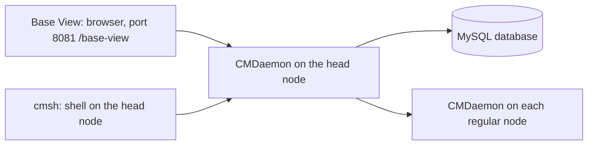

# 8.5 cmsh and Base View: administering the cluster

| | |
|---|---|
| Level | Beginner to intermediate |
| Priority tier | 1 |
| Lab venue | Laptop |
| Part | Part 8: NVIDIA Base Command Manager |
| Status | Drafted (`cmsh_lab.py`: 55 checks pass; cluster commands **untested** on live BCM) |

## Why this matters for AI infrastructure

Everything in chapters 8.3 and 8.4 was done through `cmsh` or Base View. Most real work on a cluster is repetition: the same change to 8 nodes, or 512, or one rack. cmsh is built for that, and its habits (commit, list a range, dry run) are what separate a calm change from an outage. In an interview, "show me how you would change a setting on a rack" is a cmsh question.

## Prerequisites and outcomes

You need chapters 8.1 to 8.4. After this chapter you can:

- choose between Base View and cmsh, and know they reach the same CMDaemon
- navigate cmsh modes and objects, and read the prompt, including the asterisks
- use the commit model safely (`modified`, `refresh`, `commit`)
- write node lists for a rack, a range, a stride, or an exclusion
- loop over many nodes with `foreach` and `range`, clone and rename nodes
- script cmsh and get JSON-like output
- inspect and restart CMDaemon, and say what it listens on

## 1. Two front ends, one daemon



Both talk to **CMDaemon on the head node**, never straight to the daemons on other nodes. For all management traffic, CMDaemon uses **SSL connections on TCP port 8081** (`SSLPort = 8081` in `cmd.conf`), and authenticates with client X509 certificates (chapters 8.1 and 8.6; non-SSL `Port = 8080` is used only during `init` / HTTP boot, see chapter 8.1). It keeps its data in a MySQL database on the head node. If CMDaemon stops, you lose management, but jobs run on: the workload manager is independent.

| | Base View | cmsh |
|---|---|---|
| What | Web GUI | Shell with modes and tab completion |
| Strength | Overview dashboards, discovery, one-off changes | Repeatable changes, scripts, bulk edits, exact commands in tickets |
| Reach it | `https://<head>:8081/base-view` | run `cmsh` on the head node |
| Caution | Changing many nodes is slow and hard to review | Typos act on many nodes at once |

The manual's browser table lists recent Chrome, Edge, Firefox and Safari versions; mobile browsers are not supported. The head node's plain landing page is served by Apache, and its certificate (default is a distribution self-signed one) is something you should replace. Base View is the `base-view` package; removing it turns the GUI off.

## 2. Base View in a few lines

- A **resource tree** on the left: Cluster, Networking, Provisioning, Grouping, Devices, Cloud, Containers and more. Selecting one opens its page.
- **Cluster > Overview** is the landing page: GPU, CPU and memory utilisation, job slots, device status counts (nodes, switches, NVLink switches, power shelves: closed, down, total, up), cores and GPUs, failing health checks, running and queued jobs, disk use, license information, and (for newer hardware) pages for leak detection, IMEX management and rack management.
- Two button types: one **opens an existing object**, the other (**+**) **creates a new one**. A **breadcrumb trail** at the top of each subwindow takes you back without saving.
- Every chapter of this part names the Base View path next to the cmsh command. They do the same thing.

## 3. cmsh: starting it

```bash
cmsh                      # interactive, on the head node
cmsh -c "device status node001; main showprofile"    # batch: commands separated by ;
echo "device status" | cmsh                          # piped
cmsh -f myscript.cmsh -q -x                          # run a file, quit on error, echo commands
```

Useful options from the manual's help: `-u` start unconnected, `-n` skip the rc file, `-x` echo, `-q` quit at the first error, `-Q` no quit confirmation, `--color=no`, `--hide-events` (hide events in an interactive session), `--disable-events` (for scripts; it works together with `--wait`), `-i`/`-k` alternative certificate and key.

**Start-up files.** `/etc/cmshrc` first, then your own dotfiles: `~/.cm/cmsh/.cmshrc`, `~/.cm/.cmshrc`, `~/.cmshrc`, where "the shortest path overrides". Put aliases and `groupingsyntax` there.

**Aliases.** Built in: `..` is exit, `/` is home, `?` is help, `ds` is `device status`, `ls` is `list`. Make your own with `alias lv device list virtualnode`, and `export > file` / `run file` to move them. Any script in `~/.cm/cmsh/` named `name.cmsh` becomes the alias `name`. Scripts take arguments with defaults: `device use ${1-node001}`.

## 4. Modes, objects and the prompt

cmsh groups functions in **modes** (device, category, network, partition, softwareimage, monitoring, user, and more; Appendix M shows the full tree). Inside a mode you work with **objects** (a device, a category). The prompt shows where you are:

```text
[basecm11]%                      top level
[basecm11->device]%              device mode
[basecm11->device[node001]]%     the object node001
[basecm11->device*[node001*]]%   uncommitted changes in the mode and in the object
```

- `path` prints a string that takes you back here (`home;device;use node001;`). Paste it after `cmsh -c`.
- One line can run a command in a mode without going there: `device status node001`. A semicolon **does** enter the mode: `device; status node001`.
- `home` goes to the top, `exit` goes up one level, `goto -` returns to where you came from. `bookmark` and `goto` save places.
- Prefix a command with `!` to run a shell command (`!hostname -f`); backticks substitute output; `>`, `>>` and `|` redirect.
- `ssh node001` (in device mode), `time ds node001`, and `watch -n 3 status -n node001,node002` do what they say.

## 5. The commit model: the habit that matters most

Changes in cmsh are **local until you commit**. The asterisks remind you. The commands, in plain words:

| Command | Meaning |
|---|---|
| `use X` | make X the current object |
| `add [type] name` | create an object **and drop into it** (device mode needs a type: `add physicalnode node100 10.141.0.100`) |
| `set prop value` / `get prop` | change / read a property (can name the object: `set node001 mac ...`) |
| `clear prop` | unset it (a MAC becomes `00:00:00:00:00:00`) |
| `append` / `removefrom` | edit a multi-valued property |
| `modified` | list objects with uncommitted changes: `+` new, `-` to be removed, blank changed |
| `refresh` | **undo local changes** |
| `commit` | send them to CMDaemon (`-w` waits for background work, such as cloning an image) |
| `remove X` | **propose** removal; it happens at `commit` (data is kept unless `-d`; image revisions need `-a`) |
| `clone A B` | copy an object; for a device, BCM guesses a new IP (see below) |
| `swap A B` | exchange the names of two objects (useful for two nodes swapped in a rack) |
| `usedby`, `validate` | what depends on it; check its properties |

**The safe routine:** make the change, run `modified`, read it, then `commit`. If it looks wrong, `refresh`. A `remove` followed by a forgotten `commit` leaves an asterisk, not a deletion; a `commit` executes pending removals **whichever mode it is run in**, even when the asterisk is not in the prompt (the lab tests this).

**Booleans** accept `yes`, `1`, `on`, `true` and `no`, `0`, `off`, `false`, in any case.

**Inherited values.** `get bootloaderprotocol` on a node shows `HTTP (mydefaultimage)` when the value comes from the category, which is a quick way to see where a value originates (chapter 8.1's rules).

**Cloning IP guesses.** The lab reproduces the manual's examples: cloning `node001` (10.141.0.1) to `node022..node024` gives `.22`, `.23`, `.24`. If the new names differ in digit count (`node02` from `node001`), the manual prints `Base name mismatch, IP settings will not be modified!` and the IPs duplicate until you use `--next-ip`. Cloning copies object settings, **not the software image data**, and not switch port settings. Always inspect the result.

## 6. Listing, formatting, JSON

- `list` shows objects. `list -f hostname:14,switchports:15,ip` picks columns and widths. `format` alone shows the current format and every valid field; `format -r` resets.
- Width rules: a number is fixed; `0` is the widest entry; `[10-14]` fits the text between 10 and 14 characters; longer text is cut with a `+` as the last character (`largenameforn+`). `sort type mac` sorts.
- `list --json` and `show --json` give whole objects as JSON. A different trick: `list -f hostname,ip,mac,status -d {}` turns the **selected columns** into JSON with the column names as keys; run `color off` first, or `cmsh --color=no -c "device; list -f hostname,ip -d {}"`.

## 7. Node lists: say which nodes, once

The same syntax works in `foreach`, `-n` options and most node-selecting commands:

| Form | Example | Means |
|---|---|---|
| ad hoc | `node001,node003,node005` | exactly these |
| sequence | `node001..node004` or `node00[1-4]` | four nodes |
| extended | `node[001-002]s[001-005]` | 10 names (all combinations) |
| rack style | `r[1-2]n[01-03]` | `r1n01 ... r2n03` |
| exclusion | `node001..node005,-node002..node003` | 001, 004, 005 |
| stride | `node00[1..7:2]` | 001, 003, 005, 007 |
| mixed | `node[001-100],-node[004-100:4]` | all except every fourth |
| from a file | `^/path/to/list` | one list per file |

You cannot mix square brackets and `..` in one argument. `groupingsyntax bracket|dot|auto` sets how lists are printed (auto reads both, prints dots). Group options are everywhere: `-n` nodes, `-g` group, `-c` category, `-r` rack, `-h` chassis, `-e` overlay, `-l` role, `-m` image, `-t` type, `-s` status, with `-u` union (the default) or `-i` intersection. **Check intersection or union before a risky command**: `-c gpu -r rack5` unions by default.

`cmsh_sim.expand_nodelist` and `format_nodelist` implement these forms.

## 8. Doing many things: `foreach`, `range`, `rename`

```text
foreach -n node001..node004 (set category gpu; get hostname)
foreach -c default --status UP (get ip)
foreach --clone node001 -n node022..node024 ()        # make 3 new nodes, then commit
```

- `foreach * (...)` loops over everything in the mode. `-v` prints a header per object. `--status UP` filters by state. `-q` stops at an unknown command.
- **Power commands are blocked inside `foreach` and `range`.** The manual shows `foreach -n node001 (power status)` refused with "This command is not allowed inside foreach/range ... Specify the node selection directly on the command instead", because loop timing can stack up power-on operations (a large power demand, and trouble for cloud instances). Write `power on -n node001..node016` instead (chapter 8.7). `foreach -v` prints a time-stamped header per object, handy for debugging.
- `range -n node[001-024]` is the modal version: later commands in the mode apply to the whole range, and the prompt shows `{...}`. Setting values inside submodes needs a semicolon on one line: `roles; assign slurmclient; commit`.
- **`rename`** renames in bulk. `rename node001..node003 test` gives `test1, test2, test3` (numbering restarts at 1 and pads to the count: ten nodes give `test01..test10`); `test%04d` sets the digits; `rename node[001-005] test0[1,2,5-7]` is an exact mapping (the sizes must match); `rename node[001-004] alice,bob,charlie,dave` is exact; `rename node[001-100:2] left[001-050]` takes every second node. Source names are sorted alphabetically first. Use `--dry-run`, then `commit`; `refresh` throws away the proposal (and any other pending change).

## 9. Cluster-wide settings: the `partition` mode

There is exactly one partition, called `base`, which stands for the whole physical cluster (cluster partitioning is a future idea in the manual). `partition use base; show` lists the global settings from chapter 8.3: cluster name, name servers, time servers, default category, burn configuration, and submodes for BMC, SNMP, SELinux and others.

## 10. CMDaemon from the shell

- `systemctl status cmd.service` (also stop/start/restart), and `pdsh -a "systemctl restart cmd; systemctl is-active cmd"` for all regular nodes that are up.
- `cmdaemonctl`: `full-status`, `debugon`, `debugoff`, `logconf`, `upgrade` (the database). Do not leave debug on; it costs performance.
- Configuration: `/cm/local/apps/cmd/etc/cmd.conf` on the head node (inside the image for regular nodes). `FrozenFile` and the other directives are in Appendix C (chapter 8.1).
- `cmsh` writes its history to `~/.cm/.cmshhistory` (use `history -t` for timestamps). `environment node001` shows the `CMD_*` variables that scripts get, and `-e` makes them exportable.

## 11. Habits that keep clusters safe

1. `modified` before every `commit`.
2. Select nodes with a **printed** list first: run `list` with the same selection options, check the count, then run the action.
3. Prefer `-c category` for permanent changes, `-n` for exceptions (chapter 8.1).
4. Put repeated procedures in `~/.cm/cmsh/*.cmsh` scripts and run them with `-f -q -x`.
5. Label changes: `set revision "ticket 1234"` is a free-text property on every object.
6. A dry run, where the command has one (`imageupdate`, `rename --dry-run`, `updatedevicepowerconfig --dry-run`).
7. Keep `--disable-events` for scripts so event noise does not hide output.

## 12. Common first mistakes

1. Forgetting `commit` and wondering why nothing changed.
2. Forgetting that `commit` also executes a pending `remove`.
3. A semicolon between mode and command when you meant a one-liner (or the reverse).
4. A node list that selects more than intended (union vs intersection).
5. Cloning nodes and trusting the guessed IP and MAC.
6. Trying to power nodes from inside `foreach` or `range` (refused); give the selection to the power command itself.
7. Mixing brackets and dots in one list.
8. Leaving CMDaemon in debug.
9. Editing the same object in Base View and cmsh at once.

### 12.1 Mastering `cmsh` for zero-mistake fleet operations

In a live production cluster, the difference between a junior administrator and a senior systems engineer shows up in the first thirty seconds of a `cmsh` session. Because a single `foreach` or `range` command in `cmsh` can modify or reboot five hundred GPU servers at once, disciplined operators follow a four-step rhythm on every interactive change: **Scope $\rightarrow$ Mutate $\rightarrow$ Audit (`modified`) $\rightarrow$ Commit**.

Let us trace how each step protects the cluster from fat-finger outages:

1. **Scope with a dry-run `list` first:** Whenever you combine selection filters—such as `-c gpu-nodes` (category), `-r rack05` (rack), `-g maintenance` (group), or `--status DOWN`—remember that `cmsh` defaults to **union (`-u`)**, not **intersection (`-i`)**. If you type `device power off -c gpu-nodes -r rack05` thinking it means *"only the GPU nodes located inside Rack 5,"* the union default actually selects **every GPU node in the entire data center PLUS every device in Rack 5**! If you want the intersection, you must pass `-i` explicitly (`-i -c gpu-nodes -r rack05`). Always run `device list -i -c gpu-nodes -r rack05` first, count the rows printed on screen, and only run the mutating command once the list matches your expectation.
2. **Mutate in local session memory and watch the prompt asterisks (`*`):** When you run `set`, `add`, `clear`, `append`, `removefrom`, or `remove`, nothing is sent to `CMDaemon` yet. Your edits sit in your local `cmsh` process, and the prompt changes from `[basecm11->device[node001]]%` to `[basecm11->device*[node001*]]%`. This local staging model lets you inspect derived values (`get`, `show`), check dependencies (`usedby`), and run object validation (`validate`) before touching live nodes.
3. **Audit every pending object with `modified` before typing `commit`:** Suppose ten minutes ago you ran `remove node042` while investigating a broken node, got distracted by a Slack message, navigated to `category use default`, changed a kernel parameter, and typed `commit`. Because `commit` flushes all pending modifications in the session (or mode hierarchy), that forgotten `remove node042` executes right alongside your kernel parameter change! Running `modified` before every `commit` prints a concise table of every object queued for creation (`+`), deletion (`-`), or modification (blank). If anything in `modified` surprises you, run `refresh` to discard the local changes cleanly and start fresh.
4. **Use `commit -w` when scripting image or clone operations:** Some commits trigger heavy asynchronous work on the head node—such as cloning a thirty-gigabyte software image (`clone default-image cuda12-test`) or regenerating an initrd ramdisk. In a batch script (`cmsh -f rollout.cmsh -q -x`), a plain `commit` returns immediately while the background copy is still running, causing the next line of your script to fail if it tries to modify the not-yet-finished image. Passing **`commit -w`** blocks until all background tasks spawned by that commit complete.

### 12.2 Scripting and exporting structured data from `cmsh` into Python and CI pipelines

While interactive `cmsh` is optimized for human tab-completion, Day-2 operations frequently need to extract cluster inventory, switch-port mappings, or job status into Python scripts, Ansible inventories, or monitoring checks. BCM provides three escalating ways to integrate `cmsh` with external automation:

1. **Formatted JSON column projections (`list -f ... -d {}`):** When you only need specific fields across hundreds of devices, `list --json` can be verbose because it serializes every property of every object. Instead, combine `-f` (field selection) with `-d {}` (JSON dictionary delimiter) and `--color=no`:
   ```bash
   cmsh --color=no -c "device; list -f hostname,ip,mac,category,status -d {}"
   ```
   This emits clean JSON objects containing only the five requested keys, ready to pipe directly into `jq` or `python3 -c "import sys, json; ..."`.
2. **Idempotent `.cmsh` scripts (`-f -q -x --disable-events`):** For repeatable cluster-setup procedures—such as creating four networks, six categories, and ten Slurm queues on a new test cluster—store the commands in a version-controlled `.cmsh` file and execute it with `cmsh -f setup.cmsh -q -x --disable-events`. The `-q` flag ensures the script halts on the very first syntax or validation error rather than ploughing ahead and committing a half-configured object, `-x` echoes each command for the CI log, and `--disable-events` suppresses asynchronous cluster event banners from interleaving with your script's stdout.
3. **Custom parameterized aliases in `~/.cm/cmsh/`:** Any script placed in `~/.cm/cmsh/<name>.cmsh` automatically becomes a callable command `<name>` inside interactive `cmsh` sessions, supporting positional parameter expansion with defaults (`${1-node001}`). Teams commonly place read-only diagnostic macros—such as a `rackcheck.cmsh` script that prints `status`, `ipaddresses --check`, `bmceventlog --tail 5`, and `roles; list -p` for a given rack—into `/etc/cmshrc` or shared dotfiles so every on-call engineer has the same one-word triage commands at their fingertips.

### 12.3 Diagnosing and recovering `CMDaemon` (`cmd.service`) on the head node

Because both `cmsh` and Base View are thin clients talking over TLS port `8081` to `CMDaemon` on the head node, what happens if `cmsh` hangs on startup or prints `Unable to connect to 127.0.0.1:8081`?

First, reassure your stakeholders: **a stopped or restarting `CMDaemon` on the head node does not kill running Slurm or Kubernetes jobs**. Compute nodes continue executing their active training steps, `slurmctld` and `kube-apiserver` keep running, and NFS mounts stay up. What pauses while `cmd.service` is down is cluster management: new nodes cannot PXE-provision, `cmsh` and Base View cannot connect, and BCM health triggers pause.

To diagnose `cmd.service` on the head node, follow a strict four-step sequence:
1. **Check service and MySQL health first:** Run `systemctl status cmd.service` and `systemctl status mysql.service` (or `mariadb.service`). Because `CMDaemon` stores all object state in MySQL, `cmd.service` will refuse to start if MySQL is down, if `/var` is `100%` full (`df -h /var`), or if the BCM license has expired (`verify-license verify` and `/var/log/cmdaemon`).
2. **Inspect `cmdaemonctl full-status`:** When `cmd` is running but sluggish, `cmdaemonctl full-status` reports active client sessions, worker thread utilization, and request rates—immediately revealing if a runaway script opened hundreds of concurrent `cmsh` processes in a shell loop.
3. **Check `/var/log/cmdaemon` and turn off stray debug logging:** If someone ran `cmdaemonctl debugon` during an earlier investigation and forgot to run `cmdaemonctl debugoff`, verbose debug trace logging can fill `/var/log/cmdaemon` at gigabytes per hour and stall worker threads on disk I/O.
4. **Verify daemon version alignment across the fleet:** After any head-node package update, run `cmsh -c "device; cmdaemonversions"` to confirm that the head node and all regular nodes are running compatible `CMDaemon` builds.

### 12.4 Side-by-side translation: Common cluster tasks in Base View vs `cmsh`

Even if you perform ninety percent of your daily engineering work in `cmsh`, knowing how the exact same operations map to Base View helps when training new operators or walking executives and auditors through live cluster dashboards. Every view in the web UI reads and writes the same `CMDaemon` objects over TCP port `8081`:

| Operational Task | `cmsh` Command Sequence | Base View Navigation Path |
|---|---|---|
| **Check overall cluster & rack health** | `device; status` / `rackoverview` / `healthoverview` | **Cluster > Overview** (or **Devices > Racks**) |
| **Inspect or edit global cluster settings** | `partition use base; show` | **Cluster > Settings** |
| **Create or clone a node category** | `category; clone default gpu-h100; commit` | **Grouping > Categories > `+` (or Clone)** |
| **Move a rack of nodes into a category** | `device; foreach -r rack03 (set category gpu-h100); commit` | **Devices > Nodes** (multi-select rows $\rightarrow$ Edit $\rightarrow$ Category) |
| **Inspect role priorities on a node** | `device use node001; roles; list -p` | **Devices > All Devices > `node001` > Settings > Roles** |
| **Check or stage BIOS attributes** | `device use node001; biossettings; status` / `bios apply` | **Devices > All Devices > `node001` > BIOS** |
| **Watch live metrics and health graphs** | `monitoring; samplenow node001` / `latesthealthdata` | Top-right **Monitoring** icon $\rightarrow$ **Critical Services** |
| **Hold, release, or inspect a WLM job** | `wlm; jobs; list` / `info <id>` / `hold <id>` | Top-right **HPC** icon $\rightarrow$ **Jobs** (`..` action menu) |

Notice why experienced teams avoid making concurrent edits to the same object in Base View and `cmsh` at the same time: whichever session commits second overwrites the properties committed by the first. Use Base View for visual situational awareness, time-series metric exploration, and one-off inspection, and use `cmsh` (with `modified` and `set revision "<ticket>"`) whenever you mutate cluster state.

When onboarding new engineers to your operations team, encourage them to pair Base View and `cmsh` side by side during their first week: inspect a category, overlay, or rack layout visually in Base View's left-hand resource tree to understand how the objects connect, and then run `path` and `show` on the same object in `cmsh` to learn the exact CLI path and property names that go into your team's change-management runbooks and `.cmsh` automation scripts. That habit builds both visual intuition for the object graph and muscle memory for repeatable command-line execution.

## Exercises

1. Run `python3 cmsh_lab.py`. Pick four checks and explain each rule in your own words.
2. Using `cmsh_sim.Session`, reproduce the manual's add/commit/remove session and write down each prompt. Then find where the asterisks disappear.
3. Write node lists for: all nodes of racks 1 to 3 with 8 nodes each; every odd node of a 64-node cluster; all of `node001..node032` except `node013`.
4. A script changes the category of nodes 5 to 8. Write it so that it prints the affected nodes first, then asks for `commit` only if the count is 4.
5. Rename `node[001-004]` and `node[005-008]` so that the odd and even nodes become `left` and `right`.
6. Explain the difference between `device status node001` and `device; status node001`.

## 14. Interview angles

- "How do you change a setting on one rack safely?" Select with a printed node list or `-r`, `get` first, `set`, `modified`, `commit`, verify, then use `refresh` if something looks wrong.
- "Base View or cmsh?" Both reach CMDaemon on 8081; Base View to look and explain, cmsh to repeat and script.
- "What does the asterisk mean?" Uncommitted local changes in that mode or object.
- "What does `remove` do on its own?" Proposes a removal; nothing happens until `commit`; image data stays unless `-d`.
- "Why can't you `foreach` a power-on?" Loop timing can stack up power-on operations; cmsh blocks it and wants the selection on the power command.
- "What happens if CMDaemon stops?" You lose management, monitoring and provisioning decisions; running jobs continue.

## Checkpoint questions (20)

<details>
<summary>1. On which TCP port does CMDaemon accept management connections from `cmsh` and Base View, and how is it authenticated?</summary>

**TCP port `8081` over SSL (`SSLPort = 8081` in `cmd.conf`)**, authenticated using client-side X.509v3 PEM certificates (`/root/.cm/admin.pem` and `/root/.cm/admin.key`). Non-SSL `Port = 8080` is used only during `init` / pre-init HTTP boot.
</details>

<details>
<summary>2. Which database engine does CMDaemon use on the head node to store cluster configuration and monitoring metadata?</summary>

**MySQL / MariaDB** running on the head node.
</details>

<details>
<summary>3. What is the URL for Base View, and which package can be removed if a site wants to disable the web GUI?</summary>

`https://<head-node>:8081/base-view`, served by the **`base-view`** package.
</details>

<details>
<summary>4. What do the asterisks `*` in the `cmsh` prompt `[basecm11->device*[node001*]]%` indicate?</summary>

They indicate that there are **uncommitted local modifications** pending in `device` mode (`device*`) and specifically on the `node001` object (`node001*`) that have not yet been sent to `CMDaemon` via `commit`.
</details>

<details>
<summary>5. In what order does `cmsh` load startup `rc` files, and which path wins on conflict?</summary>

It reads `/etc/cmshrc` first, followed by user dotfiles `~/.cm/cmsh/.cmshrc`, `~/.cm/.cmshrc`, and `~/.cmshrc`, where **the shortest path overrides** earlier settings.
</details>

<details>
<summary>6. Name four built-in `cmsh` aliases.</summary>

**`..`** (`exit` up one level), **`/`** (`home` to top level), **`?`** (`help`), **`ds`** (`device status`), and **`ls`** (`list`).
</details>

<details>
<summary>7. What is the difference between `cmsh -c "..."` and `cmsh -f script.cmsh -q -x`?</summary>

`-c` executes a semicolon-separated string of commands in batch mode and exits; `-f` executes commands from a script file, where `-q` aborts at the first error and `-x` echoes each command before running it.
</details>

<details>
<summary>8. What does `commit -w` do compared to a plain `commit`?</summary>

`commit -w` **waits** synchronously for long-running background operations triggered by the commit (such as cloning a multi-gigabyte software image) to finish before returning the prompt.
</details>

<details>
<summary>9. How do you discard uncommitted local changes in `cmsh` before `commit`?</summary>

Run **`refresh`**, which reloads the object/mode state from `CMDaemon` and clears your uncommitted edits.
</details>

<details>
<summary>10. What does the `modified` command display, and what do the prefixes `+`, `-`, and blank mean?</summary>

`modified` lists all objects in the current mode that have uncommitted changes: **`+`** indicates a newly added object, **`-`** indicates an object marked for removal (`remove`), and a blank prefix indicates an existing object with modified properties.
</details>

<details>
<summary>11. When you `remove` a software image in `cmsh` and `commit`, what happens to the files under `/cm/images/<name>` by default, and which flag deletes them?</summary>

By default, `remove` only removes the database object while **keeping the image directory on disk**; you must pass **`-d`** (`remove -d <image>`) to delete the underlying files on disk (and `-a` if removing image revisions).
</details>

<details>
<summary>12. When cloning `node001` (`10.141.0.1`) to `node022..node024`, how does `cmsh` guess the new IP addresses, and when does IP guessing fail?</summary>

When the base name and digit count match (`node001` $\rightarrow$ `node022..node024`), `cmsh` substitutes the trailing number into the host part of the IP (`.22`, `.23`, `.24`). If the base name or digit width differs (`node001` $\rightarrow$ `node02`), `cmsh` prints `Base name mismatch, IP settings will not be modified!` and duplicates `.1` unless you pass **`--next-ip`**.
</details>

<details>
<summary>13. Which eight case-insensitive strings does `cmsh` accept for Boolean properties?</summary>

Truthy: **`yes`**, **`1`**, **`on`**, **`true`**. Falsy: **`no`**, **`0`**, **`off`**, **`false`**.
</details>

<details>
<summary>14. Write a compact `cmsh` node list expression for every odd-numbered node from `node001` to `node099`.</summary>

**`node0[01..99:2]`** (or `node[001-099:2]`, using the `:2` stride suffix).
</details>

<details>
<summary>15. Why is `node[001-003]..node005` rejected by the `cmsh` node-list parser?</summary>

Because `cmsh` forbids mixing square-bracket range syntax `[...]` and double-dot range syntax `..` within the same range token (though `..` inside brackets like `node00[1..7:2]` is valid).
</details>

<details>
<summary>16. Write a `cmsh` node list expression that selects `node001` through `node032` excluding `node013` and `node014`.</summary>

**`node001..node032,-node013..node014`** (prefixing excluded ranges or nodes with `,-`).
</details>

<details>
<summary>17. What is the difference between `foreach -n node001..node024 (...)` and `range -n node[001-024]`?</summary>

`foreach` executes the parenthesized block of commands immediately across the selected nodes and returns to the normal mode prompt. `range` enters an interactive **modal range context** (changing the prompt to `{...}`) where every subsequent command typed applies to all nodes in the range until you exit the range.
</details>

<details>
<summary>18. Why does `cmsh` refuse to run `power` commands inside `foreach` or `range` (`foreach -n node001 (power on)`)?</summary>

To prevent loop iteration timing from stacking concurrent power-on surges across racks or cloud APIs. Instead, pass the node selection directly to the `power` command itself: **`power on -n node001..node016`**.
</details>

<details>
<summary>19. What new hostnames are produced by `rename node001..node003 test` versus `rename node001..node010 test`?</summary>

`rename` restarts numbering at `1` and zero-pads to match the width of the total count: `3` nodes become **`test1, test2, test3`**, whereas `10` nodes become **`test01..test10`** (or use `test%04d` to force 4-digit padding).
</details>

<details>
<summary>20. How do you export selected columns of `device list` as JSON objects from the command line?</summary>

Run **`cmsh --color=no -c "device; list -f hostname,ip,mac,status -d {}"`** (or use `list --json` / `show --json` for full objects).
</details>

## Sources and review notes

- **BCM 11 Administrator Manual:** 2.4 (Base View: access, login, navigation; the full Cluster resource tree was read only in part), 2.5 (cmsh: invocation, rc files, aliases, options, modes, objects, `format`, `list`, `foreach`, `range`, node lists, `rename`, `bookmark`, JSON output; read in full), 2.6 (CMDaemon, 2.6.1 and 2.6.2), and the start of Appendix M (tree view of cmsh modes).
- **Port note:** Administrator Manual section 2.6 says management goes through TCP 8081 only (SSL), and Appendix C (pp. 905–906) states the two `cmd.conf` directives: `Port = 8080` (non-SSL HTTP, used only during `init` / HTTP boot) and `SSLPort = 8081` (SSL HTTPS, used for all communication with Base View and `cmsh`), both changeable with `cm-cmd-ports --http ... --https ...` (details in chapter 8.1).
- **Run here:** `cmsh_lab.py` (55 checks): node lists, `groupingsyntax` output, `rename`, `format` widths, prompts and asterisks for add/commit/remove, `modified`, `refresh`, `clear`, Booleans, inherited `get`, `clone` IP rules, `foreach --clone` with and without `--next-ip`.
- **My own choices, not the manual's:** that a mode-prefixed one-liner leaves the mode unchanged except `add` and `clone` (this matches the manual's two examples); the "next free" address being the lowest unused one; fixed-width columns also being cut with `+`.
- **Not read or not covered:** the many mode-specific commands (monitoring, user, process, cert, and so on, which later chapters use); events and the `events` command; the command-line `cm-*` tools; Base View screens beyond Cluster; the developer API manual.
- **Not verified:** everything about a real BCM system: output formats, version differences.
