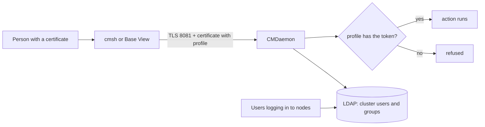

# 8.6 Users, authentication and security in BCM

| | |
|---|---|
| Level | Beginner to intermediate |
| Priority tier | 1 |
| Lab venue | Laptop |
| Part | Part 8: NVIDIA Base Command Manager |
| Status | Drafted (`security_lab.py`: 51 checks pass; cluster commands **untested** on live BCM) |

## Why this matters for AI infrastructure

A GPU cluster is expensive, shared and a target. Researchers need accounts that work on every node. Operators need to power-cycle nodes without being able to read everyone's data. Auditors ask who changed what. BCM answers with a few simple ideas: one user directory for the whole cluster, certificates for management access, and profiles that say what each certificate may do. Knowing them lets you give a person exactly the access they need.

## Prerequisites and outcomes

You need chapters 8.1 to 8.5. After this chapter you can:

- add users and groups in cmsh and Base View, and explain why a new account cannot log in until it has a password
- change the four administrative passwords with one tool and remember the HA and image catches
- explain how cmsh and Base View authenticate (certificates) and what a profile is
- give someone read-only or power-only access, and create a time-limited certificate
- point the cluster at an external LDAP server, and know what Keycloak integration needs
- turn on audit logging and use a security checklist for a new cluster

## 1. The big picture



Two separate worlds:

1. **Cluster users**: people who log in to nodes and run jobs. They live in BCM's own **LDAP directory** on the head node, not in `/etc/passwd`.
2. **Management access**: who may use cmsh or Base View. This is decided by **X509 certificates** that carry a **profile**. Every management operation needs a **token**, and a profile is a set of tokens.

A person can be in both worlds, but they are different mechanisms.

## 2. Users and groups (6.1 and 6.2)

- In Base View: **Identity Management > Users** and **Groups**. In cmsh: `user` and `group` modes.
- A fresh cluster has one user already: **cmsupport**. It has no password (so no logins), and BCM uses it for diagnostics. **Do not remove it** or its home directory contents.

```text
[basecm11]% user
[basecm11->user]% add maureen
[basecm11->user*[maureen*]]% commit
[basecm11->user[maureen]]% set password <password>
[basecm11->user*[maureen*]]% commit
```

(The manual's session, untested here. The `add` drops you into the new object, as in chapter 8.5.)

What `commit` does: it fills empty fields with defaults. IDs start at **1000** (500 on SLES; the starting point is the `LowUserId` setting), the shell is `/bin/bash`, the home directory is `/home/<name>`, and the shadow values are set (minimum age 0, maximum 999999, warning 7 days, expiry 2038/1/1). **An empty password stays empty and a login to that account is refused**: a safe default. Set the password afterwards and commit again.

Other points:

- A string starting with `{SSHA}`, `{MD5}` or `{CRYPT}` is taken as a password **hash** (made with `slappasswd`). The manual says this is not normally done.
- `AddUserPasswordReset` (an AdvancedConfig directive) forces a password change at first login.
- User properties include an **email**, a **profile** (section 5), `disablepasswordssh`, `createsshkey`, `authorizedsshkeys`, `expirationdate`, and `allowgpuworkloadpowerprofiles` (whether jobs may change GPU power profiles).
- **Groups:** `append members maureen tim fred` adds, `removefrom members tim fred` removes, and `clear members` empties the group (and its extras). `commit` at user-mode level commits **all** modified users, so mind which level you are at.
- `remove` on a user keeps the home directory; `remove -d` deletes it too.

## 3. Passwords (2.3.1)

`cm-change-passwd` is one dialog for four passwords: the **head node root**, the **root in the software images**, the **root in the node-installer**, and the **MySQL root**.

- **High availability:** run it on both head nodes. (The image password is copied to the other head automatically; the other three are not.)
- **The image password does not reach running nodes until `imageupdate` or a reboot** (chapter 8.4).
- It does **not** change the **LDAP root password** (a random string set at install; Appendix I has the procedure).
- If you saved the cluster password in Base View, update it there too.

## 4. SSH (2.3.2)

- From the **head node to regular nodes**, SSH is passwordless by default (root keys are in `/root`; user keys are in `/home`, which is mounted everywhere).
- From a regular node **to the head node**, a **root** login asks for a password, deliberately.
- Restrict user logins to regular nodes with the `usernodelogin` option (the manual covers it with workload management, chapter 8.8); restrict the head node in `/etc/ssh/sshd_config` (for example `AllowUsers root`).

## 5. Certificates and profiles: how management access works

**Certificates (2.3.3).** CMDaemon accepts only SSL connections on port 8081 and checks the client's X509 certificate. On a new cluster `root` has one: `/root/.cm/admin.pem` and `admin.key`. cmsh uses them by default, so root is not asked for a password. Base View asks for a username and password unless you import a PKCS#12 file made from the same pair (`openssl pkcs12 -export -in ~/.cm/admin.pem -inkey ~/.cm/admin.key -out ~/.cm/admin.pfx`). Two warnings: **if the administrator certificate is replaced, the certificates it signed must be made again**, and the same applies to the regular user certificates when a **license** (including an evaluation license) is replaced. `cm-check-certificates.sh` checks whether certificates are current.

**Profiles and tokens (6.5).** The certificate contains a **profile**. A profile is a named set of **tokens**, and **every cluster management operation, even the administrator's, needs the matching token**. Think of tokens as fine-grained permissions and profiles as roles.

The manual's preconfigured profiles:

| Profile | Allows | For people? |
|---|---|---|
| `admin` | all tasks | yes (root has it; give it to named administrators instead of using root) |
| `readonly` | view-only | yes |
| `portal` | user portal viewing | yes |
| `power` | device power | no (nonuser) |
| `node`, `bootstrap`, `cmhealth`, `cmpam`, `litenode`, `monitoringpush`, `mqtt`, `prs`, `autonomous-hardware-recovery`, `autonomous-job-recovery` | tasks done by BCM's own components | no (nonuser) |

**Nonuser profiles are for cluster manager clients and must never be modified**; only `admin`, `readonly` and `portal` are handed to people (and you can clone or create custom profiles, 6.5.2). Assign with `user use conner; set profile readonly; commit`.

**Trim a profile.** Example from the manual: `readonly` can see burn results by default. To stop that: `profile use readonly; removefrom tokens burn_status_token get_burn_log_token; commit` (Base View: **Identity Management > Profiles**).

**A time-limited certificate.** In `cert` mode: `createcertificate <key-length> <common-name> <organization> <organizational-unit> <locality> <state> <country> <profile> <sys-login> <days> <key-file> <cert-file>`. The manual's example makes a `readonly` certificate for user `peter` valid for 30 days. Facts:

- The **expiry cannot be extended**; make a new certificate.
- The files belong to whoever ran the command; `chown` them to the user.
- cmsh finds a certificate in this order: `-i` and `-k` options, then `~/.cm/admin.{pem,key}`, then `~/.cm/cert.{pem,key}`.
- `listcertificates` shows serial, revoked, time left, profile, system login and name; node certificates (from the node installer, chapter 8.4) appear too.
- For a user in **external LDAP** the `external-user-cert` script makes the certificate (`external-user-cert readonly spongebob --home=/home`).
- In Base View a privileged user sets a user's **Profile** and BCM places `cert.pem` and `cert.key` in that user's `.cm` directory.

`cm-component-certificate` regenerates LDAP certificates for a node or a new LDAP CA, but the manual says the administrator is not expected to use it and should use it with caution.

## 6. External LDAP and Keycloak (6.3 and 6.4)

**External LDAP.** If the company already has a directory, nodes can authenticate against it. For smaller clusters, point the LDAP clients on all nodes straight at the external server. The files to change are `/etc/nslcd.conf` and `/etc/openldap/ldap.conf` on RHEL 8 family, or `/etc/sssd/sssd.conf` instead of nslcd on RHEL 9 family, on the head node **and in the node image**; then restart `nslcd` or `sssd`, run `updateprovisioners`, and `imageupdate` or reboot nodes. If you still manage users with BCM against that server, the cmd.conf directives `LDAPHost`, `LDAPUser`, `LDAPPass` and `LDAPSearchDN` change (rare, because schemas rarely match). BCM runs an `ldap` health check using `cmsupport`; with an external server, give it a permanent check user or disable it, or you get false alarms. Open **port 636** in the head node firewall (Shorewall) if outside nodes use it.

For larger clusters, **replicate** the external directory to the head node (OpenLDAP provider and consumer with `syncrepl`; the interval format is `DD:HH:MM:SS`, and `rid=2` avoids a clash with the HA setting). In an HA pair the active head replicates from the external server and the passive head from the active head.

**Keycloak (6.4).** From BCM 11.34 the `cluster-tools` package can install Keycloak on the head node and federate BCM's LDAP into a realm for single sign-on, for example for NVIDIA Mission Control. Prerequisites: BCM 11.34+, **Ubuntu 24.04 or 26.04** on the head node (RHEL and Rocky are not supported), MySQL/MariaDB and BCM's LDAP running, free ports **9443** and **9999**, and outbound HTTPS to GitHub or a pre-staged Keycloak archive. Run `cm-setup-keycloak.py`, then `cm-setup-keycloak-realm.py --ldap`. **Set the admin and database passwords explicitly** (`--admin-password`, `--db-password`): the defaults (`admin/system`, `keycloak/system`) are well known. Verify with `cm-setup-keycloak.py --ready`. The lab checks the prerequisites list.

## 7. Audit logging (6.5.4)

Three CMDaemon directives: `CMDaemonAudit` turns logging of user actions on, `CMDaemonAuditorFile` says where, and `DisableAuditorForProfiles` leaves chosen profiles out. For a cluster with several administrators, turn auditing on and **do not exclude the `admin` profile**. The lab flags an audit setup with no file or with profiles excluded.

## 8. A security checklist for a new BCM cluster

This gathers settings from the whole part. Each item names where it was covered.

| Check | Where |
|---|---|
| Replace the self-signed web certificate on the head node | 8.5 |
| Change the four administrative passwords; LDAP root separately | 8.6 |
| Name administrators with the `admin` profile; stop using root day to day | 8.6 |
| Hand out `readonly` or custom profiles, not `admin`; remove tokens you do not want shared | 8.6 |
| Time-limited certificates for contractors | 8.6 |
| Turn on CMDaemon auditing | 8.6 |
| Keep `signinstallercertificates` AUTO only on trusted networks; MANUAL otherwise | 8.4 |
| Set `lockdowndhcpd` once all nodes are known | 8.3 |
| Consider `rsyncssh` (encrypted provisioning) if head nodes are exposed to an outside network; it costs the provisioner CPU | 8.4 |
| FIPS per node or category (not the head node) | 8.3 |
| SELinux only if required, start permissive | 8.2 |
| Use static addresses for the external interface | 8.3 |
| Restrict SSH logins on the head node and `usernodelogin` on nodes | 8.6 |
| Rotate the BMC credentials BCM created at install (my advice) | 7.4, 8.7 |
| Firewall (Shorewall on the head node): open only what you need (636 for external LDAP, 9443 for Keycloak) | 8.6 |

## 9. Common first mistakes

1. Using root and the shared `admin.pem` for everyone.
2. Editing a nonuser profile.
3. Forgetting that an expired certificate cannot be extended.
4. Creating users and never setting a password, then wondering why they cannot log in.
5. Changing the image root password and expecting running nodes to follow.
6. Not rerunning `cm-change-passwd` on the second head node.
7. Pointing nodes at an external LDAP server but forgetting the node image.
8. Leaving Keycloak with default passwords.
9. Removing `cmsupport`.
10. Replacing a license and not regenerating user certificates.

## Exercises

1. Run `python3 security_lab.py`. Pick four checks and explain each rule in your own words.
2. Design three profiles for a team: an operator who can only power-cycle nodes, an auditor who sees everything but changes nothing, a researcher who sees only their own jobs. For each, say which preconfigured profile you start from, and what you remove.
3. Write the cmsh steps (from the manual, untested) to give contractor `peter` a read-only certificate that expires in 14 days.
4. A user cannot log in right after being created. List three possible reasons and how to check each.
5. Plan a move from BCM's LDAP to the company's external LDAP for 400 nodes: which files, which image, which health check, and what do you test first on one node?
6. Use the checklist in section 8 to audit a cluster you know. Mark each row done, not done or unknown.

## 11. Interview angles

- "How does BCM decide what an administrator may do?" Certificate with a profile; profile is a set of tokens; each operation checks a token.
- "How would you give a junior read-only access?" Create a user, set the `readonly` profile, optionally trim tokens, issue a time-limited certificate.
- "Where do cluster users live?" BCM's own LDAP on the head node (or an external directory).
- "A user's new account does not work." The password is unset (a safe default), or the profile/ssh settings block it; fix and recommit.
- "What do you rotate after an incident?" The four administrative passwords, the LDAP root password separately, certificates, and BMC credentials.

## Checkpoint questions (20)

<details>
<summary>1. Where do standard cluster users live in BCM, and what is the built-in `cmsupport` account?</summary>

Cluster users live in BCM's own **OpenLDAP directory** on the head node (not in `/etc/passwd`). **`cmsupport`** is a pre-created diagnostic account with no password (so interactive login is disabled) used by BCM for internal health checks like `ldap`—**never remove `cmsupport`**.
</details>

<details>
<summary>2. What happens if you `add` a new user in `cmsh` and `commit` without setting a password?</summary>

`commit` populates default POSIX fields (`uid`, `/bin/bash`, `/home/<user>`), but leaves the password **empty**, and **any login attempt to that account is refused** until `set password` and a second `commit` are run.
</details>

<details>
<summary>3. At what numeric UID do newly created BCM users start by default, and which directive changes that starting number?</summary>

New users start at UID **`1000`** (`500` on SLES), controlled by the **`LowUserId`** directive.
</details>

<details>
<summary>4. In `cmsh` `group` mode, which commands add members, remove specific members, and empty a group completely?</summary>

**`append members maureen tim fred`** adds members, **`removefrom members tim fred`** removes specific members, and **`clear members`** empties the group.
</details>

<details>
<summary>5. What is the difference between `remove <user>` and `remove -d <user>` in `cmsh` `user` mode?</summary>

`remove <user>` deletes the LDAP account while **keeping `/home/<user>` on disk**; `remove -d <user>` deletes both the LDAP account and the user's home directory.
</details>

<details>
<summary>6. Which four administrative passwords does `cm-change-passwd` update, and which directory password does it NOT update?</summary>

It updates: (1) **head node `root`**, (2) **software image `root`**, (3) **`node-installer` `root`**, and (4) **MySQL `root`**. It does **not** change the **LDAP root password** (which has its own procedure in Appendix I).
</details>

<details>
<summary>7. After changing the software image root password with `cm-change-passwd`, what step is needed for already-running compute nodes to get the new password?</summary>

Run **`imageupdate -w`** or **reboot** the regular nodes so they synchronize from the updated software image.
</details>

<details>
<summary>8. On an HA cluster with two head nodes, why must you run `cm-change-passwd` on both head nodes?</summary>

Because while the software image root password is automatically synced to the passive head node, the **head node `root`, `node-installer` `root`, and MySQL `root` passwords are not copied automatically** to the partner head node.
</details>

<details>
<summary>9. How does default root SSH behavior differ from the head node to regular nodes versus from a regular node back to the head node?</summary>

From the **head node to regular nodes**, root SSH is **passwordless** by default (`/root/.ssh` keys). From a **regular node back to the head node**, root SSH deliberately **prompts for a password** so a compromised compute node cannot trivially compromise the head node.
</details>

<details>
<summary>10. How do `cmsh` and Base View authenticate to `CMDaemon` on port `8081`?</summary>

Using **client-side X.509v3 PEM certificates** (`/root/.cm/admin.pem` and `admin.key` for root, or PKCS#12 `.pfx` imported into a browser for certificate-based Base View login).
</details>

<details>
<summary>11. What are a **Profile** and a **Token** in BCM's management authorization model (§6.5)?</summary>

A **Token** is an atomic permission required to perform a specific `CMDaemon` operation (e.g., `burn_status_token`), and a **Profile** is a named collection of tokens embedded in a user's X.509 certificate.
</details>

<details>
<summary>12. Which three preconfigured profiles are designed to be assigned to human users?</summary>

**`admin`** (full administrative access), **`readonly`** (view-only cluster inspection), and **`portal`** (user portal access).
</details>

<details>
<summary>13. Why must `nonuser` profiles (such as `node`, `bootstrap`, `cmhealth`, `power`, `litenode`) never be modified or assigned to human accounts?</summary>

They are internal service profiles used by BCM's own daemons and components to authenticate component-to-head-node RPCs; altering their tokens breaks internal cluster services.
</details>

<details>
<summary>14. Write the `cmsh` commands to prevent holders of the `readonly` profile from viewing burn-in status or logs.</summary>

`profile use readonly; removefrom tokens burn_status_token get_burn_log_token; commit`.
</details>

<details>
<summary>15. Can the expiration date of an existing BCM X.509 client certificate be extended in place?</summary>

**No.** X.509 validity dates are cryptographically signed at issuance; once a certificate expires (or needs a longer lifetime), you must issue a **new certificate** with `createcertificate`.
</details>

<details>
<summary>16. In what order does `cmsh` search for client certificate and key files when starting up?</summary>

1. Explicit **`-i <cert>` and `-k <key>`** command-line flags.
2. **`~/.cm/admin.pem` and `~/.cm/admin.key`**.
3. **`~/.cm/cert.pem` and `~/.cm/cert.key`**.
</details>

<details>
<summary>17. In which two situations must regular user certificates be regenerated across the cluster?</summary>

When the signing **administrator certificate is replaced**, or when the cluster **license (including an evaluation license) is replaced** (verify with `cm-check-certificates.sh`).
</details>

<details>
<summary>18. Which configuration files must be updated on both the head node and inside the software image to point RHEL 9 / Rocky 9 nodes at an external LDAP server?</summary>

**`/etc/sssd/sssd.conf`** and **`/etc/openldap/ldap.conf`** (whereas RHEL 8 used `/etc/nslcd.conf`), followed by restarting `sssd`, running `updateprovisioners`, and running `imageupdate` or rebooting nodes.
</details>

<details>
<summary>19. What are the head-node OS and TCP port prerequisites for installing Keycloak via `cm-setup-keycloak.py` (BCM 11.34+)?</summary>

Requires **BCM 11.34+**, **Ubuntu 24.04 or 26.04** on the head node (RHEL/Rocky are not supported for the Keycloak installer), running MySQL/MariaDB and BCM LDAP, and free TCP ports **`9443` and `9999`**.
</details>

<details>
<summary>20. What do the `cmd.conf` directives `CMDaemonAudit`, `CMDaemonAuditorFile`, and `DisableAuditorForProfiles` control?</summary>

`CMDaemonAudit` enables audit logging of management actions performed in `CMDaemon`, `CMDaemonAuditorFile` sets the log file path, and `DisableAuditorForProfiles` lists profiles excluded from audit logging (never exclude `admin` on a multi-administrator cluster).
</details>

## Sources and review notes

- **BCM 11 Administrator Manual:** section 2.3 (administrative passwords, SSH, certificates, profiles), chapter 6 (6.1 and 6.2 users and groups, 6.3 external LDAP including replication, 6.4 Keycloak, 6.5 tokens, profiles, custom certificates, audit logging, `cm-component-certificate`).
- **Corrections to the notes:** none new; the CMDaemon port correction is in 8.1 and 8.5.
- **Run here:** `security_lab.py` (51 checks): user defaults and login rules, hashes, groups, profile tokens and the nonuser rule, certificate expiry and regeneration, cmsh key lookup order, password change plan, SSH rules, LDAP client files, `syncrepl` interval, Keycloak prerequisites, audit settings.
- **My own choices, not the manual's:** the 2048-bit minimum check on `createcertificate` (the manual only shows 2048); "regenerate everything not signed as admin" for a replaced admin certificate (the manual says certificates signed by the original must be regenerated); the audit advice not to exclude the `admin` profile; the security checklist as a whole is a summary I assembled.
- **Not read or not covered:** the revert and removal screens in 6.2.4 and 6.2.5 in detail; the NVIDIA Mission Control side of Keycloak; Appendix I (LDAP password) and Appendix J (tokens list); the Shorewall configuration (the Installation Manual mentions it); `usernodelogin` (chapter 7 of the Administrator Manual); Part 18 covers system-wide hardening.
- **Not verified:** everything about a real BCM system: screen layouts, output formats, version differences.
