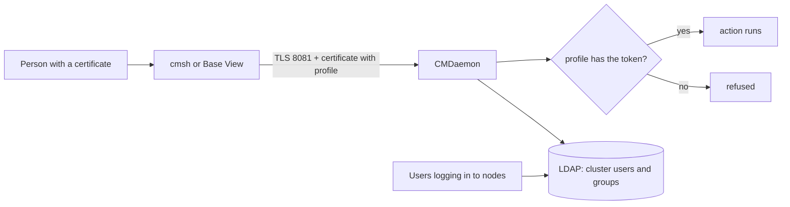

# 8.6 Users, authentication and security in BCM

| | |
|---|---|
| Level | Beginner to intermediate |
| Priority tier | 1 |
| Lab venue | Laptop |
| Part | Part 8: NVIDIA Base Command Manager |
| Status | Drafted (`security_lab.py`: 51 checks pass; cluster commands **untested** on live BCM) |

## Why this matters for AI infrastructure

Picture a GPU cluster that many teams share. Researchers need accounts that work on every node. Operators need to power-cycle a node without being able to read anyone's data. Auditors will eventually ask who changed what, and when. BCM handles all of this with a few simple ideas: one user directory for the whole cluster, certificates for management access, and profiles that say what each certificate may do. Once you know these ideas, you can give a person exactly the access they need and no more.

## Prerequisites and outcomes

You need chapters 8.1 to 8.5 before you start. When you finish this chapter, you should be able to do the following.

- Add users and groups in `cmsh` and Base View, and explain why a new account cannot log in until it has a password.
- Change the four administrative passwords with one tool, and remember the HA and image catches.
- Explain how `cmsh` and Base View authenticate with certificates, and what a profile is.
- Give someone read-only or power-only access, and create a time-limited certificate.
- Point the cluster at an external LDAP server, and know what Keycloak integration needs.
- Turn on audit logging, and use a security checklist when you set up a new cluster.

## 1. The big picture

Before you change any setting, know which part of the system you are touching. The diagram shows how a management request travels from a person to the cluster, and where the cluster's user directory fits in.



Security in BCM splits into two separate worlds, and each uses its own mechanism.

1. **Cluster users**: people who log in to nodes and run jobs. Their accounts live in BCM's own **LDAP directory** on the head node, not in `/etc/passwd`.
2. **Management access**: who may use cmsh or Base View. That is decided by **X509 certificates** that carry a **profile**. Every management operation needs a **token**, and a profile is a set of tokens.

A person can be in both worlds, but the two mechanisms are different. Login rights on a node do not grant management rights.

## 2. Users and groups (6.1 and 6.2)

You manage cluster users in Base View under **Identity Management > Users** and **Groups**, or in `cmsh` with the `user` and `group` modes. A fresh cluster already has one account, `cmsupport`. It has no password, so nobody can log in with it, and BCM uses it for diagnostics. Do not remove `cmsupport` or the contents of its home directory.

Here is how you add a user in `cmsh` and give that user a password. The manual shows this session, but it was not run on a live cluster here.

```text
[basecm11]% user
[basecm11->user]% add maureen
[basecm11->user*[maureen*]]% commit
[basecm11->user[maureen]]% set password <password>
[basecm11->user*[maureen*]]% commit
```

The `add` command drops you straight into the new object, the same way it does in chapter 8.5. The first `commit` is the important step, because it fills every empty field with a default. IDs start at **1000**, or 500 on SLES; the starting point is set by the `LowUserId` setting. The shell becomes `/bin/bash`, and the home directory becomes `/home/<name>`. The shadow values are set too: minimum age 0, maximum 999999, a warning 7 days ahead, and expiry on 2038/1/1.

An empty password stays empty, and a login to that account is refused. That is a safe default, because nobody gets in by accident. You set the password afterwards and commit again, and only then can the user log in.

A few other points matter in practice:

- A string that starts with `{SSHA}`, `{MD5}` or `{CRYPT}` is treated as a password hash, made with `slappasswd`. The manual says this is not normally done.
- The AdvancedConfig directive `AddUserPasswordReset` forces a password change at the first login.
- A user has more properties than the password. These include an email, a profile (section 5), `disablepasswordssh`, `createsshkey`, `authorizedsshkeys`, `expirationdate`, and `allowgpuworkloadpowerprofiles`, which controls whether jobs may change GPU power profiles.
- For groups, `append members maureen tim fred` adds people, `removefrom members tim fred` removes them, and `clear members` empties the group. Be careful at the user level: `commit` there commits **all** modified users, not just the one you are looking at.
- Running `remove` on a user keeps the home directory. Running `remove -d` deletes the home directory as well.

Create the account, set the password, and commit again. Treat that second commit as part of the job, not an optional extra.

## 3. Passwords (2.3.1)

Four passwords protect the cluster, and one tool changes all of them. `cm-change-passwd` is one dialog for the head node `root`, the `root` in the software images, the `root` in the node-installer, and the MySQL `root`. Running it once saves you from editing four places by hand.

Two catches matter on a high-availability pair. Run the tool on both head nodes, because the image password is copied to the other head automatically but the other three are not. The image password also does not reach running nodes until you run imageupdate or reboot them, as chapter 8.4 covers.

The tool does **not** change the LDAP root password. That password is a random string set at install time, and Appendix I has its own procedure. If you saved the cluster password in Base View, update it there too, so the two stay in step.

## 4. SSH (2.3.2)

SSH works differently in each direction, on purpose. From the head node to a regular node, SSH is passwordless by default. The root keys live in `/root`, and user keys live in `/home`, which is mounted everywhere. From a regular node back to the head node, a root login asks for a password, so a compromised compute node cannot easily take over the head node.

To restrict user logins to regular nodes, use the `usernodelogin` option, covered in chapter 8.8. To restrict the head node, edit `/etc/ssh/sshd_config`; `AllowUsers root` lets only root log in.

Test both directions after any change, so you know which way the boundary runs.

## 5. Certificates and profiles: how management access works

**Certificates (2.3.3).** Every `cmsh` or Base View session talks to CMDaemon, and CMDaemon accepts only SSL connections on port 8081. It checks the client's X509 certificate before it does anything. On a new cluster, `root` already has one, stored as `/root/.cm/admin.pem` and `admin.key`. `cmsh` uses these files by default, so root is never asked for a password. Base View is different: it asks for a username and password, unless you import a PKCS#12 file made from the same pair. You create that file with `openssl pkcs12 -export -in ~/.cm/admin.pem -inkey ~/.cm/admin.key -out ~/.cm/admin.pfx`.

Certificates have two warnings attached. If you replace the administrator certificate, every certificate it signed must be made again. The same rule applies to the regular user certificates when a license, including an evaluation license, is replaced. To check whether your certificates are still current, run `cm-check-certificates.sh`.

**Profiles and tokens (6.5).** Access is then limited by profiles. The certificate carries a **profile**, and a profile is a named set of **tokens**. Every cluster management operation needs the matching token, even when the administrator runs it. Think of tokens as fine-grained permissions and profiles as roles. The manual ships these preconfigured profiles:

| Profile | Allows | For people? |
|---|---|---|
| `admin` | all tasks | yes (root has it; give it to named administrators instead of using root) |
| `readonly` | view-only | yes |
| `portal` | user portal viewing | yes |
| `power` | device power | no (nonuser) |
| `node`, `bootstrap`, `cmhealth`, `cmpam`, `litenode`, `monitoringpush`, `mqtt`, `prs`, `autonomous-hardware-recovery`, `autonomous-job-recovery` | tasks done by BCM's own components | no (nonuser) |

Only `admin`, `readonly` and `portal` are meant for people. The nonuser profiles serve cluster manager clients, and you must never modify them. If you need something different, clone a profile or create a custom one, as section 6.5.2 of the manual describes. To assign a profile, run `user use conner; set profile readonly; commit`.

Sometimes a built-in profile gives away more than you want. The manual's example is `readonly`, which can see burn results by default. To remove that access, run `profile use readonly; removefrom tokens burn_status_token get_burn_log_token; commit`. In Base View, the same change lives under **Identity Management > Profiles**.

Some access should expire on its own. In `cert` mode you create such a certificate with `createcertificate <key-length> <common-name> <organization> <organizational-unit> <locality> <state> <country> <profile> <sys-login> <days> <key-file> <cert-file>`. The manual's example makes a `readonly` certificate for user `peter` that stays valid for 30 days. Keep three facts in mind when you use it. The expiry cannot be extended, so when the 30 days run out you must make a new certificate. The files belong to whoever ran the command, so use `chown` to hand them to the user. And `cmsh` looks for a certificate in a fixed order: first the `-i` and `-k` options, then `~/.cm/admin.{pem,key}`, and finally `~/.cm/cert.{pem,key}`.

To see what exists, run `listcertificates`. It shows the serial number, whether the certificate is revoked, the time left, the profile, the system login and the name. Node certificates, which come from the node installer in chapter 8.4, appear in the same list. Users in an external LDAP directory are a special case. For them, the `external-user-cert` script makes the certificate, for example `external-user-cert readonly spongebob --home=/home`. In Base View, a privileged user sets the **Profile** for a user, and BCM places `cert.pem` and `cert.key` in that user's `.cm` directory.

The `cm-component-certificate` tool regenerates the LDAP certificates for a node or a new LDAP CA. The manual says the administrator is not expected to need it, and should use it with caution.

Choose the narrowest profile that does the job, and hand out a time-limited certificate where you can.

## 6. External LDAP and Keycloak (6.3 and 6.4)

Many companies already have a directory of users. If yours does, the cluster can check logins against it instead of keeping a second list. For a small cluster, you point the LDAP client on every node straight at the external server. You change `/etc/nslcd.conf` and `/etc/openldap/ldap.conf` on the RHEL 8 family, or `/etc/sssd/sssd.conf` instead of nslcd on the RHEL 9 family. You make the change on the head node **and** in the node image, because a node that reboots from an old image would quietly go back to BCM's local directory. Then restart `nslcd` or `sssd`, run `updateprovisioners`, and run `imageupdate` or reboot the nodes.

If you still manage users with BCM against that external server, the `cmd.conf` directives `LDAPHost`, `LDAPUser`, `LDAPPass` and `LDAPSearchDN` have to change. This is rare, because schemas seldom match. BCM also runs an `ldap` health check that logs in as `cmsupport`. With an external server, that check can raise false alarms, so give it a permanent check user or disable it. If outside nodes need the directory, open port 636 in the head node firewall (Shorewall).

For a larger cluster, replicate the external directory onto the head node instead. You configure an OpenLDAP provider and consumer with `syncrepl`. The interval uses the format `DD:HH:MM:SS`, and `rid=2` prevents a clash with the HA setting. In an HA pair, the active head replicates from the external server, and the passive head replicates from the active head.

Keycloak adds single sign-on on top of BCM's directory. From BCM 11.34, the `cluster-tools` package can install Keycloak on the head node and federate BCM's LDAP into a realm. NVIDIA Mission Control is one example of a product that uses this. The prerequisites are strict. You need BCM 11.34 or later and Ubuntu 24.04 or 26.04 on the head node, because RHEL and Rocky are not supported. MySQL or MariaDB and BCM's LDAP must be running. Ports 9443 and 9999 must be free, and outbound HTTPS must reach GitHub or a pre-staged Keycloak archive.

Run `cm-setup-keycloak.py`, then `cm-setup-keycloak-realm.py --ldap`. Set the admin and database passwords yourself with `--admin-password` and `--db-password`, because the defaults, `admin/system` and `keycloak/system`, are well known. Confirm the install with `cm-setup-keycloak.py --ready`.

Before you point the cluster at an external directory, confirm that the external server is reachable from one test node. Only then change the rest of the cluster.

## 7. Audit logging (6.5.4)

Audit logging answers the question an auditor will ask: who changed what? Three CMDaemon directives control it. `CMDaemonAudit` turns logging on, `CMDaemonAuditorFile` sets the file, and `DisableAuditorForProfiles` leaves chosen profiles out.

When several administrators share a cluster, you should turn auditing on and not exclude the `admin` profile. Excluding it would hide the changes that matter most. The lab flags two problems: an audit setup with no file, and one with profiles excluded.

## 8. A security checklist for a new BCM cluster

You have now seen settings spread across this whole part of the handbook. This checklist gathers them in one place, so you can work through a new cluster top to bottom. Each row names the section where the topic was covered.

| Check | Where |
|---|---|
| Replace the self-signed web certificate on the head node | 8.5 |
| Change the four administrative passwords; LDAP root separately | 8.6 |
| Name administrators with the `admin` profile; stop using root day to day | 8.6 |
| Hand out `readonly` or custom profiles, not `admin`; remove tokens you do not want shared | 8.6 |
| Time-limited certificates for contractors | 8.6 |
| Turn on CMDaemon auditing | 8.6 |
| Keep `signinstallercertificates` AUTO only on trusted networks; MANUAL otherwise | 8.4 |
| Set `lockdowndhcpd` once all nodes are known | 8.3 |
| Consider `rsyncssh` (encrypted provisioning) if head nodes are exposed to an outside network; it costs the provisioner CPU | 8.4 |
| FIPS per node or category (not the head node) | 8.3 |
| SELinux only if required, start permissive | 8.2 |
| Use static addresses for the external interface | 8.3 |
| Restrict SSH logins on the head node and `usernodelogin` on nodes | 8.6 |
| Rotate the BMC credentials BCM created at install (my advice) | 7.4, 8.7 |
| Firewall (Shorewall on the head node): open only what you need (636 for external LDAP, 9443 for Keycloak) | 8.6 |

Read the BMC row twice. BCM created those credentials during install, so they are the ones most likely to be left as they were. Work down the table in order on a new cluster, and mark any row you cannot confirm.

## 9. Common first mistakes

Ten mistakes come up again and again on new clusters. Check your cluster against each one.

1. Using root and the shared `admin.pem` for everyone hides who did what.
2. Editing a nonuser profile can break the services that depend on it.
3. Forgetting that an expired certificate cannot be extended means you must issue a new one.
4. Creating users and never setting a password leaves them unable to log in.
5. Changing the image root password and expecting running nodes to follow. Running nodes pick it up only after `imageupdate` or a reboot.
6. Not rerunning `cm-change-passwd` on the second head node leaves that head with the old passwords.
7. Pointing nodes at an external LDAP server but forgetting the node image means the change disappears when a node reboots.
8. Leaving Keycloak with its default passwords.
9. Removing `cmsupport`, which BCM still needs for its own checks.
10. Replacing a license without regenerating user certificates.

### 9.1 Architecting least-privilege management profiles for multi-team AI clusters

Picture a systems engineer, a NOC operator, a help-desk technician and a platform developer, each holding a copy of `/root/.cm/admin.pem` or the `admin` profile. That setup is hard to audit and easy to break. One mistyped `remove` or `power off` in `cmsh` can wipe a software image or drop power to an entire Scalable Unit. BCM avoids this with its profile and token architecture, described in section 6.5 of the manual. You can split management authority into narrow roles without sharing `root` at all.

The first tier is read-only observability, for auditors and monitoring staff. Start by cloning the built-in `readonly` profile with `profile; clone readonly noc-viewer`. Holders of this profile can log in to Base View or `cmsh`, check device status, view monitoring graphs and inspect job queues. They lack every `set_*`, `add_*`, `remove_*` and `power_*` token. If compliance rules keep auditors away from sensitive burn-in or system logs, remove those specific tokens with `removefrom tokens burn_status_token get_burn_log_token; commit`.

The second tier is data-center smart hands, the technicians who swap DIMMs, optical transceivers or SXM GPUs. They need to blink chassis locator LEDs with `identify`, check BMC event logs with `bmceventlog`, close and open nodes for maintenance, and run `power status` or `power reset`. They should not change software images, edit LDAP users or change network subnets. Create a custom `rack-operator` profile that holds only the read tokens plus the device power and state tokens. Then issue each technician a personal X.509 certificate with `createcertificate`, valid for the length of their contract, which is `30` or `90` days. Every power reset is now logged under that technician's own certificate in `CMDaemonAuditorFile`.

The third tier is the senior cluster administrators. Even senior architects should not share the literal `root` login for daily `cmsh` work. Assign the `admin` profile to each architect's own account with `user use alice; set profile admin; commit`. Enable `CMDaemonAudit` in `cmd.conf`, and leave `DisableAuditorForProfiles` empty. Then `~/.cm/cert.pem` identifies `alice` personally, and the audit log records `alice`, not an anonymous shared root, for every committed change.

### 9.2 Enterprise identity architectures: Local LDAP vs Direct External LDAP vs `syncrepl`

Every cluster needs POSIX user and group resolution (`uidNumber`, `gidNumber`, `homeDirectory`, `loginShell`) on the head node, the login nodes and every compute node. Only then do Slurm jobs and shared filesystem permissions on Lustre, GPFS or NFS match everywhere. Section 6 introduced the three directory architectures BCM supports. The table below helps you choose between them by cluster size and by how much the organization's boundaries matter.

| Architecture | How It Works | Best For | Operational Trade-Offs |
|---|---|---|---|
| **1. BCM Standalone OpenLDAP (Default)** | Head node runs OpenLDAP as the primary authority; users/groups managed via `cmsh` `user`/`group` modes | Standalone clusters (`< 500` users) or isolated air-gapped sites | Zero external dependencies, but requires managing a separate cluster password/SSH key lifecycle unless federated with Keycloak |
| **2. Direct External LDAP / AD (`sssd` / `nslcd`)** | Compute and login nodes point `/etc/sssd/sssd.conf` and `/etc/openldap/ldap.conf` directly at corporate LDAP/Active Directory | Small-to-medium enterprise clusters with reliable low-latency links to corporate IT | Centralizes user lifecycle in corporate IT, but a corporate WAN blip or overloaded AD controller can stall `srun` UID lookups across all compute nodes |
| **3. OpenLDAP `syncrepl` Consumer on Head Node** | Corporate LDAP is the provider; the BCM head node's OpenLDAP replicates the tree locally via `syncrepl` (`rid=2`), and compute nodes query the head node | Large-scale AI factories (`500–5,000+` nodes) within an enterprise | Best of both worlds: corporate IT owns user accounts, while high-rate job-launch UID lookups stay inside the cluster on the local head-node replica |

The first option works well for a standalone cluster. Its trade-off is that you manage the cluster password and SSH key lifecycle yourself, unless you federate it with Keycloak. The second option centralizes user lifecycle in corporate IT. The cost is that a WAN blip or an overloaded AD controller can stall `srun` UID lookups across every compute node. The third option keeps user ownership with corporate IT and keeps the high-rate lookups local, which suits large AI factories.

Two practical details from the manual apply to options 2 and 3. First, update the head node **and** the software image. If you change `/etc/sssd/sssd.conf` only on the head node, or only on running compute nodes, then a node that reboots reverts to BCM's default local LDAP config. It then fails to resolve external users with `id <user>: no such user`. Second, adjust the `ldap` health check, which looks for the `cmsupport` user. If the external directory has no `cmsupport` account, that check fails on every node. Either create a read-only `cmsupport` probe account in the external directory, or reconfigure or disable the check.

### 9.3 Single Sign-On (SSO) with Keycloak for Base View, User Portal, and Mission Control

Starting in BCM 11.34, `cm-setup-keycloak.py` and `cm-setup-keycloak-realm.py --ldap` add an OpenID Connect (OIDC) or SAML identity broker on the head node. The broker federates BCM's OpenLDAP directory into a Keycloak realm on port `9443`. Why does this matter for an AI factory? Traditional HPC clusters needed POSIX UIDs mainly for SSH and Slurm. A modern AI factory exposes many more web and API surfaces. These include Base View, the BCM User Portal, Kubernetes and Run:ai, Grafana and Prometheus, Argo CD, and NVIDIA Mission Control.

With Keycloak in front of them, researchers and operators get one OIDC login flow across all of these portals. You can also federate Keycloak with your cluster LDAP or an upstream corporate identity provider. Two conditions apply. Deploy it on a supported Ubuntu `24.04` or `26.04` head node. And rotate the default `--admin-password` and `--db-password` at setup time. Keep port `9443` free from conflicting services, such as Harbor in chapter 8.10.

### 9.4 Step-by-step incident response: Revoking compromised credentials and rotating cluster secrets

Suppose a contractor leaves a project early, or an engineer loses a laptop that holds `~/.cm/cert.pem`. Or a security audit asks you to rotate every administrative credential on an HA BCM cluster. BCM keeps four kinds of secret apart: management certificates in `cert` mode, cluster POSIX users in `user` mode, administrative daemon passwords set by `cm-change-passwd`, and out-of-band BMC credentials in `bmcsettings`. Because they are separate, a full rotation takes four steps.

1. **Revoke or expire the management X.509 certificate in `cert` mode.** Start by running `cmsh -c "cert; listcertificates"`. That shows the serial number, common name, system login and profile of the lost laptop or the departing contractor. Next, revoke the certificate. If the person also had a local cluster account in `user` mode, you can disable SSH login with `set disablepasswordssh yes` and `clear authorizedsshkeys`, set an immediate `expirationdate`, or `remove` the user and commit. If the root administrator certificate, `/root/.cm/admin.pem`, was exposed, replace it and regenerate every dependent user certificate it signed. Verify the result with `cm-check-certificates.sh`.
2. **Rotate the four core passwords with `cm-change-passwd`.** Run it on the **active head node** to change the head-node `root` password, the software-image `root` password, the `node-installer` `root` password and the MySQL `root` password. On an HA pair, run it on the **passive head node** too, because only the software-image password syncs automatically. Then push the new software-image `/etc/shadow` hash to running regular nodes with `updateprovisioners` followed by `imageupdate -w`, or with a rolling reboot.
3. **Rotate the OpenLDAP root password if directory administration was exposed.** `cm-change-passwd` does not touch the OpenLDAP `cn=admin` password. That password is generated randomly at installation and stored in `cmd.conf`. If that file was ever exposed to an unauthorized party, follow the Appendix I procedure.
4. **Rotate the out-of-band BMC passwords with `bmcsettings`.** In `cmsh`, change the password under `partition use base; bmcsettings`, along with any category or node overrides, and commit. Push the change to the BMCs. Then run `credentialsoverview --inverse` in `device` mode. It should show every node converging on the single new salted SHA-256 fingerprint, with no outliers left.

Work through the steps in the order given, starting with the certificate, because that is the access someone may be using right now.

### 9.5 Hardening SSH and login-node boundaries (`usernodelogin` and `AllowUsers`)

In a multi-tenant AI cluster, researchers should reach the cluster through dedicated login nodes, Open OnDemand or Jupyter portals, Slurm with `sbatch` or `srun`, or Kubernetes APIs. They should not SSH into the head node or into idle GPU compute nodes. You enforce that boundary at three places.

On the head node, edit `/etc/ssh/sshd_config`. Restrict SSH to infrastructure administrators only, for example with `AllowUsers root` or `AllowGroups wheel cluster-admins`. Require public-key authentication with `PasswordAuthentication no`. Place the head node's external interface behind your corporate MFA bastion.

On regular GPU compute nodes, set `set usernodelogin onlywhenjob` on every compute category, as chapter 8.8 explains. With this setting, `pam_bright.so` lets a researcher SSH to a node such as `gpu014` only while that researcher holds an active Slurm job allocated on `gpu014`. Keep your platform team's diagnostic group in `/etc/security/pam_bright.d/pam_allow_group.conf` inside the software image.

On dedicated login nodes, put user-facing machines in their own `login` category with `usernodelogin always`. Add resource limits through `cgroup` or `/etc/security/limits.conf`, so a user who compiles code on a login node cannot exhaust its RAM. Give those nodes no direct route to `bmcnet`, which is `10.148.0.0/16`.

### 9.6 Auditing user, certificate, and profile state across the cluster

Identity and access controls drift over the years a cluster runs. A monthly security review in `cmsh` catches that drift. The review checks four invariants across the `user`, `group`, `profile` and `cert` modes.

1. **Certificate inventory and expiry.** Run `cert; listcertificates` and `cm-check-certificates.sh`. Confirm that every active certificate belongs to a current team member or an active BCM service. Confirm that no contractor certificate is still unrevoked after the project ends, and that no system or LDAP certificate is about to expire.
2. **Profile token audit.** Run `profile; foreach * (show)`. Confirm that only named human administrators hold the `admin` profile, and that operators hold `readonly` or a least-privilege custom profile. Also confirm that none of the internal nonuser profiles, such as `node`, `bootstrap`, `cmhealth`, `power`, `litenode`, `autonomous-hardware-recovery` and `autonomous-job-recovery`, has changed from its factory token set.
3. **Orphaned users and home directories.** Run `user; list`, and compare the users in BCM's LDAP directory with your organization's active HR or identity roster. Confirm that `cmsupport` is still there with no password set. For anyone you remove with `remove`, make sure the `/home/<user>` directory was either archived and cleaned up with `remove -d`, or handed to the research group's project lead.
4. **Auditor log integrity.** On both the active and the passive head node, inspect `/cm/local/apps/cmd/etc/cmd.conf`. Confirm that `CMDaemonAudit` is enabled, that `CMDaemonAuditorFile` ships to your central SIEM, and that `DisableAuditorForProfiles` does not exclude `admin`.

Run this review every month, as the chapter recommends, and keep each month's results so you can compare them.

## Exercises

Work through these in order. Each one builds on the chapter's checks and tools.

1. Run `python3 security_lab.py`. Choose four of its checks, and explain each rule in your own words, as if you were telling a colleague why it matters.
2. Design three profiles for a team. The first is an operator who can only power-cycle nodes. The second is an auditor who can see everything but change nothing. The third is a researcher who can see only their own jobs. For each one, name the preconfigured profile you would start from, and say what you would remove from it.
3. Write the `cmsh` steps from the manual to give contractor `peter` a read-only certificate that expires in 14 days. The manual has not been run on a live cluster, so note that in your answer.
4. A user cannot log in right after being created. List three possible reasons, and for each one say how you would check it.
5. You need to move 400 nodes from BCM's LDAP to the company's external LDAP. Plan the change: which files you would edit, which image you would update, which health check you would handle, and what you would test first on a single node.
6. Use the checklist in section 8 to audit a cluster you know. Mark each row as done, not done or unknown. Notice which rows you cannot answer without asking someone.

## 11. Interview angles

These questions test the model behind the commands. Each answer below gives the short version to say out loud.

- "How does BCM decide what an administrator may do?" A certificate carries a profile. A profile is a set of tokens, and each operation checks for the token it needs.
- "How would you give a junior read-only access?" Create the user, set the `readonly` profile, optionally trim some tokens, and issue a time-limited certificate.
- "Where do cluster users live?" In BCM's own LDAP on the head node, or in an external directory if you point the cluster at one.
- "A user's new account does not work." Either the password is still unset, which is a safe default, or the profile or SSH settings block the login. Fix the cause and commit again.
- "What do you rotate after an incident?" The four administrative passwords, the LDAP root password on its own, the certificates, and the BMC credentials.

## Checkpoint questions (20)

<details>
<summary>1. Where do standard cluster users live in BCM, and what is the built-in `cmsupport` account?</summary>

Standard cluster users live in BCM's own **OpenLDAP directory** on the head node, not in `/etc/passwd`. The `cmsupport` account is created for you. It has no password, so nobody can log in with it, and BCM uses it for internal health checks such as `ldap`. **Never remove `cmsupport`.**
</details>

<details>
<summary>2. What happens if you `add` a new user in `cmsh` and `commit` without setting a password?</summary>

The commit fills in the default POSIX fields, such as the UID, `/bin/bash` and `/home/<user>`. The password stays **empty**, though, and every login attempt to that account is refused. The account stays locked until you run `set password` and then a second `commit`.
</details>

<details>
<summary>3. At what numeric UID do newly created BCM users start by default, and which directive changes that starting number?</summary>

New users start at UID **`1000`**, or `500` on SLES. The **`LowUserId`** directive controls that starting number.
</details>

<details>
<summary>4. In `cmsh` `group` mode, which commands add members, remove specific members, and empty a group completely?</summary>

Use **`append members maureen tim fred`** to add members. Use **`removefrom members tim fred`** to remove specific members. Use **`clear members`** to empty the group.
</details>

<details>
<summary>5. What is the difference between `remove <user>` and `remove -d <user>` in `cmsh` `user` mode?</summary>

`remove <user>` deletes the LDAP account and leaves `/home/<user>` on disk. `remove -d <user>` deletes the LDAP account and the home directory together.
</details>

<details>
<summary>6. Which four administrative passwords does `cm-change-passwd` update, and which directory password does it NOT update?</summary>

It updates four passwords: the head node `root`, the software image `root`, the `node-installer` `root`, and the MySQL `root`. It does **not** change the **LDAP root password**. That password has its own procedure in Appendix I.
</details>

<details>
<summary>7. After changing the software image root password with `cm-change-passwd`, what step is needed for already-running compute nodes to get the new password?</summary>

Run **`imageupdate -w`**, or reboot the regular nodes, so they sync from the updated software image.
</details>

<details>
<summary>8. On an HA cluster with two head nodes, why must you run `cm-change-passwd` on both head nodes?</summary>

The software image root password syncs to the passive head node automatically. The head node `root`, `node-installer` `root` and MySQL `root` passwords do not. You therefore have to run the tool on both heads to cover those three.
</details>

<details>
<summary>9. How does default root SSH behavior differ from the head node to regular nodes versus from a regular node back to the head node?</summary>

From the head node to regular nodes, root SSH is **passwordless** by default, using the keys in `/root/.ssh`. From a regular node back to the head node, root SSH **prompts for a password** on purpose. That way, a compromised compute node cannot easily compromise the head node.
</details>

<details>
<summary>10. How do `cmsh` and Base View authenticate to `CMDaemon` on port `8081`?</summary>

Both use client-side X.509v3 PEM certificates. For root, these are `/root/.cm/admin.pem` and `admin.key`. For a certificate-based Base View login, you import a PKCS#12 `.pfx` file into the browser.
</details>

<details>
<summary>11. What are a **Profile** and a **Token** in BCM's management authorization model (§6.5)?</summary>

A **Token** is a single permission that one specific `CMDaemon` operation requires, such as `burn_status_token`. A **Profile** is a named collection of tokens, and it is embedded in a user's X.509 certificate.
</details>

<details>
<summary>12. Which three preconfigured profiles are designed to be assigned to human users?</summary>

They are **`admin`** for full administrative access, **`readonly`** for view-only cluster inspection, and **`portal`** for user portal access.
</details>

<details>
<summary>13. Why must `nonuser` profiles (such as `node`, `bootstrap`, `cmhealth`, `power`, `litenode`) never be modified or assigned to human accounts?</summary>

BCM's own daemons and components use these profiles to authenticate RPCs between the components and the head node. Changing their tokens breaks those internal services.
</details>

<details>
<summary>14. Write the `cmsh` commands to prevent holders of the `readonly` profile from viewing burn-in status or logs.</summary>

Run `profile use readonly; removefrom tokens burn_status_token get_burn_log_token; commit`.
</details>

<details>
<summary>15. Can the expiration date of an existing BCM X.509 client certificate be extended in place?</summary>

No. The validity dates are signed into the certificate when it is issued. When a certificate expires, or when you need a longer lifetime, you issue a **new certificate** with `createcertificate`.
</details>

<details>
<summary>16. In what order does `cmsh` search for client certificate and key files when starting up?</summary>

It checks three places in order. First come the explicit **`-i <cert>` and `-k <key>`** flags. Second are **`~/.cm/admin.pem` and `~/.cm/admin.key`**. Third are **`~/.cm/cert.pem` and `~/.cm/cert.key`**.
</details>

<details>
<summary>17. In which two situations must regular user certificates be regenerated across the cluster?</summary>

You regenerate them when the signing **administrator certificate is replaced**, and when the cluster **license is replaced**, including an evaluation license. Check the result with `cm-check-certificates.sh`.
</details>

<details>
<summary>18. Which configuration files must be updated on both the head node and inside the software image to point RHEL 9 / Rocky 9 nodes at an external LDAP server?</summary>

Update **`/etc/sssd/sssd.conf`** and **`/etc/openldap/ldap.conf`**. RHEL 8 used `/etc/nslcd.conf` instead. After that, restart `sssd`, run `updateprovisioners`, and then run `imageupdate` or reboot the nodes.
</details>

<details>
<summary>19. What are the head-node OS and TCP port prerequisites for installing Keycloak via `cm-setup-keycloak.py` (BCM 11.34+)?</summary>

You need **BCM 11.34 or later** and **Ubuntu 24.04 or 26.04** on the head node. RHEL and Rocky are not supported by the Keycloak installer. MySQL or MariaDB and BCM LDAP must be running, and the TCP ports **`9443` and `9999`** must be free.
</details>

<details>
<summary>20. What do the `cmd.conf` directives `CMDaemonAudit`, `CMDaemonAuditorFile`, and `DisableAuditorForProfiles` control?</summary>

`CMDaemonAudit` turns on audit logging of management actions in `CMDaemon`. `CMDaemonAuditorFile` sets the path of the log file. `DisableAuditorForProfiles` lists profiles to leave out of the log. On a cluster with several administrators, never exclude `admin`.
</details>

## Sources and review notes

- **BCM 11 Administrator Manual:** section 2.3 (administrative passwords, SSH, certificates, profiles), chapter 6 (6.1 and 6.2 users and groups, 6.3 external LDAP including replication, 6.4 Keycloak, 6.5 tokens, profiles, custom certificates, audit logging, `cm-component-certificate`).
- **Corrections to the notes:** none new; the CMDaemon port correction is in 8.1 and 8.5.
- **Run here:** `security_lab.py` (51 checks): user defaults and login rules, hashes, groups, profile tokens and the nonuser rule, certificate expiry and regeneration, cmsh key lookup order, password change plan, SSH rules, LDAP client files, `syncrepl` interval, Keycloak prerequisites, audit settings.
- **My own choices, not the manual's:** the 2048-bit minimum check on `createcertificate` (the manual only shows 2048); "regenerate everything not signed as admin" for a replaced admin certificate (the manual says certificates signed by the original must be regenerated); the audit advice not to exclude the `admin` profile; the security checklist as a whole is a summary I assembled.
- **Not read or not covered:** the revert and removal screens in 6.2.4 and 6.2.5 in detail; the NVIDIA Mission Control side of Keycloak; Appendix I (LDAP password) and Appendix J (tokens list); the Shorewall configuration (the Installation Manual mentions it); `usernodelogin` (chapter 7 of the Administrator Manual); Part 18 covers system-wide hardening.
- **Not verified:** everything about a real BCM system: screen layouts, output formats, version differences.
