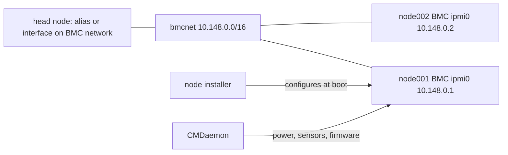

# 8.7 Power, BMC and hardware management in BCM

| | |
|---|---|
| Level | Intermediate |
| Priority tier | 1 |
| Lab venue | Laptop |
| Part | Part 8: NVIDIA Base Command Manager |
| Status | Drafted (`hardware_lab.py`: 45 checks pass; cluster commands **untested** on live BCM) |

## Why this matters for AI infrastructure

It is three in the morning, and a GPU node has stopped answering. You cannot SSH into it, because SSH runs on the operating system, and the operating system is the part that hung. A GPU server is more than an operating system. Under the operating system sit a baseboard management controller (BMC), which is a small computer on the server board with its own network port and its own power, a BIOS (the basic input and output system that starts the machine), GPU and switch firmware, the power feeds and the cooling. Each of these has its own settings and its own update path.

The BMC is the way back in. Because it runs apart from the operating system, you can reach it when the operating system is dead. From the BMC you can power-cycle the machine, read its event log and open a text console. The same separation makes firmware work risky. When you roll out new GPU firmware, a wrong activation step can leave the old firmware running while everyone believes it was updated. A rack that thinks it is on new firmware and is not stays quiet until a job fails on it.

BCM puts all of these jobs under one tool, so you can handle a whole rack at a time instead of logging into each BMC by hand. Part 7 of this handbook explains the Redfish protocol underneath, which is the standard, web-based interface that most modern BMCs speak. This chapter shows how BCM wraps it.

## Prerequisites and outcomes

Before you start, you should have chapters 8.1 to 8.5 behind you, and ideally Part 7. The chapter moves in the order you would meet these jobs on a real cluster. It begins with the power control methods and the scripts for devices that fit none of them, then the batch power schedules. After that come the BMC networks and their credentials, the commands for finding and resetting hardware, and the BIOS four-state model. It then covers firmware, serial over LAN, a routine for a hung node, and the mistakes that come up most often.

## 1. The power control methods (4.1)

Suppose a node will not respond, and you need to know which path BCM uses to cut or restore its power. The answer lives in one property. BCM stores the method in the device's **`powercontrol`** property, and the table below lists the values you can set.

Think of `powercontrol` as a label that tells BCM which hardware to ask. BCM does not guess. If the value is `ipmi0`, BCM sends its power request to the BMC. If the value is `apc`, BCM sends the request to a PDU outlet. A PDU is the power distribution unit, the strip in the rack that feeds each server, and an outlet is one of its ports. Choosing the right value is the first step, because every other power setting depends on it.

| Method | `powercontrol` | Notes |
|---|---|---|
| PDU outlet | `apc` | The node's power cable is plugged into a PDU port; BCM switches the port. The PDU must be a device in BCM and reachable. Set `powerdistributionunits mypdu:1`. Several ports per node (redundant feeds) are handled in the right order |
| BMC (IPMI) | `ipmi0` | Normal for servers. **Any PDU ports listed are ignored.** |
| BMC (others) | `ilo0`, `drac0`, `cimc0`, `rf0` | HPE iLO, Dell DRAC, Cisco CIMC, Redfish. Treated like IPMI with different interface names |
| Custom | `custom` | Your own script (section 2) |

For a server with a BMC, `ipmi0` is the normal choice, and the BMC does the switching. IPMI (the Intelligent Platform Management Interface) is the older, widely used management protocol that BMCs understand. The vendor variants in the table are treated like IPMI, with different interface names. In that case BCM ignores any PDU ports listed for the node, and that detail catches people out. You might add a PDU port to a node out of habit, then wonder why BCM never switches it.

The manual adds a few details that matter in practice. Twin nodes often share one PDU port, and then a power operation on one of them applies to all the nodes on that port. A dumb PDU, meaning one BCM cannot manage, makes the node's BMC state unknown if you assign it. Record such a PDU in the node's `notes` or `userdefined1` field instead. That way the record survives, and BCM does not try to talk to a device it cannot control.

You can also combine PDU and BMC control. With `PowerOffPDUOutlet = true` in `cmd.conf`, BCM switches the PDU outlet off after a BMC power-off. That cuts power to the BMC too, which draws a few watts per node. The node's BIOS must then be set to power on when power is restored, or the node never comes back. With shared ports, the outlet goes off only when every node on it is off. The reasoning is simple. The outlet cannot go dark while a twin node still needs it.

A BMC with a DHCP-assigned address is not power-managed by BCM. DHCP is the service that hands out addresses automatically, and the address can change, so BCM cannot rely on it. That node needs a custom script, as section 2 explains. On Dell hardware, BCM calls `racadm` with `serveraction powerstatus` and `hardreset`. `racadm` is Dell's command-line tool for the iDRAC, which is the Dell BMC. If the `bright` user lacks the privilege it needs, the manual shows raising it with `racadm ... set iDRAC.Users.4.Privilege 511`.

On a Redfish BMC, `power on`, `off` and `reset` perform a DC power cycle, and they assume AC power to the BMC is on. DC here means the low voltage that the board runs on, and AC means the mains supply that enters the power supply. An AC power cycle, where you cut all AC inputs, is a different operation. Some firmware needs it, as section 7 explains. Keep the two words apart in your head, because the difference decides whether a firmware change becomes active.

Start with the BMC method for any server that has one, and keep the PDU method for the cases the BMC cannot cover.

## 2. Custom power scripts (4.1.4)

Suppose a device fits none of the built-in methods, such as a smart plug with its own control interface. The device still needs to appear in BCM's power commands, so the same `power on` and `power status` work across the whole cluster. The answer is a small script that you write and that BCM calls on your behalf.

Set `powercontrol custom` and `custompowerscript /path/to/script`. BCM then runs the script in this form:

```bash
myscript <operation> <device> [custompowerscriptargument]
```

The `operation` argument is `ON`, `OFF`, `RESET` or `STATUS`. Your script receives the operation as its first argument, so it knows what to do. The second argument names the device, and the optional third argument carries anything extra you configured. Your script must exit with **0 on success** and a non-zero code on failure, because that exit code is how BCM knows what happened. A script that prints "done" but exits with 1 is a failure to BCM.

CMDaemon, the BCM daemon that does the work, also sets environment variables, such as `CMD_MAC`. A Wake-on-LAN script can call `wakeonlan $CMD_MAC` with no extra argument. Wake-on-LAN is a way to power on a machine by sending it a special network packet, and it needs the MAC address, the hardware address of the network card. The manual ships an example at `/cm/local/examples/cmd/custompower`, and the lab runs a real script to show the same contract.

## 3. Power operations (4.2)

Suppose a rack has just come back from maintenance and every node needs power. The tempting move is to power them all at once. The delays and batches in this section exist to stop you from doing that. A sudden surge of inrush current, the spike a server draws when it starts, can trip a breaker that feeds the whole row.

```bash
device power -n node001,node018..node033 on        # in device mode of cmsh
device power -c default -d 0.1 off
device power status -g mygroup
device power history                                # last 8 by default
device power on -p 3 rack[01-12]                    # in batches of 3 racks
power off --at 23:55            power off --after 10m
```

The first guard is the delay between devices. It is 1 second by default, set with `-d`, and it protects you from power surges. Think of it as a pause between each machine's start. Do not use `-d 0` for many nodes unless you have considered the surge, because zero delay means every node in the list gets its power request at once.

For larger groups, `-p N` starts N items at once, with no delay inside a batch. Batches are spaced 20 seconds apart (`--parallel-delay`). Take the manual's example of 12 racks in batches of 3. That gives four waves, which start at 0, 20, 40 and 60 seconds. Count the waves before you run the command, because each wave is one more group of racks drawing inrush current at the same time. The lab shows the same schedule. `--parallel-dry-run` only prints the times, so use it to check a plan before you run it.

BCM uses 32 threads for power work by default, set with `PowerThreadPoolSize`. A thread is a worker that handles one request at a time, so the pool size sets how many power requests run in parallel. Closed devices are skipped unless you add `-f`. You cannot run these commands inside `foreach` or `range` (chapter 8.5). Those loops would repeat the power request for each object, and the timing would stop being under your control. Instead, give the selection to the power command itself with `-n`, `-c`, `-g`, `-r` or `-s`.

`power status` reports one of `ON`, `OFF`, `RESET`, `FAILED` or `UNKNOWN`. `RESET` means the power was off only briefly during a reset. `FAILED` means communication broke down, and `UNKNOWN` means the request timed out. A timeout is not the same as a failure, because BCM simply got no answer in time. DGX racks report their own set: `DONE`, `GOOD`, `BUSY`, `FAIL`, `PENDING` and `CANCELLED`. The output arrives as an event, so `power status` prints nothing if private events are off. If the command seems silent, check the event setting before you assume the node is down.

Scheduled operations are managed with `power list`, `power wait` and `power cancel`. An operation can be waiting, busy, cancelled or done. If an operation fails, `--retry-count` and `--retry-delay` retry it, and the retry delay defaults to 3 s. `--port pdu1:3` works on a PDU port directly, which is handy when you want to test one outlet without touching the node's BMC.

A switch must keep dynamic speed negotiation turned on. Otherwise a NIC that drops its speed to save power can lose a node or BMC link, and BCM may misread the node's state (4.5). A NIC is the network card. PDU metrics `PDUBankLoad` and `PDULoad` feed monitoring (chapter 8.11), so the load numbers you see in graphs come from these values. For an overview, use `pduoverview`, `cduoverview` (coolant temperatures, pressures and flow, from a building management system) or `powershelfoverview` (per-PSU power, current, voltage, fan and temperature on rack-scale systems). A PSU is a power supply unit, and rack-scale systems are the large, multi-node racks that GPU clusters often use.

Before a large power-on, run the dry run and read the schedule first. That single habit prevents most of the surge problems this section describes.

## 4. BMC networks and credentials (3.7)

Suppose you have just racked forty new GPU servers, and BCM cannot power on any of them. The BMCs are cabled, but BCM has no address to reach them and no login to use. Before BCM can manage a BMC, the BMC needs an address on a network the head node can reach, and it needs a login. This section covers both, starting with the picture below.



A BMC interface is a special interface type, `bmc`, that sits on a dedicated network. The recommended network names are `bmcnet`, `ilonet`, `ipminet`, `dracnet`, `cimcnet` or `rfnet`. The default base is `10.148.0.0`, with 16 bits. The 16 bits are the network part of the address, so the range covers the whole 10.148 block of addresses. Interface names start with `ipmi`, `ilo`, `drac`, `cimc` or `rf`, which tells you the flavour of BMC at a glance.

For many nodes, you add the interfaces in one command: `addinterface -n node001..node150 bmc ipmi0 bmcnet 10.148.0.1`, followed by `commit`. The `commit` makes the change permanent in the BCM database. Use `--increment` to change the step between addresses. Without it, the addresses follow the default step, and with it you can space them out to match a different plan.

The head node also needs an address on the BMC network. If the BMCs share the internal network, add an alias interface. An alias is a second address on an existing interface, so the head node can reach the BMCs without a new cable. If the BMC network is separate, use a physical interface. To test it, run a ping loop. A 100 percent loss means you have a connectivity problem, and it usually points to a cable, a VLAN or an address on the wrong network.

The node installer (chapter 8.4) sets each BMC's network settings and credentials at boot. The defaults are user `bright`, a random password made at install, user ID 4, administrator privilege, and a reset delay of 0. You set these in `partition use base; bmcsettings`, per category or per node. A node setting overrides a category setting, and a category setting overrides the partition. `bmcsettings --show` prints the effective values and tells you where each one comes from. That last part matters, because a value you set on the partition can be silently replaced by a category value you forgot about.

`credentialsoverview` in device mode lists the effective access and BMC credentials for each device, and where each one comes from. It never shows a real password. Each password appears as a short SHA-256 fingerprint, a hash that identifies a value without revealing it. The fingerprint is salted for each cmsh session, so it changes from one session to the next. Within one session, equal passwords look equal, so a node with a different password stands out. A copied fingerprint is useless in another session. The `--inverse` option groups devices by identical credentials and lists the outliers first. Without the right tokens, fields show as `-`. This is BCM's answer to which BMC passwords have drifted, and chapter 7.14 does the same job over Redfish.

If BMC authentication fails, check `/var/log/node-installer` first, because the reason is often recorded there.
## 5. Looking at and resetting the hardware

When a machine misbehaves, you often need to find it in the rack, read what its BMC has recorded, or reset the BMC without touching the operating system. Picture the ticket that says a fan is failing somewhere in row C. You need to find the box, read the events and decide whether a reset would help. The table lists the device-mode commands for those jobs.

| Command (device mode) | Purpose |
|---|---|
| `identify -n node001 on` / `off` / `status` | blink the identification LED, to find a machine in the rack |
| `bmceventlog -n node001` | the BMC event log by Redfish (`--tail N`, `--clear`); fan failures, power events, sensor thresholds |
| `bmcreset -n node001` | hardware reset of the BMC. Out-of-band access drops for a few minutes; the node's power state and OS are **not** affected |
| `hardwareinventoryinfo` | components by Redfish: manufacturer, model, serial, part number (asset tracking, capacity planning) |
| `lspci`, `lseeprom`, `accelerators` | PCI devices (flags DPUs and accelerators), transceiver EEPROM data, accelerator count |
| `redfishsubscriptions` | which Redfish event subscriptions BCM holds for devices such as GB300 compute trays and NVLink switches |
| `rconsole` | the serial console (section 8) |
| `leakdetection enable\|disable`, `leakinfo` | coolant leak sensors via the BMC |

Use the table as a lookup. The one to be careful with is `bmcreset`. It drops out-of-band access for a few minutes, which means the BMC and its network path go quiet. But the node keeps its power state and its OS, so the running jobs on that node are not interrupted by the reset itself. Out-of-band means the management path that runs apart from the operating system, which is exactly what you lose during the reset.

The identify light deserves a word too. It is the simplest way to answer "which box is it?" in a crowded rack. Turn it on, walk to the rack, and turn it off again when you are done.

Liquid-cooled systems have leak detection enabled by default. A leak sensor is a small probe in the coolant path that reports moisture or a leak to the BMC. If a leak sensor is broken or reports falsely, `leakdetection disable` on that device stops an unwanted power-off until the sensor is replaced. The status line then shows `leak:disabled`. Leak detection does not apply to devices without sensors. Remember to turn it back on with `leakdetection enable`. A disabled sensor is a protection you have switched off, so write down why and when you did it.

If you do not have BCM's tools, the head node can still talk to the BMC with `ipmitool`, from the `ipmitool` module. For example, `ipmitool -U <user> -P <pass> -H <ip> chassis identify 1` works, and so does `mc reset cold`. The IPMI port is 623/UDP, which you can test with `nc -vz -u <ip> 623`. A BMC that is up but not serving requests may need a cold reset. The manual also says pulling the power cable is the physical way to reset it, and that shutting a server down usually does not power down the BMC. That last point is why a shut-down server can still answer on its BMC address.

## 6. BIOS settings: four states (14.5.2)

Suppose you change Boot Mode in BCM, run the commit, and see the new value in the list. The server still boots the old way. The setting looked saved, and it still did nothing. BCM keeps a BIOS setting in four places, and it helps to know which one you are looking at. BCM manages BIOS settings through Redfish, using JSON templates for each vendor model. JSON is a plain text format for structured data, and a template is a file that maps each BIOS setting to the way one vendor model stores it. The templates live under `/cm/local/apps/cm-bios-tools/templates/`. The manual lists templates for Dell 14g, 15g AMD and Intel, R730, and HPE DL110 and DL380 Gen10.


Model comes first. Set `model` in `biossettings`, on a device or a category, before anything else. BCM uses the model to pick the right template, so a setting without a model has no way to be translated into the vendor's names.

The `status` command shows three columns. Configured is the value in the CMDaemon database, the value you asked for. Pending is the value stored in the BIOS, waiting for the next boot. Live is the value the BIOS is actually running. A configured value of `<default>`, which is null after `clear`, does nothing. Only the values you set change the BIOS. This is why a cleared setting does not reset the BIOS to a known state. It simply stops BCM from touching that attribute.

To change Boot Mode, set it, then run `commit` to save it to the database. Run `bios apply` to stage it in the BIOS as pending, and reboot so it becomes live. `cm-bios-manage` is the underlying utility, which you can run directly when you need to see what BCM does on the node.

This is the same pending-versus-live idea as the Redfish Settings resource in chapter 7.9. After `bios apply`, check that the value shows as Pending, and wait for the reboot before you call the change done. A change that is Pending is a promise, not a fact yet.

## 7. Firmware (14.5.3)

Suppose a firmware update finished without an error, and the node still reports the old version. Firmware updates are where a node can end up half-updated, so follow the steps in order. For Redfish systems such as HPE iLO and DGX, set **`firmwaremanagemode`** in `bmcsettings`, on a device, category or partition. This setting tells BCM which platform's update workflow to use. The values are `auto`, `b200`, `b300`, `gb200`, `gb200sw`, `gb300`, `gb300sw`, `h100`, `iLO` or `none`. HPE DL380a Gen 12 follows the same Redfish procedure as earlier HPE generations.

The manual's DGX H100 example runs as follows. DGX is NVIDIA's family of integrated GPU servers, and H100 is the GPU model in this example.

1. Download the `.fwpkg` packages from the DGX support portal, and copy them to `/cm/local/apps/cmd/etc/htdocs/bios/firmware/<platform>/` on the head node. A `.fwpkg` file is a firmware package, a bundle of update images for several components.
2. Configure the BMC network, `bmcsettings` (username, user ID, password and firmware mode), and the node's BMC interface.
3. Run `firmware info` to list the packages. Run `firmware status -n node001` to see every component with its version and state.
4. Run `firmware flash <package>` on the node. The status shows `flashing` with a progress percentage, and then the versions in transition, for example `96.00.70.00.01 -> 96.00.74.00.01`.
5. When the update finishes, the State column shows `pending`, and the Result column says `success: AC power cycle to activate`.
6. Perform an **AC power cycle** by cutting all AC inputs, for example with a PDU that turns the whole system off, or by pulling every mains lead. A normal `power reset` is a DC, board-level power cycle, and it does not activate some components.
7. Run `firmware status` again. It should show `success: activated` and the new versions.

The step that trips people is step 6. A reboot and a `power reset` both feel like "restarting the machine", so it is natural to think the update is done after them. It is not. Some components keep the new image in staging until all the power is removed and the standby circuits drain. Until then the Result column stays at `pending`.

For HPE iLO there are extra `list`, `upload` and `remove` operations. The package goes to a special flash storage first, and then you run `flash`. Older systems can flash a BIOS from a DOS image served through the PXE menu, which the manual describes in `bios/menu.conf`. PXE is the network boot method that BCM uses for its node installs, and a DOS image is a small, self-contained disk image used for flashing. Rewrite the BIOS settings afterwards, because a new BIOS version may not understand the old stored configuration.

The lab models the pending-to-active flow. It shows why the word "success" is not enough on its own. A "success" in the Result column means the package was accepted and staged. It does not mean the new code is running. Before you call a firmware update finished, check the new version and the `activated` result.

## 8. Serial over LAN (14.7)

Suppose the node boots, but its network settings are wrong, and SSH never comes up. You need to see the boot messages and fix the settings from the console. Serial over LAN, or SOL, is the answer. It carries the serial console, the plain text stream a server writes during boot, over the BMC's network connection. This matters most when SSH is impossible, for example after bad network settings or a hung boot. SOL only works when three places agree on the same settings.

1. The BMC BIOS, with SOL enabled and matching speed, flow control and port.
2. The node kernel, through the software image's SOL settings. Run `softwareimage use default-image; set enablesol yes`, and `show | grep SOL` lists enable, flow control, port and speed.
3. The node BIOS, with its serial port enabled and the same settings.

Each of the three layers has its own copy of the settings, and a mismatch in any one of them gives you a garbled or silent console. Think of it as three locks on the same door. All three need the same key.

The manual gives some rules of thumb. Use 115200 bps, which is the speed in bits per second, the usual rate for a serial console. Higher speeds work, but they fail more often. Turn flow control on, so that a busy receiver can pause the sender instead of losing characters. COM1 is `ttyS0` on x86_64, or `ttyAMA0` on aarch64, and COM2 is `ttyS1` or `ttyAMA1`. COM1 and COM2 are the two classic serial ports, and the device names are how Linux refers to them. Use the terminal type VT100 or ANSI, which are the standard text terminal styles that most consoles understand. Turn console redirection on before and during POST, and off after POST. POST is the power-on self-test that runs before the operating system loads. Redirection during POST lets you watch the start-up checks, and turning it off afterwards keeps the operating system from sending text to a port no one is reading.

Two traps catch many people. BCM can configure the BMC's network and users, but it does not configure the SOL settings in the BMC BIOS. A factory reset can therefore break the match, and nothing in BCM will warn you. Also, if BMC LAN traffic shares the NIC, a client plugged into the dedicated BMC port sees no console. The shared-NIC case looks like a dead BMC, when really the cable is in the wrong port.

To connect, use `rconsole` in device mode, or `minicom`. `minicom` is a terminal program that opens a serial connection on the machine you are sitting at. `conman` logs serial consoles, so you have a record of what the node printed before it hung. A node installer can freeze at `freeing unused kernel memory` if SOL is on in the BIOS and the hardware cannot keep up. That message is the kernel's normal progress line, and a freeze there points to the serial path rather than the disk. Disabling SOL is the workaround, as chapter 8.4 explains.

Set up all three layers before you need the console. The moment you need it is usually the moment SSH has already failed, and that is the wrong time to find out a setting is off.

## 9. A routine for a hung node

Picture a hung node, a ticket that is waiting, and a colleague who wants to know what you are doing. A calm routine keeps you from rebooting a machine before you have read its logs. The routine below strings together the commands from this chapter, in the order that gives you the most information for the least risk.

1. Check the node's status with `ds node001`, and its power with `power status -n node001`.
2. Read the BMC event log with `bmceventlog -n node001 --tail 20` for fan, power or memory events.
3. If you need the console, open it with `rconsole`.
4. Turn on the identify light with `identify -n node001 on`, so the person at the rack can find it.
5. Close the node with `close -m "hung, ticket 123" -n node001`. If the scheduler is involved, drain the node first (chapter 8.4).
6. Run `power reset -n node001`, which is a DC cycle. If the node does not come back, check the BMC with `bmcreset`.
7. After the repair, run `open` and `undrain`, and do a short burn if you replaced hardware (chapter 8.2).

Notice the order. Steps 1 to 3 only read, so they cannot make the problem worse. Step 6 is the first one that changes the machine, and it comes only after the evidence is in. Keep that order when the pressure is high.

## 10. Common first mistakes

Your first week with BCM power and hardware work often looks like this. A node does not come back after a change, and the person who made the change says they did everything in the manual. Most early mistakes come from a few habits. People mix up PDU and BMC settings, or they treat a pending change as a finished one. The ten below come up again and again.

Mistakes 1 to 5 involve power. Mistake 1 is listing PDU ports on a node and expecting them to be used with `ipmi0`. Mistake 2 is assigning a dumb PDU, which makes the BMC state unknown. Mistake 3 is using `power on` with delay 0 on a whole rack. Mistake 4 is forgetting that `PowerOffPDUOutlet` needs "power on after AC loss" in the BIOS. Mistake 5 is treating pending firmware as active, or trying a DC reset for something that needs an AC cycle.

Mistakes 6 to 10 are habits of the workflow. Mistake 6 is configuring the BIOS but forgetting `bios apply` and the reboot. Mistake 7 is leaving a BMC password drifted on one node. Mistake 8 is assuming BCM copies SOL settings into the BMC BIOS. Mistake 9 is leaving leak detection disabled after a sensor swap. Mistake 10 is using a DHCP address for BMCs and then expecting BCM power control to work.

### 10.1 Deep dive: How BCM orchestrates Redfish, IPMI, and PDUs across a rack

Chapters 7.1 through 7.15 showed how to speak Redfish and IPMI to one BMC, or to a list of endpoints. In an NVIDIA Base Command Manager cluster, though, you rarely run standalone `curl` or `ipmitool` loops for daily work. Picture the Monday after a maintenance window, when you need to bring a whole row of GPU servers back at once. `CMDaemon` acts as a stateful, topology-aware Redfish and IPMI proxy for the whole cluster. It remembers which node has which BMC, which PDU outlet feeds it and which settings apply. To see what BCM adds, follow what happens when an operator runs `device power on -p 3 rack[01-12]` or `firmware flash nvfw_DGX-HGX-H100x8_...fwpkg` in `cmsh`.

First, BCM resolves the target node's BMC address from its `bmc` interface (`ipmi0` or `rf0` on `bmcnet` `10.148.0.0/16`). It then finds the username, password, user slot ID (`4`), and `firmwaremanagemode` (`h100`, `b200`, `gb200`, `gb300`). It does this by walking the inheritance chain from `partition[base]` → `category` → `device`. A value on the device wins over the category, and the category wins over the partition. Instead of reading passwords from a flat file on disk, it resolves them through that chain, so a change in one place reaches every node that inherits it.

Second, BCM staggers power-on to protect the electrical supply. When a cooling row or Scalable Unit comes back from a planned facility maintenance window, powering on a hundred `10.2 kW` or `14.3 kW` GPU servers at the same instant creates a massive inrush current surge at the transformers and breakers. A transformer is the device that steps the grid voltage down for the room, and a breaker is the switch that trips when the current is too high. The default is a 1-second stagger between nodes (`-d 1`). You can also start `-p 3` racks at a time, with a 20-second pause (`--parallel-delay`) between rack waves. Either way, CMDaemon smooths the electrical ramp across the data-center PDUs.

Third, BCM coordinates a BMC and PDU power-off. In high-security or energy-saving modes, you may want even the BMC's standby rail off when a node is down. A rail is one of the power lines inside the server, and standby means the low-power line that stays on while the machine is off. Set `PowerOffPDUOutlet = true` in `cmd.conf` for that. CMDaemon then issues a clean BMC power-off, waits for the host to power down, and checks whether a twin node shares the same PDU outlet (`mypdu:1`). Only then does it switch the physical outlet off. Powering back up reverses the sequence. The PDU outlet comes on first, and then BCM waits for the BMC to boot, with the BIOS set to `Always On`.

Fourth, BCM gathers telemetry across power and cooling. On liquid-cooled GB200 and GB300 NVL72 racks, power and cooling are no longer limited to single compute nodes. NVL72 is a rack-scale design in which many GPUs are linked by NVLink, NVIDIA's fast interconnect between GPUs. CMDaemon subscribes to Redfish event streams (`redfishsubscriptions`) from compute trays (`GB300`) and NVLink switch trays (`GB200SW`). A tray is a sled in the rack that holds the compute or switch hardware. It polls `33 kW` power shelves (`powershelfoverview`). It takes Coolant Distribution Unit (CDU) flow and pressure metrics from the facility Building Management System over MQTT (`cduoverview`). MQTT is a lightweight messaging protocol that sensors and building systems often use. It also monitors tray-level leak sensors (`leakdetection` / `leakinfo`), all within one object model.

### 10.2 End-to-end runbook: Flashing and activating DGX H100/B200 firmware via BCM

A DGX firmware update touches more than thirty independent microcontrollers: BIOS, BMC, CPLD, FPGA, ERoT roots of trust, 8x SXM GPU VBIOS, 4x NVSwitches and 8x PCIe retimers. A microcontroller is a small chip that runs its own firmware, and each of these parts is updated separately. The steps below run in `cmsh`, and they keep nodes from being left in a half-updated `pending` state. Work on one canary node first, and only then move to the rest of the rack.

1. Stage the vendor `.fwpkg` bundles on the active head node. Download the co-validated motherboard-tray and GPU-tray `.fwpkg` archives from the NVIDIA Enterprise Support Portal, and place them in `/cm/local/apps/cmd/etc/htdocs/bios/firmware/<platform>/`, for example `h100/` or `b200/`. Run `cmsh -c "device; firmware info"` to confirm both packages show state `available`.
2. Check reachability, credentials and the firmware mode. Run `credentialsoverview --inverse` in `device` mode to confirm that no target node has a drifted BMC password. Then verify that `bmcsettings -> get firmwaremanagemode` is set to the matching platform (`h100`, `b200`, `gb200`, or `auto`).
3. Drain and close the canary node, or the rack wave. Drain the nodes in Slurm with `drain -n node001..node008`, and wait for running jobs to finish with `jobs; list`. If the platform release notes require it, stop any in-band GPU polling agents first. Then mark the nodes closed with `close -m "FW upgrade ticket CHG-402" -n node001..node008`.
4. Record the baseline. Run `firmware status -n node001` and archive the output, so you have a full record of the pre-change versions for all thirty-plus components. A baseline is what lets you prove later what changed and what did not.
5. Flash the canary node first. Run `firmware flash nvfw_DGX-HGX-H100x8_...fwpkg -n node001`, and watch `firmware status -n node001`. The state moves from `flashing`, with a percentage, to `pending`, with the result `success: AC power cycle to activate`.
6. Do a true AC power cycle, not a warm reset. Section 7 explained that a normal `power reset` in `cmsh` only performs a DC board-level reset, and it will not activate GPU-tray `ERoT`, CPLD, FPGA, NVSwitch or retimer firmware. Shut the host down cleanly. Then trigger a full AC power cycle through the rack PDU outlets, or the platform's documented virtual AC cycle procedure. Wait at least sixty seconds for the standby capacitors to discharge before you restore AC power. The wait is what makes the cycle complete, so do not shorten it to save time.
7. Verify before you undrain. When `node001` boots back to `[ UP ]`, run `firmware status -n node001`. Every component should show state `completed`, result `success: activated`, and the new version string. Run `lspci` and `accelerators`, and a quick `dcgmi diag -r 2` check. Then run `open` and `undrain` the node before you move to the next rack wave.

### 10.3 Troubleshooting common BMC, SOL, and power-control failures in BCM

When a power, console or firmware command fails in `cmsh` device mode, the table below helps you narrow the cause quickly. Each row starts from a symptom you can see on the screen, then names the most likely cause and the checks that confirm it.

| Symptom in `cmsh` | Root Cause | Diagnostic & Remediation Steps |
|---|---|---|
| `power status -n node001` returns **`UNKNOWN`** | `CMDaemon` timed out reaching the BMC or PDU | 1. Check whether a non-manageable ("dumb") PDU was accidentally assigned to `powerdistributionunits` (clear it and record in `notes`).<br/>2. Ping the node's `ipmi0`/`rf0` IP from the active head node (`10.148.x.y`).<br/>3. Run `credentialsoverview --inverse` to check if `node001`'s BMC password drifted. |
| `power status` prints nothing at all on the terminal | Private event display is turned off in your `cmsh` session | Because `power status` returns its result asynchronously as a private event, run **`events on private`** (or `events on`) in `cmsh` and retry. |
| `rconsole node001` connects, but prints garbled text or hangs at `freeing unused kernel memory` | Baud rate / port mismatch across BMC BIOS, Node BIOS, and Software Image (`enablesol`), or hardware UART lockup | Verify all three layers use **`115200`** bps, flow control on, and **`ttyS0`** (`x86_64`) or **`ttyAMA0`** (`aarch64`). If the node-installer hangs at `freeing unused kernel memory`, disable SOL in the node BIOS during installation. |
| `firmware status` stays at `pending` (`AC power cycle to activate`) after `power reset` | `power reset` only performs a DC board-level reset, leaving standby rails energized | Perform a true **AC power cycle** by switching off the node's PDU outlets (or virtual AC cycle) so `5V`/`12V` standby rails discharge completely. |
| Node powers off cleanly with `PowerOffPDUOutlet = true`, but never boots on `power on` | Node BIOS `Power Restore Policy` is set to `Always Off` | When `CMDaemon` re-energizes the PDU outlet, the server waits for a physical button press unless its BIOS is set to **`Power On` (`Always On`) after AC power loss**. |

Find the row that matches your symptom, then check the cause it names before you change anything. Read the rows as a checklist, not as a guess. The cheapest check is usually the first numbered step in the row, and it changes nothing on the machine.

## Exercises

These exercises build on the sections above. The commands in this chapter were not run on a live BCM system, so treat them as practice on paper or in the lab. The first exercise uses the lab script, so start there.

1. Run `python3 hardware_lab.py` first. Choose four of its checks. For each one, explain the rule in your own words.
2. Write the cmsh commands from this chapter that give 150 nodes BMC interfaces on a new BMC network. Which commands set the BMC credentials cluster-wide? How would you add one category that overrides them?
3. Use `power_schedule` to work out how long it takes to power on 40 racks in batches of 4. What do the first nodes see?
4. Write a custom power script for a device with a smart plug that has an HTTP API. What would `STATUS` print?
5. Draw the BIOS state diagram for changing the NUMA setting on 8 nodes. Which command takes each step?
6. What five checks prove that a GPU firmware update is really active?

## 12. Interview angles

Interviewers like to ask about this material because the answers show whether you understand the risk, not just the commands. These are the questions that come up most often, with the answers worth having ready.

- "Walk me through updating GPU firmware across a rack." Stage the packages on the head node and check their status. Flash in small batches, confirm `pending`, do an AC power cycle, then confirm `activated` and the versions. Run a GPU test, draining before the update and undraining after.
- "A node shows `power status` UNKNOWN." That is a timeout from the BMC or PDU. Check BMC reachability and credentials with `credentialsoverview`, then check the BMC network and the head node's interface on it.
- "Why do BCM and Redfish both exist in your toolbox?" BCM holds the inventory, credentials and policy, and it fans out to many nodes. Redfish is the protocol each BMC speaks, and Part 7 covers it.
- "How do you power on a rack without tripping the breakers?" Use the delay and batch options. PDU limits come first, so know them before you power anything on.
- "How do you find which node has a different BMC password?" Run `credentialsoverview --inverse`.

## Checkpoint questions (20)

<details>
<summary>1. Which `powercontrol` property values does BCM support on a device?</summary>

You can set **`apc`** for a managed PDU outlet, **`ipmi0`** for an IPMI BMC, **`ilo0`** for HPE iLO, **`drac0`** for Dell iDRAC, **`cimc0`** for Cisco CIMC, **`rf0`** for a Redfish BMC, and **`custom`** for a script set through `custompowerscript`.
</details>

<details>
<summary>2. What happens to any `powerdistributionunits` ports configured on a node when its `powercontrol` is set to `ipmi0`?</summary>

They are **ignored** for normal power operations, unless `PowerOffPDUOutlet = true` is explicitly enabled in `cmd.conf`.
</details>

<details>
<summary>3. What does `PowerOffPDUOutlet = true` in `cmd.conf` do, and what BIOS setting does it require on the compute nodes?</summary>

After a node is shut down through its BMC, BCM also switches off the node's PDU outlet, which cuts standby power to the BMC as well. The node's BIOS **`Power Restore Policy` must be set to `Always On`**, that is, power on after AC loss. Otherwise the node stays off when the PDU outlet is turned back on.
</details>

<details>
<summary>4. What happens if two twin nodes share a single PDU outlet port and you issue a PDU power operation on one of them?</summary>

With `powercontrol = apc`, switching the shared outlet affects **all nodes plugged into that port**. With `PowerOffPDUOutlet = true`, BCM turns the shared outlet off only after all the nodes sharing it are powered off.
</details>

<details>
<summary>5. What command-line arguments and environment variables does a `custompowerscript` receive, and what exit code indicates success?</summary>

If you write one, BCM runs it as **`<script> <operation> <device> [custompowerscriptargument]`**. The operation is `ON`, `OFF`, `RESET` or `STATUS`, and CMDaemon sets `CMD_*` variables such as `CMD_MAC` and `CMD_IP` in the environment. Exit code **`0`** means success, and any non-zero code means failure.
</details>

<details>
<summary>6. What is the default per-device delay (`-d`) in `device power on`, and how do `-p N` and `--parallel-delay` schedule batch power-ons?</summary>

The default delay between devices is **`1` second** (`-d 1`). `-p N` starts N items at once in a batch, with no delay inside the batch. Batches are **`20` seconds** apart (`--parallel-delay`). So if you start 12 racks with `-p 3`, they begin at 0, 20, 40 and 60 seconds.
</details>

<details>
<summary>7. Why are `power` commands blocked inside `foreach` and `range` loops in `cmsh`?</summary>

Loop timing across hundreds of objects can stack power-on spikes or cloud API bursts by accident. Pass `-n`, `-c`, `-g` or `-r` directly to `device power` instead.
</details>

<details>
<summary>8. What are the five standard power status values returned by `device power status`?</summary>

They are **`ON`**, **`OFF`**, **`RESET`** (briefly off during a reset cycle), **`FAILED`** (a BMC or PDU communication failure), and **`UNKNOWN`** (a timeout).
</details>

<details>
<summary>9. What is the default subnet for `bmcnet` in BCM, and what naming prefixes are used for BMC interfaces?</summary>

The default subnet is **`10.148.0.0/16`**. BMC interface names start with **`ipmi`**, **`ilo`**, **`drac`**, **`cimc`** or **`rf`**, for example `ipmi0` or `rf0`.
</details>

<details>
<summary>10. What are BCM's default BMC username, user slot ID, and privilege level, and which component configures them on the node's BMC?</summary>

The default username is **`bright`**, with a random password generated at cluster install, User ID **`4`**, and Administrator privilege. The **`node-installer`** configures these on each node's BMC at boot.
</details>

<details>
<summary>11. In what precedence order do partition, category, and node `bmcsettings` apply, and which flag shows the effective source?</summary>

**Node overrides category, which overrides partition (`base`)**. Running `bmcsettings --show` displays the effective settings and which level supplied each one.
</details>

<details>
<summary>12. How does `credentialsoverview --inverse` in `cmsh` `device` mode help spot drifted BMC passwords?</summary>

In practice, it hashes each device's effective credentials into a **per-session salted SHA-256 fingerprint**. It then groups devices with identical fingerprints and lists the smallest groups, the outliers, first. Cleartext passwords are never shown.
</details>

<details>
<summary>13. What does `bmcreset -n node001` do, and does it reboot the running Linux OS on `node001`?</summary>

`bmcreset` performs a hardware cold reset of the node's **BMC microcontroller only**. Out-of-band BMC access drops for a couple of minutes while the BMC reboots. The host's power state and its running Linux OS are **completely unaffected**.
</details>

<details>
<summary>14. What are the four states and three transitions for managing BIOS settings in BCM (§14.5.2)?</summary>

1. Edit in `cmsh` or Base View, after setting `model`, in `biossettings`.
2. **`commit`** saves it in the CMDaemon database as **`Configured`**.
3. **`bios apply`** stages it to the BMC through Redfish as **`Pending`**.
4. A **node reboot** lets UEFI apply it at POST, and it becomes **`Live`**.
</details>

<details>
<summary>15. In BCM `biossettings`, what happens to a BIOS attribute whose Configured value is `<default>` (`null`, after `clear`)?</summary>

BCM **leaves that BIOS attribute untouched** on the server. Only attributes with explicit non-default Configured values are pushed during `bios apply`.
</details>

<details>
<summary>16. What does `firmwaremanagemode` in `bmcsettings` configure, and list six supported platform values?</summary>

If you set it, it tells BCM which Redfish or platform firmware workflow to use for the device, such as `cm-nvfwupd` or iLO. Supported values include **`auto`**, **`h100`**, **`b200`**, **`b300`**, **`gb200`**, **`gb200sw`**, **`gb300`**, **`gb300sw`**, **`iLO`**, and **`none`**.
</details>

<details>
<summary>17. After `firmware flash <pkg>.fwpkg` completes on a DGX H100, why does `firmware status` show state `pending` with `success: AC power cycle to activate`, and why is `power reset` insufficient?</summary>

The new firmware is staged in inactive flash. It needs all AC input power cut, through the rack PDU outlets or mains cords, so the standby rails discharge. That reinitializes the GPU tray's **`ERoT`**, **`CPLD`**, **`FPGA`**, **`NVSwitch`** and retimer chips. A standard `power reset` in `cmsh` performs only a **DC board reset**, which leaves the old firmware running.
</details>

<details>
<summary>18. Which three places must have matching baud rate, port, and flow-control settings for Serial over LAN (`SOL` / `rconsole`) to work?</summary>

1. **The BMC BIOS or SOL configuration.**
2. **The node's motherboard BIOS serial redirection settings.**
3. **The software image's kernel SOL parameters**, set with `softwareimage use default-image; set enablesol yes`.
</details>

<details>
<summary>19. What serial port device name and baud rate does the BCM manual recommend for `SOL` on `x86_64` versus `aarch64` (ARMv8)?</summary>

The manual recommends **`115200` bps** with hardware flow control on. On `x86_64`, use **`ttyS0`** for COM1, or `ttyS1` for COM2. On `aarch64`, use **`ttyAMA0`** for COM1, or `ttyAMA1` for COM2.
</details>

<details>
<summary>20. When should you run `leakdetection disable` on a liquid-cooled node, and what status indicator reminds you that it is disabled?</summary>

Only temporarily, when a faulty leak sensor raises false alarms that would otherwise trigger an unwanted emergency power-off. Keep it disabled until the sensor is replaced. While it is disabled, the node's status line shows **`leak:disabled`**.
</details>

## Sources and review notes

- **BCM 11 Administrator Manual:** chapter 4 (power methods, operations, overviews, monitoring, switch settings), section 3.7 (BMC networks, authentication, `credentialsoverview`, identification, event log, reset, port queries, leak detection), 14.5 (BIOS via Redfish templates and four states; firmware via Redfish with the DGX H100 example; the DOS image and iLO upload skimmed), 14.7 (serial over LAN), 14.11 (hardware information), appendix N (Redfish in BCM).
- **Companion chapters:** Part 7 (Redfish, firmware, BIOS, hardening) for the protocol side; 8.4 for node-installer BMC settings and the BMC cold reset.
- **Run here:** `hardware_lab.py` (45 checks): power method rules, shared ports, scheduling arithmetic, a real custom power script, BMC addressing and inheritance, credential fingerprints, the BIOS four-state flow, the firmware pending-to-activated flow, SOL consistency.
- **My own choices, not the manual's:** the lab's reading that a rack batch starts all its items together; the firmware component state model (it follows the manual's example output, not CMDaemon's code); the hung-node routine (an assembly of the manual's commands, not a manual procedure).
- **Not read or not covered:** the NVIDIA Mission Control Manual's rack power, power shelf and leak chapters; HPE iLO and Dell DRAC specifics beyond the passages above; BIOS template contents; `bios apply` option details; `cm-bios-manage`; the `firmware` command's less common options.
- **Not verified:** everything about real hardware: whether a given DGX needs an AC cycle for each component, output formats, and version differences. The manual's example is for the DGX H100; the GB-series differ.
