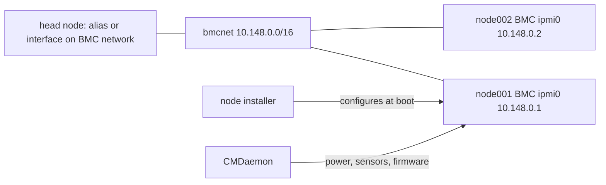

# 8.7 Power, BMC and hardware management in BCM

| | |
|---|---|
| Level | Intermediate |
| Priority tier | 1 |
| Lab venue | Laptop |
| Part | Part 8: NVIDIA Base Command Manager |
| Status | Drafted from the BCM 11 Administrator Manual: chapter 4 (power management), section 3.7 (BMC configuration), 14.5 (BIOS and firmware; the DOS-image BIOS flash and the iLO upload steps skimmed), 14.7 (serial over LAN), 14.11 (hardware information) and appendix N (Redfish management). **No BCM system and no BMC were available.** `code/part08/bcm_hardware.py` is **my model of the rules the manual states**, and `hardware_lab.py` checks 45 of them (the custom power script check runs a real shell script). It tests my reading of the manual, not BCM or any hardware. Every command shown is from the manual and untested here |

## Why this matters for AI infrastructure

A GPU server is more than an operating system. Under it sit a BMC, a BIOS, GPU and switch firmware, power feeds and cooling. When a node hangs, you cannot SSH in; you power-cycle it through the BMC. When you roll out new GPU firmware, a wrong activation step leaves the old firmware running while everyone thinks it is updated. BCM puts these jobs under one tool so they can be done for a rack at a time. Part 7 of this handbook explains the Redfish protocol underneath; this chapter shows how BCM wraps it.

## Prerequisites and outcomes

You need chapters 8.1 to 8.5 and, ideally, Part 7. After this chapter you can:

- choose a power control method and explain what BCM does with each
- power nodes on and off in batches without a power surge
- set up a BMC network and credentials, and audit which credentials each node really uses
- identify a node, read its BMC event log and reset its BMC
- manage BIOS settings with the four-state model
- flash firmware and explain why an AC power cycle is needed
- set up serial over LAN so a console works when the network does not
- list hardware, GPUs and PCI devices from the BMC, and handle leak detection

## 1. The power control methods (4.1)

BCM can control power in several ways. The setting is the device's **`powercontrol`** property.

| Method | `powercontrol` | Notes |
|---|---|---|
| PDU outlet | `apc` | The node's power cable is plugged into a PDU port; BCM switches the port. The PDU must be a device in BCM and reachable. Set `powerdistributionunits mypdu:1`. Several ports per node (redundant feeds) are handled in the right order |
| BMC (IPMI) | `ipmi0` | Normal for servers. **Any PDU ports listed are ignored.** |
| BMC (others) | `ilo0`, `drac0`, `cimc0`, `rf0` | HPE iLO, Dell DRAC, Cisco CIMC, Redfish. Treated like IPMI with different interface names |
| Custom | `custom` | Your own script (section 2) |

**Important details from the manual:**

- **Twin nodes** that share one PDU port: a power operation on one applies to **all** nodes on that port.
- A **dumb (non-manageable) PDU** assigned to a node makes the node's BMC state "unknown". Record dumb PDUs in the node's `notes` or `userdefined1` instead of assigning them.
- **Combining PDU and BMC:** with `PowerOffPDUOutlet = true` in `cmd.conf`, BCM also switches the PDU outlet off after a BMC power-off. That powers down the BMC too (a few watts per node). The node BIOS must then be set to **power on when power is restored**, or the node never comes back. With shared ports, the outlet goes off only when all nodes on it are off.
- A BMC with a **DHCP-assigned address** is not power-managed by BCM; it needs a custom script, because the address is dynamic.
- On Dell hardware BCM calls `racadm` (`serveraction powerstatus`, `hardreset`); if the `bright` user lacks privilege, the manual shows raising it with `racadm ... set iDRAC.Users.4.Privilege 511`.
- On a **Redfish** BMC, `power on/off/reset` is a **DC power cycle** and assumes AC power to the BMC is on. The **AC power cycle** (cutting all AC inputs) is a different thing, needed for some firmware (section 7).

## 2. Custom power scripts (4.1.4)

For a device nothing else covers, set `powercontrol custom` and `custompowerscript /path/to/script`. The script is run as:

```bash
myscript <operation> <device> [custompowerscriptargument]
```

`operation` is `ON`, `OFF`, `RESET` or `STATUS`; exit **0 on success, non-zero on failure**. CMDaemon also provides environment variables, for example `CMD_MAC` (so a Wake-on-LAN script can call `wakeonlan $CMD_MAC` without any extra argument). The manual ships an example at `/cm/local/examples/cmd/custompower`. The lab runs a real script to show the contract.

## 3. Power operations (4.2)

```bash
device power -n node001,node018..node033 on        # in device mode of cmsh
device power -c default -d 0.1 off
device power status -g mygroup
device power history                                # last 8 by default
device power on -p 3 rack[01-12]                    # in batches of 3 racks
power off --at 23:55            power off --after 10m
```

- **Delay between devices:** 1 second by default, to avoid power surges (`-d`). Do not use `-d 0` for many nodes unless you have considered the surge.
- **Batches:** `-p N` starts N items at once, **20 seconds** between batches (`--parallel-delay`), and 0 delay inside a batch. `--parallel-dry-run` only prints the times. The lab shows the schedule for the manual's example: 12 racks in batches of 3 start at 0, 20, 40 and 60 seconds.
- **Threads:** 32 by default (`PowerThreadPoolSize`).
- **Closed** devices are skipped unless `-f`.
- **Not inside `foreach`/`range`** (chapter 8.5). Give the selection to the power command: `-n`, `-c`, `-g`, `-r`, `-s`.
- **Status values:** `ON`, `OFF`, `RESET` (the short time power is off during a reset), `FAILED` (communication failure), `UNKNOWN` (timeout). For DGX racks: `DONE`, `GOOD`, `BUSY`, `FAIL`, `PENDING`, `CANCELLED`. `power status` output arrives as an event, so it prints nothing if private events are off.
- Scheduled operations: `power list`, `power wait`, `power cancel`; states waiting, busy, cancelled, done.
- `--retry-count` and `--retry-delay` (default 3 s) retry failed operations; `--port pdu1:3` works on a PDU port directly.

Also: a switch must keep **dynamic speed negotiation** on, or it can lose a node or BMC link when the NIC negotiates its speed down for power saving, and BCM may misread the node's state (4.5). PDU metrics `PDUBankLoad` and `PDULoad` feed monitoring (chapter 8.11). Overview commands: `pduoverview`, `cduoverview` (coolant temperatures, pressures and flow, data from a building management system), `powershelfoverview` (per-PSU power, current, voltage, fan and temperature on rack-scale systems).

## 4. BMC networks and credentials (3.7)



- A BMC interface is a special interface type, `bmc`, on a dedicated network. Recommended names: `bmcnet`, `ilonet`, `ipminet`, `dracnet`, `cimcnet` or `rfnet`, base `10.148.0.0`, 16 bits (default). Interface names start with `ipmi`, `ilo`, `drac`, `cimc` or `rf`.
- Add the interfaces for many nodes at once: `addinterface -n node001..node150 bmc ipmi0 bmcnet 10.148.0.1` (then `commit`); `--increment` changes the step.
- The **head node needs an address on the BMC network** too: an alias interface if BMCs share the internal network, or a physical interface if the BMC network is separate. Test with a ping loop; 100 percent loss means a connectivity problem.
- **Authentication:** the node installer (chapter 8.4) sets each BMC's network settings and credentials at boot. Defaults: user `bright`, a random password made at install, user ID 4, privilege administrator, reset delay 0. Set them in `partition use base; bmcsettings`, per category or per node. **Node overrides category overrides partition.** `bmcsettings --show` prints the effective values and where they come from.
- **`credentialsoverview`** (device mode) lists the effective access and BMC credentials per device and where each comes from. Passwords appear as a **short SHA-256 fingerprint salted per cmsh session**: equal passwords look equal within one session, so a **node with a different password stands out**, and a copied fingerprint is useless in another session. `--inverse` groups devices by identical credentials, **outliers first**. If you lack the right tokens the fields are redacted (`-`). This is the BCM answer to the "which BMC passwords have drifted?" question; chapter 7.14 does the same job over Redfish.
- If BMC authentication fails, the reason is often in `/var/log/node-installer`.

## 5. Looking at and resetting the hardware

| Command (device mode) | Purpose |
|---|---|
| `identify -n node001 on` / `off` / `status` | blink the identification LED, to find a machine in the rack |
| `bmceventlog -n node001` | the BMC event log by Redfish (`--tail N`, `--clear`); fan failures, power events, sensor thresholds |
| `bmcreset -n node001` | hardware reset of the BMC. Out-of-band access drops for a few minutes; the node's power state and OS are **not** affected |
| `hardwareinventoryinfo` | components by Redfish: manufacturer, model, serial, part number (asset tracking, capacity planning) |
| `lspci`, `lseeprom`, `accelerators` | PCI devices (flags DPUs and accelerators), transceiver EEPROM data, accelerator count |
| `redfishsubscriptions` | which Redfish event subscriptions BCM holds for devices such as GB300 compute trays and NVLink switches |
| `rconsole` | the serial console (section 8) |
| `leakdetection enable\|disable`, `leakinfo` | coolant leak sensors via the BMC |

**Leak detection.** Enabled by default on liquid-cooled systems. If a leak sensor is broken or reports falsely, `leakdetection disable` on that device prevents an unwanted power-off until the sensor is replaced; the status line then shows `leak:disabled`. It is not for devices without sensors. Remember to re-enable.

**Without a BMC tool.** `ipmitool -U <user> -P <pass> -H <ip> chassis identify 1` or `mc reset cold` work from the head node (module `ipmitool`). Port 623/UDP is the IPMI port (`nc -vz -u <ip> 623`). A BMC that is up but not serving may need a cold reset; the manual also says pulling the power cable is the physical way, and that shutting a server down usually does not power down the BMC.

## 6. BIOS settings: four states (14.5.2)

BCM manages BIOS settings through Redfish using JSON templates, one per vendor model, under `/cm/local/apps/cm-bios-tools/templates/` (the manual lists Dell 14g, 15g AMD and Intel, R730, and HPE DL110 and DL380 Gen10). A node's BIOS configuration has four places and three operations:


- **Model first.** Set `model` in `biossettings` (device or category) before anything else.
- `status` shows three columns: Configured (database), Pending (stored in the BIOS), Live (running).
- A configured value of **`<default>`** (null, from `clear`) **does nothing**; only values you set change the BIOS.
- To change Boot Mode: `set` it, `commit` (database), `bios apply` (pending), reboot (live).
- `cm-bios-manage` is the underlying utility.

This is the same pending-versus-live idea as the Redfish Settings resource in chapter 7.9.

## 7. Firmware (14.5.3)

For Redfish systems (HPE iLO, DGX), set **`firmwaremanagemode`** in `bmcsettings` (device, category or partition): `auto`, `b200`, `b300`, `gb200`, `gb200sw`, `gb300`, `gb300sw`, `h100`, `iLO` or `none`. HPE DL380a Gen 12 follows the same Redfish procedure as earlier HPE generations.

**The manual's DGX H100 example:**

1. Download the `.fwpkg` packages from the DGX support portal and put them in `/cm/local/apps/cmd/etc/htdocs/bios/firmware/<platform>/` on the head node.
2. Configure the BMC network and `bmcsettings` (username, user ID, password, firmware mode) and the node's BMC interface.
3. `firmware info` lists the packages. `firmware status -n node001` lists every component with its version and state.
4. `firmware flash <package>` on the node. Status shows `flashing` with a progress percentage and then versions in transition, for example `96.00.70.00.01 -> 96.00.74.00.01`.
5. The State column then shows **`pending`** and the Result column says **`success: AC power cycle to activate`**.
6. Do an **AC power cycle**: cut all AC inputs (a PDU turning the whole system off, or pulling every mains lead). **A normal `power reset` is a DC (board-level) power cycle and does not activate some components.**
7. `firmware status` now shows **`success: activated`** and the new versions.

For HPE iLO there are extra `list`, `upload` and `remove` operations (the package goes to a special flash storage first, then `flash`). Older systems can flash a BIOS from a DOS image served through the PXE menu (the manual describes `bios/menu.conf`); rewrite the BIOS settings afterwards, because a new BIOS version may not understand the old stored configuration.

The lab models the pending-to-active flow. **Do not read "success" as "active":** check the version and the `activated` result.

## 8. Serial over LAN (14.7)

When SSH is impossible (bad network settings, hung boot), the BMC can carry the **serial console over the LAN**. Three places must agree:

1. **BMC BIOS**: SOL enabled, same speed, flow control, port.
2. **Node kernel**: the software image's SOL settings (`softwareimage use default-image; set enablesol yes`; `show | grep SOL` lists enable, flow control, port, speed).
3. **Node BIOS**: serial port enabled, same settings.

Rules of thumb from the manual: **115200 bps** (higher is possible but more likely to fail), **flow control on**, **COM1 = `ttyS0`** on x86_64 or **`ttyAMA0`** on aarch64 (COM2 = `ttyS1` / `ttyAMA1`), terminal type VT100 or ANSI; console redirection before and during POST on, after POST off. Two traps: **BCM can configure the BMC's network and users but not the SOL settings in the BMC BIOS**, so a factory reset can break the match; and if BMC LAN traffic is on the **shared NIC**, a client plugged into the dedicated BMC port sees no console. Connect with `rconsole` in device mode or `minicom`; `conman` logs serial consoles. A node installer can freeze at "freeing unused kernel memory" if SOL is on in the BIOS and the hardware cannot keep up; disabling SOL is the workaround (chapter 8.4).

## 9. A routine for a hung node

1. `ds node001` (status), `power status -n node001`.
2. `bmceventlog -n node001 --tail 20` for fan, power or memory events.
3. If you need the console: `rconsole`.
4. `identify -n node001 on` so the person at the rack finds it.
5. `close -m "hung, ticket 123" -n node001` and **drain** it first if the scheduler is involved (chapter 8.4).
6. `power reset -n node001` (a DC cycle). If it does not return, check the BMC (`bmcreset`).
7. After repair: `open`, `undrain`, and a short burn if hardware was replaced (chapter 8.2).

## 10. Common first mistakes

1. Listing PDU ports and expecting them to be used with `ipmi0`.
2. Assigning a dumb PDU, which makes the BMC state unknown.
3. Using `power on` with delay 0 on a whole rack.
4. Forgetting that `PowerOffPDUOutlet` needs "power on after AC loss" in the BIOS.
5. Treating "pending" firmware as active, or trying a DC reset for something that needs an AC cycle.
6. Configuring the BIOS but forgetting `bios apply` and the reboot.
7. Leaving a BMC password drifted on one node.
8. Assuming SOL settings are copied by BCM into the BMC BIOS.
9. Leaving leak detection disabled after a sensor swap.
10. Using a DHCP address for BMCs and expecting BCM power control.

## 11. Exercises

1. Run `python3 hardware_lab.py`. Pick four checks and explain each rule in your own words.
2. Write the cmsh commands (from this chapter, untested) to give 150 nodes BMC interfaces on a new BMC network and set the BMC credentials cluster-wide, with one category overriding them.
3. Compute with `power_schedule` how long it takes to power on 40 racks in batches of 4, and what the first nodes see.
4. Write a custom power script for a device with a smart plug that has an HTTP API. What would `STATUS` print?
5. Draw the BIOS state diagram for a change of the NUMA setting on 8 nodes, with the commands for each step.
6. List the five checks that prove a GPU firmware update is really active.

## 12. Interview angles

- "Walk me through updating GPU firmware across a rack." Stage packages on the head node, check status, flash in small batches, confirm `pending`, AC power cycle, confirm `activated` and versions, run a GPU test; drain before, undrain after.
- "A node shows `power status` UNKNOWN." A timeout from the BMC or PDU; check BMC reachability and credentials (`credentialsoverview`), the BMC network and the head node's interface on it.
- "Why do BCM and Redfish both exist in your toolbox?" BCM holds the inventory, credentials and policy and fans out to many nodes; Redfish is the protocol per BMC (Part 7).
- "How do you power on a rack without tripping the breakers?" Delay and batch options; PDU limits come first.
- "How do you find which node has a different BMC password?" `credentialsoverview --inverse`.

## 13. Checkpoint questions (20)

1. Which `powercontrol` values does BCM understand?
2. What happens to PDU ports when `powercontrol` is `ipmi0`?
3. What does `PowerOffPDUOutlet` do and what must the BIOS be set to?
4. What happens when two nodes share a PDU port and you power one off?
5. What arguments does a custom power script receive, and what does exit code 0 mean?
6. What is the default delay between nodes in `power on`, and what do `-p` and `--parallel-delay` do?
7. Why does `power` not work inside `foreach`?
8. What are the five power status values?
9. What is the default BMC network and its interface name pattern?
10. What are the default BMC user and user ID, and who sets them on the BMC?
11. In which order do node, category and partition BMC settings apply?
12. What does `credentialsoverview --inverse` show first?
13. What does `bmcreset` do to the running node?
14. Name the four BIOS states and the three operations.
15. What does a `<default>` BIOS setting do?
16. What does `firmwaremanagemode` select?
17. What does `pending` with "AC power cycle to activate" mean, and why does `power reset` not fix it?
18. Name the three places SOL must be configured.
19. Which SOL port and speed does the manual suggest for x86_64?
20. When would you disable leak detection on one device?

## 14. Sources and review notes

- **BCM 11 Administrator Manual:** chapter 4 (power methods, operations, overviews, monitoring, switch settings), section 3.7 (BMC networks, authentication, `credentialsoverview`, identification, event log, reset, port queries, leak detection), 14.5 (BIOS via Redfish templates and four states; firmware via Redfish with the DGX H100 example; the DOS image and iLO upload skimmed), 14.7 (serial over LAN), 14.11 (hardware information), appendix N (Redfish in BCM).
- **Companion chapters:** Part 7 (Redfish, firmware, BIOS, hardening) for the protocol side; 8.4 for node-installer BMC settings and the BMC cold reset.
- **Run here:** `hardware_lab.py` (45 checks): power method rules, shared ports, scheduling arithmetic, a real custom power script, BMC addressing and inheritance, credential fingerprints, the BIOS four-state flow, the firmware pending-to-activated flow, SOL consistency.
- **My own choices, not the manual's:** the lab's reading that a rack batch starts all its items together; the firmware component state model (it follows the manual's example output, not CMDaemon's code); the hung-node routine (an assembly of the manual's commands, not a manual procedure).
- **Not read or not covered:** the NVIDIA Mission Control Manual's rack power, power shelf and leak chapters; HPE iLO and Dell DRAC specifics beyond the passages above; BIOS template contents; `bios apply` option details; `cm-bios-manage`; the `firmware` command's less common options.
- **Not verified:** everything about real hardware: whether a given DGX needs an AC cycle for each component, output formats, and version differences. The manual's example is for the DGX H100; the GB-series differ.
