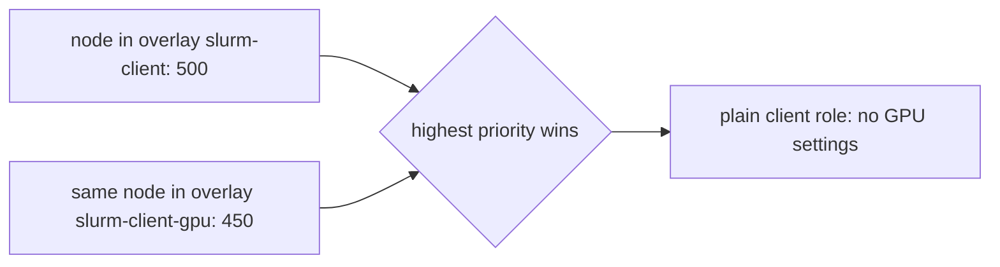

# 8.8 Workload managers under BCM: Slurm setup

| | |
|---|---|
| Level | Intermediate |
| Priority tier | 1 |
| Lab venue | Laptop |
| Part | Part 8: NVIDIA Base Command Manager |
| Status | Drafted (`slurm_lab.py`: 60 checks pass; cluster commands **untested** on live BCM) |

## Why this matters for AI infrastructure

Picture a GPU node that is up and healthy, yet no job ever lands on it. Or a queue that is missing a node you added last week. On most GPU clusters there is a scheduler, which is the program that decides which job runs on which machine and when. For training clusters that scheduler is usually Slurm, a widely used open-source workload manager. BCM does not just install Slurm and leave it alone. It generates `slurm.conf`, `gres.conf` and `cgroup.conf` from objects you set in cmsh, so nodes, queues and GPUs stay consistent as the cluster changes. The first file lists the nodes and queues, the second describes the GPUs, and the third sets the resource limits for each job. Once you know where each Slurm setting lives in BCM, you can track down the cause quickly. The three cases are a node missing from a queue, a GPU that jobs cannot see, and a Slurm that has quietly gone unconfigured after an upgrade.

## Prerequisites and outcomes

Work through chapters 8.1 to 8.7 first. For the Slurm side, Part 6 gives you the background you need. The chapter follows the path a new BCM Slurm cluster takes. It starts with the choice of scheduler and the rule that keeps users off the compute nodes. Then it covers the four roles and the overlays that carry them, the GPU overlay trap (why GPU nodes must not also sit in the plain `slurm-client` overlay), Slurm high availability and its `slurmctldstartpolicy` setting, and the `cm-wlm-setup` tool. After that come the cmsh settings for roles, high availability, containers, cgroups, draining and upgrades. Each part names the level that owns its setting, so you know where a change belongs before you make it.

## 1. Which workload managers

Suppose a new cluster arrives, and someone asks you which scheduler it runs. Before you change any setting, you need to know which scheduler BCM is managing. BCM 11 supports **Slurm** (versions 25.05 and 25.11 in the manual's version list), **IBM Spectrum LSF 10.1**, or none. LSF is a commercial scheduler from IBM, and it is installed from the vendor's packages rather than from BCM's own. Slurm arrives as BCM packages, while LSF is picked up from the vendor. This chapter follows Slurm. Packages from the distribution (`slurm`) are not integrated with BCM. They conflict with the BCM packages, so keep the two apart. A quick way to avoid the conflict is to install Slurm only through the BCM tools, never through the operating system's own package manager.

## 2. First, force jobs through the scheduler (7.2)

A researcher logs into a GPU node with SSH and starts a script beside the job Slurm placed there. The script uses the GPUs the job was given, and the job slows down or fails. By default BCM lets every user SSH into a node with their own keys. That lets people run work outside Slurm, and that work can disturb the jobs Slurm placed there. The category setting **`usernodelogin`** closes that gap. It takes one of three values:

| Value | Meaning |
|---|---|
| `always` (default) | all users may SSH to the node |
| `never` | only root |
| `onlywhenjob` | a user may SSH only while they have a job on the node |

Here is how you set it on the default category. The change takes effect at `commit`, which is the step that writes the change into the BCM database.

```text
[basecm11]% category use default
[basecm11->category[default]]% set usernodelogin onlywhenjob
[basecm11->category*[default*]]% commit
```

The `onlywhenjob` value is enforced by `pam_bright.so` in `/etc/pam.d/sshd`. PAM is the Linux pluggable authentication system, and the SSH daemon asks it whether a login is allowed. Some accounts still need access for diagnostics, and you can allow them anyway. List them in `etc/security/pam_bright.d/pam_allow.conf`, or list groups in `pam_allow_group.conf`, both inside the software image. Then run `imageupdate`, so the change reaches the nodes that boot from that image. An SSH session that is already open is not ended when the job finishes. Epilog scripts can clean up any stray processes that remain. The epilog is a script Slurm runs after a job ends, and it is the natural place to tidy up leftover work. Keep in mind that `usernodelogin` is a category setting, not a node setting, so it applies to every node in the category at once.

Leaving this at `always` on a shared cluster is one of the first mistakes listed later in this chapter. The change is small, and it prevents the most common way a shared GPU node gets disturbed.

## 3. The four roles and how BCM stores them (7.4)

Picture a login node that is missing from the submit list, so users cannot send jobs from it. Every node that takes part in Slurm plays one or more roles, and BCM assigns those roles through overlays. If a node is missing from a server or submit list, you can trace the reason through its overlay. A role is the job a node does for the workload manager. The table lists the four roles, the daemon each one runs and the overlay name you will usually see. A daemon is a background service that keeps running and answers requests.

| Role | What it is | Typical overlay |
|---|---|---|
| `slurmserver` | the controller, `slurmctld` | `slurm-server` |
| `slurmclient` | a compute node, `slurmd` | `slurm-client` |
| `slurmsubmit` | a login or submit node | `slurm-submit` |
| `slurmaccounting` | the accounting daemon `slurmdbd` | `slurm-accounting` |

The `cm-wlm-setup` command assigns these roles with configuration overlays, which chapter 8.1 introduced. An overlay is a named group of nodes that carries a role, and each overlay has a priority number. After an express setup, the manual shows the following overlays. Most sit at priority 500, and the head-node overlay sits higher at 600.

| Overlay | Priority | All head nodes | Categories | Role |
|---|---|---|---|---|
| `slurm-accounting` | 500 | yes | | slurmaccounting |
| `slurm-client` | 500 | no | default | slurmclient |
| `slurm-server` | 500 | yes | | slurmserver |
| `slurm-submit` | 500 | no | default | slurmsubmit |
| `wlm-headnode-submit` | 600 | yes | | slurmsubmit |

The `wlm-headnode-submit` overlay is special. It applies only to the head node, and every installed workload manager shares it, so the head node can always submit. The nodes in an overlay are the union of All head nodes, plus the overlay's own Nodes and its Categories. In other words, a node joins an overlay if it is a head node and the overlay covers all of them, or if it is listed directly, or if its category is listed. A WLM object can only be created by `cm-wlm-setup`, the Base View WLM wizard or the initial install. Do not create it from cmsh or Base View directly, because the manual warns of "many pitfalls". The WLM object is the record that ties all these pieces together, and creating it by hand skips the steps that set them up.

Use the setup tools to create the WLM object, and use overlays to decide which nodes play each role. That split keeps the setup tool in charge of the structure, while you stay in charge of the membership.

## 4. The GPU overlay trap

Suppose you have just set up GPUs with `cm-wlm-setup`. The node looks healthy, Slurm lists it, and yet a job that asks for a GPU never gets one. The node is in Slurm, but the Slurm configuration that describes its GPUs is not the one in force. The cause can be overlay priority, and this section explains how.

When you configure GPUs, `cm-wlm-setup` creates a **GPU client** overlay, `slurm-client-gpu`, at priority 450. It holds the same `slurmclient` role, but with GPU settings. The manual is direct about it: only the non-GPU nodes get the standard client role, and the GPU nodes get the GPU client role.

Recall from chapter 8.1 that the highest priority wins. Now suppose a GPU node also sits in the 500-priority `slurm-client` overlay. That can happen when that overlay covers the whole `default` category, which is the express default. The plain client role wins, and the GPU settings are silently ignored. The node is up and Slurm sees it, but jobs cannot get its GPUs. Nothing in the output says "ignored", which is why this trap costs so much time.

The diagram shows the two overlays competing for the same node.



The lab builds this exact situation with the 8.1 model and shows the 500 overlay beating the 450 one. You have three ways out. Put the GPU nodes in their own category, and set `slurm-client` to non-GPU nodes only. Or give the GPU overlay a higher priority than the plain one, avoiding 250 and 750. The first option removes the overlap, and the second one keeps the overlap but changes the winner. To check any node, run `device use gpu001; roles; list`, which shows which overlay supplies each role.

Before you trust a GPU node in Slurm, run that check and confirm the GPU overlay supplies its role. A green node in the list is not proof that the GPU settings are in force.

## 5. `cm-wlm-setup` (7.3)

Say you are setting up Slurm on a freshly installed cluster and want it running today. `cm-wlm-setup` is the tool for that. Run it with no arguments to get a text interface (TUI), or pass options when you want a scripted setup. The TUI is the menu-driven screen, and the options are for automation, where the same setup has to run the same way every time.

**Express** installs with a minimum of questions. **Step by step** lets you choose server nodes, client categories or nodes, submit nodes, GPU settings, accounting, Pyxis and more. Pyxis is a Slurm plugin for running containers, and section 8 explains it. If you are not sure which path to take, start with express, check the result, and rerun the step-by-step path only for the settings that differ.

The defaults are these:

- servers on the head node (`HEAD`)
- client and submit categories set to `default`
- overlay names of the form `<wlm>-server/-client/-submit/-accounting`
- overlay priority 500

The main options cover the WLM type, the names, the nodes and the categories: `--wlm slurm|lsf`, `--wlm-cluster-name`, `--server-nodes`, `--client-categories`, `--client-nodes`, `--client-slots`, `--submit-categories`, `--nvidia-gpus A100:4` and `--gpu-client-categories`. Others handle Pyxis, reboots and packages: `--with-pyxis`, `--reboot`, `-v`, `--skip-packages`, and `--min-reboot-timeout`, which must not go below 300 s. The `--disable` option needs `--yes-i-really-mean-it`, which is a deliberate guard against disabling a working scheduler by accident. LSF needs `--archives-location`.

At the end of the run, you can view the configuration, save it, or save and deploy it. The log is written to `/var/log/cm-wlm-setup.log`, so read it first when something looks wrong. You can run the tool from the secondary head only with `--allow-running-from-secondary`, and only when that head is active. The secondary head is the standby of a head-node pair, and running the tool there while it is passive can cause confusion about which head owns the configuration.

**Slurm accounting (slurmdbd).** Accounting is the record of which user ran which job and for how long. You need one or two accounting nodes, and they must all be head nodes or all be compute nodes, never a mix. Two nodes give slurmdbd high availability. The first is the primary, and the other is the `AccountingStorageBackupHost`. On head nodes, the database can live on the accounting node. On compute nodes, it uses a BCM MySQL overlay. If none exists, run `cm-mysql-setup` first, and `mysql-router` is added automatically when MySQL runs on several nodes. You can also use an external database, but then you own it, including its backups and its upgrades.

Decide where the accounting database will live before you run the express setup, because that choice decides whether accounting sits on head nodes or compute nodes. Changing it later means moving a database that already holds your job history.

## 6. Configuring the Slurm roles from cmsh (7.5)

Sometimes the express layout is not the one you need. One node may need its own `corespeccount`, which is the number of cores kept back from jobs, or an overlay may need a different queue. That is when you edit the roles from cmsh. The settings live in the role, and you can put them in an overlay, a category or a node. A node setting wins over the others, which follows the same rule you saw for partition, category and node in chapter 8.1.

```text
[basecm11->configurationoverlay]% roles slurm-client
[...->roles]% show slurmclient              # slots, queues, features, sockets, GPU auto detect, nodesets ...
[...->roles]% set slurmclient corespeccount 2 ; commit
```

The `show` command lists every slot, queue, feature, socket and GPU setting the role carries. A slot is the unit Slurm uses to count how many jobs a node can take at once. The last line changes `corespeccount` to 2 and commits the change, so that two cores stay reserved for the system on every node in that overlay.

For one node, run `device use node001; roles; assign slurmclient; set corespeccount 4`, and set `wlmcluster slurm` as well. Without `wlmcluster`, the commit is refused with "The WLM cluster should be set". That message is a reminder that the role has no idea which scheduler to join. The `list` command on the roles shows `[overlay:slurm-client] slurmclient` when the role comes from an overlay, and plain `slurmclient` when it comes from the node.

Hardware autodetection fills in the `NodeName` line for you. `NodeName` is the line in `slurm.conf` that describes one node's hardware to Slurm. Autodetection sets sockets, cores per socket, threads per core, boards, sockets per board and real memory. Because the values come from the machine itself, they match what the hardware reports, and you do not need to type them by hand.

The `gpuautodetect` setting takes one of seven values. `bcm` lets BCM write the vendor and GPU count. `none` writes no AutoDetect line in `gres.conf`. `nvml` is for NVIDIA, `rsmi` for AMD, `oneapi` for Intel, and `nrt` for AWS Trainium and Inferentia. The last value is `off`. GRES is Slurm's general resource system, and `gres.conf` is the file that lists the devices. You can set this value for the whole WLM instance, in wlm mode, or per role. The GPU screens in `cm-wlm-setup` also let you choose the type, the count and the NVIDIA MPS settings. MPS is NVIDIA's Multi-Process Service, which lets several processes share one GPU.

Two more terms come next. A Slurm *queue* is a partition. Setting `nodesets ns1` in the client role writes `NodeSet=ns1 Nodes=node001` into `slurm.conf`. A nodeset is a named group of nodes that you can place into a queue. Setting `nodesetfeatures bigmem` instead adds the feature to the node's `Features=` list and writes `NodeSet=bigmem Feature=bigmem`. A feature is a tag that a job can request, such as "I need big memory". That does not put the nodeset into any queue, so you have to add it to a queue yourself.

A queue, set in `wlm` under `jobqueue`, can take nodes from nodesets, overlays, categories, node groups or a compute nodes list. There is a catch. If the queue's `nodesets` parameter is set, BCM uses only the nodesets. It ignores the compute nodes list. Before BCM 11, queues were set only through the `queues` parameter of the client role. Both ways exist now. Changes appear in `/cm/shared/apps/slurm/etc/slurm/slurm.conf` after a short while. Do not edit the generated sections by hand, because they are protected by FrozenFile, which chapter 8.1 covers. A hand edit would be overwritten the next time BCM writes the file, and the two versions would disagree in the meantime.

When you add nodes to a queue, check whether the queue's `nodesets` field is set first, because that field decides which list BCM reads.

## 7. High availability (7.2.4)

Suppose the active head node fails at 2 a.m., and the standby head takes over the cluster services. The Slurm controller is one of those services, and it does not move by itself. A head node failover does not carry Slurm with it automatically. The Slurm server settings decide what happens next, and this section shows which ones matter.

The Slurm servers can run on two head nodes or on two compute nodes, but never one of each. In a non-HA cluster, the primary server is the head node. The active head node and the active Slurm server are independent of each other, so a passive head can host the active `slurmctld`. `slurmctld` is the Slurm controller daemon, the brain that schedules jobs, and it is the piece that must keep running through a failover.

The `scontrol takeover` command lets the backup `slurmctld` take over without a break. The `cmha makeactive` command runs it through CMDaemon. The catch is that BCM normally restarts a `slurmctld` it sees stopped, and that would undo the takeover. The server role's `slurmctldstartpolicy` setting solves this. It has three values. `TAKEOVER` is the default on HA. `ALWAYS` is the default on non-HA. `ACTIVEONLY` applies only when `/cm/shared` is not mounted on both heads. The shared directory matters because both heads must see the same Slurm files.

With `TAKEOVER`, the failover submode's `prefailoverscript` is `/cm/local/apps/cmd/scripts/slurm.takeover.sh`. The `cm-wlm-setup` tool sets it on HA. On a non-HA install, you set it yourself. The takeover is temporary. When the primary's head restarts, or the service restarts, the primary `slurmctld` takes its role back, as Slurm documents. For two compute nodes, the TAKEOVER policy is set automatically only if both nodes are in a failover group. Without that group, the nodes do not know they are partners, so BCM leaves the policy alone.

If you run a single `slurmctld`, set its policy to `ALWAYS`. For head node HA itself, chapter 8.12 is the next stop.

## 8. Containers: Enroot and Pyxis (7.3.3)

Suppose you have a user who wants to run a container job on the cluster, but the nodes have no Docker. Enroot and Pyxis give that user a path that works without it, and you decide how the image caches are shared. A container image is a packaged filesystem with the software a job needs, and a cache is a local copy so that each node does not download the same image again.

Enroot turns container images into unprivileged sandboxes, and you can think of it as an enhanced `chroot`. `chroot` is the older Linux command that changes the root folder a process sees, and Enroot adds the container details on top of that idea. Pyxis is a Slurm SPANK plugin that adds container options to `srun` and `sbatch`. SPANK is Slurm's plugin interface, and `srun` and `sbatch` are the commands that start jobs. Together they let a user run `srun --container-image=...` without Docker. BCM sets both up from `cm-wlm-setup`, using the options `--with-pyxis`, `--add-pyxis`, `--reinstall-pyxis`, `--remove-pyxis` and `--pyxis-data-directory`.

The setup supports RHEL 8-based systems and Ubuntu 20 and beyond. Enroot is installed into the images that have the client role, in a standard or a hardened flavour. Pyxis is compiled against the installed Slurm. No reboot is needed. Compiling against the installed Slurm is why the Pyxis plugin must be rebuilt after a Slurm upgrade, a point that section 10 returns to.

The Enroot screen asks how image caches should be shared, and each choice trades convenience for control. Sharing raw images among users and nodes requires a shared cache directory. The prolog then stops creating a per-user subdirectory. The prolog is a script Slurm runs before a job starts, and here it prepares the directories the job needs. If `cm-wlm-setup` has to create that directory, it gets mode `00777`, which means everyone can write to it. You can tighten it later, for example to `00770` with a group of Pyxis users, so that only the members of that group can write.

A cleaner option is to place Squashfs images in a shared directory that only administrators can write. Squashfs is a compressed, read-only filesystem format, so a job can read an image but cannot change it. Users then give the full path to the image. Sharing unpacked images among nodes is not recommended, because a job can change the filesystem. If the data directory is shared, unpack the image once before real jobs run, or concurrent extraction races. Two nodes unpacking the same image at the same moment can overwrite each other's files, and the result is a broken image. If the directories are not shared, the Slurm prolog creates a directory named after the user ID, and the epilog cleans it up.

The defaults live in `/etc/enroot/enroot.conf`, which links to `/cm/shared/apps/slurm/etc/enroot.conf`. They set the runtime, cache and data paths under `/run/enroot/.../$(id -u)`, the squashfs options `-noI -noD -noF -noX -no-duplicates`, and `ENROOT_MOUNT_HOME=yes`. The $(id -u) part is replaced by the numeric user ID, so each user gets a separate runtime path. Run these two commands to check that the container path works.

```text
module load slurm
srun --container-image=ubuntu grep PRETTY /etc/os-release
srun -N 2 --ntasks-per-node=1 --gpus-per-task=1 --mpi=pmix --container-image=deepops/mpi-nccl-test /nccl_tests/build/all_reduce_perf -b 1M -e 4G -f 2 -g 1
```

The second line is the manual's NCCL test. NCCL is NVIDIA's library for collective communication between GPUs, so this test checks that GPUs on two nodes can talk to each other from inside a container. The manual ran it with `--export` flags that it says are not a multi-tenant default, so this chapter leaves them out. Read that note as a reason to keep the first test simple before you add extra flags.

Choose the cache model before users start pulling images, because changing it later means moving images and clearing caches on every node. Chapter 8.10 returns to containers.

## 9. Cgroups (7.10)

Picture a shared GPU node where one job's process reaches into a GPU that belongs to another job. The data is mixed, and the second job crashes for no reason anyone can see at first. If the cgroup settings are loose, a job on a shared GPU node can touch GPUs it was never given. Cgroups are the Linux mechanism Slurm uses to stop that, and BCM sets the limits from one submode. A cgroup is a kernel feature that groups processes and limits what they can use, such as CPU, memory and devices.

Slurm's three cgroup plugins are on by default: `proctrack/cgroup`, `task/cgroup` and `jobacct_gather/cgroup`. Each plugin does one job. One tracks which processes belong to a job, one applies the limits, and one counts the resources the job uses. BCM generates part of `/cm/shared/apps/slurm/etc/<cluster>/cgroup.conf` from the `cgroups` submode of the WLM instance. Its parameters include `ConstrainCores`, `ConstrainRAMSpace`, `ConstrainSwapSpace`, `ConstrainDevices`, `AllowedRAMSpace` and `TaskAffinity`. Each one switches on a limit for a different resource.

`ConstrainDevices` confines each job to the GPUs that GRES allocated to it. `AllowedRAMSpace` defaults to 100 percent, and a job step is killed if it exceeds that limit. A job step is one of the parallel runs inside a job, so the limit applies to the work actually running. On a GPU cluster, check that `ConstrainDevices` is on. Without it, you cannot count on jobs staying off GPUs they were not given. Turning it on is a small change, and it is the one that makes GPU sharing safe between jobs.

Make `ConstrainDevices` the first cgroup setting you check on any GPU cluster.

## 10. Draining nodes, jobs and upgrades

Suppose you need to pull a node out of service for a reimage, but jobs are still running on it. Draining handles that. The running jobs finish, and the node accepts no new ones. A reimage is the reinstall of a node's operating system image, and you do not want to start it while a job is still using the node. You can drain a node, wait, and then reimage it safely.

`drain`, `undrain` and `drainstatus` (device mode) take the usual node selection options. A drained node starts no new jobs, while running jobs finish. `drain --setactions reboot` reboots the node once the last job ends. Do this before a reimage, which chapter 8.4 covers. The `drainstatus` command tells you where each node stands, so you can see when the last job has finished.

Drain actions can also be chained, which helps with a zero-downtime kernel rollout. A rollout that keeps the cluster running is possible when the nodes are handled in small groups. The `drain` command supports `--setactions`, `--appendactions`, `--removeactions`, `--listactions` and `--clearactions`. The manual's rolling reprovision one-liner looks like this.

```bash
cmsh -c 'device; drain -n <nodes> --setactions powerreset ; drain -n <nodes> --appendactions undrain'
```

That one line drains the nodes, power-resets them (reprovisions them) once their jobs finish, and undrains them when they return to `UP`. Treat the one-liner as the manual's pattern. Run it on a small test set first, and watch the state of each node as it moves. Watch the cost, though. If jobs take a long time to drain, the nodes that finish early sit idle until the whole batch completes. A short batch keeps that waste small.

Upgrading Slurm touches several places, so the manual's example is a useful guide. It walks from 25.05 to 25.11. As of July 2026, the manual says BCM integrates Slurm 25.05, 25.11 and 26.05, with 25.11 as the default. The order matters. Drain the nodes and wait for their jobs. Stop `slurmctld` and `slurmdbd`. Remove the old packages from the head node and from every software image, because only one Slurm version can be installed. Install the new packages in both places, set the new version in the WLM cluster with `wlm use slurm`, and reinstall Pyxis if you use it, since Pyxis is compiled against Slurm. Go one major version at a time. Skipping versions can require a full wipe of the Slurm configuration. The manual also explains how to rebuild Slurm packages from source, for 25.11 and later.

### 10.1 Monitoring WLM services, jobs, queues, and power in Base View and `cmsh`

Picture the morning after an overnight run, when a queue looks stuck and you need to know whether the scheduler itself is healthy. BCM watches the workload manager services for you, and it can show you the state of each one. By default, BCM watches the WLM services and restarts them if they stop. On the head node, those services are `munge`, `slurmctld` and `slurmdbd`. On regular nodes, they are `munge` and `slurmd`. `munge` is the authentication service that Slurm uses to check who is talking to whom. The restart happens unless the role is disabled or the service was stopped through BCM. You can inspect them with `cmsh -c "device services node001; status"` and `cmsh -c "device use node001; roles; list -p"`. The `-p` flag, also written `--priority`, prints the source of each role. An overlay role appears as `[overlay:slurm-client:500] slurmclient`, and a role assigned to the node itself appears as `[750]`. In Base View, the overlay or category source for each role is shown under `Devices > All Devices > <node> > Settings > Roles`. To stop CMDaemon from overwriting WLM config files, set `FreezeChangesToSlurmConfig = true` in `cmd.conf`. The LSF equivalent is `FreezeChangesToLSFConfig = true`, whose default is `false`. Freezing is useful when you have hand-edited a file on purpose and do not want BCM to undo it, but remember that the frozen file will no longer follow BCM changes.

In Base View, click the **HPC** speedometer icon. It opens `WLM clusters`, `Jobs` (`HPC > Jobs`), `Queues` (`HPC > Workload Management Clusters > Job Queues`) and `job queue stats`. In `HPC > Jobs`, the `..` action menu offers five job actions. **Hold** stops a queued job from being scheduled, and its key is `H`. **Release** returns a held job to the queue. **Suspend** pauses a running job, and its key is `S`. **Resume** and **Cancel** complete the list.

In `cmsh`, the `wlm` submode drops you straight into the instance when only one exists. When several exist, such as `slr` and `uc`, run `wlm; list` to see the server, submit and client nodes, then `use <name>` to pick one. The loop `foreach * (jobs; list)` runs across all instances. The `activeservers` command prints each WLM instance with the hostname of its active server, as in `slurm basecm11`. Use it to confirm which head node is currently running the scheduler.

Inside `jobs`, `list` shows pending, running and recently completed jobs. Completed jobs stay in `list` for only a few minutes. The command `wait --timeout 10m --all` prints a running and pending tally every minute, but only when the tally changes. That keeps the output short while a large batch drains. The commands `hold <id>`, `release <id>`, `suspend <id>`, `resume <id>` and `remove <id>` control individual jobs.

The `show` and `info` commands read different sources. `show <id>` asks the workload manager directly, which means `scontrol show jobs` for Slurm and `bjobs` for LSF. It works for a running or pending job. `info <id>` reads the BCM database, so it covers pending, running and completed jobs. CMDaemon can take up to ~1 minute to detect a newly submitted job, so `info` can lag right after submission. If a job is brand new and `info` shows nothing, use `show` instead.

Per-job power figures come from `wlmjobpowerusagesettings`. `info <id>` shows `Total power usage`, `Total GPU power usage`, `Total CPU power usage` and `Total power under allocation`. They stay `< not set >` until you configure metrics under `partition[base] -> wlmjobpowerusagesettings`. The defaults are `Job age = 5m` as the minimum job age before calculation, `Timeout = 30s` and `Disabled = no`. The fields are `nodepowermetrics`, `gpupowermetrics`, `cpupowermetrics` and `powerunderallocationmetrics`. Once populated, the values appear in `Wh` shortly after the job completes. Wh is watt-hours, the energy the job used over its run, which is the figure that matters when you plan power budgets.

For history and debugging, `filter` lists current and past jobs from the BCM database. Its flags are `--running`, `--pending`, `--ended` (exit code 0), `--failed` (non-zero exit code), `-u`, `-g` and `-w`. The `statistics` command summarizes `Pending`, `Running`, `Finished`, `Error` and `Nodes`, using flags such as `--user`, `--group`, `--account`, `--accounting-info`, `--hour`, `--day`, `--week` and `--interval 60`. Intervals with zero jobs are left out, so a quiet hour does not clutter the table. The command `grid --start -1h --end now --interval 5m --mode user --text` draws a color-coded utilization grid in the terminal. Read it as a heat map: a busy user shows up as a dense band of color across the hours.

The `trackedjobs` command counts the jobs tracked on each node. The command `pidsgpus <job_id>` prints each node, the GPU indices it was assigned (`0, 1, 2, 3`) and the spawned PIDs. A PID is a process ID, the number Linux gives each running program. Once the job completes, it prints `Job not tracked` instead. The commands `stdout <id>`, `stderr <id>` and `stdin <id>` fetch the job's files from the execution node, so you can read a failed job's output without logging into the node.

Cache retention works like this. `persistent <id>` keeps a job in the cache past normal retention. `forget <id>` removes it from the cache at once, even if it is marked `persistent`. The cache directives in `cmd.conf` are `JobInformationKeepCount`, which defaults to **8192** and tops out at **65536**, `JobInformationKeepDuration`, which defaults to **28 days**, `JobInformationMinimalJobDuration`, which defaults to **`0s`**, `JobInformationFlushInterval`, and `JobInformationDisabled`. Keep count and keep duration are two ways to limit how much job history the database holds, so you can tune it to the size you need.

### 10.2 Prejob and postjob health checks, power saving, and `nodecustomizations`

Say you want a short-job queue on its own set of nodes. The workflow has four steps. Create the queue with `wlm; use slurm; jobqueue; add shorq; commit`. Clone the category with `category; clone default shornodes; commit`. Assign `slurmclient` and append the queue with `roles; assign slurmclient; commit; append queues shorq; commit`. Then move the nodes into `shornodes`. Cloning the category first means the new nodes start with the same settings as the default ones, and you change only what differs.

A health check can run right before a job starts, which is `prejob`, or right after one finishes, which is `postjob`. If a node fails a prejob check, the WLM stops the job from starting there. Without that guard, an unhealthy node can accept every job sent to it and fail them at once, or swallow them silently. The manual calls this the Black Hole Node Syndrome, because jobs go in and nothing useful comes out. A prejob check is the guard that stops it.

Two switches must both be on for a prejob check to run. First, turn on the check itself with `monitoring setup; set ib prejob yes; commit`. Second, turn on the WLM instance with `wlm use slurm; set enableprejob yes; commit`, or use `enablepostjob yes` for postjob. If you set `prejob yes` on a check while no WLM has prejob enabled, `cmsh` prints `warning: Prejob is selected, but no WLM has prejob`. Pair prejob and postjob failures with the `Drain` action, so BCM reschedules the job onto healthy nodes. A node drained by a health check is not undrained automatically. An administrator must run `undrain` after fixing the fault. This is deliberate, because a node that failed once should be looked at by a person before it takes jobs again. The built-in `failedprejob` health check, enabled by default, logs prejob passes and failures, so the history is there when you look for it.

Auto Scaler, run by `cm-scale` and configured through the `ScaleServer` role in chapter 8.1, powers down idle physical nodes. It powers them back up, or bursts to cloud or virtual nodes, when Slurm queues have pending work. Power saving only helps when the queue and the scaling policy agree, so check both before you enable it on a production cluster.

Sometimes Slurm needs a `NodeName` parameter that BCM does not expose as a property of `slurmclient`. An example is `BcastExclude=/dev/shm`, which affects `sbcast`. `sbcast` is the Slurm command that copies a file to every node of a job, and this setting tells it to skip a directory. You set it under `roles[slurmclient] -> nodecustomizations`, at overlay, category or node level. Cloned nodes and nodes added by `cm-scale` then inherit it automatically. This option exists since BCM 8.2. Without it, you would have to edit `slurm.conf` by hand on every new node, and the next BCM write would undo the edit.

```text
[basecm11->configurationoverlay[slurm-client]->roles[slurmclient]]% nodecustomizations
...->nodecustomizations]% add BcastExclude
...->nodecustomizations*[BcastExclude*]]% set value /dev/shm; commit
```

Each entry has `Key`, `Value` and `Enabled`. `Enabled` is `yes` by default, and the change takes up to ~1 minute to reach `slurm.conf`. In Slurm, BCM appends `<KEY>=<VALUE>` to the `NodeName` line, and removes it when the entry is removed or disabled. In LSF, BCM sets the `lsb.hosts` column to `<VALUE>`, and replaces it with `()` when the entry is removed or disabled. Each scheduler gets the same setting in its own file format, and you enter it once.

Treat each Slurm upgrade as one major step, and do not call it done until the images match the head node. A head node that runs the new version while its images still hold the old one is the mismatch that causes the trouble in section 11.

## 11. Common first mistakes

A week after go-live, a user reports that GPU jobs run, but only on some nodes, and a new login node cannot submit. Before you sign off a BCM Slurm setup, scan this list. Each item points back to a section above, so you can go straight to the reasoning when one of them looks familiar.

1. Leaving `usernodelogin` at `always` on a shared cluster.
2. Putting GPU nodes in the plain client overlay as well, which is the priority trap.
3. Creating a node-level `slurmclient` role and forgetting `wlmcluster`.
4. Putting nodesets in `nodesetfeatures` and expecting them to show up in queues.
5. Setting a queue's `nodesets` and then adding nodes to its compute list, which BCM ignores.
6. Mixing a head node and a compute node as WLM servers.
7. Upgrading Slurm on the head node but not in the images.
8. Forgetting to reinstall Pyxis after a Slurm upgrade.
9. Hand-editing `slurm.conf`.
10. Leaving `ConstrainDevices` off on a shared GPU cluster.

## Exercises

These exercises build on the sections above. The cluster steps were not run on a live system, so treat the commands as practice. The first exercise uses the lab script, so start there.

1. Run `python3 slurm_lab.py`. Pick four of its checks. For each one, explain the rule in your own words.
2. Using `wlm_cluster()`, add a third overlay that fixes the GPU trap without moving nodes. Which priority is legal?
3. Write the cmsh commands from the manual that give 10 nodes a `bigmem` feature. Which commands create a `bigmemq` queue that uses only those nodes?
4. Plan a rolling Slurm upgrade for 500 nodes in 5 racks. When is each rack drained? How do you know it is done?
5. Explain what a user sees when `usernodelogin` is `onlywhenjob` and their job ends while they are logged in.
6. What must be identical between the head node and each image for a Slurm upgrade to work?

## 13. Interview angles

Interviewers often ask about Slurm under BCM because the answers show whether you can trace a problem from the job back to the setting. These are the questions that come up most, with the answers worth having ready.

- **"A GPU node is up in Slurm but jobs get no GPUs."** Check overlay priority first, because the node may also sit in the 500 client overlay. Then check which overlay supplies the role, plus `gpuautodetect`, `gres.conf` and `ConstrainDevices`.
- **"How do you stop users from bypassing Slurm?"** Use `usernodelogin onlywhenjob`, a PAM allow list for diagnostics, epilog cleanup and cgroup constraints.
- **"How is Slurm HA done under BCM?"** Run two WLM servers on two heads, set `slurmctldstartpolicy TAKEOVER`, use `slurm.takeover.sh` as the pre-failover script, and let `cmha makeactive` run `scontrol takeover`.
- **"How do you run containers on Slurm under BCM?"** Use Pyxis and Enroot, set up by `cm-wlm-setup`, run jobs with `srun --container-image`, and share Squashfs images for a controlled cache.
- **"Upgrade Slurm without losing config?"** Go one major version at a time. Drain, stop, replace the packages on the head node and in the images, set the version, and reinstall Pyxis.

## Checkpoint questions (20)

<details>
<summary>1. Which workload managers does BCM 11 support, and why must you never install upstream OS distribution `slurm` packages on a BCM cluster?</summary>

BCM 11 supports **Slurm** (`25.05`, `25.11`, `26.05`) and **IBM Spectrum LSF 10.1**. It can also run with neither. Distribution `slurm` packages conflict with the Slurm packages BCM integrates, and CMDaemon does not manage them.
</details>

<details>
<summary>2. What are the three values of the category property `usernodelogin`, and how is `onlywhenjob` enforced on compute nodes?</summary>

- **`always` (default):** every user can SSH into the node at any time.
- **`never`:** only `root` can SSH into the node.
- **`onlywhenjob`:** regular users can SSH in only while they have an active WLM job on that node. **`pam_bright.so`** in `/etc/pam.d/sshd` enforces this.
</details>

<details>
<summary>3. When `usernodelogin` is set to `onlywhenjob`, how do you allow a diagnostic account or admin group to SSH into compute nodes without a running job?</summary>

Add the username to **`/etc/security/pam_bright.d/pam_allow.conf`**, or the group name to **`pam_allow_group.conf`**, inside the node's **software image**. Then run `imageupdate -w`.
</details>

<details>
<summary>4. Name the four Slurm roles in BCM and the daemon or function each represents.</summary>

1. **`slurmserver`** runs the Slurm controller, `slurmctld`.
2. **`slurmclient`** runs the compute node daemon, `slurmd`, and generates the `NodeName` and `gres.conf` entries.
3. **`slurmsubmit`** gives login and submit nodes the client binaries and config.
4. **`slurmaccounting`** runs the accounting daemon, `slurmdbd`.
</details>

<details>
<summary>5. What is the `wlm-headnode-submit` configuration overlay, and why is its priority set to `600`?</summary>

It is a built-in overlay applied to **all head nodes** at priority **`600`**, above the standard `500` WLM overlays. It carries the `slurmsubmit` role for every installed workload manager, so the head node can always submit and query jobs.
</details>

<details>
<summary>6. Why must you use `cm-wlm-setup` (or the Base View WLM wizard) to create a WLM cluster rather than running `add` inside `cmsh` `wlm` mode?</summary>

Setting up a WLM needs several pieces created together: the `wlm` object, MUNGE keys, database accounting, cgroup trees, configuration overlays and health checks. A bare `wlm` object created by hand in `cmsh` is unsupported because of its configuration pitfalls.
</details>

<details>
<summary>7. Explain the **GPU client overlay priority trap** (`slurm-client` at `500` vs `slurm-client-gpu` at `450`).</summary>

When `cm-wlm-setup` creates `slurm-client` at the default priority **`500`**, covering the `default` category, and `slurm-client-gpu` at **`450`**, a GPU node in both overlays takes its `slurmclient` role from the **`500` overlay**. That silently drops all the GPU GRES settings. You can fix it by putting GPU nodes in their own category, excluded from `slurm-client`, or by setting `slurm-client-gpu` to a priority above `500`, such as `550`.
</details>

<details>
<summary>8. Which `cmsh` command shows the exact configuration overlay and numeric priority supplying each role on `gpu001`?</summary>

**`cmsh -c "device use gpu001; roles; list -p"`**. The `-p` flag prints a line such as `[overlay:slurm-client:500] slurmclient` for an overlay role, and `[750]` for a role assigned to the node.
</details>

<details>
<summary>9. What are the seven supported values for `gpuautodetect` in BCM, and what does `none` do?</summary>

The seven values are **`bcm`** (BCM writes the vendor and count), **`none`**, **`nvml`** (NVIDIA NVML), **`rsmi`** (AMD ROCm SMI), **`oneapi`** (Intel), **`nrt`** (AWS Neuron) and **`off`**. The value `none` writes **no** `AutoDetect` line into `gres.conf`.
</details>

<details>
<summary>10. What does setting `nodesets ns1` vs `nodesetfeatures bigmem` on a `slurmclient` role generate in `slurm.conf`?</summary>

`nodesets ns1` writes **`NodeSet=ns1 Nodes=node001`**. `nodesetfeatures bigmem` adds `bigmem` to the node's **`Features=`** list and writes **`NodeSet=bigmem Feature=bigmem`**.
</details>

<details>
<summary>11. On a Slurm `jobqueue` (partition) in BCM, what happens to the queue's explicit compute-nodes list if the queue's `nodesets` parameter is non-empty?</summary>

BCM uses only the `nodesets` and ignores the queue's compute-nodes list completely.
</details>

<details>
<summary>12. Can you place primary and backup `slurmserver` (`slurmctld`) roles—or `slurmaccounting` (`slurmdbd`) roles—on one head node and one regular compute node?</summary>

**No.** An HA pair of `slurmserver` or `slurmaccounting` roles must sit on either two head nodes or two regular compute nodes. A mix of one head node and one compute node is not allowed.
</details>

<details>
<summary>13. What are the three values of `slurmctldstartpolicy` on the `slurmserver` role, and why is `TAKEOVER` the default on HA head nodes?</summary>

The three values are **`TAKEOVER`** (the default on HA), **`ALWAYS`** (the default on non-HA) and **`ACTIVEONLY`**. `TAKEOVER` suits HA because, when `cmha makeactive` runs `/cm/local/apps/cmd/scripts/slurm.takeover.sh` (`scontrol takeover`), CMDaemon does not fight the takeover by restarting the stopped primary `slurmctld` right away.
</details>

<details>
<summary>14. How do you add custom `NodeName` parameters (like `BcastExclude=/dev/shm`) to `slurm.conf` without `CMDaemon` overwriting them (`FreezeChangesToSlurmConfig = false`)?</summary>

Configure them under **`roles[slurmclient] -> nodecustomizations`**. Run `add BcastExclude`, then `set value /dev/shm`, then commit. CMDaemon appends `BcastExclude=/dev/shm` to the generated `NodeName` lines in `slurm.conf` within about a minute.
</details>

<details>
<summary>15. In `cmsh` `wlm -> jobs` mode, what is the difference between `show <job_id>` and `info <job_id>`?</summary>

`show <job_id>` asks Slurm directly, through `scontrol show jobs`, about a pending or running job. `info <job_id>` reads the BCM database. That database also holds completed jobs, kept for up to `JobInformationKeepDuration = 28 days` and `JobInformationKeepCount = 8192`, and it includes the `Wh` power usage from `wlmjobpowerusagesettings`. A brand-new job can lag by up to ~1 minute.
</details>

<details>
<summary>16. Which two switches must BOTH be enabled in `cmsh` for a health check (such as `ib`) to run as a Slurm `prejob` check and prevent the "Black Hole Node Syndrome"?</summary>

1. Enable `prejob` on the health check itself with **`monitoring setup; set ib prejob yes; commit`**.
2. Enable `enableprejob` on the WLM instance with **`wlm use slurm; set enableprejob yes; commit`**.

A node drained by a failing prejob check is not undrained automatically. You must run `undrain` yourself after the repair.
</details>

<details>
<summary>17. How does `cm-wlm-setup --with-pyxis` integrate Enroot and Pyxis with Slurm, and does it require a compute node reboot?</summary>

It installs the `enroot` package into the client software images. It compiles the `pyxis` SPANK plugin against the installed Slurm version, and links `/etc/enroot/enroot.conf` to `/cm/shared/apps/slurm/etc/enroot.conf`. That enables `srun --container-image=...`. No node reboot is required.
</details>

<details>
<summary>18. Why must `ConstrainDevices` be enabled in the WLM `cgroups` submode on a multi-tenant GPU cluster?</summary>

`ConstrainDevices` makes `task/cgroup` in `cgroup.conf` isolate the `/dev/nvidia*` device nodes for each job step. That way a job that requests 1 GPU cannot reach the other 7 GPUs on the node.
</details>

<details>
<summary>19. List the required steps to upgrade Slurm from one major version to the next (e.g., `25.05` → `25.11`) in BCM.</summary>

1. Upgrade **one major version at a time**, and never skip a major release.
2. Drain the compute nodes and wait for running jobs to finish. Then stop `slurmctld` and `slurmdbd`.
3. Remove the old Slurm packages and install the new ones on **both the head node and inside every software image**.
4. Update the `version` property in cmsh with **`wlm use slurm; set version 25.11; commit`**.
5. Reinstall Pyxis with **`cm-wlm-setup --reinstall-pyxis`**, so the SPANK plugin is recompiled against the new Slurm ABI.
</details>

<details>
<summary>20. How do you chain `drain` actions in `cmsh` to automatically power-reset (reprovision) busy nodes as their jobs finish and undrain them once healthy?</summary>

Run **`cmsh -c 'device; drain -n <nodes> --setactions powerreset ; drain -n <nodes> --appendactions undrain'`**. The first drain sets a power reset as the action, and the second appends an undrain, so busy nodes are reprovisioned as their jobs finish and undrained once healthy.
</details>

## Sources and review notes

- **BCM 11 Administrator Manual, chapter 7:** 7.1 (choices), 7.2 (forcing jobs through the WLM, HA, `slurmctldstartpolicy`), 7.3 (`cm-wlm-setup` CLI and TUI, GPU screens, accounting, Pyxis and Enroot), 7.4 (enabling and disabling, the role overlays, 7.4.3 monitoring WLM services and `list -p`), 7.5 (Slurm configuration, `FreezeChangesTo<WLM>Config`, nodesets, queues, GPU autodetect, upgrade steps), 7.6 (Base View jobs and queues), 7.7 (`wlm`, `activeservers`, `jobs` submode `show` vs `info`, `wlmjobpowerusagesettings`, `filter`, `statistics`, `grid`, `trackedjobs`, `pidsgpus`, `stdout`/`stderr`/`stdin`, `persistent`/`forget` and `JobInformation*` directives, `jobqueue`, 7.7.4 `drain` action chaining), 7.8 (new category/queue example and 7.8.2 prejob/postjob health checks and Black Hole Node Syndrome), 7.9 (power saving with `cm-scale`), 7.10 (cgroups), 7.11 (`nodecustomizations` in `slurm.conf` and `lsb.hosts`).
- **Not read in depth:** LSF installation details (7.5.2), and 7.5 subsections on building Slurm RPMs from source, IMEX per-job flags, GPU workload power profiles, Prometheus job accounting and the PRS plugin.
- **Cross-reference:** Part 6 for Slurm itself (partitions, `sbatch`, accounting) and its labs.
- **Run here:** `slurm_lab.py` (60 checks): `usernodelogin`, HA rules, `cm-wlm-setup` option checks, accounting node rules, the overlay priority trap (using the 8.1 model), GPU autodetect, nodesets and queue membership, Pyxis cache modes, upgrade steps, cgroup lines, drain, plus (`added in the gap pass`) `FreezeChangesTo<WLM>Config`, `wlmjobpowerusagesettings` defaults, `JobInformation*` cache limits and `persistent`/`forget`, prejob health check two-switch validation and manual undrain rule, and `nodecustomizations` rendering for Slurm and LSF.
- **My own choices, not the manual's:** the lab's reading that priority decides between two overlays that carry the same role (this follows 8.1's rule, which itself is a reading of 2.1.6 and was marked as such there); the suggested fixes for the trap; the order in which unspecified `slurmctldstartpolicy` combinations behave (the manual's table is garbled in the text I had, so I model only the documented defaults and statements).
- **Not verified:** everything about a real BCM system. In particular the priority trap follows from the documented priority rule and the documented default priorities (450 for the GPU overlay, 500 for the client overlay); I did not see the manual state the consequence in so many words.
