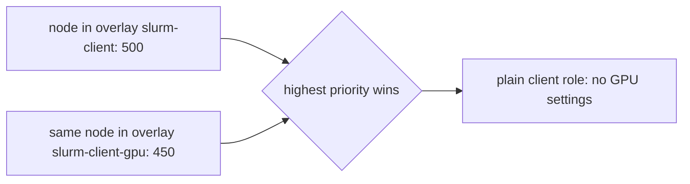

# 8.8 Workload managers under BCM: Slurm setup

| | |
|---|---|
| Level | Intermediate |
| Priority tier | 1 |
| Lab venue | Laptop |
| Part | Part 8: NVIDIA Base Command Manager |
| Status | Drafted from the BCM 11 Administrator Manual, chapter 7 (7.1 to 7.5 in depth, 7.7.4 drain, 7.8 and 7.10 skimmed). The Slurm commands themselves are covered in Part 6; this chapter is about how BCM sets Slurm up and keeps it configured. **No BCM system and no Slurm cluster under BCM were available.** `code/part08/bcm_slurm.py` is **my model of the rules the manual states**, and `slurm_lab.py` checks 50 of them. It tests my reading of the manual, not BCM or Slurm. Every command shown is from the manual and untested here |

## Why this matters for AI infrastructure

Most GPU clusters run a scheduler, and for training clusters that scheduler is usually Slurm. BCM does not just install it: it generates `slurm.conf`, `gres.conf` and `cgroup.conf` from objects you set in cmsh, so that nodes, queues and GPUs stay consistent as the cluster changes. If you know where each Slurm setting lives in BCM, you can fix a node that does not appear in a queue, a GPU that jobs cannot see, or a Slurm that is quietly unconfigured after an upgrade.

## Prerequisites and outcomes

You need chapters 8.1 to 8.7 and, for the Slurm side, Part 6. After this chapter you can:

- decide which nodes need the server, client, submit and accounting roles and how BCM stores them
- run `cm-wlm-setup` (express, step-by-step, or command line)
- explain why GPU nodes must not also sit in the plain `slurm-client` overlay
- configure GPU autodetection, nodesets and queues from cmsh
- restrict direct SSH to compute nodes so jobs go through Slurm
- explain Slurm high availability under BCM and the `slurmctldstartpolicy` setting
- set up Pyxis and Enroot for containerized jobs and know its cache choices
- drain nodes, upgrade Slurm and tune cgroups

## 1. Which workload managers

BCM 11 supports **Slurm** (versions 25.05 and 25.11 in the manual I read), **IBM Spectrum LSF 10.1**, or none. Slurm comes as BCM packages; LSF is picked up from the vendor. This chapter follows Slurm. Packages from the distribution (`slurm`) are **not** integrated with BCM and conflict with the BCM ones.

## 2. First, force jobs through the scheduler (7.2)

By default BCM lets users SSH to a node with their keys, which lets them run work outside Slurm and disturb jobs. The category setting **`usernodelogin`** controls this:

| Value | Meaning |
|---|---|
| `always` (default) | all users may SSH to the node |
| `never` | only root |
| `onlywhenjob` | a user may SSH only while they have a job on the node |

```text
[basecm11]% category use default
[basecm11->category[default]]% set usernodelogin onlywhenjob
[basecm11->category*[default*]]% commit
```

`onlywhenjob` is implemented with `pam_bright.so` in `/etc/pam.d/sshd`. Special accounts (for diagnostics) can be allowed anyway by listing them in `etc/security/pam_bright.d/pam_allow.conf` (or `pam_allow_group.conf` for groups) **inside the software image**, then `imageupdate`. An SSH session that is already open is not ended when the job ends. Epilog scripts can clean up stray processes. `usernodelogin` is a **category** setting, not a node setting.

## 3. The four roles and how BCM stores them (7.4)

| Role | What it is | Typical overlay |
|---|---|---|
| `slurmserver` | the controller, `slurmctld` | `slurm-server` |
| `slurmclient` | a compute node, `slurmd` | `slurm-client` |
| `slurmsubmit` | a login or submit node | `slurm-submit` |
| `slurmaccounting` | the accounting daemon `slurmdbd` | `slurm-accounting` |

`cm-wlm-setup` assigns them with **configuration overlays** (chapter 8.1). After an express setup the manual shows:

| Overlay | Priority | All head nodes | Categories | Role |
|---|---|---|---|---|
| `slurm-accounting` | 500 | yes | | slurmaccounting |
| `slurm-client` | 500 | no | default | slurmclient |
| `slurm-server` | 500 | yes | | slurmserver |
| `slurm-submit` | 500 | no | default | slurmsubmit |
| `wlm-headnode-submit` | 600 | yes | | slurmsubmit |

`wlm-headnode-submit` is special: applied only to the head node and shared by all installed workload managers, so the head node can always submit. The nodes of an overlay are the union of **All head nodes** with its **Nodes** and its **Categories**. A WLM object itself can only be created by `cm-wlm-setup`, the Base View WLM wizard or the initial install, never from cmsh or Base View directly ("many pitfalls").

## 4. The GPU overlay trap

When you configure GPUs, `cm-wlm-setup` creates a **GPU client** overlay, `slurm-client-gpu`, at **priority 450**. It holds the same `slurmclient` role but with GPU settings. The manual says: *only the non-GPU nodes get the standard client role; the GPU nodes get the GPU client role.*

Why it matters, using the priority rule from 8.1 (the highest priority wins): if a GPU node is **also** in the 500-priority `slurm-client` overlay (for example because that overlay covers the whole `default` category, the express default), **the plain client role wins and the GPU settings are silently ignored.** The node is up, Slurm sees it, but jobs cannot get its GPUs.



The lab builds this exact situation with the 8.1 model and shows the 500 overlay beating the 450 one. **Fix:** put GPU nodes in their own category, set `slurm-client` to non-GPU nodes only, or assign the GPU overlay a higher priority than the plain one (not 250 or 750). Check any node with `device use gpu001; roles; list`, which shows which overlay supplies each role.

## 5. `cm-wlm-setup` (7.3)

Run it with no arguments for a text interface (TUI), or with options for scripted setups.

- **Express** installs with a minimum of questions. **Step by step** lets you choose server nodes, client categories or nodes, submit nodes, GPU settings, accounting, Pyxis and more.
- Defaults: servers on the head node (`HEAD`), client and submit categories `default`, overlay names `<wlm>-server/-client/-submit/-accounting`, overlay priority 500.
- Useful options: `--wlm slurm|lsf`, `--wlm-cluster-name`, `--server-nodes`, `--client-categories`, `--client-nodes`, `--client-slots`, `--submit-categories`, `--nvidia-gpus A100:4`, `--gpu-client-categories`, `--with-pyxis`, `--reboot`, `-v`, `--skip-packages`, `--min-reboot-timeout` (not below 300 s), `--disable` with `--yes-i-really-mean-it`. **LSF needs `--archives-location`.**
- At the end you can view the configuration, save it, or save and deploy. The log is `/var/log/cm-wlm-setup.log`.
- It can be run from the secondary head only with `--allow-running-from-secondary` when that head is active.

**Slurm accounting (slurmdbd).** One or two accounting nodes; **all head nodes or all compute nodes, never mixed.** Two nodes give slurmdbd HA (the first is the primary, the other `AccountingStorageBackupHost`). On head nodes the database can live on the accounting node. On compute nodes it uses a BCM **MySQL overlay** (if none exists, run `cm-mysql-setup` first; `mysql-router` is added automatically when MySQL runs on several nodes). An **external** database is also possible; then you own it.

## 6. Configuring the Slurm roles from cmsh (7.5)

The settings live in the role, in an overlay (or category or node; node wins). Examples:

```text
[basecm11->configurationoverlay]% roles slurm-client
[...->roles]% show slurmclient              # slots, queues, features, sockets, GPU auto detect, nodesets ...
[...->roles]% set slurmclient corespeccount 2 ; commit
```

For one node: `device use node001; roles; assign slurmclient; set corespeccount 4`, and **set `wlmcluster slurm`** (the commit is refused with "The WLM cluster should be set" until you do). `list` on the roles shows `[overlay:slurm-client] slurmclient` when it comes from an overlay and plain `slurmclient` when from the node.

**Hardware autodetection.** "Slurm hardware probe autodetect" fills in sockets, cores per socket, threads per core, boards, sockets per board and real memory in the `NodeName` line.

**GPU autodetection (`gpuautodetect`).** Seven values: `bcm` (BCM writes vendor and GPU count), `none` (no AutoDetect line in `gres.conf`), `nvml` (NVIDIA), `rsmi` (AMD), `oneapi` (Intel), `nrt` (AWS Trainium/Inferentia), `off`. It can be set for the whole WLM instance (wlm mode) or per role. `cm-wlm-setup`'s GPU screens also let you choose type, count and NVIDIA MPS settings.

**Nodesets and queues.** A Slurm *queue* is a partition.

- `nodesets ns1` in the client role makes `NodeSet=ns1 Nodes=node001` in `slurm.conf`. `nodesetfeatures bigmem` adds the feature to the node's `Features=` and writes `NodeSet=bigmem Feature=bigmem`. It does **not** put the nodeset into any queue; do that yourself.
- A queue (in `wlm`, `jobqueue`) can take nodes from **nodesets, overlays, categories, node groups, or a compute nodes list**. **If the queue's `nodesets` parameter is set, BCM uses only the nodesets** and ignores the compute nodes list.
- Before BCM 11, queues were set only through the client role's `queues` parameter; both ways exist now.
- Changes appear in `/cm/shared/apps/slurm/etc/slurm/slurm.conf` "after a short while". Do not edit generated sections by hand (FrozenFile, chapter 8.1).

## 7. High availability (7.2.4)

- The WLM servers can be on **two head nodes** or **two compute nodes**, **not one of each.** In a non-HA cluster the primary server is the head node.
- The **active head node and the active Slurm server are independent**: a passive head can host the active `slurmctld`.
- `scontrol takeover` (run by `cmha makeactive` through CMDaemon) lets the backup `slurmctld` take over with no break. But BCM normally restarts a `slurmctld` it sees stopped, which would defeat that. The server role's **`slurmctldstartpolicy`** solves it: **`TAKEOVER`** (the default on HA), **`ALWAYS`** (the default on non-HA), **`ACTIVEONLY`** (only if `/cm/shared` is not mounted on both heads). With TAKEOVER, the failover submode's `prefailoverscript` is `/cm/local/apps/cmd/scripts/slurm.takeover.sh` (`cm-wlm-setup` sets it on HA; on a non-HA install set it yourself).
- The takeover is temporary: when the primary's head is restarted, or the service is restarted, the primary `slurmctld` takes its role back, as Slurm documents.
- For two compute nodes the TAKEOVER policy is set automatically only if both nodes are in a failover group.
- A single `slurmctld` should use `ALWAYS`.

Chapter 8.12 covers head node HA itself.

## 8. Containers: Enroot and Pyxis (7.3.3)

**Enroot** turns container images into unprivileged sandboxes (an enhanced `chroot`). **Pyxis** is a Slurm SPANK plugin that adds container options to `srun`/`sbatch`. Together they let users run `srun --container-image=...` without Docker. BCM sets them up from `cm-wlm-setup` (`--with-pyxis`, `--add-pyxis`, `--reinstall-pyxis`, `--remove-pyxis`, `--pyxis-data-directory`). Supported on RHEL 8-based systems and Ubuntu 20 and beyond. Enroot is installed (standard and hardened flavours exist) into the images that have the client role; Pyxis is compiled against the installed Slurm. **No reboot is needed.**

Cache choices in the Enroot screen:

- **Share raw images among users and nodes:** the cache directory must be shared; the prolog stops creating a per-user subdirectory. A directory that `cm-wlm-setup` has to create gets mode `00777`. You can tighten it afterwards, for example `00770` with a group of Pyxis users.
- A cleaner alternative: put Squashfs images in a shared directory that only administrators can write, and let users give the full path to the image.
- **Share unpacked images among nodes:** not recommended because a job can change the filesystem; if the data directory is shared, make sure the image is unpacked once before real jobs, or concurrent extraction races.
- If the directories are **not** shared, the Slurm prolog makes a directory named after the user ID, and the epilog cleans it.

Defaults in `/etc/enroot/enroot.conf` (a link to `/cm/shared/apps/slurm/etc/enroot.conf`): runtime, cache and data paths under `/run/enroot/.../$(id -u)`, squashfs options `-noI -noD -noF -noX -no-duplicates`, and `ENROOT_MOUNT_HOME=yes`. Check:

```text
module load slurm
srun --container-image=ubuntu grep PRETTY /etc/os-release
srun -N 2 --ntasks-per-node=1 --gpus-per-task=1 --mpi=pmix --container-image=deepops/mpi-nccl-test /nccl_tests/build/all_reduce_perf -b 1M -e 4G -f 2 -g 1
```

(The second line, the manual's NCCL test, was run with `--export` flags the manual itself warns are not a multi-tenant default; I left them out.) Chapter 8.10 returns to containers.

## 9. Cgroups (7.10)

Slurm's three cgroup plugins are on by default: `proctrack/cgroup`, `task/cgroup` and `jobacct_gather/cgroup`. BCM generates part of `/cm/shared/apps/slurm/etc/<cluster>/cgroup.conf` from the `cgroups` submode of the WLM instance. Parameters include `ConstrainCores`, `ConstrainRAMSpace`, `ConstrainSwapSpace`, **`ConstrainDevices`** (confines jobs to their allocated GPUs by GRES), `AllowedRAMSpace` (default 100 percent; steps are killed if the job exceeds it) and `TaskAffinity`. For a GPU cluster, **check that `ConstrainDevices` is on**, or jobs can touch GPUs they were not given.

## 10. Draining nodes, jobs and upgrades

- `drain`, `undrain`, `drainstatus` (device mode) take the usual node selection options. A drained node starts no new jobs; running jobs finish. `drain --setactions reboot` reboots the node when the last job ends. (Do this before a reimage, chapter 8.4.)
- **Upgrading Slurm** (the manual's 25.05 to 25.11 example): drain and wait; stop `slurmctld` and `slurmdbd`; remove the old packages from the head node **and from every software image** (only one Slurm version can be installed); install the new ones in both places; set the new version in the WLM cluster (`wlm use slurm`); **reinstall Pyxis** if used (it is compiled against Slurm). Go **one major version at a time**; skipping versions can need a full wipe of the Slurm configuration. The manual can also rebuild Slurm packages from source (25.11 and later).
- The manual also describes viewing jobs and queues in Base View and in cmsh (`wlm`, `jobs`, `jobqueue`), per-job IMEX daemon settings for rack-scale systems, power-saving and GPU workload power profiles (the user property `allowgpuworkloadpowerprofiles` from 8.6), and Prometheus-based job accounting. I did not read those in depth; see the sources.

## 11. Common first mistakes

1. Leaving `usernodelogin` at `always` on a shared cluster.
2. GPU nodes also in the plain client overlay (the priority trap).
3. Creating a node-level `slurmclient` role and forgetting `wlmcluster`.
4. Putting nodesets in `nodesetfeatures` and expecting them to appear in queues.
5. Setting a queue's `nodesets` and then adding nodes to its compute list.
6. Mixing a head node and a compute node as WLM servers.
7. Upgrading Slurm in the head but not in the images.
8. Forgetting to reinstall Pyxis after a Slurm upgrade.
9. Hand-editing `slurm.conf`.
10. `ConstrainDevices` off on a shared GPU cluster.

## 12. Exercises

1. Run `python3 slurm_lab.py`. Pick four checks and explain each rule in your own words.
2. Using `wlm_cluster()`, add a third overlay that fixes the GPU trap without moving nodes. Which priority is legal?
3. Write the cmsh commands (from the manual, untested) to give 10 nodes a `bigmem` feature and create a `bigmemq` queue that uses only them.
4. Plan a rolling Slurm upgrade for 500 nodes in 5 racks. When is each rack drained, and how do you know it is done?
5. Explain what a user sees when `usernodelogin` is `onlywhenjob` and their job ends while they are logged in.
6. List what must be identical between the head node and each image for a Slurm upgrade to work.

## 13. Interview angles

- "A GPU node is up in Slurm but jobs get no GPUs." Overlay priority: it may also be in the 500 client overlay; check which overlay supplies the role; check `gpuautodetect`, `gres.conf`, and `ConstrainDevices`.
- "How do you stop users from bypassing Slurm?" `usernodelogin onlywhenjob`, PAM allow list for diagnostics, epilog cleanup, and cgroup constraints.
- "How is Slurm HA done under BCM?" Two WLM servers on two heads, `slurmctldstartpolicy TAKEOVER`, `slurm.takeover.sh` as pre-failover script, `cmha makeactive` runs `scontrol takeover`.
- "How do you run containers on Slurm under BCM?" Pyxis and Enroot via `cm-wlm-setup`, `srun --container-image`, shared Squashfs images for a controlled cache.
- "Upgrade Slurm without losing config?" One major at a time, drain, stop, replace packages in head and images, set the version, reinstall Pyxis.

## 14. Checkpoint questions (20)

1. Which workload managers does BCM 11 support?
2. What are the three values of `usernodelogin` and which is the default?
3. How can a diagnostic user bypass `onlywhenjob`?
4. Name the four Slurm roles.
5. What does the `wlm-headnode-submit` overlay do and at what priority?
6. Why can't you create a WLM from cmsh?
7. What is the default priority of the GPU client overlay, and what problem can it cause?
8. How do you find which overlay supplies a node's `slurmclient` role?
9. What are the seven `gpuautodetect` values, and which writes no AutoDetect line?
10. What does a `nodesets` value turn into in `slurm.conf`?
11. When a queue has `nodesets` set, what happens to its compute nodes list?
12. Can WLM servers be one head and one compute node?
13. What are the three `slurmctldstartpolicy` values and their defaults?
14. Which script is the pre-failover script for Slurm takeover?
15. What mix is not allowed for accounting nodes?
16. What do Pyxis and Enroot each do?
17. What does a shared Enroot cache change in the prolog?
18. What is `ConstrainDevices` for?
19. Which steps does a Slurm major upgrade need besides installing packages in the head node?
20. What does `drain --setactions reboot` do?

## 15. Sources and review notes

- **BCM 11 Administrator Manual, chapter 7:** 7.1 (choices), 7.2 (forcing jobs through the WLM, HA, `slurmctldstartpolicy`), 7.3 (`cm-wlm-setup` CLI and TUI, GPU screens, accounting, Pyxis and Enroot), 7.4 (enabling and disabling, the role overlays), 7.5 (Slurm configuration, nodesets, queues, GPU autodetect, upgrade steps), 7.7.4 (drain), 7.10 (cgroups).
- **Not read in depth:** 7.4.3 (monitoring WLM services), 7.5 sections on custom package builds, IMEX per job, GPU workload power profiles, Prometheus job accounting and the PRS plugin; LSF (7.5.2); 7.6, 7.7 (jobs and queues in Base View and cmsh beyond drain); 7.8 and 7.9 (examples and power saving); 7.11 (WLM customization).
- **Cross-reference:** Part 6 for Slurm itself (partitions, `sbatch`, accounting) and its labs.
- **Run here:** `slurm_lab.py` (50 checks): `usernodelogin`, HA rules, `cm-wlm-setup` option checks, accounting node rules, the overlay priority trap (using the 8.1 model), GPU autodetect, nodesets and queue membership, Pyxis cache modes, upgrade steps, cgroup lines, drain.
- **My own choices, not the manual's:** the lab's reading that priority decides between two overlays that carry the same role (this follows 8.1's rule, which itself is a reading of 2.1.6 and was marked as such there); the suggested fixes for the trap; the order in which unspecified `slurmctldstartpolicy` combinations behave (the manual's table is garbled in the text I had, so I model only the documented defaults and statements).
- **Not verified:** everything about a real BCM system. In particular the priority trap follows from the documented priority rule and the documented default priorities (450 for the GPU overlay, 500 for the client overlay); I did not see the manual state the consequence in so many words.
