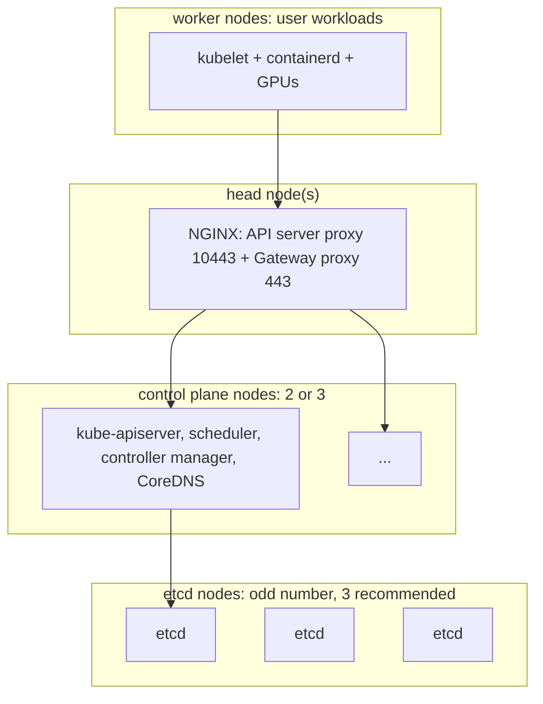
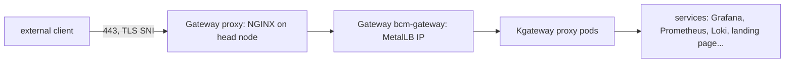

# 8.9 Kubernetes under BCM: deployment and GPU enablement

| | |
|---|---|
| Level | Intermediate |
| Priority tier | 1 |
| Lab venue | Laptop |
| Part | Part 8: NVIDIA Base Command Manager |
| Status | Drafted from the BCM 11 **Containerization Manual**, chapter 4 (Kubernetes: architecture, setup, wizard screens, roles, overlays, security model, users, Kyverno, Gateway, upgrades), the GPU operator and Network operator parts of chapter 6, and chapter 1. **No BCM system and no Kubernetes cluster were available.** `code/part08/bcm_k8s.py` is **my model of the rules the manual states**, and `k8s_lab.py` checks 48 of them. It tests my reading of the manual, not BCM or Kubernetes. Every command shown is from the manual and untested here. Kubernetes itself is Part 11's subject; this chapter is about what BCM adds |

## Why this matters for AI infrastructure

Many GPU clusters run Kubernetes for inference, notebooks and platform services, and Slurm for training. BCM can deploy a whole Kubernetes cluster onto bare-metal nodes it already manages: control plane, etcd, CNI, GPU operator, gateways and per-user policy, all from one wizard. The same nodes can often belong to either world, so you need to know what the wizard changes on a node and where each setting lives.

## Prerequisites and outcomes

You need chapters 8.1 to 8.8 and the basics of Kubernetes (Part 11 goes deeper). After this chapter you can:

- sketch BCM's Kubernetes reference architecture and size it
- run or script `cm-kubernetes-setup` and read its pre-flight checks
- explain the BCM roles and configuration overlays that carry Kubernetes
- choose the operators, and install the NVIDIA GPU operator correctly
- explain the kubelet settings BCM applies to GPU nodes
- add users safely with Kyverno policies
- understand the Gateway entry path and the upgrade rules

## 1. The reference architecture (4.1)

- **etcd** runs on an odd number of nodes, **outside** Kubernetes in BCM, as the `cm-etcd` package on nodes with the `EtcdHost` role. For HA: at least 3.
- **Control plane** nodes (typically head nodes or dedicated nodes): 2 or 3 recommended. BCM uses **kubeadm** and runs the control plane as static pods (API server, scheduler, controller manager, kube-proxy, CoreDNS).
- **Workers** are regular nodes that run user workloads.
- **API server proxy:** an NGINX server on the head node(s) and on every node of the cluster listens on **port 10443** and load balances over all control plane API servers; this is what makes the control plane HA. Because of it, one port is reserved on the head node for every Kubernetes cluster, and `kubectl` and `helm` work from the head node (`module load kubernetes`).
- **Multiple Kubernetes clusters** are allowed (since BCM 8.2), but **a node cannot be shared between clusters**.
- Versions: the manual lists Kubernetes 1.34, 1.35 and 1.36 (the first two marked "NVIDIA AI Enterprise certified"). `cm-kubernetes-setup --list-versions` shows what your packages offer.
- **Minimum per node: 16 GB RAM and two CPU cores.** Below it, deployment may succeed and later steps (such as starting Jupyter kernels) fail in hard-to-diagnose ways, because some components are removed when resources run out.

**Why odd etcd counts?** An even cluster still has a quorum but tolerates no more failures than the odd number below it: 3 and 4 nodes both survive one failure. The lab checks it with `etcd_fault_tolerance`.

## 2. Running the setup (4.2)

`cm-kubernetes-setup` (from the `cm-setup` package) has two modes: the **TUI wizard** (recommended) and **command line / config file** (`-c file.conf`, for automation). The wizard saves a config file (`cm-kubernetes-setup.conf`) that can be deployed later, but **its layout can change between BCM releases**: a file from one release should not be assumed to work in another (the manual's example: Flannel settings moved between 11.33 and 11.34).

**Pre-flight checks** (each has a `--skip-...` flag, which you should rarely use): DNS configuration, ping between all nodes, MTU consistency (mixed MTU causes packet loss), package manager refresh (for example `apt update`), and Kubernetes version support.

**What the wizard asks, in order, with the points that matter:**

1. Kubernetes version and patch level. "latest" resolves at deploy time and makes the install non-idempotent; for an air-gapped cluster choose the specific patch (chapter 8.14).
2. DockerHub registry mirror. The field is pre-filled with an NVIDIA-internal host **that customer sites cannot reach**; replace it or clear it.
3. Cluster name (a BCM label, not the Kubernetes `default` namespace), domain, external FQDN, **service network and pod network CIDRs**. The wizard avoids overlaps with networks BCM knows. By default **each Kubernetes node gets a whole /24 from the pod CIDR**, so a /16 pod network caps the cluster at 256 nodes (the lab computes this).
4. **Expose the API server to the external network?** The wizard pre-selects yes. The manual says leaving it unexposed is the safer choice; `kubectl` and Helm still work on the head node through the NGINX proxy.
5. The internal network the nodes use (`failovernet` is offered on HA clusters).
6. **Nodes:** control plane, worker (whole categories first, then individual nodes) and etcd. The head node is pre-selected as control plane and etcd. Choose an odd number of etcd nodes.
7. Ports: API server proxy 10443, etcd spool `/var/lib/etcd`.
8. CNI: **Calico** (via the Tigera operator, pre-selected, recommended) or **Flannel**. Cilium is supported but set up outside the wizard. With more than **50 nodes** Calico **Typha** is deployed automatically (one replica per 150 nodes, minimum 3, maximum 20). If the cluster grows past 50 later, enable it by hand in the `calico` application's environment.
9. **Kyverno** (policy engine) and **Kyverno policies** (the policies that enforce Pod Security Standards; the engine alone enforces nothing), namespace exclusions, and HA for Kyverno (3 replicas).
10. **Operators** (below), MetalLB mode (layer 2 by default, or BGP), Gateway IP addresses, MetalLB pools, the Gateway proxy port (443), and whether to install `cuda-dcgm` and `cm-nvidia-container-toolkit` into the images (both off by default).

It then assigns roles, adds health checks to monitoring and creates certificates. **Image updates and node reboots during the run can disrupt a production cluster**, which is why the manual suggests a direct Helm install for the GPU operator on a running cluster (section 5). `cm-kubernetes-setup --remove --cluster default --yes-i-really-mean-it` removes a cluster (it also closes firewall ports and removes the etcd spool, and asks for reboots to clean up network configuration).

**Checks afterwards:** `kubectl cluster-info` (shows `https://127.0.0.1:10443`), `kubectl get nodes` (control plane and workers `Ready`), `kubectl get all -n kube-system` (calico, coredns, metrics-server, kube-state-metrics), `helm list -A`.

## 3. Roles and overlays (4.5, 4.9)

BCM uses the same role and overlay mechanism as for Slurm (chapter 8.8), with these overlays:

| Overlay | Priority | Role it carries |
|---|---|---|
| `kube-default-etcd` | 500 | `Etcd::Host` |
| `kube-default-master` | **510** | containerd and kubelet as control plane |
| `kube-default-worker` | 500 | containerd and kubelet as worker |
| `kube-default-netq` | 501 | NetQ (only if deployed) |

Roles: **EtcdHost** (member name, spool, client and peer URLs defaulting to ports 5001 and 5002, snapshot count 5000; settings written to `/cm/local/apps/etcd/current/etc/cm-etcd.conf`), **KubernetesAPIServerProxy** (the 10443 entry; open it to the outside through the head node's `firewall` role `openports`), **KubernetesIngressServerProxy** (almost a placeholder since 11.33; the head-node NGINX is now set up by the Gateway proxy configuration), **Kubelet** (`Control plane` yes/no, `Worker`, `Max Pods`, an options submode for manifests such as `kube-apiserver.yaml`) and **Containerd**. A node in both the master and worker overlays gets the master (510) parameters, and the manual's own example shows nodes with roles `control-plane,worker` at once.

**Kubelet settings for GPU nodes (from BCM 11.34).** GPU workers are configured automatically with `cpuManagerPolicy: static`, `topologyManagerPolicy: best-effort`, `topologyManagerScope: pod`, and `kubeReserved: {cpu: 250m}`. Why: the defaults (`none`) let containers share CPUs by time-slicing, which hurts the data pipeline feeding GPUs, and let CPU, memory and GPU land on different NUMA nodes, so host-to-GPU traffic crosses the inter-socket link. Control plane nodes, non-GPU workers and clusters deployed **before** 11.34 keep the old defaults, because `kubeadm upgrade` reuses the existing kubelet configuration. This is the Kubernetes counterpart of the NUMA lesson in Part 10.

## 4. Add-ons and operators (4.2.2 to 4.2.5, chapter 6)

**Core add-ons** in `kube-system` and other namespaces: CNI, CoreDNS (inside the control plane since 10.0), MetalLB, Kgateway, Kubernetes Metrics Server, kube-state-metrics, Helm (version 4.2.3 in the manual), Kyverno, the BCM Permissions Manager and the BCM Local Path Provisioner. The Kubernetes Dashboard was retired in BCM 11.32; Ingress NGINX is deprecated in favour of the Gateway API.

**Operators** selectable in the wizard: NVIDIA GPU Operator, AgentGateway (and CRDs), Argo CD, Grafana Alloy, Loki and Operator, Ingress NGINX (deprecated), Jupyter Kernel Operator, Kgateway, Knative, Kubeflow Training Operator, Metrics Server, MPI Operator, State Metrics, LeaderWorkerSet, MetalLB, **Network Operator**, **NIM Operator**, PostgreSQL Operator, Prometheus Adapter and Operator Stack, Spark Operator. **Only four are selected by default: Kgateway, Metrics Server, State Metrics and MetalLB.** The NVIDIA GPU Operator is **not**. Run:ai is no longer part of this wizard from BCM 11.33; it uses `cm-runai-setup`.

## 5. The NVIDIA GPU Operator (6.7)

It deploys the stack that makes GPUs schedulable: the NVIDIA Container Toolkit, the device plugin, Node Feature Discovery (NFD), GPU Feature Discovery, the DCGM exporter and validator daemonsets. **The wizard does not warn you if the cluster has GPUs and you did not select it, and GPU pods will then stay Pending.** The operator can also be added to a running cluster.

Wizard checklist (independent options): 

| Option | Default | Meaning |
|---|---|---|
| Container toolkit via the operator (`toolkit.enabled`) | on | the operator manages the toolkit and hooks it into containerd via CDI where available; off means BCM's package plus containerd runtime-class drop-in files |
| Drivers as a container (`driver.enabled`) | **off** | off: the driver must be on the node (BCM provisions it); on: a driver container per GPU node. **On DGX OS images the driver is always provisioned by the host** |
| Node Feature Discovery (`nfd.enabled`) | on | labels nodes so daemonsets run only where they apply |

A custom Helm values file skips the checklist and is the way to set MIG strategy, time-slicing, custom resource names or registry overrides. To change a setting after install: re-run the wizard with a changed config file, edit the application config in cmsh, or `helm upgrade`. **Remove the operator with `helm uninstall -n gpu-operator gpu-operator` even if the wizard installed it.**

The manual's direct Helm install uses `--set driver.enabled=false --set toolkit.enabled=true` and sets `CONTAINERD_CONFIG=/cm/local/apps/containerd/var/etc/conf.d/nvidia-cri.toml` and `RUNTIME_EXECUTABLE_PATH=/cm/local/apps/containerd/current/bin/containerd` (the BCM containerd paths). Choose a chart version that is NVIDIA AI Enterprise certified.

**Validate:** `kubectl get pod -n gpu-operator -l app=nvidia-operator-validator` should be Running on each GPU node, with `nvidia-cuda-validator` and the device-plugin validator Completed. Then a GPU pod requesting `nvidia.com/gpu: 1` that runs `nvidia-smi` must leave Pending.

**Network Operator (6.8).** Selected in the same wizard, with a version screen and an optional custom values file; it deploys as the `network-operator` Helm release. NetQ, Run:ai, Spark, PostgreSQL, NIM and Jupyter operators have their own sections (not covered in depth here). NetQ has strict prerequisites (1 or 3 compute nodes, 250 GiB disk, 64 GiB RAM, Ubuntu 24.04+, **no Kyverno**, and BCM's default CMDaemon ports must be moved with `cm-cmd-ports --http 8083 --https 8084`); the lab lists them.

## 6. Users and security (4.10 to 4.15)

- **Authentication:** client certificates signed by a Kubernetes CA (made by kubeadm, in `/etc/kubernetes/pki/<cluster>/`), not the BCM CA. The API server checks the certificate's common name. **Authorization:** RBAC plus Node authorization.
- **PodSecurityPolicy was removed in Kubernetes 1.25.** BCM uses **Kyverno** for the same job.
- **Adding a user:** the BCM (PAM) user must exist. `cm-kubernetes-setup --add-user john` creates: service account `john`, namespace **`john-restricted`**, role `edit` there (or `view`, `admin`, `cluster-admin` with `--role`), read access to nodes, certificate and kube config in the user's `.kube`. The Permissions Manager turns this into a Helm chart with roles, bindings and Kyverno rules.
- **Kyverno defaults for that user:** a `hostPath` volume is allowed only under the user's home (`/home/john`) unless `--user-paths` adds more; processes run with the user's own UID and GID. `--allow-all-uids` lets pods run as any UID **but then hostPath volumes are rejected**. `--operators` grants access to operator resources.
- **Without Kyverno** (or without its policies) RBAC still separates namespaces, but a user can run privileged pods and mount host paths, which reach the **node** and, through it, other workloads. Fine for one administrator, usually not for a shared cluster. The lab shows both behaviours.
- Namespaces can be excluded from individual policies (default policies include `disallow-host-namespaces`, `disallow-host-path`, `disallow-host-ports`). Exclusions for `kube-system`, `gpu-operator`, `local-path-storage` and `*-restricted` namespaces are added automatically where needed by the features you chose.
- Other user commands: `--list-users`, `--modify-user`, `--remove-user`, `--add-to-namespace` / `--remove-from-namespace` (the namespace must exist), `--backup-permissions`, `--restore-permissions`.

## 7. Getting traffic in: the Gateway (4.17)

Since BCM 11.33 external access uses the Kubernetes **Gateway API** (1.5.x), fulfilled by **Kgateway** and **MetalLB**.

- Kgateway's **operator** is the control plane; the **proxy pods** (data plane) are created per Gateway. **Installing the operator alone exposes nothing**: a Gateway (with a GatewayClass) must exist.
- MetalLB gives each Gateway a LoadBalancer IP. The wizard pre-fills the **highest unused address** on the node network, typically just below the head node. Addresses already in use, in the dynamic range, or in a MetalLB pool are rejected.
- BCM-shipped apps publish through `bcm-gateway` with HTTPRoute and TLSRoute objects (`kubectl get gateway -A`, `httproute -A`, `tlsroute -A`). Additional gateways, TLS certificates and a migration path from Ingress are in the manual.

## 8. Upgrades (4.22)

Upgrades follow upstream `kubeadm upgrade` principles, with BCM-specific rules:

- **kubeadm upgrades only itself and a few central components.** It does **not** upgrade etcd, CNIs, CSIs, container runtimes, third-party components, or pods not managed by a Deployment or ReplicaSet. Each needs its own plan.
- Nodes may be **provisioned from software images**: update the images too (chapter 8.4), or a reboot returns the old version.
- **Order:** the first control plane node, then the other control plane nodes, then workers, one at a time, then **update the Kubernetes version recorded in BCM** (it does not update itself).
- A **hot upgrade** keeps services up; it needs spare capacity so pods can move away from the node being upgraded. Pods that **cannot migrate** (persistent volumes, GPUs a pod needs) must be handled by hand. `kubectl drain --ignore-daemonsets` skips DaemonSet pods, which then need a separate upgrade.
- Upgrade one minor version at a time (upstream rule) and read the notes for Ubuntu and SLES and for specific versions in the manual. Air-gapped upgrades have an extra procedure (Appendix C, chapter 8.14).

## 9. Common first mistakes

1. A GPU cluster without the GPU operator ("pods Pending, nodes Ready").
2. An even number of etcd nodes, or a single etcd.
3. A pod CIDR too small for the node count.
4. Leaving the NVIDIA-internal DockerHub mirror in the wizard.
5. Exposing the API server because it was the pre-selected answer.
6. Skipping Kyverno on a shared cluster.
7. Using an old config file with a newer BCM release.
8. Running the wizard on a production cluster to add one operator.
9. Removing the GPU operator with the wizard instead of Helm.
10. Upgrading control planes and forgetting etcd, CNI or the BCM version record.

## 10. Exercises

1. Run `python3 k8s_lab.py`. Pick four checks and explain each rule in your own words.
2. Size a cluster for 300 GPU nodes: etcd and control plane layout, pod CIDR, Typha replicas.
3. A user complains that their pod mounting `/scratch/data` is rejected. Give two fixes with their trade-offs.
4. Write a runbook (from this chapter, untested) for adding the GPU operator to a running cluster with Helm, including validation.
5. Explain, using the NUMA lesson, why `cpuManagerPolicy: static` matters for a training pod that requests 8 whole CPUs and 1 GPU.
6. Compare what a node needs to belong to Slurm (chapter 8.8) and to Kubernetes. Can it be both?

## 11. Interview angles

- "Walk me through a Kubernetes install on BCM." Reference architecture, wizard answers (CIDRs, nodes, CNI, Kyverno, operators), roles and overlays created, checks afterwards.
- "GPUs show up in `nvidia-smi` on the host but pods cannot get them." GPU operator missing or unhealthy; check validator pods, toolkit and containerd configuration, device plugin.
- "Why is etcd outside Kubernetes in BCM?" The manual states it as the design; it keeps the datastore independent of the cluster it serves, and BCM protects those nodes with the `datanode` option against reprovisioning.
- "How are users isolated?" Namespace per user, RBAC, Kyverno policies for hostPath and UID/GID; without Kyverno the isolation is incomplete.
- "How do you upgrade without downtime?" Hot upgrade rules above.

## 12. Checkpoint questions (20)

1. Where does etcd run in BCM, and why an odd count?
2. What is the minimum RAM and CPU per node?
3. What does the API server proxy do and on which port?
4. Can a node belong to two Kubernetes clusters?
5. Which tool deploys Kubernetes, and what does it use underneath?
6. Which CNIs does the wizard offer?
7. When is Typha deployed and how many replicas?
8. How many nodes can a /16 pod network hold with the default per-node range?
9. Which four operators are selected by default?
10. What happens if a GPU cluster is deployed without the GPU operator?
11. What are the three GPU operator checklist options and their defaults?
12. What is different about the GPU driver on DGX OS?
13. How do you remove the GPU operator?
14. What kubelet settings does BCM 11.34 apply on GPU workers, and why?
15. What priorities do the etcd, master and worker overlays have?
16. What does `--add-user john` create?
17. What does Kyverno restrict for a Kubernetes user by default?
18. What changes with `--allow-all-uids`?
19. Why does installing the Kgateway operator alone expose nothing?
20. What does kubeadm not upgrade?

## 13. Sources and review notes

- **BCM 11 Containerization Manual:** chapter 1 (introduction), chapter 4 (4.1 reference architecture, 4.2 setup, add-ons, Helm, CLI options, TUI screens, testing; 4.5 overlays; 4.9 roles; 4.10 to 4.15 security, users, Kyverno, Permissions Manager; 4.17 Gateway; 4.22 upgrades), chapter 6 (6.7 GPU operator, 6.8 Network operator, 6.9 NetQ prerequisites).
- **Not read in depth:** 4.3 and 4.4 (Docker-related prerequisites, AMD GPUs), 4.7 and 4.8 (cluster configuration options, EtcdCluster), 4.16 (external access), 4.18 to 4.21 (networking model, monitoring, storage class, Harbor), chapter 5 (Kubernetes applications), the other operators in chapter 6, chapter 7 (edge), chapter 8 (Cluster API), appendices A to C (air-gapped procedures are for chapter 8.14).
- **Cross-reference:** Part 11 for Kubernetes GPU scheduling, DCGM and MIG in depth; Part 12 for the Network operator and RDMA.
- **Run here:** `k8s_lab.py` (48 checks): etcd arithmetic and plan checks, pod CIDR capacity, Typha rules, operator defaults and warnings, GPU operator options, kubelet GPU defaults, overlay priorities, user and Kyverno behaviour, Gateway IP selection, NetQ prerequisites, air-gap version validation, upgrade order.
- **My own choices, not the manual's:** the "master overlay wins" reading for a node in both overlays (a priority-rule inference); the upgrade step wording (the manual's headings give the order; I did not read the step-by-step text); the reason given for etcd outside Kubernetes (the manual states the fact, not the reason).
- **Not verified:** everything about a real BCM system or Kubernetes cluster; version numbers in the manual change between releases.
