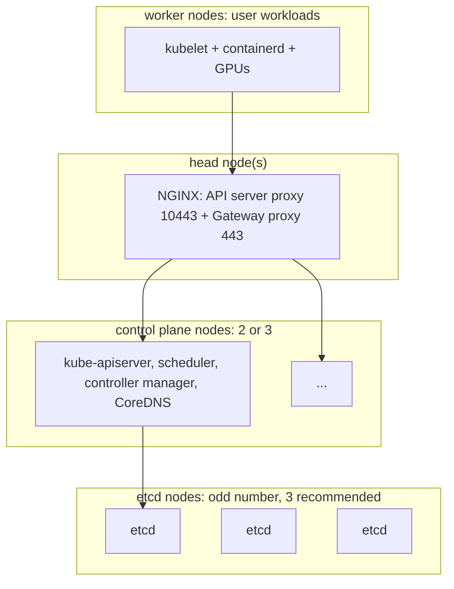
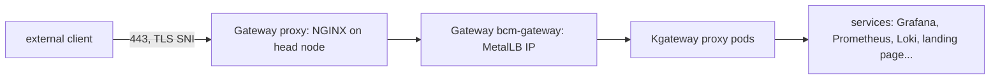

# 8.9 Kubernetes under BCM: deployment and GPU enablement

| | |
|---|---|
| Level | Intermediate |
| Priority tier | 1 |
| Lab venue | Laptop |
| Part | Part 8: NVIDIA Base Command Manager |
| Status | Drafted (`k8s_lab.py`: 64 checks pass; cluster commands **untested** on live BCM) |

## Why this matters for AI infrastructure

If you run a GPU cluster, you will probably have two systems side by side. Many clusters run Kubernetes for inference, notebooks and platform services, and Slurm for training. BCM can deploy a whole Kubernetes cluster onto bare-metal nodes it already manages. One wizard handles the control plane, etcd, the CNI, the GPU operator, the gateways and per-user policy. The same nodes can often belong to either world, so you need to know what the wizard changes on a node and where each setting lives.

## Prerequisites and outcomes

Before you start, you should have worked through chapters 8.1 to 8.8 and know the basics of Kubernetes. Part 11 goes deeper if you want more. When you finish this chapter, you should be able to:

- sketch BCM's Kubernetes reference architecture and size it
- run or script `cm-kubernetes-setup` and read its pre-flight checks
- explain the BCM roles and configuration overlays that carry Kubernetes
- choose the operators, and install the NVIDIA GPU operator correctly
- explain the kubelet settings BCM applies to GPU nodes
- add users safely with Kyverno policies
- understand the Gateway entry path and the upgrade rules

## 1. The reference architecture (4.1)

Suppose you are sizing a new cluster and need to decide where each part runs. The diagram below shows the pieces and how traffic moves between them. Workers send their requests to the head node's NGINX proxy, which passes them on to the control plane. The control plane in turn talks to the etcd nodes.



Three kinds of node make up the cluster. The etcd nodes store the cluster's state, the control plane nodes run the API and scheduling services, and the workers run your workloads.

etcd runs on an odd number of nodes, and it runs outside Kubernetes in BCM. It is installed as the `cm-etcd` package on nodes with the `EtcdHost` role. For high availability, use at least 3.

Control plane nodes are usually head nodes or dedicated machines, and two or three is the recommended count. BCM uses kubeadm to build the control plane. It runs the control plane as static pods: `kube-apiserver`, the scheduler, the controller manager, kube-proxy and CoreDNS. Workers are regular nodes that run user workloads.

The API server proxy is what makes the control plane highly available. An NGINX server on the head node(s) and on every node of the cluster listens on port 10443. It load balances requests across all the control plane API servers. Because of this, one port on the head node is reserved for each Kubernetes cluster. You can run `kubectl` and `helm` from the head node after `module load kubernetes`.

BCM allows several Kubernetes clusters, a capability added in BCM 8.2. A single node, however, cannot be shared between two clusters. The manual lists Kubernetes 1.34, 1.35 and 1.36 as supported versions, and the first two are marked NVIDIA AI Enterprise certified. Run `cm-kubernetes-setup --list-versions` to see what your packages offer.

Each node needs at least 16 GB of RAM and two CPU cores. Below that, the deployment may still succeed. Later steps, such as starting Jupyter kernels, can then fail in ways that are hard to diagnose, because some components are removed when resources run out.

**Why use an odd number of etcd nodes?** An even cluster still has a quorum, but it tolerates no more failures than the odd number below it. 3 and 4 nodes both survive one failure. The lab checks this with `etcd_fault_tolerance`.

When you plan the layout, pick an odd etcd count and two or three control plane nodes before you start the wizard.

## 2. Running the setup (4.2)

Suppose you are building a cluster for the first time. Your first decision is how to run `cm-kubernetes-setup`, which comes from the `cm-setup` package. It offers two modes: the TUI wizard, which is recommended, and command line or config file mode (`-c file.conf`), which suits automation. The wizard saves a config file named `cm-kubernetes-setup.conf` that you can deploy later. Be careful with it, because the layout can change between BCM releases. A file from one release should not be assumed to work in another. The manual's example is the Flannel settings, which moved between 11.33 and 11.34.

The setup runs a set of pre-flight checks. They cover DNS configuration, ping between all nodes, MTU consistency (mixed MTU causes packet loss), the package manager refresh (for example `apt update`), and Kubernetes version support. Each check has a `--skip-...` flag, but you should rarely use those flags.

The wizard then asks its questions in order. The points below are the ones that matter most.

1. **Kubernetes version and patch level.** "latest" resolves at deploy time, which makes the install non-idempotent. In plain terms, running it again may not give the same result. For an air-gapped cluster, choose a specific patch (chapter 8.14).
2. **DockerHub registry mirror.** The field arrives pre-filled with an NVIDIA-internal host that customer sites cannot reach. Replace it or clear it.
3. **Cluster name, domain, external FQDN, and CIDRs.** The cluster name is a BCM label, not the Kubernetes `default` namespace. You also set the service network and pod network CIDRs, and the wizard avoids overlaps with networks BCM knows. By default, each Kubernetes node gets a whole /24 from the pod CIDR. A /16 pod network therefore holds 256 /24 blocks, which caps the cluster at 256 nodes. The lab computes this for you.
4. **Expose the API server to the external network?** The wizard pre-selects yes. The manual says leaving it unexposed is the safer choice. `kubectl` and Helm still work on the head node through the NGINX proxy.
5. **Internal network.** This is the network the nodes use among themselves. `failovernet` is offered on HA clusters.
6. **Nodes.** You pick control plane nodes, workers and etcd nodes. The wizard offers whole categories first, then individual nodes. The head node is pre-selected as control plane and etcd. Choose an odd number of etcd nodes.
7. **Ports.** The API server proxy uses port 10443, and the etcd spool lives at `/var/lib/etcd`.
8. **CNI.** Calico, installed through the Tigera operator, is pre-selected and recommended. Flannel is the other choice. Cilium is supported, but you set it up outside the wizard. With more than 50 nodes, Calico Typha deploys automatically, with one replica per 150 nodes, a minimum of 3 and a maximum of 20. If the cluster grows past 50 later, enable Typha by hand in the `calico` application's environment.
9. **Kyverno and Kyverno policies.** Kyverno is the policy engine. The Kyverno policies are the rules that enforce Pod Security Standards, and the engine alone enforces nothing. The wizard also asks about namespace exclusions, and about HA for Kyverno, which uses 3 replicas.
10. **Operators and the rest.** You choose the operators (covered below), the MetalLB mode (layer 2 by default, or BGP), the Gateway IP addresses, the MetalLB pools, and the Gateway proxy port (443). You also decide whether to install `cuda-dcgm` and `cm-nvidia-container-toolkit` into the images. Both are off by default.

After the questions, the wizard assigns roles, adds health checks to monitoring and creates certificates. Image updates and node reboots during the run can disrupt a production cluster. That is why the manual suggests a direct Helm install of the GPU operator on a running cluster (section 5). To remove a cluster, run `cm-kubernetes-setup --remove --cluster default --yes-i-really-mean-it`. This closes the firewall ports, removes the etcd spool, and asks for reboots to clean up network configuration.

Afterwards, run four checks. `kubectl cluster-info` shows `https://127.0.0.1:10443`. `kubectl get nodes` lists the control plane and worker nodes, which should all be `Ready`. `kubectl get all -n kube-system` shows calico, coredns, metrics-server and kube-state-metrics. `helm list -A` lists the Helm releases.

Before you run the wizard, settle the Kubernetes patch, clear the mirror field, and size the pod CIDR for the nodes you expect to add.

## 3. Roles and overlays (4.5, 4.9)

When you deploy Kubernetes, you need to know what BCM writes onto each node. This section explains what it writes and where. BCM uses the same role and overlay mechanism it uses for Slurm (chapter 8.8). Each overlay carries one or more roles, and each has a priority number.

| Overlay | Priority | Role it carries |
|---|---|---|
| `kube-default-etcd` | 500 | `Etcd::Host` |
| `kube-default-master` | **510** | containerd and kubelet as control plane |
| `kube-default-worker` | 500 | containerd and kubelet as worker |
| `kube-default-netq` | 501 | NetQ (only if deployed) |

The priority decides which settings win when a node sits in more than one overlay. A node in both the master and worker overlays takes the master settings at priority 510. The manual's own example shows nodes with the roles `control-plane,worker` at the same time.

Five roles do the work. **EtcdHost** sets the member name, the spool, and the client and peer URLs, which default to ports 5001 and 5002, plus a snapshot count of 5000. Its settings are written to `/cm/local/apps/etcd/current/etc/cm-etcd.conf`. **KubernetesAPIServerProxy** is the 10443 entry, and you open it to the outside through the `openports` setting of the head node's `firewall` role. **KubernetesIngressServerProxy** is almost a placeholder since 11.33, because the head-node NGINX is now configured by the Gateway proxy setup. **Kubelet** holds the `Control plane` and `Worker` switches, the `Max Pods` limit, and an options submode for manifests such as `kube-apiserver.yaml`. **Containerd** is the runtime role.

**Kubelet settings for GPU nodes (from BCM 11.34).** These settings matter for any node that feeds GPUs. GPU workers get four settings automatically: `cpuManagerPolicy: static`, `topologyManagerPolicy: best-effort`, `topologyManagerScope: pod`, and `kubeReserved: {cpu: 250m}`. The default policy, `none`, lets containers share CPUs through time-slicing, and that jitter hurts the data pipeline that feeds the GPUs. The defaults can also place the CPU, memory and GPU on different NUMA nodes. Host-to-GPU traffic then crosses the inter-socket link. Control plane nodes, non-GPU workers and clusters deployed before 11.34 keep the old defaults, because `kubeadm upgrade` reuses the existing kubelet configuration. This is the Kubernetes version of the NUMA lesson in Part 10.

### 3.1 `kubernetes` and `etcd` (`EtcdCluster`) mode options, monitoring, and storage

- **`generic::containerd` and NVIDIA/AMD GPUs.** `cm-kubernetes-setup` assigns `generic::containerd` to worker nodes, and this overwrites any non-BCM `containerd` config. Its `configurations` submode holds `containerd-cri`. That file is written to `/cm/local/apps/containerd/var/etc/conf.d/cri.toml` with mode `0644`, `Service action on write = RESTART` and `Service stop on failure = yes`. It is imported into `/cm/local/apps/containerd/var/etc/config.toml` through `imports = ["/cm/local/apps/containerd/var/etc/conf.d/*.toml"]`. When NVIDIA GPU integration is enabled, `nvidia-cri` is added as well.

- **AMD GPUs.** You check for AMD GPUs with `device -> sysinfo | grep GPU`. This setup needs Kubernetes v1.16 or later, plus the RadeonOpenCompute `k8s-ds-amdgpu-dp.yaml` DaemonSet. That DaemonSet exposes `amd.com/gpu` and uses `HIP_VISIBLE_DEVICES` in pods. The upstream DaemonSet schedules onto every node, even nodes with no GPUs, and it skips tainted control-plane and head nodes. You can change that in three steps.
  1. Manage the YAML in BCM with `kubernetes[default] -> appgroups -> add amd -> applications -> add device-plugin -> set config /tmp/k8s-ds-amdgpu-dp.yaml`.
  2. To include a tainted head node without removing its taint, run `kubectl taint nodes basecm11 node-role.kubernetes.io/control-plane-`. Then change the DaemonSet toleration from `key: CriticalAddonsOnly` to `key: node-role.kubernetes.io/control-plane`, `effect: NoSchedule`, `operator: Exists`.
  3. To limit the DaemonSet to GPU nodes, create a `LabelSet` in `cmsh` with `kubernetes[default] -> labelsets -> add amd; set labels nvidia.com/amd-gpu-accelerator=; append categories gpu-nodes; commit`. Then add a `nodeAffinity` `requiredDuringSchedulingIgnoredDuringExecution` rule that matches `key: 'nvidia.com/amd-gpu-accelerator'` with `operator: Exists`.

- **`kubernetes` mode and `etcd` (`EtcdCluster`) parameters.** In `cmsh`, `kubernetes use default; show` lists the settings. They include `Etcd Cluster` (`kube-default`), `Pod Network` (`kube-default-pod`), `Pod Network Node Mask`, and `Service Network` (`kube-default-service`, default `172.29.0.0/16`, which must not overlap the pod ranges). The list continues with `Internal Network` (`internalnet`), `KubeDNS IP` (`10.150.255.254`), and the `Kubernetes API server proxy port` (default `10443`). `Trusted domains` comes next, and its first item is the cluster's external FQDN. Then come `Kubeadm init file`, `Kubeadm CERT Key`, `Kube CA Cert` and `Key`, `App Groups`, `Label Sets`, `Kubernetes users`, `External` (`no`), and the CAPI fields `Capi template`, `Capi namespace` and `Kubernetes management cluster`.

- The top-level `etcd` mode (`EtcdCluster`) sets the global etcd options. `Name` maps to `--initial-cluster-token`, and `Election Timeout` maps to `--election-timeout`, in milliseconds. `Heart Beat Interval` maps to `--heartbeat-interval`, also in milliseconds. `CA` maps to `--peer-trusted-ca-file`, and `CA Key` sits beside it. `Member Certificate` maps to `--peer-cert-file`, and `Member Certificate Key` maps to `--peer-key-file`. An `EtcdHost` role setting overwrites the `EtcdCluster` member certificate and key, so check which one is in force. `Client CA` maps to `--trusted-ca-file`. `Client Certificate` and `Key` map to `--cert-file` and `--key-file`, which `etcdctl` uses.

- **Kubernetes Apps (`appgroups`).** Version 8.1 introduced these as `addons`, and 8.2 expanded them into `kubernetes[default] -> appgroups`. Since BCM 9.2, the operators are Helm charts. What remains in the tree is `Flannel` and the predefined `system` app group, which holds `bootstrap`, `calico`, `flannel`, `kubestatemetrics`, `metrics_server` and `root`. Each application has `Format = Yaml`, an `Enabled` switch, and a `Config` you open with `set config`. Its `Environment` holds key/value variables that get substituted into the YAML, such as `calico_typha_replicas`, `calico_typha_service` and `head_node_internal_ip`. Setting `Nodes environment = yes` also exports them to the node environment. `Exclude list snippets` protects app files on the nodes from `imageupdate`.

- **Networking, health checks, storage, and Harbor.** Calico BGP is the default pod network provider. It uses BGP to share pod routes, so no IP-in-IP overlay is needed, which avoids overlay overhead on large bare-metal clusters. `cm-kubernetes-setup` adds four health checks. `KubernetesChildNode` confirms the expected agents and services are up on active nodes. `KubernetesComponentsStatus` checks that the node daemons are healthy. `KubernetesNodesStatus` checks that nodes are `Ready`. `KubernetesPodsStatus` checks that pods are `Running`, `Succeeded` or `Pending`. The wizard can also enable the Local Path Storage Class over any POSIX shared filesystem mounted on all nodes, such as NFS, BeeGFS or Lustre. It creates the default `local-path` StorageClass (`cluster.local/local-path-provisioner`, `VolumeBindingMode: WaitForFirstConsumer`, `AllowVolumeExpansion: true`). For Harbor, create the pull secret with `kubectl create secret docker-registry myregistrykey --docker-server=node001:9443 --docker-username=admin --docker-password=...` and reference it under `spec.imagePullSecrets` (see chapter 8.10).

Decide which overlay carries each node's role before you assign roles in the wizard, because the priority decides which settings win.

## 4. Add-ons and operators (4.2.2 to 4.2.5, chapter 6)

Some add-ons run in `kube-system` and others run in their own namespaces. The core set includes the CNI, CoreDNS (inside the control plane since 10.0), MetalLB, Kgateway, the Kubernetes Metrics Server, kube-state-metrics, Helm (version 4.2.3 in the manual), Kyverno, the BCM Permissions Manager and the BCM Local Path Provisioner. Two older pieces have gone. The Kubernetes Dashboard was retired in BCM 11.32, and Ingress NGINX is deprecated in favour of the Gateway API.

The wizard offers a long list of operators, including the NVIDIA GPU Operator, AgentGateway, Argo CD, Grafana Alloy, Loki and its operator, Kubeflow Training Operator, Knative, the Network Operator, the NIM Operator, the PostgreSQL Operator, Spark Operator and others. Only four are selected by default: Kgateway, Metrics Server, State Metrics and MetalLB. The NVIDIA GPU Operator is not one of the four, so you have to select it yourself. Run:ai is no longer part of this wizard from BCM 11.33 onwards, and it uses `cm-runai-setup` instead.

Before you finish the wizard, check the operator list against the hardware you have. A GPU node with the GPU operator unselected will not show its GPUs to the scheduler.

## 5. The NVIDIA GPU Operator (6.7)

Suppose the cluster has GPUs, but the GPU pods stay Pending after you deploy. The usual cause is that the GPU operator was never selected. The wizard does not warn you about this, so you need to know what the operator does. It deploys the stack that makes GPUs schedulable. That stack includes the NVIDIA Container Toolkit, the device plugin, Node Feature Discovery (NFD), GPU Feature Discovery, and the DCGM exporter and validator daemonsets. You can also add the operator to a cluster that is already running.

The wizard lists the operator's options as independent checkboxes. The table shows what each one does and its default state.

| Option | Default | Meaning |
|---|---|---|
| Container toolkit via the operator (`toolkit.enabled`) | on | the operator manages the toolkit and hooks it into containerd via CDI where available; off means BCM's package plus containerd runtime-class drop-in files |
| Drivers as a container (`driver.enabled`) | **off** | off: the driver must be on the node (BCM provisions it); on: a driver container per GPU node. **On DGX OS images the driver is always provisioned by the host** |
| Node Feature Discovery (`nfd.enabled`) | on | labels nodes so daemonsets run only where they apply |

The table matters most for the driver option. If you turn on the driver container, you are asking for a driver per GPU node. On DGX OS images, though, the host always provisions the driver, so that switch has no effect there. A custom Helm values file skips the checklist. It is the way to set the MIG strategy, time-slicing, custom resource names or registry overrides. To change a setting after install, re-run the wizard with a changed config file, edit the application config in cmsh, or run `helm upgrade`. Remove the operator with `helm uninstall -n gpu-operator gpu-operator`, even if the wizard installed it.

The manual's direct Helm install passes `--set driver.enabled=false --set toolkit.enabled=true`. It also sets `CONTAINERD_CONFIG=/cm/local/apps/containerd/var/etc/conf.d/nvidia-cri.toml` and `RUNTIME_EXECUTABLE_PATH=/cm/local/apps/containerd/current/bin/containerd`, which are the BCM containerd paths. Pick a chart version that is NVIDIA AI Enterprise certified.

To validate the install, run `kubectl get pod -n gpu-operator -l app=nvidia-operator-validator`. The validator should be Running on each GPU node, and the `nvidia-cuda-validator` and device-plugin validator should be Completed. Then run a GPU pod that requests `nvidia.com/gpu: 1` and runs `nvidia-smi`. If the operator is healthy, that pod must leave Pending.

**The Network Operator** is selected in the same wizard. It has a version screen and an optional custom values file, and it deploys as the `network-operator` Helm release. NetQ has strict prerequisites. It needs NetQ 4.15 or later on Ubuntu 24.04 or later, and NetQ 5 is not supported in the BCM 11 wizard without BCM support. It needs one or three regular compute nodes, each with at least 250 GiB of disk and 64 GiB of RAM. It also rules out Kyverno. BCM's default CMDaemon ports must be moved first with `cm-cmd-ports --http 8083 --https 8084 && systemctl restart cmd`, and then you restart the wizard. A one-node setup exposes `netq-gui` through a `NodePort` service. A three-node cluster prompts for a LoadBalancer virtual IP instead.

### 5.1 Other BCM-packaged operators and `Modify operators`

- **Inspecting and tuning operator Helm charts.** `cm-kubernetes-setup --list-operators-versions` lists the packaged versions, and it marks the NVIDIA AI Enterprise certified ones with `E`. Examples include `v26.3.0E` and `v25.10.1E` for the GPU Operator, and `25.7.0E` and `25.4.0E` for the Network Operator. `cm-kubernetes-setup --list-operators` shows `api_available` (`0` or `1`) for each operator. The charts live on shared storage, for example `/cm/shared/apps/jupyter-kernel-operator/current/helm/*.tgz`. You can read their defaults with `helm show values` and install with `--values tunables.yaml`.

- **Argo CD Operator.** The optional initial config in the wizard sets the admin password. It can also generate a random one in `argocd-initial-admin-secret`, which you read with `kubectl -n argocd get secret argocd-initial-admin-secret -o jsonpath="{.data.password}" | base64 -d`. The wizard can register `Git`, `Helm` or `OCI` repositories too.

- **Grafana Alloy and Grafana Loki.** Alloy is a log collector, not a store, so it needs Loki behind it. The wizard rejects Grafana Alloy if Grafana Loki is not selected, though you can install Loki without Alloy. Alloy's checklist offers three log sources. `pod_logs` and `kube_events` are on by default. `varlog` collects `/var/log` on worker nodes for kubelet and OS logs, and it is off by default. Any source you leave unselected is not collected at all.

  Loki offers three deployment modes: `SingleBinary` (all in one process), `SimpleScalable` (read, write and backend split), and `Distributed`. The mode screen appears only when the cluster has at least 3 worker nodes and a default StorageClass. If either is missing, the wizard quietly picks `SingleBinary`. In `SingleBinary` mode, a screen asks about `Enable MinIO storage`, `Storage` (`S3` or `FileSystem`), and `Replica factor`. In `SimpleScalable` or `Distributed` mode that screen is skipped, and MinIO and S3 are enabled automatically. If you expose the Loki API through a Gateway `HTTPRoute`, the wizard requires a non-empty username and password.

- **Jupyter Kernel Operator.** It installs into `-n cm`, as the `cmjupyterkernels.apps.brightcomputing.com` resource. Upgrades need care. When you run `helm upgrade`, pass the release's existing namespace, `-n cm`. Do not hardcode `cm-jupyter-kernel-operator-system`. An older chart shipped its own `Namespace` object, so a mismatched `-n` prunes that object and deletes the entire release. Here is how a kernel comes to life. JupyterLab hands kernel creation to Jupyter Enterprise Gateway (JEG), which opens a TCP socket and creates a `CMJupyterKernel` CRD. The operator then creates the kernel pod with an attached sidecar proxy. It fills `/etc/passwd` and `/etc/group` inside the pod, so the unprivileged process runs with the Jupyter user's exact UID and GID. When JEG disconnects, the sidecar exits, and the operator cleans up the pod, service, configmap and secrets.

- **Prometheus Operator Stack and Grafana.** Grafana's admin username and random password live in the `kube-prometheus-stack-grafana` Secret in the `prometheus` namespace, as `{.data.admin-user}` and `{.data.admin-password}`, both base64-encoded. You can reach Grafana with `kubectl port-forward -n prometheus svc/kube-prometheus-stack-grafana 3000:80`, or at `https://<Gateway IP>/grafana/`. Grafana loads any `ConfigMap`, in any namespace, that carries the label `grafana_dashboard='1'` as a dashboard.

- **Spark Operator, Zalando Postgres Operator, and NVIDIA NIM Operator.** The Spark operator (`cm-kubernetes-spark-operator`) needs the Permission Manager and the pod security policy enabled before you grant a user access. Use `cm-kubernetes-setup --add-user alice --operators cm-kubernetes-spark-operator --allow-all-uids`. The Postgres operator defaults to `1.15.1`, and the NIM Operator defaults to `3.1.1`. Both can be selected in the wizard. Run:ai is covered in chapter 8.16.

- **Adding and removing operators on a running cluster (`Modify operators`, from BCM 11.34).** You no longer have to redeploy Kubernetes to change operators. Choose **Modify operators** in the `cm-kubernetes-setup` TUI, or pass an updated config file with `cm-kubernetes-setup -c <file>`. When you add an operator, the ones already installed are greyed out, and dependency and conflict checks run. When you remove one, Helm releases are uninstalled in reverse dependency order. An operator that another operator still depends on cannot be removed alone. As usual with Helm, CRDs, namespaces, node labels and taints stay in place for manual cleanup.

Before you change the GPU operator, decide whether the node will use the host driver or a driver container, because that choice drives the rest of the setup.

## 6. Users and security (4.10 to 4.15)

Suppose a second researcher needs access to the cluster. Before you hand over a kubeconfig, you need to know what that user can reach. Authentication uses client certificates signed by a Kubernetes CA. kubeadm creates that CA under `/etc/kubernetes/pki/<cluster>/`, and it is separate from the BCM CA. The API server checks the certificate's common name. Authorization uses RBAC together with Node authorization.

PodSecurityPolicy was removed in Kubernetes 1.25, so BCM uses Kyverno for the same job.

Adding a user starts with the BCM (PAM) account, which must already exist. Then `cm-kubernetes-setup --add-user john` creates a service account named `john`, and a namespace named **`john-restricted`**. It gives `john` the `edit` role in that namespace, or `view`, `admin` or `cluster-admin` if you pass `--role`. It also grants read access to nodes, and it writes a certificate and kube config into the user's `.kube` directory. The Permissions Manager turns this into a Helm chart with roles, bindings and Kyverno rules.

Kyverno adds its own limits for that user. A `hostPath` volume is allowed only under the user's home, `/home/john`, unless `--user-paths` adds more paths. Processes run with the user's own UID and GID. The `--allow-all-uids` flag lets pods run as any UID, but then hostPath volumes are rejected. The `--operators` flag grants access to operator resources.

Without Kyverno, or without its policies, RBAC still separates namespaces. A user can then run privileged pods and mount host paths. Those reach the node, and through the node they reach other workloads. That is fine for a single administrator, but usually not for a shared cluster. The lab shows both behaviours.

You can exclude namespaces from individual policies. The default policies include `disallow-host-namespaces`, `disallow-host-path` and `disallow-host-ports`. Exclusions for `kube-system`, `gpu-operator`, `local-path-storage` and `*-restricted` namespaces are added automatically where the features you chose need them. Other user commands are `--list-users`, `--modify-user`, `--remove-user`, `--add-to-namespace` and `--remove-from-namespace` (the namespace must already exist), plus `--backup-permissions` and `--restore-permissions`.

Before you add a user to a shared cluster, confirm that Kyverno and its policies are running.

## 7. Getting traffic in: the Gateway (4.17)

Suppose an external user reports that Grafana will not load. The request has to pass through several layers before it reaches a service. Since BCM 11.33, external access uses the Kubernetes Gateway API, version 1.5.x. Kgateway and MetalLB fulfil it. The diagram shows the path a request takes.



Kgateway runs an operator, and that operator is the control plane. The proxy pods are the data plane, and the operator creates one set per Gateway. Installing the operator alone exposes nothing. A Gateway, with a GatewayClass, must exist first.

MetalLB gives each Gateway a LoadBalancer IP. The wizard pre-fills the highest unused address on the node network, which is usually just below the head node. The wizard rejects addresses that are already in use, that sit in the dynamic range, or that belong to a MetalLB pool.

BCM's own apps publish through `bcm-gateway`, using HTTPRoute and TLSRoute objects. You can list them with `kubectl get gateway -A`, `httproute -A` and `tlsroute -A`. As an example, the built-in `landingpage` HTTPRoute in the `bcm-gateway` namespace forwards `/` to a static Kgateway `Backend`. That backend points at `master:80`, which is Apache on the head node. An application in another namespace can attach a route to `bcm-gateway` only if its namespace appears under `allowedRoutes.namespaces.selector.matchExpressions` on the `bcm-gateway` listener.

External access uses two head-node ports when external exposure is on. That is the default in the wizard, and Shorewall opens both. Port 10443 (`kubernetesapiserverproxyport`) carries `kubectl` and `helm` traffic to the control plane. Port 443 serves the Gateway proxy, which is the `KubernetesIngressServerProxy` role on head nodes and edge directors. It routes by TLS SNI hostname. In `L2` MetalLB mode, traffic moves by ARP failover rather than true load balancing. So at least one Kubernetes node must share the L2 network with the head node, which lets the Gateway proxy reach the MetalLB VIP.

For testing, you can use self-signed Gateway TLS certificates. In `cm-kubernetes-setup`, open `Gateway configuration -> Configure TLS Certificate for Gateway`. Choose `no` at the "use existing certificate" prompt. The setup then generates a private CA, `gateway-ca.key` and `gateway-ca.crt`, plus a server keypair, `gateway-bcm-gateway.key` and `gateway-bcm-gateway.crt`. These files go under `/etc/kubernetes/pki/<cluster>/` on the active head node. The setup also updates the `gateway-bcm-gateway-cert` TLS Secret in `bcm-gateway`. Keep these certificates for testing only. They cause obscure issues with Run:ai, and they do not stop man-in-the-middle attacks unless you check the SHA-256 fingerprint, shown by `openssl x509 -in /etc/kubernetes/pki/default/gateway-bcm-gateway.crt -noout -fingerprint -sha256`. They also do not scale to many users.

Before you open the Gateway to users, decide whether you have a trusted certificate or are only testing with the self-signed one.

## 8. Upgrades, Edge, and Cluster API (CAPI)

Upgrading a production Kubernetes cluster is risky, so you need to know what the tools will and will not touch. BCM follows the upstream `kubeadm upgrade` principles, and it adds a few rules of its own.

kubeadm upgrades only itself and a few central components. It does not upgrade etcd, the CNIs, the CSIs, the container runtimes, third-party components, or pods that no Deployment or ReplicaSet manages. Each of those needs its own plan. If nodes are provisioned from software images, update the images too (chapter 8.4). Otherwise a reboot brings back the old version.

Work through the nodes in a fixed order. Start with the first control plane node, running `kubeadm upgrade plan` and then `kubeadm upgrade apply <version>`. Move on to the other control plane nodes with `kubeadm upgrade node`. Then upgrade the workers one at a time. For each worker, drain it with `kubectl drain --ignore-daemonsets`, run `imageupdate -w --wait`, then `kubeadm upgrade node`, `systemctl daemon-reload`, `systemctl restart kubelet`, and `kubectl uncordon`. Finally, update the Kubernetes version recorded in BCM, because BCM does not update that record itself.

A hot upgrade keeps services running. It needs spare capacity, so pods can move away from the node being upgraded. Pods that cannot migrate, such as those with persistent volumes or GPUs they need, must be handled by hand. Note that `kubectl drain --ignore-daemonsets` skips DaemonSet pods, which then need a separate upgrade. Upgrade one minor version at a time, which is the upstream rule. Read the notes for Ubuntu and SLES, and the notes for specific versions in the manual. Air-gapped upgrades have an extra procedure, covered in chapter 8.14.

### 8.1 Kubernetes on Edge (`--skip-*` flags)

When BCM Edge sites are configured, `cm-kubernetes-setup` asks for the target edge site, and it limits the node and interface choices to that site. Edge directors often have slow links to the central head node and images that are already staged. Four `--skip-*` flags can cut an edge deployment down to a few seconds when the image and disk layout are ready. You can also set them in the YAML config file.

- `--skip-package-install` skips installing packages into the image. It ignores `skip_packages` in the config.
- `--skip-image-update` and `--skip-reboot` skip pushing the image and rebooting. Use them when the edge directors already run the up-to-date image.
- `--skip-disksetup-changes` never alters the disk layout. Use it when you configured a custom partition, such as a Docker thin pool, beforehand.

### 8.2 Kubernetes Cluster API (`cm-kubernetes-capi-setup`)

BCM packages a BCM Kubernetes CAPI Infrastructure Provider. It derives from the upstream VMware Tanzu **Bring Your Own Host (BYOH)** provider, which lives in the `byoh-system` namespace. With it, a BCM-deployed Kubernetes management cluster can declare, scale and rolling-upgrade several Kubernetes CAPI clusters, called workload clusters. They run across bare-metal BCM nodes that already exist.

BCM's version differs from upstream BYOH in two ways. It is not limited to Ubuntu 20.04, and it does not rely on pre-built BYOH parcels. When a CAPI `Machine` claims a `ByoHost`, a PythonCM installation script runs. You start it with `cm-kubernetes-capi-setup --register-node <node>`. It tells the active head node to install the requested Kubernetes version into the node's software image and to run `imageupdate`. Then control passes back to `capi-agent` and `kubeadm`.

The wizard for `cm-kubernetes-capi-setup` has two steps. The first, `Install CAPI`, installs `cert-manager`, CAPI and `clusterctl init infrastructure byoh` on the chosen management cluster, which is `default` here. It creates the `capi` environment module, and it creates a `KubeCluster` template in BCM named **`capi-<mgmt_cluster_name>-template`**. For a management cluster named `default`, that template is `capi-default-template`, with `Capi template = yes` and `Kubernetes API server proxy port = 6444`. The second step, `Assign CAPI Role`, installs `cm-capi`, `kubeadm` and the `helm` repos into the target software images. It enables IP forwarding and creates a configuration overlay, such as `capi-default` at priority `500`. That overlay carries the `capi` role, which starts `capi-agent.service`, and the `containerd` role, because the `kubeadm` pre-flight check needs `containerd` running first. Registered hosts appear in `kubectl get byohost -A`. If no `ByoHost` is free when you create a cluster, its `Machine` objects wait in `Pending`, then move to `Provisioning` and finally `Running`.

To deploy a CAPI cluster, generate the manifest with an unused IP on the CAPI nodes' internal network, then apply it:

```bash
[root@headnode ~]# module load capi/1.10.2
[root@headnode ~]# CONTROL_PLANE_ENDPOINT_IP=10.141.168.1 clusterctl generate cluster byoh-cluster \
  --from /cm/local/apps/capi/var/cluster-template.yaml --kubernetes-version v1.34.2 \
  --control-plane-machine-count 1 --worker-machine-count 1 > cluster.yaml
[root@headnode ~]# kubectl create -f cluster.yaml
```

New CAPI clusters start `NotReady`, because no CNI is installed by default. Load the generated module with `module load kubernetes/byoh-cluster/<ver>`, then apply a CNI manifest such as Calico. After that, the nodes become `Ready`.

To scale, patch `KubeadmControlPlane` (`spec.replicas`) for control planes, and run `kubectl scale --replicas=N machinedeployment/<name>` for workers. Rolling upgrades use `kubectl patch kubeadmcontrolplane ...` or `machinedeployment ...` with the new `version`. These need at least one spare `ByoHost`, because the new machine is provisioned before the old one is deleted. Without a spare, use the `OnDelete` strategy, or scale the workers down by one first. To pre-install CAPI versions in an image, run `cmsh`, then `softwareimage use default-image`, then `capi list | add 1.26.0 1.27.* | remove | clear`.

A `Cluster` YAML can ask for a custom BCM template with the label `infrav1.nvidia.x-k8s.io/capi-kube-template: "<name>"`. BCM then tries templates in a fixed order. It checks the label-specified template first, if it exists in `cmsh kubernetes`. Then it tries `capi-<mgmt_cluster_name>-template`, for example `capi-mgmt-template`. Last, it tries `capi-template`.

Removing CAPI takes six steps, and the order matters. Step 1 is `kubectl delete -f cluster.yaml`. Step 2 removes the `capi-<mgmt>` configuration overlay in `cmsh`, which stops `capi-agent` and `containerd`. Step 3 runs `kubectl delete bootstrapkubeconfig --all`. Step 4 runs `clusterctl delete --infrastructure byoh`. Step 5 checks and deletes the `byohost` resources. Step 6 removes the `KubeCluster` object in `cmsh kubernetes`.

Before you start a rolling upgrade of CAPI machines, confirm you have a spare `ByoHost`.

## 9. Common first mistakes

Most of these mistakes only show up after the cluster is running, so you want to recognise them early.

1. Deploying a GPU cluster without the GPU operator. The pods stay Pending while the nodes show Ready.
2. Using an even number of etcd nodes, or running a single etcd node.
3. Choosing a pod CIDR that is too small for the node count.
4. Leaving the NVIDIA-internal DockerHub mirror in the wizard.
5. Exposing the API server because it was the pre-selected answer.
6. Skipping Kyverno on a shared cluster.
7. Using an old config file with a newer BCM release.
8. Running the wizard on a production cluster just to add one operator.
9. Removing the GPU operator with the wizard instead of Helm.
10. Upgrading the control planes and forgetting etcd, the CNI, or the BCM version record.

## Exercises

1. Run `python3 k8s_lab.py` and pick four checks. For each one, explain the rule in your own words.
2. Size a cluster for 300 GPU nodes. Work out the etcd and control plane layout, the pod CIDR, and the Typha replica count.
3. A user says their pod that mounts `/scratch/data` gets rejected. Give two fixes and the trade-off of each.
4. Write a runbook, based on this chapter and not yet tested, for adding the GPU operator to a running cluster with Helm. Include the validation steps.
5. Using the NUMA lesson, explain why `cpuManagerPolicy: static` matters for a training pod that requests 8 whole CPUs and 1 GPU.
6. Compare what a node needs to join Slurm (chapter 8.8) with what it needs to join Kubernetes. Can one node be both?

## 11. Interview angles

- "Walk me through a Kubernetes install on BCM." Start with the reference architecture, then the wizard answers (CIDRs, nodes, CNI, Kyverno, operators), the roles and overlays it creates, and the checks you run afterwards.
- "GPUs show up in `nvidia-smi` on the host, but pods cannot get them." Look for a missing or unhealthy GPU operator. Check the validator pods, the toolkit and containerd configuration, and the device plugin.
- "Why is etcd outside Kubernetes in BCM?" The manual states this as the design. It keeps the datastore independent of the cluster it serves, and BCM protects those nodes from reprovisioning with the `datanode` option.
- "How are users isolated?" Each user gets a namespace, RBAC governs what they can do, and Kyverno policies limit hostPath and UID/GID use. Without Kyverno, the isolation is incomplete.
- "How do you upgrade without downtime?" Follow the hot upgrade rules above.

## Checkpoint questions (20)

<details>
<summary>1. How does BCM deploy `etcd` for Kubernetes, and why must `etcd` run on an odd number of nodes (`3` recommended)?</summary>

BCM runs `etcd` **outside** Kubernetes, as a system daemon from the `cm-etcd` package, which the `EtcdHost` role installs and `datanode yes` protects. Raft needs $\lfloor N/2 \rfloor + 1$ nodes for quorum. A 4-node cluster therefore survives only `1` failure, the same as a 3-node cluster, and it still pays the extra write consensus cost.
</details>

<details>
<summary>2. What is the minimum RAM and CPU per node required by BCM for Kubernetes nodes?</summary>

Each node needs at least **`16 GB` of RAM** and **`2` CPU cores**.
</details>

<details>
<summary>3. How does BCM make the Kubernetes control plane API highly available across head nodes and workers?</summary>

It runs an **NGINX API server proxy**, using the `KubernetesAPIServerProxy` role, on the head node(s) and on every node in the cluster. The proxy listens on **TCP port `10443`** and spreads requests across all the `kube-apiserver` static pods.
</details>

<details>
<summary>4. Can a single BCM cluster host multiple Kubernetes clusters, and can a single node belong to two Kubernetes clusters simultaneously?</summary>

Yes, BCM supports **multiple Kubernetes clusters**, a feature added in BCM 8.2. Each cluster reserves its own API proxy port on the head node. A single node, however, cannot belong to two Kubernetes clusters at the same time.
</details>

<details>
<summary>5. Which wizard deploys Kubernetes in BCM, and what upstream tool does it use under the hood to bootstrap the control plane?</summary>

The wizard is **`cm-kubernetes-setup`**, from the `cm-setup` package. It uses upstream **`kubeadm`** to run the control plane as static pods: `kube-apiserver`, `kube-scheduler`, `kube-controller-manager`, `kube-proxy` and `CoreDNS`.
</details>

<details>
<summary>6. Which CNI plugins does `cm-kubernetes-setup` offer in the wizard, and how does Calico route pod traffic by default in BCM?</summary>

The wizard offers **Calico**, installed through the Tigera operator, which is pre-selected and recommended. It also offers **Flannel**. Cilium is supported but set up outside the wizard. By default, Calico uses **BGP** without IP-in-IP overlays, which avoids encapsulation overhead on bare-metal networks.
</details>

<details>
<summary>7. At what node count does `cm-kubernetes-setup` automatically deploy Calico Typha, and how many replicas does it run?</summary>

Typha deploys automatically above **`50` nodes**. It runs **`1` replica per `150` nodes**, with a **minimum of `3`** and a **maximum of `20`** replicas.
</details>

<details>
<summary>8. With the default `/24` per-node pod subnet allocation (`Pod Network Node Mask`), what is the maximum number of Kubernetes nodes that fit inside a `/16` pod network CIDR?</summary>

**`256` nodes.** A `/16` holds `2^(24 - 16) = 256` blocks of `/24`, and each node takes one block.
</details>

<details>
<summary>9. Which four operators are pre-selected by default in `cm-kubernetes-setup`, and is the NVIDIA GPU Operator one of them?</summary>

Only **Kgateway**, **Metrics Server**, **State Metrics** and **MetalLB** are selected by default. The **NVIDIA GPU Operator is not** selected by default. You must check it yourself, or install it with Helm.
</details>

<details>
<summary>10. What happens if you deploy Kubernetes onto GPU nodes in BCM without selecting the NVIDIA GPU Operator?</summary>

The nodes join Kubernetes as `Ready`, but the scheduler never sees any `nvidia.com/gpu` capacity. Any pod that requests `nvidia.com/gpu` stays stuck in `Pending`.
</details>

<details>
<summary>11. What are the three checklist options for the NVIDIA GPU Operator in `cm-kubernetes-setup` and their default states?</summary>

1. **Container toolkit via the operator (`toolkit.enabled`)** is **on** by default.
2. **GPU drivers as a container (`driver.enabled`)** is **off** by default, because BCM already installs the NVIDIA driver in the node's software image.
3. **Node Feature Discovery (`nfd.enabled`)** is **on** by default.
</details>

<details>
<summary>12. On DGX OS software images, how is the NVIDIA GPU driver always provisioned?</summary>

On DGX OS images, the host OS image always provisions the GPU driver. That is why `driver.enabled=false` applies in the GPU Operator.
</details>

<details>
<summary>13. How should you uninstall the NVIDIA GPU Operator (even if it was originally installed by `cm-kubernetes-setup`), and how do you add/remove operators in BCM 11.34+?</summary>

Remove the GPU Operator with **`helm uninstall -n gpu-operator gpu-operator`**, even if the wizard installed it. From BCM 11.34 onwards, you can also use the **`Modify operators`** workflow in `cm-kubernetes-setup`. It removes dependent Helm releases in reverse dependency order, and it leaves CRDs, namespaces, labels and taints for you to clean up by hand.
</details>

<details>
<summary>14. Which four `kubelet` settings does BCM 11.34+ automatically apply to GPU worker nodes, and why?</summary>

- **`cpuManagerPolicy: static`** lets guaranteed pods with whole-number CPU requests pin exclusive cores, so time-slicing jitter stays out.
- **`topologyManagerPolicy: best-effort`** and **`topologyManagerScope: pod`** keep the CPUs, RAM, NICs and GPUs on the same NUMA node. That way DMA does not cross the inter-socket UPI or Infinity Fabric link.
- **`kubeReserved: {cpu: 250m}`** holds back CPU headroom for the node daemons.
</details>

<details>
<summary>15. What numeric priorities are assigned to `kube-default-etcd`, `kube-default-master`, `kube-default-worker`, and `kube-default-netq` overlays?</summary>

`kube-default-etcd` is **`500`**, `kube-default-worker` is **`500`**, `kube-default-netq` is **`501`**, and `kube-default-master` is **`510`**. A node that sits in both the master and worker overlays therefore gets the `510` control-plane `kubelet` settings.
</details>

<details>
<summary>16. What resources does `cm-kubernetes-setup --add-user john` create?</summary>

It creates a Kubernetes user certificate and `~/.kube/config` for the PAM user `john`. It also creates a dedicated namespace, **`john-restricted`**, and a ServiceAccount named `john`. Inside that namespace, an RBAC `edit` role binding gives `john` access, and `john` gets read-only node access. The BCM Permissions Manager manages the Kyverno policy rules as well.
</details>

<details>
<summary>17. What two security restrictions does Kyverno enforce by default on a user added with `--add-user john`, and how does `--allow-all-uids` change that?</summary>

By default, Kyverno does two things. It forces the user's pods to run with **`john`'s own POSIX UID and GID**. It also limits `hostPath` volume mounts to **`/home/john`**, plus any paths listed in `--user-paths`. If you enable `--allow-all-uids`, containers can run as arbitrary UIDs, but then **`hostPath` mounts are rejected completely**. That blocks a path to escalate privileges on the host filesystem.
</details>

<details>
<summary>18. In BCM's operator wizard, what is the dependency rule between Grafana Alloy and Grafana Loki, and when does Loki's `SimpleScalable`/`Distributed` mode screen appear?</summary>

Grafana Alloy is the log collector, and it **requires** Grafana Loki, the log store. The wizard rejects Alloy if Loki is not selected. The Loki deployment-mode screen, with `SingleBinary`, `SimpleScalable` and `Distributed` as the options, appears only when the cluster has at least **`3`** worker nodes **and** a default `StorageClass`. Otherwise the wizard chooses `SingleBinary` for you.
</details>

<details>
<summary>19. How does external ingress traffic reach Kubernetes services in BCM 11.33+ via the Gateway API?</summary>

External HTTPS traffic arrives on **port `443`** at the head node's NGINX Gateway proxy, the `KubernetesIngressServerProxy`. The proxy routes by TLS SNI to the MetalLB LoadBalancer VIP of the **`bcm-gateway`** `Gateway` resource. There, Kgateway proxy pods forward traffic to backend services using `HTTPRoute` and `TLSRoute` objects.
</details>

<details>
<summary>20. In BCM's Kubernetes Cluster API (`cm-kubernetes-capi-setup`), why do newly created BYOH workload clusters start in `NotReady`, and what is the template fallback order?</summary>

New CAPI workload clusters start `NotReady` because no CNI plugin is installed by default. You have to apply a CNI manifest, such as Calico. When BCM looks for the `KubeCluster` template, it checks three places in order. It checks the `infrav1.nvidia.x-k8s.io/capi-kube-template` label on the `Cluster` YAML first. Then it checks **`capi-<mgmt_cluster_name>-template`**, and last **`capi-template`**.
</details>

## Sources and review notes

- **BCM 11 Containerization Manual:** chapter 1 (introduction), chapter 4 in full (4.1 reference architecture, 4.2 setup, add-ons, Helm, CLI options, TUI screens, testing; 4.3 NVIDIA GPUs and `generic::containerd`; 4.4 AMD GPUs and `labelsets`; 4.5 overlays; 4.6 disabling; 4.7 `kubernetes` mode options; 4.8 `EtcdCluster` options; 4.9 roles; 4.10 to 4.15 security, users, Kyverno, Permissions Manager; 4.16 external access; 4.17 Gateway; 4.18 Calico BGP model; 4.19 the 4 Kubernetes health checks; 4.20 `local-path` StorageClass; 4.21 Harbor `imagePullSecrets`; 4.22 upgrades), chapter 5 (Kubernetes Apps and `appgroups`), chapter 6 in full (6.1–6.2 operator versions and Helm charts, 6.3 Argo CD, 6.4 Grafana Alloy, 6.5 Grafana Loki, 6.6 Jupyter Kernel Operator, 6.7 GPU Operator, 6.8 Network Operator, 6.9 NetQ Operator, 6.10 Prometheus/Grafana, 6.12 Spark Operator, 6.13 Zalando Postgres Operator, 6.14 NVIDIA NIM Operator, 6.15 `Modify operators` in 11.34+; Run:ai 6.11 is in chapter 8.16), chapter 7 (Kubernetes on Edge `--skip-*` flags), chapter 8 (Kubernetes Cluster API / CAPI), and Appendix A (self-signed Gateway TLS certificate for testing; Appendices B and C are in chapter 8.14).
- **Cross-reference:** Part 11 for Kubernetes GPU scheduling, DCGM and MIG in depth; Part 12 for the Network operator and RDMA.
- **Run here:** `k8s_lab.py` (64 checks): etcd arithmetic and plan checks, pod CIDR capacity, Typha rules, operator defaults and warnings, GPU operator options, kubelet GPU defaults, overlay priorities, user and Kyverno behaviour, Gateway IP selection, NetQ prerequisites, air-gap version validation, upgrade order, plus (`added in the gap pass`) `EtcdCluster` vs `EtcdHost` cert precedence, the 4 Kubernetes health checks, AMD GPU DaemonSet labelset/toleration rules, Grafana Alloy -> Loki dependency and default log sources, Loki `SingleBinary` fallback when workers < 3 or no default StorageClass, Jupyter Kernel Operator `-n` upgrade rule, Grafana dashboard `grafana_dashboard='1'` ConfigMap label, BCM 11.34 `Modify operators` reverse-dependency removal and retained artifacts, Edge `--skip-*` flags, and CAPI BYOH machine phases, rolling-upgrade spare-host rule, and template fallback order.
- **My own choices, not the manual's:** the "master overlay wins" reading for a node in both overlays (a priority-rule inference); the upgrade step wording (the manual's headings give the order; I did not read the step-by-step text); the reason given for etcd outside Kubernetes (the manual states the fact, not the reason).
- **Not verified:** everything about a real BCM system or Kubernetes cluster; version numbers in the manual change between releases.
