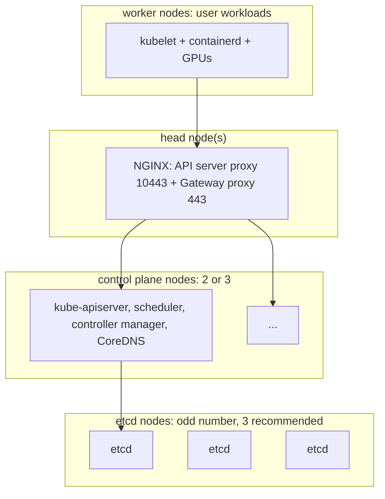
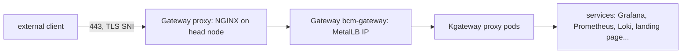

# 8.9 Kubernetes under BCM: deployment and GPU enablement

| | |
|---|---|
| Level | Intermediate |
| Priority tier | 1 |
| Lab venue | Laptop |
| Part | Part 8: NVIDIA Base Command Manager |
| Status | Drafted (`k8s_lab.py`: 64 checks pass; cluster commands **untested** on live BCM) |

## Why this matters for AI infrastructure

Many GPU clusters run Kubernetes for inference, notebooks and platform services, and Slurm for training. BCM can deploy a whole Kubernetes cluster onto bare-metal nodes it already manages: control plane, etcd, CNI, GPU operator, gateways and per-user policy, all from one wizard. The same nodes can often belong to either world, so you need to know what the wizard changes on a node and where each setting lives.

## Prerequisites and outcomes

You need chapters 8.1 to 8.8 and the basics of Kubernetes (Part 11 goes deeper). After this chapter you can:

- sketch BCM's Kubernetes reference architecture and size it
- run or script `cm-kubernetes-setup` and read its pre-flight checks
- explain the BCM roles and configuration overlays that carry Kubernetes
- choose the operators, and install the NVIDIA GPU operator correctly
- explain the kubelet settings BCM applies to GPU nodes
- add users safely with Kyverno policies
- understand the Gateway entry path and the upgrade rules

## 1. The reference architecture (4.1)



- **etcd** runs on an odd number of nodes, **outside** Kubernetes in BCM, as the `cm-etcd` package on nodes with the `EtcdHost` role. For HA: at least 3.
- **Control plane** nodes (typically head nodes or dedicated nodes): 2 or 3 recommended. BCM uses **kubeadm** and runs the control plane as static pods (API server, scheduler, controller manager, kube-proxy, CoreDNS).
- **Workers** are regular nodes that run user workloads.
- **API server proxy:** an NGINX server on the head node(s) and on every node of the cluster listens on **port 10443** and load balances over all control plane API servers; this is what makes the control plane HA. Because of it, one port is reserved on the head node for every Kubernetes cluster, and `kubectl` and `helm` work from the head node (`module load kubernetes`).
- **Multiple Kubernetes clusters** are allowed (since BCM 8.2), but **a node cannot be shared between clusters**.
- Versions: the manual lists Kubernetes 1.34, 1.35 and 1.36 (the first two marked "NVIDIA AI Enterprise certified"). `cm-kubernetes-setup --list-versions` shows what your packages offer.
- **Minimum per node: 16 GB RAM and two CPU cores.** Below it, deployment may succeed and later steps (such as starting Jupyter kernels) fail in hard-to-diagnose ways, because some components are removed when resources run out.

**Why odd etcd counts?** An even cluster still has a quorum but tolerates no more failures than the odd number below it: 3 and 4 nodes both survive one failure. The lab checks it with `etcd_fault_tolerance`.

## 2. Running the setup (4.2)

`cm-kubernetes-setup` (from the `cm-setup` package) has two modes: the **TUI wizard** (recommended) and **command line / config file** (`-c file.conf`, for automation). The wizard saves a config file (`cm-kubernetes-setup.conf`) that can be deployed later, but **its layout can change between BCM releases**: a file from one release should not be assumed to work in another (the manual's example: Flannel settings moved between 11.33 and 11.34).

**Pre-flight checks** (each has a `--skip-...` flag, which you should rarely use): DNS configuration, ping between all nodes, MTU consistency (mixed MTU causes packet loss), package manager refresh (for example `apt update`), and Kubernetes version support.

**What the wizard asks, in order, with the points that matter:**

1. Kubernetes version and patch level. "latest" resolves at deploy time and makes the install non-idempotent; for an air-gapped cluster choose the specific patch (chapter 8.14).
2. DockerHub registry mirror. The field is pre-filled with an NVIDIA-internal host **that customer sites cannot reach**; replace it or clear it.
3. Cluster name (a BCM label, not the Kubernetes `default` namespace), domain, external FQDN, **service network and pod network CIDRs**. The wizard avoids overlaps with networks BCM knows. By default **each Kubernetes node gets a whole /24 from the pod CIDR**, so a /16 pod network caps the cluster at 256 nodes (the lab computes this).
4. **Expose the API server to the external network?** The wizard pre-selects yes. The manual says leaving it unexposed is the safer choice; `kubectl` and Helm still work on the head node through the NGINX proxy.
5. The internal network the nodes use (`failovernet` is offered on HA clusters).
6. **Nodes:** control plane, worker (whole categories first, then individual nodes) and etcd. The head node is pre-selected as control plane and etcd. Choose an odd number of etcd nodes.
7. Ports: API server proxy 10443, etcd spool `/var/lib/etcd`.
8. CNI: **Calico** (via the Tigera operator, pre-selected, recommended) or **Flannel**. Cilium is supported but set up outside the wizard. With more than **50 nodes** Calico **Typha** is deployed automatically (one replica per 150 nodes, minimum 3, maximum 20). If the cluster grows past 50 later, enable it by hand in the `calico` application's environment.
9. **Kyverno** (policy engine) and **Kyverno policies** (the policies that enforce Pod Security Standards; the engine alone enforces nothing), namespace exclusions, and HA for Kyverno (3 replicas).
10. **Operators** (below), MetalLB mode (layer 2 by default, or BGP), Gateway IP addresses, MetalLB pools, the Gateway proxy port (443), and whether to install `cuda-dcgm` and `cm-nvidia-container-toolkit` into the images (both off by default).

It then assigns roles, adds health checks to monitoring and creates certificates. **Image updates and node reboots during the run can disrupt a production cluster**, which is why the manual suggests a direct Helm install for the GPU operator on a running cluster (section 5). `cm-kubernetes-setup --remove --cluster default --yes-i-really-mean-it` removes a cluster (it also closes firewall ports and removes the etcd spool, and asks for reboots to clean up network configuration).

**Checks afterwards:** `kubectl cluster-info` (shows `https://127.0.0.1:10443`), `kubectl get nodes` (control plane and workers `Ready`), `kubectl get all -n kube-system` (calico, coredns, metrics-server, kube-state-metrics), `helm list -A`.

## 3. Roles and overlays (4.5, 4.9)

BCM uses the same role and overlay mechanism as for Slurm (chapter 8.8), with these overlays:

| Overlay | Priority | Role it carries |
|---|---|---|
| `kube-default-etcd` | 500 | `Etcd::Host` |
| `kube-default-master` | **510** | containerd and kubelet as control plane |
| `kube-default-worker` | 500 | containerd and kubelet as worker |
| `kube-default-netq` | 501 | NetQ (only if deployed) |

Roles: **EtcdHost** (member name, spool, client and peer URLs defaulting to ports 5001 and 5002, snapshot count 5000; settings written to `/cm/local/apps/etcd/current/etc/cm-etcd.conf`), **KubernetesAPIServerProxy** (the 10443 entry; open it to the outside through the head node's `firewall` role `openports`), **KubernetesIngressServerProxy** (almost a placeholder since 11.33; the head-node NGINX is now set up by the Gateway proxy configuration), **Kubelet** (`Control plane` yes/no, `Worker`, `Max Pods`, an options submode for manifests such as `kube-apiserver.yaml`) and **Containerd**. A node in both the master and worker overlays gets the master (510) parameters, and the manual's own example shows nodes with roles `control-plane,worker` at once.

**Kubelet settings for GPU nodes (from BCM 11.34).** GPU workers are configured automatically with `cpuManagerPolicy: static`, `topologyManagerPolicy: best-effort`, `topologyManagerScope: pod`, and `kubeReserved: {cpu: 250m}`. Why: the defaults (`none`) let containers share CPUs by time-slicing, which hurts the data pipeline feeding GPUs, and let CPU, memory and GPU land on different NUMA nodes, so host-to-GPU traffic crosses the inter-socket link. Control plane nodes, non-GPU workers and clusters deployed **before** 11.34 keep the old defaults, because `kubeadm upgrade` reuses the existing kubelet configuration. This is the Kubernetes counterpart of the NUMA lesson in Part 10.

### 3.1 `kubernetes` and `etcd` (`EtcdCluster`) mode options, monitoring, and storage

- **`generic::containerd` and NVIDIA/AMD GPUs:**
  - `cm-kubernetes-setup` assigns `generic::containerd` to worker nodes (overwriting any non-BCM `containerd` config). Its `configurations` submode holds `containerd-cri` (`/cm/local/apps/containerd/var/etc/conf.d/cri.toml`, mode `0644`, `Service action on write = RESTART`, `Service stop on failure = yes`), imported into `/cm/local/apps/containerd/var/etc/config.toml` via `imports = ["/cm/local/apps/containerd/var/etc/conf.d/*.toml"]`, plus `nvidia-cri` when NVIDIA GPU integration is enabled.
  - **AMD GPUs:** checked via `device -> sysinfo | grep GPU`. Requires Kubernetes v1.16+ and deploying the RadeonOpenCompute `k8s-ds-amdgpu-dp.yaml` DaemonSet (which exposes `amd.com/gpu` and uses `HIP_VISIBLE_DEVICES` in pods). Because the upstream AMD DaemonSet schedules onto **every** node (even nodes without GPUs) and skips tainted control-plane/head nodes:
    1. Manage the YAML in BCM under `kubernetes[default] -> appgroups -> add amd -> applications -> add device-plugin -> set config /tmp/k8s-ds-amdgpu-dp.yaml`.
    2. To include a tainted head node without removing its taint (`kubectl taint nodes basecm11 node-role.kubernetes.io/control-plane-`), change the DaemonSet toleration from `key: CriticalAddonsOnly` to `key: node-role.kubernetes.io/control-plane`, `effect: NoSchedule`, `operator: Exists`.
    3. To restrict the DaemonSet to GPU nodes only, create a `LabelSet` in `cmsh` (`kubernetes[default] -> labelsets -> add amd; set labels nvidia.com/amd-gpu-accelerator=; append categories gpu-nodes; commit`) and add a `nodeAffinity` `requiredDuringSchedulingIgnoredDuringExecution` rule matching `key: 'nvidia.com/amd-gpu-accelerator'`, `operator: Exists`.
- **`kubernetes` mode and `etcd` (`EtcdCluster`) mode parameters:**
  - In `cmsh`, `kubernetes use default; show` holds `Etcd Cluster` (`kube-default`), `Pod Network` (`kube-default-pod`), `Pod Network Node Mask`, `Service Network` (`kube-default-service`, default `172.29.0.0/16`, must not overlap pod ranges), `Internal Network` (`internalnet`), `KubeDNS IP` (`10.150.255.254`), `Kubernetes API server proxy port` (default `10443`), `Trusted domains` (the **first** item is the cluster's external FQDN), `Kubeadm init file`, `Kubeadm CERT Key`, `Kube CA Cert`/`Key`, `App Groups`, `Label Sets`, `Kubernetes users`, `External` (`no`), and CAPI fields (`Capi template`, `Capi namespace`, `Kubernetes management cluster`).
  - Top-level `etcd` mode (`EtcdCluster`) sets global etcd options: `Name` (`--initial-cluster-token`), `Election Timeout` (`--election-timeout`, ms), `Heart Beat Interval` (`--heartbeat-interval`, ms), `CA` (`--peer-trusted-ca-file`), `CA Key`, `Member Certificate` (`--peer-cert-file`) and `Member Certificate Key` (`--peer-key-file`; **an `EtcdHost` role setting overwrites the `EtcdCluster` member cert/key**), `Client CA` (`--trusted-ca-file`), and `Client Certificate`/`Key` (`--cert-file`, `--key-file`, used by `etcdctl`).
- **Kubernetes Apps (`appgroups`):** introduced in 8.1 as `addons` and expanded in 8.2 into `kubernetes[default] -> appgroups`. Since BCM 9.2, operators have moved to Helm charts, leaving `Flannel` and the predefined `system` app group (`bootstrap`, `calico`, `flannel`, `kubestatemetrics`, `metrics_server`, `root`). Each application has `Format = Yaml`, `Enabled`, `Config` (opens in an editor via `set config`), `Environment` (key/value variables substituted into the YAML, such as `calico_typha_replicas`, `calico_typha_service`, `head_node_internal_ip`; setting `Nodes environment = yes` also exports them to the node environment), and `Exclude list snippets` (protects app files on nodes from `imageupdate`).
- **Networking model, health checks, Local Path Storage, and Harbor:**
  - **Calico BGP:** default pod network provider; uses BGP to distribute pod routes without IP-in-IP overlays, avoiding overlay overhead on large bare-metal clusters.
  - **Four health checks added by `cm-kubernetes-setup`:** `KubernetesChildNode` (expected agents/services up on active nodes), `KubernetesComponentsStatus` (node daemons healthy), `KubernetesNodesStatus` (nodes `Ready`), and `KubernetesPodsStatus` (all pods in `Running`, `Succeeded`, or `Pending`).
  - **Local Path Storage Class:** optionally enabled in the wizard over any POSIX shared filesystem mounted on all nodes (NFS, BeeGFS, Lustre); creates the default `local-path` StorageClass (`cluster.local/local-path-provisioner`, `VolumeBindingMode: WaitForFirstConsumer`, `AllowVolumeExpansion: true`).
  - **Harbor `imagePullSecrets`:** create with `kubectl create secret docker-registry myregistrykey --docker-server=node001:9443 --docker-username=admin --docker-password=...` and reference under `spec.imagePullSecrets` (see chapter 8.10).

## 4. Add-ons and operators (4.2.2 to 4.2.5, chapter 6)

**Core add-ons** in `kube-system` and other namespaces: CNI, CoreDNS (inside the control plane since 10.0), MetalLB, Kgateway, Kubernetes Metrics Server, kube-state-metrics, Helm (version 4.2.3 in the manual), Kyverno, the BCM Permissions Manager and the BCM Local Path Provisioner. The Kubernetes Dashboard was retired in BCM 11.32; Ingress NGINX is deprecated in favour of the Gateway API.

**Operators** selectable in the wizard: NVIDIA GPU Operator, AgentGateway (and CRDs), Argo CD, Grafana Alloy, Loki and Operator, Ingress NGINX (deprecated), Jupyter Kernel Operator, Kgateway, Knative, Kubeflow Training Operator, Metrics Server, MPI Operator, State Metrics, LeaderWorkerSet, MetalLB, **Network Operator**, **NIM Operator**, PostgreSQL Operator, Prometheus Adapter and Operator Stack, Spark Operator. **Only four are selected by default: Kgateway, Metrics Server, State Metrics and MetalLB.** The NVIDIA GPU Operator is **not**. Run:ai is no longer part of this wizard from BCM 11.33; it uses `cm-runai-setup`.

## 5. The NVIDIA GPU Operator (6.7)

It deploys the stack that makes GPUs schedulable: the NVIDIA Container Toolkit, the device plugin, Node Feature Discovery (NFD), GPU Feature Discovery, the DCGM exporter and validator daemonsets. **The wizard does not warn you if the cluster has GPUs and you did not select it, and GPU pods will then stay Pending.** The operator can also be added to a running cluster.

Wizard checklist (independent options): 

| Option | Default | Meaning |
|---|---|---|
| Container toolkit via the operator (`toolkit.enabled`) | on | the operator manages the toolkit and hooks it into containerd via CDI where available; off means BCM's package plus containerd runtime-class drop-in files |
| Drivers as a container (`driver.enabled`) | **off** | off: the driver must be on the node (BCM provisions it); on: a driver container per GPU node. **On DGX OS images the driver is always provisioned by the host** |
| Node Feature Discovery (`nfd.enabled`) | on | labels nodes so daemonsets run only where they apply |

A custom Helm values file skips the checklist and is the way to set MIG strategy, time-slicing, custom resource names or registry overrides. To change a setting after install: re-run the wizard with a changed config file, edit the application config in cmsh, or `helm upgrade`. **Remove the operator with `helm uninstall -n gpu-operator gpu-operator` even if the wizard installed it.**

The manual's direct Helm install uses `--set driver.enabled=false --set toolkit.enabled=true` and sets `CONTAINERD_CONFIG=/cm/local/apps/containerd/var/etc/conf.d/nvidia-cri.toml` and `RUNTIME_EXECUTABLE_PATH=/cm/local/apps/containerd/current/bin/containerd` (the BCM containerd paths). Choose a chart version that is NVIDIA AI Enterprise certified.

**Validate:** `kubectl get pod -n gpu-operator -l app=nvidia-operator-validator` should be Running on each GPU node, with `nvidia-cuda-validator` and the device-plugin validator Completed. Then a GPU pod requesting `nvidia.com/gpu: 1` that runs `nvidia-smi` must leave Pending.

**Network Operator.** Selected in the same wizard, with a version screen and an optional custom values file; it deploys as the `network-operator` Helm release. NetQ has strict prerequisites (NetQ 4.15+ on Ubuntu 24.04+ only—NetQ 5 is not supported in the BCM 11 wizard without BCM support; **1 or 3 regular compute nodes** with at least **250 GiB disk** and **64 GiB RAM**; **no Kyverno**; and BCM's default CMDaemon ports must be moved first with `cm-cmd-ports --http 8083 --https 8084 && systemctl restart cmd`, then restart the wizard; 1-node setups expose `netq-gui` via a `NodePort` service while 3-node cluster setups prompt for a LoadBalancer virtual IP).

### 5.1 Other BCM-packaged operators and `Modify operators`

- **Inspecting and tuning operator Helm charts:** `cm-kubernetes-setup --list-operators-versions` lists packaged versions (and marks NVIDIA AI Enterprise certified versions with `E`, such as `v26.3.0E` and `v25.10.1E` for GPU Operator and `25.7.0E`/`25.4.0E` for Network Operator). `cm-kubernetes-setup --list-operators` shows `api_available` (`0` or `1`) per operator. Charts live on shared storage (for example `/cm/shared/apps/jupyter-kernel-operator/current/helm/*.tgz`) and can be inspected with `helm show values` or installed with `--values tunables.yaml`.
- **Argo CD Operator:** optional initial config in the wizard sets the admin password (or generates a random one in `argocd-initial-admin-secret`, read with `kubectl -n argocd get secret argocd-initial-admin-secret -o jsonpath="{.data.password}" | base64 -d`) and registers `Git`, `Helm`, or `OCI` repositories.
- **Grafana Alloy and Grafana Loki:**
  - **Alloy depends on Loki:** Alloy is a log collector, not a store. **Selecting Grafana Alloy without Grafana Loki is rejected by the wizard** (whereas Loki can be installed without Alloy). Alloy's checklist offers three log sources: **`pod_logs`** (on by default), **`kube_events`** (on by default), and **`varlog`** (`/var/log` on worker nodes for kubelet and OS logs; **off by default**). Unselected sources are not collected at all.
  - **Loki deployment modes:** offers `SingleBinary` (all in one process), `SimpleScalable` (read/write/backend split), and `Distributed`. **The mode screen appears only if the cluster has at least 3 worker nodes AND a default StorageClass**; if either is missing, the wizard silently picks `SingleBinary`. In `SingleBinary` mode, a screen asks for `Enable MinIO storage`, `Storage` (`S3` or `FileSystem`), and `Replica factor`; in `SimpleScalable` or `Distributed` mode that screen is skipped and MinIO + S3 are enabled automatically. If you expose the Loki API via a Gateway `HTTPRoute`, the wizard requires a non-empty username and password.
- **Jupyter Kernel Operator:** installs into `-n cm` (`cmjupyterkernels.apps.brightcomputing.com`). **Helm upgrade warning:** when upgrading with `helm upgrade`, you **must** pass the release's existing namespace (`-n cm`), not a hardcoded `cm-jupyter-kernel-operator-system`—an older chart shipped its own `Namespace` object, and passing a mismatched `-n` prunes the old `Namespace` and deletes the entire release.
  - **11-step JEG + sidecar lifecycle:** JupyterLab delegates kernel creation to **Jupyter Enterprise Gateway (JEG)**, which opens a TCP socket and creates a `CMJupyterKernel` CRD; the operator creates the kernel pod with an attached **sidecar** proxy and dynamically populates `/etc/passwd` and `/etc/group` inside the pod so the unprivileged container process runs with the Jupyter user's exact UID/GID; when JEG disconnects, the sidecar exits and the operator cleans up the pod, service, configmap, and secrets.
- **Prometheus Operator Stack / Grafana:** Grafana's admin username and random password live in the `kube-prometheus-stack-grafana` Secret in namespace `prometheus` (`{.data.admin-user}` and `{.data.admin-password}`, base64-encoded). Reach it via `kubectl port-forward -n prometheus svc/kube-prometheus-stack-grafana 3000:80` or `https://<Gateway IP>/grafana/`. Any `ConfigMap` in any namespace labeled **`grafana_dashboard='1'`** is auto-loaded by Grafana as a dashboard.
- **Spark Operator, Zalando Postgres Operator, and NVIDIA NIM Operator:** Spark (`cm-kubernetes-spark-operator`) requires the Permission Manager and pod security policy enabled before granting a user access (`cm-kubernetes-setup --add-user alice --operators cm-kubernetes-spark-operator --allow-all-uids`). Postgres (`1.15.1` default) and NIM Operator (`3.1.1` default) are selectable in the wizard. (Run:ai is covered in chapter 8.16.)
- **Adding and removing operators on a running cluster (`Modify operators`, from BCM 11.34+):** from BCM 11.34 onwards, you do not have to redeploy Kubernetes to change operators. Choose **Modify operators** in the `cm-kubernetes-setup` TUI (or pass an updated config file with `cm-kubernetes-setup -c <file>`). When adding, already-installed operators are greyed out and dependency/conflict checks run. When removing, Helm releases are uninstalled in **reverse dependency order** (an operator still depended on by another cannot be removed alone); as usual with Helm, CRDs, namespaces, node labels, and taints are left in place for manual cleanup.

## 6. Users and security (4.10 to 4.15)

- **Authentication:** client certificates signed by a Kubernetes CA (made by kubeadm, in `/etc/kubernetes/pki/<cluster>/`), not the BCM CA. The API server checks the certificate's common name. **Authorization:** RBAC plus Node authorization.
- **PodSecurityPolicy was removed in Kubernetes 1.25.** BCM uses **Kyverno** for the same job.
- **Adding a user:** the BCM (PAM) user must exist. `cm-kubernetes-setup --add-user john` creates: service account `john`, namespace **`john-restricted`**, role `edit` there (or `view`, `admin`, `cluster-admin` with `--role`), read access to nodes, certificate and kube config in the user's `.kube`. The Permissions Manager turns this into a Helm chart with roles, bindings and Kyverno rules.
- **Kyverno defaults for that user:** a `hostPath` volume is allowed only under the user's home (`/home/john`) unless `--user-paths` adds more; processes run with the user's own UID and GID. `--allow-all-uids` lets pods run as any UID **but then hostPath volumes are rejected**. `--operators` grants access to operator resources.
- **Without Kyverno** (or without its policies) RBAC still separates namespaces, but a user can run privileged pods and mount host paths, which reach the **node** and, through it, other workloads. Fine for one administrator, usually not for a shared cluster. The lab shows both behaviours.
- Namespaces can be excluded from individual policies (default policies include `disallow-host-namespaces`, `disallow-host-path`, `disallow-host-ports`). Exclusions for `kube-system`, `gpu-operator`, `local-path-storage` and `*-restricted` namespaces are added automatically where needed by the features you chose.
- Other user commands: `--list-users`, `--modify-user`, `--remove-user`, `--add-to-namespace` / `--remove-from-namespace` (the namespace must exist), `--backup-permissions`, `--restore-permissions`.

## 7. Getting traffic in: the Gateway (4.17)

Since BCM 11.33 external access uses the Kubernetes **Gateway API** (1.5.x), fulfilled by **Kgateway** and **MetalLB**.



- Kgateway's **operator** is the control plane; the **proxy pods** (data plane) are created per Gateway. **Installing the operator alone exposes nothing**: a Gateway (with a GatewayClass) must exist.
- MetalLB gives each Gateway a LoadBalancer IP. The wizard pre-fills the **highest unused address** on the node network, typically just below the head node. Addresses already in use, in the dynamic range, or in a MetalLB pool are rejected.
- BCM-shipped apps publish through `bcm-gateway` with HTTPRoute and TLSRoute objects (`kubectl get gateway -A`, `httproute -A`, `tlsroute -A`). For example, the built-in `landingpage` `HTTPRoute` in namespace `bcm-gateway` forwards `/` to a static Kgateway `Backend` pointing to `master:80` (Apache on the head node). For an application in another namespace to attach a route to `bcm-gateway`, its namespace must be listed under `allowedRoutes.namespaces.selector.matchExpressions` on the `bcm-gateway` listener.
- **External access paths and testing self-signed Gateway TLS certificates:**
  - Two head-node ports serve external users when external exposure is enabled (the default in the wizard, opened in Shorewall): **port 10443** (`kubernetesapiserverproxyport`) for `kubectl`/`helm` to the control plane, and **port 443** for the Gateway proxy (`KubernetesIngressServerProxy` role on head nodes and edge directors, which routes by TLS SNI hostname). In `L2` MetalLB mode (ARP failover, not true load balancing), at least one Kubernetes node must share the L2 network with the head node so the Gateway proxy can reach the MetalLB VIP.
  - **Self-signed Gateway TLS certificates for testing:** under `Gateway configuration -> Configure TLS Certificate for Gateway` in `cm-kubernetes-setup`, choosing `no` to "use existing certificate" generates a private CA (`gateway-ca.key`, `gateway-ca.crt`) and a server keypair (`gateway-bcm-gateway.key`, `gateway-bcm-gateway.crt`) under **`/etc/kubernetes/pki/<cluster>/`** on the active head node, and updates the `gateway-bcm-gateway-cert` TLS Secret in `bcm-gateway`. Self-signed certificates are **for testing only** (and cause obscure issues with Run:ai), do not prevent MITM attacks unless you verify the SHA-256 fingerprint (`openssl x509 -in /etc/kubernetes/pki/default/gateway-bcm-gateway.crt -noout -fingerprint -sha256`), and do not scale to many users.

## 8. Upgrades, Edge, and Cluster API (CAPI)

Upgrades follow upstream `kubeadm upgrade` principles, with BCM-specific rules:

- **kubeadm upgrades only itself and a few central components.** It does **not** upgrade etcd, CNIs, CSIs, container runtimes, third-party components, or pods not managed by a Deployment or ReplicaSet. Each needs its own plan.
- Nodes may be **provisioned from software images**: update the images too (chapter 8.4), or a reboot returns the old version.
- **Order:** the first control plane node (`kubeadm upgrade plan` then `kubeadm upgrade apply <version>`), then the other control plane nodes (`kubeadm upgrade node`), then workers (`kubectl drain --ignore-daemonsets`, `imageupdate -w --wait`, `kubeadm upgrade node`, `systemctl daemon-reload`, `systemctl restart kubelet`, `kubectl uncordon`), one at a time, then **update the Kubernetes version recorded in BCM** (it does not update itself).
- A **hot upgrade** keeps services up; it needs spare capacity so pods can move away from the node being upgraded. Pods that **cannot migrate** (persistent volumes, GPUs a pod needs) must be handled by hand. `kubectl drain --ignore-daemonsets` skips DaemonSet pods, which then need a separate upgrade.
- Upgrade one minor version at a time (upstream rule) and read the notes for Ubuntu and SLES and for specific versions in the manual. Air-gapped upgrades have an extra procedure (chapter 8.14).

### 8.1 Kubernetes on Edge (`--skip-*` flags)

When BCM Edge sites are configured, `cm-kubernetes-setup` prompts for the target edge site and scopes node and interface choices to that site. Because edge directors often have slow links to the central head node and pre-staged images, four `--skip-*` flags (also usable in the YAML config file) reduce an edge Kubernetes deployment to a few seconds when the image and disk layout are already prepared:
- `--skip-package-install`: skip installing packages into the image (ignores `skip_packages` in the config).
- `--skip-image-update` and `--skip-reboot`: skip pushing the image and rebooting when edge directors are already provisioned with the up-to-date image.
- `--skip-disksetup-changes`: never alter the disk layout (use when a custom partition, such as a Docker thin pool, was configured upfront).

### 8.2 Kubernetes Cluster API (`cm-kubernetes-capi-setup`)

BCM packages a **BCM Kubernetes CAPI Infrastructure Provider**, derived from the upstream VMware Tanzu **Bring Your Own Host (BYOH)** provider (`byoh-system` namespace), so a BCM-deployed **Kubernetes management cluster** can declaratively provision, scale, and rolling-upgrade multiple **Kubernetes CAPI clusters** (workload clusters) across pre-existing bare-metal BCM nodes:
- **Unlike upstream BYOH:** BCM CAPI is **not** limited to Ubuntu 20.04 and does **not** rely on pre-built BYOH parcels—when a CAPI `Machine` claims a `ByoHost`, a PythonCM installation script (`cm-kubernetes-capi-setup --register-node <node>`) tells the active head node to install the requested Kubernetes version into the node's software image and run `imageupdate` before handing control back to `capi-agent` and `kubeadm`.
- **Two wizard steps in `cm-kubernetes-capi-setup`:**
  1. **`Install CAPI`:** installs `cert-manager`, CAPI, and `clusterctl init infrastructure byoh` on the chosen management cluster (`default`), creates the `capi` environment module, and creates a `KubeCluster` template in BCM named **`capi-<mgmt_cluster_name>-template`** (for example `capi-default-template`, with `Capi template = yes` and `Kubernetes API server proxy port = 6444`).
  2. **`Assign CAPI Role`:** installs `cm-capi`, `kubeadm`, and `helm` repos into the target software images, enables IP forwarding, and creates a configuration overlay (for example `capi-default` at priority `500`) carrying the **`capi`** role (which starts `capi-agent.service`) and the **`containerd`** role (`kubeadm` pre-flight requires `containerd` running in advance). Registered hosts appear in `kubectl get byohost -A`; if no `ByoHost` is free when a cluster is created, `Machine` objects wait in `Pending` (`Pending` -> `Provisioning` -> `Running`).
- **Deploying, networking, scaling, and upgrading a CAPI cluster:**
  - Generate and apply the manifest with an unused IP on the CAPI nodes' internal network:
    ```bash
    [root@headnode ~]# module load capi/1.10.2
    [root@headnode ~]# CONTROL_PLANE_ENDPOINT_IP=10.141.168.1 clusterctl generate cluster byoh-cluster \
      --from /cm/local/apps/capi/var/cluster-template.yaml --kubernetes-version v1.34.2 \
      --control-plane-machine-count 1 --worker-machine-count 1 > cluster.yaml
    [root@headnode ~]# kubectl create -f cluster.yaml
    ```
  - **No CNI by default:** newly created CAPI clusters start `NotReady` because **no CNI is installed by default**; load the generated module (`module load kubernetes/byoh-cluster/<ver>`) and apply a CNI manifest (such as Calico) so nodes become `Ready`.
  - **Scaling and rolling upgrades:** scale control planes by patching `KubeadmControlPlane` (`spec.replicas`) and workers with `kubectl scale --replicas=N machinedeployment/<name>`. Rolling upgrades (`kubectl patch kubeadmcontrolplane ...` or `machinedeployment ...` with the new `version`) **require at least one spare `ByoHost`** (because a new machine is provisioned before the old one is deleted; otherwise use the `OnDelete` strategy or scale workers down by one first).
  - **Pre-installing CAPI versions in an image:** `cmsh -> softwareimage use default-image -> capi list | add 1.26.0 1.27.* | remove | clear`.
  - **CAPI template fallback order:** a `Cluster` YAML can request a custom BCM template via the label `infrav1.nvidia.x-k8s.io/capi-kube-template: "<name>"`. BCM resolves the template in this exact fallback order:
    1. the label-specified template (if it exists in `cmsh kubernetes`),
    2. `capi-<mgmt_cluster_name>-template` (for example `capi-mgmt-template`),
    3. `capi-template`.
  - **6-step CAPI removal order:** (1) `kubectl delete -f cluster.yaml`, (2) remove the `capi-<mgmt>` configuration overlay in `cmsh` (stops `capi-agent` and `containerd`), (3) `kubectl delete bootstrapkubeconfig --all`, (4) `clusterctl delete --infrastructure byoh`, (5) verify/delete `byohost` resources, and (6) remove the `KubeCluster` object in `cmsh kubernetes`.

## 9. Common first mistakes

1. A GPU cluster without the GPU operator ("pods Pending, nodes Ready").
2. An even number of etcd nodes, or a single etcd.
3. A pod CIDR too small for the node count.
4. Leaving the NVIDIA-internal DockerHub mirror in the wizard.
5. Exposing the API server because it was the pre-selected answer.
6. Skipping Kyverno on a shared cluster.
7. Using an old config file with a newer BCM release.
8. Running the wizard on a production cluster to add one operator.
9. Removing the GPU operator with the wizard instead of Helm.
10. Upgrading control planes and forgetting etcd, CNI or the BCM version record.

## 10. Exercises

1. Run `python3 k8s_lab.py`. Pick four checks and explain each rule in your own words.
2. Size a cluster for 300 GPU nodes: etcd and control plane layout, pod CIDR, Typha replicas.
3. A user complains that their pod mounting `/scratch/data` is rejected. Give two fixes with their trade-offs.
4. Write a runbook (from this chapter, untested) for adding the GPU operator to a running cluster with Helm, including validation.
5. Explain, using the NUMA lesson, why `cpuManagerPolicy: static` matters for a training pod that requests 8 whole CPUs and 1 GPU.
6. Compare what a node needs to belong to Slurm (chapter 8.8) and to Kubernetes. Can it be both?

## 11. Interview angles

- "Walk me through a Kubernetes install on BCM." Reference architecture, wizard answers (CIDRs, nodes, CNI, Kyverno, operators), roles and overlays created, checks afterwards.
- "GPUs show up in `nvidia-smi` on the host but pods cannot get them." GPU operator missing or unhealthy; check validator pods, toolkit and containerd configuration, device plugin.
- "Why is etcd outside Kubernetes in BCM?" The manual states it as the design; it keeps the datastore independent of the cluster it serves, and BCM protects those nodes with the `datanode` option against reprovisioning.
- "How are users isolated?" Namespace per user, RBAC, Kyverno policies for hostPath and UID/GID; without Kyverno the isolation is incomplete.
- "How do you upgrade without downtime?" Hot upgrade rules above.

## 12. Checkpoint questions (20)

1. Where does etcd run in BCM, and why an odd count?
2. What is the minimum RAM and CPU per node?
3. What does the API server proxy do and on which port?
4. Can a node belong to two Kubernetes clusters?
5. Which tool deploys Kubernetes, and what does it use underneath?
6. Which CNIs does the wizard offer?
7. When is Typha deployed and how many replicas?
8. How many nodes can a /16 pod network hold with the default per-node range?
9. Which four operators are selected by default?
10. What happens if a GPU cluster is deployed without the GPU operator?
11. What are the three GPU operator checklist options and their defaults?
12. What is different about the GPU driver on DGX OS?
13. How do you remove the GPU operator?
14. What kubelet settings does BCM 11.34 apply on GPU workers, and why?
15. What priorities do the etcd, master and worker overlays have?
16. What does `--add-user john` create?
17. What does Kyverno restrict for a Kubernetes user by default?
18. What changes with `--allow-all-uids`?
19. Why does installing the Kgateway operator alone expose nothing?
20. What does kubeadm not upgrade?

## 13. Sources and review notes

- **BCM 11 Containerization Manual:** chapter 1 (introduction), chapter 4 in full (4.1 reference architecture, 4.2 setup, add-ons, Helm, CLI options, TUI screens, testing; 4.3 NVIDIA GPUs and `generic::containerd`; 4.4 AMD GPUs and `labelsets`; 4.5 overlays; 4.6 disabling; 4.7 `kubernetes` mode options; 4.8 `EtcdCluster` options; 4.9 roles; 4.10 to 4.15 security, users, Kyverno, Permissions Manager; 4.16 external access; 4.17 Gateway; 4.18 Calico BGP model; 4.19 the 4 Kubernetes health checks; 4.20 `local-path` StorageClass; 4.21 Harbor `imagePullSecrets`; 4.22 upgrades), chapter 5 (Kubernetes Apps and `appgroups`), chapter 6 in full (6.1–6.2 operator versions and Helm charts, 6.3 Argo CD, 6.4 Grafana Alloy, 6.5 Grafana Loki, 6.6 Jupyter Kernel Operator, 6.7 GPU Operator, 6.8 Network Operator, 6.9 NetQ Operator, 6.10 Prometheus/Grafana, 6.12 Spark Operator, 6.13 Zalando Postgres Operator, 6.14 NVIDIA NIM Operator, 6.15 `Modify operators` in 11.34+; Run:ai 6.11 is in chapter 8.16), chapter 7 (Kubernetes on Edge `--skip-*` flags), chapter 8 (Kubernetes Cluster API / CAPI), and Appendix A (self-signed Gateway TLS certificate for testing; Appendices B and C are in chapter 8.14).
- **Cross-reference:** Part 11 for Kubernetes GPU scheduling, DCGM and MIG in depth; Part 12 for the Network operator and RDMA.
- **Run here:** `k8s_lab.py` (64 checks): etcd arithmetic and plan checks, pod CIDR capacity, Typha rules, operator defaults and warnings, GPU operator options, kubelet GPU defaults, overlay priorities, user and Kyverno behaviour, Gateway IP selection, NetQ prerequisites, air-gap version validation, upgrade order, plus (`added in the gap pass`) `EtcdCluster` vs `EtcdHost` cert precedence, the 4 Kubernetes health checks, AMD GPU DaemonSet labelset/toleration rules, Grafana Alloy -> Loki dependency and default log sources, Loki `SingleBinary` fallback when workers < 3 or no default StorageClass, Jupyter Kernel Operator `-n` upgrade rule, Grafana dashboard `grafana_dashboard='1'` ConfigMap label, BCM 11.34 `Modify operators` reverse-dependency removal and retained artifacts, Edge `--skip-*` flags, and CAPI BYOH machine phases, rolling-upgrade spare-host rule, and template fallback order.
- **My own choices, not the manual's:** the "master overlay wins" reading for a node in both overlays (a priority-rule inference); the upgrade step wording (the manual's headings give the order; I did not read the step-by-step text); the reason given for etcd outside Kubernetes (the manual states the fact, not the reason).
- **Not verified:** everything about a real BCM system or Kubernetes cluster; version numbers in the manual change between releases.
