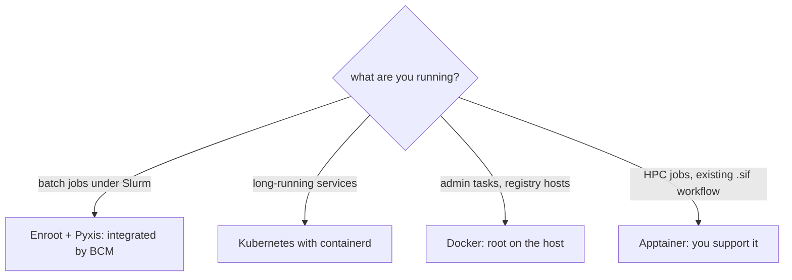

# 8.10 Containerization in BCM: Docker, Apptainer and Enroot

| | |
|---|---|
| Level | Intermediate |
| Priority tier | 1 |
| Lab venue | Laptop |
| Part | Part 8: NVIDIA Base Command Manager |
| Status | Drafted (`containers_lab.py`: 35 checks pass; cluster commands **untested** on live BCM) |

## Why this matters for AI infrastructure

Almost all AI software arrives as a container image from NGC or a company registry. On a cluster you need to answer three practical questions: which tool runs the container for which kind of user, where do the images come from without hammering the internet, and who can become root through the container tool. BCM gives a specific answer for each, and the answers differ between Slurm jobs and Kubernetes services.

## Prerequisites and outcomes

You need chapters 8.4, 8.8 and 8.9. Part 6 chapter 6.13 teaches Enroot and Pyxis in depth, so this chapter keeps to what is specific to BCM. After this chapter you can:

- choose between Docker, Kubernetes (containerd), Enroot with Pyxis, and Apptainer for a given need
- set up Docker on selected nodes, and explain what the DockerHost role controls
- set up a local registry (Docker Registry or Harbor), including a Docker Hub cache, and protect it
- set up Enroot and Pyxis through `cm-wlm-setup` and avoid the cache and credential traps
- run Apptainer on a BCM cluster knowing what BCM does and does not do for it

## 1. The four tools side by side

| | Docker | Kubernetes (containerd) | Enroot + Pyxis | Apptainer |
|---|---|---|---|---|
| Daemon | yes, runs as root | yes | none | none |
| Who can use it after BCM setup | only root, by default | users, through namespaces and policy (8.9) | any Slurm user | any user, if you install it |
| Slurm | not integrated by BCM | no | **integrated** (`cm-wlm-setup --with-pyxis`) | not integrated by BCM |
| Multi-host | no (**Swarm is not supported**) | yes | through Slurm | through Slurm |
| Set up by | `cm-docker-setup` | `cm-kubernetes-setup` | `cm-wlm-setup` | by you |
| In BCM manuals | yes | yes | yes | **no** |

The manual's own guidance: using Docker directly means being root on the host, so regular users should reach containers through Kubernetes, and BCM does **not** integrate Docker with workload managers (the only example it gives is an open-beta LSF that can run jobs in Docker containers).

## 2. Docker through BCM (Containerization Manual chapter 2)

- BCM provides the `cm-docker` package (Docker, containerd, runC, docker-py) and the setup tool **`cm-docker-setup`** (part of `cm-setup`). Docker 28.0.4 on x86_64 at the manual's date. Run it with no options for a text interface, or with `-c file.yaml` to replay a saved configuration.
- The tool asks which registries to use, on which nodes Docker goes, and whether to install the **NVIDIA container runtime** (the `cm-nvidia-container-toolkit` package; the manual's example then runs `nvidia-smi` inside an `nvidia/cuda` container).
- It installs `cm-docker`, assigns the **`DockerHost` role** to categories or head nodes, adds Docker **health checks** to monitoring, configures Docker, and restarts nodes if needed. `module load docker` is needed before using the `docker` command.

**The DockerHost role** (cmsh: `roles; assign docker::host`) holds the parameters CMDaemon writes into Docker's configuration:

| Parameter | Default | Notes |
|---|---|---|
| Spool | `/var/lib/docker` | root of the Docker runtime; put it on fast local disk |
| Enable SELinux | yes | |
| Log level | info | fatal, error, warn, info, debug |
| MTU | 0 | 0 means do not set |
| Iptables | yes | disable if it clashes with other software that uses iptables |
| User namespace remap | unset | needs `user_namespace.enable=1` in the kernel options of those nodes and a reboot |
| Insecure registries | empty | for HTTPS registries without distributed certificates |
| Enable / Verify TLS, TLS CA, certificate, key | off | verify trusts only certificates signed by the CA |
| Storage backends | **overlay2 only** | options can be set in the `storagebackend` submode |
| Runtime | runc | |

Health checks: a test call to the Docker API, and a check that no container is in the dead state. The `docker` service is also visible in the node's `services` list (monitored, autostart). Docker volumes bypass the storage driver; data on them is not overlay2. `docker info` shows the driver, cgroup version and plugins.

## 3. Registries (chapter 3)

Images come from a registry. Docker Hub is the default, but it **limits pulls**, and nodes pulling the same image at the same time create a thundering herd. The manual's remedies: authenticate with a Docker Hub account (a paid Pro, Team or Business account has unlimited pulls); run **Docker Registry as a caching proxy mirror**; or, for air-gapped clusters, use **Skopeo** (chapter 8.14).

BCM can install two local registries with **`cm-container-registry-setup`** (or Base View: **Containers > Container Registry Wizard**):

| | Docker Registry | Harbor |
|---|---|---|
| Aim | simple, trusted users, **Docker Hub proxy cache** | enterprise: security and identity management |
| Port | 5000 by default | UI at `https://<head>:9443` when on the head node |
| Config role | `generic::docker-registry` | `generic::harbor` |

Points to remember:

1. The node that hosts a registry gets the **`datanode` protection** (chapter 8.4) so it is not wiped by a reprovision: "if a registry is wiped out, the state of images in the container registry is incoherent and cannot be restored". The same protection is applied to etcd nodes (chapter 8.9).
2. To use the Docker Hub cache, select proxy mode in the registry setup; clients must give the **port** in the URL (for example `https://node001:5000`, and `docker run node001:5000/library/hello-world`).
3. Harbor's default login is `admin` with the default password **`Harbor12345`**: change it. If Harbor is on the head node, open its port to reach the UI from outside.
4. **Port clash:** the Harbor UI on the head node is on **9443**, and the Keycloak setup (chapter 8.6) also needs 9443 and 9999 free on the head node. Do not put both on the head node, or place one elsewhere. (My observation from two manual passages; the lab checks it.)
5. Kubernetes pulling from Harbor needs an `imagePullSecret` created with `kubectl create secret docker-registry myregistrykey --docker-server=node001:9443 ...` and referenced in the pod.

## 4. Enroot and Pyxis in BCM (Administrator Manual 7.3.3)

Chapter 8.8 shows how `cm-wlm-setup` installs them (cache and data directories, shared or per-user, `/etc/enroot/enroot.conf`, the prolog and epilog, no reboot needed). Part 6 chapter 6.13 teaches the tools. What is BCM-specific:

- Installed by `cm-wlm-setup`; Pyxis is compiled against the installed Slurm, so **reinstall it after a Slurm upgrade**.
- Two BCM-provided Enroot package flavours exist: standard and hardened.
- **Cache sharing is a security decision** (8.8): a shared writable cache lets every user share layers but also lets any user write to it; restrict it with mode `00770` and a group, or avoid it with administrator-owned shared Squashfs images referenced by full path.
- **Credentials** (from the user's notes, which quote the Enroot docs): NGC imports need **two** entries in the user's `.credentials` file, `nvcr.io` **and** `authn.nvidia.com`, both with login `$oauthtoken`; Docker Hub is `registry-1.docker.io`. Mode 600, never committed. The lab's `enroot_credentials_problems` checks the file text.
- In an `#SBATCH` line the `#` in `nvcr.io#nvidia/pytorch:21.12-py3` starts a comment; escape it as `nvcr.io\#nvidia/pytorch:21.12-py3`.
- **Distribution (judgment from the notes):** for jobs larger than a few nodes, import once to shared storage and give the `.sqsh` path to `--container-image`, so the registry is contacted once.

## 5. Apptainer (not in the BCM manuals)

I found no mention of Apptainer or Singularity in the three BCM manuals I read. The HPC sysadmin book describes it as follows (in my words):

- **Docker is hard to use directly in HPC**: it needs a root-run service, does not give direct InfiniBand and GPU access, and integrates badly with job managers.
- **Singularity** (Sylabs) was designed for HPC: its own image format (`.sif`), built from a definition file (like a Dockerfile), runs as a normal process, gives transparent access to InfiniBand and GPUs, and integrates with any batch system. **Apptainer** is the Linux Foundation fork; almost everything about Singularity applies. To use NVIDIA GPUs you need the NVIDIA container toolkit.
- Under Slurm the book recommends `srun` over `mpirun`: `srun ... singularity run app.sif /opt/my-mpi-app` style launches.
- The user's notes show GPU use as `apptainer exec --nv <image> <command>`.

**On a BCM cluster you would do the following yourself** (my outline, not from BCM): install Apptainer in the software image with `cm-chroot-sw-img` or on `/cm/shared` with a module file (chapter 8.4), install `cm-nvidia-container-toolkit`, update nodes with `imageupdate` or a reboot, keep `.sif` files on shared storage, launch through `srun`. BCM will not configure it, monitor it, or (as far as the manuals say) support it, so you own the upgrades and the security review. If you only need Slurm containers and want the BCM-supported path, use Enroot with Pyxis.

## 6. A decision guide

| Situation | Use | Why |
|---|---|---|
| Researchers submit GPU training jobs | Enroot + Pyxis | BCM-integrated, unprivileged, `srun --container-image` |
| A team already has `.sif` workflows | Apptainer (and accept self-support) | no conversion; check security and GPU toolkit |
| Notebooks, inference APIs, platform services | Kubernetes | scheduling, restarts, policy (8.9) |
| Running a registry, or an admin tool | Docker (root-only) | simple, administrator-only |
| 100 nodes pulling one image at job start | import once; Docker Registry cache or shared `.sqsh` | avoid registry rate limits and slow starts |
| Disconnected site | local registry and Skopeo | chapter 8.14 |

## 7. Common first mistakes

1. Giving users `docker` access instead of a Slurm or Kubernetes path.
2. Expecting Docker to be integrated with Slurm in BCM.
3. Leaving Harbor with `Harbor12345`.
4. A Docker Hub proxy URL without the port.
5. Putting Harbor and Keycloak on the same head node.
6. Letting every node pull a big image from NGC at the same moment.
7. Forgetting `authn.nvidia.com` in Enroot credentials.
8. A shared Enroot cache open to everyone.
9. Forgetting to reinstall Pyxis after upgrading Slurm.
10. Assuming BCM supports Apptainer.

## 8. Exercises

1. Run `python3 containers_lab.py`. Pick four checks and explain each rule in your own words.
2. A 64-node job pulls a 20 GB NGC image at start. Compare three distribution methods in time, load and risk, and pick one for your site.
3. Write the check list you would run before giving a contractor access to Docker on a node, and why you would refuse.
4. Plan where Harbor, Keycloak, Docker Registry and the Docker Hub cache run on a cluster with two head nodes and 200 compute nodes.
5. Convert a Docker-based inference workflow into (a) a Kubernetes deployment and (b) a Slurm job with Pyxis. What does each lose?
6. Explain to a security reviewer why Enroot and Apptainer need no daemon, and what that does and does not protect.

## 9. Interview angles

- "Why not just give users Docker?" Root daemon; membership in the docker group is root on the host; BCM's answer is Kubernetes or Enroot.
- "How would you reduce image pull load?" Registry cache, shared squashfs, pre-pull, authenticated pulls.
- "What protects a registry node from reprovisioning?" The `datanode` option.
- "Enroot versus Apptainer?" Both daemonless and HPC-friendly; Enroot is NVIDIA's, BCM-integrated with Pyxis; Apptainer has its own image format and community and is not covered by BCM.
- "How do containers get GPUs on BCM?" Docker: NVIDIA container runtime package. Kubernetes: GPU operator and toolkit. Enroot: the `98-nvidia.sh` hook. Apptainer: `--nv` and the toolkit.

## 10. Checkpoint questions (20)

1. Which container tool does BCM integrate with Slurm?
2. Is Docker Swarm supported?
3. Who can run `docker` after `cm-docker-setup`?
4. What does `cm-docker-setup` install and assign?
5. What does the DockerHost role's Spool default to?
6. Which storage backend does BCM offer for Docker?
7. What does user namespace remap require?
8. What are the two Docker health checks?
9. Name two ways to avoid Docker Hub pull limits.
10. What are the two registries `cm-container-registry-setup` can install?
11. Why is the `datanode` option set on registry nodes?
12. What must a Docker Hub proxy URL include?
13. What is Harbor's default admin password, and what should you do?
14. Which port conflict can arise on the head node?
15. How does a pod pull from Harbor?
16. Which two machines does an NGC `.credentials` file need?
17. How do you write an NGC image in an `#SBATCH --container-image` line?
18. Why should Pyxis be reinstalled after a Slurm upgrade?
19. What do the BCM manuals say about Apptainer?
20. What do you own if you run Apptainer on BCM?

## 11. Sources and review notes

- **BCM 11 Containerization Manual:** chapter 1 (introduction), chapter 2 (Docker: setup, DockerHost role, iptables, storage, monitoring, NVIDIA runtime), chapter 3 (registries: Docker Hub limits, Docker Registry proxy, Harbor, generic roles), section 4.21 (Harbor with Kubernetes).
- **BCM 11 Administrator Manual**, 7.3.3 (Enroot and Pyxis; see chapter 8.8).
- **HPC sysadmin book**, chapter 16 (containers): Singularity, Apptainer, Charliecloud, Pyxis and Enroot, caching advice.
- **NVIDIA-DevOps notes**, volume 10 chapter 8 (Enroot and Pyxis, credentials, quoting) and chapter 9 (the `apptainer exec --nv` example). Part 6 chapter 6.13 already covers the Enroot and Pyxis material in depth.
- **Run here:** `containers_lab.py` (35 checks): runtime choice, Docker role validation, registry checks and the Harbor/Keycloak port conflict, Enroot credential text, `#SBATCH` escaping, Apptainer command shape.
- **My own choices, not the manual's:** the decision table and `choose_runtime` (a judgment); the Harbor/Keycloak port conflict (derived from two separate manual passages); the Apptainer on BCM outline; the "import once for jobs over a few nodes" threshold (the notes state the advice, not the number).
- **Not read or not covered:** the Docker sections on logging drivers and networks beyond iptables; Skopeo and air-gapped registries (chapter 8.14); Podman; Charliecloud details; the other registries in the wider ecosystem; Docker Compose.
- **Not verified:** everything about a real BCM system, and all Apptainer behaviour (no Apptainer was available).
