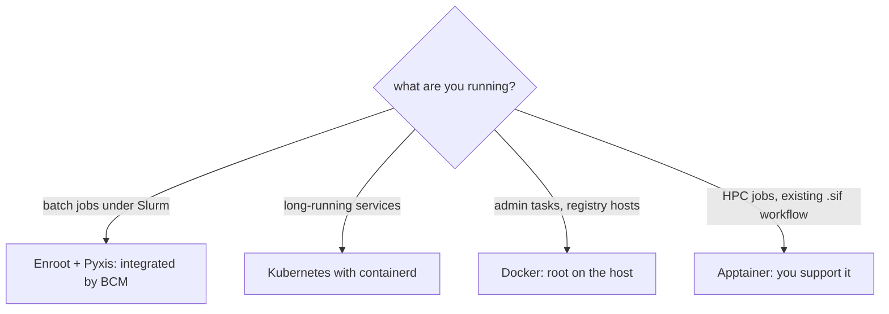

# 8.10 Containerization in BCM: Docker, Apptainer and Enroot

| | |
|---|---|
| Level | Intermediate |
| Priority tier | 1 |
| Lab venue | Laptop |
| Part | Part 8: NVIDIA Base Command Manager |
| Status | Drafted (`containers_lab.py`: 35 checks pass; cluster commands **untested** on live BCM) |

## Why this matters for AI infrastructure

A researcher messages you on a Monday morning. Their training job will not start, and the error mentions a container. Before you can help, you need three answers. Which tool ran the container? Where did the image come from? Who is allowed to become root through that tool?

Those questions matter because a container is a packaged program with its own files and libraries, but it shares the Linux kernel of the host it runs on. An image is the saved package that a container starts from. Almost all AI software now arrives as a container image, pulled from NGC, which is NVIDIA's software catalog, or from a company registry. On a BCM cluster, each of those three questions has a specific answer. The answers also differ depending on whether the work runs as a Slurm job or as a Kubernetes service. Slurm is the workload manager that queues and starts batch jobs, and Kubernetes runs long-lived services. This chapter walks through each answer, so you can tell which path a failing job took.

## Prerequisites and outcomes

Read chapters 8.4, 8.8 and 8.9 first. They cover the software images, the Slurm setup and the Kubernetes setup that this chapter builds on. Part 6 chapter 6.13 teaches Enroot and Pyxis in depth, so this chapter sticks to what is specific to BCM. The chapter starts with a side-by-side comparison of the four tools, then covers how to set up Docker on selected nodes and what the `DockerHost` role controls. Next come the registries, then how to set up Enroot and Pyxis through `cm-wlm-setup` without falling into the cache and credential traps, and finally how to run Apptainer on a BCM cluster, knowing what BCM does and does not do for it. It closes with a decision guide, a list of common first mistakes, and a set of deeper notes on the same topics.

## 1. The four tools side by side

Someone asks where their container should run, and you have four choices. Each tool fits a different kind of work, so start with what the work is. Batch jobs, which run to completion and then stop, belong in a different place from a web service that must stay up all day. A daemon is a background program that keeps running and answers requests, and some of the tools below need one while others do not. The flowchart below gives you that first split.

The table compares the four tools on the points that matter for support. Read it column by column when a request arrives. Docker is the only one that runs a daemon as root, and BCM does not integrate it with Slurm. Apptainer is not in the BCM manuals at all, so anything about it comes from outside BCM and needs your own care.

| | Docker | Kubernetes (containerd) | Enroot + Pyxis | Apptainer |
|---|---|---|---|---|
| Daemon | yes, runs as root | yes | none | none |
| Who can use it after BCM setup | only root, by default | users, through namespaces and policy (8.9) | any Slurm user | any user, if you install it |
| Slurm | not integrated by BCM | no | **integrated** (`cm-wlm-setup --with-pyxis`) | not integrated by BCM |
| Multi-host | no (**Swarm is not supported**) | yes | through Slurm | through Slurm |
| Set up by | `cm-docker-setup` | `cm-kubernetes-setup` | `cm-wlm-setup` | by you |
| In BCM manuals | yes | yes | yes | **no** |

The manual's own guidance is clear on the risk. Using Docker directly means being root on the host, because anyone who can talk to the Docker daemon can ask it to do anything the root user can do. So regular users should reach containers through Kubernetes. BCM does not integrate Docker with workload managers. The only example it gives is an open-beta LSF that can run jobs in Docker containers. LSF is IBM's workload manager, and it is a different product from Slurm.

## 2. Docker through BCM (Containerization Manual chapter 2)

Suppose a team asks for Docker on a few admin nodes. They want to build images there and try them out. The setup tool does most of the work, but you still need to know what each setting controls, because a setting you skip now can cause trouble later. Start with the package and the tool itself.

BCM ships the `cm-docker` package, which holds Docker, containerd, runC and docker-py. Docker is the engine that builds and runs containers. containerd is the lower-level runtime that Docker and Kubernetes both rely on, and runC is the small program that actually creates each container. The setup tool is **`cm-docker-setup`**, and it comes as part of `cm-setup`. At the manual's date, the Docker version was 28.0.4 on x86_64, which is the standard 64-bit Intel and AMD processor type. Run the tool with no options to get a text interface, or pass `-c file.yaml` to replay a saved configuration. A saved file is useful when you set up several clusters the same way.

The tool asks three things. It asks which registries to use, which nodes should run Docker, and whether to install the **NVIDIA container runtime**. That runtime lets a container see the GPUs on the host. It comes from the `cm-nvidia-container-toolkit` package. The manual's example then runs `nvidia-smi` inside an `nvidia/cuda` container. The `nvidia-smi` command prints the GPUs and their state, so if it prints the cards from inside the container, the GPU path works.

Once you answer, the tool does the rest. It installs `cm-docker`, assigns the **`DockerHost` role** to categories or head nodes, and adds Docker **health checks** to monitoring. It then configures Docker and restarts nodes if needed. A health check is a small test that reports whether something works, and the monitoring part of this section explains how those results turn into alerts. Load the module with `module load docker` before you type the `docker` command. The module step puts the client on your path, so the command is found.

**The `DockerHost` role** holds the settings that CMDaemon writes into Docker's configuration. CMDaemon is BCM's central management daemon, the program that owns the cluster's settings. You can assign it from cmsh, which is BCM's command-line shell, with `roles; assign docker::host`. The table lists each parameter and its default, so you can see what you are changing before you change it.

| Parameter | Default | Notes |
|---|---|---|
| Spool | `/var/lib/docker` | root of the Docker runtime; put it on fast local disk |
| Enable SELinux | yes | |
| Log level | info | fatal, error, warn, info, debug |
| MTU | 0 | 0 means do not set |
| Iptables | yes | disable if it clashes with other software that uses iptables |
| User namespace remap | unset | needs `user_namespace.enable=1` in the kernel options of those nodes and a reboot |
| Insecure registries | empty | for HTTPS registries without distributed certificates |
| Enable / Verify TLS, TLS CA, certificate, key | off | verify trusts only certificates signed by the CA |
| Storage backends | **overlay2 only** | options can be set in the `storagebackend` submode |
| Runtime | runc | |

Health checks watch two things. One is a test call to the Docker API, which is the interface other programs use to ask Docker to act. The other is a check that no container is in the dead state, which means a container that Docker can no longer start, stop or clean up. The `docker` service also appears in the node's `services` list, where it is monitored and set to autostart. Autostart means the service starts again after a reboot without anyone running a command. Docker volumes bypass the storage driver, so data on them is not overlay2. A volume is a named place where a container keeps data that must outlive it. Run `docker info` to see the driver, the cgroup version and the plugins. A cgroup is the Linux mechanism that limits how much CPU and memory a group of processes can use.

Two decisions come before you run the setup. Put the Spool directory on fast local disk, because Docker writes image layers there every time it pulls. Decide which nodes get the `DockerHost` role first, since that role is what the tool uses to decide where Docker runs.

## 3. Registries (chapter 3)

Picture a hundred nodes starting the same job at once. Each one asks for the same image at the same moment. A registry is the server that stores container images and hands them out on request. Docker Hub is the default public registry, but it limits how many pulls an account may make in a set window, so that rush can stall the whole start. Some nodes get their image and others wait, and the job does not begin until the last node is ready. The manual offers three remedies.

You can authenticate with a Docker Hub account. A paid Pro, Team or Business account has unlimited pulls. You can also run Docker Registry as a caching proxy mirror. A mirror keeps a copy of what it fetches, so the second node asking for an image gets it from your own network. For air-gapped clusters, which have no route to the internet at all, you can use Skopeo, which chapter 8.14 covers. Skopeo copies images between registries, including across a gap that no network crosses directly.

BCM can install two local registries with `cm-container-registry-setup`. You can also use the Base View wizard, under **Containers > Container Registry Wizard**. Base View is BCM's graphical web interface. The table helps you choose between the two registries.

| | Docker Registry | Harbor |
|---|---|---|
| Aim | simple, trusted users, **Docker Hub proxy cache** | enterprise: security and identity management |
| Port | 5000 by default | UI at `https://<head>:9443` when on the head node |
| Config role | `generic::docker-registry` | `generic::harbor` |

Docker Registry is the simple choice for trusted users, and it can act as a Docker Hub proxy cache. Harbor is aimed at enterprise needs such as security and identity management. It adds a web user interface, user accounts and access rules on top of the basic registry. Keep these five points in mind when you set either one up.

1. The node that hosts a registry gets the **`datanode` protection** (chapter 8.4), so a reprovision does not wipe it. Reprovisioning means reinstalling a node's image from scratch, which normally erases its local disk. The manual puts the risk plainly: "if a registry is wiped out, the state of images in the container registry is incoherent and cannot be restored". The same protection applies to etcd nodes (chapter 8.9). etcd is the key-value store that Kubernetes uses to keep its state.
2. To use the Docker Hub cache, select proxy mode in the registry setup. Clients must give the **port** in the URL, as in `https://node001:5000` and `docker run node001:5000/library/hello-world`. Without the port, the client tries the default web port and never reaches the registry, so the pull fails in a way that looks like a network fault.
3. Harbor's default login is `admin`, and its default password is **`Harbor12345`**. Change that password on the first day. If Harbor runs on the head node, open its port so you can reach the UI from outside.
4. **Port clash.** The Harbor UI on the head node uses **9443**. The Keycloak setup (chapter 8.6) also needs 9443 and 9999 free on the head node. Keycloak is an open-source single sign-on server, which lets one login work across several tools. Do not put both on the head node, or place one of them elsewhere. This reading combines two passages in the manual, and the lab checks it.
5. Kubernetes needs an `imagePullSecret` to pull from Harbor. That is a stored login that a pod uses when it pulls its image. Create it with `kubectl create secret docker-registry myregistrykey --docker-server=node001:9443 ...`, then reference it in the pod.

Choose the registry host early, because the `datanode` protection and the port clash both depend on that choice. Moving a registry later means copying its images and changing every client that points at it.

## 4. Enroot and Pyxis in BCM (Administrator Manual 7.3.3)

Your researcher's `enroot import` fails with a `401 Unauthorized` error, even though `nvcr.io` appears in their credentials file. The cause is usually a detail in the credentials, not in the image. `401` is the web status code for "you did not prove who you are", so the problem is the login. This section shows what BCM sets up, and what you must check yourself. Enroot is NVIDIA's tool for turning a container image into a plain directory tree that an unprivileged user can run. Pyxis is a Slurm plugin that lets a job ask for that container by name.

Chapter 8.8 shows how `cm-wlm-setup` installs Enroot and Pyxis. That covers the cache and data directories, whether they are shared or per-user, the `/etc/enroot/enroot.conf` file, and the prolog and epilog. The prolog and epilog are small scripts that Slurm runs before and after each job. No reboot is needed. Part 6 chapter 6.13 teaches the tools themselves, so the points below cover only what is specific to BCM.

`cm-wlm-setup` installs both tools. Pyxis is compiled against the installed Slurm, which means it is built for one exact Slurm version. You must reinstall it after a Slurm upgrade, or the `--container-image` option will be missing. BCM also provides two Enroot package flavours, a standard one and a hardened one. The hardened one adds stricter defaults, and you pick the flavour that matches your site's rules.

Cache sharing is a security decision, as chapter 8.8 explains. The cache holds the unpacked layers of images that users have pulled. A shared writable cache lets every user share image layers, which saves time and disk space. It also lets any user write to that cache, so one user could change a layer that another user's job then runs. You can restrict it with mode `00770` and a group, so only members of that group can write. You can also avoid sharing altogether by using administrator-owned shared Squashfs images, referenced by their full path. Squashfs is a read-only compressed filesystem, so a shared image of this kind cannot be changed by the users who read it.

The Enroot documentation says that NGC imports need **two** entries in the user's `.credentials` file: `nvcr.io` and `authn.nvidia.com`. Both use the login `$oauthtoken`. The first entry names the registry that holds the image. The second names the login service that the registry sends the client to, so the token can be issued. Docker Hub is `registry-1.docker.io`. The file must be mode `600`, which means only its owner can read or write it, and it must never be committed to a repository. The lab's `enroot_credentials_problems` check reads the text of this file, so you can see the two-entry rule being enforced.

In an `#SBATCH` line, the `#` inside `nvcr.io#nvidia/pytorch:21.12-py3` starts a comment. Slurm reads the rest of that line as a note and ignores it, so the image name is cut off. Escape it as `nvcr.io\#nvidia/pytorch:21.12-py3`. This is a trap that catches many first-time users, and the error does not say that a comment caused it.

For jobs larger than a few nodes, import once to shared storage, then give the `.sqsh` path to `--container-image`. An `.sqsh` file is a single compressed image file that Enroot can start from directly. That way the registry is contacted once, no matter how many nodes run the job. This threshold is a judgment call, not a rule the manual gives.

Treat the cache and the credentials file as security decisions, not just setup steps. A cache with the wrong permissions or a credentials file with the wrong mode can expose a team's work, even when the setup itself succeeded.

## 5. Apptainer (not in the BCM manuals)

Suppose a team already runs its jobs from Apptainer `.sif` images, and they want to bring those jobs to your cluster. Apptainer is a container tool built for HPC, which is high-performance computing, meaning large batch work across many machines. A `.sif` file is one Apptainer image in a single file. The first question is whether BCM documents Apptainer. The three BCM manuals do not mention Apptainer or Singularity, which is its older name. The *Supercomputers for Linux Sysadmins* book covers both, and the points below summarize that book.

Docker is hard to use directly in HPC. It needs a root-run service, it does not give direct InfiniBand and GPU access, and it integrates badly with job managers. InfiniBand is the high-speed network that connects the nodes in an AI cluster, and a container that cannot reach it cannot run multi-node training at full speed.

Singularity, from Sylabs, was designed for HPC. It uses its own image format, `.sif`, which you build from a definition file, much like a Dockerfile. A definition file is the recipe that says what goes into an image. The image runs as a normal process, gives transparent access to InfiniBand and GPUs, and works with any batch system. Apptainer is the Linux Foundation fork, and almost everything about Singularity applies to it. To use NVIDIA GPUs, you need the NVIDIA container toolkit, which is the piece that exposes the host's GPU libraries inside the container.

Under Slurm, the same book recommends `srun` over `mpirun`. MPI is the standard library for programs that run across many processes, and `mpirun` is the launcher that starts it outside a scheduler. A launch in that style looks like `srun ... singularity run app.sif /opt/my-mpi-app`. For GPU use, the command takes the form `apptainer exec --nv <image> <command>`. The `--nv` flag tells Apptainer to make the host's NVIDIA libraries visible inside the image.

If a team needs this on a BCM cluster, the work falls to you. What follows is an outline of general practice, not a procedure that BCM documents. Install Apptainer in the software image with `cm-chroot-sw-img`, or on `/cm/shared` with a module file (chapter 8.4). A module file is a small script that sets up your path when a user loads the module. Install `cm-nvidia-container-toolkit` as well. Then update the nodes with `imageupdate` or a reboot. Keep the `.sif` files on shared storage, and launch through `srun`.

BCM will not configure Apptainer or monitor it. As far as the manuals say, it does not support it either. You therefore own the upgrades and the security review. Every new Apptainer release, and every change to the image it lives in, becomes your job to test and roll out. If you only need Slurm containers and want the BCM-supported path, use Enroot with Pyxis.

## 6. A decision guide

A request arrives, and you need to pick a runtime without guessing. Start by finding the situation in the left column. The reason in the right column tells you why that row fits, so you can explain the choice to the requester as well as make it.

| Situation | Use | Why |
|---|---|---|
| Researchers submit GPU training jobs | Enroot + Pyxis | BCM-integrated, unprivileged, `srun --container-image` |
| A team already has `.sif` workflows | Apptainer (and accept self-support) | no conversion; check security and GPU toolkit |
| Notebooks, inference APIs, platform services | Kubernetes | scheduling, restarts, policy (8.9) |
| Running a registry, or an admin tool | Docker (root-only) | simple, administrator-only |
| 100 nodes pulling one image at job start | import once; Docker Registry cache or shared `.sqsh` | avoid registry rate limits and slow starts |
| Disconnected site | local registry and Skopeo | chapter 8.14 |

Notice the last two rows, since both depend on caching or shared storage. A pull that works for one node can fail for a hundred at once, and a disconnected site has no internet to fall back on. Match your request to its row, and the rest of the decision usually follows.

## 7. Common first mistakes

These ten mistakes come up again and again when teams first set up containers on BCM. Each one is cheap to avoid and expensive to find later. Read the list before you hand out access or build your first image.

1. Giving users `docker` access instead of a Slurm or Kubernetes path.
2. Expecting Docker to be integrated with Slurm in BCM.
3. Leaving Harbor with the default `Harbor12345` password.
4. Using a Docker Hub proxy URL without the port.
5. Putting Harbor and Keycloak on the same head node.
6. Letting every node pull a big image from NGC at the same moment.
7. Forgetting `authn.nvidia.com` in the Enroot credentials.
8. Leaving a shared Enroot cache open to everyone.
9. Forgetting to reinstall Pyxis after upgrading Slurm.
10. Assuming BCM supports Apptainer.

### 7.1 Deep dive: Why Docker is an anti-pattern for multi-tenant HPC and Slurm jobs

Picture a machine-learning engineer who moves from a single cloud workstation to a shared bare-metal Slurm cluster. Bare-metal means the software runs directly on the physical servers, without a virtual machine in between. Their first instinct is to ask for `docker run --gpus all` on the compute nodes. The BCM Containerization Manual advises against giving regular users Docker access on shared compute nodes. So why does BCM integrate **Enroot + Pyxis** for Slurm instead? The answer comes from three mismatches between the Docker daemon and how a shared batch cluster works.

Three architectural mismatches make the standard Docker daemon a poor fit for multi-tenant HPC batch scheduling. Multi-tenant means many users and teams share the same machines. Each mismatch is a place where Docker's design works against the cluster's rules.

The first is the root-equivalent daemon escalation problem. The Docker CLI, `docker`, is a thin client. It sends REST calls over a UNIX domain socket, `/var/run/docker.sock`, to the `dockerd` daemon, which runs as `root` on the host OS. A socket is a special file that two programs use to talk to each other. Any user who can talk to `/var/run/docker.sock`, by being placed in the `docker` UNIX group, can run `docker run -v /:/host -it ubuntu chroot /host bash`. That command mounts the whole host disk inside a container and then starts a shell in it, which gives them unrestricted `root` on the compute node instantly. From there they could read other tenants' model weights, modify `/etc/shadow`, or flash hardware firmware. The related handbook material is at `volume-18/ch2`. Even if you enable `User namespace remap` on the `DockerHost` role, mapping subordinate UIDs breaks shared POSIX ownership across Lustre, GPFS and NFS mounts. A UID is the number Linux uses to identify a user. Every node there expects the researcher's real LDAP UID, so remapping them would make the files look like someone else's.

The second is process-tree orphan escape from Slurm `proctrack/cgroup`. When a user submits a job with `srun`, Slurm's `slurmd` daemon places the job process inside a Linux cgroup, using `proctrack/cgroup` and `task/cgroup`. That lets Slurm track CPU, memory and GPU use. It also lets Slurm kill every child process when the job ends or runs past its wall-clock time limit. A `docker run` inside a job breaks that chain. The container becomes a child of `dockerd`, which sits outside `slurmd`'s process tree. If the job is cancelled with `scancel`, the `docker run` client exits, but the GPU training container keeps running inside `dockerd` as an orphan. An orphan is a process whose parent has gone, so nothing is watching it. It can hold 80 GB of GPU HBM memory, and the next user's Slurm job on that node then crashes with `CUDA out of memory`. The scheduler believed the node was clean, and the memory was still in use by a process it could not see.

The third is multi-node MPI and PMIx bootstrap friction. Consider a 64-node training job. `srun` uses PMIx to wire up rank identities, InfiniBand RDMA queue pairs and shared-memory segments across all 512 GPU processes at once. A rank is one process of the parallel job, and PMIx is the interface that lets those processes find each other at startup. Enroot is daemonless. It unpacks a SquashFS image into an unprivileged `chroot`, using user and mount namespaces, as a child of `slurmd`. A chroot is a changed view of the filesystem that makes one directory look like the root. Namespaces are Linux features that give a process its own view of users or mounts. Pyxis hooks into Slurm's SPANK plugin API at step launch. SPANK is Slurm's plugin system, and a step is one launch of a program inside a job. So every container rank runs as the user's real LDAP UID, inside Slurm's cgroup. It inherits the job's exact `CUDA_VISIBLE_DEVICES` and InfiniBand devices through `nvidia-container-cli` (`98-nvidia.sh`), and it ends cleanly as soon as `srun` finishes.

For multi-tenant GPU work, keep Docker away from regular users and submit through Slurm instead.

### 7.2 Architecting container image caching and registry tiers for 512-GPU jobs

Imagine a researcher who launches a 64-node training job with `srun -N 64 --ntasks-per-node=8 --container-image=nvcr.io#nvidia/pytorch:24.01-py3`. Each flag there tells Slurm how big the job is and which image to start. A modern PyTorch, CUDA, cuDNN and NCCL container image is ten to twenty gigabytes compressed. CUDA is NVIDIA's GPU programming platform, cuDNN is its library for deep-learning operations, and NCCL is the library that moves data between GPUs. Unpacked, it runs to thirty to forty gigabytes.

Now suppose all sixty-four nodes reach out at the same second. If they all go through the head node's NAT gateway, or a corporate proxy, to pull twenty gigabytes from `nvcr.io` or Docker Hub, the arithmetic is painful. A NAT gateway is the one machine that translates many internal addresses into one outside address, so every pull squeezes through it. Sixty-four nodes times twenty gigabytes is 1.28 terabytes of container layers. That crosses the external border link before step 0 of training can even start. A layer is one stored piece of an image, and an image is a stack of these pieces.

If the image comes from Docker Hub, the pulls can also hit a rate limit. A rate limit caps how many requests one account may make in a set window. Sixty-four nodes pulling multi-layer manifests can trip the `100` pulls per 6 hours limit for unauthenticated users, or the `200` pulls per 6 hours limit for authenticated users. A manifest is the list that describes an image's layers, so each node makes several requests before it has any layers at all. When that happens, half the ranks in the job fail with `429 Too Many Requests`, and the entire 64-node allocation aborts. An allocation is the set of nodes that Slurm has reserved for the job.

A production BCM cluster eliminates this bottleneck by combining three caching tiers. Each tier handles a different part of the problem, and each one has a clear place to be used.

The first tier is pre-imported `.sqsh` files on parallel storage, the fastest option for Slurm and Pyxis. Parallel storage is a shared filesystem that many nodes can read at the same time at high speed. Rather than pass a remote `nvcr.io#...` URL to a job that spans more than a couple of nodes, import the image once on a login or build node. Run `enroot import docker://nvcr.io#nvidia/pytorch:24.01-py3`. That produces one single-file archive, `nvidia+pytorch+24.01-py3.sqsh`. Place it on a striped Lustre or WekaFS directory, such as `/scratch/containers/` or `/cm/shared/containers/`. Striped means the file is split across several storage targets so that many readers can run in parallel. When the 64-node job runs `srun --container-image=/scratch/containers/nvidia+pytorch+24.01-py3.sqsh`, no external registry call happens. The parallel filesystem streams the SquashFS blocks at tens of gigabytes per second, and each node unpacks into its local NVMe `/run/enroot` scratch in seconds. NVMe is fast flash storage attached directly to the node.

The second tier is a local Harbor and Docker Registry proxy cache, set up with `cm-container-registry-setup`. This suits Kubernetes workloads on `containerd`, and interactive, iterative builds where images change often. Deploy **Harbor** (`generic::harbor`, port `9443`) for internal team images. Deploy **Docker Registry in proxy-cache mode** (`generic::docker-registry`, port `5000`) as a pull-through mirror for upstream registries. A pull-through mirror fetches an image from upstream the first time someone asks, then keeps a copy. BCM sets `datanode yes` on registry hosts automatically, so a node reboot never wipes your cached layers. Keep Harbor and Keycloak (`cm-setup-keycloak.py`) on separate nodes too, because they conflict on TCP port `9443`.

The third tier is hardened Enroot credential and cache hygiene. Hygiene here means keeping the cache and the login files clean and private, so one user's mistake does not reach another. On shared clusters, keep each user's `~/.config/enroot/.credentials` at mode `0600`. It should list both `nvcr.io` and `authn.nvidia.com`, each with `login $oauthtoken`, for NGC access. Keep `ENROOT_CACHE_PATH` and `ENROOT_DATA_PATH` per user, under `/run/enroot/.../$(id -u)`, on fast local NVMe. The `$(id -u)` part expands to the user's numeric UID, so each user gets a folder of their own. That way one user cannot tamper with another user's unpacked rootfs layers.

Choose the tier by the workload. Shared `.sqsh` files suit Slurm, and the registry cache suits Kubernetes. Use both when a site runs both kinds of work.

### 7.3 Integrating Apptainer safely alongside BCM's native stack

Many academic, national-lab and bioinformatics teams bring years of Apptainer and Singularity `.sif` images and definition files to your cluster. A site with that history cannot simply switch tools, because the images already work. Enroot with Pyxis is still BCM's native, supported container workflow for Slurm, so those images need a plan. Apptainer is daemonless. It runs as the invoking user's POSIX UID under `srun`, for example `srun apptainer exec --nv model.sif python train.py`. POSIX is the standard set of file and permission rules that Linux follows. That means it coexists with BCM and Slurm. Your platform team, though, must handle three details that BCM does not handle automatically.

1. Install into the software image, never ad hoc on individual nodes. An ad hoc install is one done by hand on a single machine, and it drifts from the rest of the cluster the next time a node is reprovisioned. Install `apptainer`, and `cm-nvidia-container-toolkit` so that `--nv` can find the host NVIDIA libraries through `nvidia-container-cli`. Do this inside a chroot of the target software image with `cm-chroot-sw-img /cm/images/default-image`. Then run `updateprovisioners` and push the change with `imageupdate -w`. The `-w` flag makes the update wait until it finishes, so you know when it is done.
2. Configure bind paths for parallel storage in `/etc/apptainer/apptainer.conf`. A bind path makes a host directory visible inside the container. Add `bind path = /scratch` and `bind path = /cm/shared` inside the software image. Users then do not need `-B /scratch:/scratch` on every job command line, so the job scripts stay short and the paths stay consistent.
3. Move Apptainer's cache and temp directories off `/home`. By default, Apptainer caches OCI blobs under `~/.apptainer/cache`. An OCI blob is one downloaded file of a container image, and the OCI standard is the common format that Docker and Apptainer both read. When a user builds or pulls a twenty-gigabyte image, it writes thousands of layer files into `/home` over NFS. NFS is the network filesystem that serves home directories, and many small writes slow it down for everyone. That can exhaust the home quota and stall the head node's NFS server. Drop `/etc/profile.d/apptainer-scratch.sh` into the software image. It exports `APPTAINER_CACHEDIR=/lscratch/$USER/apptainer_cache` and `APPTAINER_TMPDIR=/lscratch/$USER/tmp`, on fast local NVMe. Exporting a variable makes it visible to every program the shell starts, so Apptainer picks up the new locations automatically.

Start with the software image, because that is where all three settings belong. A change made there reaches every node that is rebuilt from it, and a change made on one node reaches only that node.

### 7.4 Step-by-step runbook: Deploying Harbor and a Docker Hub pull-through cache on BCM

Suppose your Slurm nodes and your Kubernetes nodes both pull large images, and upstream limits slow every start. The fix is a local cache that sits between the cluster and the internet. You can set up a Docker Registry pull-through cache and a Harbor private registry with `cm-container-registry-setup`. The steps below walk through both. Check each name and port against your own site before you run any of these steps.

1. Choose dedicated registry hosts and avoid head-node port collisions. Recall from Section 3 that Harbor's web UI defaults to **TCP port `9443`** on the head node. That port collides with BCM's **Keycloak** single sign-on service, which uses `cm-setup-keycloak.py` and ports `9443` and `9999`. A collision means two services try to listen on the same port, and the second one fails to start. On a production cluster, give Harbor and the Docker Registry proxy cache a dedicated utility or storage-gateway node, such as `reg01` or `node001`. A storage-gateway node is a machine whose job is to serve storage or images to the rest of the cluster. Put its `/var/lib/docker` and registry storage on high-endurance NVMe RAID or a dedicated parallel-storage volume. High-endurance means the drives can take many writes over their life. When `cm-container-registry-setup` assigns the `generic::docker-registry` or `generic::harbor` role to that node, BCM sets **`datanode yes`** on the node object. An accidental reboot in `FULL` install mode then cannot wipe your stored container layers without an explicit administrator confirmation.
2. Configure the Docker Registry proxy-cache mirror, which listens on `5000`. Run `cm-container-registry-setup`, select **Docker Registry**, and enable **Proxy mode**, which is the Docker Hub caching mirror. Provide a paid or authenticated Docker Hub service account, which gives `200` or unlimited pulls. The proxy then fetches upstream layers once and serves them at line rate over `internalnet`. Line rate means the network's full speed, and `internalnet` is the cluster's internal network. The proxy is then reachable at `https://reg01:5000`. Always include the explicit port, `:5000`, when you configure clients. That applies to `containerd` `mirrors` in `cri.toml`, Docker `registry-mirrors`, and Enroot registry URLs. A client that leaves the port out goes to the wrong place, so check every client config once you are done.
3. Configure Harbor on port `9443`, and rotate the default `Harbor12345` password. Run `cm-container-registry-setup` to deploy Harbor. Then log in to the Harbor UI at `https://reg01:9443` as `admin`. Rotate the default **`Harbor12345`** password to a secret kept in a vault. A vault is a secure store for passwords and keys. Create robot accounts with read-only pull tokens. A robot account is a service login that can only do one narrow job, so a leaked token cannot change images. Use them for your Kubernetes namespaces, through `kubectl create secret docker-registry ...`, and for your researchers' `~/.config/enroot/.credentials` files. CI pipelines then push validated training images into Harbor once. CI is the automated build and test system that runs whenever code changes. Compute nodes pull them over the internal `100G` or `400G` network, without touching the public internet.

Choose the registry hosts first, because the port and `datanode` settings both follow from that choice.

### 7.5 Troubleshooting container launch failures across Docker, Enroot/Pyxis, and Kubernetes

A researcher reports that a GPU container fails to start on a BCM cluster. The error message is rarely enough to tell you which layer broke. Use the four-row table below to find the layer that failed, so you start in the right place and do not reinstall things that were fine.

| Symptom | Container Stack | Root Cause & Remediation in BCM |
|---|---|---|
| `srun: unrecognized option '--container-image'` | **Slurm + Pyxis** | Either Pyxis was not enabled in `cm-wlm-setup` (`--with-pyxis`), or Slurm was upgraded to a new major version without recompiling/reinstalling the Pyxis SPANK plugin (`cm-wlm-setup --reinstall-pyxis`). |
| `enroot import` fails with `401 Unauthorized` on `nvcr.io` even though `nvcr.io` is in `.credentials` | **Enroot + NGC** | NGC token authentication redirects through `authn.nvidia.com`. Verify `~/.config/enroot/.credentials` (`0600`) contains entries for **both** `machine nvcr.io` and `machine authn.nvidia.com` with `login $oauthtoken`. |
| `sbatch` script with `#SBATCH --container-image=nvcr.io#nvidia/pytorch:...` fails to parse image name | **Slurm + Pyxis** | Slurm treats an unescaped `#` inside an `#SBATCH` line as a comment delimiter. Escape it as `nvcr.io\#nvidia/pytorch:...` (or use `nvcr.io/nvidia/pytorch:...`). |
| `docker run --gpus all` fails with `could not select device driver "nvidia"` on a `DockerHost` node | **Docker (`cm-docker-setup`)** | The NVIDIA container runtime was not enabled during `cm-docker-setup`. Re-run `cm-docker-setup` to install `cm-nvidia-container-toolkit` and configure the `nvidia` runtime in `/etc/docker/daemon.json`. |

Each row names the stack that failed, so you can start with the matching setup step. Read the stack column first, because it tells you which tool to look at. When a symptom matches a row, rerun that row's setup step before you change anything else. Changing several things at once makes it impossible to know which change fixed the problem.

### 7.6 Summary: Enforcing container security boundaries across all four runtimes

Every container on your cluster shares the host Linux kernel. That fact should shape how you grant access and how you keep images in order. A kernel bug can let a container reach the host, so the boundary is only as strong as the kernel and the rules around it. Whichever runtime a workload uses, four guardrails keep container workloads isolated, reproducible and fast.

1. Never grant unprivileged users access to the root `dockerd` socket. Reserve `cm-docker-setup` and the `DockerHost` role for administrator-managed infrastructure hosts. Examples are a Harbor registry node, or a dedicated CI builder VM where tenants have no interactive shell access.
2. Enforce UID, GID and mount isolation on shared compute nodes. A GID is the group number that Linux uses for permissions. Under Slurm, Enroot with Pyxis runs containers as the submitting user's unprivileged POSIX UID, inside Slurm's cgroup (`ConstrainDevices=yes`). Under Kubernetes, which `cm-kubernetes-setup` configures, always enable **Kyverno** and the **Kyverno policies** (Chapter 8.9). Kyverno is a policy engine that checks and blocks pod requests before they run. The policies stop users in `*-restricted` namespaces from launching privileged pods or bind-mounting arbitrary host paths outside their own `/home/<user>` directory. A namespace is a separate area inside Kubernetes that groups related workloads.
3. Stage heavy AI images before the job launches, either on shared SquashFS or on a local registry mirror. Whether a researcher runs a 64-node PyTorch job through Pyxis, with `--container-image=/scratch/containers/pytorch.sqsh`, or scales a multi-replica inference deployment from a local Harbor or Docker Registry proxy cache on `internalnet`, pre-staging removes external rate limits. Pre-staging means putting the image where the cluster can reach it before anyone asks for it. It also cuts job startup from twenty minutes to seconds.
4. Keep container runtime packages aligned across head nodes and software images. Whenever you upgrade Slurm with `cm-wlm-setup --reinstall-pyxis`, update `containerd` or `cm-docker`, or roll out a new NVIDIA GPU driver in a software image, test first. Run a single-node GPU container with `nvidia-smi`, and a two-node NCCL container with `all_reduce_perf`. `all_reduce_perf` is a standard NCCL benchmark that checks GPU-to-GPU communication. Do both on a canary category before the image update reaches the production fleet. A canary category is a small group of nodes that receives a change first, so a problem shows up on a few machines instead of all of them.

Use these four guardrails as a checklist before any change that touches users, images or runtimes.

## Exercises

These exercises connect the rules in this chapter to tasks you can run or argue about. The lab script runs on a laptop, but the cluster steps were not run on a live cluster.

1. Start by running `python3 containers_lab.py`. Pick four of its checks. Explain each rule in your own words.
2. Picture a 64-node job that pulls a 20 GB NGC image at start. Compare three distribution methods for this job. Judge each one by time, load and risk. Then pick the one that suits your site.
3. Write the checklist you would run before giving a contractor access to Docker on a node. Then answer one question. Why would you still refuse?
4. Plan where Harbor, Keycloak, Docker Registry and the Docker Hub cache run on a cluster with two head nodes and 200 compute nodes.
5. Convert a Docker-based inference workflow into a Kubernetes deployment. Then convert the same workflow into a Slurm job with Pyxis. For each version, name what it loses.
6. Explain to a security reviewer why Enroot and Apptainer need no daemon. What does that protect, and what does it leave open?

## 9. Interview angles

These are the questions interviewers tend to ask about containers on BCM. Each answer is short, and each one ties back to a point in the chapter. If you can answer them in your own words, you have the main ideas.

- "Why not just give users Docker?" Docker runs a root daemon, and membership in the docker group is root on the host. BCM's answer is Kubernetes, or Enroot.
- "How would you reduce image pull load?" Use a registry cache, a shared SquashFS file, pre-pulling, and authenticated pulls.
- "What protects a registry node from reprovisioning?" The `datanode` option does.
- "Enroot versus Apptainer?" Both are daemonless and HPC-friendly. Enroot is NVIDIA's, and BCM integrates it with Pyxis. Apptainer has its own image format and community, and BCM does not cover it.
- "How do containers get GPUs on BCM?" With Docker, you install the NVIDIA container runtime package. With Kubernetes, you use the GPU operator and toolkit. With Enroot, the `98-nvidia.sh` hook does it. With Apptainer, you use `--nv` and the toolkit.

## Checkpoint questions (20)

1. Which container runtime does BCM natively integrate with Slurm via `cm-wlm-setup`?

BCM integrates **Enroot paired with the Pyxis SPANK plugin**. You enable it with `cm-wlm-setup --with-pyxis`.

2. Is Docker Swarm supported by BCM?

**No.** The BCM Containerization Manual says so explicitly: Docker Swarm is not supported.

3. Who can run `docker` commands by default after `cm-docker-setup` completes, and why shouldn't regular cluster users be added to the `docker` group?

By default, only **`root`** can run `docker`. The Docker daemon runs as `root`, so any user in the `docker` group can bind-mount `/` from the host into a container. That gives them instant, uninhibited `root` privileges on the physical node.

4. What packages, roles, and health checks does `cm-docker-setup` configure?

It installs `cm-docker`, which brings Docker `28.0.4`, `containerd`, `runC` and `docker-py`. It can also install `cm-nvidia-container-toolkit`. It assigns the **`DockerHost` (`docker::host`)** role to the categories or head nodes you pick. It also enables two health checks: one for Docker API responsiveness, and one that checks that no container is in the `dead` state.

5. What is the default `Spool` directory on the `DockerHost` role, and where should it be placed?

The default is **`/var/lib/docker`**. Container image layers and writable overlays are I/O-intensive, so put `/var/lib/docker` on fast local NVMe or SSD storage, not on slow network mounts.

6. Which Docker storage backend driver does BCM support in the `DockerHost` role?

**`overlay2` only.** You set its options in the `storagebackend` submode.

7. What kernel parameter and action are required on compute nodes if you set `User namespace remap` on the `DockerHost` role?

Add **`user_namespace.enable=1`** to the kernel parameters for those nodes, whether on the node itself, its category or its image. Then **reboot** the nodes.

8. What two health checks does BCM attach to nodes holding the `DockerHost` role?

1. A test query to the **Docker daemon API** that confirms the daemon responds.
2. A check that **no container is in the `dead` state**.

9. Name three ways to prevent Docker Hub pull rate-limiting and thundering-herd network saturation when 100 nodes start a job.

1. Deploy **Docker Registry in proxy-cache mirror mode** through `cm-container-registry-setup`.
2. Pre-import the image once into a shared **Enroot `.sqsh`** file (or an Apptainer `.sif` file) on the parallel filesystem, such as `/cm/shared` or `/scratch`.
3. Authenticate with a paid Docker Hub Pro, Team or Business account, or host the images in a local **Harbor** registry set up by `cm-container-registry-setup`.

10. Which two local container registries can `cm-container-registry-setup` deploy, and what BCM roles represent them?

1. **Docker Registry**, with the role `generic::docker-registry`. It listens on port `5000` by default and supports Docker Hub proxy caching.
2. **Harbor**, with the role `generic::harbor`. When it runs on the head node, its default HTTPS port is `9443`. It offers enterprise RBAC and vulnerability scanning.

11. Why does `cm-container-registry-setup` automatically enable `datanode` on any node hosting a container registry?

If a `FULL` re-provision wipes a registry host on reboot, the stored image layers and the registry database are lost for good, and they become incoherent.

12. When pulling through a BCM Docker Registry proxy cache on `node001`, what must clients include in the registry URL?

Clients must include the **port number** in the URL, which is `:5000` in this case. For example, use `https://node001:5000` or `docker run node001:5000/library/hello-world`.

13. What is Harbor's default administrator username and password after `cm-container-registry-setup`, and what must you do immediately?

The username is **`admin`** and the password is **`Harbor12345`**. This well-known default password must be rotated immediately after installation.

14. Why can't you install both Harbor and Keycloak on the same BCM head node with their default port settings?

Both Harbor's web UI and BCM's `cm-setup-keycloak.py` need **TCP port `9443`** on the head node. The Keycloak script also needs `9999` free.

15. How does a Kubernetes pod authenticate to pull private images from a BCM-deployed Harbor registry on `node001:9443`?

You create a `kubernetes.io/dockerconfigjson` Secret with `kubectl create secret docker-registry myregistrykey --docker-server=node001:9443 ...`. The pod spec then references it under **`imagePullSecrets`**.

16. Which two hostname entries must be present in `~/.config/enroot/.credentials` to import private images from NVIDIA NGC (`nvcr.io`)?

Both **`nvcr.io`** and **`authn.nvidia.com`**. Each one uses `login $oauthtoken`, with your NGC API key as the password. The file mode is `0600`.

17. Why must `#` be escaped in `#SBATCH --container-image=nvcr.io\#nvidia/pytorch:24.01-py3` inside a Slurm batch script?

Slurm's `#SBATCH` parser treats an unescaped `#` as the start of an inline comment. Without escaping, the image URI is cut off at `nvcr.io`. Escape the `#` as `\#`, or replace it with `/` in newer Pyxis versions.

18. Why must you run `cm-wlm-setup --reinstall-pyxis` after upgrading Slurm to a new major release in BCM?

Pyxis is a C SPANK plugin, `spank_pyxis.so`. It is compiled directly against the headers and ABI of the installed Slurm release, so it has to be rebuilt against the new release.

19. Is Apptainer (or Singularity) configured or documented in the BCM 11 manuals?

**No.** Apptainer and Singularity appear in none of the BCM 11 Administrator, Installation or Containerization manuals. Enroot with Pyxis is the HPC container stack that BCM supports.

20. If your research teams require Apptainer (`.sif` images) on a BCM cluster, how do you deploy it and what operational responsibilities do you own?

Install the `apptainer` package into the software image with `cm-chroot-sw-img`, and add `cm-nvidia-container-toolkit` for `--nv` GPU support. You can instead install on `/cm/shared` with an Environment Module. Push the change with `imageupdate -w`, store `.sif` images on shared storage, and launch with `srun apptainer exec --nv app.sif ...`. BCM does not manage Apptainer, so your team owns the `apptainer.conf` security settings, the setuid and fuse upgrades, and the monitoring.

## Sources and review notes

- **BCM 11 Containerization Manual:** chapter 1 (introduction), chapter 2 (Docker: setup, DockerHost role, iptables, storage, monitoring, NVIDIA runtime), chapter 3 (registries: Docker Hub limits, Docker Registry proxy, Harbor, generic roles), section 4.21 (Harbor with Kubernetes).
- **BCM 11 Administrator Manual**, 7.3.3 (Enroot and Pyxis; see chapter 8.8).
- **HPC sysadmin book**, chapter 16 (containers): Singularity, Apptainer, Charliecloud, Pyxis and Enroot, caching advice.
- **NVIDIA-DevOps notes**, volume 10 chapter 8 (Enroot and Pyxis, credentials, quoting) and chapter 9 (the `apptainer exec --nv` example). Part 6 chapter 6.13 already covers the Enroot and Pyxis material in depth.
- **Run here:** `containers_lab.py` (35 checks): runtime choice, Docker role validation, registry checks and the Harbor/Keycloak port conflict, Enroot credential text, `#SBATCH` escaping, Apptainer command shape.
- **My own choices, not the manual's:** the decision table and `choose_runtime` (a judgment); the Harbor/Keycloak port conflict (derived from two separate manual passages); the Apptainer on BCM outline; the "import once for jobs over a few nodes" threshold (the notes state the advice, not the number).
- **Not read or not covered:** the Docker sections on logging drivers and networks beyond iptables; Skopeo and air-gapped registries (chapter 8.14); Podman; Charliecloud details; the other registries in the wider ecosystem; Docker Compose.
- **Not verified:** everything about a real BCM system, and all Apptainer behaviour (no Apptainer was available).
