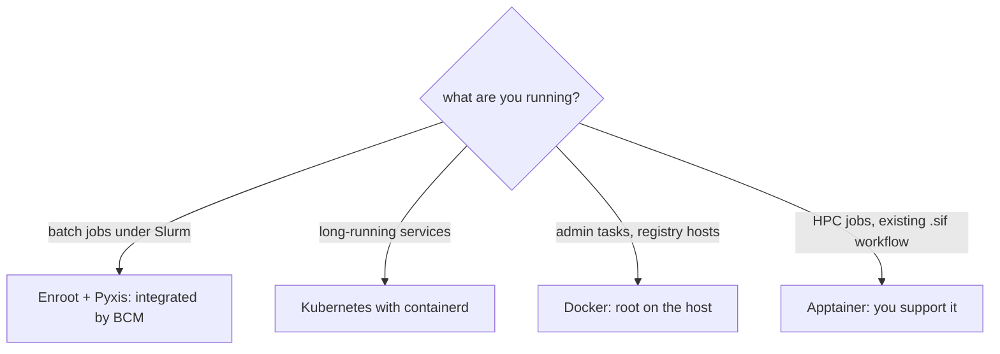

# 8.10 Containerization in BCM: Docker, Apptainer and Enroot

| | |
|---|---|
| Level | Intermediate |
| Priority tier | 1 |
| Lab venue | Laptop |
| Part | Part 8: NVIDIA Base Command Manager |
| Status | Drafted (`containers_lab.py`: 35 checks pass; cluster commands **untested** on live BCM) |

## Why this matters for AI infrastructure

Almost all AI software arrives as a container image from NGC or a company registry. On a cluster you need to answer three practical questions: which tool runs the container for which kind of user, where do the images come from without hammering the internet, and who can become root through the container tool. BCM gives a specific answer for each, and the answers differ between Slurm jobs and Kubernetes services.

## Prerequisites and outcomes

You need chapters 8.4, 8.8 and 8.9. Part 6 chapter 6.13 teaches Enroot and Pyxis in depth, so this chapter keeps to what is specific to BCM. After this chapter you can:

- choose between Docker, Kubernetes (containerd), Enroot with Pyxis, and Apptainer for a given need
- set up Docker on selected nodes, and explain what the DockerHost role controls
- set up a local registry (Docker Registry or Harbor), including a Docker Hub cache, and protect it
- set up Enroot and Pyxis through `cm-wlm-setup` and avoid the cache and credential traps
- run Apptainer on a BCM cluster knowing what BCM does and does not do for it

## 1. The four tools side by side

| | Docker | Kubernetes (containerd) | Enroot + Pyxis | Apptainer |
|---|---|---|---|---|
| Daemon | yes, runs as root | yes | none | none |
| Who can use it after BCM setup | only root, by default | users, through namespaces and policy (8.9) | any Slurm user | any user, if you install it |
| Slurm | not integrated by BCM | no | **integrated** (`cm-wlm-setup --with-pyxis`) | not integrated by BCM |
| Multi-host | no (**Swarm is not supported**) | yes | through Slurm | through Slurm |
| Set up by | `cm-docker-setup` | `cm-kubernetes-setup` | `cm-wlm-setup` | by you |
| In BCM manuals | yes | yes | yes | **no** |

The manual's own guidance: using Docker directly means being root on the host, so regular users should reach containers through Kubernetes, and BCM does **not** integrate Docker with workload managers (the only example it gives is an open-beta LSF that can run jobs in Docker containers).

## 2. Docker through BCM (Containerization Manual chapter 2)

- BCM provides the `cm-docker` package (Docker, containerd, runC, docker-py) and the setup tool **`cm-docker-setup`** (part of `cm-setup`). Docker 28.0.4 on x86_64 at the manual's date. Run it with no options for a text interface, or with `-c file.yaml` to replay a saved configuration.
- The tool asks which registries to use, on which nodes Docker goes, and whether to install the **NVIDIA container runtime** (the `cm-nvidia-container-toolkit` package; the manual's example then runs `nvidia-smi` inside an `nvidia/cuda` container).
- It installs `cm-docker`, assigns the **`DockerHost` role** to categories or head nodes, adds Docker **health checks** to monitoring, configures Docker, and restarts nodes if needed. `module load docker` is needed before using the `docker` command.

**The DockerHost role** (cmsh: `roles; assign docker::host`) holds the parameters CMDaemon writes into Docker's configuration:

| Parameter | Default | Notes |
|---|---|---|
| Spool | `/var/lib/docker` | root of the Docker runtime; put it on fast local disk |
| Enable SELinux | yes | |
| Log level | info | fatal, error, warn, info, debug |
| MTU | 0 | 0 means do not set |
| Iptables | yes | disable if it clashes with other software that uses iptables |
| User namespace remap | unset | needs `user_namespace.enable=1` in the kernel options of those nodes and a reboot |
| Insecure registries | empty | for HTTPS registries without distributed certificates |
| Enable / Verify TLS, TLS CA, certificate, key | off | verify trusts only certificates signed by the CA |
| Storage backends | **overlay2 only** | options can be set in the `storagebackend` submode |
| Runtime | runc | |

Health checks: a test call to the Docker API, and a check that no container is in the dead state. The `docker` service is also visible in the node's `services` list (monitored, autostart). Docker volumes bypass the storage driver; data on them is not overlay2. `docker info` shows the driver, cgroup version and plugins.

## 3. Registries (chapter 3)

Images come from a registry. Docker Hub is the default, but it **limits pulls**, and nodes pulling the same image at the same time create a thundering herd. The manual's remedies: authenticate with a Docker Hub account (a paid Pro, Team or Business account has unlimited pulls); run **Docker Registry as a caching proxy mirror**; or, for air-gapped clusters, use **Skopeo** (chapter 8.14).

BCM can install two local registries with **`cm-container-registry-setup`** (or Base View: **Containers > Container Registry Wizard**):

| | Docker Registry | Harbor |
|---|---|---|
| Aim | simple, trusted users, **Docker Hub proxy cache** | enterprise: security and identity management |
| Port | 5000 by default | UI at `https://<head>:9443` when on the head node |
| Config role | `generic::docker-registry` | `generic::harbor` |

Points to remember:

1. The node that hosts a registry gets the **`datanode` protection** (chapter 8.4) so it is not wiped by a reprovision: "if a registry is wiped out, the state of images in the container registry is incoherent and cannot be restored". The same protection is applied to etcd nodes (chapter 8.9).
2. To use the Docker Hub cache, select proxy mode in the registry setup; clients must give the **port** in the URL (for example `https://node001:5000`, and `docker run node001:5000/library/hello-world`).
3. Harbor's default login is `admin` with the default password **`Harbor12345`**: change it. If Harbor is on the head node, open its port to reach the UI from outside.
4. **Port clash:** the Harbor UI on the head node is on **9443**, and the Keycloak setup (chapter 8.6) also needs 9443 and 9999 free on the head node. Do not put both on the head node, or place one elsewhere. (My observation from two manual passages; the lab checks it.)
5. Kubernetes pulling from Harbor needs an `imagePullSecret` created with `kubectl create secret docker-registry myregistrykey --docker-server=node001:9443 ...` and referenced in the pod.

## 4. Enroot and Pyxis in BCM (Administrator Manual 7.3.3)

Chapter 8.8 shows how `cm-wlm-setup` installs them (cache and data directories, shared or per-user, `/etc/enroot/enroot.conf`, the prolog and epilog, no reboot needed). Part 6 chapter 6.13 teaches the tools. What is BCM-specific:

- Installed by `cm-wlm-setup`; Pyxis is compiled against the installed Slurm, so **reinstall it after a Slurm upgrade**.
- Two BCM-provided Enroot package flavours exist: standard and hardened.
- **Cache sharing is a security decision** (8.8): a shared writable cache lets every user share layers but also lets any user write to it; restrict it with mode `00770` and a group, or avoid it with administrator-owned shared Squashfs images referenced by full path.
- **Credentials** (from the user's notes, which quote the Enroot docs): NGC imports need **two** entries in the user's `.credentials` file, `nvcr.io` **and** `authn.nvidia.com`, both with login `$oauthtoken`; Docker Hub is `registry-1.docker.io`. Mode 600, never committed. The lab's `enroot_credentials_problems` checks the file text.
- In an `#SBATCH` line the `#` in `nvcr.io#nvidia/pytorch:21.12-py3` starts a comment; escape it as `nvcr.io\#nvidia/pytorch:21.12-py3`.
- **Distribution (judgment from the notes):** for jobs larger than a few nodes, import once to shared storage and give the `.sqsh` path to `--container-image`, so the registry is contacted once.

## 5. Apptainer (not in the BCM manuals)

I found no mention of Apptainer or Singularity in the three BCM manuals I read. The HPC sysadmin book describes it as follows (in my words):

- **Docker is hard to use directly in HPC**: it needs a root-run service, does not give direct InfiniBand and GPU access, and integrates badly with job managers.
- **Singularity** (Sylabs) was designed for HPC: its own image format (`.sif`), built from a definition file (like a Dockerfile), runs as a normal process, gives transparent access to InfiniBand and GPUs, and integrates with any batch system. **Apptainer** is the Linux Foundation fork; almost everything about Singularity applies. To use NVIDIA GPUs you need the NVIDIA container toolkit.
- Under Slurm the book recommends `srun` over `mpirun`: `srun ... singularity run app.sif /opt/my-mpi-app` style launches.
- The user's notes show GPU use as `apptainer exec --nv <image> <command>`.

**On a BCM cluster you would do the following yourself** (my outline, not from BCM): install Apptainer in the software image with `cm-chroot-sw-img` or on `/cm/shared` with a module file (chapter 8.4), install `cm-nvidia-container-toolkit`, update nodes with `imageupdate` or a reboot, keep `.sif` files on shared storage, launch through `srun`. BCM will not configure it, monitor it, or (as far as the manuals say) support it, so you own the upgrades and the security review. If you only need Slurm containers and want the BCM-supported path, use Enroot with Pyxis.

## 6. A decision guide

| Situation | Use | Why |
|---|---|---|
| Researchers submit GPU training jobs | Enroot + Pyxis | BCM-integrated, unprivileged, `srun --container-image` |
| A team already has `.sif` workflows | Apptainer (and accept self-support) | no conversion; check security and GPU toolkit |
| Notebooks, inference APIs, platform services | Kubernetes | scheduling, restarts, policy (8.9) |
| Running a registry, or an admin tool | Docker (root-only) | simple, administrator-only |
| 100 nodes pulling one image at job start | import once; Docker Registry cache or shared `.sqsh` | avoid registry rate limits and slow starts |
| Disconnected site | local registry and Skopeo | chapter 8.14 |

## 7. Common first mistakes

1. Giving users `docker` access instead of a Slurm or Kubernetes path.
2. Expecting Docker to be integrated with Slurm in BCM.
3. Leaving Harbor with `Harbor12345`.
4. A Docker Hub proxy URL without the port.
5. Putting Harbor and Keycloak on the same head node.
6. Letting every node pull a big image from NGC at the same moment.
7. Forgetting `authn.nvidia.com` in Enroot credentials.
8. A shared Enroot cache open to everyone.
9. Forgetting to reinstall Pyxis after upgrading Slurm.
10. Assuming BCM supports Apptainer.

### 7.1 Deep dive: Why Docker is an anti-pattern for multi-tenant HPC and Slurm jobs

When machine-learning engineers move from a single cloud workstation to a shared bare-metal Slurm cluster, their first instinct is almost always to ask for `docker run --gpus all` on the compute nodes. Why does the BCM Containerization Manual explicitly advise against giving regular users Docker access on shared compute nodes, and why does BCM integrate **Enroot + Pyxis** for Slurm instead?

Three fundamental architectural mismatches make the standard Docker daemon unsuitable for multi-tenant HPC batch scheduling:

1. **The root-equivalent daemon escalation problem:** The Docker CLI (`docker`) is a thin client that sends REST calls over a UNIX domain socket (`/var/run/docker.sock`) to the `dockerd` daemon, which runs as `root` on the host OS. Any user granted permission to talk to `/var/run/docker.sock` (by being placed in the `docker` UNIX group) can run `docker run -v /:/host -it ubuntu chroot /host bash` and instantly become unrestricted `root` on the compute node—allowing them to read other tenants' model weights, modify `/etc/shadow`, or flash hardware firmware (`volume-18/ch2`). Even if you enable Docker's `User namespace remap` on the `DockerHost` role, mapping subordinate UIDs breaks shared POSIX filesystem ownership across Lustre, GPFS, and NFS mounts where every node expects the researcher's real LDAP UID.
2. **Process-tree orphan escape from Slurm `proctrack/cgroup`:** When a user submits a job with `srun`, Slurm's `slurmd` daemon spawns the job process inside a Linux cgroup (`proctrack/cgroup` and `task/cgroup`) so Slurm can track its CPU/memory/GPU usage and kill every child process when the job ends or exceeds its wall-clock time limit. When a Slurm job invokes `docker run`, the container process is spawned as a child of the external `dockerd` daemon, **outside** `slurmd`'s process tree. If the Slurm job is cancelled with `scancel`, the `docker run` CLI client exits while the actual GPU training container keeps running inside `dockerd` as a rogue orphan, holding onto `80 GB` of GPU HBM memory and causing the next user's Slurm job on that node to crash with `CUDA out of memory`.
3. **Multi-node MPI and PMIx bootstrap friction:** In a 64-node training job, `srun` uses PMIx to wire up rank identities, InfiniBand RDMA queue pairs, and shared-memory segments across all 512 GPU processes simultaneously. Because Enroot is **daemonless**—unpacking a SquashFS image into an unprivileged `chroot` + user/mount namespace directly as a child of `slurmd`—and **Pyxis** hooks directly into Slurm's SPANK plugin API at step launch, every container rank runs as the user's real LDAP UID inside Slurm's cgroup, inherits the job's exact `CUDA_VISIBLE_DEVICES` and InfiniBand devices via `nvidia-container-cli` (`98-nvidia.sh`), and terminates cleanly the instant `srun` finishes.

### 7.2 Architecting container image caching and registry tiers for 512-GPU jobs

Imagine what happens when a researcher launches a 64-node (`512`-GPU) training job with `srun -N 64 --ntasks-per-node=8 --container-image=nvcr.io#nvidia/pytorch:24.01-py3`. A modern PyTorch + CUDA + cuDNN + NCCL container image is ten to twenty gigabytes compressed (and thirty to forty gigabytes unpacked).

If all sixty-four nodes reach out over the head node's NAT gateway (or corporate proxy) to pull twenty gigabytes from `nvcr.io` or Docker Hub at the exact same second:
- Your cluster tries to pull **1.28 terabytes** of container layers across the external border link before step 0 of training can even start.
- If the image comes from Docker Hub, sixty-four nodes pulling multi-layer manifests immediately trip the `100` (unauthenticated) or `200` (authenticated) pulls-per-6-hours rate limit, causing half the ranks in the job to fail with `429 Too Many Requests` and aborting the entire 64-node allocation.

A production BCM cluster eliminates this bottleneck by combining three caching tiers:

1. **Tier 1 — Pre-imported `.sqsh` files on parallel storage (fastest for Slurm/Pyxis):** Instead of passing a remote `nvcr.io#...` registry URL on `srun` jobs spanning more than a couple of nodes, import the container image **once** on a login or build node using `enroot import docker://nvcr.io#nvidia/pytorch:24.01-py3`, placing the resulting single-file `nvidia+pytorch+24.01-py3.sqsh` archive onto a striped Lustre or WekaFS directory (`/scratch/containers/` or `/cm/shared/containers/`). When the 64-node job runs `srun --container-image=/scratch/containers/nvidia+pytorch+24.01-py3.sqsh`, zero external registry calls occur; the parallel filesystem streams the SquashFS blocks at tens of gigabytes per second across the storage fabric, and each node unpacks into its local NVMe `/run/enroot` scratch in seconds.
2. **Tier 2 — Local Harbor and Docker Registry proxy cache (`cm-container-registry-setup`):** For Kubernetes workloads (`containerd`) and interactive iterative builds, deploy **Harbor** (`generic::harbor`, port `9443`) for internal team images and **Docker Registry in proxy-cache mode** (`generic::docker-registry`, port `5000`) as a pull-through mirror for upstream registries. Remember that BCM automatically sets `datanode yes` on registry hosts so a node reboot never wipes your cached layers, and ensure Harbor and Keycloak (`cm-setup-keycloak.py`) are placed on separate nodes so they do not conflict on TCP port `9443`.
3. **Tier 3 — Hardened Enroot credential and cache hygiene:** On shared clusters, keep each user's `~/.config/enroot/.credentials` at mode `0600` (including both `nvcr.io` and `authn.nvidia.com` with `login $oauthtoken` for NGC access), and keep `ENROOT_CACHE_PATH` and `ENROOT_DATA_PATH` per-user (`/run/enroot/.../$(id -u)`) on fast local NVMe so one user cannot tamper with another user's unpacked rootfs layers.

### 7.3 Integrating Apptainer safely alongside BCM's native stack

Even though Enroot + Pyxis is the native, BCM-supported container workflow for Slurm, many academic, national-lab, and bioinformatics teams bring years of existing **Apptainer (Singularity)** `.sif` images and definition files to your cluster. Because Apptainer is daemonless and runs as the invoking user's POSIX UID under `srun` (`srun apptainer exec --nv model.sif python train.py`), it coexists peacefully with BCM and Slurm—as long as your platform team manages three details that BCM does not handle automatically:

1. **Install into the software image, never ad-hoc on nodes:** Install `apptainer` (and `cm-nvidia-container-toolkit` so `--nv` can locate host NVIDIA libraries via `nvidia-container-cli`) inside a chroot of the target software image (`cm-chroot-sw-img /cm/images/default-image`), run `updateprovisioners`, and push via `imageupdate -w`.
2. **Configure `/etc/apptainer/apptainer.conf` bind paths for parallel storage:** Add `bind path = /scratch` and `bind path = /cm/shared` to `apptainer.conf` inside the software image so users do not have to pass `-B /scratch:/scratch` on every job command line.
3. **Direct `APPTAINER_CACHEDIR` and `APPTAINER_TMPDIR` off `/home`:** By default, Apptainer caches OCI blobs under `~/.apptainer/cache` in the user's home directory. When a user builds or pulls a twenty-gigabyte image, writing thousands of layer files into `/home` over NFS will exhaust their home quota and stall the head node's NFS server. Drop `/etc/profile.d/apptainer-scratch.sh` into the software image exporting `APPTAINER_CACHEDIR=/lscratch/$USER/apptainer_cache` and `APPTAINER_TMPDIR=/lscratch/$USER/tmp` on fast local NVMe.

### 7.4 Step-by-step runbook: Deploying Harbor and a Docker Hub pull-through cache on BCM

To make container image delivery fast, private, and resilient against upstream rate limits across both your Slurm (Enroot/Pyxis) and Kubernetes (`containerd`) nodes, let us walk through how an infrastructure team sets up both **Docker Registry (as a pull-through proxy cache)** and **Harbor (as the enterprise private registry)** using `cm-container-registry-setup`:

1. **Choose dedicated registry hosts and avoid head-node port collisions:**
   - Recall from Section 3 that Harbor's web UI defaults to **TCP port `9443`** when deployed on the head node, which collides directly with BCM's **Keycloak** single sign-on service (`cm-setup-keycloak.py`, ports `9443` and `9999`).
   - On a production cluster, assign a dedicated utility or storage-gateway node (for example, `reg01` or `node001`) to host Harbor and the Docker Registry proxy cache, and make sure its `/var/lib/docker` and registry storage paths sit on high-endurance NVMe RAID or a dedicated parallel-storage volume.
   - When `cm-container-registry-setup` assigns the `generic::docker-registry` or `generic::harbor` role to that node, BCM automatically sets **`datanode yes`** on the node object so an accidental reboot in `FULL` install mode will never wipe your stored container layers without explicit administrator confirmation.
2. **Configure the Docker Registry proxy-cache mirror (`port 5000`):**
   - Run `cm-container-registry-setup`, select **Docker Registry**, enable **Proxy mode** (Docker Hub caching mirror), and provide a paid or authenticated Docker Hub service account (`200` or unlimited pulls) so the proxy cache fetches upstream layers once and serves them locally at line rate over `internalnet` (`https://reg01:5000`).
   - Always include the explicit port (`:5000`) when configuring clients (`containerd` `mirrors` in `cri.toml`, Docker `registry-mirrors`, or Enroot registry URLs).
3. **Configure Harbor (`port 9443`) and rotate the default `Harbor12345` password:**
   - Run `cm-container-registry-setup` to deploy Harbor, immediately log into the Harbor UI (`https://reg01:9443`) as `admin`, and rotate the default **`Harbor12345`** password to a vault-managed secret.
   - Create robot accounts (read-only pull tokens) for your Kubernetes namespaces (`kubectl create secret docker-registry ...`) and for your researchers' `~/.config/enroot/.credentials` files so CI pipelines push validated training images into Harbor once and compute nodes pull them over the internal `100G`/`400G` network without ever touching the public internet.

### 7.5 Troubleshooting container launch failures across Docker, Enroot/Pyxis, and Kubernetes

When a researcher or platform engineer reports that a GPU container fails to start on a BCM cluster, use this four-row symptom table to pinpoint the layer immediately:

| Symptom | Container Stack | Root Cause & Remediation in BCM |
|---|---|---|
| `srun: unrecognized option '--container-image'` | **Slurm + Pyxis** | Either Pyxis was not enabled in `cm-wlm-setup` (`--with-pyxis`), or Slurm was upgraded to a new major version without recompiling/reinstalling the Pyxis SPANK plugin (`cm-wlm-setup --reinstall-pyxis`). |
| `enroot import` fails with `401 Unauthorized` on `nvcr.io` even though `nvcr.io` is in `.credentials` | **Enroot + NGC** | NGC token authentication redirects through `authn.nvidia.com`. Verify `~/.config/enroot/.credentials` (`0600`) contains entries for **both** `machine nvcr.io` and `machine authn.nvidia.com` with `login $oauthtoken`. |
| `sbatch` script with `#SBATCH --container-image=nvcr.io#nvidia/pytorch:...` fails to parse image name | **Slurm + Pyxis** | Slurm treats an unescaped `#` inside an `#SBATCH` line as a comment delimiter. Escape it as `nvcr.io\#nvidia/pytorch:...` (or use `nvcr.io/nvidia/pytorch:...`). |
| `docker run --gpus all` fails with `could not select device driver "nvidia"` on a `DockerHost` node | **Docker (`cm-docker-setup`)** | The NVIDIA container runtime was not enabled during `cm-docker-setup`. Re-run `cm-docker-setup` to install `cm-nvidia-container-toolkit` and configure the `nvidia` runtime in `/etc/docker/daemon.json`. |

### 7.6 Summary: Enforcing container security boundaries across all four runtimes

Regardless of which container runtime a workload uses on your BCM cluster, remember that **a container shares the host Linux kernel**. Keep these four operational guardrails in place so container workloads remain isolated, reproducible, and fast:

1. **Never grant unprivileged users access to the root `dockerd` socket:** Reserve `cm-docker-setup` and the `DockerHost` role strictly for administrator-managed infrastructure hosts (such as a Harbor registry node or a dedicated CI builder VM where tenants have no interactive shell access).
2. **Enforce UID/GID and mount isolation on shared compute nodes:** Under Slurm, Enroot + Pyxis naturally executes containers as the submitting user's unprivileged POSIX UID inside Slurm's cgroup (`ConstrainDevices=yes`). Under Kubernetes (`cm-kubernetes-setup`), always enable **Kyverno** and the **Kyverno policies** (Chapter 8.9) so users in `*-restricted` namespaces cannot launch privileged pods or bind-mount arbitrary host paths outside their own `/home/<user>` directory.
3. **Stage heavy AI container images onto shared SquashFS or local registry mirrors before job launch:** Whether a researcher runs a 64-node PyTorch job via Pyxis (`--container-image=/scratch/containers/pytorch.sqsh`) or scales a multi-replica inference deployment on Kubernetes (pulling from a local Harbor or Docker Registry proxy cache on `internalnet`), pre-staging images eliminates external registry rate-limiting and cuts job startup time from twenty minutes to seconds.
4. **Keep container runtime packages aligned across head nodes and software images:** Whenever you upgrade Slurm (`cm-wlm-setup --reinstall-pyxis`), update `containerd` or `cm-docker`, or roll out a new NVIDIA GPU driver in a software image, test a single-node GPU container (`nvidia-smi`) and a two-node NCCL container (`all_reduce_perf`) on a canary category before rolling the image update out to the production fleet.

## Exercises

1. Run `python3 containers_lab.py`. Pick four checks and explain each rule in your own words.
2. A 64-node job pulls a 20 GB NGC image at start. Compare three distribution methods in time, load and risk, and pick one for your site.
3. Write the check list you would run before giving a contractor access to Docker on a node, and why you would refuse.
4. Plan where Harbor, Keycloak, Docker Registry and the Docker Hub cache run on a cluster with two head nodes and 200 compute nodes.
5. Convert a Docker-based inference workflow into (a) a Kubernetes deployment and (b) a Slurm job with Pyxis. What does each lose?
6. Explain to a security reviewer why Enroot and Apptainer need no daemon, and what that does and does not protect.

## 9. Interview angles

- "Why not just give users Docker?" Root daemon; membership in the docker group is root on the host; BCM's answer is Kubernetes or Enroot.
- "How would you reduce image pull load?" Registry cache, shared squashfs, pre-pull, authenticated pulls.
- "What protects a registry node from reprovisioning?" The `datanode` option.
- "Enroot versus Apptainer?" Both daemonless and HPC-friendly; Enroot is NVIDIA's, BCM-integrated with Pyxis; Apptainer has its own image format and community and is not covered by BCM.
- "How do containers get GPUs on BCM?" Docker: NVIDIA container runtime package. Kubernetes: GPU operator and toolkit. Enroot: the `98-nvidia.sh` hook. Apptainer: `--nv` and the toolkit.

## Checkpoint questions (20)

1. Which container runtime does BCM natively integrate with Slurm via `cm-wlm-setup`?

**Enroot paired with the Pyxis SPANK plugin** (`cm-wlm-setup --with-pyxis`).

2. Is Docker Swarm supported by BCM?

**No.** The BCM Containerization Manual explicitly states that Docker Swarm is not supported.

3. Who can run `docker` commands by default after `cm-docker-setup` completes, and why shouldn't regular cluster users be added to the `docker` group?

Only **`root`** can run `docker` by default. Because the Docker daemon runs as `root`, any user in the `docker` group can bind-mount `/` from the host into a container and gain instant uninhibited `root` privileges on the physical node.

4. What packages, roles, and health checks does `cm-docker-setup` configure?

It installs `cm-docker` (Docker `28.0.4`, `containerd`, `runC`, `docker-py`) and optionally `cm-nvidia-container-toolkit`, assigns the **`DockerHost` (`docker::host`)** role to selected categories or head nodes, and enables two health checks (Docker API responsiveness and checking that no container is in the `dead` state).

5. What is the default `Spool` directory on the `DockerHost` role, and where should it be placed?

**`/var/lib/docker`**. Because container image layers and writable overlays are I/O-intensive, `/var/lib/docker` should reside on fast local NVMe/SSD storage rather than slow network mounts.

6. Which Docker storage backend driver does BCM support in the `DockerHost` role?

**`overlay2` only** (configured via the `storagebackend` submode).

7. What kernel parameter and action are required on compute nodes if you set `User namespace remap` on the `DockerHost` role?

You must add **`user_namespace.enable=1`** to the kernel parameters of those nodes (or their category/image) and **reboot** the nodes.

8. What two health checks does BCM attach to nodes holding the `DockerHost` role?

1. A test query to the **Docker daemon API** to verify the daemon is responsive.
2. A check verifying that **no container is in the `dead` state**.

9. Name three ways to prevent Docker Hub pull rate-limiting and thundering-herd network saturation when 100 nodes start a job.

1. Deploy **Docker Registry in proxy-cache mirror mode** via `cm-container-registry-setup`.
2. Pre-import the image once into a shared **Enroot `.sqsh`** (or Apptainer `.sif`) file on the parallel filesystem (`/cm/shared` or `/scratch`).
3. Authenticate with a paid Docker Hub Pro/Team/Business account or host images in a local **Harbor** registry (`cm-container-registry-setup`).

10. Which two local container registries can `cm-container-registry-setup` deploy, and what BCM roles represent them?

1. **Docker Registry** (`generic::docker-registry`, default port `5000`, supports Docker Hub proxy caching).
2. **Harbor** (`generic::harbor`, default HTTPS port `9443` when on the head node, enterprise RBAC and vulnerability scanning).

11. Why does `cm-container-registry-setup` automatically enable `datanode` on any node hosting a container registry?

Because if a registry host were accidentally wiped by a `FULL` re-provision on reboot, the stored container image layers and registry database would be permanently lost and incoherent.

12. When pulling through a BCM Docker Registry proxy cache on `node001`, what must clients include in the registry URL?

Clients must explicitly include the **port number (`:5000`)** in the URL (for example, `https://node001:5000` and `docker run node001:5000/library/hello-world`).

13. What is Harbor's default administrator username and password after `cm-container-registry-setup`, and what must you do immediately?

Username **`admin`** and password **`Harbor12345`**—you must rotate this well-known default password immediately after installation.

14. Why can't you install both Harbor and Keycloak on the same BCM head node with their default port settings?

Both Harbor's web UI and BCM's `cm-setup-keycloak.py` require **TCP port `9443`** on the head node (`cm-setup-keycloak.py` requires `9443` and `9999` to be free).

15. How does a Kubernetes pod authenticate to pull private images from a BCM-deployed Harbor registry on `node001:9443`?

By creating a `kubernetes.io/dockerconfigjson` Secret (`kubectl create secret docker-registry myregistrykey --docker-server=node001:9443 ...`) and referencing it in the pod spec under **`imagePullSecrets`**.

16. Which two hostname entries must be present in `~/.config/enroot/.credentials` to import private images from NVIDIA NGC (`nvcr.io`)?

Both **`nvcr.io`** and **`authn.nvidia.com`**, each configured with `login $oauthtoken` and your NGC API key as the password (with file mode `0600`).

17. Why must `#` be escaped in `#SBATCH --container-image=nvcr.io\#nvidia/pytorch:24.01-py3` inside a Slurm batch script?

Because Slurm's `#SBATCH` parser treats an unescaped `#` after the directive as the start of an inline comment, truncating the image URI at `nvcr.io` unless escaped as `\#` (or replaced with `/` in newer Pyxis versions).

18. Why must you run `cm-wlm-setup --reinstall-pyxis` after upgrading Slurm to a new major release in BCM?

Because Pyxis is a C SPANK plugin (`spank_pyxis.so`) compiled directly against the headers and ABI of the installed Slurm release.

19. Is Apptainer (or Singularity) configured or documented in the BCM 11 manuals?

**No.** Neither Apptainer nor Singularity appears in the BCM 11 Administrator, Installation, or Containerization manuals; Enroot + Pyxis is BCM's supported HPC container stack.

20. If your research teams require Apptainer (`.sif` images) on a BCM cluster, how do you deploy it and what operational responsibilities do you own?

Install the `apptainer` package (and `cm-nvidia-container-toolkit` for `--nv` GPU support) into the software image via `cm-chroot-sw-img` (or on `/cm/shared` with an Environment Module), push via `imageupdate -w`, store `.sif` images on shared storage, and launch via `srun apptainer exec --nv app.sif ...`. Because BCM does not manage Apptainer, your team owns `apptainer.conf` security settings, setuid/fuse upgrades, and monitoring.

## Sources and review notes

- **BCM 11 Containerization Manual:** chapter 1 (introduction), chapter 2 (Docker: setup, DockerHost role, iptables, storage, monitoring, NVIDIA runtime), chapter 3 (registries: Docker Hub limits, Docker Registry proxy, Harbor, generic roles), section 4.21 (Harbor with Kubernetes).
- **BCM 11 Administrator Manual**, 7.3.3 (Enroot and Pyxis; see chapter 8.8).
- **HPC sysadmin book**, chapter 16 (containers): Singularity, Apptainer, Charliecloud, Pyxis and Enroot, caching advice.
- **NVIDIA-DevOps notes**, volume 10 chapter 8 (Enroot and Pyxis, credentials, quoting) and chapter 9 (the `apptainer exec --nv` example). Part 6 chapter 6.13 already covers the Enroot and Pyxis material in depth.
- **Run here:** `containers_lab.py` (35 checks): runtime choice, Docker role validation, registry checks and the Harbor/Keycloak port conflict, Enroot credential text, `#SBATCH` escaping, Apptainer command shape.
- **My own choices, not the manual's:** the decision table and `choose_runtime` (a judgment); the Harbor/Keycloak port conflict (derived from two separate manual passages); the Apptainer on BCM outline; the "import once for jobs over a few nodes" threshold (the notes state the advice, not the number).
- **Not read or not covered:** the Docker sections on logging drivers and networks beyond iptables; Skopeo and air-gapped registries (chapter 8.14); Podman; Charliecloud details; the other registries in the wider ecosystem; Docker Compose.
- **Not verified:** everything about a real BCM system, and all Apptainer behaviour (no Apptainer was available).
