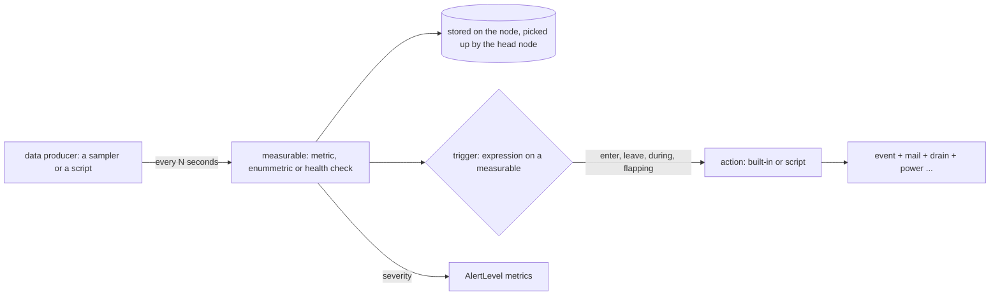

# 8.11 Monitoring, health checks and alerts in BCM

| | |
|---|---|
| Level | Intermediate |
| Priority tier | 1 |
| Lab venue | Laptop |
| Part | Part 8: NVIDIA Base Command Manager |
| Status | Drafted from the BCM 11 Administrator Manual: chapter 10 (10.1 to 10.6 and 10.7 read in the key parts; 10.8 user portal, 10.9, 10.11 to 10.12 not read in depth), appendix G (G.1.6 GPU metrics, G.2.2 GPU health checks, G.4 actions), section 14.8 (monitoring storage) and the user's notes (volume 10 chapter 13). **No BCM system was available.** `code/part08/bcm_monitor.py` is **my model of the rules the manual states**, and `monitoring_lab.py` checks 36 of them. It tests my reading of the manual, not BCM itself. Two items are **my derivations** and are labelled: the flapping arithmetic in section 4, and the remediation tiers in section 8 (the notes' design recommendation, not a BCM feature) |

## Why this matters for AI infrastructure

A training run that loses one GPU can stall hundreds of others. The sooner a bad node is found and drained, the less compute is wasted. BCM's monitoring collects thousands of numbers per node, turns some of them into pass or fail checks, and can run actions when something changes. The skill is deciding what to watch, what is only information and what should act on its own.

## Prerequisites and outcomes

You need chapters 8.1 to 8.7 (objects, nodes, power) and 8.8 (drain). After this chapter you can:

- name the parts of the monitoring pipeline and what each does
- tell metrics, enummetrics and health checks apart, and read `PASS`, `FAIL`, `UNKNOWN` and `no data`
- predict exactly when a trigger fires, using enter, leave, during and flapping
- build a custom trigger and action, and validate it before committing
- list the GPU, DCGM and Redfish checks BCM provides
- understand consolidation and when monitoring needs to scale out
- design automatic remediation that cannot loop or hide a hardware fault

## 1. The pipeline



The manual's words, simplified:

- A **data producer** is the thing that takes a measurement. It may produce many measurables (ProcStat gives CPU user, system, idle, forks...), or one (a health check script such as `ssh2node`).
- A **measurable** is one measured value for an **entity**. An entity is usually a device, but can be a category, partition, software image, network, job queue, user and more.
- **Metrics** are numbers (or `no data`). **Enummetrics** have a small set of states (for example `DeviceStatus`). **Health checks** have the states `PASS`, `FAIL`, `UNKNOWN` and `no data`.
- A **trigger** is a condition on a measurable. When it is met, it launches **actions**. An action is a built-in or a script that exits 0 on success.
- **Severity** and **AlertLevel** summarise how bad things are.

## 2. Health checks, severities and AlertLevel (10.2.4 to 10.2.8)

`PASS` means fine. `FAIL` means failed. **`UNKNOWN`** means it neither passed nor failed (for example a timeout); the manual says to investigate it. **`no data`** means the check did not run (for example it is disabled), and CMDaemon writes it explicitly so a gap is visible. Keep `UNKNOWN` as its own signal; do not fold it into `FAIL`.

**Default severities** come from the three pre-defined trigger templates: **FAIL 15, UNKNOWN 10, PASS 0**. A standalone health check script can override them with its own value (`FAIL 40`, as the `hpraid` script does).

**AlertLevel** is a special metric with three forms, recalculated whenever an event with a severity happens:

| Form | Meaning | Use it to |
|---|---|---|
| count | number of events at "notice" level or higher | see how many problems |
| max | the highest latest severity | see the worst problem |
| sum | the sum of the latest severities | see overall load of problems |

`healthoverview` (device mode) shows sum, maximum and count per node. Example from the manual: a node with "hot" (15) and "fan high" (15) has sum 30, max 15, count 2.

## 3. Common health checks you will see

From `/cm/local/apps/cmd/scripts/healthchecks/` and the measurables list: `ssh2node`, `diskspace`, `mounts`, `mysql`, `ldap`, `ntp`, `dmesg`, `oomkiller`, `defaultgateway`, `exports`, `interfaces`, `chrootprocess` (a daemon running inside an image), `cmsh`, `cuda-dcgm`, `lustre`, `hpraid`, `ManagedServicesOk` (CMDaemon), and the Redfish checks `chassis_health`, `cpu_health`, `memory_health`, `storage_health`, `drive_health`, `volume_health`, `psu_health` and more. The `cm-docker-setup`, `cm-kubernetes-setup` and `cm-wlm-setup` tools add their own health checks when they install a component (chapters 8.8 to 8.10).

In cmsh: `measurables node001` lists everything for an entity, `healthchecks`, `metrics`, `enummetrics` the subsets, `usage <measurable>` shows which entities use one, `monitoringproducers` lists the producers on an entity.

## 4. Triggers: exactly when does it fire? (10.4.5)

A trigger watches one measurable. The "zone" is where the condition is true (for example `CPUUser > 50`). The manual defines four launch options:

| Option | Fires when |
|---|---|
| **Enter actions** | this sample is in the zone **and the previous sample was not** |
| **Leave actions** | this sample is out of the zone and the previous sample was in it |
| **During actions** | this sample and the previous sample are both in the zone |
| **State flapping actions** | the threshold is crossed repeatedly: 5 times (default) within 5 minutes (default) |

Consequences the lab proves:

- **The first sample can never "enter"**: there is no previous sample. The manual says it directly for the example: after an enter, the very next sample never enters again.
- A value that stays in the zone fires **During** every sample, not Enter again.
- Pre-defined triggers: only **three** exist, all with Enter actions: failing, passing and unknown health checks, each running the Event action at severities 15, 0 and 10.
- **The default sampling period is 120 s** (the manual's basic example samples `CPUUser` every 120 s, changeable in the data producer).

**A derived caveat (my arithmetic).** With 120 s sampling and flapping defined as 5 crossings in 300 s, flapping can never be detected on that measurable: crossings are only seen between consecutive samples, so at most two fit in five minutes. To use flapping actions, sample faster or loosen the flap settings. The manual does not say this; I computed it from its defaults, and the lab labels it so.

**The basic example (10.1).** The manual simulates a user running eight `yes` processes on a head node. The administrator clones the `killprocess` action as `killallyesaction` pointing at a script in `/cm/local/apps/cmd/scripts/actions/`, then clones the *Failing health checks* trigger as `killallyestrigger` with Enter action `killallyesaction` and the expression *entity = head node, measurable `CPUUser`, operator `>`, value 50*. `CPUUser` is in jiffies per second; do not confuse it with `CPUUsage`, a percentage. It is deliberately contrived: any CPU-heavy process would fire it.

**Always validate.** In cmsh, `validate` on a new trigger warns "No actions were set" and "No known measurable matches the specified regexes". The manual's own example is a misspelled `devicestate` (the data producer) instead of `devicestatus` (the measurable).

```text
[basecm11]% monitoring trigger add nodedown
[...]% expression
[...->expression]% set measurables devicestatus ; set operator eq ; set value down
[...]% validate
```

(The manual's example, shortened; untested here.)

## 5. Actions (10.2.6, G.4)

Built-in actions, with where they run:

| Action | Runs on | What it does |
|---|---|---|
| Drain / Undrain | head ("Active") | stop / allow the workload manager placing jobs on the node. Plan for undrain from another node if the drain happened on a node that went down |
| Send e-mail to administrators | head | uses the mail setup from 8.3; recipients are an action parameter |
| Event | head | an event for connected clients |
| ImageUpdate | head | update the node's image (chapter 8.4) |
| PowerOff, PowerOn, PowerReset | head | **hard**, through the BMC or PDU |
| Reboot, Shutdown | node | clean, through the operating system |
| `killprocess`, `remount`, `testaction` | node | standalone scripts in `/cm/local/apps/cmd/scripts/actions/` (head) or the image path (nodes) |

Drain has a hidden setting, `post-drain-actions`, that runs more actions after the node is fully drained: `set -e -v post-drain-actions send\ e-mail\ to\ administrators poweroff`. Also relevant: `monitoringactionhistory` shows which triggers fired and what ran.

## 6. GPU and DCGM health (G.1.6, G.2.2)

The `GPUSampler` producer reads GPUs. Metrics are written `name:gpuN` (for example `gpu_ecc_dbe_agg:gpu1`): ECC single and double bit counts (aggregate and volatile), memory, power, clocks, temperature, NVLink bandwidth, power violation time, and `gpu_xid_error`. Profiling metrics (SM activity, NVLink read and transmit) exist too (see MIG caveats in 8.3).

**Fourteen GPU health checks** (the V100 and A100 table; newer GPUs are in the Mission Control Manual): `gpu_health_driver`, `_hostengine`, `_inforom`, `_mcu`, `_mem`, `_nvlink`, `_nvswitch_fatal`, `_nvswitch_non_fatal`, `_overall`, `_pcie`, `_pmu`, `_power`, `_sm`, `_thermal`. Written with `:gpuN` for one GPU, without it for all; `_hostengine` is always for the whole node.

**DCGM WARN.** These checks report only PASS, UNKNOWN or FAIL. A DCGM **WARN is reported as PASS by default**, with the reason in the Info field. If you want warnings to count as failures, set the `GPUSampler` extra parameter **`Warn as fail`** to true (`monitoring setup use gpusampler; set -e "Warn as fail" true; commit`); it then applies to all `gpu_health_*` checks. This is an easy way to have a "healthy" cluster that is hiding DCGM warnings: decide on purpose.

The `cuda-dcgm` package must be present for GPU metrics (chapter 8.3).

## 7. Keeping data: consolidation, storage and scale

- Raw samples are stored on the head node. **Consolidators** summarise old data; the default `hour` consolidator keeps hourly averages for **7 years 26 weeks** at most **65,536 samples** (65,536 hours is about 7.5 years; the lab checks this). Reducing the sample limit discards consolidated data, so change it with care.
- `monitoringinfo --storage` shows disk use; the raw store grows in **1 GB increments**. `cm-monitoring-disk-usage.py` estimates the final size (the manual's 10-entity, 286-measurable example gives a maximum of about 1.4 GB). `dumpmonitoringdata` exports a period, `monitoringdrop` removes data, `samplenow`, `latestmetricdata` and `latesthealthdata` read live and last values.
- Nodes **cache** their samples; the head node picks them up at a **pickup interval** (`monitoringpickup`).
- **Scale:** the traditional design handles about **10,000 nodes** with default metrics and hit a limit around **20,000** on 2020 hardware. **Offloaded monitoring** assigns the `monitoring` role to nodes, removes the single point of failure and scales with the cluster (10.7). Add data producers and metrics with the monitoring storage in mind.

## 8. Automatic remediation: a design that cannot make things worse

BCM gives the pieces (health check, trigger, action). It does **not** ship a policy. This is the design recommendation from the user's notes (marked as the author's recommendation there; the mechanisms are documented, the mapping is judgment):

| Tier | Fault | Suggested chain | Why |
|---|---|---|---|
| 1 | suspected **hardware** (GPU falls off the bus, uncorrectable ECC, PSU) | Drain, notify, evidence (`NVSMHealthDump`). **No automatic reboot or image update.** | A reboot does not repair silicon; it returns suspect hardware to the scheduler |
| 2 | reproducible **software state** (missing mount, wrong package, bad module) | Drain, `ImageUpdate` (or reboot), re-run the check, Undrain on PASS | The image defines the state, so restoring the image restores the node |
| 3 | **transient** (a brief fabric blip, one timeout) | alert; use flapping and `UNKNOWN`; drain only if it persists | Reimaging healthy nodes wastes the time you meant to save |

**The loop trap.** In tier 2 a node that fails after every reimage will be reimaged forever. Count attempts per node (the counter is yours to build in the action script) and move the node to tier 1 after the second failure. The lab implements this cap.

Also: treat `UNKNOWN` as its own signal; remember an action that drains must be paired with an undrain plan; and test every trigger on one node with `samplenow` and `validate` before applying it to a category.

## 9. Common first mistakes

1. Folding `UNKNOWN` into `FAIL`, or ignoring it.
2. Expecting Enter to fire again while the value stays high (that is During).
3. Relying on flapping with 120 s sampling and default settings.
4. A trigger on a misspelled measurable (always `validate`).
5. A power or reboot action wired to an automatic hardware fault.
6. A drain action with no undrain plan.
7. Leaving DCGM warnings hidden as PASS without choosing it.
8. Adding many measurables and never checking monitoring disk growth.
9. Reducing a consolidator's sample count and losing history.
10. Using `CPUUser` (jiffies per second) as if it were a percentage.

## 10. Exercises

1. Run `python3 monitoring_lab.py`. Pick four checks and explain each rule in your own words.
2. Using `evaluate_trigger`, find a series where Enter fires twice but During fires only once.
3. Choose a sampling interval and flap settings for a link-flap alert on a GPU fabric port. Show it can be detected.
4. Write the cmsh steps (from the manual, untested) for a trigger that mails the administrators when `gpu_health_overall` fails, and a second that drains on `gpu_health_nvlink` failing.
5. Decide whether you want `Warn as fail` on a training cluster, and say what you would watch if not.
6. Sketch a remediation counter that survives a reboot of the node (it must live somewhere other than the node's local disk).

## 11. Interview angles

- "How does BCM decide a node is unhealthy?" Health checks produce PASS/FAIL/UNKNOWN/no data on a schedule; triggers watch them; severities feed AlertLevel and `healthoverview`.
- "Explain Enter versus During." Enter is a threshold crossing; During is staying in the zone.
- "What would you not automate?" Reboot or reimage for suspected hardware faults.
- "How do you avoid alert storms?" Flapping detection, severities, `mute` during maintenance (chapter 8.4), consolidation of notifications.
- "When does head-node monitoring stop scaling?" Around 10,000 to 20,000 nodes; offloaded monitoring.

## 12. Checkpoint questions (20)

1. Name the three kinds of measurable.
2. What are the four health check states?
3. What are the default severities for FAIL, UNKNOWN and PASS?
4. How can a health check script override its severity?
5. What do AlertLevel count, max and sum show?
6. State the four trigger launch options.
7. Why can the first sample never fire Enter?
8. How many pre-defined triggers exist and what do they do?
9. What is the default sampling period in the basic example?
10. What is the difference between `CPUUser` and `CPUUsage`?
11. What does `validate` warn about?
12. Which built-in actions run on the head node and which on the node?
13. Which actions are hard power actions?
14. What is `post-drain-actions` for?
15. How are GPU metric names written for one GPU?
16. How does a DCGM WARN appear by default and how do you change it?
17. What does the default `hour` consolidator keep?
18. In what increment does the raw monitoring store grow?
19. When should offloaded monitoring be considered?
20. Why does the recommended remediation design cap reimages?

## 13. Sources and review notes

- **BCM 11 Administrator Manual:** chapter 10 (10.1 basic example; 10.2 concepts: measurables, enummetrics, metrics, health checks, triggers, actions, severity, AlertLevel, flapping, data producers; 10.4.5 triggers; 10.5.2 consolidators; 10.6 on-demand sampling, health overview, action history, pickup intervals; 10.7 offloaded monitoring; 10.10 events), appendix G (GPU metrics, health checks, Redfish checks, actions), 14.8 (monitoring data storage).
- **NVIDIA-DevOps notes**, volume 10 chapter 13: the health check, trigger and action pipeline and the remediation tiers; the notes say the tiers are a design recommendation, not a BCM feature. The Xid mapping there is a catalog matter I did not re-check.
- **Not read in depth:** the Base View monitoring screens (10.3, 10.4), PromQL queries and Prometheus integration (10.4.9, 3.18), the user portal (10.8), job monitoring and accounting (chapters 11 to 13 of the Administrator Manual), InfoMessages, the full metrics tables (InfiniBand, NFS, IPMI, Redfish, Kubernetes, NetQ), Mission Control's extra GB200 metrics.
- **Run here:** `monitoring_lab.py` (36 checks): severities and AlertLevel, trigger firing rules and flapping, the flapping arithmetic, validate, consolidation retention, scale advice, GPU check names, DCGM WARN handling, the remediation chain and its loop cap.
- **My own choices, not the manual's:** the numeric value of "notice" (10); the flapping arithmetic; the remediation chain (the notes' recommendation, implemented as written).
- **Not verified:** everything about a real BCM system.
