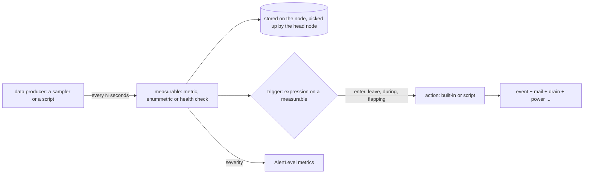

# 8.11 Monitoring, health checks and alerts in BCM

| | |
|---|---|
| Level | Intermediate |
| Priority tier | 1 |
| Lab venue | Laptop |
| Part | Part 8: NVIDIA Base Command Manager |
| Status | Drafted (`monitoring_lab.py`: 46 checks pass; cluster commands **untested** on live BCM) |

## Why this matters for AI infrastructure

Picture a training run that spans hundreds of GPUs. When one GPU fails, the others can stall while they wait for it, because a synchronized job cannot move forward until its slowest member is ready. The sooner you find the bad node and drain it, the less compute gets wasted. Draining means you tell the scheduler to stop placing new work on that node, so the running jobs can finish while nothing new lands on it.

BCM's monitoring collects thousands of numbers per node. Most of them are only information, a few become pass or fail checks, and some can run actions when something changes. A reading of a fan speed or a CPU load is useful for a graph but is not a reason to page anyone. A check that says a GPU has lost its link to the rest of the node is a different matter. Your real skill is deciding what to watch, what is only information, and what should act on its own.

## Prerequisites and outcomes

Before you start, you need chapters 8.1 to 8.7 (objects, nodes, power) and 8.8 (drain). Drain appears here because a health check often ends with a drained node. Check that list against what you already know, and go back to an earlier chapter for anything you cannot yet do.

You will need to tell metrics, enummetrics and health checks apart, and to read the four health results, `PASS`, `FAIL`, `UNKNOWN` and `no data`. The chapter follows the monitoring pipeline in the order a value travels, from the producer that takes a reading to the trigger and action that respond to it. It then explains the four health-check results, the trigger launch options, the built-in actions, and the GPU and DCGM checks. DCGM is NVIDIA's Data Center GPU Manager, the software that reports on GPU health. After that come data retention and scale, a design for automatic repair that cannot make things worse, and the Base View screens and portal features. The last sections cover common mistakes and a worked example of a custom check.

## 1. The pipeline

A measurement on a node has a long way to travel before anyone is paged. It starts with a producer, becomes a stored value, and may then pass through a trigger that runs an action. Each stage has one job, and it helps to name them in order. The diagram below shows that path, and you can follow any alert back along the arrows.



The manual's terms, in plain words, are these. A data producer is the thing that takes a measurement. It is a sampler, a built-in reader or a script you wrote. One producer can yield many measurables. ProcStat, for example, gives CPU user, system, idle, forks and more. Another producer yields just one, such as a health check script like `ssh2node`. A script is a small program that checks one thing and prints the answer.

A measurable is one measured value for an entity. An entity is usually a device, but it can also be a category, partition, software image, network, job queue, user and more. So "CPU user time on node001" is a measurable, and node001 is its entity.

Metrics are numbers, or `no data`. Enummetrics pick from a small set of states, such as `DeviceStatus`. Health checks report one of the states `PASS`, `FAIL`, `UNKNOWN` and `no data`. The first two types give you a value to graph, and health checks give you a verdict to act on.

A trigger is a condition on a measurable. When the condition is met, the trigger launches actions. An action is either built in or a script, and a script counts as successful when it exits 0. Exiting 0 is the Unix convention for success, and any other exit code means the script failed. Severity and AlertLevel tell you how bad things are, and the next section covers both.

When you read a monitoring setup, trace it in the same order a value travels, which means producer first, then measurable, then trigger, then action. Doing this for each alert quickly shows you which link is missing when something fails to fire.

## 2. Health checks, severities and AlertLevel (10.2.4 to 10.2.8)

A health check tells you whether one part of a node is working, and its answer can decide whether anyone gets paged. A check is a question with a short answer, such as "is the disk mounted?" or "does the InfiniBand port respond?" There are four possible answers, and they do not mean the same thing.

`PASS` means fine, and `FAIL` means failed. `UNKNOWN` means the check neither passed nor failed, for example because it timed out. A timeout is a check that did not finish in time, so it could not say either way. The manual says to investigate that case. `no data` means the check did not run at all, for example because it is disabled. CMDaemon writes it explicitly, so a gap stays visible. A silent gap is dangerous, because it looks the same as a healthy node. Keep `UNKNOWN` as its own signal, and do not fold it into `FAIL`.

Each result also carries a severity, which is a number for how serious the problem is. The three pre-defined trigger templates set the defaults: **FAIL 15, UNKNOWN 10, PASS 0**. A template is a starting configuration that you can copy and adjust. A standalone health check can set its own value instead. The `hpraid` script, for example, uses `FAIL 40`, which overrides the default 15. That severity ranks its failures above an ordinary failed check in AlertLevel.

AlertLevel is a special metric that comes in three forms. BCM recalculates it whenever an event with a severity happens. Each form answers a different question, so pick the one that matches what you need to know:

| Form | Meaning | Use it to |
|---|---|---|
| count | number of events at "notice" level or higher | see how many problems |
| max | the highest latest severity | see the worst problem |
| sum | the sum of the latest severities | see overall load of problems |

`healthoverview` (device mode) shows sum, maximum and count per node. Take the manual's example: a node has a "hot" event at severity 15 and a "fan high" event at severity 15. The sum is 15 + 15 = 30, the maximum is 15, and the count is 2. Read together, those three numbers tell you there are two problems and that the worst one has severity 15. Two events with the same severity give the same maximum, so the sum and the count are what tell them apart.

Watch the count to see how many problems exist, and watch the max to find the one that needs attention first. The sum is most useful when you compare nodes, because a node with a large sum has more trouble overall.

## 3. Common health checks you will see

Picture your first week on the cluster, when an alert names a check you have never seen. BCM ships with many checks, so you will meet most of them early. Learning their names now saves time when an alert names one you have never seen. The standalone scripts live in `/cm/local/apps/cmd/scripts/healthchecks/`, and the measurables list shows the rest.

The list includes `ssh2node`, `diskspace`, `mounts`, `mysql`, `ldap`, `ntp`, `dmesg`, `oomkiller`, `defaultgateway`, `exports`, `interfaces`, `chrootprocess` (a daemon running inside an image), `cmsh`, `cuda-dcgm`, `lustre`, `hpraid`, `ManagedServicesOk` (CMDaemon), and the Redfish checks `chassis_health`, `cpu_health`, `memory_health`, `storage_health`, `drive_health`, `volume_health`, `psu_health` and more. Redfish is the standard web interface that many server management controllers provide, and these checks read hardware health through it. Some setup tools add their own checks when they install a component. `cm-docker-setup`, `cm-kubernetes-setup` and `cm-wlm-setup` do this, and chapters 8.8 to 8.10 cover the components they install.

To explore these from `cmsh`, use `measurables node001` to list everything for an entity. The subsets are `healthchecks`, `metrics` and `enummetrics`. `usage <measurable>` shows which entities use a given measurable, and `monitoringproducers` lists the producers on an entity. Those three commands answer the questions you will ask most often, which are what is watched, what uses this check, and where the data comes from.

Run `measurables node001` on one node first, so you see what is already watched before you add anything. A long list is normal, and it is easier to read once you know which subset you need.

## 4. Triggers: exactly when does it fire? (10.4.5)

Suppose a CPU value climbs above 50 and stays there. Does the trigger fire once, or on every sample? The answer depends on the launch option you choose, and the options are easy to mix up. A sample is one reading taken at the sampling interval, so a value that stays high produces many samples.

A trigger watches one measurable. The zone is the region where its condition is true. For example, the zone for `CPUUser > 50` is every sample above 50. Think of the zone as a room, and each sample as a person walking in or out. The manual defines four launch options, and each one answers a different question about the room.

| Option | Fires when |
|---|---|
| **Enter actions** | this sample is in the zone **and the previous sample was not** |
| **Leave actions** | this sample is out of the zone and the previous sample was in it |
| **During actions** | this sample and the previous sample are both in the zone |
| **State flapping actions** | the threshold is crossed repeatedly: 5 times (default) within 5 minutes (default) |

These rules have consequences you can predict. The first sample can never fire an Enter action, because there is no previous sample to compare with. The manual makes the same point with its example: after an Enter, the very next sample never enters again, since it is already inside the zone. A value that stays in the zone fires During on every sample, not Enter again. So if you want one alert when a value first goes high, use Enter, and if you want a repeated reminder while it stays high, use During.

Only three pre-defined triggers exist, and all three use Enter actions. They cover failing, passing and unknown health checks, and they run the Event action at severities 15, 0 and 10. The default sampling period is 120 s. The manual's basic example samples `CPUUser` every 120 s, and you can change that in the data producer.

One consequence follows from the defaults. With 120 s sampling and flapping defined as 5 crossings in 300 s, flapping can never be detected on that measurable. Crossings are only seen between consecutive samples, so at most two fit in five minutes. To use flapping actions, sample faster or loosen the flap settings. The manual does not say this. It follows from the manual's default values, and the lab labels it as derived. A derived result is one you work out from the documented numbers, rather than one the documentation states outright.

The manual's basic example (10.1) simulates a user running eight `yes` processes on a head node. The `yes` program prints a line forever, so it keeps one CPU core busy. The administrator clones the `killprocess` action as `killallyesaction`, which points at a script in `/cm/local/apps/cmd/scripts/actions/`. Then they clone the *Failing health checks* trigger as `killallyestrigger`, with `killallyesaction` as its Enter action. The expression is: entity = head node, measurable `CPUUser`, operator `>`, value 50. `CPUUser` is in jiffies per second, so do not confuse it with `CPUUsage`, which is a percentage. A jiffy is a small clock tick that the Linux kernel counts. The example is deliberately contrived, because any CPU-heavy process would fire it.

Always validate a new trigger. In `cmsh`, `validate` warns "No actions were set" and "No known measurable matches the specified regexes". A common slip is to type `devicestate`, which is the data producer, where you meant `devicestatus`, which is the measurable. The producer is where the reading comes from, and the measurable is the name of the value you want to watch. Mixing them up produces a trigger that silently never fires. The manual's example below uses the correct name.

```text
[basecm11]% monitoring trigger add nodedown
[...]% expression
[...->expression]% set measurables devicestatus ; set operator eq ; set value down
[...]% validate
```

(The manual's example, shortened.)

Run `validate` on every new trigger, and check that the measurable name matches exactly. A trigger that validates cleanly still needs a real test, which section 8 explains.

## 5. Actions (10.2.6, G.4)

Picture a node that starts overheating at two in the morning. The trigger fires, and something has to happen before the next job lands on that node. When a trigger fires, an action does the work. Some actions run on the head node, and others run on the node that triggered them. The place matters, because the power actions and the OS-level actions behave very differently. `PowerOff`, `PowerOn` and `PowerReset` are hard actions that go through the BMC or PDU. The BMC is the server's own management controller, and the PDU is the power strip that feeds it. `Reboot` and `Shutdown` are clean, because they go through the operating system and give running programs a chance to stop properly.

The table lists the built-in actions and where each one runs.

| Action | Runs on | What it does |
|---|---|---|
| Drain / Undrain | head ("Active") | stop / allow the workload manager placing jobs on the node. Plan for undrain from another node if the drain happened on a node that went down |
| Send e-mail to administrators | head | uses the mail setup from 8.3; recipients are an action parameter |
| Event | head | an event for connected clients |
| ImageUpdate | head | update the node's image (chapter 8.4) |
| PowerOff, PowerOn, PowerReset | head | **hard**, through the BMC or PDU |
| Reboot, Shutdown | node | clean, through the operating system |
| `killprocess`, `remount`, `testaction` | node | standalone scripts in `/cm/local/apps/cmd/scripts/actions/` (head) or the image path (nodes) |

Read the "Runs on" column as a safety question. Ask which machine does the work, and whether that machine is still up when the alert fires. An action on a node that is already unhealthy may never run.

Drain also has a hidden setting, `post-drain-actions`, which runs more actions once the node is fully drained. Fully drained means no jobs remain on it. The manual's example is `set -e -v post-drain-actions send\ e-mail\ to\ administrators poweroff`. Finally, `monitoringactionhistory` shows which triggers fired and what ran. Check it when an action did something you did not expect, because it records the history.

If a drain happens on a node that went down, you will need to undrain it from another node. The node cannot undrain itself, because it is not running. Plan that step before you wire a drain into any trigger.

## 6. GPU and DCGM health (G.1.6, G.2.2)

Picture a node that looks healthy in every graph while one of its GPUs quietly loses a link. GPUs get their own checks because they need watching separately from the rest of the node. A GPU can be in trouble while the CPU and memory look normal, and a healthy-looking node can still run a broken card. The `GPUSampler` producer reads them. Each GPU gets its own metrics, written as `name:gpuN`, such as `gpu_ecc_dbe_agg:gpu1`. The `gpuN` part names the card, so `gpu1` is the second GPU in the node, counting from zero.

These metrics cover ECC single and double bit counts (aggregate and volatile), memory, power, clocks, temperature, NVLink bandwidth, power violation time and `gpu_xid_error`. ECC is error-correcting memory, which fixes single-bit errors and reports double-bit errors that it cannot fix. NVLink is NVIDIA's high-speed link between GPUs in one node. An Xid error is a code the NVIDIA driver writes to the log when a GPU hits a fault. Profiling metrics such as SM activity and NVLink read and transmit exist too. SM activity shows how busy the GPU's compute units are. See the MIG caveats in 8.3 before you rely on them, because MIG splits one GPU into smaller pieces and some readings apply to the whole card.

The GPU health checks are fourteen in number for the V100 and A100 table. Newer GPUs are covered in the Mission Control Manual. The checks are `gpu_health_driver`, `_hostengine`, `_inforom`, `_mcu`, `_mem`, `_nvlink`, `_nvswitch_fatal`, `_nvswitch_non_fatal`, `_overall`, `_pcie`, `_pmu`, `_power`, `_sm` and `_thermal`. Add `:gpuN` to target one GPU, or leave it off to cover all of them. `_hostengine` is always for the whole node, because the host engine is the DCGM service itself and it is not tied to one card.

DCGM reports a WARN as well, but these checks only report PASS, UNKNOWN or FAIL. So by default a DCGM WARN is reported as PASS, with the reason placed in the Info field. A cluster can look fully healthy while DCGM is warning about it, and nothing in the default setup will show you. A warning is an early signal that a card is drifting toward trouble, so hiding it removes your chance to act early. If you want warnings to count as failures, set the `GPUSampler` extra parameter **`Warn as fail`** to true. It then applies to all `gpu_health_*` checks. Run `monitoring setup use gpusampler; set -e "Warn as fail" true; commit` to set it.

The `cuda-dcgm` package has to be present before GPU metrics appear (see chapter 8.3). Without it, the sampler has nothing to read, and the GPU panels stay empty.

Decide now whether DCGM warnings should count as failures, because the default hides them.

## 7. Keeping data: consolidation, storage and scale

Picture the head node's disk filling up over a few months of monitoring, with no one watching the growth. Monitoring data piles up quickly, and the head node has to keep all of it somewhere. A reading every two minutes for each measurable adds up across hundreds of nodes and dozens of measurables. Consolidators are how BCM shrinks old data, so the history stays useful without filling the disk. A consolidator replaces many fine-grained samples with one summary per period, such as an hourly average.

Raw samples are stored on the head node. Consolidators summarise the old ones. The default `hour` consolidator keeps hourly averages for up to 7 years 26 weeks, and for at most 65,536 samples. Those 65,536 hours are about 7.5 years, which the lab checks. Reducing the sample limit discards consolidated data, so change it with care. Once the data is gone, no setting brings it back.

Use `monitoringinfo --storage` to see disk use. The raw store grows in 1 GB increments, so the disk usage can jump in steps rather than climb smoothly. `cm-monitoring-disk-usage.py` estimates the final size. In the manual's example of 10 entities and 286 measurables, the maximum comes to about 1.4 GB. A measurable is one stored series, so the count of series drives the size more than the count of nodes does. `dumpmonitoringdata` exports a period, and `monitoringdrop` removes data. `samplenow`, `latestmetricdata` and `latesthealthdata` read live and last values.

Nodes cache their samples, and the head node picks them up at the pickup interval (`monitoringpickup`). Because the nodes hold their samples until they are picked up, a short gap in head-node service may not lose readings.

Scale is the last concern. The traditional design handles about 10,000 nodes with default metrics. On 2020 hardware it hit a limit around 20,000. Offloaded monitoring assigns the `monitoring` role to nodes. It removes the single point of failure and scales with the cluster (10.7). A single point of failure is one part whose failure stops everything, and moving the work to dedicated nodes spreads that risk. Keep the monitoring storage in mind whenever you add data producers or metrics, because every new series adds to the disk use.

If your cluster is heading toward those node counts, plan offloaded monitoring before you add more metrics.

## 8. Automatic remediation: a design that cannot make things worse

It is tempting to let BCM fix a sick node by itself. Done badly, though, an automatic fix can keep rebooting a broken node or hide a real hardware fault. A node that reboots every ten minutes looks busy on a dashboard, yet it never does any work. The design below is meant to prevent both problems.

BCM gives you the pieces: a health check, a trigger and an action. It does not ship a policy. This table is a recommendation, not a BCM feature. The mechanisms are documented, but the mapping from fault to action is judgment, and you own that judgment for your site.

| Tier | Fault | Suggested chain | Why |
|---|---|---|---|
| 1 | suspected **hardware** (GPU falls off the bus, uncorrectable ECC, PSU) | Drain, notify, evidence (`NVSMHealthDump`). **No automatic reboot or image update.** | A reboot does not repair silicon; it returns suspect hardware to the scheduler |
| 2 | reproducible **software state** (missing mount, wrong package, bad module) | Drain, `ImageUpdate` (or reboot), re-run the check, Undrain on PASS | The image defines the state, so restoring the image restores the node |
| 3 | **transient** (a brief fabric blip, one timeout) | alert; use flapping and `UNKNOWN`; drain only if it persists | Reimaging healthy nodes wastes the time you meant to save |

The three tiers follow one rule. Hardware faults get drained and investigated, never rebooted. Software-state faults can be repaired by restoring the image. Transient faults call for patience, so you alert first and drain only if the problem persists. The table is easiest to use by asking, for any new alert, which tier the fault belongs to before you ask what the action should be.

**The loop trap.** In tier 2, a node that fails after every reimage will be reimaged forever. A loop like that uses up your time and keeps the node out of service without ever fixing it. Count attempts per node. The counter is yours to build in the action script. Move the node to tier 1 after the second failure. The lab implements this cap, so you can see the rule working in code.

Also, treat `UNKNOWN` as its own signal. Remember that an action that drains must be paired with an undrain plan. Test every trigger on one node with `samplenow` and `validate` before you apply it to a category. A category is the group of nodes that share a configuration, so a bad trigger there would hit every node in the group at once.

For each fault you automate, write down the tier first and the action second, so you never reach for a reboot by default.

## 8.1 Base View monitoring screens, data producer tuning, consolidator math, and PromQL

The Base View window is where you will spend most of your monitoring time, so it helps to know what each part does. The top-right bar holds eight icons. From left to right they are: (1) **Cluster Overview**, (2) **Job Accounting**, (3) **Monitoring** (visual graphs), (4) **Chargeback**, (5) **Events**, (6) **Background Tasks**, (7) **Package Updates** (the GUI equivalent of `packages --outdated` in `cmsh`), and (8) the **Menu (`≡`)** icon, which holds the dark mode toggle and logout. Chargeback is the report that assigns cluster use to the groups who used it.

The monitoring visualization window opens the **Critical Services** dashboard by default. It shows two plot panels for the `ManagedServicesOK` health check. Panel 1 covers the head node, and panel 2 covers all regular nodes in the `default` category. The left navigation filter ignores case and accepts regexes such as `node001.*cpuuser` and `(node001|node002).*cpuuser`. A regex is a pattern that matches many names at once, so one filter can select several nodes. It uses `/` for tree depth, as in `node001/cpu/cpuuser`. Dragging a measurable into a panel draws two graphs: a smaller bottom bar chart of polled values, and a larger upper interpolated line graph. Interpolated means the line connects the points smoothly between samples.

Data producers compress their samples with **run length encoding (RLE)**. RLE stores a run of identical values as one value and a count, which saves space when a reading stays flat for a long time. Two settings decide how much history survives. `Maximal samples` and `Maximal Age` work together, and whichever limit is reached first drops the older RLE samples. A value of `0` means ignore that limit. Setting both to `0` keeps samples forever, which the manual discourages because it exhausts the disk. Reducing `Maximal samples` discards previously consolidated values after about **30 minutes**. Read that carefully, because it is easy to lose history by changing a setting that looks harmless.

`Offset` delays sampling for producers that depend on other producers. For example, `AggregateNode` computes `TotalCPUIdle` and `TotalMemoryFree`, so it depends on `ProcStat` for `CPUIdle` and on `ProcMemInfo` for `MemoryFree`. The offset makes it wait until those readings exist. `Fuzzy offset` is a multiplier in `[0, 1]`. It spreads node sampling across the window from 0 to `fuzzy_offset * interval`, which avoids a sampling storm. A storm is what happens when every node samples at the same instant and the head node is hit with a flood of data. Take the manual's example: a 120 s interval with a 0.25 fuzzy offset spreads node samples across a 30 s window, because 0.25 * 120 = 30.

`When` is `Timed` by default. The other options are `On demand`, `Out of band` and `On start`. Timed means the producer runs on the interval, while on demand means it runs only when someone asks. Enabling `Only when idle` restricts the producer to idle nodes, where idle is defined by the metric condition `LoadOne > 1`. Load one is the one-minute load average, so the node counts as busy when that value rises above 1.

A metric marked `Cumulative` only grows from boot. Interface bytes received is one example, and it resets at boot. Administrators usually plot its differential per sample interval, which gives bytes/second. The differential is the change between two samples, and dividing it by the interval gives a rate. A raw cumulative graph climbs forever and is hard to read, but the rate shows what the network is doing now.

Consolidators summarise old data. The pre-existing groups are `default` and `none`. In BCM 11, `default` holds only `hour`, with a 3600 s interval. Clusters upgraded from BCM 10 also keep the legacy `day` and `week` consolidators. `none` means no consolidation. Each consolidator item has a `Kind`, which is `average` by default, or `maximum`, or `minimum`. Changing `Kind` discards all previous consolidated data for that consolidator, so make that choice early, before the history matters.

The timing follows a simple chain. When a measurable with interval `Interval_measurable` and at most `Maximal_samples_measurable` raw samples drops its oldest raw point, that point enters consolidation at this age:

```text
t_raw_gone = Maximal_samples_measurable * Interval_measurable
```

With `Offset` on the consolidator item, consolidated data is presented starting at `t_consolidation = t_raw_gone + Offset` into the past. It extends back to `t_consolidation_gone = Maximal_samples_consolidation * Interval_consolidation`. Put in plain words, the raw data runs out after one time span, and the consolidated data picks up after that and runs for a longer span.

An action runs on `Active head node`, on `Node` (the triggering node), or on `Monitoring node`. Its `Allowed time` field limits when it may start. Write months and days in lowercase. Examples are `november-march{monday-saturday{13:00-17:00}}`, `may-september{monday-friday{09:00-18:00};saturday-sunday{13:00-17:00}}`, and `may,september{1-15{monday-friday}}`. These windows let you keep a noisy action out of working hours. In `Send e-mail to administrators`, the `Info` field replaces `{infomessage}` in `/cm/local/apps/cmd/scripts/actions/sendemail.py`. That placeholder is filled in with the reason text from the check.

`Monitoring > Standalone Monitored Entities` covers unmanaged devices, which have no CMDaemon on the target. An admin workstation pinged by a custom script on the head node is one example. `Monitoring > Queries` manages PromQL job-related queries and drilldown queries. PromQL is the query language of Prometheus, the open-source metrics system. A drilldown query opens a more detailed view when you click into a graph. You reach the drilldown queries through `Monitoring > Queries > <query> > Manage the drilldown queries`.

When you change a data producer, check `Maximal samples` and the consolidator's `Kind` first, because those two settings decide how much history survives.

## 8.2 The User Portal, Cloud Job Tagging, Events, the Event Bucket, and InfoMessages

Not every user ought to change the cluster. The User Portal gives non-root users a restricted, read-only version of Base View. Read-only means users can look at the cluster but cannot change it. You install it with the `cm-webportal` package, using `yum install cm-webportal`. Until it is installed, the head-node landing page shows a grey block with `⊕`. After installation, the block turns colored and shows a chain-link icon. The block is a shortcut, so its change in appearance tells you the portal is ready.

Users reach the portal at `https://<head>:8081/userportal`. CMDaemon serves it directly, unlike the landing page, which Apache serves. Apache is a general web server, and CMDaemon is BCM's own service. It uses BCM's self-signed X509v3 certificate, `NVIDIA Bright CA`, unless you replace it with a public CA certificate. A self-signed certificate is one that the cluster's own software issued for itself, so browsers warn about it until you replace it. A public CA certificate comes from a certificate authority that browsers already trust. Users log in with their own credentials and get the `readonly` profile by default. If you want one shared login for everyone, create a user in `cmsh`, then set `"username"` and `"password"` in `/cm/local/apps/cmd/etc/htdocs/userportal/assets/config/common-credentials.json`. That file is blank by default, which disables common access. Shared logins are convenient, but they remove the record of who logged in, so think before you use one.

The home page shows the Message Of The Day, which comes from `/cm/local/apps/cmd/etc/htdocs/userportal/assets/config/message-of-the-day.html`. It also shows cluster documentation links, a cluster state overview refreshed every 10 s by default, and a Job Accounting chart icon. The portal serves static files only. That is a security rule: it will not execute PHP or CGI scripts. Static means the files are sent as they are, with nothing run on the server, so an attacker has far less to work with.

Cloud Job Tagging is for AWS only. Turn it on with `cmsh -c 'cloud; use amazon; set cloudjobtagging yes; commit'`. When a job starts on an AWS cloud node, CMDaemon applies four cost-allocation tags, out of AWS's limit of 50 tags. The tags are `BCM_JOB_ID`, `BCM_JOB_ACCOUNT`, `BCM_JOB_USER` and `BCM_JOB_NAME`. CMDaemon removes them when the job stops, so AWS Cost Explorer can attribute cloud spend to each job. Cost allocation tags are labels that the billing report groups by, so the tags turn one bill into a bill per job.

Viewing events in Base View and `cmsh` is enabled by the `EventLogger` directive in `cmd.conf`. A directive is one setting in the daemon's configuration file. In `cmsh`, the global `events` command takes several options: `on [broadcast|private]`, `off [broadcast|private]`, `show-acknowledged <yes/no>`, `show-detailed <yes/no>`, `level <info|notice|warning|error|alert>`, `clear`, `details <id>`, `acknowledge <id>`, `unacknowledge <id>`, `events <number> [level]`, and `events follow`, which works like `tail -f`. Run `events` with no arguments and you see the defaults: `Private events: off`, `Broadcast events: on`, `Acknowledged events: off`, `Details: off`, `Level: notice`. A broadcast event goes to every connected session, and a private event goes only to the session that asked for it. For example, `updateprovisioners` emits **private** events. Those appear live in your `cmsh` session only if you set `events on private`, or `events on`.

Scripts can also report back through two channels, and the **Event Bucket** and **InfoMessages** are the two parts of that story. An InfoMessage is a short reason attached to a check result. The Event Bucket is a file that turns a line of text into an event. Use them when a script has something more useful to say than a bare PASS or FAIL.

An InfoMessage comes from a health or metric script. Inside a measurable script, write to file descriptor 3 to set the status reason. A file descriptor is a numbered channel that a program writes to, and descriptor 3 is a side channel that does not mix with normal output:

```bash
echo "Drive speed unknown: Reverse polarity" >&3
```

The Event Bucket at `/var/spool/cmd/eventbucket` turns a line into a BCM event, and the default severity is `info`. Add a prefix to choose the severity: `EVENT_SEVERITY_DEBUG:`, `EVENT_SEVERITY_INFO:`, `EVENT_SEVERITY_NOTICE:`, `EVENT_SEVERITY_WARNING:`, `EVENT_SEVERITY_ERROR:` or `EVENT_SEVERITY_ALERT:`. Regex filters live in `/cm/local/apps/cmd/etc/eventbucket.filter`, and the `EventBucket` and `EventBucketFilter` directives in `cmd.conf` control them. A filter decides which lines are allowed through, so noisy messages can be dropped before they become events.

The bucket can also tag device status lines. The command `echo "STATE.USERMESSAGE.node001:just right" > /var/spool/cmd/eventbucket` makes `device status node001` display `node001 ... (just right) [ UP ]`. Leave out `.node001` to target the local host. To clear the message, echo an empty one, `STATE.USERMESSAGE.node001:`. Finally, `echo LOGGING.RELOAD.CONFIG > /var/spool/cmd/eventbucket` reloads CMDaemon's logging configuration without restarting `cmd`. Reloading is useful when you change a logging setting and want it to take effect at once.

During node provisioning, before `systemd` and the node's CMDaemon are up, the initialize and finalize scripts use a different bucket, `/tmp/eventbucket`. Provisioning is the step where a node receives its image, and at that point the normal channel does not exist yet. They can write in two modes. `echo "info-message: text" > /tmp/eventbucket` updates the device status line. `echo "Some text" > /tmp/eventbucket` raises a warning event.

Pick the channel by where the message should appear. Use fd 3 for a measurable's status reason, and use the Event Bucket for an event. If you are unsure, ask who needs to see the message and where they look for it.

## 9. Common first mistakes

The chapter has warned about the ten mistakes below. Each one shows up after a monitoring setup looks fine on the surface. Scan the list before you build your first trigger.

1. Folding `UNKNOWN` into `FAIL`, or ignoring it.
2. Expecting Enter to fire again while the value stays high (that is During).
3. Relying on flapping with 120 s sampling and default settings.
4. A trigger on a misspelled measurable (always `validate`).
5. A power or reboot action wired to an automatic hardware fault.
6. A drain action with no undrain plan.
7. Leaving DCGM warnings hidden as PASS without choosing it.
8. Adding many measurables and never checking monitoring disk growth.
9. Reducing a consolidator's sample count and losing history.
10. Using `CPUUser` (jiffies per second) as if it were a percentage.

### 9.1 End-to-end walkthrough: Building a custom health check, trigger, and bounded remediation action

Here is the full lifecycle of one custom check. It starts as a shell script on a compute node and ends as a loop-protected `Drain` action on the active head node. Each step depends on the one before it, so skipping one leaves a gap that shows up later as a silent failure. Read the three steps in order, and do not jump ahead to the trigger.

1. Write the check script. A standalone health check script lives in `/cm/local/apps/cmd/scripts/healthchecks/`, both on the head node and inside the software image. It must follow a strict output contract. Print `PASS`, `FAIL`, or `UNKNOWN` to standard output (`fd 1`). Standard output is the normal channel a program prints to. `FAIL` may carry a custom severity integer, such as `FAIL 40`, which overrides the default 15. `UNKNOWN` defaults to severity 10. You can also write a short reason to file descriptor 3 (`>&3`). CMDaemon captures it as the check's `InfoMessage`, as in `echo "Scratch mount /scratch is read-only" >&3`, and substitutes it into `{infomessage}` in administrator alert emails.
2. Register the check as a measurable and tune how it runs. In `cmsh`, open `monitoring setup`. Add the health check script, limit it to the right node categories with `nodeexecutionfilters`, and set a sampling interval of 120 s. Add a `Fuzzy offset` of 0.25, so that a thousand nodes spread their runs across a thirty-second window instead of spiking at once. If the check verifies something a training job needs, such as an InfiniBand port in `ACTIVE` state or a responsive parallel scratch mount, set `prejob yes` on the check. Also set `enableprejob yes` on the Slurm WLM instance. BCM then runs the check just before it allocates any job to the node, which prevents **Black Hole Node Syndrome**. That name describes a node that keeps accepting jobs and failing them, so the queue drains into it.
3. Wire the trigger and validate it before you commit. Create a trigger that watches the new measurable. Use an **`Enter`** action when you want something like `Drain` plus `Send e-mail to administrators` to fire once, at the moment the check moves from `PASS` to `FAIL`. Suppose you also want a **`State flapping`** action (5 crossings in 300 s) to catch an intermittently bouncing optical link. Then you must shorten the data producer's sampling interval, to 15 s or 30 s. A 120 s sampler can never cross a threshold five times inside a five-minute window. Finally, run `validate` before `commit`. It checks that your measurable regex matches a real measurable and that at least one action is attached.

Run `validate` on the trigger before you commit it, every time.

## Exercises

Work through these after the chapter. Some ask you to run the lab, and others ask you to write steps. The cmsh steps have not been tested on a live BCM system, so treat them as a plan to check rather than a proven procedure.

1. Run `python3 monitoring_lab.py`. Choose four checks. Explain each rule in your own words.
2. Use `evaluate_trigger` to find a series where Enter fires twice but During fires only once.
3. Choose a sampling interval and flapping settings for a link-flap alert on a GPU fabric port. Then show that the alert can detect the flapping.
4. Write the cmsh steps for two triggers, taken from the manual. The first trigger mails the administrators when `gpu_health_overall` fails. The second trigger drains the node when `gpu_health_nvlink` fails.
5. Decide whether you want `Warn as fail` on a training cluster. If you leave it off, name what you would watch.
6. Sketch a remediation counter that survives a reboot of the node. It must live somewhere other than the node's local disk.

## 11. Interview angles

Interviewers like these questions because each one tests whether you understand the mechanism and not just the name. Give the short answer first, then the reason.

- "How does BCM decide a node is unhealthy?" Health checks produce PASS, FAIL, UNKNOWN or no data on a schedule. Triggers watch those results, and severities feed AlertLevel and `healthoverview`.
- "Explain Enter versus During." Enter is a threshold crossing. During is staying in the zone.
- "What would you not automate?" Reboot or reimage for suspected hardware faults.
- "How do you avoid alert storms?" Flapping detection, severities, `mute` during maintenance (chapter 8.4), and consolidation of notifications.
- "When does head-node monitoring stop scaling?" Around 10,000 to 20,000 nodes. Offloaded monitoring is the answer.

## Checkpoint questions (20)

<details>
<summary>1. Name the three kinds of measurables in BCM monitoring and how their values differ.</summary>

1. **Metrics:** Numbers, or `no data`, such as `CPUUser` or `gpu_temp:gpu0`.
2. **Enummetrics:** Discrete states from a small set, such as `DeviceStatus`, which can be `UP`, `DOWN` or `CLOSED`.
3. **Health checks:** Diagnostic checks that return one of four states: **`PASS`**, **`FAIL`**, **`UNKNOWN`**, or **`no data`**.
</details>

<details>
<summary>2. What is the difference between a health check returning `UNKNOWN` versus `no data`?</summary>

**`UNKNOWN`** means the check ran but could confirm neither `PASS` nor `FAIL`, such as a command that timed out and needs investigation. **`no data`** means the check did not run during that interval, for example because it is disabled. `CMDaemon` records that gap explicitly.
</details>

<details>
<summary>3. What are the default numeric severities assigned by the three pre-defined health-check trigger templates?</summary>

**`FAIL = 15`**, **`UNKNOWN = 10`**, and **`PASS = 0`**.
</details>

<details>
<summary>4. How can a standalone health check script override the default `FAIL 15` severity?</summary>

It prints its own severity integer after `FAIL`, as in **`FAIL 40`**, which the `hpraid` check uses.
</details>

<details>
<summary>5. What do the three forms of `AlertLevel` (`count`, `max`, `sum`) displayed by `healthoverview` represent?</summary>

- **`count`:** The number of active events at `"notice"` (`>= 10`) severity or higher on the entity.
- **`max`:** The highest current severity among active problems on the entity.
- **`sum`:** The total of the latest severities across all active problems on the entity. Two severity-15 failures, for example, give `sum = 30, max = 15, count = 2`.
</details>

<details>
<summary>6. Define the four trigger action launch options (`Enter`, `Leave`, `During`, `State flapping`).</summary>

- **`Enter`:** Fires when the current sample is inside the zone and the previous sample was outside.
- **`Leave`:** Fires when the current sample is outside the zone and the previous sample was inside.
- **`During`:** Fires when both the current sample and the previous sample are inside the zone.
- **`State flapping`:** Fires when the threshold is crossed repeatedly, by default 5 times within 5 minutes.
</details>

<details>
<summary>7. Why can the very first sample collected by a data producer NEVER fire an `Enter` action?</summary>

Enter needs a change from outside the zone to inside it, so it needs a previous sample to compare with. The first sample has none, so it can never fire Enter.
</details>

<details>
<summary>8. Which three pre-defined triggers exist in a fresh BCM installation, and what action do they run?</summary>

They are **Failing health checks** (severity `15`), **Unknown health checks** (severity `10`), and **Passing health checks** (severity `0`). Each has an `Enter` action that runs the built-in **`Event`** action.
</details>

<details>
<summary>9. Why can a measurable sampled at `120 s` intervals never trigger the default `State flapping` rule (`5` crossings in `300 s`)?</summary>

In `300` seconds, a `120 s` sampler collects at most `2–3` intervals (`0 s, 120 s, 240 s`). That gives at most **2 threshold crossings**, well short of the 5 that flapping needs. A shorter sampling interval or a longer flapping window fixes this.
</details>

<details>
<summary>10. What is the difference between the metrics `CPUUser` and `CPUUsage` in BCM?</summary>

**`CPUUser`** is measured in **jiffies per second** (from `/proc/stat`). **`CPUUsage`** is a percentage from `0–100%`.
</details>

<details>
<summary>11. What two configuration mistakes does running `validate` on a new trigger in `cmsh` catch?</summary>

1. **`"No actions were set"`**, which means the trigger does nothing when its condition matches.
2. **`"No known measurable matches the specified regexes"`**, for example when you type the data producer name `devicestate` instead of the measurable name `devicestatus`.
</details>

<details>
<summary>12. Which built-in trigger actions execute on the **active head node** versus on the **target regular node**?</summary>

- **Run on the active head node:** `Drain`, `Undrain`, `Send e-mail to administrators`, `Event`, `ImageUpdate`, and the hard BMC or PDU power actions `PowerOff`, `PowerOn` and `PowerReset`.
- **Run on the target node:** The OS-level `Reboot` and `Shutdown`, plus node scripts such as `killprocess`, `remount` and `testaction`.
</details>

<details>
<summary>13. What does the hidden `post-drain-actions` parameter on the `Drain` action do?</summary>

It chains more actions, such as `send e-mail to administrators` and `poweroff`. They run only after all running WLM jobs on the drained node have finished.
</details>

<details>
<summary>14. How are per-GPU metrics and the 14 `GPUSampler` health checks named for a single GPU versus the whole node?</summary>

Appending **`:gpuN`** scopes a metric or check to GPU `N`, as in `gpu_ecc_dbe_agg:gpu1` or `gpu_health_nvlink:gpu0`. Leaving it off, as in `gpu_health_overall` or `gpu_health_hostengine`, scopes it to the whole node.
</details>

<details>
<summary>15. How does `GPUSampler` report a DCGM `WARN` condition by default, and how do you make DCGM warnings fail the health check?</summary>

By default a DCGM `WARN` is reported as **`PASS`**, with the reason placed in the `Info` field. To treat warnings as failures across all `gpu_health_*` checks, run `monitoring setup use gpusampler; set -e "Warn as fail" true; commit`.
</details>

<details>
<summary>16. What does `Fuzzy offset` (e.g., `0.25` on a `120 s` interval) on a data producer do?</summary>

It spreads node sampling evenly across the window from `0` to `fuzzy_offset * interval`, which is `0` to `30 s` for `0.25 * 120 s`. Hundreds of nodes then do not all sample and push monitoring data in the same second.
</details>

<details>
<summary>17. What does the default `hour` consolidator retain, and what happens if you change a consolidator's `Kind` (`average`, `maximum`, `minimum`)?</summary>

The default `hour` consolidator, with a `3600 s` interval, retains up to **`65,536` samples**, which is **`7` years `26` weeks**, about `~7.5` years. Changing a consolidator's `Kind` **discards all previously consolidated data** for that consolidator.
</details>

<details>
<summary>18. How does a custom health check script set its human-readable `InfoMessage`, and how do scripts inject events into `/var/spool/cmd/eventbucket`?</summary>

A health check or metric script writes its `InfoMessage` to **file descriptor 3**, as in `echo "reason" >&3`. External scripts pipe lines into **`/var/spool/cmd/eventbucket`**. A line can start with `EVENT_SEVERITY_WARNING:` to set its severity. It can also be `STATE.USERMESSAGE.node001:text`, which tags the `device status` line, or `LOGGING.RELOAD.CONFIG`, which reloads logging without restarting `cmd`.
</details>

<details>
<summary>19. At roughly what node count does traditional head-node monitoring reach its limit, and how does BCM scale beyond it?</summary>

Traditional head-node monitoring handles roughly **`10,000` to `20,000` nodes**. Beyond that, or to stop the head node being the monitoring bottleneck, assign the **`monitoring` role** to dedicated regular nodes. This is **offloaded monitoring**, covered in §10.7.
</details>

<details>
<summary>20. In a three-tier automated remediation design (Hardware vs Software state vs Transient), why must Tier 1 (hardware faults) never auto-reboot/reimage, and why must Tier 2 (software drift) cap reimage attempts?</summary>

Rebooting or reimaging a node with a hardware fault, such as `Xid 79`, double-bit ECC or a dead PSU, does not repair the silicon. It can also return a faulty node to the scheduler. For Tier 2 software drift, cap automatic `ImageUpdate` or reboot attempts, for example at `2` before escalating to Tier 1 quarantine. Otherwise a persistent fault that looks like a software failure can cause an endless reimage loop.
</details>

## Sources and review notes

- **BCM 11 Administrator Manual:** chapter 10 (10.1 basic example; 10.2 concepts and 10.2.11 Base View top-right icons; 10.3 Base View monitoring window and regex/path filters; 10.4 Base View configuration of data producers, RLE, `Fuzzy offset`, `Only when idle`, cumulative metrics, consolidator equations, action `Allowed time` syntax, triggers, `post-drain-actions`, standalone entities, and 10.4.9 PromQL queries; 10.5.2 consolidators; 10.6 on-demand sampling, health overview, action history, pickup intervals; 10.7 offloaded monitoring; 10.8 User Portal `cm-webportal` and `common-credentials.json`; 10.9 AWS Cloud Job Tagging; 10.10 Events, `/var/spool/cmd/eventbucket`, `/tmp/eventbucket`, and fd 3 InfoMessages), appendix G (GPU metrics, health checks, Redfish checks, actions), 14.8 (monitoring data storage).
- **NVIDIA-DevOps notes**, volume 10 chapter 13: the health check, trigger and action pipeline and the remediation tiers; the notes say the tiers are a design recommendation, not a BCM feature. The notes' Xid mapping was not re-checked against NVIDIA's catalog.
- **Not read in depth:** GNSS location monitoring (10.11, skimmed), monitoring report queries and NVSM/Syslog sections (10.12 to 10.14), job monitoring, accounting and chargeback chapters (chapters 11 to 13 of the Administrator Manual), the full metrics tables (InfiniBand, NFS, IPMI, Redfish, Kubernetes, NetQ), Mission Control's extra GB200 metrics.
- **Run here:** `monitoring_lab.py` (46 checks): severities and AlertLevel, trigger firing rules and flapping, the flapping arithmetic, validate, consolidation retention, scale advice, GPU check names, DCGM WARN handling, the remediation chain and its loop cap, plus (`added in the gap pass`) `Fuzzy offset` spread window, consolidator `t_raw_gone` / `t_consolidation` / `t_consolidation_gone` equations and `Kind`-change discard, User Portal URL/package/CGI rules, AWS cloud job tags, `events` default flags, and `/var/spool/cmd/eventbucket` / `/tmp/eventbucket` / fd 3 InfoMessage parsing.
- **Choices made in this chapter, not the manual's:** the numeric value of "notice" (10); the flapping arithmetic; the remediation chain (the notes' recommendation, implemented as written).
- **Not verified:** everything about a real BCM system.
