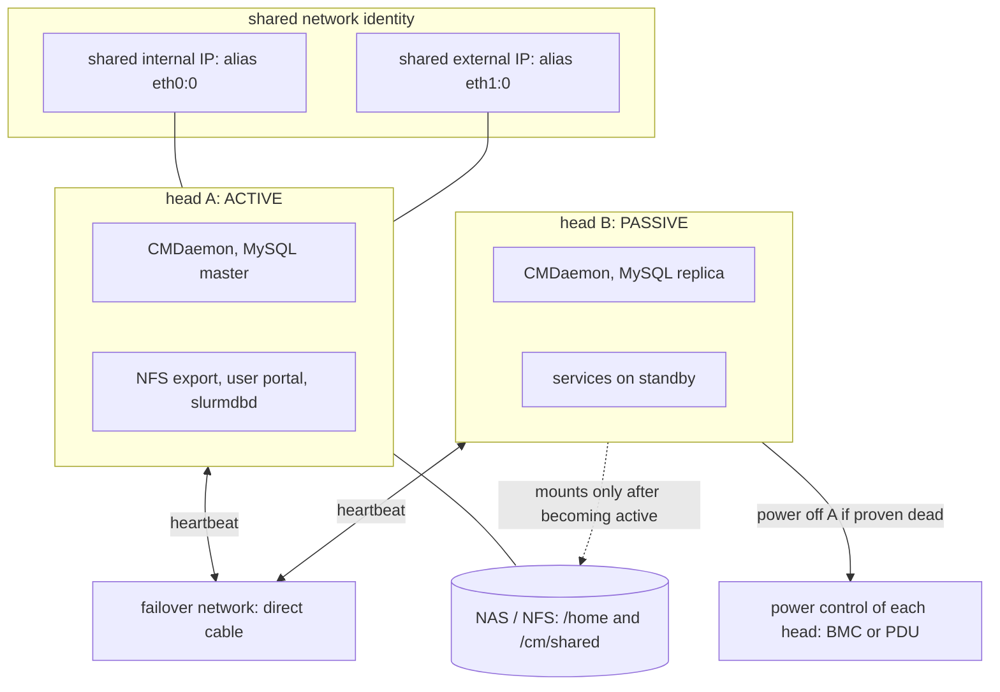

# 8.12 High availability and head node failover

| | |
|---|---|
| Level | Intermediate |
| Priority tier | 1 |
| Lab venue | Laptop |
| Part | Part 8: NVIDIA Base Command Manager |
| Status | Drafted (`ha_lab.py`: 50 checks pass; cluster commands **untested** on live BCM) |

## Why this matters for AI infrastructure

Suppose the head node stops answering. It holds CMDaemon, the database, the DHCP and TFTP services, the LDAP directory, the master image copies and often the Slurm controller. While it is down, you cannot provision, change or monitor anything. Running jobs usually keep going, but nothing new can be managed.

A second head node costs one server, so the hardware is the easy part. The harder part is making sure a failover happens **when needed and never when not**. A wrong failover can corrupt shared storage. The rest of this chapter keeps coming back to that risk.

## Prerequisites and outcomes

Before you start, make sure you have covered chapters 8.1 to 8.8 and 8.11. This chapter builds directly on the cluster and provisioning ideas from those pages. When you finish, you should be able to do the following.

- explain primary, secondary, active and passive, and what runs on both heads
- explain shared IPs, the failover network and shared storage
- explain split brain, fencing, quorum and STONITH, and why a power-off is not a pulled cable
- decide between automatic and manual failover, and know what each one needs
- set up a pair with `cmha-setup` and check it with `cmha status`
- test failover in a way that proves something
- keep two heads in sync, update them in the right order, and know what does not replicate
- describe HA for regular nodes

If any of these still feels vague, reread the matching section before you touch a live pair.

## 1. The pair

Think of two head nodes that present one identity to the outside world. Users and compute nodes only ever talk to the shared addresses, so they never need to know which physical box is in charge. The diagram shows the parts that make this work.



Two names describe each head, and they answer different questions. The primary and secondary names are fixed. One head is the primary and the other is the secondary, and that never changes. The active and passive roles do change, so the primary can be passive at any given time. BCM's "primary" is not the same thing as Slurm's "primary", which chapter 8.8 explains.

The active head leads and the passive head follows. Think of the passive head as a standby copy of the active head, ready to take over when you need it to. MySQL runs in master-slave mode, so CMDaemon writes to the active head while the passive head trails behind. The passive head also watches the active head all the time.

Shared IP addresses are the next piece. There are two virtual IPs, one internal and one external. They are alias interfaces such as `eth0:0`, and whichever head is active hosts them. Users log in through the shared external IP. Nodes use the shared internal IP, for example for NFS, so their mounts survive a failover. If you bond the head interfaces, rename the shared alias interfaces to the bond alias, as chapter 8.3 describes.

Last comes the failover network. It is a dedicated link between the heads that carries the heartbeat. The best practice is a direct cable with no switch, so that a switch reset cannot disturb the heartbeat.

Plan the heartbeat cable first, because every other setting depends on the two heads being able to check on each other.

## 2. What runs where

Not every service can run on both heads at the same time. Some services must run everywhere, while others can run only on the active head and therefore move during a failover. The table shows how that split works.

| On both heads at all times | Migrates to the active head |
|---|---|
| CMDaemon (including provisioning), DHCP (load balanced), TFTP, LDAP (replication), MySQL (replication), NTP, DNS, workload manager (one fully active, the other standby) | NFS, the user portal, `slurmdbd` (Slurm accounting), and the LSF batch daemons |

Both heads take the provisioning role. Nodes can be provisioned from either head, and the passive head is provisioned from the active one. Each head gets its own `provisioninginterface`.

The replication scope is the part that surprises people. By default, only the `cmdaemon` and `slurm_acct_db` databases are copied. Any other database is not copied. A third-party application database is a good example; the manual's example is AJR. That database will be missing after a failover unless you list it in `extradbclone.xml`. From BCM 11.34, `cmha-setup` can optionally replicate all non-system databases, along with users and grants. The setup prompt asks "Replicate all non-system MySQL databases?", and the express option is `--replicate-all-databases`. System databases are never replicated: `mysql`, `information_schema`, `performance_schema` and `sys`.

**Inventory every database on the head before you promise "full HA".** The lab's `missing_after_failover` check does this for you.

## 3. Shared storage

Picture a failover where the new active head mounts `/home` while the old head still has it mounted. Two machines writing to one filesystem is how data gets corrupted.
The usual setup shares `/home` and `/cm/shared`. BCM 11 uses NAS, commonly NFS, and also names Lustre and GPFS. The shared filesystems are mounted only on the active head, by a configurable mount script. The unmount script releases them again.

That rule has three consequences. First, the passive head shows the old local contents of those directories, so point your users to the shared IP instead of letting them log in there. Second, the pre-failover unmount script must return a non-zero exit code when it has problems unmounting. Otherwise the storage can be mounted twice in the post-failover stage, and that can corrupt data. A head stuck in `UNABLETOBECOMEACTIVE` usually means a mount or unmount script returns the wrong exit codes. Third, imported NFS cannot be re-exported, so nodes mount from the NAS directly.

Test the failure path of your unmount script before you trust it, because a script that always returns 0 hides the one error that matters.

## 4. One active head, always: split brain, fencing, quorum, STONITH

Imagine the link between the two heads breaks while both heads keep running. The passive head cannot tell whether the active head has crashed or only lost its network link. That doubt is called **split brain**. Two heads writing to shared storage is the failure you must prevent, so the passive head works through four steps in order.

1. The passive head enters fencing mode. It records what it does as a backlog, so the two heads can compare and sync that backlog if they reconnect before any failover happens.
2. It needs proof that the active head is off. That proof comes either from an administrator's manual confirmation or from STONITH, which stands for "shoot the other node in the head". With STONITH, the passive head powers the active head off through its BMC or PDU, then checks that the power is really off.
3. It needs a quorum first. The passive head asks all nodes whether they also cannot reach the active head. It proceeds only if more than half of them confirm. This stops a passive head with its own network fault from powering off a healthy active head. Nodes that do not answer within Quorum time are not counted. The manual leaves open whether "half" means half of the responders or half of all nodes. The lab defaults to responders and can use the total instead.
4. Once the active head is proven off, the fencing head becomes active.

Now the trigger. `cmha status` shows four checks from each head's view: `failoverping` (the dedicated link), `ping` (the management network), `status` (CMDaemon answers REST calls) and `mysql` (replication). BCM prepares to fail over only when `ping`, `failoverping` and `status` are all not OK. In that case the active head is "all dead". If only some of those checks fail, the head is "mostly dead", which the manual calls slightly alive. BCM takes no automatic action then, and an administrator decides. The head can be powered off after someone has examined it. A failing `mysql` check on its own is reported, but it does not trigger a failover.

A reboot or a graceful shutdown of the active head does not trigger one either. BCM assumes that kind of shutdown is intentional. If you want to switch on purpose, run `cmha makeactive` on the passive head.

A power-off and a pulled cable look similar in a test, but BCM treats them differently. A power-off switches off the main board and leaves the BMC running, so BCM can still verify the power state. Pulling the power cable usually takes the BMC down too. BCM then cannot tell a dead head from a network failure, so it does not fail over automatically and waits for manual confirmation.

Before you trust a failover test, decide how the active head will go down, because a power-off and a pulled cable lead to different results.

## 5. Automatic or manual failover

Automatic failover needs power control defined for both heads, as chapter 8.7 describes. If that power control is in place, automatic failover is tried by default. The active head is powered off when it stops responding.

Manual failover is the other path. The administrator starts the failover and confirms that the old active head is off. You end up with manual failover in four situations: when there is no power control, when `disableautomaticfailover` is set, when power control is broken, or when the active head is mostly dead. To set the flag, run `partition failover base; set disableautomaticfailover yes`.

Before you rely on automatic failover, check power control with `device power status -n head1,head2`. A head cannot always reach its own BMC when there is no dedicated BMC port. In that case, ping the counterpart's BMC address from the other head instead.

The lab's `failover_decision` combines all of these rules, so you can see what the passive head does for each combination.

Settle the mode before an outage, and check power control now, since a manual failover waits for an administrator to confirm the old active head is off.

## 6. Building and checking the pair (15.2)

Build the pair with `cmha-setup`. The manual is explicit that building it by hand is not supported, so use the tool. The build runs in stages, and each stage depends on the one before it.

Start with preparation on the primary. Power off the other nodes if you can, and test bonding before you go further. Then run `cmha-setup`, choose Setup, then Configure. The tool checks the license first, because HA needs an HA-enabled license. You can see the MAC addresses in `verify-license info`, and an HA license shows two. Next the tool asks for the shared internal and external IPs and the alias interface names. It also asks for the passive head's host name, the failover network and its interfaces, and the secondary's other interfaces, such as InfiniBand and BMC. It then shows a summary. External addresses must be static, because DHCP does not work for HA. The last question is for the MySQL root password, and whether to replicate all non-system databases.

Next, clone the secondary. PXE boot the secondary into the rescue environment from the primary. Log in as root with no password, then run `/cm/cmcloneinstall --failover`. Give the boot interface, confirm the disk layout and the erasing, and wait for the syncing to finish. Then choose Finalize on the primary. Identical hardware and BIOS clocks set to local time are strongly recommended. An ARM64 secondary needs a workaround. Put `set -e grub yes` and `set -e bootloaderprotocol tftp` in one commit, because the generated PXE file name can be wrong.

After that, set up the shared storage on NAS, and optionally set up automated failover with power control. Check the result with `cmha status` from either head. The asterisk marks the active head. `failoverping` only starts working after the passive head has rebooted.

Installing a new license invalidates existing user certificates. Install the HA-enabled license before you create certificates, as chapter 8.6 explains.

To change an HA configuration, remove the old one with the "Undo Failover" menu option, then run the procedure again. Re-cloning rebuilds a head. Use `cm-clone-install --clone`, or `--failover` to replace a failed passive. A prepared "spare" snapshot is discouraged, because it goes stale.

Cloning exclude files and Btrfs snapshots need a separate look. `cm-clone-install` reads two files from `/cm/` on the clone node. CMDaemon does not maintain them, and `excludelistmanipulatescript` does not change them. Do not confuse them with the five image exclude lists in chapter 8.4. The first file is `/cm/excludelistnormal`, which `cm-clone-install` uses without `--failover`. The second is `/cm/excludelistfailover`, which `cm-clone-install --failover` uses. Cloning logs to `/var/log/clone-install-log`. If you clone a Btrfs partition, only mounted snapshots are cloned by default. Passing `--btrfs-full-clone` clones all snapshots, but it duplicates the data by bypassing copy-on-write. That can greatly increase the filesystem size.

### 6.1 Express CLI setup without ncurses (`cmha-setup -x`)

For scripted deployments, `cmha-setup` has an express mode that skips ncurses. You drive it with an XML file that you can edit by hand. The recommended path for that file is `/cm/local/apps/cluster-tools/ha/conf/failoverconf.xml`.

```text
cmha-setup [ -x -c <configfile> [-s <type>] <-i|-f[-r]> [-p <mysqlrootpassword>] [-a] ]
```

The express workflow has four steps, and every step uses the same XML file.

1. Initialize on the active head with `-i|--initialize`. First shut down all regular nodes and prepare `failoverconf.xml`. Then run `cmha-setup -x -c failoverconf.xml -i`. Add `-p <mysqlrootpassword>` to avoid the interactive password prompt. On BCM 11.34.0 and later, add `-a|--replicate-all-databases` to replicate all non-system MySQL databases, along with users and grants. This step updates the shared internal, external and failover interfaces. It also clones the master object in the CMDaemon database.
2. PXE boot and clone the passive head. Boot the passive head into the rescue environment and run `/cm/cm-clone-install --failover`.
3. Finalize on the active head and reboot the passive head. Run `cmha-setup -x -c failoverconf.xml -f -r`. The `-f|--finalize` option updates the secondary MAC, initializes failover on `head2`, clones the database and permissions, and checks the dedicated failover network. The `-r|--finalizereboot` option reboots `head2` when it completes.
4. Configure the shared storage with `cmha-setup -x -c failoverconf.xml -s nas`.

Express mode does very little validation. An invalid entry in `failoverconf.xml` can therefore make `cmha-setup` hang.

Do not call the pair finished until `cmha status` looks right from either head.

## 7. Operating the pair

Once the pair is running, most of your time goes to checking its state and tuning its timers. A head can be in one of several states, and `cmha status` shows the current one. The same state appears in the login banner and in `/var/spool/cmd/state`. The states are `INIT`, `FENCING`, `ACTIVE`, `PASSIVE`, `BECOMEACTIVE`, `BECOMEPASSIVE`, `UNABLETOBECOMEACTIVE` and `ERROR`. If a mount script misbehaves, look in `/var/log/cmdaemon`. Then run `cmha makeactive` to tell a head to try again.

The failover parameters live in `partition failover base`. In Base View you find them at Cluster > Partition[base] > Settings > Failover. *Dead time* is how long a head can go without an answer before the active head is treated as dead and a quorum starts. *Warn time* is when BCM logs a warning, and *Init dead* replaces Dead time while a head is just starting. *Keep alive* sets the check interval, and *Quorum time* sets how long the quorum poll waits. *Failover network* names the heartbeat network. The *Mount script* and *Unmount script* handle shared storage. The *Prefailover script* runs on both heads once the decision is made, before the change. It must unmount and return a non-zero code on problems. The *Postfailover script* runs on both heads after the former passive head becomes active. The list also includes *Disable automatic failover* and *Secondary headnode*. The manual's `show` output gives these defaults:

| Setting | Default |
|---|---|
| Dead time | 10 s |
| Disable automatic failover | no |
| Failover network | failovernet |
| Init dead | 30 s |
| Keep alive | 1 s |
| Quorum time | 60 s |
| Warn time | 5 s |

To fail over by hand, run `cmha makeactive` on the head that should become active. Cancel any provisioning in progress first, with `softwareimage cancelprovisioningrequest -a`. If the active head is mostly dead, think carefully before you answer the prompt. You can also use the same command for planned maintenance. Switch the active role, update the former active head, and then optionally switch back.

If MySQL replication breaks after a hard crash, run `cmha dbreclone <host>` to copy the MySQL database to the other head again. That command needs CMDaemon stopped, so cmsh and Base View cannot run it. A hard crash can leave `cmha status` showing a failed replication on the returned head. `dbreclone` is the fix for that.

Testing comes next. Check power control and BMC reachability first, as section 5 describes. A graceful shutdown tests nothing. To test automatic failover, crash the kernel on the active head with `echo c > /proc/sysrq-trigger`. The passive head then powers the frozen head off and becomes active. Run this in a test window, because it is a real failover.

Updates are where two heads most often drift apart. The rules below come from section 15.4.5 of the manual.

| Item | Rule |
|---|---|
| CMDaemon and MySQL packages | update the **active first**, confirm `cmha status`, restart `cmd`, **then** the passive (a CMDaemon update can contain a MySQL schema migration). On Ubuntu update `mysql` separately before `cmdaemon` (a known stall, internal reference BCM-31089) |
| DHCP, LDAP, NTP, DNS | any order |
| Migrating services (NFS, sgemaster) | update the passive, `cmha makeactive` on it, then update the former active, so problems show up while you can still inspect |
| Software images | not on shared storage by default; run **`updateprovisioners` on the active right after an image change**, or a failover soon after can leave the new active with stale images (the passive is only synced at midnight or on a provisioning request; `provisioningstatus` showing it "out of date" is normal) |
| Changes **outside** CMDaemon (RPMs, local apps, `/cm/node-installer/` files, other config) | do them on **both** heads by hand. BCM does not sync them on purpose, so a bad change cannot break both heads at once |

The first row explains the order. The active head goes first, and the passive head follows only after `cmha status` looks healthy. The migrating-services row reverses the pattern on purpose. You update the passive head, move the active role to it, and then update the former active head. Problems show up while you can still inspect the old head.

Build a bare-metal cluster as a single head first, get it right, then set up HA, so the secondary is cloned from a good system.

## 8. HA for regular nodes and edge directors (15.5)

BCM can also make regular nodes highly available, and it supports edge directors too. Regular node HA has been available since BCM 7.0, and edge directors since 9.2. Use it for extra services that you run on regular nodes. Do not use it to move the default head node services, because those are already optimized as they are.

The mechanism looks familiar. It uses power control, warn and dead times, mount and unmount scripts, pre and post failover scripts, and a shared virtual IP, just like head node HA. The differences start with configuration. You set it up in the `failovergroups` submode, at `partition[base]->failovergroups`, or with `cmha nodestatus [groups]` and `cmha makeactive <node>`. A group needs two or more nodes, with one active and the rest passive. There is no failover network, so the heartbeat travels over the regular node network. The active head node runs the health checks and STONITH itself, instead of a node-wide quorum. There is also no `cmha-setup` for this. For edge directors, use `cm-edge-setup`, and never edit `failovergroups` by hand for them.

Setting up a regular node group takes a few commands. Add the group with `failovergroups; add cupsgroup; set nodes node001..node002; commit`. Then add the service on each member with `set runif active; set autostart yes; set monitored yes`. Add a shared alias interface on each member with `interfaces; add alias bootif:0; set ip 10.141.240.1; set startif active; set network internalnet; set additionalhostnames cups; commit`, and reboot the group nodes afterwards. Use the same `additionalhostnames` across all members, because the shared VIP must not carry a different name on each node. In `failovergroups`, `Automatic failover after graceful shutdown` defaults to `no`.

When you switch the active regular node with `makeactive`, the active head node runs one fixed sequence, and you can follow it step by step. In step 1, every group node runs the `Prefailover script`. In step 2, the old active node stops its service and runs the `Unmount script`. If that script exits with anything above 0, all the remaining actions are skipped. If STONITH powers off the old active, the old-active sequence aborts. Otherwise the old active stops the active IP, starts the passive IP and starts its passive services. In step 3, the new active node stops its service, runs the `Mount script`, stops the passive IP, starts the active IP and starts its service. In step 4, every group node runs the `Postfailover script`.

### 8.1 Workload manager job continuation across failover

Running workload manager jobs can continue through a head node failover. Queued jobs wait, then start once resources are available after the handover, unless a BCM prejob health check rejects them. Three conditions must all be met.

The first condition is a supported WLM setup. The workload manager must have been configured either during the initial BCM installation or with `cm-wlm-setup`. The second is shared storage that supports job continuity. The HA storage setup must support it for that workload manager, and NAS does this for Slurm and LSF. The third is application tolerance for a brief NFS pause. During the failover, the shared filesystem is unmounted and remounted across the head nodes. The workload manager client daemons have default timeouts longer than the HA `Dead time`, so the scheduler survives. However, user code that does unbuffered I/O to `/home` or `/cm/shared` at that exact second can fail if it does not retry.

Before you build a group, decide which extra services really need HA, because each one adds scripts and failover steps.

## 9. Failure scenarios

When a failover does not go the way you expected, start with the symptom in the left column. The middle column names the likely cause, and the right column tells you what to check first.

| Symptom | Likely cause | Check |
|---|---|---|
| The passive will not take over | no power control, automatic failover disabled, BMC unreachable, mostly dead active | `device power status`, `disableautomaticfailover`, `cmha status`, ping the counterpart's BMC |
| `UNABLETOBECOMEACTIVE` | mount or unmount script failing or returning wrong codes | `/var/log/cmdaemon`, the scripts' exit codes |
| After failover an application's data is missing | its database was not replicated | the replicated set; consider the 11.34 option |
| Users see old or empty directories | they logged in to the passive head | use the shared external IP |
| Nodes get an old image after a failover | `updateprovisioners` was not run | run it after image changes |
| `cmha status` shows mysql failing | replication out of step, often after a hard crash | wait a few minutes, then `dbreclone` |
| A pulled cable did not fail over | BMC down, cannot verify power-off | by design: confirm manually |
| A reboot of the active did not fail over | assumed intentional | `cmha makeactive` on the passive |

If your symptom is not in the table, find the section that explains the rule involved, and check that rule first.

## 10. Common first mistakes

Each of these mistakes is easy to avoid before a failover and hard to diagnose during one. Read the list as a checklist for your own pair, and be honest with yourself about which items you have already done.

1. Testing failover by pulling the cable or by a graceful shutdown. Pulling the cable does not fail over automatically, and a graceful shutdown tests nothing.
2. Promising full HA without first listing every database on the head.
3. Putting a switch in the heartbeat path.
4. Taking the external head addresses from DHCP.
5. Writing an unmount script that always returns 0.
6. Updating the passive CMDaemon before the active one.
7. Forgetting `updateprovisioners` before a planned switch.
8. Installing software on the active head only, outside CMDaemon.
9. Letting users log in to the passive head.
10. Assuming a license change leaves certificates valid.

### 10.1 Deep dive: Anatomy of a head-node failover from second `0` to `ACTIVE`

Every detail in this chapter matters at once: the direct heartbeat cable, the NAS unmount exit codes, BMC power control and node quorum. The timeline below shows you why, second by second. It follows the active head node, `head1`, through a kernel panic in a production AI factory.

1. At `T = 0 s`, `head1` panics. The Linux kernel on `head1` halts. As you read, notice what happens on the compute nodes first. Running Slurm and Kubernetes jobs do not die. `slurmd`, `srun`, `kubelet` and `containerd` keep executing user GPU kernels. If `head1` and `head2` use an external NAS for `/home` and `/cm/shared`, or if compute nodes mount `/scratch` directly from Lustre or WekaFS, compute node storage I/O continues without interruption.
2. From `T = 1 s` to `T = 5 s`, the passive head `head2` polls `head1` once every second. It polls over `internalnet` with `ping`, over `failovernet` with `failoverping`, and on port `8081` with `status`. Keep alive is 1 s and Warn time is 5 s. At `T = 5 s`, `head2` logs a warning that `head1` has stopped answering.
3. At `T = 10 s`, which is Dead time, `head2` moves to `FENCING` and starts a cluster quorum poll. The quorum window is `Quorum time = 60 s`. By then `ping`, `failoverping` and `status` are all NOT OK, so `head1` is "all dead" rather than "mostly dead". `head2` asks the regular compute nodes whether they also lost contact with `head1`. When more than half of the responding nodes confirm that `head1` is unreachable, `head2` knows the failure is not a local NIC fault on `head2`.
4. With quorum established and `disableautomaticfailover = no`, `head2` contacts the BMC of `head1`, or the rack PDU, over `bmcnet`. It issues a hard power-off, which is STONITH. It then polls `power status` until the BMC confirms that main chassis power is `OFF`. This explains why pulling `head1`'s AC cords during a test blocks automatic failover. If `head1`'s BMC has no standby AC power, `head2` cannot get proof that `head1` is powered off.
5. Now that `head1` cannot write to shared storage, `head2` moves to `BECOMEACTIVE`. It runs the `Prefailover script`, which includes `/cm/local/apps/cmd/scripts/slurm.takeover.sh` when Slurm HA is configured with `slurmctldstartpolicy = TAKEOVER`. Then it runs the `Mount script` to mount the shared NAS at `/cm/shared` and `/home`. It brings up the shared internal virtual IP, `eth0:0` or `bond0:0`, and the shared external virtual IP, `eth1:0`. It sends gratuitous ARP broadcasts so that compute nodes and external SSH users route to `head2` seamlessly. Finally it starts the active-only services, `nfs-server`, `slurmdbd` and the User Portal, and moves to `ACTIVE`.
6. When `head1` is repaired and boots, it sees that `head2` is now active, and it comes up in `PASSIVE`. If the hard crash left the MySQL binlog replication on `head1` out of sync, the `mysql` check fails in `cmha status`. To fix that, stop `cmd` on `head1` and run `cmha dbreclone head1`. That command re-clones a clean snapshot of `cmdaemon` and `slurm_acct_db` from `head2` to `head1`. You can then watch `cmha status` until `head1` reports a healthy `mysql` check again.

## Exercises

Work through these after you have run the lab. Each one asks you to explain a rule in your own words, which is the best test of whether the rule has really sunk in.

1. Run `python3 ha_lab.py`. Choose four of its checks, and explain each rule in your own words.
2. Use `failover_decision` to build a table for six situations: a reboot, a crash, a crash without power control, a pulled cable, a mostly dead active head, and a quorum that answers no. For each row, write down what the passive head does.
3. Draw the sequence of `cmha makeactive` steps for a planned update of the active head. Show every command.
4. List the databases on a head node you know. Mark the ones that would be missing after a failover, and propose a fix for each.
5. Design the failover network and power control for two heads in different racks.
6. Explain to a manager why testing with `echo c > /proc/sysrq-trigger` is acceptable, but pulling the cable is not.

## 12. Interview angles

These are questions you may hear in an interview, with a short answer for each.

- "How does BCM avoid two active heads?" Answer with four mechanisms: fencing, proof of power-off through STONITH, a quorum across the nodes, and shared storage mounted only on the active head.
- "What does BCM not replicate?" Everything outside CMDaemon-managed state. That covers non-default databases, unless you use the 11.34 option or `extradbclone`, and it covers local packages and files.
- "Why did my failover test not fail over?" Most likely you used a graceful shutdown or pulled the cable. BCM deliberately does not treat either one as a failover trigger.
- "How would you update the head nodes?" Update the active head first for CMDaemon and MySQL, confirm with `cmha status`, then update the passive head. Migrate services by switching first.
- "Is a second head enough for HA?" No, not on its own. You also need shared storage, power control, a heartbeat link, static addresses, an HA license and tested scripts.

## Checkpoint questions (20)

<details>
<summary>1. In BCM head-node High Availability, what is the difference between **Primary / Secondary** and **Active / Passive**?</summary>

Primary and Secondary are fixed hardware identities, assigned at installation. They never change. Active and Passive are runtime roles that swap on failover. After a failover, the Secondary head becomes Active and the Primary becomes Passive.
</details>

<details>
<summary>2. Which services run simultaneously on BOTH head nodes at all times?</summary>

`CMDaemon` runs on both heads, including provisioning. So do DHCP (load balanced), TFTP, OpenLDAP (replicated), MySQL (master-replica replication), NTP, DNS, and the workload manager controller, which has one active instance and one standby.
</details>

<details>
<summary>3. Which services run ONLY on the currently Active head node and migrate during failover?</summary>

You will find NFS exports, the User Portal, `slurmdbd` (the Slurm accounting daemon) and the LSF batch daemons only on the Active head. They migrate during a failover.
</details>

<details>
<summary>4. Which MySQL databases are replicated between head nodes by default, and what happens to third-party databases after failover if nothing else is configured?</summary>

By default, only `cmdaemon` and `slurm_acct_db` are replicated. Any other database is not copied. Without further configuration, it will be missing after a failover unless you list it in `extradbclone.xml`.
</details>

<details>
<summary>5. What new option did BCM 11.34 add to `cmha-setup` for MySQL replication?</summary>

BCM 11.34 added an option to replicate all non-system MySQL databases, along with users and grants. In express mode you can use `--replicate-all-databases`, or `-a`. System databases, namely `mysql`, `information_schema`, `performance_schema` and `sys`, are never replicated.
</details>

<details>
<summary>6. How are the shared internal and external IP addresses implemented on the head nodes?</summary>

They are virtual IP alias interfaces, such as `eth0:0` and `eth1:0`, or `bond0:0` when the interfaces are bonded. They come up only on whichever head is currently Active.
</details>

<details>
<summary>7. Why does the manual recommend using a direct crossover/patch cable with no switch for `failovernet`?</summary>

With no switch in the path, a management switch reboot, spanning-tree reconvergence or a switch firmware bug cannot interrupt the heartbeat between the two heads. That means no false split-brain alarm.
</details>

<details>
<summary>8. On which head node are `/home` and `/cm/shared` (from the NAS) mounted during normal operation, and what happens if the pre-failover unmount script exits `0` when an unmount actually failed?</summary>

The shared storage is mounted only on the Active head. If the unmount script fails to unmount the old active head but still exits `0`, both heads could mount the shared storage at once. The filesystem could then be corrupted. That is why the unmount script must return non-zero on failure, which places the node in `UNABLETOBECOMEACTIVE`.
</details>

<details>
<summary>9. What is a **split-brain** condition in cluster HA?</summary>

Split brain happens when communication between the two heads breaks while both are still running. The passive head cannot tell from the heartbeat alone whether the active head crashed or only the network link failed.
</details>

<details>
<summary>10. What is **Fencing mode** (`FENCING` state in `cmha status`)?</summary>

Fencing mode is the protective state the passive head enters when it loses contact with the active head. It tags local changes as a backlog. While in this state, it runs the quorum check and verifies power-off with STONITH before it becomes Active.
</details>

<details>
<summary>11. What is **STONITH**, and why is it mandatory for automatic failover?</summary>

STONITH stands for "Shoot The Other Node In The Head". It forcibly powers off the unresponsive active head through its out-of-band BMC or PDU. The passive head then checks that the power state is `OFF` before it mounts shared storage and takes the shared IPs. This proof is why STONITH is mandatory for automatic failover.
</details>

<details>
<summary>12. How does the **Quorum** check work before the passive head executes STONITH?</summary>

The passive head asks all regular compute nodes within `Quorum time`, which defaults to `60 s`, whether they can still reach the active head. It proceeds with STONITH only if more than half confirm that the active head is unreachable. This stops a passive head with a bad NIC from shooting a healthy active head.
</details>

<details>
<summary>13. Which four checks appear in `cmha status`, and which three must all fail for the active head to be classified as **"all dead"**?</summary>

The four checks are `failoverping`, `ping`, `status` (the `CMDaemon` REST check) and `mysql`. Automatic failover triggers only when `ping`, `failoverping` and `status` are all NOT OK, which is the "all dead" state.
</details>

<details>
<summary>14. What does **"mostly dead"** ("slightly alive") mean in BCM HA, and what does the passive head do?</summary>

Mostly dead, or slightly alive, means that some of `ping`, `failoverping` and `status` failed, but not all three. For example, `CMDaemon` might hang so that `status` fails while `ping` still answers. The passive head takes no automatic failover action. It alerts the administrator, who inspects the head and fails over manually.
</details>

<details>
<summary>15. Why does yanking the AC power cords out of the active head node NOT trigger an automatic failover when power control is via the BMC?</summary>

If you pull the AC cords, you also take down the active head's BMC. When the passive head tries to query that BMC to verify or command power-off, the BMC does not answer. BCM cannot prove the active head is off, so it waits for manual confirmation.
</details>

<details>
<summary>16. Why does a clean `reboot` or `shutdown -h now` on the active head node not trigger automatic failover?</summary>

BCM treats a graceful OS shutdown or reboot of the active head as intentional maintenance. If you want to switch active heads on purpose, run `cmha makeactive` on the passive head.
</details>

<details>
<summary>17. How do you disable automatic failover during maintenance while keeping HA replication running?</summary>

In `cmsh`, run `partition failover base; set disableautomaticfailover yes; commit`.
</details>

<details>
<summary>18. What is the manual's recommended command to test automatic failover realistically in a maintenance window?</summary>

If you want to test automatic failover, trigger an immediate kernel panic on the active head with `echo c > /proc/sysrq-trigger`. It freezes the host OS just like a real crash, and the BMC stays powered on, so STONITH can succeed.
</details>

<details>
<summary>19. When updating `cmdaemon` and `mysql` packages on an HA head-node pair, which head node must be updated first and why?</summary>

Update the Active head node first, so you can verify with `cmha status` and restart `cmd` before you touch the other head. Only then update the Passive head. A `CMDaemon` update may include a MySQL schema migration, and that migration must be applied on the master database first. On Ubuntu, update `mysql` separately before `cmdaemon`.
</details>

<details>
<summary>20. Give four architectural differences between **Regular Node HA** (`failovergroups`) and **Head Node HA** (`cmha-setup`).</summary>

1. Regular node HA is configured through `partition[base] -> failovergroups`, while head node HA uses `cmha-setup`.
2. A regular node group supports two or more nodes, with one active node and $N-1$ passive nodes.
3. Regular node HA uses no dedicated `failovernet` cable, because heartbeats travel over the regular internal network.
4. The active head node runs the health checks and STONITH directly, instead of a cluster-wide node quorum poll.
</details>

## Sources and review notes

- **BCM 11 Administrator Manual, chapter 15:** 15.0 to 15.6 read in full (concepts, shared IP and storage, fencing, quorum, automatic and manual failover, `cmha-setup` TUI and 15.3 `-x` express XML mode, cloning and 15.4.8 `excludelistnormal`/`excludelistfailover` and `--btrfs-full-clone`, states, failover decisions, keeping heads in sync, parameters in 15.4.6 and 15.5.3, regular node HA and failover sequence in 15.5.3–15.5.4, and WLM job continuation in 15.6).
- **NVIDIA-DevOps notes**, volume 10 chapter 13, section 4: the same material in the author's words, including the trap about databases and the interview framing.
- **Run here:** `ha_lab.py` (50 checks): naming versus mode, `cmha status` classification, quorum, the failover decision table, test outcomes, timers, database replication scope, service lists, storage script safety, setup prerequisites, update order, regular node HA differences, plus (`added in the gap pass`) `cmha-setup -x` express options and sequence, `cm-clone-install` exclude files and Btrfs flag, regular-node failover step sequence and unmount abort rule, and the 3 conditions for WLM job continuation across failover.
- **My own choices, not the manual's:** the mapping of values in the garbled parameter table; the quorum denominator default (responders); the simplified setup-prerequisite checker; the "do it in a test window" advice.
- **Not verified:** everything about a real BCM system. A real failover involves timings and hardware behaviour that no model captures.
