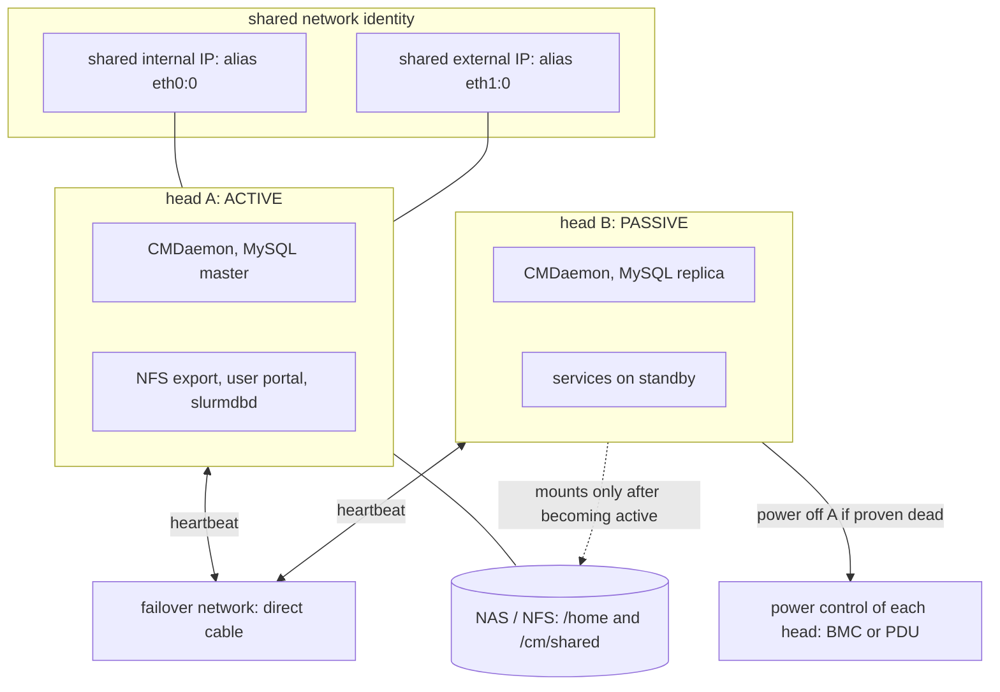

# 8.12 High availability and head node failover

| | |
|---|---|
| Level | Intermediate |
| Priority tier | 1 |
| Lab venue | Laptop |
| Part | Part 8: NVIDIA Base Command Manager |
| Status | Drafted (`ha_lab.py`: 50 checks pass; cluster commands **untested** on live BCM) |

## Why this matters for AI infrastructure

The head node holds CMDaemon, the database, the DHCP and TFTP services, the LDAP directory, the master image copies and often the Slurm controller. While it is down, you cannot provision, change, or monitor anything; running jobs usually continue but nothing new can be managed. A second head node costs one server. The harder part is making sure a failover happens **when needed and never when not**, because the wrong failover can corrupt shared storage.

## Prerequisites and outcomes

You need chapters 8.1 to 8.8 and 8.11. After this chapter you can:

- explain primary, secondary, active and passive, and what services are on both heads
- explain shared IPs, the failover network and shared storage
- explain split brain, fencing, quorum and STONITH, and why a power-off is not a pulled cable
- decide between automatic and manual failover and know what each needs
- set up a pair with `cmha-setup` and check it with `cmha status`
- test failover in a way that proves something
- keep two heads in sync, update them in the right order, and know what does not replicate
- describe HA for regular nodes

## 1. The pair



- **Naming versus mode.** One head is the **primary**, the other the **secondary**; that never changes. One is **active** and the other **passive**; that does change. The primary can be passive. (BCM's "primary" is not Slurm's "primary", chapter 8.8.)
- The active head leads; the passive follows. MySQL runs in master-slave mode: CMDaemon writes on the active, the passive trails. The passive continuously monitors the active.
- **Shared IP addresses.** Two virtual IPs, internal and external, are alias interfaces (for example `eth0:0`) hosted by whichever head is active. Users log in through the shared external IP; nodes use the shared internal IP, for example for NFS, so mounts survive a failover. If you bond the head interfaces, rename the shared alias interfaces to the bond alias (chapter 8.3).
- **Failover network.** A dedicated link between the heads for the heartbeat. Best practice: a **direct cable, no switch**, so a switch reset cannot disturb it.

## 2. What runs where

| On both heads at all times | Migrates to the active head |
|---|---|
| CMDaemon (including provisioning), DHCP (load balanced), TFTP, LDAP (replication), MySQL (replication), NTP, DNS, workload manager (one fully active, the other standby) | NFS, the user portal, `slurmdbd` (Slurm accounting), and the LSF batch daemons |

Both heads take the **provisioning role**, so nodes can be provisioned from either (and the passive is provisioned from the active); each head gets a `provisioninginterface`.

**What MySQL replicates.** By default only the **`cmdaemon` and `slurm_acct_db`** databases. Others, such as a third-party application database (the manual's example is AJR), **are not copied and will be missing after a failover** unless listed in `extradbclone.xml`. From **BCM 11.34**, `cmha-setup` can optionally replicate all non-system databases plus users and grants (the prompt "Replicate all non-system MySQL databases?"; express option `--replicate-all-databases`). System databases (`mysql`, `information_schema`, `performance_schema`, `sys`) are never replicated. **Inventory every database on the head before you promise "full HA".** The lab's `missing_after_failover` makes the check.

## 3. Shared storage

The usual setup shares `/home` and `/cm/shared`. BCM 11 uses **NAS** (commonly NFS; Lustre and GPFS are named). Direct-attached storage is no longer suggested. The shared filesystems are mounted **only on the active head**, by a configurable **mount script**; the **unmount script** releases them. This has consequences:

- On the passive head the **old local contents** of those directories show; direct logins there are confusing. Point users to the shared IP.
- The pre-failover script (unmount) **must return non-zero if unmounting has problems**; otherwise the storage can be mounted twice in the post-failover stage and **corrupt data**. A head stuck in `UNABLETOBECOMEACTIVE` usually means a mount or unmount script returns wrong exit codes.
- Imported NFS cannot be re-exported, so nodes mount from the NAS directly.

## 4. One active head, always: split brain, fencing, quorum, STONITH

Two heads writing to shared storage is the failure to prevent. A passive head that cannot reach the active cannot know whether the active is dead or only the link is broken (**split brain** is that doubt). So:

1. The passive enters **fencing mode**: it tags what it does as a backlog, to be compared and synced if the heads reconnect before any failover.
2. It must get **proof** the active is off: an administrator's manual confirmation, or **STONITH** ("shoot the other node in the head"): power it off through its BMC or PDU and verify the power is off.
3. First a **quorum**: the passive asks all nodes whether they also cannot reach the active. Only if **more than half** confirm does it proceed. This stops a passive head with its own network fault from powering off a healthy active head. Nodes that do not answer within **Quorum time** are not counted. (The manual's wording leaves open whether "half" means half of the responders or of all nodes; the lab defaults to responders and can use the total.)
4. When the active is proven off, the fencing head becomes active.

**What triggers it.** `cmha status` shows four checks from each head's view: `failoverping` (dedicated link), `ping` (management network), `status` (CMDaemon answers REST calls) and `mysql` (replication). BCM prepares to fail over when **ping, failoverping and status are all not OK**: the active is **"all dead"**. If only some failed, it is **"mostly dead"** (slightly alive): no automatic action, an administrator decides, and the head can be powered off after examination. `mysql` alone failing is reported but is not a trigger.

**What does not trigger it.** A **reboot** or a **graceful shutdown** of the active (assumed intentional; use `cmha makeactive` on the passive to switch on purpose).

**Power-off versus pulling the cable (the test trap).** A power-off switches off the main board but leaves the **BMC** up, so the power state can be verified. Pulling the power cable usually takes the BMC down too, so BCM cannot tell a dead head from a network failure and does **not** fail over automatically; it needs manual confirmation.

## 5. Automatic or manual failover

- **Automatic** needs **power control defined for both heads** (chapter 8.7), and is tried by default if it is. The active is powered off when it stops responding.
- **Manual**: the administrator starts the failover and confirms the old active is off. This is the case when there is no power control, when `disableautomaticfailover` is set (`partition failover base; set disableautomaticfailover yes`), when power control is broken, or when the active is mostly dead.
- Check power control: `device power status -n head1,head2`. A head cannot always reach its own BMC if there is no dedicated BMC port; ping the counterpart's BMC address from the other head instead.

The lab's `failover_decision` combines all these rules, so you can see what the passive does for each combination.

## 6. Building and checking the pair (15.2)

The supported way is **`cmha-setup`** (manual construction is explicitly unsupported). Stages:

1. **Preparation on the primary.** Power off other nodes if you can; test bonding first; run `cmha-setup`, Setup, Configure. The tool checks the license: **HA needs an HA-enabled license** (two MAC addresses in `verify-license info`). It asks for the shared internal and external IPs and alias interface names, the passive's host name, the failover network and interfaces, the secondary's other interfaces (InfiniBand, BMC), and shows a summary. **External addresses must be static: DHCP does not work for HA.** It asks for the MySQL root password and whether to replicate all non-system databases.
2. **Cloning the secondary.** PXE boot the secondary into the **rescue environment** from the primary; log in as root with no password; run `/cm/cmcloneinstall --failover`; give the boot interface; confirm the disk layout and erasing; wait for syncing. Then **Finalize** on the primary. Identical hardware and BIOS clocks set to local time are strongly recommended. (An ARM64 secondary needs a workaround, `set -e grub yes` and `set -e bootloaderprotocol tftp` in one commit, because the generated PXE file name can be wrong.)
3. **Shared storage setup** (NAS) and, optionally, automated failover with power control.
4. Check with `cmha status` from either head. The asterisk marks the active head; `failoverping` works once the passive has rebooted.

License note: **installing a new license invalidates existing user certificates**, so install the HA-enabled license before creating certificates (chapter 8.6).

**Changing an HA configuration:** run the procedure again after removing the old one with the "Undo Failover" menu option. **Re-cloning** (`cm-clone-install --clone`, or `--failover` to replace a failed passive) rebuilds a head; a prepared "spare" snapshot is discouraged because it goes stale.
- **Cloning exclude files and Btrfs snapshots:** `cm-clone-install` reads two files from `/cm/` on the clone node that are **not** maintained by CMDaemon and **not** modified by `excludelistmanipulatescript` (do not confuse them with the five image exclude lists of chapter 8.4): **`/cm/excludelistnormal`** (used by `cm-clone-install` without `--failover`) and **`/cm/excludelistfailover`** (used by `cm-clone-install --failover`). Cloning logs to `/var/log/clone-install-log`. If cloning a **Btrfs** partition, only mounted snapshots are cloned by default; passing `--btrfs-full-clone` clones all snapshots but duplicates data (bypassing copy-on-write), which can greatly increase filesystem size.

### 6.1 Express CLI setup without ncurses (`cmha-setup -x`)

For scripted deployments, `cmha-setup` provides an express non-ncurses mode driven by a human-editable XML file (recommended path `/cm/local/apps/cluster-tools/ha/conf/failoverconf.xml`):

```text
cmha-setup [ -x -c <configfile> [-s <type>] <-i|-f[-r]> [-p <mysqlrootpassword>] [-a] ]
```

- **Four-step express workflow:**
  1. **Initialize on the active head (`-i|--initialize`):** shut down all regular nodes, prepare `failoverconf.xml`, and run `cmha-setup -x -c failoverconf.xml -i` (add `-p <mysqlrootpassword>` to avoid the interactive password prompt, and `-a|--replicate-all-databases` on BCM 11.34.0+ to replicate all non-system MySQL databases and users/grants). This updates the shared internal/external and failover interfaces and clones the master object in the CMDaemon database.
  2. **PXE-boot and clone the passive head:** boot the passive into the rescue environment and run `/cm/cm-clone-install --failover`.
  3. **Finalize on the active head and reboot the passive (`-f -r`):** run `cmha-setup -x -c failoverconf.xml -f -r` (`-f|--finalize` updates the secondary MAC, initializes failover on `head2`, clones the database and permissions, and checks the dedicated failover network; `-r|--finalizereboot` reboots `head2` upon completion).
  4. **Configure shared storage (`-s nas`):** run `cmha-setup -x -c failoverconf.xml -s nas`.
- **Warning:** express mode performs **very little validation**, so invalid entries in `failoverconf.xml` can cause `cmha-setup` to hang.

## 7. Operating the pair

- **States** (`cmha status`, login banner, `/var/spool/cmd/state`): `INIT`, `FENCING`, `ACTIVE`, `PASSIVE`, `BECOMEACTIVE`, `BECOMEPASSIVE`, `UNABLETOBECOMEACTIVE`, `ERROR`. Debug mount script problems in `/var/log/cmdaemon`; `cmha makeactive` tells a head to try again.
- **Parameters** (`partition failover base`; Base View: **Cluster > Partition[base] > Settings > Failover**): *Dead time* (no answer for this long: the active is considered dead and a quorum starts), *Warn time* (log a warning), *Init dead* (used instead of Dead time while a head is just starting), *Keep alive* (check interval), *Quorum time*, *Failover network*, *Mount script*, *Unmount script*, *Prefailover script* (runs on both heads once the decision is made, before the change; it must unmount and return non-zero on problems), *Postfailover script* (runs on both heads after the former passive becomes active), *Disable automatic failover*, *Secondary headnode*. In the manual's `show` output, the default values are: **`Dead time = 10` s**, **`Disable automatic failover = no`**, **`Failover network = failovernet`**, **`Init dead = 30` s**, **`Keep alive = 1` s**, **`Quorum time = 60` s**, and **`Warn time = 5` s**.
- **Manual failover:** `cmha makeactive` on the head that should become active. Cancel in-progress provisioning first (`softwareimage cancelprovisioningrequest -a`). With a mostly-dead active, think before answering the prompt. Use it also for planned maintenance: switch, update the former active, optionally switch back.
- `cmha dbreclone <host>` re-copies the MySQL database to the other head (needs CMDaemon stopped, so cmsh and Base View cannot do it). A hard crash can leave `cmha status` showing a failed replication on the returned head; `dbreclone` is the fix.

**Testing.** Verify power control and BMC reachability (section 5). A graceful shutdown tests nothing. To test automatic failover, **crash the kernel** on the active head: `echo c > /proc/sysrq-trigger`. The passive powers the frozen head off and goes active. **Do this on a test window**: it is a real failover.

**Keeping the heads in sync** (15.4.5):

| Item | Rule |
|---|---|
| CMDaemon and MySQL packages | update the **active first**, confirm `cmha status`, restart `cmd`, **then** the passive (a CMDaemon update can contain a MySQL schema migration). On Ubuntu update `mysql` separately before `cmdaemon` (a known stall, internal reference BCM-31089) |
| DHCP, LDAP, NTP, DNS | any order |
| Migrating services (NFS, sgemaster) | update the passive, `cmha makeactive` on it, then update the former active, so problems show up while you can still inspect |
| Software images | not on shared storage by default; run **`updateprovisioners` on the active right after an image change**, or a failover soon after can leave the new active with stale images (the passive is only synced at midnight or on a provisioning request; `provisioningstatus` showing it "out of date" is normal) |
| Changes **outside** CMDaemon (RPMs, local apps, `/cm/node-installer/` files, other config) | do them on **both** heads by hand. BCM does not sync them on purpose, so a bad change cannot break both heads at once |

Build a bare-metal cluster as a single head first, get it right, then set up HA, so the secondary is cloned from a good system.

## 8. HA for regular nodes and edge directors (15.5)

BCM also supports HA for **regular nodes** (since BCM 7.0) and edge directors (9.2). It is for **extra services** you run on regular nodes, **not** for moving the default head node services, which are optimized as they are. It uses power control, warn and dead times, mount and unmount scripts, pre and post failover scripts and a shared virtual IP like head node HA, but differs: configured in the `failovergroups` submode (`partition[base]->failovergroups`, or `cmha nodestatus [groups]` and `cmha makeactive <node>`), **two or more nodes** per group (one active, the rest passive), **no failover network** (heartbeat over the regular node network), **the active head node performs the health checks and STONITH** (instead of a node-wide quorum), and no `cmha-setup` (for edge directors, use `cm-edge-setup`, never manual `failovergroups` edits).
- **Regular node HA setup and failover sequence:**
  - Add the group (`failovergroups; add cupsgroup; set nodes node001..node002; commit`), add the service on each member with **`set runif active; set autostart yes; set monitored yes`**, and add a shared alias interface on each member (`interfaces; add alias bootif:0; set ip 10.141.240.1; set startif active; set network internalnet; set additionalhostnames cups; commit`, then reboot the group nodes; use the same `additionalhostnames` across all members, never different names for the shared VIP). Note that in `failovergroups`, `Automatic failover after graceful shutdown` defaults to **`no`**.
  - When switching the active regular node (`makeactive`), the active head node orchestrates this exact sequence: (1) **All group nodes:** run `Prefailover script`; (2) **Old active:** stop service -> run `Unmount script` (**if exit code > 0, all remaining actions are skipped**; if STONITH powers off the old active, the old-active sequence aborts) -> stop active IP -> start passive IP -> start passive services (now passive); (3) **New active:** stop service -> run `Mount script` -> stop passive IP -> start active IP -> start service (now active); (4) **All group nodes:** run `Postfailover script`.

### 8.1 Workload manager job continuation across failover

Running workload manager jobs continue through a head-node failover handover—and queued jobs wait and start once resources are available after the handover (unless rejected by a BCM prejob health check)—**if all three of these conditions are met:**
1. **Supported WLM setup:** the workload manager was configured either during initial BCM installation or via `cm-wlm-setup`.
2. **NAS shared storage:** the HA storage setup supports job continuity for that WLM (supported with **NAS** for **Slurm and LSF**).
3. **Application tolerance for the brief NFS pause:** the running jobs themselves do not crash during the short window when the shared filesystem is unmounted and remounted across the head nodes (WLM client daemons have default timeouts longer than the HA `Dead time`, so the scheduler survives, but user code doing unbuffered I/O to `/home` or `/cm/shared` at that exact second can fail if it does not retry).

## 9. Failure scenarios

| Symptom | Likely cause | Check |
|---|---|---|
| The passive will not take over | no power control, automatic failover disabled, BMC unreachable, mostly dead active | `device power status`, `disableautomaticfailover`, `cmha status`, ping the counterpart's BMC |
| `UNABLETOBECOMEACTIVE` | mount or unmount script failing or returning wrong codes | `/var/log/cmdaemon`, the scripts' exit codes |
| After failover an application's data is missing | its database was not replicated | the replicated set; consider the 11.34 option |
| Users see old or empty directories | they logged in to the passive head | use the shared external IP |
| Nodes get an old image after a failover | `updateprovisioners` was not run | run it after image changes |
| `cmha status` shows mysql failing | replication out of step, often after a hard crash | wait a few minutes, then `dbreclone` |
| A pulled cable did not fail over | BMC down, cannot verify power-off | by design: confirm manually |
| A reboot of the active did not fail over | assumed intentional | `cmha makeactive` on the passive |

## 10. Common first mistakes

1. Testing failover by pulling the cable or by a graceful shutdown.
2. Promising full HA without inventorying databases.
3. A switch in the heartbeat path.
4. External head addresses from DHCP.
5. An unmount script that always returns 0.
6. Updating the passive CMDaemon before the active.
7. Forgetting `updateprovisioners` before a planned switch.
8. Installing software on the active head only (outside CMDaemon).
9. Letting users log in to the passive head.
10. Assuming a license change leaves certificates valid.

## 11. Exercises

1. Run `python3 ha_lab.py`. Pick four checks and explain each rule in your own words.
2. Using `failover_decision`, write a table for six situations (reboot, crash, crash without power control, cable pulled, mostly dead, quorum no) and the passive's reaction.
3. Draw the sequence of `cmha makeactive` for a planned update of the active head, with every command.
4. List the databases on a head node you know, mark which would be missing after a failover, and propose the fix.
5. Design the failover network and power control for two heads in different racks.
6. Explain to a manager why testing with `echo c > /proc/sysrq-trigger` is acceptable and pulling the cable is not.

## 12. Interview angles

- "How does BCM avoid two active heads?" Fencing, proof of power-off (STONITH), quorum across nodes, and shared storage mounted only on the active.
- "What does BCM not replicate?" Everything outside CMDaemon-managed state: non-default databases (unless the 11.34 option or `extradbclone`), local packages and files.
- "Why did my failover test not fail over?" Graceful shutdown or cable pull; both are deliberately not failover triggers.
- "How would you update the head nodes?" Active first for CMDaemon and MySQL, confirm `cmha status`, then the passive; migrate services by switching first.
- "Is a second head enough for HA?" Also shared storage, power control, a heartbeat link, static addresses, HA license, and tested scripts.

## 13. Checkpoint questions (20)

1. What is the difference between primary and active?
2. Which services run on both heads?
3. Which services migrate on failover?
4. Which databases are replicated by default?
5. What does the 11.34 replicate-all option add?
6. What are the shared IP addresses and how are they implemented?
7. Why should the failover network be a direct cable?
8. Where are the shared filesystems mounted?
9. What is split brain?
10. What is fencing mode?
11. What is STONITH?
12. How does the quorum check work?
13. Which `cmha status` checks define "all dead"?
14. What is "mostly dead" and what happens?
15. Why does pulling the power cable not cause an automatic failover?
16. What does automatic failover require?
17. How do you disable it?
18. How do you test automatic failover safely?
19. In what order are CMDaemon and MySQL updated?
20. How does regular node HA differ from head node HA?

## 14. Sources and review notes

- **BCM 11 Administrator Manual, chapter 15:** 15.0 to 15.6 read in full (concepts, shared IP and storage, fencing, quorum, automatic and manual failover, `cmha-setup` TUI and 15.3 `-x` express XML mode, cloning and 15.4.8 `excludelistnormal`/`excludelistfailover` and `--btrfs-full-clone`, states, failover decisions, keeping heads in sync, parameters in 15.4.6 and 15.5.3, regular node HA and failover sequence in 15.5.3–15.5.4, and WLM job continuation in 15.6).
- **NVIDIA-DevOps notes**, volume 10 chapter 13, section 4: the same material in the author's words, including the trap about databases and the interview framing.
- **Run here:** `ha_lab.py` (50 checks): naming versus mode, `cmha status` classification, quorum, the failover decision table, test outcomes, timers, database replication scope, service lists, storage script safety, setup prerequisites, update order, regular node HA differences, plus (`added in the gap pass`) `cmha-setup -x` express options and sequence, `cm-clone-install` exclude files and Btrfs flag, regular-node failover step sequence and unmount abort rule, and the 3 conditions for WLM job continuation across failover.
- **My own choices, not the manual's:** the mapping of values in the garbled parameter table; the quorum denominator default (responders); the simplified setup-prerequisite checker; the "do it in a test window" advice.
- **Not verified:** everything about a real BCM system. A real failover involves timings and hardware behaviour that no model captures.
