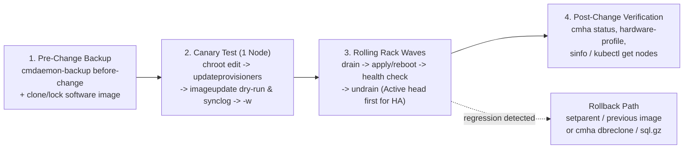

# 8.13 Day-2 operations: updates, scaling, hardware replacement, disaster recovery

| | |
|---|---|
| Level | Intermediate |
| Priority tier | 1 |
| Lab venue | Laptop |
| Part | Part 8: NVIDIA Base Command Manager |
| Status | Drafted (`ops_lab.py`: 45 checks pass; cluster commands **untested** on live BCM) |

## Why this matters for AI infrastructure

Building a cluster is a project; running it is a job that never ends. Packages need updating, nodes fail, racks are added, disks die, someone makes a bad change at 3 a.m. BCM gives you the tools, but a lot of the safety is a habit: back up first, change little, check, and know the way back. This chapter gathers the habits and the exact tools the manual provides.

## Prerequisites and outcomes

You need the rest of Part 8. After this chapter you can:

- read BCM version numbers and follow the update rules, including for HA
- run a command on many nodes without causing a power surge or cutting off your own tool
- ask for help the way BCM support wants (`cm-diagnose`)
- back up the cluster and recover a corrupted database
- use image revisions, check new hardware, replace a node, scale out efficiently
- use Ansible with BCM
- write a short runbook for the three kinds of change you will do most

## 1. Version numbers and the update rules (chapter 9)

- Releases are **10.0** and **11.0** (also written 10, 11). `cmsh -c "main; versioninfo"` and `/etc/cm-release` show it.
- **Point releases** have two formats: **calendar** (`11.25.08` means 2025, August; used up to 10.25.03 and 11.25.08) and **semantic** (`11.30.0`, `11.31.0`, `11.34.0`; a number above 0 in the last place is a backward-compatible bug fix). A **lowercase letter** (`10.23.02a`) is a **hotfix** (letter suffixes are never used in semantic versioning releases). Different packages may be at different point releases, so the manual says to avoid depending on the exact point release; let the package manager keep BCM packages consistent. `cm-package-release-info` (`-f cmdaemon,cluster-tools`) lists package versions and the point releases that use them.
- **Package filename anatomy and origin check:** BCM packages carry `cm` and a developer git hash in their filename:
  - RPM: `<package>-<version>-<revision>_cm<x.y>_<hash>.<arch>.rpm` (for example `cmdaemon-11.0-152061_cm11.0_ec0ea0f4d1.x86_64.rpm`).
  - DEB (Ubuntu only; all other supported distros use RPM): `<package>_<version>-<revision>-cm<x.y>-<hash>_<arch>.deb` (for example `cmdaemon_11.0-152061-cm11.0-ec0ea0f4d1_amd64.deb`).
  - Check whether a file came from BCM or the base distribution with `rpm -qf <path>` on RPM systems or `dpkg -S <path>` followed by `dpkg -s <pkg>` on Ubuntu. **Never replace a BCM-supplied package (marked by `_cm` or `-cm`) with a distribution package:** the cluster enters an unsupported state and subtle failures follow.
- **The `cmsh` `device packages` command:** queries nodes directly for installed packages (`Name`, `Type`, `Version`, `Arch`, `Size`, `Install date`), independent of `rpm` or `dpkg`.
  - **Scale warning:** `packages -a` returns about **100 KB per node** (~1,000 lines), so running `packages -a` across **1,000 nodes dumps ~100 MB (nearly a million lines)**. Across many nodes, filter by package name with one or more `-f|--find` flags (`packages -f cmdaemon -f cuda-dcgm-libs`), or check available BCM upgrades with `packages --outdated` (only upgradable BCM packages) or `packages --outdated -a` (all installed BCM packages and available versions).
- **Updating** (within an OS major release or a BCM release) is normal. **Moving the OS to the next major release** (RHEL 8 to 9) while keeping BCM is **not supported**: install BCM again on the new OS. DGX OS upgrades follow NVIDIA's DGX OS documentation.
- **Commands and GPG keys:** `yum update` (`yum list`); `zypper refresh; zypper up` (`zypper pa`; YUM is not set up on SUSE by default and is not recommended); `apt update; apt upgrade` (`apt-cache gencaches`, `apt-cache search <regex>`). The refresh/update step matters on SUSE and Ubuntu because it only updates repository metadata. `yum clean all`, `zypper clean -a` or `apt-get clean` flush caches. All BCM packages are signed with the **Bright Computing GPG public key (`0x5D849C16`)**, installed at `/etc/pki/rpm-gpg/RPM-GPG-KEY-cm` on Red Hat derivatives (`rpm --import /etc/pki/rpm-gpg/RPM-GPG-KEY-cm`) and imported automatically into `/etc/apt/trusted.gpg.d/brightcomputing-archive-cm.gpg` by `cm-config-apt` on Ubuntu. BCM repackages third-party `modules`, `shorewall`, and `gcc`.
- **HA:** update `cmdaemon` and MySQL on the **active head first**, confirm `cmha status`, then the passive (chapter 8.12). Do not stop CMDaemon or MySQL by hand before an update.
- **Security:** vulnerabilities in distribution packages are handled by updating the distribution; vulnerabilities in BCM packages by updating BCM packages (contact BCM support for BCM package vulnerabilities). **Hardening** (removing packages, blocking ports, disabling USB, disk encryption, SELinux) is possible but **not done by default** and is your responsibility; the manual warns it can affect performance.
- **Non-RPM/non-DEB software layout:** software in nodes goes in the image (chapter 8.4); software compiled from source (`--prefix=/cm/shared/apps/<application>`) belongs under `/cm/shared` in its six standard subdirectories: `apps`, `docs`, `etc`, `examples`, `licenses`, and `modulefiles`.

## 2. Running commands on many nodes (14.1)

| Tool | Where it runs | Notes |
|---|---|---|
| `pdsh` | OS shell | `-v` skips nodes that are down, `-a`/`-A` all nodes, `-g` genders query, `-w`/`-x` include/exclude, `-f` fanout. Default **genders**: `all`, `category=default`, `computenode`, `headnode`. Needs packages `pdsh`, `genders`, `pdsh-mod-cmupdown` and others |
| `pexec` | inside cmsh (CMDaemon) | `-j` join output; the cmsh way |

Two rules from the manual:

1. **Power surge.** Do not power-cycle many nodes with `pdsh` or `pexec`. The cmsh `device power` command inserts a deliberate delay between nodes (chapter 8.7).
2. **Restarting CMDaemon on many regular nodes needs `pdsh`.** A `pexec` command that depends on the node's running CMDaemon cannot sensibly stop that CMDaemon. Example: `pdsh -g computenode systemctl start cmd`.

For bulk changes in cmsh, avoid a shell loop that starts cmsh per node; build **one session**: `(echo device; for i in {129..255}; do echo "set node00$i category newbunch"; done; echo commit) | cmsh`. The lab compares: 127 cmsh runs against 1.

## 3. Asking for help: `cm-diagnose` (14.2)

Support requests go through the NVIDIA enterprise support portal. Choose **Product Type: Software**; **Product Category: Base Command Manager** for BCM 10 and later (older versions: Bright Cluster Manager). Logging in pre-fills cluster details. Support is mainly by e-mail, and `cm-diagnose`, run on the head node, gathers logs, commands, file contents and cmsh output for the head node and images into a tar file, offers to include a **gdb trace of CMDaemon** (only if support asks) and can upload the file. For larger clusters raise the defaults (log limit 50 MB, timeout 60 s): `cm-diagnose --limit 100 --timeout 240`. Release notes are on docs.nvidia.com/base-command-manager.

## 4. Backups and database recovery (14.3)

**BCM has no backup facility for the cluster installation.** You decide, and the manual says to **test that a restore works**. Back up the head node's full filesystem, including all software images; node disks only if they hold important data. Suggested open-source tools: Bacula (head node ports 9101 to 9103; open them from the backup server's address through the `firewall` role's `openports`) and rsnapshot (port 22). Another approach: clone the head node (chapter 8.12). 

**What BCM does itself:**

- The CMDaemon database (most cluster settings) is backed up nightly into `/var/spool/cmd/backup/` as **seven rotating files** `backup-Mon.sql.gz` ... `backup-Sun.sql.gz`. Raw monitoring data is **not** backed up (it can be huge); the monitoring *configuration* is, because it is in the database.
- **`cmdaemon-backup`** makes one on demand. With no argument it overwrites today's default file. With a string it uses `<string>-<YY-MM-DD_HH-MM-SS>_<Day>.sql.gz`, for example `manual-24-08-28_13-19-59_Wed.sql.gz`. **Run it before any big change.**

**A corrupted database** usually follows an improper shutdown. MySQL checks and repairs itself at start. If it cannot start, **CMDaemon cannot start**. If it starts but finds corruption later, it runs **read-only**; the `mysql` health check fails, an info message appears, and `journalctl -xeu mysql.service` shows checksum errors. Fix:

- **HA:** `cmha dbreclone <passive>` from the healthy head gives a current CMDaemon and Slurm database (not the monitoring data). Extra databases need `extradbclone.xml` and `replicate-do-db` lines in `/etc/my.cnf` (chapter 8.12).
- **Not HA:** gunzip the latest local backup and pipe it into MySQL for the CMDaemon user.

**MySQL on compute nodes for Slurm** (`cm-mysql-setup`, chapter 8.8): one primary and one asynchronous replica using GTID, with `mysql-router` on clients. Failover is manual with `cm-slurm-mysql-ha --config /root/mysql-ha-config.conf failover --host <primary>` (add `--force` if the primary crashed); after a forced failover run `remediate --host <new primary> --target <old primary>` once it is back, which replaces the target's data with a fresh clone. Keep `/root/mysql-ha-config.conf` (it holds passwords) root-only.

## 5. Image revisions, hardware checks, replacements, scale

**Image revision control (14.4)** uses **Btrfs** so images become subvolumes: `softwareimage; newrevision default-image "description"` makes `default-image@1` in `/cm/images/default-image-1`; `revisions`, `list -r`, `setparent` (rolls the parent back to a revision) and `remove -a -d`. Btrfs was **removed from RHEL 8 onward**; SLES 15 supports it. Keep important images on a non-Btrfs filesystem too, and migrate with `cm-migrate-image` (never `cp`). The manual says revision control suits test clusters more than production clusters because of disk use. Image sync tools and exclude lists are in chapter 8.4.

**Check that new hardware matches (14.6).** Add the new nodes to a category, save one node as the reference with `node-hardware-profile -n node129 -s newbunch` (saved under `/cm/shared/apps/cmd/hardware-profiles/`), enable the `hardware-profile` data producer with an interval (the manual uses 600 s) and a `nodeexecutionfilters` category filter. CMDaemon then alerts when a node does not match. If the reference itself is faulty, **most** nodes are reported as bad, which is how you notice.

**Replace a node (14.9).** If the new machine's MAC is known: `device use node031; set mac <new mac>; commit`. If not: `clear mac; commit`, then pick the node's name at the node installer (the placeholder identity of chapter 8.4). If the disk size and everything else match, that is all. For a switch-port setup, a swapped node shows as a port mismatch (chapter 8.4); `swap` can exchange the names (chapter 8.5).

**Scale out.** New nodes: `foreach --clone`, the node creation wizard, then `newnodes` in power-on order (8.4); network and IPs (8.3); roles and overlays for Slurm or Kubernetes (8.8, 8.9); a **burn-in** (8.2); the hardware match check above; bulk operations in one cmsh session (section 2). At fleet scale add boot and provisioning roles per rack (8.4) and consider offloaded monitoring (8.11).

## 6. Ansible with BCM (14.10)

BCM publishes Ansible collections named for the BCM version: **`brightcomputing.bcm110`** for BCM 11 (`ansible-galaxy collection install brightcomputing.bcm110`). Most modules come in pairs, one that queries an entity and one that sets it. The head node has examples in `/cm/local/examples/cmd/ansible/` (for example `add-user.yaml`). `ansible-doc brightcomputing.bcm110.user` shows a module. Use it for repeatable, reviewable configuration (users, profiles and so on); Part 7 shows the Redfish side of Ansible. BCM can also install the cluster with an Ansible add-on installer (chapter 8.2).

## 7. Disaster recovery: an outline (my assembly)

The manual gives pieces; this is how I would put them in order. Adapt it to your site and **test it**.

| Failure | First move | Recover from |
|---|---|---|
| Head node dies, HA in place | automatic or `cmha makeactive` (chapter 8.12) | the passive head; then clone a new passive with `cm-clone-install --failover` |
| Head node dies, single head | restore hardware, reinstall BCM with the same license MAC rules (chapter 8.2) | site backup of the head filesystem and the latest database backup |
| CMDaemon database corrupt | check `mysql` health, journal | HA: `cmha dbreclone`; single: restore the local `backup-<Day>.sql.gz` |
| Software image damaged | lock it (8.4) | an image revision (Btrfs), a clone, or a backup copy on non-Btrfs |
| A rack of nodes bad after a change | `close` and `drain` (8.4, 8.8) | the previous image or setting; burn-in before returning them |
| Monitoring history lost | not backed up locally | recreate from now; raw data restore only from your own site backup |
| Everything lost | rebuild | external backup of `/cm/images`, `/cm/shared`, `/home`, the database dump, license, and the written install plan (8.2) |

What this implies for planning: keep **off-cluster** copies of the database dump, the images, `/cm/shared` and the installation notes; keep the **license** and its MAC rules in mind; and rehearse a restore, because the manual itself says to.

## 8. Change management: the fleet-scale habits

From the notes' fleet-scale chapter, in short: split the loads (boot and provisioning roles, 8.4); know the sync directions (`imageupdate` image to node, dry run by default; `grabimage` node to image); protect scratch mounts from `imageupdate` (autofs is not detected); `close` is not `drain`; build remediation yourself (8.11); and for HA, fencing plus quorum plus power control (8.12). Each of these is an operational habit more than a tool.

## 9. Common first mistakes

1. No tested backup, relying on the nightly database dump alone.
2. Updating the passive head first.
3. Power-cycling a rack with `pdsh`.
4. Restarting CMDaemon on nodes with `pexec`.
5. A shell loop with one cmsh run per node.
6. Upgrading the OS major version in place.
7. Believing Btrfs revision control is available on RHEL.
8. Replacing a node without clearing or setting its MAC.
9. Skipping a burn-in on replaced hardware.
10. Making a big change without `cmdaemon-backup`.

## 10. Change runbooks (my assembly)

Every change starts the same way: **write down the change and its undo, and take a named database backup** (`cmdaemon-backup before-change`). Then:

**Image change.** Lock or clone the image; change it in a chroot; `updateprovisioners`; `imageupdate` as a dry run, read `synclog`, apply to one node; roll out in batches with drain first; verify; keep the old image until the new one has run for a while.

**Head node package update.** In HA: the active head first, confirm `cmha status`, then the passive. Let the package manager restart services. Verify cmsh, Base View and a provisioning test.

**BIOS or firmware.** Test on one node; one rack at a time; an AC power cycle if the Result column says so; verify versions and a GPU test (chapter 8.7).

## Exercises

1. Run `python3 ops_lab.py`. Pick four checks and explain each rule in your own words.
2. Classify these versions as calendar, semantic or hotfix: `10.25.03`, `11.25.08`, `11.30.0`, `11.31.0b`.
3. Write a one-session cmsh script to move 200 nodes into a new category and check the result.
4. Plan the restore test you would run every quarter, with a stop condition and who signs off.
5. Draft the runbook for replacing a failed DGX node, using chapters 8.4, 8.7, 8.8 and this one.
6. List what is on your own cluster but not in any backup.

## 12. Interview angles

- "What does BCM back up for you?" The CMDaemon database nightly, seven rotating files; nothing else. The rest is yours.
- "How do you update head nodes in HA?" Active first for CMDaemon and MySQL, confirm, then passive.
- "A node died. How do you replace it?" Set or clear the MAC, commit, name it at install, burn-in.
- "Why not `pdsh` for a rack reboot?" Power surge; use `device power` with its delay.
- "Walk me through a bad image rollout." Lock, previous revision or image, drain, `imageupdate` or reboot, verify.

## Checkpoint questions (20)

1. What are the two point-release numbering schemes used in BCM 10 and 11 (§9.1)?

1. **Calendar versioning (`YY.MM`):** Used up to `10.25.03` and `11.25.08` (e.g., `11.25.08` = August 2025).
2. **Semantic versioning (`Major.Minor.Patch`):** Used from `11.30.0` onward (`11.30.0`, `11.31.0`, `11.34.0`), where a non-zero third number indicates a backward-compatible bug-fix release.

2. What does a lowercase letter suffix on a BCM version (such as `10.23.02a`) signify, and does it appear in semantic releases?

It denotes a **hotfix** release on calendar-versioned point releases; lowercase letter suffixes are **never used** in semantic versioning releases.

3. Is an in-place major OS upgrade (such as RHEL 8 to RHEL 9) supported on a BCM head node?

**No.** Upgrading the underlying Linux distribution to a new major release in place while keeping BCM is unsupported; you must perform a fresh BCM installation on the new OS major version.

4. How can you recognize a BCM-supplied RPM or DEB package from its filename, and why must you never replace it with an upstream distribution package?

BCM packages embed **`_cm<x.y>_<git_hash>`** (RPM) or **`-cm<x.y>-<git_hash>`** (DEB) in the filename and are signed with GPG key **`0x5D849C16`**. Replacing a BCM-supplied package with a standard OS distro package puts the cluster in an unsupported state and breaks `CMDaemon` integration.

5. What are the four default `genders` groups configured for `pdsh -g` in BCM?

**`all`**, **`category=default`**, **`computenode`**, and **`headnode`**.

6. Why must you use `pdsh` (an OS-level SSH tool) rather than `cmsh`'s `pexec` to restart or start `cmd` (`CMDaemon`) across regular nodes?

Because `pexec` executes commands **through the remote node's running `CMDaemon` (`cmd` service)**—so `pexec` cannot start a stopped `cmd` daemon and cuts off its own connection if used to stop `cmd`.

7. Why should you never use `pdsh` or `pexec` to power-cycle or reboot a rack of GPU servers simultaneously?

Because `pdsh` executes across all target nodes in parallel with zero stagger delay, risking a massive electrical inrush **power surge** when all nodes boot together. Use `cmsh` `device power` (which enforces a `1 s` per-node delay or `20 s` batch delay).

8. What does `cm-diagnose` collect for NVIDIA Enterprise Support, and what do `--limit` and `--timeout` adjust?

`cm-diagnose` packages head-node and image logs, configs, and `cmsh` outputs (plus an optional `gdb` trace of `CMDaemon`) into a support tarball. `--limit` raises the maximum log file size collected (default `50 MB`, e.g., `--limit 100`) and `--timeout` raises the per-command timeout (default `60 s`, e.g., `--timeout 240`) for large clusters.

9. When opening a support case in the NVIDIA Enterprise Support Portal for BCM 10 or 11, which Product Type and Product Category do you select?

**Product Type: `Software`**, **Product Category: `Base Command Manager`** (versions prior to 10 used `Bright Cluster Manager`).

10. What does BCM back up automatically out of the box, where are those files stored, and how many are kept?

BCM automatically backs up **only the `CMDaemon` MySQL database** every night into **`/var/spool/cmd/backup/`** as **seven rotating daily files** named `backup-Mon.sql.gz` through `backup-Sun.sql.gz`.

11. What filename format does `cmdaemon-backup before-change` create compared to running `cmdaemon-backup` with no arguments?

With no arguments, `cmdaemon-backup` overwrites today's rotating `backup-<Day>.sql.gz` file. With a label argument (`before-change`), it writes a timestamped file **`before-change-<YY-MM-DD_HH-MM-SS>_<Day>.sql.gz`** that is never overwritten by the nightly rotation.

12. Which critical cluster assets are NOT backed up by `cmdaemon-backup` and require your own site backup solution?

1. **Software images (`/cm/images/*`)**.
2. **Shared storage (`/cm/shared` and `/home`)**.
3. **Head node OS filesystem and custom scripts**.
4. **Raw monitoring time-series data**.

13. What happens to `CMDaemon` if MySQL cannot start, versus if MySQL starts but detects table corruption later?

If MySQL cannot start, **`CMDaemon` refuses to start**. If MySQL detects corruption while running, it switches into **read-only mode**, causing the `mysql` health check to fail and logging checksum errors in `journalctl -xeu mysql.service`.

14. How do you recover a corrupted `CMDaemon` MySQL database on an HA cluster versus a single-head-node cluster?

- **On an HA cluster:** Run **`cmha dbreclone <passive>`** from the healthy head node (with `CMDaemon` stopped) to re-clone the live `cmdaemon` and `slurm_acct_db` databases.
- **On a single head node:** Gunzip the newest `/var/spool/cmd/backup/backup-<Day>.sql.gz` (or manual backup) and pipe it into the `mysql` client.

15. What filesystem does BCM's built-in `softwareimage` revision control (`newrevision`, `setparent`) require, and why is it unavailable on RHEL 8/9?

It requires **Btrfs** subvolumes, and Red Hat **removed Btrfs support from RHEL 8 onward** (it remains supported on SLES 15).

16. Why should you never run `device packages -a` across 1,000 nodes without `-f <package>`?

Because `packages -a` returns roughly **`100 KB` (`~1,000` lines) per node**, producing **`~100 MB` (`~1,000,000` lines)** across 1,000 nodes. Always filter with `-f cmdaemon` or use `packages --outdated`.

17. How does `node-hardware-profile` verify that a newly delivered batch of servers matches a reference node, and how can you tell if the reference node itself was faulty?

`node-hardware-profile -n node129 -s newbunch` saves `node129`'s hardware inventory under `/cm/shared/apps/cmd/hardware-profiles/`, and the `hardware-profile` data producer alerts on any node in `newbunch` that differs. If `node129` itself had a missing DIMM or bad card, **every other healthy node in the batch is flagged as mismatched**.

18. What are the two ways in `cmsh` to replace a dead compute node `node031` with a new physical chassis?

1. **If the replacement MAC is known:** `device use node031; set mac <new-mac>; commit` and PXE-boot the new machine.
2. **If the replacement MAC is not known in advance:** `device use node031; clear mac; commit` (turning `node031` into a placeholder), PXE-boot the new machine, and select `node031` at the `node-installer` console prompt.

19. What is the official Ansible Galaxy collection name for BCM 11, and where are example playbooks stored on the head node?

**`brightcomputing.bcm110`**, with example playbooks located in **`/cm/local/examples/cmd/ansible/`**.

20. When MySQL for Slurm accounting is deployed on compute nodes via `cm-mysql-setup`, how do you fail over after a primary crash and re-sync the old primary afterward?

Run **`cm-slurm-mysql-ha --config /root/mysql-ha-config.conf failover --host <primary> --force`**, and once the old primary node is repaired, run **`cm-slurm-mysql-ha --config /root/mysql-ha-config.conf remediate --host <new-primary> --target <old-primary>`**.

## Sources and review notes

- **BCM 11 Administrator Manual:** chapter 9 (9.1 package naming and point releases, 9.2 head node packages and the HA note), chapter 14 (14.1 parallel shells, 14.2 support and `cm-diagnose`, 14.3 backups and database recovery, 14.4 image revision control, 14.6 hardware match, 14.9 node replacement, 14.10 Ansible, 14.12 `cm-mysql-setup` and its maintenance).
- **NVIDIA-DevOps notes**, volume 10 chapter 13: fleet-scale operating habits (used here and in 8.4, 8.11 and 8.12).
- **Run here:** `ops_lab.py` (45 checks): version schemes, BCM package filename parsing (`.rpm` and `.deb`), `device packages -a` output volume, GPG key and `/cm/shared` layout, parallel tool choice, bulk script, `cm-diagnose` and support, backup names and scope, restore paths, Btrfs, revisions, hardware match, node replacement, MySQL HA commands, runbook shapes.
- **My own choices, not the manual's:** the disaster recovery table (section 7) and the change runbooks (section 10); the "unknown" classification for versions between the calendar and semantic ranges (the manual gives no rule there).
- **Not read or not covered:** 14.5 and 14.7 beyond chapter 8.7; Btrfs `cm-clone-install` issue (page 828); 14.11; the Cluster Extension and cloud topics; Bacula and rsnapshot configuration; air-gapped updates (chapter 8.14); upgrading BCM to a new major release (11 to 12 procedure, not in the text I read).
- **Not verified:** everything about a real BCM system.
