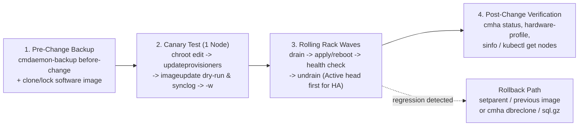

# 8.13 Day-2 operations: updates, scaling, hardware replacement, disaster recovery

| | |
|---|---|
| Level | Intermediate |
| Priority tier | 1 |
| Lab venue | Laptop |
| Part | Part 8: NVIDIA Base Command Manager |
| Status | Drafted (`ops_lab.py`: 45 checks pass; cluster commands **untested** on live BCM) |

## Why this matters for AI infrastructure

Think about a bad night on a cluster. Someone makes a change at 3 a.m., and in the morning you have to find out what changed and how to undo it. Building a cluster is a project with an end. Running it is a job that never ends. Packages need updating, nodes fail, racks get added, and disks die.

BCM, which stands for NVIDIA Base Command Manager, gives you the tools for all of this. Much of the safety, however, comes from habit rather than from a single command. The habits are simple to name. Back up before you change anything. Change only a little at a time. Check the result before you move on. Know the way back if the result is wrong. This chapter collects those habits along with the exact tools the manual provides, so that a routine task on a quiet afternoon and a repair on a bad night follow the same careful path.

## Prerequisites and outcomes

This chapter assumes you have worked through the rest of Part 8, because the later sections lean on the install, the node categories and the high-availability pair. This chapter walks through the version numbers and update rules, including the rules that apply to a high-availability (HA) pair of head nodes. It then covers running one command on many nodes safely, asking support for help with `cm-diagnose`, and backing up the cluster. Next come recovery of a corrupted database, image revisions and checks for new hardware. The last parts cover replacing a node, scaling out, using Ansible with BCM and writing a short runbook for the changes you will make most often.

## 1. Version numbers and the update rules (chapter 9)

Suppose a colleague asks which BCM version your head nodes run. You can check with `cmsh -c "main; versioninfo"`, or read `/etc/cm-release`. The version string follows a pattern. Once you can read that pattern, you know what kind of update a release is before you install it.

The major releases are 10.0 and 11.0, which you can also write as 10 and 11. A major release is the big step, where the product line itself changes. Point releases use one of two formats. The calendar format puts the year and month in the number, so `11.25.08` means August 2025. It was used up to `10.25.03` and `11.25.08`. The semantic format starts at `11.30.0`, with `11.31.0` and `11.34.0` following it. In that format, the three places read as major, minor and patch. A number above 0 in the last place is a backward-compatible bug fix, which means it should not break things that already work.

A lowercase letter, as in `10.23.02a`, marks a hotfix, which is a small fix sent out between the regular point releases. Letter suffixes are never used in semantic releases, so a letter at the end is a quick sign of the older format.

Different packages can sit at different point releases. For that reason, the manual says not to depend on the exact point release. Let the package manager keep the BCM packages consistent with each other. To see which package versions go with which point releases, run `cm-package-release-info` with `-f cmdaemon,cluster-tools`. The output lets you compare what you have against what a release expects.

BCM packages carry `cm` and a developer git hash in their filenames, which is how you tell them apart from the distribution's own packages. An RPM name looks like `<package>-<version>-<revision>_cm<x.y>_<hash>.<arch>.rpm`, for example `cmdaemon-11.0-152061_cm11.0_ec0ea0f4d1.x86_64.rpm`. A DEB name looks like `<package>_<version>-<revision>-cm<x.y>-<hash>_<arch>.deb`, for example `cmdaemon_11.0-152061-cm11.0-ec0ea0f4d1_amd64.deb`. RPM is the package format used by Red Hat and its derivatives, and DEB is the format used by Debian and Ubuntu. DEB files are used on Ubuntu only, and all other supported distributions use RPM.

To check whether a file came from BCM or from the base distribution, use `rpm -qf <path>` on RPM systems. On Ubuntu, run `dpkg -S <path>` and then `dpkg -s <pkg>`. The first command tells you which package owns the file, and the second shows the details of that package. Never replace a BCM-supplied package, the ones marked with `_cm` or `-cm`, with a distribution package. If you do, the cluster enters an unsupported state, and subtle failures follow. Those failures can show up days later, far from the change that caused them.

The `cmsh` command `device packages` asks the nodes directly what they have installed. It does not depend on `rpm` or `dpkg` on your side, so it works even when you cannot log in to a node. The output shows the fields `Name`, `Type`, `Version`, `Arch`, `Size` and `Install date`.

Be careful with that command at scale. Suppose you run `packages -a` across 1,000 nodes. Each node returns about 100 KB, roughly 1,000 lines, so the total is about 100 MB, which is nearly a million lines. That is far too much to read, and it can slow your session down. Instead, filter by package name with one or more `-f|--find` flags, as in `packages -f cmdaemon -f cuda-dcgm-libs`. The filter returns only the packages you asked about. To check for upgrades, use `packages --outdated`, which lists only the upgradable BCM packages, or `packages --outdated -a`, which lists all installed BCM packages and the versions available for them.

Updating within an OS major release or a BCM release is normal. Moving the OS to the next major release while keeping BCM is not supported. Going from RHEL 8 to RHEL 9, for example, means installing BCM again on the new OS. DGX OS upgrades follow NVIDIA's DGX OS documentation, not the BCM procedure.

Each package manager has its own commands. On YUM systems, use `yum update`, and `yum list` shows what is available. On SUSE, run `zypper refresh; zypper up`, and list packages with `zypper pa`. YUM is not set up on SUSE by default and is not recommended there. On Ubuntu, run `apt update; apt upgrade`, and use `apt-cache gencaches` or `apt-cache search <regex>` to work with the cache. The refresh step matters on SUSE and Ubuntu, because it only updates the repository metadata, which is the index of what is available. It does not install anything by itself. To flush caches, use `yum clean all`, `zypper clean -a` or `apt-get clean`.

All BCM packages are signed with the Bright Computing GPG public key, `0x5D849C16`. A GPG signature lets your package manager check that a package really came from its publisher and was not changed on the way. On Red Hat derivatives, the key is installed at `/etc/pki/rpm-gpg/RPM-GPG-KEY-cm`, and you import it with `rpm --import /etc/pki/rpm-gpg/RPM-GPG-KEY-cm`. On Ubuntu, `cm-config-apt` imports it automatically into `/etc/apt/trusted.gpg.d/brightcomputing-archive-cm.gpg`. BCM also repackages third-party `modules`, `shorewall` and `gcc`, so those packages carry the same BCM marks.

In an HA pair, update `cmdaemon` and MySQL on the active head first. Confirm the state with `cmha status`, and only then update the passive head (chapter 8.12). Do not stop CMDaemon or MySQL by hand before an update. The package manager and the BCM scripts know the right order for stopping and restarting them. A manual stop can leave the two heads disagreeing about who is in charge.

Security fixes follow the same split. A vulnerability in a distribution package is fixed by updating the distribution. A vulnerability in a BCM package is fixed by updating the BCM packages, and for those you should contact BCM support. Hardening, which covers removing packages, blocking ports, disabling USB, disk encryption and SELinux, is possible. It is not done by default, and it is your responsibility. The manual warns that hardening can affect performance, so test it on a canary node before you apply it widely.

Software that the nodes need belongs in the software image (chapter 8.4). Software you compile from source, with `--prefix=/cm/shared/apps/<application>`, belongs under `/cm/shared`, which is the storage that all nodes can see. It goes in one of six standard subdirectories: `apps`, `docs`, `etc`, `examples`, `licenses` or `modulefiles`. Keeping to these folders means that the next person can find your software where they expect it.

On an HA pair, the active head always goes first, and you wait for `cmha status` to confirm before you touch the passive one. The short rule is easy to remember and easy to break under pressure, so write it into your change ticket.

## 2. Running commands on many nodes (14.1)

Suppose a whole rack needs a restart after a firmware change. Typing a command on each node is slow, and a typing mistake on one node can go unnoticed for a long time. So you send one command to all of them. Two tools can do that, and the one you choose depends on where the command should run.

| Tool | Where it runs | Notes |
|---|---|---|
| `pdsh` | OS shell | `-v` skips nodes that are down, `-a`/`-A` all nodes, `-g` genders query, `-w`/`-x` include/exclude, `-f` fanout. Default **genders**: `all`, `category=default`, `computenode`, `headnode`. Needs packages `pdsh`, `genders`, `pdsh-mod-cmupdown` and others |
| `pexec` | inside cmsh (CMDaemon) | `-j` join output; the cmsh way |

`pdsh` is a parallel shell. It opens an SSH connection to each target and runs the same command on all of them at once. A genders file is a list that gives names to groups of hosts, so you can say `-g computenode` instead of listing every node. `pexec` is different. It sends the command through the CMDaemon service that runs on each node, and it runs from inside `cmsh`, the BCM command shell.

The manual gives two rules for this. The first one is about power. Do not power-cycle many nodes with `pdsh` or `pexec`, because all of them would start at once. When a large group of GPU servers starts together, the power draw can spike sharply, which is what the rule guards against. The `cmsh` command `device power` inserts a deliberate delay between nodes (chapter 8.7), and that delay is what prevents the surge.

The second rule is about CMDaemon. A `pexec` command depends on the running CMDaemon of the node it targets, so it cannot sensibly stop that daemon. If you stop CMDaemon through the same channel, you cut off the connection you are using to give the command. To restart CMDaemon on many regular nodes, use `pdsh`, for example `pdsh -g computenode systemctl start cmd`. This runs over plain SSH, so it does not need the daemon to be up.

For bulk changes in `cmsh`, avoid a shell loop that starts `cmsh` once per node. Each start has a cost, and a long loop is slow and easy to interrupt halfway. Build one session instead: `(echo device; for i in {129..255}; do echo "set node00$i category newbunch"; done; echo commit) | cmsh`. The lab compares 127 `cmsh` runs against 1.

When you need to change many nodes, use one `cmsh` session or `pdsh`, and never power-cycle a rack with either tool.

## 3. Asking for help: `cm-diagnose` (14.2)

Suppose a head node problem has stumped you and you need to open a support case. Support will ask for logs, command output and file contents. Gathering all of that by hand takes time, and it is easy to leave out the one file that matters. `cm-diagnose` collects that material for you in one step.

Open your request on the NVIDIA enterprise support portal. Set Product Type to `Software`, and set Product Category to `Base Command Manager` for BCM 10 and later. Older versions used the name Bright Cluster Manager. Logging in pre-fills your cluster details, so the support team can see which cluster they are looking at.

Support works mainly by e-mail. Run `cm-diagnose` on the head node. It gathers logs, command output, file contents and `cmsh` output for the head node and the images into one tar file. A tar file is a single archive that bundles many files, which makes it easy to attach to a case. It can also include a `gdb` trace of CMDaemon, but only when support asks for one. A `gdb` trace records the state of a running program, so it is useful to a developer and not needed for most cases. Finally, it can upload the file for you. On a large cluster, raise the log limit and the timeout from their defaults of 50 MB and 60 s, with `cm-diagnose --limit 100 --timeout 240`. Release notes are on docs.nvidia.com/base-command-manager.

## 4. Backups and database recovery (14.3)

Suppose a disk fails on the head node and you reinstall the box. The question you need to answer in that moment is simple: what can you get back? A backup you have never restored is only a hope. You want to know, before the bad day, that the copy works.

BCM has no backup facility for the whole cluster installation, so you decide what to back up. The manual says to test that a restore works. Back up the head node's full filesystem, including all software images, because the images hold the exact software each group of nodes boots with. Back up node disks only if they hold important data, since a compute node's local disk is usually scratch space. The manual suggests two open-source tools. Bacula needs the head node ports 9101 to 9103, which you open from the backup server's address through the `firewall` role's `openports`. rsnapshot uses port 22, which is the standard SSH port. Another option is to clone the head node (chapter 8.12), so the copy can take over if the original fails.

BCM does back up one thing on its own: the CMDaemon database. Most cluster settings live there, including categories, networks and node definitions. Every night, BCM saves it into `/var/spool/cmd/backup/` as seven rotating files, named `backup-Mon.sql.gz` through `backup-Sun.sql.gz`. A rotating set means each day's file replaces the file from one week earlier, so the folder always holds the last seven nights. Raw monitoring data is not backed up, because it can be huge. The monitoring configuration is backed up, because it lives in the database.

You can make a backup on demand with `cmdaemon-backup`. With no argument, it overwrites today's default file. With a string, it writes a file named `<string>-<YY-MM-DD_HH-MM-SS>_<Day>.sql.gz`, for example `manual-24-08-28_13-19-59_Wed.sql.gz`. The date and time in the name make each file unique, so a named backup is never overwritten by the nightly rotation. Run it before any big change, and use a label that tells you why the file exists.

A corrupted database usually follows an improper shutdown, such as a power cut or a forced reset while the disk was still writing. When MySQL starts, it checks and repairs itself. If MySQL cannot start, CMDaemon cannot start either. If MySQL starts but finds corruption later, it runs read-only. The `mysql` health check then fails, an info message appears, and `journalctl -xeu mysql.service` shows checksum errors. A checksum error means the data on disk no longer matches the value that was stored with it, so the database cannot trust those pages.

The fix depends on your setup. On an HA cluster, run `cmha dbreclone <passive>` from the healthy head. It gives you a current CMDaemon and Slurm database, but not the monitoring data. The passive head receives a copy of the good database, so both heads agree again. If you have extra databases, you need `extradbclone.xml` and `replicate-do-db` lines in `/etc/my.cnf` (chapter 8.12). The `replicate-do-db` setting names the databases that replication copies. On a cluster that is not HA, gunzip the latest local backup and pipe it into MySQL for the CMDaemon user. This puts the most recent good copy back in place, and you lose only the changes made since that night.

MySQL for Slurm can run on the compute nodes, set up with `cm-mysql-setup` (chapter 8.8). Slurm needs a database to keep its job accounting records. That setup has one primary and one asynchronous replica, which use GTID, with `mysql-router` on the clients. A GTID, or global transaction identifier, is a unique label on each change, so the replica can tell which changes it has already applied. An asynchronous replica copies changes after the primary has written them, so a sudden crash can lose the newest changes. The `mysql-router` process sends each client to whichever server is currently the primary. Failover is manual. Run `cm-slurm-mysql-ha --config /root/mysql-ha-config.conf failover --host <primary>`, and add `--force` if the primary crashed. After a forced failover, run `remediate --host <new primary> --target <old primary>` once the old primary is back. That command replaces the target's data with a fresh clone. Keep `/root/mysql-ha-config.conf` readable by root only, because it holds passwords.

Decide now where your off-cluster copies will go, and test one restore before you need it. A copy stored only on the cluster will not help if the cluster is the thing that failed.

## 5. Image revisions, hardware checks, replacements, scale

Suppose a software image update breaks a rack of nodes. You want to return to the image that worked. Before a new node joins the cluster, you also want proof that its hardware matches the rest. These two needs look different, but both come down to keeping a known good state that you can return to or compare against.

Image revision control (14.4) uses Btrfs, so each image becomes a subvolume. Btrfs is a Linux filesystem that can take cheap snapshots of a directory tree, and a subvolume is one such tree. Run `softwareimage; newrevision default-image "description"` to create `default-image@1` in `/cm/images/default-image-1`. Each revision keeps the image as it was at that moment. Then use `revisions` and `list -r` to see the revisions. `setparent` rolls the parent back to a revision, which is how you return the nodes to an earlier image. `remove -a -d` deletes them when you no longer need them. Btrfs was removed from RHEL 8 onward, but SLES 15 supports it. Keep important images on a non-Btrfs filesystem too, and migrate them with `cm-migrate-image`, never `cp`. A plain copy does not carry the subvolume structure with it, so the copy would not be a real revision. The manual says revision control suits test clusters better than production clusters, because it uses a lot of disk. Image sync tools and exclude lists are in chapter 8.4.

Hardware matching works like this (14.6). Suppose a new batch of servers arrives, and each one should be identical to the others. Add the new nodes to a category, then save one node as the reference with `node-hardware-profile -n node129 -s newbunch`. That stores the profile under `/cm/shared/apps/cmd/hardware-profiles/`. The profile is a record of the parts the node reports, such as memory, disks and cards. Next, enable the `hardware-profile` data producer with an interval, and add a `nodeexecutionfilters` category filter. A data producer is a small job that gathers one kind of measurement on a schedule, and the filter limits it to the nodes you chose. The manual uses an interval of 600 s. After that, CMDaemon alerts you when a node does not match the reference. The reference can itself be faulty. If it is, most nodes get reported as bad, and that is how you notice the problem. When the alerts point at nearly every node, check the reference before you check the rest.

Replacing a dead node follows a similar path (14.9). A replacement works because the new machine takes the old node's name and role. If the new machine's MAC address is known, run `device use node031; set mac <new mac>; commit`. The MAC address is the hardware address of the network card, and BCM uses it to recognize the machine at boot. If it is not known, run `clear mac; commit`. Then choose the node's name at the node installer. That name is the placeholder identity from chapter 8.4. If the disk size and everything else match, that is all. On a switch-port setup, a swapped node shows up as a port mismatch (chapter 8.4). The `swap` command can exchange the names (chapter 8.5), so the node that moved to a new port takes on the identity that belongs there.

Scaling out has several steps, and the order matters. For new nodes, use `foreach --clone`, the node creation wizard, and then `newnodes` in power-on order (8.4). Power-on order means you bring the nodes up in a planned sequence, so the boot load does not hit all at once. Set up the network and IP addresses (8.3), and assign roles and overlays for Slurm or Kubernetes (8.8, 8.9). An overlay is a group of settings that applies to a set of nodes across categories. Run a burn-in (8.2), which is a stress test that shows weak hardware before the node takes real work. Then run the hardware match check described above. Bulk operations belong in one `cmsh` session, as in section 2 of this chapter. At fleet scale, add boot and provisioning roles per rack (8.4), and consider offloaded monitoring (8.11), so the head node does not carry all the load.

Whenever you replace or add hardware, run the match check before you trust the new nodes. A node that looks healthy but differs from its peers is often the first sign of a bad part.

## 6. Ansible with BCM (14.10)

Suppose you need the same user accounts on a new cluster that you set up on the last one. Doing it by hand means typing the same steps again, and any step you forget becomes a surprise. Ansible lets you write those steps into a file that you can review and repeat. Ansible is an automation tool that describes the desired state in a playbook, which is a YAML file that lists the tasks in order.

BCM publishes Ansible collections named for the BCM version. A collection is a bundle of modules, roles and examples that you install as one unit. For BCM 11, the collection is `brightcomputing.bcm110`, which you install with `ansible-galaxy collection install brightcomputing.bcm110`. Most modules come in pairs. One queries an entity, and its partner sets it. The query side lets you read the current state without changing anything, and the set side makes the change. The head node has examples in `/cm/local/examples/cmd/ansible/`, such as `add-user.yaml`. To read the documentation for one module, run `ansible-doc brightcomputing.bcm110.user`.

Use the collection for configuration you need to repeat and review, such as users and profiles. Part 7 shows the Redfish side of Ansible. BCM can also install the cluster with an Ansible add-on installer (chapter 8.2), so the install itself can be written down and repeated.

For a change that will repeat or needs review, write it as Ansible rather than a one-off `cmsh` session. A playbook in Git leaves a record of who asked for the change and why, and a second person can read it before it runs.

## 7. Disaster recovery: an outline (my assembly)

Picture the head node that will not answer in the middle of the night. Nodes stop reporting, and the people on the on-call rota are asking what to do. What you do next depends on which part failed, so it helps to have the plan written before that night comes. The manual gives the pieces, but not the order to use them in. The outline below puts them in order. Adapt it to your site, and test it before you rely on it.

| Failure | First move | Recover from |
|---|---|---|
| Head node dies, HA in place | automatic or `cmha makeactive` (chapter 8.12) | the passive head; then clone a new passive with `cm-clone-install --failover` |
| Head node dies, single head | restore hardware, reinstall BCM with the same license MAC rules (chapter 8.2) | site backup of the head filesystem and the latest database backup |
| CMDaemon database corrupt | check `mysql` health, journal | HA: `cmha dbreclone`; single: restore the local `backup-<Day>.sql.gz` |
| Software image damaged | lock it (8.4) | an image revision (Btrfs), a clone, or a backup copy on non-Btrfs |
| A rack of nodes bad after a change | `close` and `drain` (8.4, 8.8) | the previous image or setting; burn-in before returning them |
| Monitoring history lost | not backed up locally | recreate from now; raw data restore only from your own site backup |
| Everything lost | rebuild | external backup of `/cm/images`, `/cm/shared`, `/home`, the database dump, license, and the written install plan (8.2) |

Read each row as a separate failure. The middle column is the first move, and the last column is what you recover from. The first move is what stops the damage from growing. The last column is the longer road back.

Planning for this means keeping off-cluster copies of the database dump, the images, `/cm/shared` and the installation notes. Keep the license and its MAC rules in mind as well, because a restore onto different hardware can fail the license check. And rehearse a restore, because the manual itself says to. A rehearsal finds the missing file or the wrong password while there is still time to fix it.

## 8. Change management: the fleet-scale habits

Picture a change that looks harmless on one machine, pushed to a whole rack at once.

A change on a fleet reaches many nodes at once, so the habits matter more than any single tool. A small mistake that would be harmless on one machine can spread across a whole rack in minutes.

The notes from the fleet-scale chapter boil down to a few habits. Split the boot and provisioning loads across roles (8.4), so that no single node serves every boot request. Know which way each sync runs. `imageupdate` copies the image to the node and does a dry run by default, which means it shows you what would change and changes nothing. `grabimage` copies the node back into the image, so it runs in the opposite direction, and you should be sure which one you want before you run either. Protect scratch mounts from `imageupdate`, because autofs is not detected. Autofs is a service that mounts directories on demand, and a sync can delete a mount point it does not recognize. Remember that `close` is not `drain`. Closing a node stops new work from landing on it, while draining also waits for the running work to finish. Build your own remediation (8.11), meaning the scripts that fix a common problem the same way every time. For HA, combine fencing, quorum and power control (8.12). Fencing cuts off a node that might be misbehaving, quorum is the agreement needed before the cluster acts, and power control lets the cluster reboot the node. Each of these is an operational habit more than a tool, and each one reduces the chance that a single failure becomes a cluster-wide outage.

## 9. Common first mistakes

Picture the night before a maintenance window, when the checklist is the only thing between you and a costly slip.

Watch for these common first mistakes. Each one is easy to make on a busy night, and each one has a simple fix once you see it.

1. Relying on the nightly database dump alone, with no tested backup. The dump is useful, but it is one copy in one place, and nobody has checked that it restores.
2. Updating the passive head first, before the active one.
3. Power-cycling a rack with `pdsh`.
4. Restarting CMDaemon on nodes with `pexec`.
5. Running a shell loop with one `cmsh` run per node.
6. Upgrading the OS major version in place.
7. Believing Btrfs revision control is available on RHEL.
8. Replacing a node without clearing or setting its MAC.
9. Skipping a burn-in on replaced hardware.
10. Making a big change without `cmdaemon-backup`.

Read this list before your next maintenance window, and treat each item as a question you must answer first. If you cannot answer it, stop and find out before you go on.

## 10. Change runbooks (my assembly)

A change window can go wrong halfway through. You may have updated some racks, and then the next rack shows a regression, which means the new version behaves worse than the old one. A runbook written before the window tells you what to do at that point. It is a short written list of steps, each with a check, so you are not inventing the procedure under pressure. The flowchart below shows the order of a safe change: back up, test on one node, roll out in waves, then verify. If a regression appears, you take the rollback path.



Every change starts the same way. Write down the change and its undo, then take a named database backup with `cmdaemon-backup before-change`. The name tells a future reader why the file exists. The steps after that depend on what you are changing.

For an image change, lock or clone the image first, then change it in a chroot. A chroot is a directory that a program sees as its whole filesystem, so you can edit the image without touching the head node itself. Run `updateprovisioners`, and then run `imageupdate` as a dry run. Read `synclog`, and apply the change to one node. Roll out the rest in batches, draining each batch first. Verify the result, and keep the old image until the new one has run for a while.

For a head node package update, update the active head first, and confirm with `cmha status` before you move to the passive head. Let the package manager restart services. Afterward, verify `cmsh`, Base View and a provisioning test. Base View is the web interface for BCM, and a provisioning test checks that a node can still boot from the image.

For a BIOS or firmware change, test the change on one node, then do one rack at a time. Use an AC power cycle if the Result column says so, because some firmware only takes effect after the power is fully removed. Finish by verifying the versions and running a GPU test (chapter 8.7).

### 10.1 Deep dive: Managing software-image lifecycles without breaking running jobs

Picture a multi-node training job that has run for days and is still far from finished. It is halfway through, and a security patch has come out. In a busy AI cluster, multi-node training jobs can run twenty-four hours a day for weeks at a time. How do you roll out a security patch, an updated CUDA toolkit, an `MLNX_OFED` / `DOCA-Host` driver or a new Linux kernel across five hundred compute nodes without interrupting active jobs?

BCM separates software images (`/cm/images/<name>`), categories and drain-action chaining. An image is the software a node boots with. A category groups nodes that should share settings and an image. A drain action is a step that runs after a node has finished its work, such as a reboot. Together these give you two rollout patterns. Which one you use depends on whether the change is a user-space package update or a kernel or driver change. User-space means the software that runs above the kernel, which can be changed while the node keeps running. A kernel or driver change touches the part of the system that is already loaded in memory, so it needs a reboot to take effect.

1. Pattern A is an in-place canary and wave sync for user-space updates (`imageupdate`).
   Use this pattern for user-space packages that do not need a kernel reboot, such as `htop`, monitoring agents, `/etc/sssd/sssd.conf` or container hooks.
   - Start with a database backup, `cmdaemon-backup before-pkg-update`. Then clone the production image with `softwareimage; clone default-image default-image-rollback; commit -w`, so you have an instant rollback copy.
   - Enter the image with `cm-chroot-sw-img /cm/images/default-image`. Lock it first with `softwareimage lock default-image` while `apt` or `dnf` runs, and unlock it afterward. The lock stops a sync from copying a half-finished image to the nodes.
   - Run `updateprovisioners` (`softwareimage; updateprovisioners`). Any regular node with the `provisioning` role then receives the updated image at once, instead of waiting for the `300 s` `dirtyautoupdatetimeout` or the midnight UTC sync. The wait is there so the image is not pushed out too often, but for an urgent fix you want it sooner.
   - Run a dry run against one canary node with `imageupdate -n node001`, without the `-w` flag. Then read `synclog node001` to check that no unexpected node-local files or `autofs` mounts are slated for deletion. This is where `excludelistupdate` comes in. An exclude list names the paths that a sync must leave alone, so node-specific files survive the update.
   - Apply the change to the canary with `imageupdate -n node001 -w`, check its health with `samplenow`, and then roll out across the category in waves. A wave is a small batch of nodes. If the first wave looks healthy, you move on to the next.
2. Pattern B is a zero-downtime rolling category switch for kernel, driver and OFED upgrades.
   Use this pattern when the change touches the Linux kernel (`set kernelversion` with `createramdisk`), the NVIDIA GPU kernel driver (`nvidia.ko`), or the `MLNX_OFED` / `DOCA-Host` RDMA stack. RDMA is a way for one machine to read or write another machine's memory directly, and it is the basis of fast GPU networking. Syncing files onto a running node with `imageupdate -w` is risky here. The running kernel and the loaded `.ko` modules in RAM no longer match the files on disk. A `.ko` file is a kernel module, a piece of driver code that the kernel loads. Any new job step or `nvidia-smi` call on that node can then fail with a driver or library version mismatch.
   Use a rolling category or image switch with chained drain actions instead. Instead of changing the running node, you point nodes at a new image and let them reboot into it.
   - Clone the production image (`dgx-prod-v1` → `dgx-prod-v2`). Make all the kernel, driver and `createramdisk` updates inside `dgx-prod-v2`, while production nodes keep running on `dgx-prod-v1`. The old image stays intact, so the rollback is simply pointing back to it.
   - Create a canary category, `dgx-canary`, that points to `dgx-prod-v2`. Move one idle test node into it, reboot it, and validate GPUDirect RDMA and GDS with `gdscheck.py -p` and `all_reduce_perf`. GPUDirect RDMA lets a network card move data straight to or from GPU memory, and GDS (GPUDirect Storage) does the same for storage. The `all_reduce_perf` test is a benchmark that checks how fast the GPUs share data.
   - After validation, point the production category at `dgx-prod-v2`, or move racks into the new category. Then schedule a rolling reboot across busy nodes with chained drain actions:
     ```bash
     cmsh -c 'device; drain -n node001..node032 --setactions powerreset ; drain -n node001..node032 --appendactions undrain'
     ```
     Each node finishes its running Slurm job first. Then it resets its power and provisions `dgx-prod-v2` at boot. It passes its `prejob` and boot health checks, and it undrains itself back into the Slurm pool. A `prejob` check runs before a job starts, so a node with a fault never receives work.

For a kernel or driver change, use the category switch rather than an in-place sync. The extra steps cost a reboot per node, and that cost is what keeps a running job from meeting a half-updated driver.

### 10.2 End-to-end bare-metal disaster recovery rehearsal

Every quarter, pull up the table in section 7 of this chapter and ask your team a hard question. Suppose the primary storage array in your management rack suffered a double fault tonight, and both head nodes lost their local disks. Could you rebuild this cluster from your off-cluster backups? A double fault is two failures at once, which is harder to recover from than one. Asking the question out loud, and writing down the answer, is what turns a plan into a tested one.

An off-cluster disaster recovery bundle needs five artifacts. Store them on an external backup target, outside the cluster's own `/cm/shared` NAS. A NAS is a network storage box, and keeping the bundle off the cluster means that one failure cannot take out both the cluster and its backup.

1. The latest `CMDaemon` MySQL dump, `/var/spool/cmd/backup/backup-<Day>.sql.gz` or a dump from `cmdaemon-backup`, plus any external databases (`slurm_acct_db`, Keycloak, Harbor). Keycloak handles logins and Harbor stores container images, so both are worth backing up if you run them.
2. Tarballs or `rsync` mirrors of `/cm/images/*` and `/cm/node-installer*`, which hold the exact golden software images for every category and architecture. A golden image is the reference copy that every node of that kind should match. An `rsync` mirror is a copy that updates only the changed files.
3. Configuration files that live outside the `CMDaemon` database: `/cm/local/apps/cmd/etc/cmd.conf`, `/etc/named.conf.include`, `/cm/excludelistnormal`, `/cm/excludelistfailover`, custom health checks and actions in `/cm/local/apps/cmd/scripts/`, and TLS/CA keys under `/root/.cm/` and `/etc/kubernetes/pki/`. These files sit outside the database, so a database dump does not include them.
4. The BCM cluster license file and its bound head-node MAC addresses. With them, you can restore onto the same NIC MAC, or request an emergency license re-host from NVIDIA Enterprise Support before the maintenance window.
5. The written Day-0 installation parameters (Chapter 8.2): the network topology type, the `internalnet`, `externalnet` and `bmcnet` subnets with their IP offsets, and the disk layout XMLs. Day-0 means the settings you chose at the very start, before the cluster was in service. Without them, a rebuild turns into guesswork.

Rehearse a database restore, `gunzip < backup.sql.gz | mysql ...`, and a single-node image boot in a small virtual or lab environment. Use a machine that does not matter, so a mistake costs you nothing. Rehearsal turns disaster recovery from a hope into a verified thirty-minute procedure, and it shows you which step takes the longest.

### 10.3 Automating BCM Day-2 configuration as code with `brightcomputing.bcm110`

Picture a cluster that started as one rack and now has several scalable units, run by a small team instead of one person. Interactive changes in `cmsh` that nobody reviews slowly make staging and production drift apart. Drift means the two environments stop matching, and a fix that works in staging fails in production for no clear reason. How do you manage BCM objects, such as categories, networks, racks, users, profiles and monitoring triggers, through Git pull requests and CI pipelines? CI means the automatic checks that run whenever a change is proposed.

Section 6 introduced the `brightcomputing.bcm110` Ansible collection, which lives in `/cm/local/examples/cmd/ansible/`. Knowing how the collection talks to CMDaemon lets you combine Git discipline with BCM's provisioning engine.

1. The modules talk to CMDaemon directly. Generic Linux modules, such as `ansible.builtin.copy` or `lineinfile`, SSH into compute nodes and edit files in `/etc` behind CMDaemon's back. The modules in `brightcomputing.bcm110` (`category`, `physical_node`, `network`, `user`, `profile`, `software_image` and `configuration_overlay`) connect directly to CMDaemon on the active head node. Each one reads the current object state, compares it with the YAML attributes in your playbook, and commits only the properties that differ. It reports `ok` or `changed`, and running it again is safe. A module that reports `ok` made no change, which is what you want to see on a second run.
2. Suppose you prepare a new CUDA or driver image. A playbook that uses `brightcomputing.bcm110.category` with `cloneFrom: "dgx-h100-prod"` creates the `dgx-h100-canary` category. It points that category's `softwareImageProxy` at the new image and updates its kernel parameters, all in one reviewed Git commit. The review step is where a second person catches a wrong image name before it reaches a node.
3. Keep the ownership boundary from Chapter 8.1 Section 3.8 clear. Use Ansible with `brightcomputing.bcm110` to manage BCM objects on the head node. Or run Ansible inside a chrooted software image on the head node, before you run `updateprovisioners` and `imageupdate -w`. Never use Ansible to SSH into running compute nodes and overwrite files that CMDaemon or the software image manages. The next `imageupdate -w` or node reboot will erase those unmanaged edits. The rule is simple: the file belongs either to the image or to CMDaemon, and the change goes through that owner.

Put BCM object changes in Git and let CI review them, and leave the node files to the image.

### 10.4 Pre-flight and post-flight checklist for every Day-2 maintenance window

Before a maintenance window starts, you want to know two things. The cluster must be healthy, and you must be able to get back if something goes wrong. Whether the window covers head node packages, a kernel image, faulty hardware or a new Slurm rack, the same six checks apply. The first three are pre-flight checks, which you run before anything changes. The last three are the core of the change and the proof that it worked. Pre-flight and post-flight are simply the words for before and after.

1. Take an explicit, named database backup first. Run `cmdaemon-backup pre-maint-<date>` on the active head node, and check that the `.sql.gz` file appears under `/var/spool/cmd/backup/`. A file you have not looked at is not yet a backup, so check that it exists.
2. Check HA and replication health before you touch either head node. Run `cmha status` and confirm that both head nodes show `OK` for `ping`, `failoverping`, `status` and `mysql`. If one head is already unhealthy, the window is the wrong time to start.
3. Check provisioning, and lock or clone the target images. Run `softwareimage; provisioningstatus` to make sure no nodes are mid-transfer. Clone any image you plan to change with `clone  ; commit -w` before you modify its packages or kernel. A node in the middle of a transfer can boot a half-written image.
4. Drain the target compute nodes cleanly through the workload manager. Use `drain -n <nodes>` or a Slurm maintenance reservation. A maintenance reservation is a Slurm booking that keeps jobs off the nodes for a set period. Confirm that the running jobs have finished with `wlm; jobs; list` before you reboot or power-cycle the nodes.
5. Validate on one canary node before you widen the change. Apply the image, BIOS or firmware change to that node first. Check the `samplenow` health checks, `ipaddresses --check`, and a quick GPU or fabric test. Only then roll out across racks, using `device power` stagger delays or chained `drain --setactions powerreset --appendactions undrain`. The stagger delay is the spacing that keeps the power draw smooth.
6. Confirm the cluster converged after the window. Verify `cmha status`, `cmdaemonversions`, `packages --outdated`, `healthoverview`, and `sinfo` or `kubectl get nodes`. That proves the whole cluster returned to a clean, uniform baseline. Uniform means every node runs the same version and reports healthy, so no node is quietly behind the rest.

Do not close the change ticket until step six is done. A window that looks finished but has not passed the last check is not finished.

## Exercises

These steps were not run on a live cluster, so treat them as practice.

1. Run `python3 ops_lab.py`. Pick four checks. For each one, explain the rule in your own words.
2. Sort these four versions into calendar, semantic or hotfix. Start with `10.25.03`. Then do `11.25.08`. Then do `11.30.0`. Last, do `11.31.0b`.
3. Write a one-session cmsh script that moves 200 nodes into a new category. Then check the result.
4. Plan the restore test you would run every quarter. Give it a stop condition. Name who signs off on it.
5. Draft the runbook for replacing a failed DGX node. Use chapters 8.4, 8.7, 8.8 and this one.
6. List what is on your own cluster but not in any backup.

## 12. Interview angles

- "What does BCM back up for you?" Only the CMDaemon database, every night, in seven rotating files. The rest is yours to back up, and a database dump alone does not rebuild a cluster.
- "How do you update head nodes in HA?" Update the active head first for CMDaemon and MySQL, confirm it, then update the passive head. The order keeps one head always able to take over.
- "A node died. How do you replace it?" Set or clear the MAC, commit, name the node at install, and then run a burn-in. The burn-in is what shows whether the new hardware is sound.
- "Why not `pdsh` for a rack reboot?" It causes a power surge. Use `device power` instead, because it adds a delay between nodes.
- "Walk me through a bad image rollout." Lock the image, roll back to the previous revision or image, drain the nodes, run `imageupdate` or reboot them, and then verify. Each step gives you a point where you can stop and check before going further.

## Checkpoint questions (20)

<details>
<summary>1. What are the two point-release numbering schemes used in BCM 10 and 11 (§9.1)?</summary>

1. **Calendar versioning (`YY.MM`):** This scheme was used up to `10.25.03` and `11.25.08`. For example, `11.25.08` means August 2025.
2. **Semantic versioning (`Major.Minor.Patch`):** This scheme is used from `11.30.0` onward, with releases such as `11.30.0`, `11.31.0` and `11.34.0`. A non-zero third number marks a backward-compatible bug-fix release.
</details>

<details>
<summary>2. What does a lowercase letter suffix on a BCM version (such as `10.23.02a`) signify, and does it appear in semantic releases?</summary>

A letter suffix marks a **hotfix** on the calendar-versioned point releases. You will never see a lowercase letter suffix on a semantic release.
</details>

<details>
<summary>3. Is an in-place major OS upgrade (such as RHEL 8 to RHEL 9) supported on a BCM head node?</summary>

**No.** Upgrading the Linux distribution to a new major release in place, while keeping BCM, is not supported. You have to do a fresh BCM installation on the new OS major version.
</details>

<details>
<summary>4. How can you recognize a BCM-supplied RPM or DEB package from its filename, and why must you never replace it with an upstream distribution package?</summary>

BCM packages carry `_cm<x.y>_<git_hash>` in an RPM filename, or `-cm<x.y>-<git_hash>` in a DEB filename. They are also signed with the GPG key `0x5D849C16`. If you replace one with a standard OS package, the cluster enters an unsupported state, and the `CMDaemon` integration breaks.
</details>

<details>
<summary>5. What are the four default `genders` groups configured for `pdsh -g` in BCM?</summary>

The four default groups are **`all`**, **`category=default`**, **`computenode`**, and **`headnode`**.
</details>

<details>
<summary>6. Why must you use `pdsh` (an OS-level SSH tool) rather than `cmsh`'s `pexec` to restart or start `cmd` (`CMDaemon`) across regular nodes?</summary>

`pexec` runs commands through the running `CMDaemon` on the remote node (the `cmd` service). So it cannot start a stopped `cmd` daemon, and if you use it to stop `cmd`, it cuts off its own connection.
</details>

<details>
<summary>7. Why should you never use `pdsh` or `pexec` to power-cycle or reboot a rack of GPU servers simultaneously?</summary>

`pdsh` runs in parallel across all target nodes with no stagger delay. When every node boots together, the electrical inrush can cause a massive **power surge**. Use `cmsh` `device power` instead, which enforces a `1 s` per-node delay or a `20 s` batch delay.
</details>

<details>
<summary>8. What does `cm-diagnose` collect for NVIDIA Enterprise Support, and what do `--limit` and `--timeout` adjust?</summary>

`cm-diagnose` packages the logs, configs and `cmsh` output for the head node and images into a support tarball. It can add a `gdb` trace of `CMDaemon` as well. `--limit` raises the largest log file size it collects, from the default `50 MB` (for example `--limit 100`). `--timeout` raises the per-command timeout, from the default `60 s` (for example `--timeout 240`), for large clusters.
</details>

<details>
<summary>9. When opening a support case in the NVIDIA Enterprise Support Portal for BCM 10 or 11, which Product Type and Product Category do you select?</summary>

Choose **Product Type: `Software`** and **Product Category: `Base Command Manager`**. Versions before 10 used `Bright Cluster Manager`.
</details>

<details>
<summary>10. What does BCM back up automatically out of the box, where are those files stored, and how many are kept?</summary>

Out of the box, BCM backs up **only the `CMDaemon` MySQL database**. It does this every night, into **`/var/spool/cmd/backup/`**, as **seven rotating daily files** named `backup-Mon.sql.gz` through `backup-Sun.sql.gz`.
</details>

<details>
<summary>11. What filename format does `cmdaemon-backup before-change` create compared to running `cmdaemon-backup` with no arguments?</summary>

With no arguments, `cmdaemon-backup` overwrites today's rotating `backup-<Day>.sql.gz` file. With a label such as `before-change`, it writes a timestamped file named **`before-change-<YY-MM-DD_HH-MM-SS>_<Day>.sql.gz`**. The nightly rotation never overwrites that file.
</details>

<details>
<summary>12. Which critical cluster assets are NOT backed up by `cmdaemon-backup` and require your own site backup solution?</summary>

1. **Software images (`/cm/images/*`)**.
2. **Shared storage (`/cm/shared` and `/home`)**.
3. **Head node OS filesystem and custom scripts**.
4. **Raw monitoring time-series data**.
</details>

<details>
<summary>13. What happens to `CMDaemon` if MySQL cannot start, versus if MySQL starts but detects table corruption later?</summary>

If MySQL cannot start, **`CMDaemon` refuses to start**. If MySQL finds corruption while it is running, it switches to **read-only mode**. The `mysql` health check then fails, and checksum errors appear in `journalctl -xeu mysql.service`.
</details>

<details>
<summary>14. How do you recover a corrupted `CMDaemon` MySQL database on an HA cluster versus a single-head-node cluster?</summary>

- **On an HA cluster:** From the healthy head node, with `CMDaemon` stopped, run **`cmha dbreclone <passive>`**. That re-clones the live `cmdaemon` and `slurm_acct_db` databases.
- **On a single head node:** Gunzip the newest `/var/spool/cmd/backup/backup-<Day>.sql.gz` (or a manual backup), and pipe it into the `mysql` client.
</details>

<details>
<summary>15. What filesystem does BCM's built-in `softwareimage` revision control (`newrevision`, `setparent`) require, and why is it unavailable on RHEL 8/9?</summary>

It requires **Btrfs** subvolumes. Red Hat removed Btrfs support from RHEL 8 onward, so revision control is not available there. SLES 15 still supports Btrfs.
</details>

<details>
<summary>16. Why should you never run `device packages -a` across 1,000 nodes without `-f <package>`?</summary>

`packages -a` returns about **`100 KB` (`~1,000` lines) per node**. Across 1,000 nodes, that adds up to about **`100 MB` (`~1,000,000` lines)**. Always filter with `-f cmdaemon`, or use `packages --outdated`.
</details>

<details>
<summary>17. How does `node-hardware-profile` verify that a newly delivered batch of servers matches a reference node, and how can you tell if the reference node itself was faulty?</summary>

`node-hardware-profile -n node129 -s newbunch` saves the hardware inventory of `node129` under `/cm/shared/apps/cmd/hardware-profiles/`. The `hardware-profile` data producer then alerts on any node in `newbunch` that differs from it. If `node129` itself has a fault, such as a missing DIMM or a bad card, every other healthy node in the batch gets flagged as mismatched.
</details>

<details>
<summary>18. What are the two ways in `cmsh` to replace a dead compute node `node031` with a new physical chassis?</summary>

1. **If the replacement MAC is known:** Run `device use node031; set mac <new-mac>; commit`, then PXE-boot the new machine.
2. **If the replacement MAC is not known in advance:** Run `device use node031; clear mac; commit` to turn `node031` into a placeholder. Then PXE-boot the new machine, and select `node031` at the `node-installer` console prompt.
</details>

<details>
<summary>19. What is the official Ansible Galaxy collection name for BCM 11, and where are example playbooks stored on the head node?</summary>

The collection is **`brightcomputing.bcm110`**. Its example playbooks are in **`/cm/local/examples/cmd/ansible/`**.
</details>

<details>
<summary>20. When MySQL for Slurm accounting is deployed on compute nodes via `cm-mysql-setup`, how do you fail over after a primary crash and re-sync the old primary afterward?</summary>

Run **`cm-slurm-mysql-ha --config /root/mysql-ha-config.conf failover --host <primary> --force`**. Once the old primary node is repaired, run **`cm-slurm-mysql-ha --config /root/mysql-ha-config.conf remediate --host <new-primary> --target <old-primary>`**.
</details>

## Sources and review notes

- **BCM 11 Administrator Manual:** chapter 9 (9.1 package naming and point releases, 9.2 head node packages and the HA note), chapter 14 (14.1 parallel shells, 14.2 support and `cm-diagnose`, 14.3 backups and database recovery, 14.4 image revision control, 14.6 hardware match, 14.9 node replacement, 14.10 Ansible, 14.12 `cm-mysql-setup` and its maintenance).
- **NVIDIA-DevOps notes**, volume 10 chapter 13: fleet-scale operating habits (used here and in 8.4, 8.11 and 8.12).
- **Run here:** `ops_lab.py` (45 checks): version schemes, BCM package filename parsing (`.rpm` and `.deb`), `device packages -a` output volume, GPG key and `/cm/shared` layout, parallel tool choice, bulk script, `cm-diagnose` and support, backup names and scope, restore paths, Btrfs, revisions, hardware match, node replacement, MySQL HA commands, runbook shapes.
- **My own choices, not the manual's:** the disaster recovery table (section 7) and the change runbooks (section 10); the "unknown" classification for versions between the calendar and semantic ranges (the manual gives no rule there).
- **Not read or not covered:** 14.5 and 14.7 beyond chapter 8.7; Btrfs `cm-clone-install` issue (page 828); 14.11; the Cluster Extension and cloud topics; Bacula and rsnapshot configuration; air-gapped updates (chapter 8.14); upgrading BCM to a new major release (11 to 12 procedure, not in the text I read).
- **Not verified:** everything about a real BCM system.
