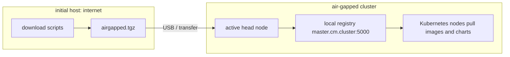

# 8.14 Air-gapped installation and upgrades

| | |
|---|---|
| Level | Intermediate to advanced |
| Priority tier | 2 |
| Lab venue | Laptop |
| Part | Part 8: NVIDIA Base Command Manager |
| Status | Drafted (`airgap_lab.py`: 34 checks pass; cluster commands **untested** on live BCM) |

## Why this matters for AI infrastructure

Many AI clusters sit in places with no direct internet: regulated industries, government, defence, and large operators who isolate the training fabric. In those places `yum update` and `docker pull` do not exist. Everything has to be brought in on media, verified, and installed from local copies. The work is mostly **preparation**: if one package, image or chart is missing from the bundle, you find out halfway through an installation that you cannot continue.

## Prerequisites and outcomes

You need chapters 8.2, 8.4, 8.9, 8.10 and 8.12. After this chapter you can:

- explain what must be done before the cluster is cut off
- prepare a complete bundle on a connected host and check it is complete
- install Kubernetes and the container registry from the bundle, in the right order
- avoid the traps with architectures, passive head nodes, Ubuntu's `_apt` user and Docker Hub limits
- plan a Kubernetes upgrade that respects the version skew rules
- set up the rest of BCM (images, OFED, MySQL) from offline sources

## 1. What "air-gapped" means for BCM

The manual's definition: the cluster is not directly connected to the internet, usually to protect it. For BCM that raises four questions:

1. **Where do OS and BCM packages come from?** Local repositories built from install media (9.6.3 of the Administrator Manual) or internal mirrors.
2. **Where do container images come from?** A **local registry** on the head node (chapter 8.10).
3. **Where do Helm charts and CRDs come from?** The same bundle, pushed into that registry.
4. **How do you move things in?** Through a connected "initial host" and removable media.

## 2. The reference scenario (Appendix B)

Cluster air-gapped, Kubernetes 1.34.7, BCM 11.33.0 or 11.33.1, on Ubuntu 22.04 or 24.04, Rocky Linux 9 or RHEL 9. The initial host needs internet, an OS and **architecture that match the cluster's** (Ubuntu 22.04, 24.04, 26.04, Rocky 9 or RHEL 9). **The bundle supports one architecture at a time**: a cluster with x86-64 head nodes and ARM64 control plane nodes needs a more customized approach.



## 3. Before the cluster is cut off

Things that **cannot be arranged once the cluster is air-gapped**, so do them first:

- **Node assignment** for the Kubernetes control plane, workers and etcd (chapter 8.9; the wizard screens are the same, but you must have done the selection).
- If **Run:ai** will be used: three reserved IP addresses from the internal network, DNS records for the Run:ai control plane FQDN, two wildcard subdomains, a TLS certificate and key, and an NGC API key.
- The list of **operators** you will want (the bundle only contains what you download).
- The BCM **repository credentials** (`<user>:<password>` in `cm.list`), taken from a working cluster, to download packages on the initial host.
- The **GPU operator version**: only chart versions that you downloaded can be installed. A certified version (asterisk in the wizard) is not necessarily downloaded, and a downloaded version is not necessarily certified. List `helm-charts/` before you choose.

## 4. Preparing the bundle (on the connected host)

1. **OS match.** Copy the BCM repository files from a working cluster of the same OS: on Ubuntu `cm-*.list` and `ubuntu.sources` under `/etc/apt/sources.list.d/` (the manual shows 11.33 fixes for architecture lines: `Architectures: amd64`/`arm64` in `ubuntu.sources`, `arch=` in the CUDA and `cm.list` files; they are fixed from 11.34); on RHEL `cm.repo` and `epel.repo` under `/etc/yum.repos.d/`.
2. **Tools.** **Helm 3.x** (not 4.x as of the manual's date; `download_helm_binary.sh` installs it) and **Skopeo** on the connected host only. The air-gapped head gets its own Skopeo from the bundle; **do not install it there from a distribution repository**, there is none.
3. **Docker Hub limits.** Unauthenticated pulls are limited to **100 per 6 hours**, authenticated to **200 per 6 hours**. Sign up for any account and `skopeo login docker.io`; the credentials are not put in the bundle.
4. **Scripts** (from `$K8S_AG_SCRIPTS`, the `airgap-scripts` directory of the `cm-setup` package; add it to `PATH`): `download_ubuntu_packages.sh` (or `download_r9_packages.sh`), `download_container_images.sh`, `download_helm_charts.sh`, `download_crds.sh`. **Pass `--kube-version=1.34` to the first three explicitly**, otherwise each uses its own default version. They can also read the version from a `cm-kubernetes-setup.conf` with `-c`. Run them in sequence, in `screen` or `tmux`; the container images take about 15 times longer than everything else. Apt warnings about `_apt` and `/root` are expected and harmless.
5. **Size.** About **8.6 GB** (8.1 GB of it images) without Run:ai; Run:ai adds **13 to 14 GB**, so plan **upwards of 20 GB** of working space.
6. **Run:ai** (optional): the air-gapped package from NGC (needs an NGC API key; version 2.23.60 or later for multi-arch) and the `cm-setup-runai-bcm11` package, published **only as a `.deb`**, so **air-gapped Run:ai on RHEL is not supported in this release**. Verify with `sha256sum -c`; the `.sha256` file holds only the checksum, so append the file name on the same line first. Do not install if the check is not OK.
7. **Completeness check.** `find packages packages-head packages-non-dgx packages-cuda k8s-images helm-charts crds -type f`: **every category must print files.** A directory or subdirectory that exists but is empty means that download did not finish; re-run it before tarballing.
8. `tar -cvzf airgapped.tgz airgapped`, include **all architectures** the Kubernetes nodes use, and carry it to the **active** head node.

If your network restricts outbound destinations from the connected host, the chart repositories change between releases: BCM 11.34 adds the AgentGateway OCI repositories, the Argo CD repository and the Flannel repository.

## 5. Installing on the air-gapped head node

The manual's order (13 steps in the lab's `STEPS`):

1. **Generate the configuration** while still able to run the wizard: `cm-kubernetes-setup --airgap-registry master.cm.cluster:5000 --airgap-registry-as-helm`, go through the wizard, and at the summary **save, do not deploy**. If Run:ai is planned, select **its dependency operators** now (GPU Operator, Grafana Operator, Kgateway, Knative, Kubeflow Training, Metrics Server, MPI Operator, State Metrics, LeaderWorkerSet, MetalLB, Prometheus Adapter and Operator Stack; Network and NIM Operators are optional).
2. **Extract** the bundle. On **Ubuntu extract somewhere APT can write, such as `/tmp`**: APT runs as `_apt`, which cannot read under `/root`. On Rocky and RHEL you can extract in place.
3. From inside the extracted directory: `cm-kubernetes-setup --airgap-install-system-packages -c /root/cm-kubernetes-setup.conf`. It installs the packages on the head and in the images (multi-arch automatically) and brings Skopeo. **On an HA pair run it on the active head only**; it also updates the secondary. **Never run the wizard on the passive head** and **never use `--force`** to override the "not the active head node" refusal: software images are local to each head and synchronized from the active one, so a passive write is reverted and the passive serves a different image meanwhile.
4. **Registry:** `cm-container-registry-setup --skip-packages`, choose the active head, set the certificate SAN (for example `master.cm.cluster`), save and deploy. Then trust its CA system-wide: copy `/cm/local/apps/docker-registry/var/etc/<host>:5000-ca.crt` to `/usr/local/share/ca-certificates/` and `update-ca-certificates`, so Helm works without TLS errors.
5. **Docker** (only for Run:ai): `cm-docker-setup --skip-packages`; check with `module load docker; docker ps`. No `docker login` needed.
6. **Push** the content: `cm-kubernetes-setup --airgap-push-container-images -c ...` then `--airgap-push-helm-charts -c ...`.
7. **Extract CRDs:** `$K8S_AG_SCRIPTS/extract_crds.sh`.
8. **Deploy:** `cm-kubernetes-setup -c /root/cm-kubernetes-setup.conf`. The `airgap` section of the config (Helm repo `oci://master.cm.cluster:5000/helm-charts`, registry, CA path) is filled in automatically by the flags in step 1.
9. **Run:ai** is deployed afterwards by its own wizard, `cm-runai-setup`, which needs the `cm-setup-runai-bcm11` package (the command exists without it but fails). BCM 11.33 pairs with Run:ai 2.25 and 11.34 with 2.26, but any supported Run:ai version can be used.

The lab's `order_problems` flags the dependency mistakes: pushing before the registry exists, deploying before images, charts and CRDs are in place, and so on. The wizard checks the bundle against the Kubernetes version you chose (from BCM 11.34) and names each package or chart whose version does not match, which is much better than failing late (chapter 8.9).

## 6. Upgrading Kubernetes air-gapped (Appendix C)

Same principles as chapter 8.9, with these differences:

- **Minimum BCM point release:** 11.32.0 (BCM 11) or 10.31.0 (BCM 10). Check with chapter 8.13's version rules.
- **Version skew:** at most **two adjacent minor releases** in the cluster at any time (1.34 and 1.35 fine; 1.33, 1.34 and 1.35 not). If nodes are on two minors, **the only valid upgrade is to the newer one**. Skipping minors is not allowed. Decide: **minor** upgrade (latest of the next minor) or **patch** upgrade (latest patch of the current minor). Read the BCM release notes and compatibility matrix for the target version.
- The cluster must be healthy and a local registry deployed; nodes to upgrade must be **drained**.
- Rebuild the bundle for the **target** version on the connected host (same steps, `--kube-version` set to the target), carry it over, extract, install packages, push images and charts, extract CRDs.
- Upgrade control plane nodes **first**, one at a time, then worker nodes:
  1. **First control-plane node:**
     - Push the updated binaries from the software image on the head node (`-w` is required, otherwise `imageupdate` only runs a dry run):
       ```bash
       root@headnode:~# cmsh -c 'device; imageupdate -w controlplane01 --wait'
       ```
     - SSH to `controlplane01` and run `kubeadm upgrade plan` with an explicit `--kubeconfig` (important when a BCM cluster hosts multiple Kubernetes clusters):
       ```bash
       root@controlplane01:~# kubeadm upgrade plan --kubeconfig=/root/.kube/config-default
       ```
       In the manual's `v1.32.10` session, `kubeadm upgrade plan` suggests upgrading to the latest patch in the current minor (`v1.32.11`), but because the skew policy allows jumping to the next minor (`v1.33.6`, after checking the Kubernetes changelogs), apply the target version directly on the **first** control-plane node:
       ```bash
       root@controlplane01:~# kubeadm upgrade apply v1.33.6 --kubeconfig=/root/.kube/config-default
       ```
     - **Validate before touching the next node:** check `kubectl get nodes` (`Ready`, `v1.33.6`), `kubectl get pod -A` (especially `kube-system` and `calico-system`), and verify that the static pod pulls from the local air-gapped registry:
       ```bash
       root@controlplane01:~# kubectl describe pod -n kube-system kube-apiserver-controlplane01 | grep Image:
       Image: master.cm.cluster:5000/kube-apiserver:v1.33.6
       ```
  2. **Subsequent control-plane nodes:** on the head node run `cmsh -c 'device; imageupdate -w <node> --wait'`, then on the control-plane node run **`kubeadm upgrade node`** (not `upgrade apply`, and no version argument is passed):
     ```bash
     root@node001:~# kubeadm upgrade node --kubeconfig /root/.kube/config-default
     ```
     Repeat the `kubectl get nodes` and `kubectl get pod -A` validation after each control-plane node.
  3. **Worker nodes:** upgrade one worker (or batch) at a time so running workloads are evacuated cleanly:
     - **On the head node:** drain the worker and update its image binaries:
       ```bash
       root@basecm11:~# kubectl drain $host --ignore-daemonsets
       root@basecm11:~# cmsh -c "device use $host; imageupdate -w --wait"
       ```
     - **On the worker node:** upgrade the node configuration, reload systemd, and restart `kubelet`:
       ```bash
       root@<node>:~# kubeadm upgrade node --kubeconfig=/root/.kube/config-<Kubernetes instance>
       root@<node>:~# systemctl daemon-reload
       root@<node>:~# systemctl restart kubelet
       ```
     - **Uncordon and validate:** run `kubectl uncordon $host`, then confirm `kubectl get nodes` and `kubectl get pod -A`.

## 7. The rest of BCM, offline

| Need | Offline option |
|---|---|
| Distribution and BCM packages for the head or an image | A local repository from the install media: mount the ISO (`mount -o loop`), `bind` mount it into the image, a repo file such as `/etc/yum.repos.d/cm11.0-dvd.repo` with `baseurl=file:///mnt1/data/packages/11.0-<subminor>`. For Ubuntu an APT list for the ISO; the BCM line needs no `trusted=yes` (the `cm-config-apt` package imports the BCM keyring), and the second line for the base Ubuntu packages on the ISO uses `trusted=yes`, which the manual calls a **deliberate risk acceptance for local, physically controlled media, not a default to copy to a network-hosted repository** |
| RHEL or SLES base repositories | copy the vendor ISOs into the image (`/root/repo1`) and add `file://` repos (9.6.3) |
| A custom image offline | `cm-create-image ... -e -s` with the local repository (9.6.4); `--air-gapped` exists in the image-creation options |
| Mellanox/DOCA OFED | `cm-doca-ofed-install.sh -v <version> -h --cmdvd` installs from a BCM install medium (BCM 11 media carry DOCA OFED) |
| MySQL for Slurm (`cm-mysql-setup`) | `--skip-packages`, with `mysql-server` packages preinstalled in the server nodes' images and `mysql-router` in client images; Ubuntu 24 and later use the distribution packages, other systems need MySQL Community Edition packages |
| RHEL head node installer (Ansible add-on) | an internal mirror `.repo` file via `pre_install_repo_files`, `--basedistrepo` pointing at it, and keep the ISO's Rocky repositories disabled on a RHEL host (they conflict with RHEL packages) |
| Updates later | repeat the connected-host preparation and carry in a new bundle; there is no `yum update` |

## 8. Operating an air-gapped cluster

- **Updates are projects.** Plan windows to refresh the bundle: OS security updates, BCM point releases, Kubernetes patches, GPU operator charts, Run:ai.
- **Keep the bundle.** Store `airgapped.tgz` with its checksum, the exact `cm-kubernetes-setup.conf`, the repo files and the release notes. A rebuild needs them (chapter 8.13).
- **Time and certificates.** An isolated site still needs a correct clock (an internal NTP source) and certificate lifetimes you manage (chapter 8.6).
- **Support.** `cm-diagnose` output can be moved out on media (chapter 8.13).
- **Image provenance.** Verify checksums on everything you carry in; keep the connected host clean and single-purpose.

## 9. Common first mistakes

1. Downloading a bundle for the wrong Kubernetes version (forgetting `--kube-version`).
2. A bundle with an empty category.
3. Not choosing operators or the Run:ai dependencies before the cut-off.
4. Extracting under `/root` on Ubuntu.
5. Installing Skopeo from a repository on the air-gapped head.
6. Running the wizard on the passive head, or using `--force`.
7. Picking a GPU operator version that was not downloaded.
8. Forgetting the registry CA trust, so Helm fails with TLS errors.
9. Upgrading across minors or with nodes on three minors.
10. Planning air-gapped Run:ai on RHEL.

## Exercises

1. Run `python3 airgap_lab.py`. Pick four checks and explain each rule in your own words.
2. Write a pre-flight checklist for the connected host with ten items, each with the command that verifies it.
3. A cluster has nodes on 1.34.7 and 1.35.1. Which upgrade targets are valid? What if one node is on 1.33?
4. Estimate the number of Docker Hub pulls needed for a bundle of 230 images, with and without an account.
5. Draw the order of steps for adding a new operator to an already air-gapped cluster. What must be on the connected host first?
6. Explain to a security officer how you will verify each file that enters the cluster.

## 11. Interview angles

- "How do you install Kubernetes where nothing reaches the internet?" A bundle prepared on a connected host (packages, images, charts, CRDs), moved on media, a local registry, and `cm-kubernetes-setup` in air-gap mode.
- "What would you check before cutting the cluster off?" Node roles, operators and versions, GPU operator chart, Run:ai prerequisites, bundle completeness.
- "How do you upgrade Kubernetes there?" Same kubeadm principles, rebuilt bundle for the target, skew policy (two adjacent minors), control plane first, drain.
- "Why not run the wizard on the passive head?" Images are local to each head and synchronized from the active head, so passive writes are lost.
- "What can the bundle not do?" Contain what you forgot; there is no way to fetch it later.

## Checkpoint questions (20)

<details>
<summary>1. What four artifact streams must be prepared locally when operating BCM and Kubernetes in an air-gapped site?</summary>

1. **OS and BCM packages** (`.rpm` or `.deb` repositories from ISOs or mirrors).
2. **Container images** (pushed via Skopeo into a local registry on the head node, such as `master.cm.cluster:5000`).
3. **Helm charts** (pushed as OCI charts into the local registry).
4. **Kubernetes CRDs** (extracted on the head node via `extract_crds.sh`).
</details>

<details>
<summary>2. What must the internet-connected initial staging host match relative to the air-gapped BCM cluster?</summary>

It must run the **same Linux distribution/version** (`Ubuntu 22.04`/`24.04`/`26.04`, `RHEL 9`, or `Rocky 9`) and the **same CPU architecture** (`x86_64` or `aarch64`) as the target cluster.
</details>

<details>
<summary>3. How many CPU architectures does a single air-gapped download bundle (`airgapped.tgz`) support by default?</summary>

**One architecture at a time** (either `x86_64` or `aarch64`).
</details>

<details>
<summary>4. Why must you pass `--kube-version=1.34` (or `-c cm-kubernetes-setup.conf`) explicitly to `download_ubuntu_packages.sh`, `download_container_images.sh`, and `download_helm_charts.sh`?</summary>

Because without an explicit `--kube-version` or `-c` flag, each download script falls back to its own internal default Kubernetes version, which may not match the version you selected in the wizard.
</details>

<details>
<summary>5. What are Docker Hub's unauthenticated versus authenticated pull rate limits, and how do you avoid hitting them while building the bundle?</summary>

Unauthenticated pulls are capped at **`100` pulls per `6` hours**, and free authenticated accounts at **`200` pulls per `6` hours**. Authenticate with `skopeo login docker.io` before running `download_container_images.sh` (or use a paid Pro/Team/Business account).
</details>

<details>
<summary>6. Which seven directories inside the air-gapped workspace must all be non-empty before creating `airgapped.tgz`?</summary>

**`packages`**, **`packages-head`**, **`packages-non-dgx`**, **`packages-cuda`**, **`k8s-images`**, **`helm-charts`**, and **`crds`** (verified with `find packages packages-head packages-non-dgx packages-cuda k8s-images helm-charts crds -type f`).
</details>

<details>
<summary>7. Roughly how much disk space does the air-gapped bundle require without Run:ai versus with Run:ai?</summary>

About **`8.6 GB`** (`8.1 GB` of container images) without Run:ai, plus **`13 to 14 GB`** for Run:ai (plan **upwards of `20 GB`** of free working space).
</details>

<details>
<summary>8. On an Ubuntu head node, why must `airgapped.tgz` be extracted under `/tmp` rather than under `/root`?</summary>

Because Ubuntu's `apt` drops privileges to the unprivileged **`_apt`** user when reading local package archives, and `_apt` lacks traverse permissions on `/root` (`0700`).
</details>

<details>
<summary>9. On an HA head-node pair, which head node must run `--airgap-install-system-packages` and `cm-kubernetes-setup`, and why must you never pass `--force` on the passive head?</summary>

Always run them on the **Active head node only** (which automatically updates the secondary head). Software images are local to each head node and synced from Active to Passive, so running the wizard on the Passive head with `--force` creates temporary split state that is overwritten on the next sync.
</details>

<details>
<summary>10. Where does the air-gapped head node obtain the `skopeo` binary?</summary>

From the **air-gapped package bundle itself** during `cm-kubernetes-setup --airgap-install-system-packages`—never try to install `skopeo` from an upstream internet repo on the air-gapped head.
</details>

<details>
<summary>11. What do `--airgap-registry master.cm.cluster:5000` and `--airgap-registry-as-helm` configure when generating `cm-kubernetes-setup.conf`?</summary>

They populate the `airgap` section of the configuration file so Kubernetes pulls all container images from `master.cm.cluster:5000` and Helm pulls all operator charts from `oci://master.cm.cluster:5000/helm-charts`.
</details>

<details>
<summary>12. After deploying the local Docker Registry on the active head node (`cm-container-registry-setup --skip-packages`), how do you make the OS and Helm trust its TLS certificate?</summary>

Copy `/cm/local/apps/docker-registry/var/etc/<host>:5000-ca.crt` into **`/usr/local/share/ca-certificates/`** and run **`update-ca-certificates`**.
</details>

<details>
<summary>13. Which three commands push and unpack the bundle's images, Helm charts, and CRDs onto the active head node before final deployment?</summary>

1. `cm-kubernetes-setup --airgap-push-container-images -c /root/cm-kubernetes-setup.conf`
2. `cm-kubernetes-setup --airgap-push-helm-charts -c /root/cm-kubernetes-setup.conf`
3. `$K8S_AG_SCRIPTS/extract_crds.sh`
</details>

<details>
<summary>14. Why can selecting a GPU Operator version marked with an asterisk `*` (NVAIE certified) in the wizard still fail during an air-gapped install?</summary>

Because the air-gapped bundle only contains the chart version(s) downloaded on the connected host; if you pick a version in the wizard that is not present inside `helm-charts/`, installation fails. Always check `ls helm-charts/` first.
</details>

<details>
<summary>15. Why is air-gapped Run:ai not supported on RHEL/Rocky in the documented BCM 11 release?</summary>

Because the required `cm-setup-runai-bcm11` helper package is published **only as a Debian/Ubuntu `.deb` package** in that release.
</details>

<details>
<summary>16. What are the minimum BCM point releases required for the air-gapped Kubernetes upgrade procedure (Appendix C)?</summary>

**BCM `11.32.0`** (for BCM 11) or **`10.31.0`** (for BCM 10).
</details>

<details>
<summary>17. State the Kubernetes minor-version skew rule enforced during air-gapped upgrades.</summary>

At most **two adjacent minor versions** may coexist in the cluster at any time (for example, `1.34` and `1.35`), and skipping a minor version is forbidden. If nodes currently span two adjacent minors (`1.34` and `1.35`), the **only** valid upgrade target is the newer minor (`1.35.x`).
</details>

<details>
<summary>18. During an air-gapped Kubernetes upgrade, what exact `kubeadm` command runs on the **first** control-plane node versus on **subsequent** control-plane and worker nodes?</summary>

- **First control-plane node:** After `imageupdate -w controlplane01 --wait`, run `kubeadm upgrade plan --kubeconfig=...` followed by **`kubeadm upgrade apply v<target> --kubeconfig=/root/.kube/config-default`**.
- **Subsequent control-plane and worker nodes:** After `imageupdate -w <node> --wait`, run **`kubeadm upgrade node --kubeconfig=/root/.kube/config-default`** (no version argument).
</details>

<details>
<summary>19. Why does the manual allow `trusted=yes` on the base Ubuntu APT line when mounting a local ISO loop image, while warning against copying that flag to network repositories?</summary>

Because the mounted ISO is local, physically controlled installation media whose checksum was already verified, whereas setting `trusted=yes` on a network-hosted APT repository disables GPG signature verification over the network.
</details>

<details>
<summary>20. How do you install NVIDIA DOCA OFED offline from the BCM installation DVD/ISO?</summary>

Run **`cm-doca-ofed-install.sh -v <version> -h --cmdvd`**, which reads the bundled DOCA OFED packages directly from the mounted BCM installation medium.
</details>

## Sources and review notes

- **BCM 11 Containerization Manual:** appendix A (self-signed server certificate pair for testing, covered in 8.10 and checked here), appendix B (installation: host preparation, head node preparation, registry, Docker for Run:ai, pushing content, CRDs, deployment, decoupled Run:ai) and appendix C in full (upgrade prerequisites, preparation, head node steps, and C.4 step-by-step `kubeadm upgrade plan` / `upgrade apply` / `upgrade node` sessions for the first control-plane node, subsequent control-plane nodes, and drained workers). (Run:ai chapter 6.11 is covered in chapter 8.16.)
- **BCM 11 Administrator Manual:** 9.6.3 and 9.6.4 (local repositories and offline images), 14.12 (offline MySQL).
- **BCM 11 Installation Manual:** chapter 3 (the RHEL air-gapped installer settings) and chapter 10 (`--cmdvd`).
- **Run here:** `airgap_lab.py` (34 checks): version prerequisites, skew rules, bundle completeness, sizes, Docker Hub windows, architecture, the 13-step order, extraction and passive head rules, GPU operator availability, Run:ai checks, offline repository and option summaries, plus (`added in the gap pass`) C.4 step-by-step upgrade commands (`upgrade apply <version>` on the first control plane vs `upgrade node` on subsequent control planes and workers, worker drain/imageupdate/daemon-reload/restart/uncordon sequence, and air-gapped `kube-apiserver` image check).
- **My own choices, not the manual's:** the dependency map in `order_problems` (derived from the manual's order and statements, not a documented dependency graph); the 22 GB planning number for Run:ai (the manual says upwards of 20); the summary table in section 7, which gathers separate statements; and all of section 8 (operating an air-gapped cluster), which is general advice and not from the manuals.
- **Not verified:** everything about a real BCM system. Package names, script options and the exact set of artifacts change between releases; read the release notes for your version.
