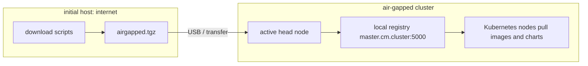

# 8.14 Air-gapped installation and upgrades

| | |
|---|---|
| Level | Intermediate to advanced |
| Priority tier | 2 |
| Lab venue | Laptop |
| Part | Part 8: NVIDIA Base Command Manager |
| Status | Drafted (`airgap_lab.py`: 34 checks pass; cluster commands **untested** on live BCM) |

## Why this matters for AI infrastructure

Picture a training cluster in a government data centre with no route to the internet. A driver update stalls halfway through, and the package it needs sits on a server the cluster cannot reach. There, `yum update` and `docker pull` do not work at all. Everything has to be carried in on media, checked, and installed from local copies.

Many AI clusters sit in places like this, including regulated industries, government and defence. The work is mostly preparation. If one package, image or chart is missing from the bundle, you find out halfway through an installation, and by then you cannot simply carry on.

Plan the preparation first, because the installation can only use what you already brought in.

## Prerequisites and outcomes

Before you start, work through chapters 8.2, 8.4, 8.9, 8.10 and 8.12. When you finish this chapter, you should be able to do the following.

- Explain what must be done before the cluster is cut off from the internet.
- Prepare a complete bundle on a connected host, and check that nothing is missing.
- Install Kubernetes and the container registry from the bundle, in the right order.
- Avoid the traps around architectures, passive head nodes, Ubuntu's `_apt` user and Docker Hub limits.
- Plan a Kubernetes upgrade that respects the version skew rules.
- Set up the rest of BCM (images, OFED, MySQL) from offline sources.

If any of those chapters is unfamiliar, go back to it before you touch the bundle.

## 1. What "air-gapped" means for BCM

"Air-gapped" means the cluster has no direct connection to the internet, usually on purpose, to protect it. For BCM, the cut-off raises four questions, and you need an answer to each before you start.

1. **Where do OS and BCM packages come from?** You build local repositories from the install media, or you point at internal mirrors.
2. **Where do container images come from?** From a **local registry** on the head node (chapter 8.10).
3. **Where do Helm charts and CRDs come from?** From the same bundle, pushed into that registry. CRDs are the Kubernetes definitions that add new object types to the cluster.
4. **How do you move things in?** Through a connected "initial host" and removable media.

Write down where each of the four answers comes from before you touch the connected host. Every later step depends on those answers.

## 2. The reference scenario

The chapter follows one reference setup from the BCM 11 Containerization Manual. The cluster is air-gapped, runs Kubernetes 1.34.7 with BCM 11.33.0 or 11.33.1, and runs on Ubuntu 22.04 or 24.04, or on Rocky Linux 9 or RHEL 9.

The initial host still has internet access, and it must match the cluster's operating system and architecture: Ubuntu 22.04, 24.04 or 26.04, Rocky 9 or RHEL 9. **The bundle supports one architecture at a time.** A cluster with x86-64 head nodes and ARM64 control plane nodes needs a more customized approach.



The bundle crosses to the active head node, and the Kubernetes nodes pull from the registry there. Match the host's OS and architecture to the cluster before you pick the initial host.

## 3. Before the cluster is cut off

Some things cannot be arranged once the cluster is air-gapped. Do them first, while the connected side is still open to you. The list below covers what you must settle before you leave.

- **Node assignment** for the Kubernetes control plane, workers and etcd (chapter 8.9). The wizard screens look the same as before, but you must have made the selection yourself.
- If **Run:ai** will be used, reserve three IP addresses from the internal network. You also need DNS records for the Run:ai control plane FQDN, two wildcard subdomains, a TLS certificate and key, and an NGC API key.
- The list of **operators** you want. The bundle only contains what you downloaded.
- The BCM **repository credentials** (`<user>:<password>` in `cm.list`), taken from a working cluster, so the initial host can download packages.
- The **GPU operator version**. Only the chart versions you downloaded can be installed. A certified version, the one marked with an asterisk in the wizard, is not necessarily downloaded. A downloaded version is not necessarily certified either. List `helm-charts/` before you choose.

None of these choices can be made after the cut-off, so settle every one of them while you can still reach the outside.

## 4. Preparing the bundle (on the connected host)

Everything the cluster needs must be downloaded on the connected host first. Once the cut-off happens, a missing or wrong-version download cannot be fixed from inside. Work through these steps in order.

1. **OS match.** The BCM repository files must come from a working cluster that runs the same OS. On Ubuntu, copy `cm-*.list` and `ubuntu.sources` from `/etc/apt/sources.list.d/`. On RHEL, copy `cm.repo` and `epel.repo` from `/etc/yum.repos.d/`. BCM 11.33 needs small fixes to the architecture lines: `Architectures: amd64` or `arm64` in `ubuntu.sources`, and `arch=` in the CUDA and `cm.list` files. The problem is fixed from 11.34 onward.
2. **Tools.** Use Helm 3.x, not 4.x, which was the case when the manual was written. The script `download_helm_binary.sh` installs it. Install Skopeo only on the connected host. The air-gapped head gets its own Skopeo from the bundle. Do not install it there from a distribution repository, because no such repository exists on that network.
3. **Docker Hub limits.** Unauthenticated pulls are limited to **100 per 6 hours**. Authenticated pulls get **200 per 6 hours**. Sign up for any account, then run `skopeo login docker.io`. The credentials are not put in the bundle.
4. **Scripts.** The scripts live in `$K8S_AG_SCRIPTS`, which points at the `airgap-scripts` directory of the `cm-setup` package. Add that directory to `PATH`. The four scripts are `download_ubuntu_packages.sh` (or `download_r9_packages.sh`), `download_container_images.sh`, `download_helm_charts.sh` and `download_crds.sh`. **Pass `--kube-version=1.34` to the first three explicitly.** Otherwise each one uses its own default version. You can also read the version from a `cm-kubernetes-setup.conf` file with `-c`. Run the scripts in sequence, inside `screen` or `tmux`, because the container images take about 15 times longer than everything else. Apt warnings about `_apt` and `/root` are expected and harmless.
5. **Size.** Without Run:ai, the bundle is about **8.6 GB**, and **8.1 GB** of that is images. Run:ai adds **13 to 14 GB**. Add the two together and you get about 21.6 to 22.6 GB, which is why NVIDIA advises that you plan **upwards of 20 GB** of working space.
6. **Run:ai** (optional). Get the air-gapped package from NGC. You need an NGC API key, and version 2.23.60 or later for multi-arch. The `cm-setup-runai-bcm11` package is published **only as a `.deb`**, so air-gapped Run:ai on RHEL is not supported in this release. Verify the download with `sha256sum -c`. The `.sha256` file holds only the checksum, so append the file name on the same line first. Do not install if the check is not OK.
7. **Completeness check.** Run `find packages packages-head packages-non-dgx packages-cuda k8s-images helm-charts crds -type f`. **Every category must print files.** A directory or subdirectory that exists but is empty means that download did not finish. Re-run that download before you make the tarball.
8. Create the tarball with `tar -cvzf airgapped.tgz airgapped`. Include **all architectures** the Kubernetes nodes use, and carry the file to the **active** head node.

If your network restricts outbound destinations from the connected host, watch the chart repositories, because they change between releases. BCM 11.34 adds the AgentGateway OCI repositories, the Argo CD repository and the Flannel repository.

Run the completeness check before you copy the bundle anywhere, because an empty category is far cheaper to fix on the connected side.

## 5. Installing on the air-gapped head node

The install runs in a fixed order, and the order matters more than any single command. Each step assumes the step before it has finished. The documented order, as the lab's `STEPS` list records it, has 13 steps. The numbered list below follows that order.

1. **Generate the configuration** while you can still run the wizard. Run `cm-kubernetes-setup --airgap-registry master.cm.cluster:5000 --airgap-registry-as-helm`, go through the wizard, and at the summary choose **save, do not deploy**. If you plan to use Run:ai, select its dependency operators now. These are GPU Operator, Grafana Operator, Kgateway, Knative, Kubeflow Training, Metrics Server, MPI Operator, State Metrics, LeaderWorkerSet, MetalLB, Prometheus Adapter and Operator Stack. The Network and NIM Operators are optional.
2. **Extract** the bundle. On **Ubuntu, extract it somewhere APT can write, such as `/tmp`.** APT runs as `_apt`, and `_apt` cannot read under `/root`. On Rocky and RHEL you can extract in place.
3. From inside the extracted directory, run `cm-kubernetes-setup --airgap-install-system-packages -c /root/cm-kubernetes-setup.conf`. It installs the packages on the head and in the images, handling multi-arch automatically, and it brings in Skopeo. On an HA pair, run it on the active head only. It also updates the secondary. **Never run the wizard on the passive head**, and **never use `--force`** to get past the "not the active head node" refusal. Software images are local to each head and are synchronized from the active one. A write on the passive head gets reverted, and in the meantime the passive head serves a different image.
4. **Registry.** Run `cm-container-registry-setup --skip-packages`, choose the active head, set the certificate SAN (for example `master.cm.cluster`), then save and deploy. After that, trust the registry's CA across the whole system. Copy `/cm/local/apps/docker-registry/var/etc/<host>:5000-ca.crt` to `/usr/local/share/ca-certificates/`, then run `update-ca-certificates`. Helm will then work without TLS errors.
5. **Docker** (only for Run:ai). Run `cm-docker-setup --skip-packages`, then check with `module load docker; docker ps`. No `docker login` is needed.
6. **Push** the content. Run `cm-kubernetes-setup --airgap-push-container-images -c ...`, then run `--airgap-push-helm-charts -c ...`.
7. **Extract the CRDs** by running `$K8S_AG_SCRIPTS/extract_crds.sh`.
8. **Deploy** with `cm-kubernetes-setup -c /root/cm-kubernetes-setup.conf`. The flags you used in step 1 fill in the `airgap` section of the config for you. That section holds the Helm repo `oci://master.cm.cluster:5000/helm-charts`, the registry, and the CA path.
9. **Run:ai** is deployed afterwards by its own wizard, `cm-runai-setup`. That wizard needs the `cm-setup-runai-bcm11` package. The command exists without the package, but it fails. BCM 11.33 pairs with Run:ai 2.25, and 11.34 pairs with 2.26. Any supported Run:ai version can be used.

The lab's `order_problems` check flags the dependency mistakes. Those include pushing before the registry exists, and deploying before the images, charts and CRDs are in place. The wizard checks the bundle against the Kubernetes version you chose, from BCM 11.34 onward. It names each package or chart whose version does not match. That is far better than failing late (chapter 8.9).

If the wizard reports a version mismatch, fix the bundle before you deploy anything.

## 6. Upgrading Kubernetes air-gapped

The principles match the install in chapter 8.9. A few differences matter here, and they are the ones this section covers.

- **Minimum BCM point release.** Your BCM must be at least 11.32.0 on BCM 11, or 10.31.0 on BCM 10. Check your version against the rules in chapter 8.13.
- **Version skew.** At most **two adjacent minor releases** can run in the cluster at any time. So 1.34 and 1.35 together is fine, while 1.33, 1.34 and 1.35 together is not. If your nodes sit on two minors, **the only valid upgrade is to the newer one**, because skipping minors is not allowed. You then choose between a **minor** upgrade, which goes to the latest of the next minor, and a **patch** upgrade, which goes to the latest patch of the current minor. Read the BCM release notes and compatibility matrix for the target version.
- The cluster must be healthy, and a local registry must be deployed. Each node you plan to upgrade must be **drained** first.
- Rebuild the bundle for the **target** version on the connected host. Use the same steps as before, with `--kube-version` set to the target. Then carry the bundle over, extract it, install the packages, push the images and charts, and extract the CRDs.
- Upgrade the control plane nodes **first**, one at a time, and then the worker nodes:
  1. **First control-plane node:**
     - Push the updated binaries from the software image on the head node. The `-w` flag is required. Without it, `imageupdate` only runs a dry run.
       ```bash
       root@headnode:~# cmsh -c 'device; imageupdate -w controlplane01 --wait'
       ```
     - SSH to `controlplane01` and run `kubeadm upgrade plan` with an explicit `--kubeconfig`. That matters when one BCM cluster hosts several Kubernetes clusters.
       ```bash
       root@controlplane01:~# kubeadm upgrade plan --kubeconfig=/root/.kube/config-default
       ```
       In NVIDIA's `v1.32.10` example session, `kubeadm upgrade plan` suggests the latest patch in the current minor, `v1.32.11`. The skew policy, however, lets you jump to the next minor, `v1.33.6`, once you have checked the Kubernetes changelogs. So apply the target version directly on the **first** control-plane node:
       ```bash
       root@controlplane01:~# kubeadm upgrade apply v1.33.6 --kubeconfig=/root/.kube/config-default
       ```
     - **Validate before you touch the next node.** Check that `kubectl get nodes` shows `Ready` and `v1.33.6`. Then check `kubectl get pod -A`, paying close attention to `kube-system` and `calico-system`. Finally, confirm that the static pod pulls from the local air-gapped registry:
       ```bash
       root@controlplane01:~# kubectl describe pod -n kube-system kube-apiserver-controlplane01 | grep Image:
       Image: master.cm.cluster:5000/kube-apiserver:v1.33.6
       ```
  2. **Subsequent control-plane nodes:** On the head node, run `cmsh -c 'device; imageupdate -w <node> --wait'`. Then, on the control-plane node, run **`kubeadm upgrade node`**. Do not use `upgrade apply` here, and pass no version argument:
     ```bash
     root@node001:~# kubeadm upgrade node --kubeconfig /root/.kube/config-default
     ```
     Repeat the `kubectl get nodes` and `kubectl get pod -A` checks after each control-plane node.
  3. **Worker nodes:** Upgrade one worker, or a small batch, at a time. That way running workloads are moved off cleanly first.
     - **On the head node,** drain the worker and update its image binaries:
       ```bash
       root@basecm11:~# kubectl drain $host --ignore-daemonsets
       root@basecm11:~# cmsh -c "device use $host; imageupdate -w --wait"
       ```
     - **On the worker node,** upgrade the node configuration, reload systemd, and restart `kubelet`:
       ```bash
       root@<node>:~# kubeadm upgrade node --kubeconfig=/root/.kube/config-<Kubernetes instance>
       root@<node>:~# systemctl daemon-reload
       root@<node>:~# systemctl restart kubelet
       ```
     - **Uncordon and validate.** Run `kubectl uncordon $host`, then check `kubectl get nodes` and `kubectl get pod -A`.

Upgrade one control-plane node at a time, and do not move on until its validation passes.

## 7. The rest of BCM, offline

Not every part of BCM needs the internet, but each part needs a source you can reach from inside the cluster. The table below lists what each part needs and the offline option for it. Find the row that matches what you are installing.

| Need | Offline option |
|---|---|
| Distribution and BCM packages for the head or an image | A local repository from the install media: mount the ISO (`mount -o loop`), `bind` mount it into the image, a repo file such as `/etc/yum.repos.d/cm11.0-dvd.repo` with `baseurl=file:///mnt1/data/packages/11.0-<subminor>`. For Ubuntu an APT list for the ISO; the BCM line needs no `trusted=yes` (the `cm-config-apt` package imports the BCM keyring), and the second line for the base Ubuntu packages on the ISO uses `trusted=yes`, which NVIDIA describes as a **deliberate risk acceptance for local, physically controlled media, not a default to copy to a network-hosted repository** |
| RHEL or SLES base repositories | copy the vendor ISOs into the image (`/root/repo1`) and add `file://` repos (9.6.3) |
| A custom image offline | `cm-create-image ... -e -s` with the local repository (9.6.4); `--air-gapped` exists in the image-creation options |
| Mellanox/DOCA OFED | `cm-doca-ofed-install.sh -v <version> -h --cmdvd` installs from a BCM install medium (BCM 11 media carry DOCA OFED) |
| MySQL for Slurm (`cm-mysql-setup`) | `--skip-packages`, with `mysql-server` packages preinstalled in the server nodes' images and `mysql-router` in client images; Ubuntu 24 and later use the distribution packages, other systems need MySQL Community Edition packages |
| RHEL head node installer (Ansible add-on) | an internal mirror `.repo` file via `pre_install_repo_files`, `--basedistrepo` pointing at it, and keep the ISO's Rocky repositories disabled on a RHEL host (they conflict with RHEL packages) |
| Updates later | repeat the connected-host preparation and carry in a new bundle; there is no `yum update` |

Most rows point at the install media or at a local repository. Updates are the exception, because they arrive as a new bundle rather than through a package manager.

Before you start an offline install of any part, confirm that its source is already on the head node or inside the image.

## 8. Operating an air-gapped cluster

The work does not stop when the cluster is installed. These habits keep an isolated site running.

- **Updates are projects.** Plan a window for each refresh of the bundle. That covers OS security updates, BCM point releases, Kubernetes patches, GPU operator charts and Run:ai.
- **Keep the bundle.** Store `airgapped.tgz` with its checksum, the exact `cm-kubernetes-setup.conf`, the repo files and the release notes. A rebuild needs all of them (chapter 8.13).
- **Time and certificates.** An isolated site still needs a correct clock, so run an internal NTP source. Certificate lifetimes are yours to manage (chapter 8.6).
- **Support.** `cm-diagnose` output can be moved off the cluster on media (chapter 8.13).
- **Image provenance.** Verify checksums on everything you carry in, and keep the connected host clean and single-purpose.

Store the checksum and configuration files with the bundle on the day you build it, not later when you need them.

## 9. Common first mistakes

Most failed air-gapped installs come down to a short list of mistakes. The ten below are the ones to check before you start.

1. You download a bundle for the wrong Kubernetes version, because you forgot `--kube-version`.
2. The bundle has an empty category.
3. You skip choosing the operators, or the Run:ai dependencies, before the cut-off.
4. You extract the bundle under `/root` on Ubuntu.
5. You install Skopeo from a repository on the air-gapped head.
6. You run the wizard on the passive head, or you reach for `--force`.
7. You pick a GPU operator version that was never downloaded.
8. You forget the registry CA trust, so Helm fails with TLS errors.
9. You upgrade across minors, or you have nodes on three minors at once.
10. You plan air-gapped Run:ai on RHEL.

### 9.1 Deep dive: End-to-end air-gapped lifecycle from staging host to DMZ transfer

Picture a connected cluster that is missing an RPM package or a Helm chart. An administrator fixes it in ten seconds with `apt install` or `helm install`. Now picture the same gap inside an air-gapped facility, behind a one-way data diode or a physical media escort. A single missing dependency found in the middle of a change window means you abort the window and wait days for a new media transfer approval.

Running an air-gapped AI factory in a defence, sovereign-cloud or financial data centre is therefore a supply-chain discipline. The work falls into three places, and each has its own checks.

**On the connected staging host.** Keep a dedicated machine whose OS distribution, minor version and CPU architecture (`x86_64` or `aarch64`) match your air-gapped head node. This matching rule is the one that cannot be bent. Copy the BCM repository files from your cluster, `cm-*.list` and `ubuntu.sources` on Ubuntu or `cm.repo` and `epel.repo` on RHEL, so that the staging host pulls the exact BCM point-release packages your head node expects. Log Skopeo in to Docker Hub with `skopeo login docker.io`, and to NGC with `skopeo login nvcr.io`, before you run `download_container_images.sh`. That way you do not hit the unauthenticated Docker Hub limit of 100 pulls partway through hundreds of container layers. Pass `--kube-version=<major.minor>`, or `-c cm-kubernetes-setup.conf`, explicitly to the package, image and chart download scripts, and run `download_crds.sh` as well.

**At the verification gate, before the media leaves.** Before you write `airgapped.tgz` to encrypted removable media or push it across a DMZ diode, run the seven-directory completeness check from section 4. An empty directory means a script exited early, usually because of a network blip. Run `ls helm-charts/` and record the exact versions of the downloaded GPU Operator, Network Operator and Run:ai charts. The wizard on the inside must select those exact versions, even when its menu marks another version with the certification asterisk. Then generate a `SHA256SUMS` file that covers `airgapped.tgz`, the BCM installation ISO, which carries the `--cmdvd` DOCA OFED packages and base OS repositories, and any firmware bundles. Treat this gate as a hard stop, because a file missing on the inside costs a change window and a new media transfer.

**On the air-gapped active head node.** Run `sha256sum -c SHA256SUMS` right after the copy, and never run setup scripts on the passive head node. On Ubuntu, extract the bundle under `/tmp/airgap`, or under `/var/tmp/airgap` with world-readable directory permissions, not under `/root`, so that the unprivileged `_apt` user can read the `.deb` archives. Then follow the order that `code/part08/airgap_lab.py` enforces. Generate the configuration with the air-gap flags and save without deploying. Install the system packages, which brings in `skopeo` from the bundle. Deploy the local registry and trust its CA. Push the images and then the Helm charts, extract the CRDs, and deploy with `cm-kubernetes-setup -c ...`.

### 9.2 Planning multi-hop air-gapped Kubernetes upgrades under the skew policy

Suppose the air-gapped cluster sits on 1.33 and must reach 1.35. The skew policy will not let you jump there in one step. Kubernetes and BCM allow at most two adjacent minor versions in a cluster and forbid skipping minors. The path from `1.33` to `1.35` therefore needs two separate bundles, one for 1.34 and one for 1.35, both prepared on the connected staging host.

Each hop follows the node-by-node order from section 6: control-plane nodes first, one at a time, with `kubeadm upgrade apply` on the first and `kubeadm upgrade node` on the others, then the workers in drained batches. Load the 1.35 bundle and begin the second hop only after every node has completed the 1.34 hop and passed its health checks.

### 9.3 Building offline software images and local OS mirrors (`--cmdvd` and `file://` repos)

An air-gapped AI cluster still has to patch its base Linux OS, update the MLNX_OFED and DOCA-Host drivers, and build new software images. None of that can reach the internet. BCM provides four built-in mechanisms for doing this offline, and each one is described below.

1. **Loop-mounting the BCM DVD ISO as a local package repository:** The BCM installation ISO contains the full set of BCM packages (`data/packages/11.0-<subminor>`), plus bundled **NVIDIA DOCA OFED** packages. Mount the ISO on the head node with `mount -o loop /root/bcm-11.0.iso /mnt/cdrom`. Then bind-mount it inside the target software image at `/cm/images/<image>/mnt/cdrom`. Point a local `/etc/yum.repos.d/cm11.0-dvd.repo`, or `/etc/apt/sources.list.d/cm-dvd.list`, at `file:///mnt/cdrom/...`, and you can install or update packages completely offline.
2. **Offline DOCA OFED installation (`cm-doca-ofed-install.sh --cmdvd`):** Instead of downloading Mellanox or DOCA OFED tarballs from `linux.mellanox.com`, run `cm-doca-ofed-install.sh -v <version> -h --cmdvd`. It installs the InfiniBand and RoCEv2 driver stack straight from the mounted BCM DVD ISO, into both the head node and the target software images. It also rebuilds the kernel modules and the initrd ramdisk automatically.
3. **Offline image creation (`cm-create-image -e -s` / `--air-gapped`):** When you create a new software image on an air-gapped head node with `cm-create-image`, pass **`-e`**. That stops the tool from overwriting your custom local `file://` or internal mirror `.repo` and `.list` files inside the image. Pass **`-s`** as well, so the tool does not try to fetch extra base distribution packages from external mirrors. Alternatively, use `--air-gapped`, which relies only on the base tar archive (`/data/UBUNTU2404.tar.gz` on the ISO) and your local repositories.
4. **Offline Slurm MySQL HA (`cm-mysql-setup --skip-packages`):** To set up a dedicated MySQL GTID pair on compute nodes for Slurm accounting (`slurmdbd`), first pre-install `mysql-server` in the database nodes' software image. Pre-install `mysql-router` in the client nodes' software image. Take both from your local ISO repository. Then run `cm-mysql-setup --skip-packages`, so the wizard configures GTID replication without attempting an online package download.

Set up the local repositories before you build any image, so that the build never reaches for the internet.

### 9.4 Troubleshooting common air-gapped deployment and upgrade failures

A stalled install inside a secure facility is hard to fix, because you cannot search the internet for an answer. The table below maps each symptom to its root cause and to a fix you can make from inside the environment.

| Symptom | Root cause | Fix from inside the environment |
|---|---|---|
| `--airgap-install-system-packages` fails on Ubuntu with `Permission denied` reading `.deb` files | `airgapped.tgz` was extracted under `/root` (`0700`), which the unprivileged `_apt` user cannot traverse | Move or re-extract the bundle under **`/tmp`** (or `/var/tmp` with `0755` permissions) and re-run `--airgap-install-system-packages`. |
| Helm chart push or operator install fails with `x509: certificate signed by unknown authority` | The head node's OS trust store does not trust the local Docker Registry's self-signed CA certificate | Copy `/cm/local/apps/docker-registry/var/etc/<host>:5000-ca.crt` to **`/usr/local/share/ca-certificates/`**, run **`update-ca-certificates`**, and retry the push. |
| Wizard refuses to run with `"This node is not the active head node"` and operator is tempted to pass `--force` | Operator logged into the **Passive** head node by mistake | **Never pass `--force` on a passive head.** Log into the **Active** head node (`cmha status` asterisk `*`) and run the command there; it updates the passive head automatically. |
| GPU Operator installation fails with `chart version not found` in `oci://master.cm.cluster:5000/helm-charts` | The version chosen in the wizard (e.g., an NVAIE `*`-marked version) differs from the version downloaded in `helm-charts/` | Inspect `ls helm-charts/` inside the extracted bundle to see which exact chart version was downloaded, and select that exact version in `cm-kubernetes-setup`. |
| `kubeadm upgrade apply` or `node` pulls from `registry.k8s.io` and times out instead of using `master.cm.cluster:5000` | `cm-kubernetes-setup.conf` was generated without `--airgap-registry` or binaries were not pushed via `imageupdate -w` | Confirm `airgap` settings in `cm-kubernetes-setup.conf`, ensure `cmsh -c "device; imageupdate -w <node> --wait"` completed before running `kubeadm`, and verify `Image: master.cm.cluster:5000/...` on static pods. |

If a symptom matches none of these rows, check the step order in section 5 before you change anything else.

## Exercises

Each exercise checks a different part of the chapter. Work through them in order, and write your answers down as you go.

1. Run `python3 airgap_lab.py`. Pick four of the checks, then explain each rule in your own words.
2. Write a pre-flight checklist for the connected host with ten items. Next to each item, write the command that verifies it.
3. A cluster has nodes on 1.34.7 and 1.35.1. Which upgrade targets are valid? What changes if one node is still on 1.33?
4. Estimate how many Docker Hub pulls a bundle of 230 images needs, once without an account and once with one.
5. Draw the order of steps for adding a new operator to a cluster that is already air-gapped. What must already be on the connected host?
6. Explain to a security officer how you will verify each file that enters the cluster.

## 10. Interview angles

Interviewers ask these questions to see whether you understand the whole workflow, not just one command. Practise each answer out loud, in your own words.

- "How do you install Kubernetes where nothing reaches the internet?" You prepare a bundle on a connected host, with packages, images, charts and CRDs. You move it on media, deploy a local registry, and run `cm-kubernetes-setup` in air-gap mode.
- "What would you check before cutting the cluster off?" Node roles, operators and versions, the GPU operator chart, the Run:ai prerequisites and the completeness of the bundle.
- "How do you upgrade Kubernetes there?" You use the same kubeadm principles, a bundle rebuilt for the target version, and the skew policy of two adjacent minors. You upgrade the control plane first, and you drain the workers before you upgrade them.
- "Why not run the wizard on the passive head?" Images are local to each head and are synchronized from the active head. Anything written on the passive head is lost.
- "What can the bundle not do?" It cannot contain what you forgot to download, and there is no way to fetch it later.

## Checkpoint questions (20)

<details>
<summary>1. What four artifact streams must be prepared locally when operating BCM and Kubernetes in an air-gapped site?</summary>

You prepare four kinds of content on the connected side:

1. **OS and BCM packages** (`.rpm` or `.deb` repositories from ISOs or mirrors).
2. **Container images**, pushed with Skopeo into a local registry on the head node, such as `master.cm.cluster:5000`.
3. **Helm charts**, pushed into that local registry as OCI charts.
4. **Kubernetes CRDs**, extracted on the head node with `extract_crds.sh`.
</details>

<details>
<summary>2. What must the internet-connected initial staging host match relative to the air-gapped BCM cluster?</summary>

The staging host must run the same Linux distribution and version as the target cluster, which means Ubuntu 22.04, 24.04 or 26.04, RHEL 9, or Rocky 9. It must also share the cluster's CPU architecture, either `x86_64` or `aarch64`.
</details>

<details>
<summary>3. How many CPU architectures does a single air-gapped download bundle (`airgapped.tgz`) support by default?</summary>

Only **one architecture at a time**, either `x86_64` or `aarch64`.
</details>

<details>
<summary>4. Why must you pass `--kube-version=1.34` (or `-c cm-kubernetes-setup.conf`) explicitly to `download_ubuntu_packages.sh`, `download_container_images.sh`, and `download_helm_charts.sh`?</summary>

Without an explicit `--kube-version` or `-c` flag, each download script falls back to its own default Kubernetes version. That default may not match the version you chose in the wizard.
</details>

<details>
<summary>5. What are Docker Hub's unauthenticated versus authenticated pull rate limits, and how do you avoid hitting them while building the bundle?</summary>

Unauthenticated pulls are capped at **`100` pulls per `6` hours**. Free authenticated accounts get **`200` pulls per `6` hours**. Log in with `skopeo login docker.io` before you run `download_container_images.sh`, or use a paid Pro, Team or Business account.
</details>

<details>
<summary>6. Which seven directories inside the air-gapped workspace must all be non-empty before creating `airgapped.tgz`?</summary>

All seven must contain files: **`packages`**, **`packages-head`**, **`packages-non-dgx`**, **`packages-cuda`**, **`k8s-images`**, **`helm-charts`** and **`crds`**. Check them with `find packages packages-head packages-non-dgx packages-cuda k8s-images helm-charts crds -type f`.
</details>

<details>
<summary>7. Roughly how much disk space does the air-gapped bundle require without Run:ai versus with Run:ai?</summary>

Without Run:ai, the bundle is about **`8.6 GB`**, and **`8.1 GB`** of that is container images. Run:ai adds **`13 to 14 GB`**, so plan for **upwards of `20 GB`** of free working space.
</details>

<details>
<summary>8. On an Ubuntu head node, why must `airgapped.tgz` be extracted under `/tmp` rather than under `/root`?</summary>

Ubuntu's `apt` drops privileges to the unprivileged **`_apt`** user when it reads local package archives. The `_apt` user cannot traverse `/root`, which is `0700`, so an extraction there blocks the install.
</details>

<details>
<summary>9. On an HA head-node pair, which head node must run `--airgap-install-system-packages` and `cm-kubernetes-setup`, and why must you never pass `--force` on the passive head?</summary>

Run them on the **active head node only**. The active head updates the secondary automatically. Software images are local to each head node and are synced from active to passive. Running the wizard on the passive head with `--force` creates temporary split state, and the next sync overwrites it.
</details>

<details>
<summary>10. Where does the air-gapped head node obtain the `skopeo` binary?</summary>

From the **air-gapped package bundle itself**, during `cm-kubernetes-setup --airgap-install-system-packages`. Never try to install `skopeo` from an upstream internet repository on the air-gapped head.
</details>

<details>
<summary>11. What do `--airgap-registry master.cm.cluster:5000` and `--airgap-registry-as-helm` configure when generating `cm-kubernetes-setup.conf`?</summary>

They fill in the `airgap` section of the configuration file. After that, Kubernetes pulls all container images from `master.cm.cluster:5000`, and Helm pulls all operator charts from `oci://master.cm.cluster:5000/helm-charts`.
</details>

<details>
<summary>12. After deploying the local Docker Registry on the active head node (`cm-container-registry-setup --skip-packages`), how do you make the OS and Helm trust its TLS certificate?</summary>

Copy `/cm/local/apps/docker-registry/var/etc/<host>:5000-ca.crt` into **`/usr/local/share/ca-certificates/`**, then run **`update-ca-certificates`**.
</details>

<details>
<summary>13. Which three commands push and unpack the bundle's images, Helm charts, and CRDs onto the active head node before final deployment?</summary>

1. `cm-kubernetes-setup --airgap-push-container-images -c /root/cm-kubernetes-setup.conf`
2. `cm-kubernetes-setup --airgap-push-helm-charts -c /root/cm-kubernetes-setup.conf`
3. `$K8S_AG_SCRIPTS/extract_crds.sh`
</details>

<details>
<summary>14. Why can selecting a GPU Operator version marked with an asterisk `*` (NVAIE certified) in the wizard still fail during an air-gapped install?</summary>

The bundle contains only the chart versions you downloaded on the connected host. If you pick a version in the wizard that is not in `helm-charts/`, the install fails. Run `ls helm-charts/` first, and check the version you plan to select against that list.
</details>

<details>
<summary>15. Why is air-gapped Run:ai not supported on RHEL/Rocky in the documented BCM 11 release?</summary>

Because the required `cm-setup-runai-bcm11` helper package is published **only as a Debian or Ubuntu `.deb` package** in that release.
</details>

<details>
<summary>16. What are the minimum BCM point releases required for the air-gapped Kubernetes upgrade procedure (Appendix C)?</summary>

**BCM `11.32.0`** for BCM 11, or **`10.31.0`** for BCM 10.
</details>

<details>
<summary>17. State the Kubernetes minor-version skew rule enforced during air-gapped upgrades.</summary>

At most **two adjacent minor versions** can coexist in the cluster at any time, for example `1.34` and `1.35`. Skipping a minor version is forbidden. If nodes span `1.34` and `1.35`, the **only** valid upgrade target is the newer minor, `1.35.x`.
</details>

<details>
<summary>18. During an air-gapped Kubernetes upgrade, what exact `kubeadm` command runs on the **first** control-plane node versus on **subsequent** control-plane and worker nodes?</summary>

- **First control-plane node:** After `imageupdate -w controlplane01 --wait`, run `kubeadm upgrade plan --kubeconfig=...`, then run **`kubeadm upgrade apply v<target> --kubeconfig=/root/.kube/config-default`**.
- **Subsequent control-plane and worker nodes:** After `imageupdate -w <node> --wait`, run **`kubeadm upgrade node --kubeconfig=/root/.kube/config-default`**, with no version argument.
</details>

<details>
<summary>19. Why does NVIDIA allow `trusted=yes` on the base Ubuntu APT line when mounting a local ISO loop image, while warning against copying that flag to network repositories?</summary>

The mounted ISO is local, physically controlled installation media, and its checksum was already verified. Setting `trusted=yes` on a network-hosted APT repository, by contrast, turns off GPG signature verification over the network. That is why NVIDIA warns against copying the flag there.
</details>

<details>
<summary>20. How do you install NVIDIA DOCA OFED offline from the BCM installation DVD/ISO?</summary>

Run **`cm-doca-ofed-install.sh -v <version> -h --cmdvd`**. It reads the bundled DOCA OFED packages straight from the mounted BCM installation medium.
</details>

Re-read any answer you cannot explain in your own words before you move on to the next chapter.

## Sources and review notes

- **BCM 11 Containerization Manual:** appendix A (self-signed server certificate pair for testing, covered in 8.10 and checked here), appendix B (installation: host preparation, head node preparation, registry, Docker for Run:ai, pushing content, CRDs, deployment, decoupled Run:ai) and appendix C in full (upgrade prerequisites, preparation, head node steps, and C.4 step-by-step `kubeadm upgrade plan` / `upgrade apply` / `upgrade node` sessions for the first control-plane node, subsequent control-plane nodes, and drained workers). (Run:ai chapter 6.11 is covered in chapter 8.16.)
- **BCM 11 Administrator Manual:** 9.6.3 and 9.6.4 (local repositories and offline images), 14.12 (offline MySQL).
- **BCM 11 Installation Manual:** chapter 3 (the RHEL air-gapped installer settings) and chapter 10 (`--cmdvd`).
- **Run here:** `airgap_lab.py` (34 checks): version prerequisites, skew rules, bundle completeness, sizes, Docker Hub windows, architecture, the 13-step order, extraction and passive head rules, GPU operator availability, Run:ai checks, offline repository and option summaries, plus the C.4 step-by-step upgrade commands (`upgrade apply <version>` on the first control plane vs `upgrade node` on subsequent control planes and workers, worker drain/imageupdate/daemon-reload/restart/uncordon sequence, and air-gapped `kube-apiserver` image check).
- **Choices made by this handbook, not by NVIDIA:** the dependency map in `order_problems` (derived from the manual's order and statements, not a documented dependency graph); the 22 GB planning number for Run:ai (the manual says upwards of 20); the summary table in section 7, which gathers separate statements; and all of section 8 (operating an air-gapped cluster), which is general advice and not from the vendor manuals.
- **Not verified:** everything about a real BCM system. Package names, script options and the exact set of artifacts change between releases; read the release notes for your version.
