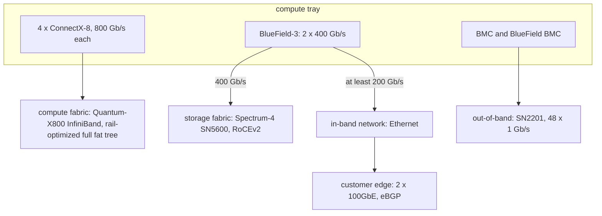

# 8.15 BCM in an AI factory: DGX SuperPOD integration

| | |
|---|---|
| Level | Intermediate |
| Priority tier | 2 |
| Lab venue | Laptop |
| Part | Part 8: NVIDIA Base Command Manager |
| Status | Drafted from NVIDIA's **DGX SuperPOD Reference Architecture for DGX GB300** and the deck **Data Center Best Practices with DGX B200**, plus the BCM Administrator Manual passages that name SuperPOD-related features (racks, power shelves, CDUs, leak detection, IMEX, NMX Manager, firmware modes). **No SuperPOD hardware was available.** `code/part08/superpod_calc.py` reproduces the documents' numbers, and `superpod_lab.py` checks 29 of them, including all ten rows of the B200 power table. Both documents say configurations must be finalized with an NVIDIA representative: treat every number as a reference value, not a design |

## Why this matters for AI infrastructure

BCM does not live alone. In a DGX SuperPOD it is one layer of a stack that starts with a concrete floor: power, cooling and cables decide how many GPUs you can run, and BCM (inside NVIDIA Mission Control) is how you manage them. An engineer who knows the numbers can sanity-check a design in minutes and can say which BCM features exist because of which physical component.

## Prerequisites and outcomes

You need chapters 8.1 to 8.14 and the basics of GPU networking (Part 12 goes deeper). After this chapter you can:

- describe a scalable unit and size a SuperPOD in racks, GPUs, power and bandwidth
- name the four networks and what runs on each
- place BCM, Slurm, Kubernetes, Run:ai and Mission Control in the software stack
- do the rack power and cooling arithmetic for DGX B200 and explain the redundancy schemes
- connect BCM features (rack mode, power shelves, leak detection, IMEX, switch management) to the hardware they manage

## 1. The scalable unit (GB300)

A **scalable unit (SU)** is the repeatable block. For DGX GB300 it is **8 compute racks**. Each rack is an NVL72 system: **18 compute trays**, each with two GB300 Superchips, each Superchip having two B300 GPUs and one Grace CPU, so **4 GPUs per tray and 72 GPUs per rack**, in one NVLink domain, with NVLink switch trays and power shelves in the rack. The architecture shows up to **128 racks (9,216 GPUs)**, and one SU needs about **1.2 MW** of thermal design power. The data center should meet at least Uptime Tier 3 (or TIA-942-B Rated 3, EN 50600 Class 3): concurrent maintainability, no single point of failure. Cooling is hybrid: GPUs and CPUs are liquid cooled, the rest is air cooled.

The lab turns this into arithmetic: one SU is 144 trays and 576 GPUs; 16 SUs reach the 128-rack limit; per SU the compute fabric has 144 × 4 × 800 Gb/s = **460.8 Tb/s** of NIC capacity, storage 144 × 400 Gb/s = **57.6 Tb/s**, and in-band at least 28.8 Tb/s. (These bandwidths are my products of the document's per-tray figures.) A note on reading references critically: the document calls the compute tray topology "NVL32" while counting 72 GPUs per rack, which looks like a typo for NVL72. Spotting such slips matters when you design from a document.

## 2. The four networks

| Network | Carries | Notes |
|---|---|---|
| Compute | GPU-to-GPU traffic between racks | InfiniBand, rail-optimized, full fat tree, managed switches, SHARPv3 support, UFM manages it. NVLink inside the rack is managed by **NMX Manager** |
| Storage | high-performance parallel storage | RoCEv2, a dedicated 400 Gb/s port per tray so storage traffic is not mixed with in-band on a bond |
| In-band | provisioning, user services, the NFS tier, uplink to the outside | at least 200 Gb/s per tray. This is where BCM provisions nodes and where Slurm and Kubernetes endpoints live |
| Out-of-band | BMCs, BlueField BMCs, NVSwitch management, PDUs, switch management | physically and logically isolated from users; carries IPMI/Redfish control and fabric/switch management |

Edge: at least **2 × 100GbE** (DR1 single-mode); eBGP hands routes over, and the **building management system** traffic flows through the uplink as part of the untrusted zone. The out-of-band network can have a dedicated customer link or leak its routes through the in-band path.

This is the same three-network idea from chapters 8.2, 8.3 and 8.7: a boot and management network, a BMC network, and separate data networks. In BCM terms: `internalnet` is the in-band network, the BMC network is the out-of-band one, and the fabrics are extra networks you add (InfiniBand setup, 3.6, I did not cover).

## 3. The software stack

The GB300 document describes **NVIDIA Mission Control** as a five-layer stack that **leverages BCM** for cluster provisioning and operations, adds **Run:ai** for scheduling on Kubernetes, supports **Slurm** for batch work, includes a telemetry layer, a validation and diagnostics layer with an **autonomous recovery engine**, and **NMX Manager** for NVLink switches. The listed software components are Mission Control, NVIDIA AI Enterprise, Magnum IO, NGC, Slurm and Run:ai. In BCM-managed installs the Run:ai control plane sits on the "user-space Kubernetes cluster" and its cluster components on the administrative Kubernetes (so there are two Kubernetes clusters, which BCM supports, chapter 8.9). Chapter 8.16 covers Mission Control.

Where each BCM chapter lands:

| Layer or task | BCM chapter |
|---|---|
| Install, nodes, networks, images | 8.2 to 8.4 |
| Slurm and Kubernetes services | 8.8, 8.9 |
| Health and alerts | 8.11 |
| HA of the head pair | 8.12 |
| Day-2 and offline | 8.13, 8.14 |

## 4. BCM features that exist because of this hardware

The Administrator Manual's Base View map and commands name them; I read their headings and some commands, not each procedure:

- **Rack mode** (`rack`, `rackoverview`): UP, DOWN and CLOSED counts for nodes, DPU nodes, managed switches, **NVLink switches** and **power shelves**, plus cores, GPUs, power draw and fabric status. Racks are 42U by default (chapter 8.3).
- **Power shelves** (`powershelfoverview`): per-PSU input and rail power, current, voltage, fan speed and temperature (chapter 8.7).
- **CDUs** (`cduoverview`): supply and return temperatures, pressures, flow, from a conforming **building management system** over MQTT. BCM has a BMS object (default "NVIDIA-conforming BMS") and **leak action policies** (default "Default building policy").
- **Leak detection** (`leakdetection`, `leakinfo`) per device and rack (chapter 8.7).
- **IMEX** (inter-node memory exchange for multi-node NVLink): a network setting writes the peer list to `/etc/nvidia-imex/nodes_config.cfg`; Slurm can enable the IMEX daemon globally or per job (8.3, 8.8).
- **Firmware modes** `gb200`, `gb200sw`, `gb300`, `gb300sw` for compute trays and NVLink switches (8.7), and **Redfish subscriptions** for GB300 compute trays and NVLink switches.
- **NMX Manager settings**, **UFM settings** and **NetQ** objects in the cluster settings, and **ZTP** for switch provisioning.
- Base View pages for **GB200 rack management**, **power reservation steering**, **GPU workload power profiles**, **Run:ai**, **autonomous hardware recovery** and **autonomous job recovery**; matching nonuser profiles in chapter 8.6.

## 5. Power and cooling: the DGX B200 numbers

The B200 deck is air-cooled and shows how to check a rack in minutes.

- One DGX B200: **14.3 kW** maximum, 10 RU, about 130 kg. A scalable unit of up to **32** systems is **458 kW** (32 × 14.3 = 457.6). A UFM appliance displaces one system, so a full SuperPOD holds at most **127** DGX B200.
- Rack patterns: **2 systems per rack = 28.6 kW** (typical, 42U or 52U), **4 per rack = 57.2 kW** (high density, 52U).
- **Cooling:** about **150 CFM per kW** at sea level, so about **2,145 CFM per system**, 4,290 CFM for a 2-system rack and 8,580 for 4. Supply air must follow ASHRAE Class A1 with a **maximum of 30 °C** (recommended 18 to 27 °C); filtration at least MERV 13; room cleanliness ISO 14644-1 Class 8.
- **Circuits (the N pattern):** two circuits, each rated to handle **50 percent of the rack's peak demand**, after breaker derating.

**Reproducing the document's power table.** Usable power of one three-phase circuit is 3 × V(line to neutral) × amps × derating × 0.95 power factor. For two circuits: 380 V (219 V L-N), 32 A, 80 percent derating gives 2 × 15.98 = about 32 kW, which carries 2 systems (28.6 kW) and strands 3.4 kW; 415 V (240 V L-N) 60 A at 80 percent gives about 66 kW, which carries 4 systems (57.2 kW) and strands 8.4 kW. The lab reproduces all ten rows of the document's table (capacity within about 1 kW, stranded power within 1.3 kW). A rack is rated by the **largest deployment pattern (4 or 2) whose peak fits**, not by dividing capacity by 14.3; that is how the document's "supported systems" column works. (The formula is my derivation, checked against the table.)

**Why ordinary redundancy fails.** Each B200 has **six PSUs and needs five energized**. So "dual feed" designs behave differently from what intuition says. The lab simulates single failures for each scheme of the deck:

| Scheme | One PDU fails | One UPS fails | Verdict |
|---|---|---|---|
| Two discrete sources, system on one PDU (N) | half of the systems | half | fewest interdependencies; best when only two UPS exist |
| Single source | half | **all** | a UPS failure takes the rack |
| **Interleaved** (PSUs split across both PDUs) | **all** | **all** | most interdependencies: **not recommended** (3 of 6 PSUs remain, below 5) |
| Static transfer switch | one system | none | the switch is a single point of failure; **NVIDIA has not tested or validated any STS** with B200; in-rack STS not supported |
| **"6 to make 5"** (each PSU on its own feed) | none | none | optimal for availability; needs six discrete sources and is limited by rack space (about 2 systems per rack) |

The lesson generalises: with internal N+1 power supplies, upstream redundancy models must be re-thought. Check the PSU rule for any GPU server you deploy.

Other planning points from the deck: align the multiple groups (facility, IT, systems, network, application owners), because relief in one resource (power, cooling, space) shifts pressure to another; InfiniBand cable length limits rack-to-rack placement; rear door heat exchangers and in-row coolers are not typically suitable for B200.

## 6. How I would use this in practice

1. **Size:** GPUs wanted → SUs (`su_count_for_gpus`) → racks, MW, fabric bandwidth.
2. **Check power:** for air-cooled systems, systems per rack from circuits and derating; for GB300, plan a liquid-cooled facility (the 1.2 MW per SU is a TDP).
3. **Pick a redundancy scheme** with the facility team and write the failure table before the contract.
4. **Map networks:** which VLANs or VXLANs, which BCM network objects, which edge uplink.
5. **Plan management:** BCM head pair (8.12), BMS integration, NMX Manager, UFM, Run:ai prerequisites (8.14), air-gap if needed.
6. **Acceptance:** burn-in (8.2), hardware match (8.13), firmware (8.7), health checks (8.11).

## 7. Common first mistakes

1. Treating NVIDIA reference numbers as final designs.
2. Dividing rack capacity by 14.3 instead of using the 2-or-4 patterns and N circuits.
3. Interleaving PSU feeds for "redundancy".
4. Assuming a static transfer switch is supported.
5. Mixing storage and in-band traffic on one bond when the design separates them.
6. Forgetting the building management system in the network and security plan.
7. Letting the BMC network be reachable by users.
8. Planning Run:ai in an air-gapped site after the cut-off (8.14).
9. Ignoring supply air above 30 °C.
10. Not reading the document critically (the NVL32/72 slip).

## 8. Exercises

1. Run `python3 superpod_lab.py`. Pick four checks and explain each rule in your own words.
2. Size a cluster of 2,304 GB300 GPUs: SUs, racks, MW, compute fabric Tb/s.
3. A site has 400 V (230 V L-N) 63 A circuits at 80 percent derating. How many B200 per rack, and how much power is stranded? Try 100 percent derating.
4. Draw the feed map for 4 systems with "6 to make 5" and list what a double failure does.
5. Write the BCM network objects you would create for the four networks (names, types, who gets addresses).
6. List the questions you would ask your facility team before accepting a 1.2 MW SU.

## 9. Interview angles

- "How do you size a SuperPOD?" Scalable units, racks, GPUs, fabric ports, power and cooling per SU, storage.
- "Why is interleaving PSU feeds bad for DGX B200?" Six PSUs, five needed: splitting 3/3 means any single feed loss drops below five.
- "What is on each network?" Compute IB, storage RoCE, in-band Ethernet for provisioning and services, OOB for BMCs and switch management.
- "Where does BCM fit?" Provisioning, configuration, monitoring and management layer inside Mission Control, with Slurm and Run:ai on top.
- "What physical components make BCM add features?" Power shelves, NVLink switches, CDUs, leak sensors, BMS integration.

## 10. Checkpoint questions (20)

1. How many racks make a GB300 scalable unit?
2. How many GPUs per tray and per rack?
3. What is the maximum size in the GB300 reference architecture?
4. What is the TDP of one SU?
5. What availability tier should the data center meet?
6. Which cooling does a GB300 rack use?
7. What are the four networks?
8. Why are storage and in-band on separate ports?
9. What does the out-of-band network carry?
10. What is the edge uplink recommendation?
11. Which software layers sit above BCM in Mission Control?
12. How many DGX B200 in a 32-system SU and how many kW?
13. Why at most 127 in a full SuperPOD?
14. How many kW for a 2-system and a 4-system rack?
15. What is the CFM rule of thumb?
16. What is the maximum supply air temperature for B200?
17. What does "N pattern" mean for circuits?
18. How many PSUs does a B200 need energized?
19. Why is interleaving not recommended?
20. Which BCM commands show power shelves and CDUs?

## 11. Sources and review notes

- **NVIDIA DGX SuperPOD Reference Architecture, DGX GB300** (35 pages): architecture, components, design requirements, network fabrics and segmentation, edge, software stack, Run:ai. I read the text; I did not see the figures.
- **Data Center Best Practices with DGX B200** (slide deck): specifications, scalable unit, power profiles and provisioning table, redundancy schemes, cooling parameters. I read the slide text; I did not read the cabling and FAQ slides in detail.
- **BCM 11 Administrator Manual:** the Base View map in 2.4.2, rack mode (3.16), power chapter (4.3), leak detection (3.7.11), firmware modes (14.5), appendix N Redfish subscriptions, settings lists.
- **Run here:** `superpod_lab.py` (29 checks).
- **My own derivations:** the per-SU bandwidth totals; the circuit power formula (checked against the table); the PSU failure simulation (a model of the deck's schemes with feed maps I chose); the "NVL32" typo reading.
- **Not read or not covered:** the NVIDIA Mission Control Manual (rack power, BMS, NMX, IMEX details), the B200 cabling slides, the GB200 and other SuperPOD generations, InfiniBand setup in BCM (3.6), UFM, NetQ and ZTP procedures (3.8 to 3.12).
- **Not verified:** everything about real hardware. Reference numbers change by generation and revision.
