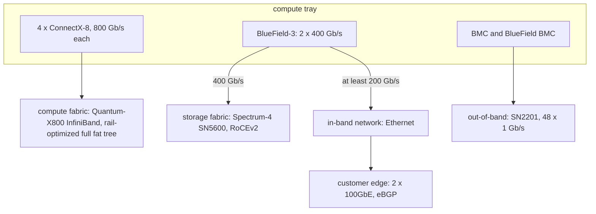

# 8.15 BCM in an AI factory: DGX SuperPOD integration

| | |
|---|---|
| Level | Intermediate |
| Priority tier | 2 |
| Lab venue | Laptop |
| Part | Part 8: NVIDIA Base Command Manager |
| Status | Drafted (`superpod_lab.py`: 29 checks pass; cluster commands **untested** on live SuperPOD) |

## Why this matters for AI infrastructure

Picture a design review for a new SuperPOD row, where nobody can say whether the building can feed it. The racks are ordered, the network plan looks tidy, and the software team has a date. Then someone asks how many kilowatts a single rack draws at full load, and the room goes quiet. BCM cannot answer that question on its own. In a DGX SuperPOD, BCM is one layer of a stack that starts with the physical floor. Power, cooling and cables decide how many GPUs you can run. BCM, which runs inside NVIDIA Mission Control, is how you manage what those parts support. A SuperPOD is NVIDIA's name for a large, pre-designed cluster built from DGX systems, and the DGX systems are the GPU servers themselves.

An engineer who knows the numbers can sanity-check a design in minutes. That engineer can also explain why each BCM feature exists, because it maps to a physical component. A feature that manages a power shelf exists because the power shelf is there. A feature that watches coolant exists because the coolant loop is there. When you read a BCM setting with the hardware in mind, the setting stops looking like an arbitrary option. Start with the floor, and only then plan the software.

## Prerequisites and outcomes

Before you start, finish chapters 8.1 to 8.14. You also need the basics of GPU networking, because the fabric decisions in this chapter depend on them. Part 12 goes deeper on that topic if you want more.

The chapter walks through the scalable unit, which is the repeatable block you size a SuperPOD in, and then the four networks and what runs on each. It places BCM, Slurm, Kubernetes, Run:ai and Mission Control in one software stack. Next comes the rack power and cooling arithmetic for the DGX B200, along with the redundancy schemes that decide how a rack survives a failure. The chapter closes with the BCM features that connect to this hardware, such as rack mode, power shelves, leak detection, IMEX and switch management.

## 1. The scalable unit (GB300)

Suppose someone asks how many GPUs a DGX GB300 cluster can hold. You need a repeatable block to count in, because counting every rack one at a time is slow and easy to get wrong. NVIDIA calls that block a **scalable unit (SU)**, and you grow a SuperPOD by adding SUs. For DGX GB300, one SU is 8 compute racks.

Each rack is an NVL72 system with 18 compute trays. The name NVL72 refers to the 72 GPUs that share one NVLink domain, which is NVIDIA's high-speed link between GPUs. Every tray carries two GB300 Superchips, and each Superchip has two B300 GPUs and one Grace CPU. That gives 4 GPUs per tray and 72 GPUs per rack, all in one NVLink domain. NVLink switch trays and power shelves sit in the same rack. A power shelf is the unit that converts facility power into the DC voltage the servers use, and it is the first thing the rack's electricity passes through.

The architecture scales to 128 racks (9,216 GPUs). One SU needs about 1.2 MW of thermal design power, the planning figure for the heat the facility has to handle. Thermal design power is the amount of heat the equipment is expected to give off at full load, so the cooling has to remove at least that much. The data center should meet at least Uptime Tier 3, which is also called TIA-942-B Rated 3 or EN 50600 Class 3. These are three names for the same level of design. Tier 3 means concurrent maintainability, so you can service one part without shutting the whole thing down, and no single point of failure. Cooling is hybrid: GPUs and CPUs are liquid cooled, and the rest is air cooled. Liquid cooling carries heat away much more efficiently than moving air, which is why the hottest parts get it.

The lab turns this into arithmetic, and you can repeat the same steps for any SU you size. One SU has 144 trays, which is 8 racks times 18 trays. With 4 GPUs per tray, that comes to 576 GPUs. 16 SUs reach the 128-rack limit. For the compute fabric, 144 × 4 × 800 Gb/s gives 460.8 Tb/s of NIC capacity per SU. A NIC is the network card, and the fabric is the network that links the GPUs across racks. Storage adds 144 × 400 Gb/s, or 57.6 Tb/s, and the in-band network carries at least 28.8 Tb/s. In-band is the network that carries provisioning and services, which you will meet again in section 2. These bandwidths are products of the document's per-tray figures, not numbers the document states.

Reading references critically matters too. The document calls the compute tray topology "NVL32", yet it counts 72 GPUs per rack. That looks like a typo for NVL72. Spotting slips like this is part of designing from a document. A single wrong label in a reference can carry into a purchase order if nobody checks it against the table beside it.

Work out the SU arithmetic yourself from the per-tray figures before you trust a headline total.

## 2. The four networks

Picture a training job that slows down every time the storage team runs a large copy.

A SuperPOD carries four kinds of traffic, and each one gets its own network. The reason is practical. A training job's GPU-to-GPU traffic should not compete with the provisioning and login traffic that keeps the cluster running. If one network carried everything, a large data transfer could slow down the very messages that keep a training step moving. Separate networks keep each kind of traffic predictable. The diagram shows how the parts of one compute tray connect to these networks.

The table lists what each network carries and the notes that matter when you configure it. A BMC is the small controller inside a server that lets you power it on, reset it and read its sensors even when the operating system is down. A BlueField is a data processing unit, a card that handles networking work so the main CPU does not have to.

| Network | Carries | Notes |
|---|---|---|
| Compute | GPU-to-GPU traffic between racks | InfiniBand, rail-optimized, full fat tree, managed switches, SHARPv3 support, UFM manages it. NVLink inside the rack is managed by **NMX Manager** |
| Storage | high-performance parallel storage | RoCEv2, a dedicated 400 Gb/s port per tray so storage traffic is not mixed with in-band on a bond |
| In-band | provisioning, user services, the NFS tier, uplink to the outside | at least 200 Gb/s per tray. This is where BCM provisions nodes and where Slurm and Kubernetes endpoints live |
| Out-of-band | BMCs, BlueField BMCs, NVSwitch management, PDUs, switch management | physically and logically isolated from users; carries IPMI/Redfish control and fabric/switch management |

Notice that the out-of-band row is isolated from users on purpose. The other three rows carry traffic that users and jobs depend on, so they are designed to be reachable. The out-of-band network is designed to be reachable only by operators, because anyone who can reach a BMC can often control the power and firmware of the machine behind it. Keeping it apart is a security decision as much as a performance one.

The edge is the uplink to the outside world. It uses at least 2 × 100GbE on DR1 single-mode links, and eBGP hands routes over at that point. Ethernet is the standard wired network technology, 100GbE means 100 gigabit Ethernet, and single-mode is a fibre type that carries signal over long distances. BGP is the protocol that routers use to tell each other which addresses they can reach, and eBGP is the version used between separate networks. The building management system traffic flows through this uplink as part of the untrusted zone. The building management system is the software that watches the facility, and an untrusted zone is a part of the network you do not fully control. The out-of-band network can have a dedicated customer link, or it can leak its routes through the in-band path. Keep that second option in mind when you draw the security boundary, because a leak of routes is a path an attacker could follow.

You have met this three-network idea before, in chapters 8.2, 8.3 and 8.7. It has a boot and management network, a BMC network, and separate data networks. In BCM terms, `internalnet` is the in-band network and the BMC network is the out-of-band one. The fabrics are extra networks you add. This chapter does not cover InfiniBand setup, which is manual section 3.6, so read that section before you wire the compute fabric.

Decide which of the four networks each device belongs to before you cable anything. A cable pulled to the wrong switch is a small mistake on the floor and a long afternoon in the lab.

## 3. The software stack

Picture a job that fails with a scheduler error, and the on-call engineer cannot tell whether Slurm or Kubernetes owns the problem.

Hardware alone does not run a training job. Something has to provision the nodes, schedule the work and recover from faults. Provisioning means installing the right software on each node and bringing it up. In a DGX SuperPOD, that job falls to NVIDIA Mission Control. The GB300 document describes it as a five-layer stack that leverages BCM for cluster provisioning and operations. A layer here means a group of software that depends on the layer below it. Mission Control adds Run:ai for scheduling on Kubernetes and supports Slurm for batch work. Slurm is the scheduler that queues batch jobs, and Run:ai is a layer that schedules GPU work on Kubernetes. Mission Control also includes a telemetry layer, which is the stream of measurements from the hardware, and a validation and diagnostics layer with an autonomous recovery engine. The recovery engine is the part that decides what to do when a fault appears. It also includes NMX Manager for NVLink switches.

The listed software components are Mission Control, NVIDIA AI Enterprise, Magnum IO, NGC, Slurm and Run:ai. Magnum IO is the set of libraries that moves data efficiently between GPUs and storage, and NGC is NVIDIA's catalogue of containers and models. In BCM-managed installs, the Run:ai control plane sits on the "user-space Kubernetes cluster", and its cluster components sit on the administrative Kubernetes. The control plane is the part that makes decisions, and the cluster components do the work. That gives you two Kubernetes clusters. One runs the administration side and the other runs the workloads. BCM supports this layout, as chapter 8.9 explains. Chapter 8.16 covers Mission Control.

The table below maps each layer or task to the BCM chapter that covers it, so you know where to read next.

| Layer or task | BCM chapter |
|---|---|
| Install, nodes, networks, images | 8.2 to 8.4 |
| Slurm and Kubernetes services | 8.8, 8.9 |
| Health and alerts | 8.11 |
| HA of the head pair | 8.12 |
| Day-2 and offline | 8.13, 8.14 |

When a problem appears, find its layer in this table first, then read the chapter that owns it. A problem in a Slurm job, for example, is usually a question for chapter 8.8, even if the symptom shows up in a dashboard.

## 4. BCM features that exist because of this hardware

Each BCM feature in this section exists because some piece of hardware needs a handle in the software. A handle is a command or setting that lets BCM see and control that piece. The Administrator Manual's Base View map and commands name these features. The list below covers their headings and some of their commands, not every procedure, so treat it as a map rather than a full guide.

**Rack mode** is reached through `rack` and `rackoverview`. It shows UP, DOWN and CLOSED counts for nodes, DPU nodes, managed switches, NVLink switches and power shelves. A DPU node is a server whose networking card runs its own processor. The view also shows cores, GPUs, power draw and fabric status. Racks are 42U by default, as chapter 8.3 explains. A U is the standard unit of rack height, and 42U is a common full-height rack.

`powershelfoverview` reports per-PSU input and rail power, current, voltage, fan speed and temperature. A PSU is a power supply unit, and a rail is a single output line from it at a set voltage. Reading the input and rail values side by side tells you whether the power going in matches the power the components are getting. Chapter 8.7 covers the power shelf details.

`cduoverview` shows supply and return temperatures, pressures and flow. A CDU is a coolant distribution unit, the device that moves liquid coolant around the racks. The supply temperature is the coolant going in, and the return temperature is the coolant coming back warm. A conforming building management system supplies these values over MQTT. MQTT is a lightweight messaging protocol that sensors and controllers often use to publish readings. BCM has a BMS object, whose default is "NVIDIA-conforming BMS", and leak action policies, whose default is "Default building policy". A policy is the set of actions that run when a condition is met. Leak detection uses `leakdetection` and `leakinfo`, per device and per rack, and chapter 8.7 covers it too. A leak sensor on a liquid-cooled tray is the early warning that lets you cut power before water reaches electronics.

IMEX is the inter-node memory exchange for multi-node NVLink. It lets GPUs on different nodes share memory through the NVLink fabric, which is faster than sending the data over the network. A network setting writes the peer list to `/etc/nvidia-imex/nodes_config.cfg`. A peer list is the list of nodes that take part in the exchange. Slurm can enable the IMEX daemon globally or per job, as chapters 8.3 and 8.8 describe. A daemon is a background service, and enabling it per job means only the jobs that need it start it.

Firmware modes `gb200`, `gb200sw`, `gb300` and `gb300sw` apply to compute trays and NVLink switches, and chapter 8.7 covers them. Firmware mode is the setting that tells BCM which firmware package family a device should follow. Redfish subscriptions exist for GB300 compute trays and NVLink switches. Redfish is the web-based standard interface that BMCs use to report events, so a subscription is a request to be told when something changes.

NMX Manager settings, UFM settings and NetQ objects live in the cluster settings. UFM is the fabric manager for the InfiniBand network, and NetQ is a tool for watching network state. ZTP handles switch provisioning. ZTP stands for zero-touch provisioning, which means a switch configures itself from a server when it first powers on, with no manual login.

Base View also has pages for GB200 rack management, power reservation steering, GPU workload power profiles, Run:ai, autonomous hardware recovery and autonomous job recovery. Matching nonuser profiles appear in chapter 8.6. Each page is a view on one of the features above, so you can use the view you are most comfortable with and still reach the same objects.

Before you open Base View on a new site, list which of these features your hardware actually needs. A feature you do not need is a feature you do not have to configure, and a smaller list is easier to check on a busy day.

## 5. Power and cooling: the DGX B200 numbers

The B200 deck is air-cooled, and it shows how to check a rack in a few minutes. The deck here means the reference document the chapter draws its numbers from. Air cooling means fans move air across the hot parts, and it is the simpler of the two methods. The method is useful because the arithmetic is short, and each step is a check you can repeat. Start with one system. One DGX B200 has a maximum draw of 14.3 kW. It is 10 RU and weighs about 130 kg. A scalable unit of up to 32 systems therefore draws 458 kW, because 32 × 14.3 = 457.6. A UFM appliance takes the place of one system, so a full SuperPOD holds at most 127 DGX B200 systems.

There are two rack patterns to know. 2 systems per rack draws 28.6 kW, which is typical in a 42U or 52U rack. 4 systems per rack draws 57.2 kW, which is high density in a 52U rack. Density is how much power and heat one rack carries, and a high-density rack needs more from the facility than a standard one.

Cooling is the next limit. The deck uses about 150 CFM per kW at sea level, which is about 2,145 CFM per system. CFM means cubic feet per minute, the volume of air a fan moves. Air is thinner at altitude, so the figure is given for sea level. A 2-system rack therefore needs 4,290 CFM, and a 4-system rack needs 8,580 CFM. Supply air must follow ASHRAE Class A1, with a maximum of 30 °C, and the recommended range is 18 to 27 °C. ASHRAE is the body that publishes the standards for data center air, and the class sets the temperature and humidity range for the inlet air. The filtration must be at least MERV 13, which is a rating for how fine a filter catches particles, and room cleanliness must meet ISO 14644-1 Class 8. That standard measures how many particles the air can hold, so dust that could clog fans stays out.

For power, you need circuits that follow an N pattern. There are two circuits, and each one is rated to handle 50 percent of the rack's peak demand after breaker derating. A circuit is a single electrical path with a breaker, which is the switch that cuts power if the current is too high. Derating means you run the breaker below its rated value, usually to keep it from overheating over long periods. The N pattern means each circuit can carry the full load alone, if the other one fails, half the rack keeps running.

The document's power table can be reproduced with one formula. Usable power of one three-phase circuit is 3 × V(line to neutral) × amps × derating × 0.95 power factor. Three-phase power uses three conductors, and line to neutral is the voltage between one of those lines and the neutral wire. The power factor accounts for the fact that some of the current is out of step with the voltage, so it does not do useful work. Take 380 V, which is 219 V line to neutral, with 32 A and 80 percent derating. Two circuits give 2 × 15.98, or about 32 kW. That carries two systems, 28.6 kW, and strands 3.4 kW. Stranded power is capacity you have paid for but cannot use, because the systems come in chunks too large to fill it. Now take 415 V, which is 240 V line to neutral, with 60 A and 80 percent derating. The same two circuits give about 66 kW. That carries four systems, 57.2 kW, and strands 8.4 kW.

The lab reproduces all ten rows of the document's table. Capacity matches within about 1 kW, and stranded power matches within 1.3 kW. A rack is rated by the largest deployment pattern whose peak fits, either 4 or 2 systems. You do not get that answer by dividing capacity by 14.3, and that is how the document's "supported systems" column works. Dividing gives you a number that ignores whole systems and the redundancy rules that follow. The formula is a derivation from the document's figures, and the lab checks it against the table.

Redundancy is where intuition fails. Each B200 has six PSUs and needs five energized. Energized means powered and able to carry load. A dual-feed design therefore behaves differently from what intuition suggests. It is tempting to think that six supplies split across two feeds will survive a feed loss, but the count is what matters. The lab simulates a single failure for each scheme in the deck:

| Scheme | One PDU fails | One UPS fails | Verdict |
|---|---|---|---|
| Two discrete sources, system on one PDU (N) | half of the systems | half | fewest interdependencies; best when only two UPS exist |
| Single source | half | **all** | a UPS failure takes the rack |
| **Interleaved** (PSUs split across both PDUs) | **all** | **all** | most interdependencies: **not recommended** (3 of 6 PSUs remain, below 5) |
| Static transfer switch | one system | none | the switch is a single point of failure; **NVIDIA has not tested or validated any STS** with B200; in-rack STS not supported |
| **"6 to make 5"** (each PSU on its own feed) | none | none | optimal for availability; needs six discrete sources and is limited by rack space (about 2 systems per rack) |

A PDU is a power distribution unit, the strip that feeds the rack's outlets, and a UPS is an uninterruptible power supply, the battery system that carries the load during an outage. A static transfer switch, or STS, moves a load from one source to another. The table reads row by row. Each row names a design, then says what one failure does to the rack. The verdict column is the decision, and it is the one to check against your own facility before you commit.

The lesson applies beyond the B200. When a server has internal N+1 power supplies, you must rethink the upstream redundancy model. N+1 means one spare supply beyond what the load needs, so the server survives the loss of any one supply. The spare inside the box does not help if the feeds upstream of it are wired so that one failure takes out most of the supplies together. Check the PSU rule for any GPU server you deploy, and write down the count of supplies that must stay energized.

The deck also raises planning points beyond the numbers. Align the groups early. Facility, IT, systems, network and application owners all need a say, because each one can see a different limit. Relief in one resource, such as power, cooling or space, shifts the pressure to another. Freeing up power by moving systems often uses up floor space or cooling, so a fix in one place can create a problem in another. InfiniBand cable length limits how far apart racks can sit, so the layout has to respect the reach of the cables. Rear door heat exchangers and in-row coolers are not typically suitable for B200. A rear door heat exchanger is a radiator fitted to the back of a rack, and an in-row cooler sits between racks in a row.

Before you fix the rack count, check the power pattern and the redundancy scheme together. Either one can cap the count on its own, and the lower cap is the real answer.

## 6. How I would use this in practice

The steps below follow the order you would use on a real design. Each step gives the answer that the next step needs.

1. Size: start from the GPUs wanted, use `su_count_for_gpus` to get the SUs, then read off racks, MW and fabric bandwidth. Begin with the GPU count because the rest of the design is built from it.
2. Check power: for air-cooled systems, count systems per rack from circuits and derating. For GB300, plan a liquid-cooled facility, since the 1.2 MW per SU is a TDP. 
3. Pick a redundancy scheme with the facility team, and write the failure table before the contract.
4. Map networks: decide which VLANs or VXLANs, which BCM network objects, and which edge uplink. A VLAN splits one physical network into separate logical ones, and VXLAN does the same across routed networks.
5. Plan management: BCM head pair (8.12), BMS integration, NMX Manager, UFM, Run:ai prerequisites (8.14), and air-gap if needed.
6. Acceptance: burn-in (8.2), hardware match (8.13), firmware (8.7), health checks (8.11). Acceptance is the set of tests that prove the new hardware is ready before it takes real work.

Settle the redundancy scheme and its failure table before you sign anything. A table that is written after the contract can only explain the problem, and a table written before it can prevent the problem.

## 7. Common first mistakes

This section lists ten first mistakes in SuperPOD designs. Most of them come from trusting a number without asking how it was derived. Read them as a checklist for your own first review, and ask of each number where it came from.

The first two are about numbers. The first is treating NVIDIA reference numbers as final designs. A reference is a starting point that the site has to check against its own facility. The second is dividing rack capacity by 14.3 instead of using the 2-or-4 patterns and N circuits. A third number-based mistake is ignoring supply air above 30 °C, because the air limit is what the equipment is rated for, and warmer air leaves the cooling with no margin.

Two of the mistakes are about power. Interleaving PSU feeds for "redundancy" breaks the rule that five of six PSUs stay energized. The split looks balanced, but a single PDU failure takes three supplies with it, below the five the server needs. Assuming a static transfer switch is supported is also wrong, because NVIDIA has not validated any STS with B200. A feature that is not validated is a risk you accept, not a safe default.

The rest come from the wider design. Mixing storage and in-band traffic on one bond ignores the separation the design depends on. A bond is two network links combined into one, so the traffic from both shares the same path. Forgetting the building management system in the network and security plan leaves a gap, because the facility's controls can then reach the cluster without anyone deciding that they should. Letting the BMC network be reachable by users exposes the network that should stay isolated. Planning Run:ai for an air-gapped site after the cut-off is a mistake that chapter 8.14 covers, because the software has to be carried in before the cut-off, not afterwards.

The last mistake is not reading the document critically. The NVL32/72 slip in the GB300 text shows why a careful read matters.

### 7.1 Deep dive: Tracing a SuperPOD from concrete floor to a running job in BCM

This section ties together three earlier threads: the physical facility lessons of Chapter 6.30, the out-of-band Redfish architecture of Part 7, and the Base Command Manager control plane of Chapters 8.1 through 8.14. Picture a cloud provider deploying an NVIDIA DGX SuperPOD. The build might use air-cooled DGX B200 systems, which draw `14.3 kW` per `10U` node, with up to `32` nodes or `458 kW` per Scalable Unit. It might instead use liquid-cooled DGX GB300 NVL72 racks. Each of those has `18` compute trays, `9` NVLink switch trays and `8` `33 kW` power shelves, which gives `72` GPUs per rack. Eight such racks make `576` GPUs and about `~1.2 MW` per Scalable Unit. Either way, every physical wire and pipe in the data hall maps to a concrete object in BCM. The goal of this walk is to follow one object from the floor to the job that uses it.

The four physical networks map to BCM network objects. Each network you cable on the floor has a matching object in BCM, and the object is where the addresses and roles for that network are kept. Start with the out-of-band network and work your way up.

The out-of-band network, built on `SN2201` 1 GbE switches, maps to `bmcnet` (`10.148.0.0/16`) in BCM. Every compute tray BMC, BlueField-3 BMC, NVLink switch tray BMC or NVOS port, power shelf BMC and smart rack PDU sits here. A smart PDU reports its own readings over the network, so it can be watched and controlled remotely. The network is completely isolated from user traffic, and it rolls up into a dedicated spine VXLAN per Scalable Unit. A spine is the central switch layer that the other switches connect to, so a spine VXLAN carries this traffic across the whole unit.

The in-band network, built on BlueField-3 at 200 Gb/s or more over Ethernet, maps to `internalnet` (`10.141.0.0/16`) in BCM. This is where `node-installer` boots compute trays over HTTP. The node installer is the BCM component that brings a new machine onto the cluster. `CMDaemon` talks on TCP port `8081`. CMDaemon is the BCM management daemon, and a TCP port is the numbered door a service listens on. Slurm (`slurmctld`/`slurmd`) and the Kubernetes control planes (`10443` API proxy and `443` Gateway) run here too. Dual `100GbE` eBGP border uplinks reach the customer edge from this network. Because so many services share this network, a problem here touches more of the cluster than a problem on any other.

The storage fabric uses a dedicated 400 Gb/s port on BlueField-3, connected to `SN5600` switches running RoCEv2 or InfiniBand. RoCEv2 is RDMA over converged Ethernet, a way to move data directly between memory on different machines. It maps to a dedicated storage network object in BCM. That keeps high-bandwidth parallel filesystem traffic from Lustre, WekaFS, GPFS or VAST physically apart from `internalnet`. A parallel filesystem is storage that spreads each file across many servers so many clients can read it at once. A multi-terabyte checkpoint burst therefore never delays a provisioning sync or a `slurmctld` heartbeat. A checkpoint is a saved snapshot of a training run, and a heartbeat is the regular message a service sends to say it is alive.

The compute fabric uses `4 x ConnectX-8` at `800 Gb/s` per GB300 tray on Quantum-X800 InfiniBand, or `8 x ConnectX-7` at `400 Gb/s` on H100 and B200. It maps to the rail-aligned compute fabric. Rail-aligned means each GPU in a tray connects to the matching switch for its position, so traffic between the same-numbered GPUs across racks takes one hop. UFM, which BCM exposes as `ufmsettings`, manages that fabric across racks. NMX Manager and IMEX, configured through `/etc/nvidia-imex/nodes_config.cfg`, cover the multi-node NVLink domains inside each NVL72 rack.

Power envelopes and PSU redundancy map to facility circuits and PDUs. Before you rack a single B200 or GB300 system, the power arithmetic in `code/part08/superpod_calc.py` and `superpod_lab.py` decides the physical rack layout. A DGX B200 draws `14.3 kW` at peak, and it needs five of its six internal PSUs (`5 of 6`) to stay energized. So you never wire its power cords in a `3 + 3` interleaved split across two PDUs. In that split, losing one PDU drops three PSUs, which crashes every server in the rack.

Use one of two schemes instead. The first is two discrete sources, the `N` pattern. All six cords of Server 1 go on Feed A, and all six cords of Server 2 go on Feed B. A feed failure then drops at most half the rack. The second is "6 to make 5", which needs six independent power feeds. Each cord of a server goes to its own feed, so losing any one feed leaves five cords live.

In BCM, the rack positions, PDUs, power shelves and CDUs are registered in `rack` mode, through `rackoverview`, `pduoverview`, `powershelfoverview` and `cduoverview`. An operator in Base View or `cmsh` then sees electrical draw, coolant temperatures and leak sensor states (`leakinfo`). Slurm and Kubernetes job allocations appear beside them. An allocation is the set of nodes that a job has been given.

Full-stack orchestration sits on BCM inside NVIDIA Mission Control. NVIDIA Mission Control builds directly on top of BCM. BCM handles bare-metal image provisioning (`cm-create-image --dgx`), switch ZTP (`nvconfiguration`), Redfish firmware rollouts (`firmwaremanagemode`), and health and trigger pipelines. Bare-metal means a machine with no operating system installed yet, so BCM must put the image on it from scratch. Above that layer sit Slurm, for synchronous multi-rack foundation-model training, and Run:ai on Kubernetes. Run:ai is split across an administrative K8s cluster and a user-space K8s cluster, for elastic inference and interactive workspaces. Elastic inference means the serving capacity grows and shrinks with demand. Chapter 8.16, the last chapter in Part 8, covers that integration.

### 7.2 Day-0 SuperPOD site-readiness and BCM configuration review

Before hardware arrives, you will sit down with the customer's data-center facilities, network engineering and platform operations teams. Day-0 is the planning stage before anything is switched on. Use this six-domain readiness review to walk through the new DGX B200 or GB300 deployment. Each row links a physical SuperPOD specification from Sections 1 through 5 to the exact BCM configuration you will build on Day 1. Day 1 is the first day the cluster is installed and running.

| SuperPOD Domain | Physical Specification to Verify (`superpod_lab.py`) | Corresponding BCM Configuration (`cmsh` / Setup Wizards) |
|---|---|---|
| **1. Scalable Unit (SU) & Rack Count** | **GB300:** `8` NVL72 racks/SU (`18` trays/rack = `144` trays, `576` GPUs, `~1.2 MW` TDP/SU, up to `16` SUs = `128` racks / `9,216` GPUs). **B200:** `32` nodes/SU (`14.3 kW`/node = `~458 kW`/SU, max `127` nodes in 4 SUs with UFM). | Plan `4`-digit node names (`node0001`), define `rack` objects (`42U`/`52U`), and populate `addrackposition` for all compute trays, NVLink switches (`9`/rack), and power shelves (`8`/rack). |
| **2. Rack Power & PSU Redundancy** | **B200:** `2` systems/rack (`28.6 kW`) or `4` systems/rack (`57.2 kW`); `5 of 6` PSUs required (`N` dual-source or `"6 to make 5"`, **never interleaved `3+3`**). **GB300:** `8` power shelves/rack (`6 x 5.5 kW = 33 kW` each). | Register smart PDUs (`set powercontrol apc`) and power shelves (`powershelfoverview`), and set `device power` batching (`-p` / `--parallel-delay 20`) to prevent transformer inrush surges. |
| **3. Cooling & Leak Detection** | **B200:** Air-cooled (`150 CFM/kW` = `2,145 CFM`/system, ASHRAE A1 $\le 30^\circ\text{C}$, MERV 13). **GB300:** Hybrid liquid cooling + facility CDUs. | Configure the `BMS` object (MQTT telemetry for `cduoverview`), verify `leakdetection enable` (`leakinfo`) on all liquid-cooled trays, and wire leak triggers to emergency drain/power-off actions. |
| **4. Four Segregated Networks** | **Compute IB:** `4 x 800G` CX-8 (`460.8 Tb/s`/SU) on Quantum-X800. **Storage RoCEv2:** `1 x 400G` BF-3 (`57.6 Tb/s`/SU) on `SN5600`. **In-Band:** $\ge 200\text{G}$ BF-3 (`28.8 Tb/s`/SU, `2 x 100GbE` eBGP edge). **OOB:** `SN2201` (`48 x 1G`). | Define `internalnet` (in-band boot/mgmt), `bmcnet` (OOB `10.148.0.0/16`), storage network, and `ibnet`; configure Cumulus ZTP (`nvconfigurationmode`), `ufmsettings`, `nmx` manager, and `imex` peer lists. |
| **5. Bare-Metal Provisioning & Firmware** | Scale boot and image sync across `144` trays/SU (`576+` nodes across multiple SUs) and baseline `30+` firmware components per tray. | Assign `boot` role per subnet and `provisioning` role per rack group; create platform images (`cm-create-image --dgx --dgx-type dgx_b200` / `dgx_gb300`); set `firmwaremanagemode` (`b200`, `gb300`, `gb300sw`). |
| **6. Dual Workload Engines (Slurm + Run:ai)** | Synchronous multi-rack foundation-model training on Slurm + elastic inference/notebooks on Run:ai (administrative + user-space K8s clusters). | Run `cm-wlm-setup --with-pyxis` (with separate `slurm-client-gpu` category/priority), `cm-kubernetes-setup` (with GPU and Network Operators), `cm-runai-setup`, and `cm-scale` Auto Scaler. |

Notice that every row pairs a physical number with the BCM step that depends on it. 

### 7.3 Why critical reading of reference architectures matters in real deployments

Recall the discrepancy from Section 1, which surfaced while writing `code/part08/superpod_lab.py`. In one paragraph of the DGX GB300 Reference Architecture text, the prose calls the rack compute-tray topology "NVL32". The same sentence and the hardware tables specify `18` compute trays with `4` B300 GPUs each. That is `18 x 4 = 72` GPUs per rack, which makes it NVL72. 

A second slip sits in the DGX B200 power-provisioning table. The published "Supported Systems" column caps a rack at `4` systems (`57.2 kW`). Yet two `415V`/`63A` circuits at `100%` derating provide `86 kW` of electrical capacity, which leaves `28.8 kW` stranded. The cap exists because a physical `52U` rack holds `4 x 10U = 40U` of systems plus switches, and cooling density limits the validated pattern to `2` or `4` systems per rack. So the cap is not only an electrical number. The rack's height and its cooling both play a part, and the table only shows one of them.

That is the central lesson of this chapter, and of the handbook as a whole. Reference architectures are engineering blueprints, not copy-paste gospel. When you encode a vendor's tables into executable Python, as `superpod_calc.py` and `superpod_lab.py` do, and check every product of trays, GPUs, ports, amps and kilowatts yourself, you catch documentation typos on paper. Fixing a typo on paper costs far less than a six-figure cabling or power-circuit mistake on the data-center floor. 

### 7.4 Walkthrough: Sizing a multi-SU SuperPOD expansion from a customer target

To practice the sizing workflow you will use in a customer design review or a senior solutions-architect interview, let us walk through a concrete example. It uses the functions in `code/part08/superpod_calc.py`. Work through it with a pencil and a calculator before you run the code, so the numbers are in your head first.

Suppose a research lab asks you to design a **2,000-GPU training cluster**. The lab wants to compare an air-cooled DGX B200 deployment with a liquid-cooled DGX GB300 NVL72 deployment. The question is not only how many GPUs fit, but which build fits the building the lab actually has.

Start with the GB300 NVL72 option, which `superpod_calc.su_count_for_gpus(2000)` sizes. Each rack provides `72` B300 GPUs across `18` compute trays. Each Scalable Unit (SU) holds `8` racks, which is `144` compute trays and `576` GPUs. Dividing `2,000` requested GPUs by `576` GPUs per SU, and rounding up, gives 4 Scalable Units. Rounding up matters because a partial SU still needs the whole SU's space and power. Those four SUs hold `32` compute racks, `576` compute trays and `2,304` B300 GPUs in total.

At `1.2 MW` TDP per SU, the 4-SU cluster needs `4.8 MW` of hybrid cooling capacity, mostly direct-to-chip liquid. Direct-to-chip means the coolant runs through a cold plate on the chip itself. Each SU also supplies `460.8 Tb/s` of Quantum-X800 InfiniBand compute bandwidth, `57.6 Tb/s` of Spectrum-4 RoCEv2 storage bandwidth, and at least `28.8 Tb/s` of in-band Ethernet. In BCM, each of the `32` racks holds `18` compute tray BMCs, `18` BlueField-3 DPU BMCs, `9` NVLink switch tray BMCs (plus `18` NVOS COMe ports) and `8` power shelf BMCs. That calls for a properly sized `bmcnet` (`/16`), per-SU `boot` and `provisioning` role nodes, and `cduoverview` and `leakdetection` integration with the facility's liquid-cooling BMS. A network of that size holds a large block of addresses, so the address plan has to leave room for growth.

Now the air-cooled DGX B200 option. Each `10U` system gives `8` B200 GPUs at a peak of `14.3 kW`, and it needs about `2,145 CFM` of ASHRAE Class A1 supply air at up to `30 °C`. Each SU holds up to `32` systems, which is `256` GPUs and `458 kW`. Section 5 showed that a standard 4-SU air-cooled SuperPOD supports at most `127` DGX B200 systems, or `1,016` GPUs, because one system slot goes to the UFM appliances. Reaching `2,000+` GPUs needs `256` systems, which is `2,048` GPUs across `8` SUs. That takes either an `8`-SU fabric topology or two `4`-SU pods. The IT load comes to about `~3.66 MW`, spread across `64` high-density racks or `128` standard racks. A high-density rack holds `4` systems at `57.2 kW` and `8,580 CFM`. A standard rack holds `2` systems at `28.6 kW` and `4,290 CFM`. All of them are wired in a non-interleaved `N` dual-source or "6 to make 5" power scheme.

Put the two options side by side. The GB300 build needs fewer racks and a liquid-cooling plant. The B200 build needs more racks, more air, and a careful power scheme, but it may suit a building that cannot take liquid. The walk gives you the numbers. The choice belongs to the facility, the budget and the workload.

If you can sketch both options on a whiteboard in five minutes, with SU counts, megawatts, airflow, PSU redundancy traps and the BCM objects that manage them, you have shown end-to-end command of AI infrastructure.

## Exercises

These steps were not run on a live cluster, so treat them as practice. Each exercise asks one question at a time, so you can check your work as you go.

1. Run `python3 superpod_lab.py`. Choose four of the checks. For each one, explain the rule in your own words.
2. Size a cluster of 2,304 GB300 GPUs. Work out the number of SUs first. Then work out the number of racks. Work out the megawatts next. Last, work out the compute fabric in Tb/s.
3. Your circuits run at 400 V, which is 230 V line to neutral. Each circuit is rated at 63 A. Apply 80 percent derating. How many B200 systems fit in one rack? How much power is stranded? Then repeat the calculation at 100 percent derating.
4. Draw the feed map for 4 systems wired with "6 to make 5". Then write down what a double failure does.
5. Write the BCM network objects you would create for the four networks. Give each one a name. Give each one a type. Then say who gets an address on each network.
6. Write the questions you would put to your facility team before you accept a 1.2 MW SU.

## 9. Interview angles

Each question below probes one part of this chapter. Practice saying each answer aloud in a sentence or two. If you can explain the reason behind the answer, the answer will hold up under follow-up questions.

- "How do you size a SuperPOD?" Start with scalable units, then count racks, GPUs, fabric ports, power and cooling per SU, and storage. The order matters, because each count depends on the one before it.
- "Why is interleaving PSU feeds bad for DGX B200?" The system has six PSUs and needs five. A 3/3 split means any single feed loss drops below five.
- "What is on each network?" Compute IB carries GPU traffic, storage RoCE carries data, in-band Ethernet handles provisioning and services, and OOB carries BMCs and switch management.
- "Where does BCM fit?" BCM provides provisioning, configuration, monitoring and management inside Mission Control, with Slurm and Run:ai on top.
- "What physical components make BCM add features?" Power shelves, NVLink switches, CDUs, leak sensors and BMS integration.

## Checkpoint questions (20)

1. In the DGX GB300 SuperPOD reference architecture, how many compute racks form one Scalable Unit (SU)?

When you count one Scalable Unit, you get **`8` compute racks**, which is `144` compute trays and `576` B300 GPUs.

2. How many compute trays and GPUs sit inside a single GB300 NVL72 rack?

A rack holds **`18` compute trays**. Each tray has `2` GB300 Superchips, which together give `4` B300 GPUs and `2` Grace CPUs per tray. The rack totals **`72` GPUs** in a single NVLink domain.

3. What is the maximum reference scale shown in the GB300 SuperPOD architecture in racks, SUs, and GPUs?

If you plan at the top of the range, the maximum is **`16` Scalable Units**, which is **`128` compute racks** and **`9,216` B300 GPUs**.

4. What is the approximate Thermal Design Power (TDP) of a single 8-rack GB300 Scalable Unit?

About **`1.2 MW`** per Scalable Unit.

5. Which data-center availability tier standard does the GB300 reference architecture recommend?

The reference recommends **Uptime Institute Tier 3**. The same level is also written as TIA-942-B Rated 3 or EN 50600 Class 3. It means concurrent maintainability with no single point of failure.

6. How are GB300 NVL72 racks cooled?

You will find **hybrid cooling** in these racks. Direct-to-chip **liquid cooling** handles the high-power GPUs, Grace CPUs and NVLink switches, and **air cooling** handles the lower-power peripheral components.

7. Name the four networks in the GB300 SuperPOD reference architecture and the NIC/switch hardware used for each.

1. **Compute fabric:** each tray uses `4 x ConnectX-8` at `800 Gb/s` each, connected to a rail-optimized **Quantum-X800 InfiniBand** fat tree. UFM manages it, and NMX Manager handles NVLink inside the rack.
2. **Storage fabric:** a `400 Gb/s` port on the **BlueField-3 DPU** connects to **Spectrum-4 `SN5600`** switches running **RoCEv2**.
3. **In-band management network:** at least `200 Gb/s` Ethernet on the BlueField-3 DPU, used for BCM provisioning, Slurm and Kubernetes control, NFS and external uplinks.
4. **Out-of-band (OOB) management network:** **Spectrum `SN2201`** (`48 x 1 Gb/s`) switches connect tray BMCs, BlueField BMCs, NVSwitch BMCs, power shelves and PDUs.

8. Why does the GB300 reference architecture separate storage traffic and in-band management traffic onto distinct BlueField-3 ports rather than bonding them?

Heavy parallel-storage checkpoint bursts at `400 Gb/s` over RoCEv2 could otherwise contend with BCM provisioning, Slurm and Kubernetes heartbeats, and interactive in-band services, or starve them. Separate ports keep the two apart.

9. Which endpoints sit on the Out-of-Band (OOB) network, and how is it isolated from users?

The OOB network connects all compute tray BMCs, BlueField BMCs, NVLink switch BMCs and NVOS ports, power shelves, rack PDUs and switch management ports. It is physically and logically isolated from tenant and user networks, and it rolls up into a spine VXLAN per SU.

10. What is the recommended customer edge uplink for a GB300 SuperPOD, and which untrusted facility system flows through it?

The recommended uplink is at least **`2 x 100GbE`** with `DR1` single-mode optics, running **eBGP** routing. The facility **Building Management System (BMS)** sends its power and cooling telemetry through that uplink, as part of the untrusted zone.

11. What are the core layers of **NVIDIA Mission Control**, and how does it use BCM?

Mission Control is a five-layer AI factory software stack. It uses BCM as its bare-metal provisioning, configuration and cluster operations engine. On top of BCM sit **Slurm** for batch training, **Run:ai** on Kubernetes (split across an administrative K8s cluster and a user-space K8s cluster), **NMX Manager** for NVLink fabric management, telemetry and BMS integration, and an **autonomous hardware and job recovery engine**.

12. For air-cooled **DGX B200** systems, what is the maximum power draw per server and for a 32-node Scalable Unit?

Each DGX B200 (`10 RU`, `~130 kg`) draws at most **`14.3 kW`**. A `32`-node SU therefore draws **`457.6 kW`**, which rounds to `~458 kW`.

13. Why does a full 4-SU DGX B200 SuperPOD hold at most `127` DGX B200 systems instead of `128`?

One system slot goes to the **UFM (Unified Fabric Manager) appliances** in the InfiniBand compute fabric, so `128 - 1 = 127` nodes remain.

14. What are the two supported rack density patterns for DGX B200 and their peak rack power demands?

- **2 systems per rack:** **`28.6 kW`**, which is `2 x 14.3 kW`, in a `42U` or `52U` rack.
- **4 systems per rack:** **`57.2 kW`**, which is `4 x 14.3 kW`, in a high-density `52U` rack.

15. What is the airflow rule of thumb (`CFM/kW`) for air-cooled DGX B200 systems, and how many `CFM` are required for 1, 2, and 4 systems?

The rule of thumb is about **`150 CFM per kW`** at sea level, so you can estimate airflow from power. One system at `14.3 kW` needs about `~2,145 CFM`. A `2`-system rack at `28.6 kW` needs about `~4,290 CFM`, and a `4`-system rack at `57.2 kW` needs about `~8,580 CFM`.

16. What are the ASHRAE supply air temperature, filtration, and cleanliness requirements for air-cooled DGX B200 halls?

The hall needs **ASHRAE Class A1** conditions, with a maximum supply air temperature of **`30 °C`** (`18–27 °C` recommended). It also needs at least **MERV 13** filtration and **ISO 14644-1 Class 8** room cleanliness.

17. In the DGX B200 rack power table (`superpod_lab.py`), how is usable 3-phase power calculated for two circuits, and why does a `66 kW` rack support `4` systems (`57.2 kW`) with `8.4 kW` stranded power?

Each three-phase circuit gives `3 * V_LN * I * derating * 0.95 PF`. For two `415V`/`240V L-N`, `60A` circuits at `80%` derating, that comes to about `65.6 kW`. Racks deploy in fixed `2`-system (`28.6 kW`) or `4`-system (`57.2 kW`) patterns, so a `65.6 kW` rack fits `4` systems and leaves **`8.4 kW` stranded**.

18. How many internal PSUs does a DGX B200 have, and how many must remain energized for the server to stay running?

You will find that each DGX B200 has **six internal PSUs**. It needs at least **five energized PSUs** (`5 of 6`) to keep running.

19. Why is **interleaved dual-feed** wiring (`3` PSUs on Feed A, `3` PSUs on Feed B) strongly discouraged for DGX B200 racks, and which two wiring schemes work?

If you split the six PSUs `3 + 3`, and losing either feed leaves only `3` energized PSUs, which is below five. Every server in the rack then goes down, `100%` of them. Two schemes work instead. **Two discrete sources (`N`)** put half the servers on Feed A and half on Feed B, so one feed loss affects only 50 percent of servers. **"6 to make 5"** gives each PSU its own independent source, so a single feed failure loses `0` servers.

20. Which BCM `cmsh` commands inspect power shelves, liquid-cooling CDUs, racks, and multi-node NVLink IMEX domains on rack-scale SuperPOD hardware?

If you want to inspect power shelves, use **`powershelfoverview`**. **`cduoverview`** shows CDU data fed by the BMS over MQTT. **`rackoverview`** shows nodes, DPUs, NVLink switches and power shelves in a rack. The **`imex`** settings manage multi-node NVLink IMEX domains and write `/etc/nvidia-imex/nodes_config.cfg`.

## Sources and review notes

- **NVIDIA DGX SuperPOD Reference Architecture, DGX GB300** (35 pages): architecture, components, design requirements, network fabrics and segmentation, edge, software stack, Run:ai. I read the text; I did not see the figures.
- **Data Center Best Practices with DGX B200** (slide deck): specifications, scalable unit, power profiles and provisioning table, redundancy schemes, cooling parameters. I read the slide text; I did not read the cabling and FAQ slides in detail.
- **BCM 11 Administrator Manual:** the Base View map in 2.4.2, rack mode (3.16), power chapter (4.3), leak detection (3.7.11), firmware modes (14.5), appendix N Redfish subscriptions, settings lists.
- **Run here:** `superpod_lab.py` (29 checks).
- **My own derivations:** the per-SU bandwidth totals; the circuit power formula (checked against the table); the PSU failure simulation (a model of the deck's schemes with feed maps I chose); the "NVL32" typo reading.
- **Not read or not covered:** the NVIDIA Mission Control Manual (rack power, BMS, NMX, IMEX details), the B200 cabling slides, the GB200 and other SuperPOD generations, InfiniBand setup in BCM (3.6), UFM, NetQ and ZTP procedures (3.8 to 3.12).
- **Not verified:** everything about real hardware. Reference numbers change by generation and revision.
