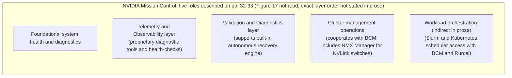
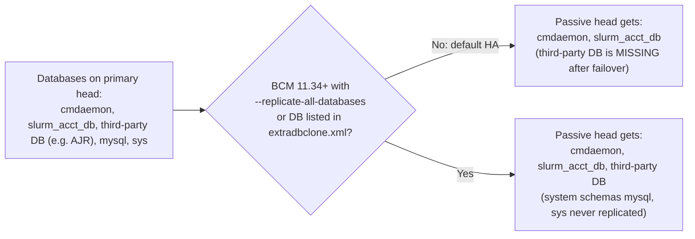
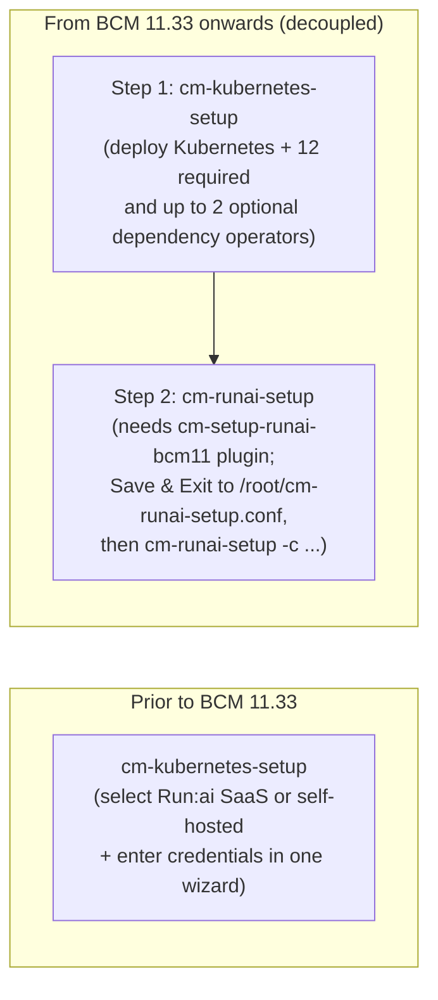

# 8.16 Mission Control, DGX Cloud and autonomous recovery concepts

| | |
|---|---|
| Level | Intermediate |
| Priority tier | 1b |
| Lab venue | Nebius GPU |
| Part | Part 8: NVIDIA Base Command Manager (BCM) |
| Status | Drafted from the **DGX SuperPOD Reference Architecture for DGX GB300** (pages 11 to 14 and 32 to 35; text only, figures not read), the **BCM 11 Containerization Manual** (chapter 6.11 on the Run:ai Operator and appendix B section B.2.8 on decoupled Run:ai deployment), the **BCM 11 Administrator Manual** (sections 0.1 to 0.3, 1.3, 2.4, 3.3, 3.7.11, 3.16.5, 4.3.2 to 4.3.3, 6.4.5, 6.5, chapter 7 pages 417 to 418 on Topograph in AWS, 14.5 on Base View firmware flashing, 15.1 on HA MySQL replication, appendix G.1.6/G.2.3, and appendix N.1.2), the **BCM 11 Installation Manual** (sections 4.1.2 and 4.2 on licensing), and the author's notes (`nvidia-zero-to-hero` volume 1 chapter 8 section 6 and volume 21 chapters 6, 7 and 10). **The dedicated NVIDIA Mission Control Manual is not in our corpus, and the sources say very little about DGX Cloud.** **No BCM, Mission Control, Run:ai or DGX Cloud system was available.** `code/part08/bcm_mission_control.py` is **my checker for the rules those sections state**, and `mission_control_lab.py` runs 31 checks against it. It tests my reading of the manuals, not the products. Every command shown is from the manuals and untested here |

## Why this matters for AI infrastructure

In a DGX SuperPOD, Base Command Manager is not packaged by itself: NVIDIA ships it inside a wider software stack called **NVIDIA Mission Control**, alongside **NVIDIA Run:ai** for Kubernetes workload management, **Slurm** for batch jobs, and built-in validation, telemetry and autonomous recovery components. In the BCM manuals, Mission Control appears as a license edition, a set of Base View pages, nonuser security profiles, and a separate manual that many hardware and recovery sections point to. Knowing which parts live in standard BCM (`cmsh`, `cm-kubernetes-setup`, `cm-runai-setup`, `cmha-setup`) and which parts belong to Mission Control keeps you from looking in the wrong tool or breaking a cluster's self-healing and high-availability setup.

## Prerequisites and outcomes

You need chapters 8.1 (architecture), 8.5 (`cmsh` and Base View), 8.6 (certificates, tokens and profiles), 8.8 (Slurm), 8.9 (Kubernetes), 8.11 (monitoring, health checks and actions), 8.12 (head-node high availability), 8.14 (air-gapped Kubernetes and Run:ai) and 8.15 (DGX SuperPOD integration). After this chapter you can:

- state what the GB300 Reference Architecture says about the five-layer Mission Control stack, and which layers are named directly versus described indirectly in the prose
- list every place where the BCM 11 manuals hand off a topic to the separate NVIDIA Mission Control Manual, and explain what a Mission Control license unlocks in BCM
- explain the two preconfigured recovery profiles (`autonomous-hardware-recovery` and `autonomous-job-recovery`), why they are nonuser profiles that must never be edited, and which MySQL databases are not replicated by default during a head-node failover
- connect Mission Control's four stated recovery and diagnostic claims to the BCM monitoring pipeline (chapter 8.11) and checkpoint recovery arithmetic (volume 21 chapter 7)
- install and validate the Run:ai Operator on BCM using `cm-runai-setup` (Containerization Manual 6.11 and B.2.8), comparing SaaS, connected self-hosted and air-gapped self-hosted modes
- state the exact facts our sources record about DGX Cloud (and what is left to chapter 9.14)

## 1. Where Mission Control sits in BCM and in a SuperPOD

Two documents in our corpus describe NVIDIA Mission Control from different angles: the **DGX GB300 SuperPOD Reference Architecture** describes what the product is for on a SuperPOD, and the **BCM 11 manuals** show how it hooks into a BCM head node.

### 1.1 What the GB300 Reference Architecture states

In the GB300 Reference Architecture (pages 3, 5, 7, 11 to 14 and 32 to 35), NVIDIA Mission Control is one of the four key components of a DGX GB300 SuperPOD (alongside the DGX GB300 NVL72 rack system, Quantum-X800 InfiniBand, and Spectrum Ethernet). The document states that Mission Control is used to manage all DGX GB300 SuperPOD deployments, integrates operational technology (OT) with the cluster, and needs shared storage on the User Storage NFS tier when deployed in a High Availability configuration (page 14).

On pages 32 and 33, the prose says that the NVIDIA Mission Control software stack "comprises a five-layer architecture that builds from foundational system health and diagnostics to advanced NVIDIA DGX SuperPOD cluster management operations." Figure 17 in that document ("NVIDIA DGX GB300 SuperPOD Software Stack") was not available as text in our corpus, and the prose does not number the five layers or give a strict bottom-to-top order beyond that opening phrase. Two layers are named with the literal word "layer" in the text, and the other three roles are described in the same paragraph:

| Component or layer in the prose (pp. 32 to 33) | How the text names it | What the text says it does |
|---|---|---|
| **System health and diagnostics** | Described as the starting point ("builds from foundational system health and diagnostics") | Forms the foundational health and diagnostics base; page 33 also says Mission Control handles system health monitoring |
| **Telemetry and Observability layer** | Named explicitly as a layer | Leverages proprietary diagnostic tools and health-checks for system insights |
| **Validation and Diagnostics layer** | Named explicitly as a layer | Supports the built-in **autonomous recovery engine** that ensures rapid failure recovery and system restoration with minimal time to recovery |
| **Cluster management operations (with BCM and NMX Manager)** | Described as the other end of the stack ("to advanced NVIDIA DGX SuperPOD cluster management operations") | Handles deployment optimization and cooperates with **NVIDIA Base Command Manager (BCM)** technology to coordinate cluster provisioning and operations; the stack also includes **Network Manager eXperience Manager (NMX Manager)** for monitoring and control of NVLink switch trays |
| **Workload orchestration (Slurm, Kubernetes, Run:ai)** | Described indirectly via scheduler access (my inference that this is the fifth of the five layers) | Leverages BCM technology and **NVIDIA Run:ai** functionality to provide scheduler access with **Slurm** and **Kubernetes** for AI and HPC workload orchestration |



*Caption: The five roles described in the GB300 Reference Architecture text (pages 32 to 33). Because Figure 17 was not read and the prose only states that the architecture builds from foundational system health and diagnostics to advanced cluster management operations, the boxes are shown without flow arrows.*

### 1.2 How Mission Control appears inside BCM 11

The BCM 11 Administrator, Installation and Containerization manuals treat NVIDIA Mission Control as both a **separate manual** and a **license edition** that turns on extra features inside BCM:

1. **A separate manual.** The prefaces (0.1 to 0.3) and Administrator Manual section 1.3 ("Outside The Direct Scope Of The Administrator Manual") state that NVIDIA Mission Control has its own manual, the *NVIDIA Mission Control Manual*, which describes Mission Control capabilities and their integration with BCM. That manual is not in our corpus.
2. **A license edition.** In Installation Manual sections 4.1.2 (`main licenseinfo` in `cmsh`) and 4.2 (`verify-license info`), the `Edition` field of the BCM certificate shows `NVIDIA Mission Control`. Administrator Manual section 2.4 (page 46) explains that the **License Information** tab in Base View has a **Mission Control** section with a **Manage Mission Control** hyperlink and a list of which Mission Control license features are currently active.
3. **A setup script.** Containerization Manual section B.2.8 (page 201) mentions `cm-mission-control-setup` alongside `cm-runai-setup`: on clusters with internet access, running either command automatically installs the `cm-setup-runai-bcm11` plugin package.
4. **Base View navigation entries.** In the Base View tree map (Administrator Manual section 2.4, pages 43 to 45), both the main navigation tree and the `License Information -> Mission Control` subtree list these entries:
   - `Building Management System Integration`
   - `Leak Detection`
   - `NMX Manager`
   - `Inter-node Memory Exchange (IMEX) Management`
   - `GB200 Rack Management`
   - `GB200 Firmware Management`
   - `Power Reservation Steering`
   - `Run:ai`
   - `GPU Workload Power Profiles` (in the main tree)
   - `Autonomous Hardware Recovery`
   - `Autonomous Job Recovery`
5. **Features that check for the license or defer to the Mission Control Manual.** Across the Administrator Manual, specific commands and workflows point to the Mission Control Manual or require an active Mission Control license:

| BCM feature or command | Where in BCM Administrator Manual | What it says about Mission Control |
|---|---|---|
| `NMX Manager` cluster setting object | Section 3.3 (p. 96) | Does not exist by default on a new cluster; clicking it starts creation. Documented in section 2.3 of the *NVIDIA Mission Control Manual* |
| `leakdetectionoverview` and NVL8 Redfish leak detection | Section 3.7.11 (p. 122) and Appendix N.1.2 (p. 1090) | `leakdetectionoverview` is a rack-centric leak command "available in the NVIDIA Mission Control edition of BCM" (section 3.3.2 of the *Mission Control Manual*). Meanwhile, per-device `leakdetection enable/disable` and `leakinfo` are in standard BCM; disabling a broken or false-positive sensor appends `leak:disabled` to the device status line so it does not trigger an unwanted power-off |
| Rack electrical, liquid cooling and power operations | Sections 3.16.4 and 3.16.5 | Rack-level electrical supply, liquid cooling and leak actions are in section 3.3 of the *Mission Control Manual*; rack power details are in section 4.9.4 |
| CDU data over MQTT from a BMS | Section 4.3.2 | Provided by a conforming Building Management System using MQTT; integration is in section 3.3.1 of the *Mission Control Manual* and example CDU measurables are in section 12.5 |
| `powershelfoverview` and power shelf configuration | Section 4.3.3 | Configuration is in chapter 4 of the *Mission Control Manual*, `powershelfoverview` is in section 4.2, and example measurables are in section 12.4 |
| Keycloak LDAP federation (`cm-setup-keycloak.py`) | Sections 6.4.1 to 6.4.5 (pp. 338 to 339) | Available from BCM 11.34 on Ubuntu 24.04 or 26.04 head nodes (not supported on RHEL or Rocky; needs ports `9443` HTTPS and `9999` HTTP free). Mission Control can federate its own LDAP into this Keycloak instance with no extra BCM-side setup: give Mission Control the URL `https://<head-fqdn>:9443`, realm name, admin credentials, and Keycloak TLS certificate, and open port `9443/tcp` in the head node firewall if Mission Control is not running on the head node |
| Blackwell Workload Power Profile Settings (WPPS) | Chapter 7 (p. 406) | Background is in the *NVIDIA Mission Control System Administration Guide* |
| Base View firmware flashing for GB200, GB300 and DGX | Section 14.5 (p. 757) | **Flashing fails without an active NVIDIA Mission Control license**, and the error returned states this. Only one firmware package can be selected at a time. In BCM 11.34.0, the `Dry Run` button does not work correctly on these platforms (fixed in 11.35.0; use `Flash` directly). Base View also cannot narrow a flash to named component targets (`--targets`); that requires `cmsh firmware` |
| Extra GB200 GPU and DGX Redfish measurables | Appendix G.1.6 and G.2.3 (pp. 1029, 1034) | Listed in sections 12.6, 12.8 (metrics), 12.9 (enums) and 12.10 (health checks) of the *Mission Control Manual* |

## 2. Autonomous recovery concepts and what BCM exposes

### 2.1 The four claims in the GB300 Reference Architecture

Pages 33 and 34 of the GB300 Reference Architecture state that the Validation and Diagnostics layer supports a built-in **autonomous recovery engine**, and list four specific capabilities under "business value":

1. **Automated Failure Detection & Self-Recovery:** automated failure detection and recovery mechanisms minimize downtime compared to manual intervention, so training continues with less disruption and higher GPU utilization.
2. **Optimized Workload Migration & Resource Allocation:** workloads are continuously reassigned to healthy nodes to prevent idle GPU time and increase training throughput.
3. **Unified Diagnostics for Infrastructure & Applications:** infrastructure and application-level diagnostics are combined so model builders, SREs and DevOps engineers can identify and resolve issues faster.
4. **In-Memory Checkpointing for Seamless Job Recovery:** training workloads recover by automatically restarting failed processes or ranks from the most recent valid checkpoint, avoiding data loss or rework and reducing retraining time in environments with frequent failures.

Because the *NVIDIA Mission Control Manual* is not in our corpus, the internal architecture, configuration screens, and exact mechanisms of the autonomous recovery engine and of in-memory checkpointing are **not documented in the sources we read**. What we *can* verify from the BCM manuals and the author's notes is:
- how BCM authorizes its own recovery clients (`autonomous-hardware-recovery` and `autonomous-job-recovery` profiles in section 6.5),
- how BCM's head-node high availability treats databases that are not part of default replication (section 15.1),
- how BCM's general monitoring pipeline (chapter 8.11) and multi-node training checkpoint arithmetic (volume 21 chapter 7) work underneath.

### 2.2 The two recovery profiles in BCM (`bcm11-admin` section 6.5)

As chapter 8.6 covered, every management operation against `CMDaemon` (on port 8081) requires a client X509v3 certificate whose **profile** holds the relevant **tokens**. In Administrator Manual section 6.5 (page 340), the table of 14 preconfigured profiles in `cmsh` includes two profiles for autonomous recovery:

| Profile name | "Default Tasks Allowed" (exact text in 6.5 table) | `nonuser`? |
|---|---|---|
| `autonomous-hardware-recovery` | `autonomous hardware recovery tasks` | `yes` |
| `autonomous-job-recovery` | `autonomous job recovery tasks` | `yes` |

The manual's table states only those two descriptions (`autonomous hardware recovery tasks` and `autonomous job recovery tasks`); it does not list the individual tokens inside either profile. (If you have a live cluster, `cmsh -c "profile; get autonomous-hardware-recovery tokens"` and `get autonomous-job-recovery tokens` list them, per the `get readonly tokens` pattern on page 341; untested here.) Any more specific statement about what hardware or job actions those tokens permit—for example, my inference that they authorize the Mission Control recovery services to trigger node power or scheduler operations through `CMDaemon`—is an inference beyond the table text.

Two hard rules from section 6.5 (pages 340 to 341) govern both profiles (see also chapter 8.6 section 5):

1. **They are `nonuser` profiles (`nonuser = yes`).** Of the 14 preconfigured profiles, 11 are nonuser profiles (`autonomous-hardware-recovery`, `autonomous-job-recovery`, `bootstrap`, `cmhealth`, `cmpam`, `litenode`, `monitoringpush`, `mqtt`, `node`, `power`, `prs`). Only three (`admin`, `readonly`, `portal`) have `nonuser = no` and can be assigned to human users.
2. **Administrators must never modify them.** The manual states explicitly: *"Most of the preconfigured profiles are nonuser profiles. Such a profile is used by cluster manager clients, and should never be modified by the cluster administrator."* Do not add or remove tokens from `autonomous-hardware-recovery` or `autonomous-job-recovery`, and do not assign them to user accounts. They exist so BCM's own components and Mission Control clients can authenticate to `CMDaemon`.

You can check the `nonuser` flag across all profiles with the manual's one-liner (from page 340, untested here):

```bash
[root@basecm11 ~]# cmsh -c "profile; foreach * (get name; get nonuser)" | paste - -
```

### 2.3 Head-node HA and databases that are not replicated by default (`bcm11-admin` section 15.1)

In chapter 8.12 (section 2), we saw how BCM head-node high availability (`cmha-setup`) runs MySQL in master-slave replication between the active and passive head nodes (see chapter 8.12 for the full failover and quorum mechanism). Administrator Manual section 15.1 (page 802) calls out a specific database replication rule to keep in mind whenever extra services store state in MySQL on the head node:

- **Default MySQL replication scope:** by default, head-node MySQL HA clones and replicates **only** the `cmdaemon` and `slurm_acct_db` databases to the secondary head node.
- **Third-party application databases are left behind by default:** any third-party application database not listed in `extradbclone.xml`—the manual names the `AJR` database as its example, without stating what `AJR` stands for—is **not** cloned by default and is therefore **missing from the new active head node after a failover**.
- **Two ways to include extra databases across a failover:**
  1. List the named databases in `extradbclone.xml` so MySQL HA clones and replicates them.
  2. **From BCM 11.34.0 onwards**, `cmha-setup` offers a TUI prompt after the MySQL root password: `"Replicate all non-system MySQL databases?"` (or in express mode, `--replicate-all-databases`, section 15.3). Answering `Yes` removes the default database filters and clones and replicates all non-system databases (`cmdaemon`, `slurm_acct_db`, and any third-party application databases such as the manual's `AJR` example) along with MySQL users and grants. MySQL's built-in system schemas (`mysql`, `information_schema`, `performance_schema`, `sys`) are never replicated.



### 2.4 How this connects to BCM monitoring (8.11) and training checkpoints (Volume 21)

Even without the Mission Control Manual, we can see how recovery fits the two layers we already studied:

- **Detection and node actions in BCM (chapter 8.11):** BCM's monitoring pipeline runs data producers and health checks (such as `cuda-dcgm`, `ssh2node`, `mounts`, and Redfish checks like `psu_health` and `chassis_health`), evaluates triggers (`enter`, `leave`, `during`, `flapping`), and runs built-in or custom actions (such as logging an event, emailing, draining a node in Slurm, or power-cycling). In `nvidia-zero-to-hero` volume 21 chapter 10 (sections 1.1, 2.1 and 3.1), the operational playbook for a GPU failure follows the same steps manually: detect via DCGM (`DCGM_FI_DEV_XID_ERRORS`, thermal slowdown, or hung AllReduce), confirm, stop or requeue the affected job, reset or reboot the node, resume the job from its last checkpoint on healthy nodes, and RMA persistent hardware faults. Mission Control's autonomous recovery claims automate that loop.
- **Checkpoint math and job restarts (`nvidia-zero-to-hero` volume 21 chapter 7, section 2):** when a rank or node dies in a multi-node training job, the NCCL communicator across the job is broken, so collectives error out or hang until the timeout (for example `timeout=datetime.timedelta(minutes=30)` in `dist.init_process_group`, volume 21 chapter 6 section 2.1). As volume 21 chapter 7 explains, in-process `try/except` loops generally cannot repair a broken NCCL communicator; the standard pattern is to terminate the failed processes or job, exclude the unhealthy node, and restart all ranks from the latest complete sharded checkpoint (using `torchrun --max-restarts`, Slurm `--requeue`, or a Kubernetes operator).
  - Volume 21 chapter 7 (section 2.1) gives a worked example: if a job writes a checkpoint every `500` steps and the cluster fails at step `5243`, the launcher loads `step-5000` and resumes from step `5001`. At most `500` steps of work are ever lost, and in this example `5243 - 5000 = 243` steps are lost. The lab function `checkpoint_resume_loss(5243, 500)` checks this exact example.
  - The GB300 Reference Architecture's claim of **in-memory checkpointing** (page 33) aims to shrink both the checkpoint write overhead and the time spent reloading checkpoints when restarting failed processes or ranks.

## 3. NVIDIA Run:ai under BCM (`bcm11-containerization` 6.11 and B.2.8)

Both the GB300 Reference Architecture (pages 14 and 34) and the BCM 11 Containerization Manual (section 6.11 and appendix B section B.2.8) cover **NVIDIA Run:ai**, which is included with NVIDIA Mission Control to manage resources and workloads on GPUs in a Kubernetes cluster. (Part 11 chapter 11.19 covers the Run:ai platform view on Kubernetes in more detail; here we cover how BCM installs and validates it.)

### 3.1 Architecture and installation types

Run:ai has two primary components, described with slightly different terms in our two sources:

- In **Containerization Manual 6.11** (page 144): the **datascience GPU cluster** (the BCM Kubernetes cluster) and the **control plane**.
- In the **GB300 Reference Architecture** (page 34): the **control plane (backend)**, which is the central management system capable of orchestrating multiple Run:ai clusters across an organization, and the **cluster**, which runs close to the computational resources. The GB300 document notes that in BCM-managed SuperPOD installations, the Run:ai control plane resides on the **"user-space Kubernetes cluster"** while the cluster components are deployed onto the **administrative Kubernetes infrastructure** (recall from chapter 8.9 that BCM supports multiple Kubernetes clusters on the same BCM head node).

Containerization Manual section 6.11 (pages 143 to 144) lists the **two installation modes** and **two self-hosted variants**, all supported on top of a BCM Kubernetes cluster:

| Installation mode | Variant | Where the control plane lives | Network rule stated in 6.11 |
|---|---|---|---|
| **SaaS (or Classic)** | Cloud-hosted | In the Run:ai cloud | The BCM cluster must allow outbound traffic to the Run:ai cloud |
| **Self-hosted** | **1. Connected** | On-premises, installed on the BCM cluster | Download is allowed from the internet, **but upload is not allowed** |
| **Self-hosted** | **2. Air-gapped** | On-premises, installed on the BCM cluster | The cluster is completely disconnected from the internet (see chapter 8.14 and section 3.4 below) |

### 3.2 How the setup wizard changed in BCM 11.33 (`cm-kubernetes-setup` vs `cm-runai-setup`)

Section 6.11 (page 144) and section B.2.8 (pages 200 to 202) state a version split that every BCM administrator needs to know:

- **Prior to BCM 11.33:** Run:ai is installed **inside `cm-kubernetes-setup`** (or in Base View via `Containers > Kubernetes > Kubernetes Management > Launch Wizard`). You pick `Run:ai (SaaS)` or `Run:ai (self-hosted)` on the operator package selection screen and enter the credentials in that same wizard.
- **From BCM 11.33 onwards (decoupled deployment):** Run:ai is deployed in **two sequential steps**:
  1. Run **`cm-kubernetes-setup`** first to deploy Kubernetes **together with the operator packages that Run:ai depends on** (selected at the operator selection screen).
  2. Once `cm-kubernetes-setup` has finished, run **`cm-runai-setup`** separately to configure the installation type (SaaS or self-hosted), credentials, and deploy Run:ai itself.



**The `cm-runai-setup` and `cm-setup-runai-bcm11` trap (Appendix B, section B.2.8, pages 200 to 202):**
- The **`cm-runai-setup` command** is part of the **`cm-setup` package** and is present on a BCM head node by default.
- However, the **plugin that implements the wizard** is delivered in a **separate package: `cm-setup-runai-bcm11`**, published in the public NVIDIA Mission Control repository (`sw-dgxc-nmc-cm-setup-plugins-debian-local`).
- Running `cm-runai-setup` without `cm-setup-runai-bcm11` installed **fails with an error stating that the main component is not installed**. Therefore, **checking whether the `cm-runai-setup` command exists on the head node does NOT tell you whether Run:ai can be deployed.**
- **How the plugin package gets installed:**
  - *Clusters with internet access:* no manual action is needed; `cm-setup-runai-bcm11` is installed automatically when you run `cm-runai-setup` or `cm-mission-control-setup`.
  - *Air-gapped clusters on Ubuntu:* because air-gapped deployments must pass `cm-runai-setup --skip-packages` (without `--skip-packages`, the wizard's automatic update feature tries to reach the internet and fails), the wizard cannot install the package itself. You must download `cm-setup-runai-bcm11_<version>_<arch>.deb` on the internet host, verify its `.sha256` file (after appending the filename on the same line, chapter 8.14), and `apt install -y` it on the primary head node—and **`scp` it to the secondary head node and install it there too**, because the `.deb` is in local storage, while the `cm-runai-setup` wizard itself is run on the **active head node only**.
  - *Supported OS distributions:* for connected clusters, section 6.11.2 (page 147) states that `cm-runai-setup` is available on **Ubuntu 24.04, Ubuntu 26.04, and RHEL9-based distributions** (with RHEL10 planned). For **air-gapped** clusters, section B.1 and B.2.8 state that `cm-setup-runai-bcm11` is published **only as a `.deb`**, so **an air-gapped Run:ai deployment on RHEL is not supported in this release**.
- **Release cadence:** BCM and Run:ai release on the same cadence—**BCM 11.33 corresponds to Run:ai 2.25**, and **BCM 11.34 corresponds to Run:ai 2.26**—but section B.2.8 notes this is a matter of timing, not a hard restriction: any supported, non-EOL Run:ai version can be deployed, provided the air-gapped tarball version matches the version being deployed (and is at least **2.23.60**, when multi-arch support was added).

### 3.3 Operator dependencies, prerequisites, and wizard validations (6.11.1, 6.11.2, B.2.1, B.2.8)

When you run `cm-kubernetes-setup` with the intent of deploying Run:ai (illustrated for Run:ai 2.25 in section B.2.1, page 198), you must select the operators Run:ai depends on:

- **12 required operators:** `NVIDIA GPU Operator`, `Grafana Operator`, `Kgateway`, `Knative Operator`, `Kubeflow Training Operator`, `Kubernetes Metrics Server`, `Kubernetes MPI Operator`, `Kubernetes State Metrics`, `LeaderWorkerSet Operator`, `MetalLB`, `Prometheus Adapter`, and `Prometheus Operator Stack`.
- **2 optional operators:** `Network Operator` ("technically optional, but recommended") and `NIM Operator` ("optional").

Before running `cm-runai-setup`, section 6.11.1 (pages 144 to 146) and section 6.11.2 (page 147) require these prerequisites according to the mode:

| Mode | Required inputs and prerequisites (6.11.1 & 6.11.2) |
|---|---|
| **SaaS** | Updated BCM head node; outbound traffic to the Run:ai cloud; **tenant name**, **application secret**, **admin username and password**; a **hostname** (used instead of the cluster external IP so clients and the Run:ai web UI reach cluster APIs through a Gateway served by **Kgateway** over HTTPS); a **DNS entry** resolving that hostname to the cluster IP; and a **trusted certificate and private key** for that hostname |
| **Self-hosted (connected)** | Updated BCM head node; **Run:ai JFrog / registry credentials** (as a base64-encoded token string or a file path); a **control plane FQDN** (for example `runai.example.com`) which **must differ from the Kubernetes FQDN**; a **DNS entry** resolving that FQDN to the cluster IP; the **domain full-chain certificate** (`.crt` or `.pem`) and **private key** (`.key`); an optional **local CA certificate** (`.crt` or `.pem`, required in almost all cases when the domain certificate is self-signed, omitted only for publicly trusted certificates); **Tenants Manager admin email and password** (at least 8 characters with at least one digit, one uppercase letter, and one special character, per B.2.8); the **node category** for the Run:ai control plane (same category as Kubernetes control-plane nodes is recommended); the **Run:ai version**; and an **unused IP address for the Run:ai inference load balancer (Kourier)** |
| **Self-hosted (air-gapped additions, B.2.8)** | All of the self-hosted items, prepared **before** air-gapping: **`cm-setup-runai-bcm11`** pre-installed on both head nodes; **Docker** configured via `cm-docker-setup --skip-packages` (B.2.4: Docker is currently only needed for the BCM Run:ai installation); **three reserved IP addresses** (none already in use: one for the **BCM gateway**, one for the **Run:ai control plane ingress**, and one for **Run:ai inference / Kourier**—the MetalLB range given to `cm-kubernetes-setup` must be large enough to cover all three, and the three addresses must be **left free rather than placed in a MetalLB pool beforehand** because `cm-runai-setup` creates its own MetalLB pools; also verify the gateway IP the wizard offers against your reserved list); **three DNS records** (`<cp-fqdn>` and workspace wildcard `*.<cp-fqdn>` pointing at the control-plane IP, plus inference wildcard `*.runai-inference.<domain>` pointing at the inference IP); **an NGC API key** (the wizard requires a value even in air-gap); files staged in `/cm/shared/runai/` (conventional location); and the air-gapped registry, Helm repo, Helm CA cert, and `runai-airgapped-package-<version>.tar.gz` paths. In air-gapped mode the wizard does **not** prompt for the Run:ai version: it takes it from the operator defaults, which must match the tarball |

**What the wizard validates automatically (section 6.11.1, pages 145 to 146):**
During both the questions phase and the setup phase, `cm-runai-setup` (or `cm-kubernetes-setup` prior to 11.33) runs three groups of checks, all modeled in `bcm_mission_control.py`:

1. **Required field validation:** checks that the JFrog/registry credentials, control plane domain name (FQDN), and domain certificate/key paths are not empty. (It allows the local CA path to be empty, with a caution that an empty CA only works for publicly signed certificates.)
2. **Question phase validation (warnings):**
   - *Domain name resolution:* resolves the domain name to an IP address and warns if resolution fails.
   - *Certificate verification:* if a local CA is provided, runs:
     ```bash
     openssl verify -CAfile <local CA .crt file> <local .crt file>
     ```
     (from the manual, untested here) and warns if verification fails.
   - *Domain FQDN validation:* checks that the domain FQDN is in the certificate's Subject Alternative Name (SAN) list, including wildcard SAN entries.
   - *IP routability check (present since BCM 11.25.08):* checks whether the IP address that the FQDN resolved to is routable to one of the nodes in the BCM cluster. **Important exception:** this check is **disabled if MetalLB is used with Run:ai**, because the IP address is not yet in use during the questions phase.
3. **Consistency validation (since BCM 11.25.08; aborts setup):**
   - If a local CA certificate **is** provided, but a custom CA is **not** enabled in the Helm values, **the setup aborts**.
   - If a local CA certificate is **not** provided, but a custom CA **is** enabled in the Helm values, **the setup aborts**.

### 3.4 Saving the configuration, deploying, verifying, and post-installation (6.11.2, 6.11.3, B.2.8)

In `cm-runai-setup` (best run inside `screen` or `tmux`), the final summary screen offers two config styles—**`minimal config`** (only settings that differ from application defaults) or **`config`** (minimal settings plus upstream defaults)—and **Save & Exit**, which writes `/root/cm-runai-setup.conf` without deploying.
- In **BCM 11.33**, section B.2.8 (page 202) states you **must** choose **Save & Exit** first because a bug in the 11.33 wizard prevents deploying in a single run.
- Because `/root/cm-runai-setup.conf` contains sensitive credentials, section 6.11.2 (page 148) instructs you to restrict its permissions and delete it after confirming the deployment (commands from the manual, untested here):

```bash
# Deploy from the saved configuration (add --skip-packages if air-gapped)
[root@basecm11 ~]# chmod 600 /root/cm-runai-setup.conf
[root@basecm11 ~]# cm-runai-setup -c /root/cm-runai-setup.conf

# Check the cluster-installer and runai-cluster Helm releases and pods
[root@basecm11 ~]# helm list -n runai
[root@basecm11 ~]# helm history -n runai runai-cluster
[root@basecm11 ~]# kubectl get all -n runai
```

**Post-installation steps from BCM 11.33 onwards (section 6.11.3, pages 149 to 150):**
1. **Load the right Kubernetes module** in multi-cluster setups:
   ```bash
   [root@basecm11 ~]# module unload kubernetes
   [root@basecm11 ~]# module load kubernetes/k8s-user
   ```
2. **On Multi-Node NVLink systems (DGX B200, GB200, B300, and GB300), install the NVIDIA Dynamic Resource Allocation (DRA) driver** (`nvidia-dra-driver-gpu`), which section 6.11.3 states is **required for secure Internode Memory Exchange (IMEX)** on those systems, and then patch `runaiconfig` to expose DRA capabilities (from the manual, untested here):
   ```bash
   [root@basecm11 ~]# helm repo add nvidia https://helm.ngc.nvidia.com/nvidia && helm repo update
   [root@basecm11 ~]# helm install nvidia-dra-driver-gpu nvidia/nvidia-dra-driver-gpu \
     --version="25.8.0" --create-namespace --namespace nvidia-dra-driver-gpu \
     --set nvidiaDriverRoot=/ --set resources.gpus.enabled=false

   [root@basecm11 ~]# kubectl patch runaiconfig runai -n runai --type='merge' \
     -p '{"spec":{"workload-controller":{"GPUNetworkAccelerationEnabled":true},"global":{"tolerations":[{"key":"node-role.kubernetes.io/control-plane","operator":"Exists","effect":"NoSchedule"}]}}}'
   ```
3. **Verify the CLI and the Kourier ingress service:** `runai version` (on Windows: `runai config set --cp-url runai.example.com`) and `kubectl get svc -n knative-serving kourier -o wide`.
4. **Removing Run:ai (6.11.2 and B.2.8):** prior to 11.33, `helm uninstall cluster-installer -n runai`. From 11.33, use the `cm-runai-setup` uninstall option or run:
   ```bash
   [root@basecm11 ~]# cm-runai-setup --cluster <kube cluster> --remove --yes-i-really-mean-it
   ```
   Uninstalling the whole Kubernetes cluster (`cm-kubernetes-setup --cluster <kube cluster> --remove --yes-i-really-mean-it`) also removes Run:ai automatically.

*(Note: Prior to BCM 11.33, section 6.11.3 pages 148 to 149 describes a different post-install step: running `cm-kubernetes-setup` and choosing `"Enable Run:ai Config (Configure Run:ai CLI binary and OIDC settings)"`, which updates the Kubernetes API server with OIDC parameters for Researcher Access Control—causing about a minute of API server downtime—and lets you place the `runai` binary in `/usr/bin`.)*

## 4. What our sources say about DGX Cloud

The chapter title includes **DGX Cloud**, so let us be completely transparent about what is in the corpus:

1. **In the BCM 11 manuals (`bcm11-admin` chapter 7, pages 417 to 418):** DGX Cloud is mentioned **once** (in two overlapping chunks), inside the section on BCM's **Topograph** service for Slurm topology awareness on cloud providers:
   - For **AWS clouds** managed by BCM, the compute nodes must be **running (exist)** and must use an instance flavor that supports the **AWS EC2 instance topology API** (`ec2-instance-topology`).
   - The manual states: *"One of the supported flavors is the `p5.48xlarge` instance currently used by DGX Cloud."*
   - To use Topograph with AWS, the IAM identity must have the **`ec2:DescribeInstanceTopology`** permission (which can be granted via the AWS-managed policy **`AmazonEC2ReadOnlyAccess`**), and Topograph needs cloud credentials: if the administrator sets **`Pass cloud credentials`** to **`yes`**, BCM sends the credentials to the Topograph service on each topology fetch.
   - *(The same page also notes that the old `FakeNodes` and `FakeNodesPool` extra settings are no longer needed in recent Slurm versions and are not supported in **Topograph 4**—BCM logs a warning and ignores them; reverting to Topograph 3 requires clearing the `version4` extra value and reinstalling the `topograph` package on every node running `topograph4`, followed by `updateprovisioners` and `imageupdate` if installed in a software image.)*
2. **In the GB300 Reference Architecture (page 36):** "NVIDIA DGX Cloud" appears only in the trademark footer.
3. **In the author's notes (`nvidia-zero-to-hero` volume 1, chapter 8, section 6):** a short two-paragraph overview describes **DGX Cloud** as NVIDIA's managed AI training platform where NVIDIA hosts SuperPOD infrastructure inside major cloud providers (AWS, Azure, GCP, Oracle) so users submit jobs through a browser portal as an OpEx service without managing the underlying Slurm, Kubernetes, drivers, or InfiniBand fabric themselves. (Volume 21 chapter 12 section 2.1 also notes that an AWS `p5.48xlarge` instance has `8 × H100` GPUs.)

Nothing else about DGX Cloud's internal architecture or its relationship to Mission Control appears in the BCM manuals or the GB300 Reference Architecture. Cloud GPU platforms (DGX Cloud, CoreWeave, Nebius, and GCP A3/A4) are covered in their own chapter, **chapter 9.14**.

## 5. Lab: checking Mission Control, Run:ai and recovery rules (`mission_control_lab.py`)

`code/part08/bcm_mission_control.py` encodes the verifiable rules from the sections above, and `code/part08/mission_control_lab.py` runs **31 self-checks** (stdlib Python only):

- **GB300 five-layer prose check (4 checks):** verifies that 5 roles are tracked, only 2 (`telemetry_and_observability`, `validation_and_diagnostics`) carry the literal word "layer" in the prose while 3 are described indirectly, that `validation_and_diagnostics` is paired with the autonomous recovery engine, and that the 4 business-value claims match the text.
- **Administrator Manual 6.5 profiles (5 checks):** checks all 14 preconfigured profiles, verifies the exact task strings for `autonomous-hardware-recovery` and `autonomous-job-recovery`, and confirms that modifying, disabling, or assigning either nonuser profile to a human user raises `MissionControlError` while assigning `readonly` succeeds.
- **Administrator Manual 15.1 HA MySQL replication (4 checks):** checks that default HA replicates only `cmdaemon` and `slurm_acct_db` (leaving a third-party database such as the manual's `ajr` example missing after failover), that adding it to `extradbclone.xml` preserves it, that `replicate_all_non_system=True` (from BCM 11.34.0) replicates all non-system databases while still excluding system schemas (`mysql`, `sys`), and that `replicate_all_non_system` is rejected before 11.34.0.
- **Administrator Manual 6.4.5, 14.5, 3.7.11 (4 checks):** checks Keycloak federation requirements for Mission Control (BCM 11.34+, Ubuntu 24.04/26.04, `https://<head-fqdn>:9443`, port `9443/tcp` open when Mission Control is off-head), Base View firmware flashing rules on GB200/GB300/DGX (Mission Control license required, 1 package at a time, 11.34.0 `Dry Run` bug fixed in 11.35.0, no `--targets` in Base View), and the `leak:disabled` status suffix rule.
- **Containerization Manual 6.11 and B.2.8 Run:ai workflow and wizard validations (12 checks):** checks the BCM 11.33 decoupling from `cm-kubernetes-setup` to `cm-runai-setup`, the `cm-setup` versus `cm-setup-runai-bcm11` plugin rule (connected auto-install vs `--skip-packages` air-gap failure), the 12 required and 2 optional dependency operators, SaaS and self-hosted wizard validations (CA/Helm consistency abort since 11.25.08, control-plane FQDN != Kubernetes FQDN, wildcard SAN matching, MetalLB disabling the IP routability check), the Tenants Manager password policy (`>=8` chars, digit, uppercase, special), the 9 air-gapped Run:ai pre-flight failure conditions (RHEL `.deb` restriction, minimum version `2.23.60`, tarball/operator version match, 3 distinct free IPs inside the MetalLB range, DNS wildcards, NGC key, 11.33 single-run bug), and the `nvidia-dra-driver-gpu` requirement on Multi-Node NVLink systems (`B200`, `GB200`, `B300`, `GB300`).
- **Administrator Manual chapter 7 Topograph & Volume 21 chapter 7 checkpoint math (2 checks):** checks AWS Topograph requirements (`p5.48xlarge` used by DGX Cloud, nodes running, `ec2:DescribeInstanceTopology`, `Pass cloud credentials = yes`) and reproduces the worked example of a failure at step `5243` with a `500`-step checkpoint interval (resumes from step `5001` after loading `step-5000`, losing `243` steps).

Run it locally:

```bash
python3 code/part08/mission_control_lab.py
```

## Common first mistakes

1. **Editing or assigning `autonomous-hardware-recovery` or `autonomous-job-recovery`:** both are `nonuser` profiles (`nonuser = yes`) used by BCM's own components and clients. Administrator Manual 6.5 states they must never be modified and cannot be assigned to human users (chapter 8.6).
2. **Assuming `cm-runai-setup` is in `cluster-tools` or that its presence means Run:ai is ready to install:** `cm-runai-setup` is part of `cm-setup` and is on the head node by default, but its implementation lives in the separate `cm-setup-runai-bcm11` package (Containerization Manual B.2.8). Without that plugin package, `cm-runai-setup` fails with "main component is not installed." (`cluster-tools` is where `cm-setup-keycloak.py` lives, Administrator Manual 6.4.)
3. **Forgetting third-party MySQL databases when setting up head-node HA:** by default `cmha-setup` replicates only `cmdaemon` and `slurm_acct_db`. Unless you list a third-party application database (the manual uses `AJR` as its example) in `extradbclone.xml` or enable `"Replicate all non-system MySQL databases?"` (`--replicate-all-databases`, available from BCM 11.34.0), that database will be missing on the new active head node after a failover (Administrator Manual 15.1, chapter 8.12).
4. **Providing a local CA certificate in `cm-runai-setup` without enabling custom CA in Helm values (or vice versa):** since BCM 11.25.08, the consistency check aborts the setup if those two settings disagree (Containerization Manual 6.11.1).
5. **Pre-allocating the three Run:ai IPs into a MetalLB pool before running `cm-runai-setup`:** `cm-runai-setup` creates its own MetalLB address pools. The three reserved IPs (BCM gateway, Run:ai control plane ingress, Run:ai inference/Kourier) must be inside the overall range given to MetalLB during `cm-kubernetes-setup`, but left free beforehand (Containerization Manual B.2.8).
6. **Using the same FQDN for the Run:ai control plane and the Kubernetes cluster:** section 6.11.2 states that the Run:ai control plane FQDN must differ from the Kubernetes FQDN.
7. **Deploying air-gapped Run:ai in a single run on BCM 11.33, or forgetting to copy `cm-setup-runai-bcm11_*.deb` to the secondary head node:** BCM 11.33 has a wizard bug that requires choosing **Save & Exit** first and then running `cm-runai-setup --skip-packages -c /root/cm-runai-setup.conf`. On an HA pair, install the `.deb` on both heads so the wizard survives a failover, but run `cm-runai-setup` on the active head only (Containerization Manual B.2.8).
8. **Skipping the NVIDIA DRA driver on GB200, GB300, B200 or B300 clusters running Run:ai:** Multi-Node NVLink systems require `nvidia-dra-driver-gpu` and the `GPUNetworkAccelerationEnabled` patch on `runaiconfig` for secure Internode Memory Exchange (Containerization Manual 6.11.3).
9. **Using Base View `Dry Run` for GB200/GB300/DGX firmware on BCM 11.34.0, or flashing without a Mission Control license:** Base View firmware flashing on those platforms fails without an active Mission Control license, and `Dry Run` is broken in 11.34.0 (fixed in 11.35.0; use `Flash` directly, Administrator Manual 14.5).
10. **Looking in the BCM Administrator Manual for Mission Control procedures:** rack power shelves (`4.3.3`), CDU/BMS MQTT integration (`4.3.2`), rack-level leak overview (`3.7.11`), NMX Manager (`3.3`), and Mission Control LDAP federation (`6.4.5`) all hand off to the separate *NVIDIA Mission Control Manual*.

## Exercises

1. Run `python3 code/part08/mission_control_lab.py` and inspect `code/part08/bcm_mission_control.py`. Pick four checks—one each from sections 6.5, 15.1, 6.11.1, and B.2.8—and explain the manual rule each check enforces.
2. Using `runai_wizard_validation` in `bcm_mission_control.py`, test two broken self-hosted configurations: (a) a self-signed certificate where `local_ca_path` is set but `custom_ca_enabled_in_helm=False`, and (b) a cluster without MetalLB where `ip_routable_to_cluster=False`. Which one aborts setup and which one only warns?
3. A BCM 11.33 primary head node has the MySQL databases `cmdaemon`, `slurm_acct_db`, `ajr` (the manual's example third-party database), `keycloak`, `mysql`, and `performance_schema`. Call `mysql_dbs_after_failover` for default HA, for `extradbclone=["ajr", "keycloak"]`, and after upgrading to BCM 11.34.0 with `replicate_all_non_system=True`. Which databases survive a failover in each case?
4. Write a pre-flight checklist for an air-gapped Ubuntu 24.04 head-node pair that will run Kubernetes and Run:ai 2.25.11 on BCM 11.33. Include the exact operator selections in `cm-kubernetes-setup`, the three reserved IPs, the three DNS records, the `.deb` checksum verification command, the secondary head-node step, and the two-step `cm-runai-setup` invocation.
5. Using `checkpoint_resume_loss` from `bcm_mission_control.py`, compare a 64-GPU training job that fails at step `8390` under checkpoint intervals of `250`, `500`, and `1000` steps. How many steps are lost in each case, and what is the worst-case loss for each interval?
6. On a live BCM 11.34+ cluster (if available; untested here), run `verify-license info` and `cmsh -c "profile; foreach * (get name; get nonuser)" | paste - -`. Check whether the `Edition` is `NVIDIA Mission Control` and confirm that `autonomous-hardware-recovery` and `autonomous-job-recovery` report `yes` for `nonuser`.

## Interview angles

1. **"How do NVIDIA Mission Control, Base Command Manager, and Run:ai fit together on a DGX SuperPOD?"**
   *Answer:* In the GB300 Reference Architecture, Mission Control is the full-stack operations suite; it cooperates with BCM for bare-metal provisioning and cluster operations, uses NMX Manager for NVLink switches, includes a validation and diagnostics layer with an autonomous recovery engine, and uses Slurm and Kubernetes with Run:ai for workload orchestration.
2. **"We ran `which cm-runai-setup` on our air-gapped BCM head node and the binary is there—can we deploy Run:ai?"**
   *Answer:* Not necessarily: `cm-runai-setup` is shipped by `cm-setup` on every head node, but the plugin that implements it is in the separate `cm-setup-runai-bcm11` `.deb` package, which must be downloaded before air-gapping and installed on both head nodes (and air-gapped Run:ai on RHEL is unsupported in this release because that package is `.deb`-only).
3. **"What happens to a third-party application database on the BCM head node (such as the manual's `AJR` example) if the active head node fails over to the passive head node?"**
   *Answer:* By default, BCM MySQL HA only replicates `cmdaemon` and `slurm_acct_db` (chapter 8.12), so any third-party database is missing on the new active head unless you added it to `extradbclone.xml` or enabled `--replicate-all-databases` in `cmha-setup` (available from BCM 11.34.0).
4. **"Should an administrator tune the tokens in `autonomous-hardware-recovery` or `autonomous-job-recovery`?"**
   *Answer:* Never: Administrator Manual section 6.5 marks both as `nonuser` profiles used by cluster manager clients and states that nonuser profiles must never be modified by the administrator or assigned to human users.
5. **"What changes when deploying Run:ai on a Multi-Node NVLink system such as GB200 or GB300 versus an H100 cluster?"**
   *Answer:* After `cm-runai-setup` finishes, you must install the `nvidia-dra-driver-gpu` Helm chart and patch `runaiconfig` to enable `GPUNetworkAccelerationEnabled`, because the NVIDIA DRA driver is required for secure Internode Memory Exchange (IMEX) on B200, GB200, B300, and GB300 systems.

## Checkpoint questions (20)

1. Which two layers of the five-layer Mission Control stack are named with the literal word "layer" in the GB300 Reference Architecture prose (pages 32 to 33)?
2. Which layer in that prose supports the built-in autonomous recovery engine?
3. What are the four capabilities ("business value" items) claimed for Mission Control on pages 33 to 34 of the GB300 Reference Architecture?
4. In a BCM-managed SuperPOD installation (GB300 Reference Architecture page 34), which Kubernetes cluster hosts the Run:ai control plane, and which hosts the Run:ai cluster components?
5. What are the exact "Default Tasks Allowed" descriptions for `autonomous-hardware-recovery` and `autonomous-job-recovery` in the Administrator Manual 6.5 table?
6. Are `autonomous-hardware-recovery` and `autonomous-job-recovery` user profiles or `nonuser` profiles, and may an administrator modify their tokens?
7. Which three preconfigured profiles in Administrator Manual 6.5 have `nonuser = no` and can be assigned to human users?
8. Why is a third-party application database (such as the manual's `AJR` example) missing after a default BCM head-node failover, and what two methods fix this (Administrator Manual 15.1, chapter 8.12)?
9. Which four MySQL system schemas are never replicated by `cmha-setup`, even when `"Replicate all non-system MySQL databases?"` is enabled in BCM 11.34.0+?
10. What head-node OS versions and BCM version are required by `cm-setup-keycloak.py` (Administrator Manual 6.4.1), and which firewall port must be open if Mission Control runs off the head node (6.4.5)?
11. What happens if you try to flash GB200, GB300, or DGX firmware from Base View without an active NVIDIA Mission Control license, or use `Dry Run` on BCM 11.34.0 (Administrator Manual 14.5)?
12. What suffix appears on a device's status line when `leakdetection disable` is run on it, and why would an administrator disable it (Administrator Manual 3.7.11)?
13. How did the Run:ai installation workflow change in BCM 11.33 compared with versions prior to 11.33 (Containerization Manual 6.11)?
14. Which package provides the `cm-runai-setup` command, which separate package provides the plugin that implements it, and why is air-gapped Run:ai not supported on RHEL in this release (Appendix B.2.8)?
15. What are the 12 required and 2 optional Kubernetes operators that Run:ai 2.25 depends on in `cm-kubernetes-setup` (Appendix B.2.1)?
16. In `cm-runai-setup`, why is the IP routability check (added in BCM 11.25.08) disabled when MetalLB is used, and what causes the consistency check to abort setup (6.11.1)?
17. What are the three reserved IP addresses and three DNS records required before an air-gapped Run:ai deployment, and why must the three IPs not be placed into a MetalLB pool beforehand (Appendix B.2.8)?
18. What is the minimum Run:ai version required for an air-gapped tarball (and why), and why must you select **Save & Exit** at the `cm-runai-setup` summary screen on BCM 11.33 (Appendix B.1 and B.2.8)?
19. Which extra Helm chart must be installed after `cm-runai-setup` on DGX B200, GB200, B300, and GB300 systems, and what is it required for (6.11.3)?
20. In what context does the BCM 11 Administrator Manual mention **DGX Cloud** and the AWS `p5.48xlarge` instance flavor, and what IAM permission and BCM setting does that feature require (chapter 7, pages 417 to 418)?

## Sources and review notes

- **Sources read in full for this chapter:**
  - **DGX SuperPOD Reference Architecture, DGX GB300** (`superpod-gb300-ra`): pages 1 to 14 (overview, key components, NVIDIA Mission Control, Run:ai, User Storage HA note) and pages 26 to 36 (OOB network, storage, DGX SuperPOD Software, the five-layer Mission Control description, the four business-value bullets, NVIDIA Run:ai architecture, summary, and trademark footer). *Note:* Only the extracted text was available; Figure 17 ("NVIDIA DGX GB300 SuperPOD Software Stack" and "NVIDIA Run:ai") was not read.
  - **BCM 11 Containerization Manual** (`bcm11-containerization`): section 6.11 in full (6.11 The Run:ai Operator, 6.11.1 installation prerequisites and wizard validation checks, 6.11.2 installing prior to 11.33 and from 11.33 with `cm-runai-setup`, 6.11.3 post-installation prior to 11.33 and from 11.33 including `nvidia-dra-driver-gpu`, pages 143 to 150) and Appendix B section B.2.8 in full (Decoupled Run:ai Deployment, `cm-setup` vs `cm-setup-runai-bcm11`, prerequisites, HA secondary head-node `.deb` copy, `--skip-packages`, 11.33 Save & Exit bug, uninstalling, pages 200 to 203), plus the Run:ai parts of B.1 (pages 194 to 196), B.2.1 (operator dependencies, page 198), B.2.4 (Docker for Run:ai, page 199), and C.2 (pages 211 to 214).
  - **BCM 11 Administrator Manual** (`bcm11-admin`): sections 0.1 to 0.3 and 1.3 (manual scope and the separate *NVIDIA Mission Control Manual*), section 2.4 (Base View GUI tree map and License Information Mission Control section, pages 43 to 46), section 3.3 (cluster settings defaults including `NMX Manager`, `Leak action policies`, `Building Management System`, page 96), section 3.7.11 (`leakdetection`, `leakinfo`, `leakdetectionoverview`, page 122), sections 3.16.4 and 3.16.5 (rack overview and power cross-references), sections 4.3.2 and 4.3.3 (CDU/BMS MQTT and `powershelfoverview`), sections 6.4.1 to 6.4.5 (Keycloak setup and NVIDIA Mission Control LDAP federation, pages 338 to 339), section 6.5 (Tokens And Profiles table and `nonuser` rules, pages 339 to 341), chapter 7 pages 406 and 417 to 418 (Blackwell WPPS reference; Topograph on AWS, `p5.48xlarge` used by DGX Cloud, `ec2:DescribeInstanceTopology`, `Pass cloud credentials`), section 14.5 (Base View firmware flashing on GB200, GB300 and DGX requiring a Mission Control license, 11.34.0 `Dry Run` bug, page 757), section 15.1 (HA MySQL replication scope and third-party application databases such as the `AJR` example, page 802), Appendix G.1.6 and G.2.3 (GB200 and DGX Redfish measurable cross-references), and Appendix N.1.2 (Redfish uses in BCM).
  - **BCM 11 Installation Manual** (`bcm11-install`): sections 4.1.2 and 4.2 (`main licenseinfo` and `verify-license info` showing `Edition: NVIDIA Mission Control`, pages 60 to 61).
  - **Author's notes (`nvidia-devops` repo):** `nvidia-zero-to-hero/volume-01/chapter-08` section 6 (DGX Cloud overview), and `nvidia-zero-to-hero/volume-21` chapters 06 (CUDA/driver alignment, DDP/DeepSpeed, Kubernetes Indexed Job), 07 (multi-node training fault tolerance and checkpoint-interval worked example), and 10 (DCGM/Prometheus observability and GPU failure incident playbook).
- **Skimmed in `nvidia-zero-to-hero/volume-21` (routed to later parts per `planning/MIGRATION_MAP.md`):** chapters 01 (AI factory design principles), 02 (GPU cluster design), 03 (networking), 04 (storage), 05 (power and thermal), 08 (inference serving), 09 (multi-region), 11 (capacity planning), 12 (cost optimization and `p5.48xlarge` spot example), 13 (128-GPU training cluster reference architecture), 14 (multi-region inference reference architecture), and labs 01 to 04. These chapters cover general AI factory design and do not mention BCM or Mission Control; they remain marked `[todo]` in `planning/MIGRATION_MAP.md` for Parts 0, 9, 16, and 17.
- **Not read or not in the corpus:** the *NVIDIA Mission Control Manual* and the *NVIDIA Mission Control System Administration Guide* are not in the corpus. Anything that only those manuals document (the internal rules of the autonomous recovery engine, the exact tokens inside `autonomous-hardware-recovery` and `autonomous-job-recovery`, and how in-memory checkpointing is configured) is marked unknown here.
- **Corrections to the author's notes:** none for `volume-21` (which does not make BCM-specific claims). In my own earlier draft of this chapter, I wrongly stated that `cm-runai-setup` came from `cluster-tools` (it is in `cm-setup`, with the plugin in `cm-setup-runai-bcm11`), invented a top-to-bottom ordering for the five Mission Control layers, and treated the nonuser recovery profiles as administrator-tunable; all three are corrected here.
- **Run here:** `code/part08/mission_control_lab.py` (31 checks, testing `code/part08/bcm_mission_control.py`).
- **My own choices and inferences, labelled in the text:**
  1. Treating "Workload orchestration (Slurm, Kubernetes, Run:ai)" as the fifth of the five layers in the GB300 Reference Architecture prose (pages 32 to 33), since only two layers carry the literal word "layer" and Figure 17 was not read.
  2. Inferring that the tokens inside `autonomous-hardware-recovery` and `autonomous-job-recovery` authorize Mission Control's recovery clients to call `CMDaemon` for hardware and job recovery operations (the manual's table in 6.5 states only `"autonomous hardware recovery tasks"` and `"autonomous job recovery tasks"`).
- **Not verified:** every command (`cmsh`, `cm-runai-setup`, `cm-kubernetes-setup`, `cmha-setup`, `helm`, `kubectl`, `verify-license`) and every GUI path is from the manuals and was not run on a live BCM, Run:ai, or Mission Control system.
