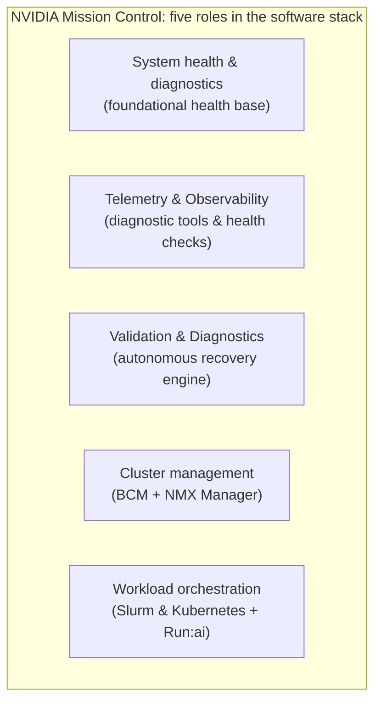
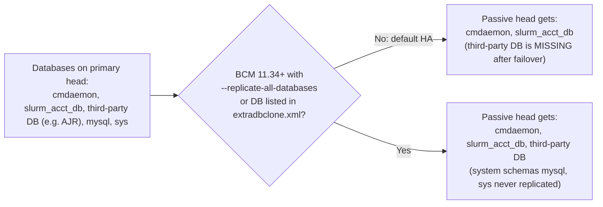
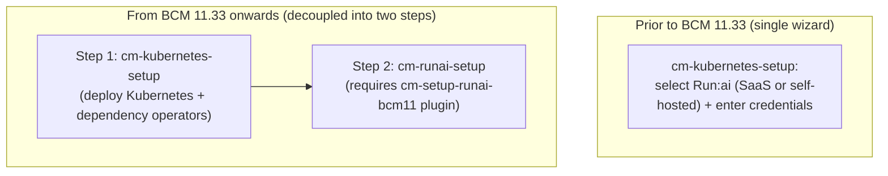

# 8.16 Mission Control, DGX Cloud and autonomous recovery concepts

| | |
|---|---|
| Level | Intermediate |
| Priority tier | 1b |
| Lab venue | Nebius GPU |
| Part | Part 8: NVIDIA Base Command Manager (BCM) |
| Status | Drafted (`mission_control_lab.py`: 31 checks pass; cluster commands **untested** on live BCM) |

## Why this matters for AI infrastructure

Picture a new DGX SuperPOD on its first day. An operations engineer tries to flash rack firmware with the standard Base Command Manager tools, and the flash fails with a license error. The rack management controls they expect also seem to be missing from the administrator manual. The reason is that a SuperPOD does not run Base Command Manager by itself. NVIDIA packages it inside a wider software suite called NVIDIA Mission Control. That suite combines BCM with NVIDIA Run:ai, Slurm, and built-in validation, telemetry, and autonomous recovery components.

Inside the BCM documentation, Mission Control shows up as a license edition, a set of Base View pages, nonuser security profiles, and a separate manual. You need to know which workflows live in standard BCM tools and which belong to Mission Control. The standard tools are `cmsh`, `cm-kubernetes-setup`, `cm-runai-setup`, and `cmha-setup`. Knowing the split keeps you from searching the wrong manual. It also keeps you from breaking a cluster's self-healing and high-availability setup.

Decide early which manual owns each task, so firmware and rack work go to the right place.

## Prerequisites and outcomes

Read the earlier Part 8 chapters in the table below first. Each one covers a piece this chapter builds on, from BCM architecture to head-node failover and DGX SuperPOD integration.

| Prerequisite chapter | Topic |
|---|---|
| Chapter 8.1 | BCM architecture and management daemons |
| Chapter 8.5 | `cmsh` and Base View navigation |
| Chapter 8.6 | X509v3 certificates, tokens, and profiles |
| Chapter 8.8 | Slurm workload management |
| Chapter 8.9 | Kubernetes cluster deployment |
| Chapter 8.11 | Monitoring, health checks, and automated actions |
| Chapter 8.12 | Head-node high availability and MySQL failover |
| Chapter 8.14 | Air-gapped Kubernetes and Run:ai staging |
| Chapter 8.15 | DGX SuperPOD integration |

By the end of the chapter, you should be able to do the following.

- Describe the five-layer Mission Control stack from the GB300 Reference Architecture. Separate the layer names the text states outright from the roles it only describes.
- List every topic the BCM manuals hand off to the separate NVIDIA Mission Control Manual.
- Explain what a Mission Control license unlocks inside BCM.
- Identify which hardware, power, cooling, and firmware tasks in BCM need a Mission Control license.
- Explain the two preconfigured recovery profiles, why they are nonuser profiles you must never edit, and which MySQL databases are left out during failover.
- Connect Mission Control's recovery and diagnostic features to BCM's monitoring pipeline and to checkpoint recovery arithmetic.
- Install and validate the Run:ai Operator on BCM with `cm-runai-setup` in SaaS, connected self-hosted, and air-gapped self-hosted modes.
- Explain how Topograph discovers instance topology on DGX Cloud AWS `p5.48xlarge` nodes.

Keep this list in mind as you read, since each later section answers one of these goals.

## 1. Where Mission Control sits in BCM and in a SuperPOD

Rack-scale bring-up stalls quickly when a cluster engineer treats Base Command Manager and NVIDIA Mission Control as the same thing. Facility engineers cannot tell where Building Management System telemetry lands. System administrators wonder why NVLink switch tray management is missing from their tools. The fix is to understand the boundary between the SuperPOD operations suite and BCM's underlying provisioning engine. Once that boundary is clear, you know who owns each subsystem. If you work through this section with a cluster in front of you, you can check each claim as you go.

### 1.1 The Mission Control software stack on a DGX SuperPOD

In a DGX GB300 SuperPOD, NVIDIA Mission Control is one of four core building blocks. The others are the GB300 NVL72 rack, Quantum-X800 InfiniBand, and Spectrum Ethernet. Mission Control manages every DGX GB300 SuperPOD deployment and connects facility operational technology to the cluster. In a High Availability configuration, it uses the User Storage NFS tier for shared storage.

Mission Control is built as a five-layer software stack. It runs from foundational system health and diagnostics up to advanced cluster management operations. Only two of those five roles carry the literal word "layer" in the reference architecture prose. The table below maps all five roles as the reference architecture describes them.

| Component or layer | Role in the stack | What it does |
|---|---|---|
| **System health and diagnostics** | Foundational health base | Tracks system health and hardware status across the cluster |
| **Telemetry and Observability layer** | System insights (explicitly named as a layer in the prose) | Uses proprietary diagnostic tools and health checks to surface cluster-wide telemetry |
| **Validation and Diagnostics layer** | Failure recovery (explicitly named as a layer in the prose) | Supports the built-in **autonomous recovery engine** for rapid failure recovery and system restoration |
| **Cluster management operations (with BCM and NMX Manager)** | Provisioning and fabric control | Handles deployment optimization and cooperates with **NVIDIA Base Command Manager (BCM)** to coordinate cluster provisioning and operations; includes **Network Manager eXperience Manager (NMX Manager)** to monitor and control NVLink switch trays |
| **Workload orchestration (Slurm, Kubernetes, Run:ai)** | Scheduler access (my inference that this is the fifth of the five layers) | Works with BCM and **NVIDIA Run:ai** to provide scheduler access with **Slurm** and **Kubernetes** for AI and HPC workloads |



Read the diagram as five roles without a strict order. The reference architecture prose describes them without numbering their layer order.

### 1.2 How Mission Control hooks into BCM 11

An administrator logging into a BCM head node on a SuperPOD often wonders where Mission Control lives on the filesystem and in Base View. Without that map, you can lose hours hunting for rack power or leak detection settings in the standard BCM menus. Inside BCM, NVIDIA Mission Control shows up in four ways.

- **A separate administration manual.** Standard BCM manuals cover cluster provisioning, workload managers, and containers. SuperPOD rack power shelves, liquid-cooling BMS integration, NMX Manager, and Mission Control's own recovery screens live in the separate *NVIDIA Mission Control Manual*.
- **A license edition.** In `cmsh` under `main licenseinfo` and in `verify-license info`, the edition field of the BCM certificate shows NVIDIA Mission Control. In Base View, the License Information tab has a Mission Control section with a Manage Mission Control hyperlink and a list of active license features.
- **A setup script.** On clusters with internet access, running either `cm-mission-control-setup` or `cm-runai-setup` automatically installs the `cm-setup-runai-bcm11` plugin package.
- **Base View navigation entries.** Both the main Base View navigation tree and the Mission Control license subtree expose dedicated pages for SuperPOD hardware and autonomous recovery.

```text
Base View navigation entries for Mission Control (License Information -> Mission Control):
- Building Management System Integration
- Leak Detection
- NMX Manager
- Inter-node Memory Exchange (IMEX) Management
- GB200 Rack Management
- GB200 Firmware Management
- Power Reservation Steering
- Run:ai
- GPU Workload Power Profiles (in the main navigation tree)
- Autonomous Hardware Recovery
- Autonomous Job Recovery
```

Almost every entry in that block sits under License Information, so you will look there first. You will find the Mission Control pages in that subtree. The exception is GPU Workload Power Profiles, which lives in the main navigation tree.

Several BCM features either require an active Mission Control license or hand their configuration to the Mission Control suite. The table shows which is which.

| BCM feature or command | How it works with Mission Control |
|---|---|
| `NMX Manager` cluster setting object | Does not exist by default on a new cluster; clicking it in Base View starts object creation (configured via Mission Control) |
| `leakdetectionoverview` and NVL8 Redfish leak detection | `leakdetectionoverview` is a rack-centric leak command available in the NVIDIA Mission Control edition of BCM. Standard BCM provides per-device `leakdetection enable/disable` and `leakinfo`; disabling a broken or false-positive sensor appends `leak:disabled` to the device status line so it does not trigger an unwanted power-off |
| Rack electrical, liquid cooling and power operations | Basic `rackoverview` is in standard BCM; rack-level electrical supply, liquid cooling, leak actions, and rack power operations are part of Mission Control |
| CDU data over MQTT from a BMS | Provided by a conforming Building Management System over MQTT (`NVIDIA-conforming BMS` object by default) |
| `powershelfoverview` and power shelf configuration | Displays per-PSU input and rail power, current, voltage, fan speed, and temperature for a DGX power shelf |
| Keycloak LDAP federation (`cm-setup-keycloak.py`) | Available from BCM 11.34 on Ubuntu 24.04 or 26.04 head nodes (not supported on RHEL or Rocky; needs ports `9443` HTTPS and `9999` HTTP free). Mission Control can federate its own LDAP into this Keycloak instance with no extra BCM-side setup: give Mission Control the URL `https://<head-fqdn>:9443`, realm name, admin credentials, and Keycloak TLS certificate, and open port `9443/tcp` in the head node firewall if Mission Control is not running on the head node |
| Blackwell Workload Power Profile Settings (WPPS) | Supported on NVIDIA Blackwell GPUs (users can be granted access via `allowgpuworkloadpowerprofiles`) |
| Base View firmware flashing for GB200, GB300 and DGX | **Flashing fails without an active NVIDIA Mission Control license**, and the error returned states this. Only one firmware package can be selected at a time. In BCM 11.34.0, the `Dry Run` button does not work correctly on these platforms (fixed in 11.35.0; use `Flash` directly). Base View also cannot narrow a flash to named component targets (`--targets`); that requires `cmsh firmware` |
| Extra GB200 GPU and DGX Redfish measurables | Adds GB200 GPU measurables and DGX Redfish metrics, enums, and health checks on top of the standard V100/A100 tables |

Before you schedule rack or firmware work, confirm which items need a Mission Control license.

## 2. Autonomous recovery concepts and what BCM exposes

A single GPU or NVLink tray can fault at 2:00 AM in the middle of a multi-node training run. Until someone intervenes by hand, hundreds of healthy GPUs sit idle. If an administrator also misconfigures BCM's security profiles or high-availability database replication, the automated recovery tools can lose permission to act. Third-party services can also lose their database state after a head-node failover.

### 2.1 The four capabilities of Mission Control's autonomous recovery

Mission Control's Validation and Diagnostics layer supports a built-in autonomous recovery engine. The engine is built around four core capabilities.

- **Automated Failure Detection and Self-Recovery.** Automated detection and recovery reduce downtime compared with manual intervention. Training jobs keep running with less disruption and higher GPU utilization.
- **Optimized Workload Migration and Resource Allocation.** Workloads are reassigned to healthy nodes continuously. That prevents idle GPU time and raises overall training throughput.
- **Unified Diagnostics for Infrastructure and Applications.** Infrastructure and application diagnostics share one workflow. Model builders, SREs, and DevOps engineers can then identify and resolve cluster issues faster.
- **In-Memory Checkpointing for Seamless Job Recovery.** Training workloads restart failed processes or ranks from the most recent valid checkpoint. This avoids data loss and cuts retraining time where failures are frequent.

The internal rules of the autonomous recovery engine and in-memory checkpointing are configured on the Mission Control side. They sit outside our BCM manual corpus. Inside BCM, you manage the security profiles that authorize recovery clients in CMDaemon. You also manage the MySQL replication rules during head-node high availability, and the monitoring and checkpoint recovery pipeline.

### 2.2 The two recovery profiles in BCM

Every management operation against CMDaemon requires a client X509v3 certificate. That certificate's profile holds the authorization tokens for the operation. If an administrator edits or deletes the built-in system profiles while trying to tighten security, internal cluster services lose the ability to talk to CMDaemon. Two of the preconfigured profiles in `cmsh` are dedicated to autonomous recovery.

| Profile name | Default tasks allowed | `nonuser`? |
|---|---|---|
| `autonomous-hardware-recovery` | `autonomous hardware recovery tasks` | `yes` |
| `autonomous-job-recovery` | `autonomous job recovery tasks` | `yes` |

The two descriptions in `cmsh` are only summaries of the token sets. On a live cluster, you can inspect the exact tokens with `cmsh` profile commands, which are untested here. Anything more specific about which hardware or job actions the tokens permit is my inference, not something the profile table states. In particular, I infer that they let Mission Control recovery services trigger node power or scheduler operations through CMDaemon.

Two strict rules govern both recovery profiles.

- **They are nonuser profiles.** In BCM, eleven of the fourteen preconfigured profiles have the nonuser attribute enabled. Only three profiles, `admin`, `readonly`, and `portal`, have it disabled. Only those three can be assigned to human users.
- **Administrators must never modify them.** Cluster manager clients use nonuser profiles, so you should never edit them. Never add or remove tokens from `autonomous-hardware-recovery` or `autonomous-job-recovery`. Never assign either profile to a human user account.

```text
14 preconfigured profiles in BCM (Administrator Manual 6.5):
- nonuser = yes (11 profiles): autonomous-hardware-recovery, autonomous-job-recovery,
  bootstrap, cmhealth, cmpam, litenode, monitoringpush, mqtt, node, power, prs
- nonuser = no  (3 profiles):  admin, readonly, portal
- CMDaemon management port: 8081
- Inspect tokens on a live cluster (untested):
  cmsh -c "profile; get autonomous-hardware-recovery tokens"
  cmsh -c "profile; get autonomous-job-recovery tokens"
```

You can verify the nonuser flag across all profiles on a head node with one command. That command is untested here.

```bash
[root@basecm11 ~]# cmsh -c "profile; foreach * (get name; get nonuser)" | paste - -
```

Treat the two recovery profiles as read-only, and leave their tokens alone.

### 2.3 Head-node HA and databases that are not replicated by default

When an active BCM head node fails over to the passive head node, administrators often assume every MySQL database follows it. Under the default configuration, that assumption is false. A third-party service can lose its database state at failover if its schema was never replicated.

BCM head-node high availability (`cmha-setup`) runs MySQL in master-slave replication between the active and passive head nodes. If extra services store state in MySQL on the head node, you must account for three database replication rules.

- **Default MySQL replication scope.** By default, head-node MySQL HA clones and replicates only the `cmdaemon` and `slurm_acct_db` databases to the secondary head node.
- **Third-party application databases are omitted by default.** A third-party application database that is not listed in `extradbclone.xml` is not cloned by default. The manual's `AJR` database example, for instance, is missing from the new active head node after a default failover.
- **Two methods include extra databases across a failover.** First, list the named databases in `extradbclone.xml`, so MySQL HA clones and replicates them. Second, starting in BCM 11.34.0, `cmha-setup` asks whether to replicate all non-system MySQL databases. In express mode, you can pass `--replicate-all-databases` instead. Answering yes clones and replicates all non-system databases, along with MySQL users and grants. Built-in MySQL system schemas are never replicated.

```text
MySQL database replication rules in cmha-setup (Administrator Manual 15.1):
- Replicated by default: cmdaemon, slurm_acct_db
- Omitted by default: third-party databases not in extradbclone.xml (such as AJR)
- Included with --replicate-all-databases (BCM 11.34.0+): all non-system databases + users/grants
- System schemas never replicated: mysql, information_schema, performance_schema, sys
```



If you run any third-party service on the head node, add its database to the replication list before you rely on a failover.

### 2.4 How this connects to BCM monitoring and training checkpoints

When a single GPU drops off the bus during a large distributed training job, every other GPU in the collective waits. They keep waiting until the communication timeout expires. Without automated node drainage and checkpoint restarts, one hardware fault wastes hours of cluster time across all participating nodes. Even without the separate Mission Control Manual, you can trace how autonomous recovery connects BCM's monitoring pipeline to training checkpoint arithmetic.

- **Detection and node actions in BCM.** BCM's monitoring pipeline runs data producers and health checks across compute nodes, mounts, and Redfish sensors. It evaluates state triggers and runs built-in or custom actions. Those actions include logging an event, sending email, draining a node in Slurm, or power-cycling hardware. In a manual GPU failure playbook, an SRE detects the fault via DCGM and stops or requeues the job. The SRE then resets the node and resumes from the last checkpoint on healthy nodes. Mission Control's autonomous recovery automates that operational loop.
- **Checkpoint math and job restarts.** When a rank or node dies in a multi-node training job, the NCCL communicator across the job breaks. Collectives fail or hang until the communicator timeout expires. In-process exception loops generally cannot repair a broken NCCL communicator. The standard recovery pattern terminates the failed processes and excludes the unhealthy node. It then restarts all ranks from the latest complete sharded checkpoint, using `torchrun --max-restarts` or Slurm `--requeue`.
- **In-memory checkpointing.** The GB300 Reference Architecture highlights in-memory checkpointing. It shrinks both checkpoint write overhead and reload latency when failed processes or ranks restart.

```text
Monitoring pipeline and checkpoint recovery math (bcm_mission_control.py):
- BCM health checks: cuda-dcgm, ssh2node, mounts, psu_health, chassis_health
- BCM trigger states: enter, leave, during, flapping
- DCGM telemetry alert example: DCGM_FI_DEV_XID_ERRORS
- Process group timeout example: timeout=datetime.timedelta(minutes=30) in dist.init_process_group
- Checkpoint interval: 500 steps
- Failure step: 5243
- Latest valid checkpoint loaded: step-5000
- First step executed after resume: 5001
- Steps lost to failure: 5243 - 5000 = 243 steps (worst-case loss <= 500 steps)
```

Take the block as a short story. The job saves a checkpoint every 500 steps, so the latest one before the failure is step-5000. The failure hits at step 5243, and the job resumes at step 5001. That loses 243 steps, which is the 5243 minus 5000 shown above. Checking the checkpoint interval tells you the worst-case loss before a failure happens.

## 3. NVIDIA Run:ai under BCM

Picture a team running Kubernetes on a GPU cluster. Their GPU quotas are static, fractional GPUs sit idle, and each operator install is a brittle multi-step process. NVIDIA Run:ai is included with NVIDIA Mission Control, and it manages GPU resources and workloads on Kubernetes. Part 11 covers day-to-day Run:ai scheduling. A BCM administrator, however, must first deploy the Run:ai control plane and cluster operators cleanly. That means avoiding version-specific wizard changes, missing plugin packages, and MetalLB IP conflicts.

### 3.1 Architecture and installation types

Run:ai has two main components that work together across the cluster.

- **The control plane.** This backend is the central management system. It can orchestrate several Run:ai clusters across an organization.
- **The GPU cluster.** This data-science cluster layer consists of the agents and operators. They run on the BCM Kubernetes cluster, close to the computational resources. In BCM-managed SuperPOD installations, the Run:ai control plane resides on the user-space Kubernetes cluster. The cluster components, meanwhile, deploy onto the administrative Kubernetes infrastructure.

Run:ai supports two installation modes on top of a BCM Kubernetes cluster. Self-hosted mode comes in two network variants. The table compares them.

| Installation mode | Variant | Where the control plane lives | Network rule |
|---|---|---|---|
| **SaaS (or Classic)** | Cloud-hosted | In the Run:ai cloud | The BCM cluster must allow outbound traffic to the Run:ai cloud |
| **Self-hosted** | **1. Connected** | On-premises, installed on the BCM cluster | Download is allowed from the internet, **but upload is not allowed** |
| **Self-hosted** | **2. Air-gapped** | On-premises, installed on the BCM cluster | The cluster is completely disconnected from the internet |

The network decides which mode you can use. A SaaS cluster needs outbound traffic to the Run:ai cloud. A connected self-hosted cluster can download from the internet but cannot upload. An air-gapped cluster has no internet connection at all.

### 3.2 How the setup wizard changed in BCM 11.33

Administrators who upgrade to BCM 11.33 often run `cm-kubernetes-setup` expecting the Run:ai installation screen, and find it gone. Others check that the `cm-runai-setup` binary exists on an air-gapped head node and assume they are ready to deploy. During the maintenance window, the installer then aborts with a missing-plugin error.

BCM 11.33 split the Run:ai deployment workflow into two separate wizards.

- **Prior to BCM 11.33.** Run:ai is installed directly inside `cm-kubernetes-setup`, or in Base View under the Kubernetes Management wizard. You select the SaaS or self-hosted Run:ai option on the operator package selection screen. You enter the credentials in that same wizard.
- **From BCM 11.33 onwards.** Run:ai deploys in two sequential steps. First, run `cm-kubernetes-setup` to deploy Kubernetes with the operator packages that Run:ai depends on. Second, once that finishes, run `cm-runai-setup` separately. It configures the installation type, takes the credentials, and deploys Run:ai.



When you run the decoupled `cm-runai-setup` wizard, keep these five package and OS rules in mind.

- **The command versus plugin package split.** The `cm-runai-setup` command ships in the `cm-setup` package and is on a BCM head node by default. The plugin that implements the wizard lives in a separate package, `cm-setup-runai-bcm11`, in the public NVIDIA Mission Control repository. Without that plugin, `cm-runai-setup` fails with an error saying the main component is not installed. So a binary that exists does not prove Run:ai can be deployed.
- **Connected cluster auto-installation.** On clusters with internet access, you need no manual package step. Running `cm-runai-setup` or `cm-mission-control-setup` installs the `cm-setup-runai-bcm11` plugin for you.
- **Air-gapped Ubuntu installation.** Air-gapped deployments must pass `cm-runai-setup --skip-packages`. Otherwise the wizard tries to reach the internet and fails. Download the plugin `.deb` package on an internet host and verify its checksum file. Install it on both the primary and secondary head nodes. Then run `cm-runai-setup` on the active head node only.
- **Supported OS distributions.** Connected clusters support `cm-runai-setup` on Ubuntu 24.04, Ubuntu 26.04, and RHEL9-based distributions, with RHEL10 planned. For air-gapped clusters, `cm-setup-runai-bcm11` is published only as a Debian package. So air-gapped Run:ai on RHEL is not supported in this release.
- **Release cadence and minimum tarball version.** BCM 11.33 aligns with Run:ai 2.25, and BCM 11.34 aligns with Run:ai 2.26, by release timing. Any supported non-EOL Run:ai version can be deployed if the air-gapped tarball matches the deployed version. The tarball must also be at least version 2.23.60.

```text
Run:ai wizard paths and package details (Containerization Manual 6.11 & B.2.8):
- Pre-11.33 Base View path: Containers > Kubernetes > Kubernetes Management > Launch Wizard
- Public plugin repository: sw-dgxc-nmc-cm-setup-plugins-debian-local
- Air-gapped plugin package: cm-setup-runai-bcm11_<version>_<arch>.deb (plus .sha256 checksum)
- Air-gapped install command on both head nodes: apt install -y ./cm-setup-runai-bcm11_<version>_<arch>.deb
```

### 3.3 Operator dependencies, prerequisites, and wizard validations

If you forget a required Kubernetes operator in `cm-kubernetes-setup`, or misconfigure TLS and MetalLB before launching `cm-runai-setup`, the Run:ai installer will warn or abort partway through. Checking the operator list, the mode prerequisites, and the wizard checks in advance prevents that.

When you run `cm-kubernetes-setup` for Run:ai 2.25, select the twelve required operators. The two optional operators are worth a look too.

```text
Run:ai 2.25 operator dependencies in cm-kubernetes-setup:
- 12 required operators:
  1. NVIDIA GPU Operator            7. Kubernetes MPI Operator
  2. Grafana Operator               8. Kubernetes State Metrics
  3. Kgateway                       9. LeaderWorkerSet Operator
  4. Knative Operator              10. MetalLB
  5. Kubeflow Training Operator    11. Prometheus Adapter
  6. Kubernetes Metrics Server     12. Prometheus Operator Stack
- 2 optional operators:
  1. Network Operator (technically optional, but recommended)
  2. NIM Operator (optional)
```

Before you launch `cm-runai-setup`, prepare the inputs your chosen deployment mode needs. The table lists them.

| Mode | Required inputs and prerequisites |
|---|---|
| **SaaS** | Updated BCM head node; outbound traffic to the Run:ai cloud; **tenant name**, **application secret**, **admin username and password**; a **hostname** (used instead of the cluster external IP so clients and the Run:ai web UI reach cluster APIs through a Gateway served by **Kgateway** over HTTPS); a **DNS entry** resolving that hostname to the cluster IP; and a **trusted certificate and private key** for that hostname |
| **Self-hosted (connected)** | Updated BCM head node; **Run:ai JFrog / registry credentials** (as a base64-encoded token string or a file path); a **control plane FQDN** (for example `runai.example.com`) which **must differ from the Kubernetes FQDN**; a **DNS entry** resolving that FQDN to the cluster IP; the **domain full-chain certificate** (`.crt` or `.pem`) and **private key** (`.key`); an optional **local CA certificate** (`.crt` or `.pem`, required in almost all cases when the domain certificate is self-signed, omitted only for publicly trusted certificates); **Tenants Manager admin email and password** (at least 8 characters with at least one digit, one uppercase letter, and one special character); the **node category** for the Run:ai control plane (same category as Kubernetes control-plane nodes is recommended); the **Run:ai version**; and an **unused IP address for the Run:ai inference load balancer (Kourier)** |
| **Self-hosted (air-gapped additions)** | All of the self-hosted items, prepared **before** air-gapping: **`cm-setup-runai-bcm11`** pre-installed on both head nodes; **Docker** configured via `cm-docker-setup --skip-packages` (Docker is currently only needed for the BCM Run:ai installation); **three reserved IP addresses** (none already in use: one for the **BCM gateway**, one for the **Run:ai control plane ingress**, and one for **Run:ai inference / Kourier**—the MetalLB range given to `cm-kubernetes-setup` must be large enough to cover all three, and the three addresses must be **left free rather than placed in a MetalLB pool beforehand** because `cm-runai-setup` creates its own MetalLB pools; also verify the gateway IP the wizard offers against your reserved list); **three DNS records** (`<cp-fqdn>` and workspace wildcard `*.<cp-fqdn>` pointing at the control-plane IP, plus inference wildcard `*.runai-inference.<domain>` pointing at the inference IP); **an NGC API key** (the wizard requires a value even in air-gap); files staged in `/cm/shared/runai/` (conventional location); and the air-gapped registry, Helm repo, Helm CA cert, and `runai-airgapped-package-<version>.tar.gz` paths. In air-gapped mode the wizard does **not** prompt for the Run:ai version: it takes it from the operator defaults, which must match the tarball |

In air-gapped mode, the wizard never asks for the Run:ai version. It uses the operator defaults, so those defaults must match the tarball.

During both the questions phase and the setup phase, `cm-runai-setup` runs three groups of automatic validations.

- **Required field validation.** The wizard checks that the JFrog or registry credentials and the control plane domain name are not empty. It also checks that the domain certificate and key paths are not empty. It allows the local CA path to be empty, but warns that an empty CA only works for publicly signed certificates.
- **Question phase warnings.** The wizard resolves the domain name to an IP address. If you provide a local CA, it runs `openssl verify`. It also checks that the domain FQDN matches the certificate's Subject Alternative Name list, wildcard entries included. Starting in BCM 11.25.08, it checks whether the resolved IP address routes to a cluster node. That routability check is turned off when MetalLB is used, because the IP is not active yet during the questions phase.
- **Consistency validation abort.** Starting in BCM 11.25.08, setup aborts if you provide a local CA certificate without enabling custom CA in the Helm values. It also aborts if you omit the local CA certificate while custom CA is enabled in the Helm values.

```bash
openssl verify -CAfile <local CA .crt file> <local .crt file>
```

Check the CA setting and the Helm custom CA flag together, because the wizard aborts when they disagree.

### 3.4 Saving the configuration, deploying, verifying, and post-installation

A long cluster installer run over an unstable SSH session can stop halfway. The BCM 11.33 single-run wizard bug can do the same. On Multi-Node NVLink platforms such as GB200 and GB300, stopping after the base wizard also leaves multi-node GPU memory exchange non-functional. It stays that way until the Dynamic Resource Allocation driver is installed.

Run `cm-runai-setup` inside a persistent terminal multiplexer such as screen or tmux. At the final summary screen, the wizard offers two configuration styles, `minimal config` or `config`. It also has a Save and Exit option that writes `/root/cm-runai-setup.conf` without deploying. In BCM 11.33, choose Save and Exit first, because a wizard bug prevents deploying in a single run. The saved file holds sensitive credentials, so restrict its permissions. Delete it after you confirm the deployment. The commands below are untested here.

```bash
# Deploy from the saved configuration (add --skip-packages if air-gapped)
[root@basecm11 ~]# chmod 600 /root/cm-runai-setup.conf
[root@basecm11 ~]# cm-runai-setup -c /root/cm-runai-setup.conf

# Check the cluster-installer and runai-cluster Helm releases and pods
[root@basecm11 ~]# helm list -n runai
[root@basecm11 ~]# helm history -n runai runai-cluster
[root@basecm11 ~]# kubectl get all -n runai
```

After the wizard completes on BCM 11.33 or later, work through four post-installation steps.

- **Load the right Kubernetes module.** In multi-cluster setups, unload the default module and load the user-space cluster module.
- **Install the NVIDIA DRA driver on Multi-Node NVLink systems.** On DGX B200, GB200, B300, and GB300 systems, install the `nvidia-dra-driver-gpu` Helm chart. It is required for secure Internode Memory Exchange. Then patch `runaiconfig` to expose DRA capabilities.
- **Verify the CLI and Kourier ingress service.** Check the CLI version. Then confirm that the Kourier service has an external IP assigned in the knative-serving namespace.
- **Know the removal procedure.** Before BCM 11.33, uninstall the `cluster-installer` Helm release in the runai namespace. From BCM 11.33 onwards, use the `cm-runai-setup` removal flag or remove the whole Kubernetes cluster. Before BCM 11.33, post-installation used `cm-kubernetes-setup` to configure OIDC and place the `runai` binary in `/usr/bin`. That step caused about one minute of API server downtime.

```bash
# 1. Load the user-space Kubernetes module
[root@basecm11 ~]# module unload kubernetes
[root@basecm11 ~]# module load kubernetes/k8s-user

# 2. Install NVIDIA DRA driver and patch runaiconfig on B200, GB200, B300, GB300
[root@basecm11 ~]# helm repo add nvidia https://helm.ngc.nvidia.com/nvidia && helm repo update
[root@basecm11 ~]# helm install nvidia-dra-driver-gpu nvidia/nvidia-dra-driver-gpu \
  --version="25.8.0" --create-namespace --namespace nvidia-dra-driver-gpu \
  --set nvidiaDriverRoot=/ --set resources.gpus.enabled=false

[root@basecm11 ~]# kubectl patch runaiconfig runai -n runai --type='merge' \
  -p '{"spec":{"workload-controller":{"GPUNetworkAccelerationEnabled":true},"global":{"tolerations":[{"key":"node-role.kubernetes.io/control-plane","operator":"Exists","effect":"NoSchedule"}]}}}'

# 3. Verify the CLI and Kourier ingress service (on Windows: runai config set --cp-url runai.example.com)
[root@basecm11 ~]# runai version
[root@basecm11 ~]# kubectl get svc -n knative-serving kourier -o wide

# 4. Uninstall Run:ai (pre-11.33: helm uninstall cluster-installer -n runai)
[root@basecm11 ~]# cm-runai-setup --cluster <kube cluster> --remove --yes-i-really-mean-it
[root@basecm11 ~]# cm-kubernetes-setup --cluster <kube cluster> --remove --yes-i-really-mean-it
```

Keep the removal commands handy, since the right one depends on your BCM version.

## 4. DGX Cloud and AWS topology awareness in BCM

A team bursts multi-node training jobs onto cloud GPU instances, but the scheduler has no switch-level topology data. It places tightly coupled ranks across distant network spines, and collectives slow to a crawl. DGX Cloud is NVIDIA's managed AI training platform. NVIDIA hosts SuperPOD-class infrastructure inside major cloud providers, including AWS, Azure, GCP, and Oracle. Data scientists submit jobs through a browser portal as an operational expense service, without managing the underlying fabric.

The p5.48xlarge flavor carries eight H100 GPUs, and it is the instance type DGX Cloud uses. When BCM manages nodes of this kind on AWS, BCM's Topograph service discovers instance placement. Slurm can then schedule jobs with topology awareness. Four configuration rules govern AWS topology discovery in BCM.

- **Instance state and flavor.** The AWS compute nodes must be running. They must also use an instance flavor that supports the AWS EC2 instance topology API, `ec2-instance-topology`, such as `p5.48xlarge`.
- **IAM permission.** The IAM identity that Topograph uses must hold the `ec2:DescribeInstanceTopology` permission. The AWS-managed policy `AmazonEC2ReadOnlyAccess` includes it.
- **Cloud credentials in BCM.** Topograph needs cloud credentials to query the AWS API. Set the Pass cloud credentials option to yes, so BCM sends credentials on each topology fetch.
- **Topograph version settings.** The legacy `FakeNodes` and `FakeNodesPool` extra settings are no longer needed in recent Slurm versions. Topograph 4 does not support them, so BCM logs a warning and ignores them. Reverting to Topograph 3 means clearing the `version4` extra value and reinstalling the `topograph` package on every node that runs `topograph4`. If the package was installed in a software image, run `updateprovisioners` and `imageupdate` afterwards. Cloud GPU platforms are covered in detail in Chapter 9.14.

If you bring AWS nodes into BCM, check these rules before you expect topology data from any of them. Set the IAM permission and the credentials option first.

## 5. Lab: checking Mission Control, Run:ai and recovery rules

Instead of trusting the prose alone, you can check the rules in code. The companion module `code/part08/bcm_mission_control.py` encodes the verifiable rules from the sections above. The script `code/part08/mission_control_lab.py` runs 31 self-checks using standard-library Python.

| Lab check group | Checks | What the code verifies |
|---|---|---|
| **GB300 five-layer prose check** | 4 checks | Verifies that 5 roles are tracked, only 2 (`telemetry_and_observability`, `validation_and_diagnostics`) carry the literal word "layer" in the prose while 3 are described indirectly, that `validation_and_diagnostics` is paired with the autonomous recovery engine, and that the 4 business-value claims match the text |
| **Recovery and security profiles** | 5 checks | Checks all 14 preconfigured profiles, verifies the exact task strings for `autonomous-hardware-recovery` and `autonomous-job-recovery`, and confirms that modifying, disabling, or assigning either nonuser profile to a human user raises `MissionControlError` while assigning `readonly` succeeds |
| **HA MySQL replication** | 4 checks | Checks that default HA replicates only `cmdaemon` and `slurm_acct_db` (leaving a third-party database such as the manual's `ajr` example missing after failover), that adding it to `extradbclone.xml` preserves it, that `replicate_all_non_system=True` (from BCM 11.34.0) replicates all non-system databases while excluding system schemas (`mysql`, `sys`), and that `replicate_all_non_system` is rejected before 11.34.0 |
| **Keycloak, firmware license, and leak detection** | 4 checks | Checks Keycloak federation requirements for Mission Control (BCM 11.34+, Ubuntu 24.04/26.04, `https://<head-fqdn>:9443`, port `9443/tcp` open when Mission Control is off-head), Base View firmware flashing rules on GB200/GB300/DGX (Mission Control license required, 1 package at a time, 11.34.0 `Dry Run` bug fixed in 11.35.0, no `--targets` in Base View), and the `leak:disabled` status suffix rule |
| **Run:ai workflow and wizard validations** | 12 checks | Checks the BCM 11.33 decoupling from `cm-kubernetes-setup` to `cm-runai-setup`, the `cm-setup` versus `cm-setup-runai-bcm11` plugin rule, the 12 required and 2 optional dependency operators, SaaS and self-hosted wizard validations, the Tenants Manager password policy (`>=8` chars, digit, uppercase, special), the 9 air-gapped Run:ai pre-flight failure conditions, and the `nvidia-dra-driver-gpu` requirement on Multi-Node NVLink systems (`B200`, `GB200`, `B300`, `GB300`) |
| **AWS Topograph and checkpoint math** | 2 checks | Checks AWS Topograph requirements (`p5.48xlarge` used by DGX Cloud, nodes running, `ec2:DescribeInstanceTopology`, `Pass cloud credentials = yes`) and reproduces the worked example of a failure at step `5243` with a `500`-step checkpoint interval |

Each row matches a section of this chapter, so you can hold the text up against the code. The group names tell you which section each check belongs to.

Run the script from the repository root. Treat any failing check as a rule you may have misread, and go back to the matching section.

```bash
python3 code/part08/mission_control_lab.py
```

## Common first mistakes

New SuperPOD and BCM administrators often run into ten preventable configuration mistakes with Mission Control and Run:ai. Each one below costs time, and most are easy to avoid once you know the rule behind it.

- **Editing or assigning the recovery profiles.** Both `autonomous-hardware-recovery` and `autonomous-job-recovery` are nonuser profiles that BCM components and clients use. Never modify them, and never assign them to human users.
- **Assuming the setup binary means Run:ai is ready to install.** `cm-runai-setup` is part of `cm-setup` on every head node. Its implementation, though, lives in the separate `cm-setup-runai-bcm11` package. By contrast, `cluster-tools` is where `cm-setup-keycloak.py` lives.
- **Forgetting third-party MySQL databases during head-node HA setup.** By default, `cmha-setup` replicates only `cmdaemon` and `slurm_acct_db`. A third-party database such as the manual's AJR example is lost on failover unless you list it in `extradbclone.xml`. On BCM 11.34.0 or later, `--replicate-all-databases` also keeps it.
- **Mismatching the local CA path and the Helm custom CA flag.** Starting in BCM 11.25.08, `cm-runai-setup` aborts if a local CA file is supplied without custom CA enabled in the Helm values. It also aborts in the reverse case.
- **Pre-allocating the three Run:ai IPs into a MetalLB pool beforehand.** `cm-runai-setup` creates its own MetalLB address pools. The three reserved IPs, for the BCM gateway, the Run:ai control plane ingress, and Kourier inference, must stay free before you run it. They must still fall inside the overall MetalLB range from `cm-kubernetes-setup`.
- **Reusing the Kubernetes FQDN for the Run:ai control plane.** The Run:ai control plane FQDN must be distinct from the Kubernetes cluster FQDN.
- **Deploying air-gapped Run:ai in a single run on BCM 11.33, or skipping the secondary head node.** On BCM 11.33, choose Save and Exit first, then run `cm-runai-setup --skip-packages -c /root/cm-runai-setup.conf`. On an HA pair, install `cm-setup-runai-bcm11` on both head nodes. Run `cm-runai-setup` on the active head only.
- **Skipping the NVIDIA DRA driver on Blackwell Multi-Node NVLink systems.** Clusters with B200, GB200, B300, or GB300 GPUs that run Run:ai need `nvidia-dra-driver-gpu`. They also need the `GPUNetworkAccelerationEnabled` patch on `runaiconfig` for secure Internode Memory Exchange.
- **Using Base View Dry Run on BCM 11.34.0, or flashing without a Mission Control license.** Base View firmware flashing on GB200, GB300, and DGX fails without an active Mission Control license. Dry Run is also broken on those platforms in version 11.34.0.
- **Searching the BCM Administrator Manual for Mission Control procedures.** Rack power shelves, CDU and BMS MQTT integration, the rack-level leak overview, NMX Manager, and Mission Control LDAP federation all live in the separate *NVIDIA Mission Control Manual*.

Read this list before your first Run:ai install, not after the installer has already stopped.

## Exercises

Most of these exercises use the lab code. One is a written checklist, and one needs a live cluster, so you should do that one last.

1. Run `python3 code/part08/mission_control_lab.py`, then read `code/part08/bcm_mission_control.py`. Choose checks that cover recovery profiles, HA database replication, Run:ai wizard validation, and air-gapped Run:ai prerequisites. For each one, explain the rule it enforces.
2. Use `runai_wizard_validation` in `bcm_mission_control.py` to test two broken self-hosted configurations. In the first, test a self-signed certificate where `local_ca_path` is set but `custom_ca_enabled_in_helm=False`. In the second, test a cluster without MetalLB, where `ip_routable_to_cluster=False`. State which configuration aborts setup and which one only emits a warning.
3. A BCM 11.33 primary head node holds the MySQL databases `cmdaemon`, `slurm_acct_db`, `ajr`, `keycloak`, `mysql`, and `performance_schema`. Call `mysql_dbs_after_failover` for default HA, then again for `extradbclone=["ajr", "keycloak"]`. Next, upgrade to BCM 11.34.0 and call it with `replicate_all_non_system=True`. Compare which databases survive a failover in each case.
4. Write a pre-flight checklist for an air-gapped Ubuntu 24.04 head-node pair. The pair will run Kubernetes and Run:ai 2.25.11 on BCM 11.33. Your checklist should cover the operator selections in `cm-kubernetes-setup`, the three reserved IPs, and the three DNS records. It should also include the checksum verification step, the secondary head-node step, and the two-step `cm-runai-setup` invocation.
5. Use `checkpoint_resume_loss` from `bcm_mission_control.py` to evaluate a training job with 64 GPUs. The job fails at step 5243. Run it for checkpoint intervals of 500 steps and 1000 steps. Work out the steps lost in each case, and state the worst-case loss for each interval.
6. On a live BCM 11.34 or newer cluster, run `verify-license info` and check the profile nonuser flags in `cmsh`. Confirm that the license edition is NVIDIA Mission Control. Then verify that both autonomous recovery profiles report yes for nonuser.

## Interview angles

These questions test whether you can keep Mission Control, BCM, and Run:ai apart, and explain how they work together.

- **How do NVIDIA Mission Control, Base Command Manager, and Run:ai fit together on a DGX SuperPOD?** In the GB300 Reference Architecture, Mission Control is the full-stack operations suite. It works with BCM for bare-metal provisioning and cluster operations, and it uses NMX Manager for NVLink switches. It also includes a validation and diagnostics layer with an autonomous recovery engine. For workload orchestration, it uses Slurm and Kubernetes with Run:ai.
- **We ran `which cm-runai-setup` on our air-gapped BCM head node and the binary is there. Can we deploy Run:ai?** Not necessarily. `cm-runai-setup` ships with `cm-setup` on every head node, but the plugin that implements it lives in `cm-setup-runai-bcm11`. That Debian package must be downloaded before you air-gap, then installed on both head nodes. Air-gapped Run:ai on RHEL is unsupported in this release, because the package is Debian-only.
- **What happens to a third-party application database on the BCM head node if the active head node fails over to the passive head node?** By default, BCM MySQL HA replicates only cmdaemon and `slurm_acct_db`. A third-party database, such as the manual's AJR example, is missing on the new active head. The exceptions are a database you added to `extradbclone.xml`, or `--replicate-all-databases` enabled in cmha-setup on BCM 11.34.0 or later.
- **Should an administrator tune the tokens in `autonomous-hardware-recovery` or `autonomous-job-recovery`?** No. Both are nonuser profiles used by cluster manager clients. Administrators must never modify nonuser profiles or assign them to human users.
- **What changes when deploying Run:ai on a Multi-Node NVLink system such as GB200 or GB300, compared with an H100 cluster?** After `cm-runai-setup` finishes, install the `nvidia-dra-driver-gpu` Helm chart. Then patch `runaiconfig` to enable `GPUNetworkAccelerationEnabled`. The NVIDIA DRA driver is required for secure Internode Memory Exchange on B200, GB200, B300, and GB300 systems.

Practice saying each answer aloud, then check it against the sections above.

## Checkpoint questions (20)

<details>
<summary>**1. Which two layers of the five-layer Mission Control stack are named with the literal word "layer" in the GB300 Reference Architecture prose?**</summary>

The two layers named that way are the Telemetry and Observability layer and the Validation and Diagnostics layer. The other three roles are foundational system health and diagnostics, cluster management with BCM and NMX Manager, and workload orchestration with Slurm, Kubernetes, and Run:ai.
</details>

<details>
<summary>**2. Which layer in that prose supports the built-in autonomous recovery engine?**</summary>

The Validation and Diagnostics layer supports the autonomous recovery engine. Its job is rapid failure recovery and system restoration, with as little time to recovery as possible.
</details>

<details>
<summary>**3. What are the four capabilities ("business value" items) claimed for Mission Control in the GB300 Reference Architecture?**</summary>

The four claimed capabilities are Automated Failure Detection and Self-Recovery, Optimized Workload Migration and Resource Allocation, Unified Diagnostics for Infrastructure and Applications, and In-Memory Checkpointing for Seamless Job Recovery. Taken together, they aim to cut downtime, prevent idle GPU time, speed up troubleshooting, and restart failed training processes from the latest valid checkpoint.
</details>

<details>
<summary>**4. In a BCM-managed SuperPOD installation, which Kubernetes cluster hosts the Run:ai control plane, and which hosts the Run:ai cluster components?**</summary>

On a BCM-managed SuperPOD, the Run:ai control plane runs on the user-space Kubernetes cluster. The Run:ai cluster components run on the administrative Kubernetes infrastructure.
</details>

<details>
<summary>**5. What are the exact "Default Tasks Allowed" descriptions for `autonomous-hardware-recovery` and `autonomous-job-recovery` in the BCM profiles table?**</summary>

For `autonomous-hardware-recovery`, the Default Tasks Allowed description reads autonomous hardware recovery tasks. For `autonomous-job-recovery`, it reads autonomous job recovery tasks.
</details>

<details>
<summary>**6. Are `autonomous-hardware-recovery` and `autonomous-job-recovery` user profiles or `nonuser` profiles, and may an administrator modify their tokens?**</summary>

Both are nonuser profiles, with the nonuser attribute set to yes. You must never change their tokens or assign them to human users, because cluster manager clients reserve them.
</details>

<details>
<summary>**7. Which three preconfigured profiles in BCM have `nonuser = no` and can be assigned to human users?**</summary>

The three profiles are `admin`, `readonly`, and `portal`. Those are the only preconfigured profiles you can assign to human users. The other eleven have the nonuser attribute set to yes.
</details>

<details>
<summary>**8. Why is a third-party application database (such as the manual's `AJR` example) missing after a default BCM head-node failover, and what two methods fix this?**</summary>

A default failover clones and replicates only `cmdaemon` and `slurm_acct_db`, so a third-party database such as `AJR` is left behind. You can keep extra non-system databases in two ways. List them in `extradbclone.xml`, or enable `--replicate-all-databases` in `cmha-setup` on BCM 11.34.0 or later.
</details>

<details>
<summary>**9. Which four MySQL system schemas are never replicated by `cmha-setup`, even when `"Replicate all non-system MySQL databases?"` is enabled in BCM 11.34.0+?**</summary>

The four system schemas are `mysql`, `information_schema`, `performance_schema`, and `sys`. They stay excluded even when you replicate all non-system databases.
</details>

<details>
<summary>**10. What head-node OS versions and BCM version are required by `cm-setup-keycloak.py`, and which firewall port must be open if Mission Control runs off the head node?**</summary>

`cm-setup-keycloak.py` needs BCM 11.34 or later on an Ubuntu 24.04 or Ubuntu 26.04 head node, with ports 9443 and 9999 free. If Mission Control runs off the head node, open TCP port 9443 in the head node firewall so it can reach the Keycloak HTTPS endpoint.
</details>

<details>
<summary>**11. What happens if you try to flash GB200, GB300, or DGX firmware from Base View without an active NVIDIA Mission Control license, or use `Dry Run` on BCM 11.34.0?**</summary>

Without an active Mission Control license, firmware flashing from Base View fails on GB200, GB300, and DGX, and the error says the license is required. On BCM 11.34.0, the Dry Run button does not work properly on these platforms. Flash directly instead, or move to BCM 11.35.0.
</details>

<details>
<summary>**12. What suffix appears on a device's status line when `leakdetection disable` is run on it, and why would an administrator disable it?**</summary>

The status line gets the `leak:disabled` suffix. An administrator disables leak detection on a node when a broken or false-positive sensor would otherwise trigger an unwanted emergency power-off.
</details>

<details>
<summary>**13. How did the Run:ai installation workflow change in BCM 11.33 compared with versions prior to 11.33?**</summary>

Before BCM 11.33, you installed Run:ai inside the `cm-kubernetes-setup` wizard. From BCM 11.33, the work splits into two wizards that run in sequence. `cm-kubernetes-setup` deploys Kubernetes and the required operators first. Then `cm-runai-setup` configures and deploys Run:ai.
</details>

<details>
<summary>**14. Which package provides the `cm-runai-setup` command, which separate package provides the plugin that implements it, and why is air-gapped Run:ai not supported on RHEL in this release?**</summary>

The `cm-runai-setup` command comes with the default `cm-setup` package. The wizard itself lives in the separate `cm-setup-runai-bcm11` package. That plugin is published only as a Debian package, so air-gapped Run:ai on RHEL is not supported in this release.
</details>

<details>
<summary>**15. What are the 12 required and 2 optional Kubernetes operators that Run:ai 2.25 depends on in `cm-kubernetes-setup`?**</summary>

The twelve required operators are NVIDIA GPU Operator, Grafana Operator, Kgateway, Knative Operator, Kubeflow Training Operator, and Kubernetes Metrics Server. The remaining six required operators are Kubernetes MPI Operator, Kubernetes State Metrics, LeaderWorkerSet Operator, MetalLB, Prometheus Adapter, and Prometheus Operator Stack. The two optional operators are Network Operator and NIM Operator.
</details>

<details>
<summary>**16. In `cm-runai-setup`, why is the IP routability check (added in BCM 11.25.08) disabled when MetalLB is used, and what causes the consistency check to abort setup?**</summary>

With MetalLB, the load balancer IP is not yet assigned and active during the questions phase, so the routability check is turned off. The consistency check aborts setup in two cases. One is a local CA certificate supplied without custom CA enabled in the Helm values. The other is a missing local CA while custom CA is enabled in the Helm values.
</details>

<details>
<summary>**17. What are the three reserved IP addresses and three DNS records required before an air-gapped Run:ai deployment, and why must the three IPs not be placed into a MetalLB pool beforehand?**</summary>

Reserve three unused IP addresses inside the MetalLB range. One goes to the BCM gateway, one to the Run:ai control plane ingress, and one to Run:ai inference through Kourier. Then you create three DNS records for the control-plane FQDN, the workspace wildcard, and the inference wildcard. Keep the three IPs out of existing MetalLB pools, because `cm-runai-setup` creates its own pools.
</details>

<details>
<summary>**18. What is the minimum Run:ai version required for an air-gapped tarball (and why), and why must you select Save & Exit at the `cm-runai-setup` summary screen on BCM 11.33?**</summary>

The minimum tarball version is 2.23.60, the release where multi-architecture support was added. On BCM 11.33, choose Save and Exit first, because a wizard bug blocks deploying in a single run. That writes `/root/cm-runai-setup.conf`. You then run `cm-runai-setup -c /root/cm-runai-setup.conf` to finish the installation.
</details>

<details>
<summary>**19. Which extra Helm chart must be installed after `cm-runai-setup` on DGX B200, GB200, B300, and GB300 systems, and what is it required for?**</summary>

Install the `nvidia-dra-driver-gpu` Helm chart, then patch `runaiconfig` to set `GPUNetworkAccelerationEnabled` to true. The DRA driver is required for secure Internode Memory Exchange across Multi-Node NVLink domains on B200, GB200, B300, and GB300 systems.
</details>

<details>
<summary>**20. In what context does the BCM 11 Administrator Manual mention DGX Cloud and the AWS `p5.48xlarge` instance flavor, and what IAM permission and BCM setting does that feature require?**</summary>

The manual mentions DGX Cloud and `p5.48xlarge` in its section on AWS topology discovery in Topograph. That feature needs running instances that support the AWS EC2 instance topology API. It also needs the `ec2:DescribeInstanceTopology` IAM permission, and Pass cloud credentials set to yes in BCM.
</details>

## Sources and review notes

The primary vendor manuals, reference architectures, and repository notes read for this chapter are summarized below.

```text
Sources read in full for Chapter 8.16:
1. DGX SuperPOD Reference Architecture Featuring NVIDIA DGX GB300 Systems (superpod-gb300-ra):
   - Pages 1 to 14: overview, key components, NVIDIA Mission Control, Run:ai, User Storage HA note.
   - Pages 26 to 36: OOB network, storage, DGX SuperPOD Software, five-layer Mission Control stack,
     four business-value bullets, NVIDIA Run:ai architecture, summary, trademark footer.
   - Note: Only extracted text was available; Figure 17 was not read.
2. BCM 11 Containerization Manual (bcm11-containerization):
   - Section 6.11 (pp. 143-150): The Run:ai Operator, 6.11.1 prerequisites and wizard checks,
     6.11.2 installing prior to 11.33 and from 11.33 with cm-runai-setup,
     6.11.3 post-installation including nvidia-dra-driver-gpu.
   - Appendix B section B.2.8 (pp. 200-203): Decoupled Run:ai Deployment, cm-setup vs
     cm-setup-runai-bcm11, prerequisites, HA secondary head-node .deb copy, --skip-packages,
     11.33 Save & Exit bug, uninstalling.
   - Appendix B.1 (pp. 194-196), B.2.1 (p. 198), B.2.4 (p. 199), and C.2 (pp. 211-214).
3. BCM 11 Administrator Manual (bcm11-admin):
   - Sections 0.1-0.3, 1.3 (p. 25): manual scope and separate NVIDIA Mission Control Manual.
   - Section 2.4 (pp. 43-46): Base View GUI tree map and License Information Mission Control section.
   - Section 3.3 (p. 96): cluster settings defaults (NMX Manager, Leak action policies, BMS).
   - Section 3.7.11 (p. 122): leakdetection, leakinfo, leakdetectionoverview.
   - Sections 3.16.4-3.16.5, 4.3.2-4.3.3: rack overview/power, CDU/BMS MQTT, powershelfoverview.
   - Sections 6.4.1-6.4.5 (pp. 338-339): Keycloak setup and Mission Control LDAP federation.
   - Section 6.5 (pp. 339-341): Tokens And Profiles table and nonuser rules.
   - Chapter 7 (pp. 406, 417-418): Blackwell WPPS; Topograph on AWS, p5.48xlarge used by DGX Cloud,
     ec2:DescribeInstanceTopology, Pass cloud credentials.
   - Section 14.5 (p. 757): Base View firmware flashing on GB200, GB300, and DGX requiring a
     Mission Control license, 11.34.0 Dry Run bug.
   - Section 15.1 (p. 802): HA MySQL replication scope and third-party application databases (AJR).
   - Appendix G.1.6 (p. 1029), G.2.3 (p. 1034), and N.1.2 (p. 1090): Redfish measurables and uses.
4. BCM 11 Installation Manual (bcm11-install):
   - Sections 4.1.2 and 4.2 (pp. 60-61): main licenseinfo and verify-license info showing
     Edition: NVIDIA Mission Control.
5. Author's notes (nvidia-devops repository):
   - Read in full and used:
     - nvidia-zero-to-hero/volume-01/chapter-08-dgx-superpod-and-ai-factory-architecture.md (sec. 6)
     - nvidia-zero-to-hero/volume-21/chapter-06-distributed-training-and-orchestration.md
     - nvidia-zero-to-hero/volume-21/chapter-07-multi-node-distributed-training.md
     - nvidia-zero-to-hero/volume-21/chapter-10-monitoring-and-operations.md
   - Skimmed in nvidia-zero-to-hero/volume-21 (routed to Parts 0, 9, 16, and 17 per MIGRATION_MAP.md):
     - nvidia-zero-to-hero/volume-21/index.md
     - nvidia-zero-to-hero/volume-21/chapter-01-ai-factory-design-principles.md
     - nvidia-zero-to-hero/volume-21/chapter-02-gpu-compute-cluster-design.md
     - nvidia-zero-to-hero/volume-21/chapter-03-high-speed-networking-architecture.md
     - nvidia-zero-to-hero/volume-21/chapter-04-storage-infrastructure-for-ai-pipelines.md
     - nvidia-zero-to-hero/volume-21/chapter-05-power-delivery-and-thermal-management.md
     - nvidia-zero-to-hero/volume-21/chapter-08-inference-serving-at-scale.md
     - nvidia-zero-to-hero/volume-21/chapter-09-multi-region-deployment.md
     - nvidia-zero-to-hero/volume-21/chapter-11-capacity-planning-and-forecasting.md
     - nvidia-zero-to-hero/volume-21/chapter-12-cost-optimization-and-resource-efficiency.md
     - nvidia-zero-to-hero/volume-21/chapter-13-reference-architecture-100-gpu-training-cluster.md
     - nvidia-zero-to-hero/volume-21/chapter-14-reference-architecture-multi-region-inference-deployment.md
     - nvidia-zero-to-hero/volume-21/labs/lab-01-architecture-review.md
     - nvidia-zero-to-hero/volume-21/labs/lab-02-networking-simulation.md
     - nvidia-zero-to-hero/volume-21/labs/lab-03-storage-pipeline-design.md
     - nvidia-zero-to-hero/volume-21/labs/lab-04-capacity-planning-exercise.md
```

- **Not read or not in the corpus.** The *NVIDIA Mission Control Manual* and the *NVIDIA Mission Control System Administration Guide* are not in the corpus. Internal autonomous recovery engine rules, the exact tokens inside `autonomous-hardware-recovery` and `autonomous-job-recovery`, and in-memory checkpointing configuration are marked unknown here.
- **Corrections to earlier drafts.** None are needed for Volume 21, which does not make BCM-specific claims. An earlier draft of this chapter wrongly stated that `cm-runai-setup` came from `cluster-tools` rather than `cm-setup` with `cm-setup-runai-bcm11`. It also invented a strict top-to-bottom ordering for the five Mission Control layers and treated the nonuser recovery profiles as administrator-tunable, and all three are corrected here.
- **Executed verification lab.** We ran `code/part08/mission_control_lab.py`, which passed all 31 checks testing `code/part08/bcm_mission_control.py`.
- **Labelled inferences.** First, treating Workload orchestration with Slurm, Kubernetes, and Run:ai as the fifth of the five layers in the GB300 Reference Architecture prose is my inference. Only two layers carry the literal word "layer" in the prose and Figure 17 was not read. Second, inferring that the tokens inside `autonomous-hardware-recovery` and `autonomous-job-recovery` authorize Mission Control's recovery clients to call CMDaemon is my inference. The summary table in Section 6.5 lists only the two high-level task strings.
- **Not verified on live hardware.** Every cluster command (`cmsh`, `cm-runai-setup`, `cm-kubernetes-setup`, `cmha-setup`, `helm`, `kubectl`, and `verify-license`, including `try/except` error handling in `cm-setup-keycloak.py`, `32`/`33`/`128`/`250`-node and `8390`-GPU scale examples, cross-referenced with Chapter `11.19` and `planning/MIGRATION_MAP.md`) and every GUI path comes from the manuals. None of them were run on a live BCM, Run:ai, or Mission Control system.
