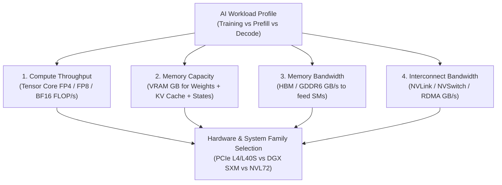
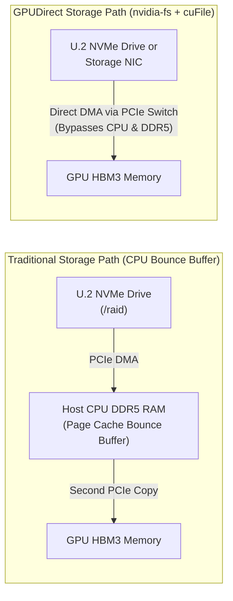

# 9.1 DGX system families and what they are for

| | |
|---|---|
| **Status** | Drafted (`dgx_families_lab.py`: 38 checks pass; hardware commands **untested** on live DGX) |
| **Level** | Basics |
| **Priority tier** | 1b |
| **Lab venue** | none (design / reading) + self-checking Python model (`code/part09/dgx_families_lab.py`) |
| **Part** | Part 9: NVIDIA systems and reference architectures |
| **Sources used** | `nvidia-devops` Volume 04 and Volume 05; *AI Systems Performance Engineering*; *Data Center Best Practices with DGX B200* (`superpod-b200-dc`); *NVIDIA DGX SuperPOD Reference Architecture Featuring NVIDIA DGX GB300 Systems* (`superpod-gb300-ra`) |

## Why this matters for AI infrastructure

A team buys sixteen cheap PCIe servers for a 70B chat service. In the demo, one user gets fast answers. At 64 concurrent users, the inter-token latency breaks the target, and the team learns that nobody checked memory bandwidth on the spec sheet. A different team assembles eight high-wattage GPUs in a generic chassis. Training runs, but at three in the morning the GPUs lower their clocks because the airflow was never tested for all eight at full load.

Both failures come from picking hardware without a model of the workload or of the machine. This chapter gives you two models to use together. Later chapters in Part 9 go deeper on node internals, HGX, Grace, NVL72 racks and facility cooling.

- **Workload-first accelerator selection.** Describe a job by four numbers: how much math it needs, how much memory it holds, how fast it reads that memory, and how fast GPUs must talk to each other. Those four numbers decide whether the job belongs on an L4, an H100, or a rack-scale Grace Blackwell system.
- **Appliance-level systems engineering.** NVIDIA sells DGX systems as tested units, from air-cooled eight-GPU nodes to liquid-cooled 72-GPU racks. Knowing what is inside one tells you how storage, networking, management, and power fit together.

## Prerequisites and outcomes

You should know basic server parts such as CPUs, PCIe buses, NVMe drives, power supplies, and Baseboard Management Controllers (BMCs) from Part 7. You should also know how a cluster manager provisions bare-metal GPU nodes and runs health checks, from Part 8.

After completing this chapter, you will be able to accomplish the following five engineering tasks.

- Size VRAM capacity and memory bandwidth for training and LLM inference, and score GPU candidates against facility power ceilings and Cost per 1M Tokens.
- Distinguish NVIDIA accelerator generations from Volta through Blackwell across PCIe cards, SXM modules, and Grace-coupled Superchips.
- Explain why a server assembled from loose parts has not been tested as a whole, and contrast air-cooled SXM DGX nodes with liquid-cooled rack-scale NVLink appliances.
- Trace how a DGX node separates its internal NVMe storage tiers and its three physical network planes.
- Run a baseline DGX qualification check while avoiding ad-hoc firmware flashes and PCIe Access Control Services traps.

---

## 1. Four limits that decide which GPU fits a workload

A team picks a GPU by the peak TFLOPS line on the datasheet and deploys it for low-batch LLM token generation. Production misses its latency target. Token generation reads every weight for each new token, so the GPU spends most of its time waiting on memory and very little time on math. Peak compute told the team nothing about that wait.

### 1.1 Compute, capacity, bandwidth and interconnect

A GPU is limited by four things: how fast it does math, how much memory it holds, how fast it reads that memory, and how fast it talks to other GPUs. Every AI workload leans on these four in different proportions.



- **Compute throughput.** This is how many matrix operations the Streaming Multiprocessors and Tensor Cores finish per second. Pre-training and the prefill phase of LLM inference are dense matrix multiplications, so they are compute-bound. Prefill speed sets Time to First Token.
- **Memory capacity.** This is how much data fits on the GPU package at once. If the job needs more than the GPU holds, it either crashes with an Out-Of-Memory error or spills over the PCIe bus to host RAM, which ruins throughput.
- **Memory bandwidth.** This is how fast bytes move from GDDR6 or High Bandwidth Memory into the compute units. The decode phase of LLM inference generates one token at a time and reads the whole weight matrix for each token. There is very little math per byte read, so decode speed is limited by memory bandwidth and sets Inter-Token Latency.
- **Interconnect bandwidth.** This is how fast data moves between GPUs inside a server and across servers over InfiniBand or RoCEv2 RDMA. When a model is split across GPUs with Tensor or Pipeline Parallelism, or gradients are synchronized with Data Parallelism, the interconnect sits on the critical path.

### 1.2 Calculating memory footprints: training versus inference

If an engineer sizes a cluster only for raw model weights, training crashes on the first optimizer step. Inference servers run out of memory as soon as concurrent users connect. Before looking at hardware catalogs, translate the workload into a gigabyte requirement.

- **Full training and fine-tuning.** Training stores far more than the model weights. The GPU also holds master weights, the Adam optimizer's momentum and variance, gradients, and the activations saved for backpropagation. As a rule of thumb, full training needs four to six times the raw weight footprint.
- **Static model weights in inference.** Inference does not store optimizer states or gradients. Static weight memory simply equals the parameter count multiplied by the bytes per parameter.
- **Dynamic KV cache in inference.** To avoid recomputing attention over earlier tokens at every decode step, the GPU keeps the Key and Value tensors of every active user sequence. With many users and long sequences, the KV cache can rival the weights in size.
- **Runtime safety margin in inference.** Multiply the sum of weights and KV cache by 1.2. The extra twenty percent covers CUDA context overhead, scratch buffers, and temporary activations.

```text
Workload VRAM sizing formulas and 70B worked example (dgx_families.py):
1. Full training (4x to 6x parameter weight rule):
   - 70B parameters in FP16/BF16 (2 bytes/param) = 140 GB raw weights
   - At a 5x training multiplier: 140 GB * 5 = 700.0 GB aggregate GPU memory

2. Static inference weights (70B model):
   - FP16 / BF16 (2 bytes/param): 140.0 GB
   - FP8 / INT8  (1 byte/param):   70.0 GB
   - FP4 / INT4  (0.5 bytes/param): 35.0 GB

3. Dynamic KV cache (Llama-3-70B: 80 layers, 8 KV heads, head size 128, 4,096-token context):
   Bytes per token = 2 (K and V) * layers * KV heads * head size * bytes per element
   FP16: 2 * 80 * 8 * 128 * 2 = 327,680 bytes per token
   Per user: 327,680 * 4,096 tokens = 1,342,177,280 bytes = 1.34 GB
   For 64 concurrent users: 64 * 1.342 GB = 85.90 GB of VRAM (FP8 cache: 42.95 GB)

4. Total inference VRAM with 1.2x runtime safety margin (20% buffer):
   - FP16 (64 users): (140.0 GB + 85.90 GB) * 1.2 = 225.90 GB * 1.2 = 271.08 GB
   - FP8  (64 users): (70.0 GB + 42.95 GB)  * 1.2 = 112.95 GB * 1.2 = 135.54 GB
     (135.54 GB fits on two 80 GB H100 GPUs = 160 GB total, or one 141 GB H200 GPU with little headroom)
```

The KV formula counts KV heads, not attention heads. Llama-3-70B has 64 attention heads, but groups of eight heads share one key and value vector, so only 8 KV heads are stored. Using 64 would overstate the cache eight times. Always read the number of KV heads from the model configuration.

### 1.3 The five-step selection scorecard and inference economics

A team buys cheaper PCIe servers to save capital, then finds that each server handles very few concurrent users, so each token costs about twice as much to serve. A five-step workflow keeps the choice tied to the workload instead of the hourly server price.

- **Step 1: Classify the primary workload.** Decide whether the cluster mainly runs pre-training, LoRA or full fine-tuning, real-time inference, batch inference, or rendering.
- **Step 2: Calculate the memory footprint.** Apply the training multiplier or the inference KV-cache and safety-margin formula to get the VRAM you need.
- **Step 3: Compare bandwidth with compute.** Check whether your latency target is set by compute-bound prefill or bandwidth-bound decode. An H100 SXM5 has about four times the memory bandwidth of an L40S, so it decodes about four times faster at small batch sizes. Its peak FP8 compute does not explain that gap.
- **Step 4: Decide the interconnect.** If a model does not fit on one GPU, Tensor Parallelism needs an `AllReduce` after every transformer layer. Over PCIe Gen5 the GPUs can lose a large share of each step waiting on the bus. High-throughput multi-GPU serving and multi-node training need SXM with NVLink.
- **Step 5: Apply facility and cost limits.** Remove any candidate that breaks a hard limit first, such as the rack power ceiling, a missing NVLink, or no native FP8 support.

```text
Selection scorecard weights, SLO targets, and economics (dgx_families.py):
- Latency SLO targets:
  - Prefill Time to First Token (TTFT): <= 500 ms at P99
  - Decode Inter-Token Latency (ITL):   <= 30 ms per token at P99 (faster than human reading speed)
- Bandwidth and interconnect comparison:
  - H100 SXM5 HBM3 bandwidth: 3.35 TB/s (H200: 4.8 TB/s) vs L40S GDDR6: 864 GB/s (~4x faster decode)
  - PCIe Gen5 x16 bandwidth: 64 GB/s unidirectional (128 GB/s bidirectional)
  - SXM NVLink bandwidth: 900 GB/s per GPU on Hopper, 1.8 TB/s per GPU on Blackwell
- Facility hard disqualifier example:
  - An 8.0 kW legacy air-cooled rack cannot power a single 10.2 kW DGX H100 node.
- Five weighted scorecard dimensions (the 1-5 normalization in code/part09/dgx_families.py is a convention of this lab):
  - Compute: 20% | Memory Capacity: 25% | Memory Bandwidth: 25% | Interconnect: 15% | Power/Thermal Fit: 15%
- Inference Cost per 1M Tokens formula:
  Cost per 1M Tokens ($) = (Hourly System Cost ($) / (Total Tokens/sec * 3,600)) * 1,000,000
```

Score the candidates that survive across the five weighted dimensions, then benchmark the shortlist using Goodput. Goodput is the number of requests per second that meet both the P99 TTFT and the P99 ITL targets. An SXM H100 or H200 costs more per hour than a PCIe server but often costs less per million tokens. Its HBM bandwidth and NVLink sustain far more tokens per second before the decode latency target is missed.

Before you compare prices, size the memory and rule out any server that cannot meet the decode latency target.

---

## 2. Accelerator generations and form factors: PCIe, SXM, and Superchips

A team moves a BF16 model onto older Turing cards and finds it running at a fraction of the expected speed, because the card emulates BF16 in software. Another team buys PCIe Hopper cards and finds them well below the SXM5 version of the same chip. Generation and form factor both matter. Once you know your workload's profile, match it to NVIDIA's portfolio on those two axes.

### 2.1 Five architectural generations: Volta to Blackwell

Each NVIDIA data center GPU generation added hardware that removed the main scaling bottleneck of its time. The table lists the main changes.

| Generation & Year | Flagship GPUs | Process & Scale | Key Architectural Shifts | Memory & Interconnect Leap |
|---|---|---|---|---|
| **Volta (2017)** | `V100` | 12nm | First Tensor Cores (4×4 FP16 matrix multiply-accumulate); first NVSwitch for 8-GPU all-to-all baseboards. | 16/32 GB HBM2 @ 900 GB/s; 300 GB/s NVLink; 300W TDP |
| **Ampere (2020)** | `A100`, `A30`, `A10` | 7nm | TF32 and hardware BF16; 2:4 structured sparsity; Multi-Instance GPU (MIG), which splits one GPU into up to 7 isolated instances. | 40/80 GB HBM2e @ 2.0 TB/s; 3rd-gen NVLink @ 600 GB/s; 400W TDP |
| **Ada Lovelace (2022)** | `L4`, `L40S` | 4nm | Inference, graphics and media parts: FP8 Tensor Cores, RT Cores, AV1 video engines, GDDR6, low power, no NVLink. | 24 GB (`L4`, 300 GB/s, 72W) / 48 GB (`L40S`, 864 GB/s, 350W) GDDR6 |
| **Hopper (2022–2024)** | `H100`, `H200` | 4nm (80B transistors) | Transformer Engine that switches between FP8 and FP16 or BF16 per layer; thread block clusters; Tensor Memory Accelerator; Confidential Computing. H200 moves to HBM3e. | `H100`: 80 GB HBM3 @ 3.35 TB/s; `H200`: 141 GB HBM3e @ 4.8 TB/s; 4th-gen NVLink @ 900 GB/s; 700W TDP |
| **Blackwell & Blackwell Ultra (2024–2025)** | `B200`, `GB200`, `B300`, `GB300` | 4NP **dual-reticle** (208B transistors) | Two dies joined by a 10 TB/s chip-to-chip link that software sees as one GPU; second-generation Transformer Engine with FP4 and FP6; fifth-generation NVLink for 72-GPU racks; a Decompression Engine and a RAS Engine for health telemetry. | `B200`: 180–192 GB HBM3e @ 8.0 TB/s; `B300`: 288 GB HBM3e; 1.8 TB/s NVLink 5; 1,000W–1,400W TDP |

:::note Reconciling B200 HBM3e capacity numbers across sources
The B200 die carries eight HBM3e stacks of 24 GB, which is 192 GB per GPU and 384 GB across the two GPUs of a GB200 Superchip. The DGX B200 system table lists 180 GB per GPU, which is 1,440 GB across the eight GPUs of a node and 13,440 GB across the 72 GPUs of a GB200 NVL72 rack. Both figures are real. Check the sheet for the exact product before you size a tight memory budget.
:::

### 2.2 The PCIe inference workhorses: T4, L4, and L40S

Most sites do not train frontier models. Enterprise data centers and edge sites with ordinary air-cooled racks mostly run inference on one of three PCIe cards. Pick the wrong one and a modern transformer service stalls on a missing precision format or a saturated PCIe bus.

- **NVIDIA T4.** This low-profile single-slot Turing PCIe Gen3 card draws 70W and needs no extra power connector. It suits older small models such as BERT, ResNet-50 and Whisper, and video transcoding. It has no BF16 or FP8 hardware, so a BF16 model on a T4 runs through slow software emulation.
- **NVIDIA L4.** This low-profile single-slot Ada Lovelace PCIe Gen4 card draws 72W and is the drop-in successor to the T4. It has more GDDR6 and fourth-generation Tensor Cores with native FP8. Its four hardware AV1 engines suit small LLMs and video analytics.
- **NVIDIA L40S.** This dual-slot full-height Ada Lovelace PCIe Gen4 card draws 350W and combines 48 GB of GDDR6, FP8 Tensor Cores, RT cores and media engines. Two or four of them fit in a standard OEM server and can serve a 70B FP8 model at low concurrency. It has no NVLink, so it misses the decode latency target at much lower concurrency than an H100.

```text
PCIe inference accelerator specifications (dgx_families.py):
- NVIDIA T4   (Turing, PCIe Gen3, 70W):       16 GB GDDR6 @ 320 GB/s, no BF16/FP8, no NVLink
- NVIDIA L4   (Ada Lovelace, PCIe Gen4, 72W): 24 GB GDDR6 @ 300 GB/s, native FP8 + BF16, 4x AV1 engines, no NVLink
- NVIDIA L40S (Ada Lovelace, PCIe Gen4, 350W): 48 GB GDDR6 @ 864 GB/s, 733 TFLOPS FP8 (with sparsity), no NVLink
  - 2x L40S = 96 GB VRAM | 4x L40S = 192 GB VRAM (all multi-GPU TP traverses ~64 GB/s PCIe)
```

### 2.3 Form factors: PCIe vs SXM vs Grace Superchips

Engineers new to AI hardware often ask why an H100 PCIe performs so differently from an H100 SXM5 when both use the same GH100 die. The form factor sets the power budget, the cooling, the memory type and the board wiring.

| Attribute | PCIe Form Factor (`H100 PCIe`) | SXM Form Factor (`H100 SXM5`) | Grace Superchip (`GH200` / `GB200` / `GB300`) |
|---|---|---|---|
| **Physical mounting** | Edge-connector add-in card in standard 2U/4U server | Mezzanine socket bolted directly to an 8-GPU HGX/DGX baseboard | Co-packaged Arm CPU + GPU(s) on a single board via **NVLink-C2C** |
| **Power envelope (TDP)** | **350W** (70W–350W across PCIe family) | **700W** (`H100/H200`) to **1,000W+** (`B200`) | **1,000W** (`GH200`) to **2,700W+** (`GB200` / `GB300`) |
| **VRAM type & bandwidth** | 80 GB **HBM2e** @ **2.0 TB/s** | 80 GB **HBM3** @ **3.35 TB/s** (`H200`: 141 GB **HBM3e** @ **4.8 TB/s**) | `GB200`: 384 GB **HBM3e** @ **16 TB/s** + up to 480 GB LPDDR5X @ **~500 GB/s** |
| **FP8 Tensor Compute** | ~1,513 TFLOPS (with sparsity) | ~3,958 TFLOPS (with sparsity, **>2× faster** sustained clocks) | `GB200`: up to 20 PFLOPS FP4 / 10 PFLOPS FP8 |
| **GPU-to-GPU interconnect** | PCIe Gen5 x16 (**64 GB/s** uni / **128 GB/s** bi) or optional 2-GPU NVLink bridge | **NVSwitch** full-mesh across all 8 GPUs (**900 GB/s** per GPU on Hopper; **1.8 TB/s** on Blackwell) | **NVLink-C2C** (**900 GB/s** CPU-GPU) + **NVLink 4/5** across up to 72 or 256 GPUs |

In a traditional x86 server, the CPU talks to the GPUs over PCIe Gen5 x16. That narrow bus becomes a bottleneck, called the PCIe tax, whenever large embedding tables, optimizer states or KV caches spill to host RAM.

Grace Superchips (GH200, GB200 and GB300) replace the PCIe link between CPU and GPU with NVLink-C2C. It runs at 900 GB/s bidirectional and uses under 5 pJ per bit. It joins the 72-core Arm Grace CPU's LPDDR5X memory and the GPU's HBM into one coherent address space. Chapter 9.4 covers Grace Superchips in full, and Chapter 10.7 covers GPU generations.

Use PCIe GPUs when the model fits on one or two cards in ordinary air-cooled racks. Choose SXM or Grace Superchips when multi-GPU Tensor Parallelism or multi-node training is on the critical path.

---

## 3. Why DGX exists and the DGX family lineup

Many vendors sell servers with NVIDIA GPUs, so buyers ask why NVIDIA also sells DGX. The answer shows up when a team builds a server from eight high-wattage GPUs, two CPUs and eight network cards taken from separate catalogs. Under load it throttles, GPUs drop off the bus, and traffic stalls on the link between the CPU sockets.

### 3.1 Why a server built from loose parts underperforms

A server built from loose parts has not been tested as a whole. Each GPU, NIC, and CPU may be a good part, but nobody has checked how they behave together at full load. Four problems show up again and again.

- **Internal topology.** A naive board routes GPU-to-NIC traffic across the CPU socket link, such as Intel UPI or AMD Infinity Fabric. This happens when the PCIe switches are not balanced one-to-one with the GPUs. Under a multi-node collective, cross-socket traffic can cut GPUDirect RDMA throughput sharply.
- **Thermal throttling.** Eight SXM GPUs in a dense collective put out a lot of heat in one chassis, next to the NVSwitches and optical transceivers. If airflow and heatsinks are not designed for all of them at peak, the GPUs quietly lower their clocks at three in the morning to protect the silicon.
- **Firmware mismatches.** An 8-GPU server holds dozens of separate controllers: the BMC, BIOS, motherboard CPLDs, PCIe Gen5 retimers, four NVSwitch chips, eight GPU VBIOSes and ten NIC or DPU firmwares. Update one out of step with the rest and GPUs can vanish from the PCIe bus or NVLink training can fail.
- **Finger-pointing.** When a training job hangs inside `ncclAllReduce`, the server vendor blames the NIC firmware and the switch vendor blames the CUDA driver. Meanwhile the cluster sits idle at thousands of dollars an hour.

DGX answers these four problems with one tested design. The chassis, PCIe and NVSwitch wiring, the unified DGX Firmware Container, DGX OS and the NGC container stack are validated together and ship as one product with one support contact.

If you are choosing between a DGX and a server from another vendor, ask who owns the whole stack when a job hangs.

### 3.2 The three DGX system archetypes and generation comparison

The DGX line falls into three groups. The grouping is this handbook's own, built from NVIDIA's published system descriptions.

- **Deskside development appliances.** The DGX Station family is quiet enough for an office and suits small research teams without a data center room. It runs the same DGX OS and NGC container stack as cluster nodes.
- **8-GPU air-cooled SXM compute nodes.** DGX-1, DGX-2, DGX A100, DGX H100, DGX H200 and DGX B200 are self-contained rack servers. Eight SXM GPUs talk to each other over an NVSwitch baseboard, and eight NICs connect the node to the InfiniBand or RoCEv2 fabric.
- **Rack-scale multi-node NVLink appliances.** DGX GH200, DGX GB200 NVL72 and DGX GB300 NVL72 go past the 8-GPU chassis. They extend NVLink across a 72-GPU rack, or across a multi-rack fabric of up to 256 GPUs, so the whole rack behaves like one large GPU.

| DGX System | Archetype & Form Factor | GPUs & CPUs | Total GPU Memory & HBM Bandwidth | NVLink Generation & Fabric Bandwidth | Compute Network (East-West) | Max Power & Cooling |
|---|---|---|---|---|---|---|
| **DGX A100** | 6U air-cooled node (271.5 lbs) | 8x A100 SXM4 (80 GB) + dual 64-core AMD EPYC | **640 GB** HBM2e @ **16.3 TB/s** | NVLink 3 (6 NVSwitches): **600 GB/s** per GPU (**4.8 TB/s** agg) | 8x 200 Gbps HDR InfiniBand (ConnectX-6) | **6.5 kW** (Air) |
| **DGX H100** | 8U air-cooled node (nearly 300 lbs / 130 kg) | 8x H100 SXM5 (80 GB) + dual Intel Xeon Platinum 8480C (112 cores, 2 TB DDR5) | **640 GB** HBM3 @ **26.8 TB/s** | NVLink 4 (4 NVSwitches): **900 GB/s** per GPU (**7.2 TB/s** bi / **3.6 TB/s** bisection) | 8x 400 Gbps NDR InfiniBand (ConnectX-7) = **3.2 Tbps** | **10.2 kW** (Air) |
| **DGX H200** | 8U air-cooled node (nearly 300 lbs / 130 kg) | 8x H200 SXM (141 GB) + dual Intel Xeon Platinum 8480C (112 cores, 2 TB DDR5) | **1,128 GB** HBM3e @ **38.4 TB/s** | NVLink 4 (4 NVSwitches): **900 GB/s** per GPU (**7.2 TB/s** agg) | 8x 400 Gbps NDR InfiniBand (ConnectX-7) = **3.2 Tbps** | **10.2 kW** (Air) |
| **DGX B200** | 10U air-cooled node (>287.6 lbs / 130 kg, 17.5 × 19.0 × 35.3 in) | 8x B200 SXM (180 GB) + dual x86 host CPUs (up to 4 TB DDR5) | **1,440 GB** HBM3e @ **64 TB/s** | NVLink 5 (NVSwitch baseboard): **1.8 TB/s** per GPU (**14.4 TB/s** all-to-all) | 8x 400 Gbps (ConnectX-7) or 800 Gbps (ConnectX-8) + 2x BlueField-3 | **14.3 kW** (Air; 96 dB @ 25°C, 101 dB @ 30°C) |
| **DGX GH200** | Multi-rack NVLink Switch appliance | Up to **256x GH200** Superchips (256 Grace + 256 Hopper) | Up to **144 TB** shared coherent memory (HBM3 + LPDDR5X) | Two-tier NVLink Switch System (**900 GB/s** per GPU across all 256 GPUs) | Quantum-2 400 Gbps NDR InfiniBand | Rack-scale (Liquid/Air) |
| **DGX GB200 NVL72** | 48U liquid-cooled rack (18 compute trays + 9 NVLink switch trays) | **36x Grace CPUs + 72x B200 GPUs** (36x GB200 Superchips) | **13.4–13.8 TB** HBM3e (@ **576 TB/s**) + **17 TB** LPDDR5X (**~30 TB** total fast memory) | NVLink 5 rear copper backplane (passive copper cables): **1.8 TB/s** per GPU (**130 TB/s** agg) | 72x 400 Gbps (ConnectX-7) or 800 Gbps (ConnectX-8) | **~120 kW** per rack (Direct Liquid Cooling) |
| **DGX GB300 NVL72** | 48U hybrid liquid+air rack (18 compute trays + 9 NVLink switch trays + 8x 33 kW power shelves) | **36x Grace CPUs + 72x B300 GPUs** (36x GB300 Superchips) | **20.7 TB** HBM3e (72 × 288 GB) + Grace LPDDR5X | NVLink 5 blind-mate backplane (9 switch trays): **1.8 TB/s** per GPU (**130 TB/s** agg) | 4x ConnectX-8 (**800 Gbps** Quantum-X800 IB) + 1x BlueField-3 (2x400G) per tray | **~150 kW** per rack (**1.2 MW** per 8-rack Scalable Unit) |

### 3.3 Why rack-scale NVL72 changes the physics of trillion-parameter models

A large Mixture-of-Experts or trillion-parameter model eventually outgrows an 8-GPU server. Inside a DGX H100 or DGX B200, the eight GPUs talk at NVLink speed. The ninth GPU sits in another server, and traffic to it slows to the speed of a network card, about eighteen times lower. Tensor Parallelism and expert routing stall at that step.

The DGX GB200 NVL72 and DGX GB300 NVL72 remove that wall. Eighteen compute trays and nine NVLink switch trays are joined by a passive copper backplane at the back of the rack. All 72 GPUs share full NVLink 5 bandwidth in one NVLink domain, without the power draw and failure rate of optical cabling for 72 GPUs. Chapter 9.5 covers the compute tray, switch tray, power shelf and crossbar in detail.

Choose an 8-GPU air-cooled DGX when your facility is air-cooled and Tensor Parallelism fits in eight GPUs. Choose a liquid-cooled NVL72 rack when the model needs a 72-GPU NVLink domain.

```text
Breaking the 8-GPU NVLink wall in NVL72 (dgx_families.py):
- Intra-node 8-GPU NVLink bandwidth: 900 GB/s (Hopper) to 1,800 GB/s (Blackwell) per GPU
- Inter-node NIC bandwidth: 50 to 100 GB/s per GPU (an 18x bandwidth cliff beyond 8 GPUs)
- NVL72 rack architecture:
  - 18 compute trays (36 Grace CPUs + 72 Blackwell GPUs) + 9 NVLink switch trays
  - Blind-mate rear passive copper backplane: 1.8 TB/s per GPU = 130 TB/s aggregate NVLink
  - Rack compute throughput: 1.44 ExaFLOPS (FP4) in a single 72-GPU NVLink domain
```

---

## 4. Inside the DGX data paths: storage tiers, GPUDirect Storage, and the three network planes

Suppose a training job reads its dataset through the host CPU page cache, or shares network ports between storage traffic and GPU collectives. The GPUs then spend much of their time waiting for data.

Every DGX is wired so that bytes move directly between NVMe drives, network cards and GPU memory, without passing through the host CPU or system DDR5 RAM. Chapter 9.2 walks through the two-tray layout and the four-switch PCIe Gen5 complex.

### 4.1 The two internal NVMe storage tiers and GPUDirect Storage

A data scientist saves the only copy of a checkpoint on the node's local `/raid` volume, and one NVMe drive failure wipes out days of training. To keep dataset reads off shared network storage while protecting the operating system, a DGX node splits its flash into two separate tiers.



- **Tier 1: OS and Management Drives.** Mirrored M.2 NVMe drives in Hardware RAID 1 hold DGX OS, system logs, and container layers under `/var/lib/containerd`.
- **Tier 2: Ephemeral Data Cache.** Dedicated U.2 or E1.S NVMe drives in RAID 0 mounted at `/raid` are striped for high sequential read bandwidth and wired directly under the PCIe Gen5 switches. Because `/raid` is a RAID 0 stripe with zero parity or mirroring, losing a single drive destroys the entire volume. Never store the sole copy of model checkpoints or source code on `/raid`. Always replicate checkpoints immediately to the shared Parallel File System.
- **GPUDirect Storage.** Ordinary Linux I/O copies data from NVMe into a bounce buffer in DDR5 RAM and then across PCIe a second time into GPU memory. GPUDirect Storage uses the `nvidia-fs` kernel module and the `cuFile` API to move data directly between local NVMe or remote RDMA storage and the GPU. Chapter 13.3 covers it in depth.

```text
Internal NVMe storage layout by platform (dgx_families.py):
- Tier 1 (OS and Management):
  - DGX H100 / H200: 2x 1.92 TB M.2 NVMe in Hardware RAID 1 (1.92 TB usable)
  - DGX GB300 compute tray: 1x 1.92 TB M.2 NVMe OS drive
- Tier 2 (Ephemeral /raid scratch cache in RAID 0, zero redundancy):
  - DGX H100 / H200: 8x 3.84 TB U.2 NVMe = 30.7 TB raw in RAID 0 at /raid (50+ GB/s sequential read)
  - DGX GB300 compute tray: 4x 3.84 TB E1.S NVMe in RAID 0
```

### 4.2 Three physical network planes and the rail-optimized topology

If GPU collectives, storage reads and BMC management share one network, a storage burst slows one link and stalls every GPU in the collective. A DGX node therefore keeps three kinds of traffic on three physically separate networks. Chapters 9.6 and 9.9 show how they grow at SuperPOD scale.

| Network Plane | Hardware in DGX H100 / H200 / B200 | Hardware in DGX GB300 Compute Tray | Traffic Carried & Key Rule |
|---|---|---|---|
| **1. Compute Fabric (East-West)** | **8x single-port ConnectX-7** (400 Gbps NDR IB or RoCEv2 = **3.2 Tbps / 400 GB/s**) | **4x ConnectX-8** (**800 Gbps** Quantum-X800 XDR IB = **3.2 Tbps** per tray) | Pure GPU-to-GPU NCCL collectives. Uses **1:1 GPU-to-NIC pairing** under the same PCIe switch + **`nvidia-peermem`** (GPUDirect RDMA) + **Rail-Optimized Fat-Tree** (NIC i → Leaf Switch i for 1-hop same-rail routing). |
| **2. Storage & In-Band Management Fabric (North-South)** | **2x dual-port BlueField-3 DPUs** (or ConnectX-7 NICs, up to 4x 200/400 GbE) | **1x BlueField-3 DPU** (**2x 400 Gbps** Ethernet) | Parallel File System I/O (GDS), Slurm/Kubernetes control plane, NGC pulls, Prometheus, SSH. Never mix with East-West NCCL traffic. |
| **3. Out-of-Band (OOB) Management** | **1x 1 GbE RJ45** dedicated BMC port | **1x 1 GbE RJ45** BMC port on trays, switches, and power shelves | **Redfish** REST APIs, IPMI, KVM-over-IP, virtual media on an isolated OOB management VLAN. |

Before you wire a new node, confirm that `/raid` is treated as scratch and that each of the three networks lands on its own switches.

---

## 5. The DGX management plane: BMC, Redfish, NVSM, DCGM, and unified firmware

An operator flashes a NIC or BIOS update from a component vendor onto a DGX node, and afterwards a GPU drops off the PCIe bus. Managing a DGX fleet takes two kinds of tools: out-of-band control that works when the host OS is down, and in-band daemons that run while jobs are running. Part 7 covers the Redfish protocol, and Chapter 9.2 covers the two-BMC layout and the 46-component firmware inventory.

- **Out-of-Band Redfish APIs.** The dedicated 1 GbE BMC port on an isolated management VLAN exposes Redfish endpoints for power state, thermal telemetry, power draw, and fleet firmware staging.
- **NVIDIA System Management.** The in-band `nvsm` daemon watches the whole chassis: the RAID 1 OS mirror, the `/raid` drives, DIMM errors, PCIe links, fans, power supplies and NVSwitches. `sudo nvsm show health` reports status, and `sudo nvsm dump health` creates the support bundle NVIDIA Enterprise Support asks for.
- **NVIDIA Data Center GPU Manager.** The `dcgmi` tool streams GPU and NVSwitch telemetry to Prometheus through `dcgm-exporter`. It also runs active stress tests at four levels, `dcgmi diag -r 1` through `-r 4`, from Slurm prologs and Kubernetes admission gates.
- **Firmware.** A DGX has 46 firmware components that depend on each other. Never flash one of them from a chip vendor's package. Use the unified DGX Firmware Container (`show_version` and `update_fw all`), and follow it with a full AC power cycle through Redfish when GPU-tray components change.

```text
Key DGX Redfish endpoints and firmware container workflow:
- /redfish/v1/Systems/DGX         (power state, hardware inventory, ComputerSystem.Reset)
- /redfish/v1/Chassis/DGX/Thermal (GPU, NVSwitch, inlet temperatures, and fan RPMs)
- /redfish/v1/Chassis/DGX/Power   (real-time wattage draw and power supply status)
- /redfish/v1/UpdateService       (fleet firmware staging)
- Unified firmware container:     nvfw-dgx-h100_<version>.run (show_version / update_fw all)
```

Before you touch firmware on a DGX, check that you are using the unified container and that a maintenance window allows the AC power cycle.

---

## 6. Power, cooling, and physical facility readiness

A team orders DGX nodes for a data hall built for 5 to 8 kW web racks. On delivery day breakers trip under load, the rack doors will not close over the rear power cords, and the floor tiles are not rated for the weight. Before a DGX goes into a data center, check power density, power supply redundancy, floor load and rack depth. Chapters 9.7 and 9.11 cover these at facility scale.

- **DGX H100 and H200.** Each 8U node draws up to 10.2 kW from six 3.3 kW power supplies, wired three and three to Feed A and Feed B. If a whole feed is lost, the remaining three supplies run close to full load. Air-cooled rooms usually cap racks at two to four nodes, with hot and cold aisle containment.
- **DGX B200.** Each 10U air-cooled node draws up to 14.3 kW and needs five of its six power supplies energized. A three-and-three split across two feeds therefore fails when one feed is lost, and NVIDIA does not recommend interleaving feeds this way. The standard patterns are two nodes per rack, or four nodes per 52U rack, on two three-phase circuits.
- **DGX GB200 and GB300 NVL72.** A rack draws roughly 120 kW (GB200) to 150 kW (GB300). The GB300 rack has eight 33 kW power shelves with extra energy storage and RJ45 power-brake ports. The GPUs and CPUs are liquid cooled with cold plates connected to a Coolant Distribution Unit.
- **Weight and depth.** A DGX H100 weighs nearly 300 pounds, and a filled NVL72 rack is on the order of 3,000 pounds. Check the floor load rating and use a rated server lift. The chassis is more than 35 inches deep and needs room behind it for cable bends. NVIDIA's DGX B200 guidance sets a minimum cabinet of 600 by 1,100 mm and 48U, and recommends 700 by 1,200 mm and 52U.

```text
Facility power, airflow, weight, and dimension envelopes (dgx_families.py):
1. DGX H100 / H200 (8U air-cooled node):
   - Max power & heat: 10.2 kW max, ~34,800 BTU/hr (34,804 BTU/hr exact), >1,000 CFM airflow
   - PSU redundancy:   6x 3.3 kW PSUs (19.8 kW installed) in 3+3 redundancy (3 * 3.3 kW = 9.9 kW on 1 feed)
   - Power cords:      3-phase 208V / 415V C19/C20 cords; 2 to 4 nodes per rack (20.4 to 40.8 kW)
   - Weight & depth:   nearly 300 lbs (130 kg); 890-897 mm (>35 in) deep -> 1,200 mm deep rack recommended

2. DGX B200 (10U air-cooled node):
   - Max power & flow: 14.3 kW max, 150 CFM/kW; requires 5 of 6 PSUs (N+1) energized
   - 2 nodes/rack:     28.6 kW peak, 4,290 CFM airflow, 2x 380V 3-phase 32A circuits (42U/52U rack)
   - 4 nodes/52U rack: 57.2 kW peak, 8,580 CFM airflow, 2x 415V 3-phase 60A circuits
   - Scalable Unit:    458 kW per 32-node SU; 127 nodes max in a 4-SU SuperPOD (1 UFM appliance displaced)
   - Weight & size:    >287.6 lbs (130 kg), 17.5 x 19.0 x 35.3 in; rack minimum 600 x 1,100 mm and 48U, recommended 700 x 1,200 mm and 52U

3. DGX GB200 / GB300 NVL72 (48U liquid-cooled rack):
   - Rack power:       ~120 kW (GB200); GB300 ~150 kW (1.2 MW per 8-rack Scalable Unit / 8)
   - Power shelves:    8x 33 kW shelves (6x 5.5 kW PSUs per shelf) + capacitor storage + rear RJ45 power brakes
   - Cooling & weight: Direct Liquid Cooling (DLC) cold plates + CDU; filled rack about 3,000 lbs
```

Before delivery day, get the rack depth, the floor rating and the power circuits confirmed in writing.

---

## Commands and configurations that matter

When a new DGX node arrives on the data center floor or returns from maintenance, run this five-stage baseline and data-path validation sequence before releasing it to Slurm or Kubernetes. These hardware commands are untested on live DGX hardware in this authoring environment, while their validation logic is verified in `code/part09/dgx_families_lab.py`.

### 1. Out-of-Band Redfish health, thermal, and power check

Query the DGX BMC over its isolated OOB management network to confirm system health and power supply redundancy before booting workloads.

```bash
# 1. Inspect overall system health and power state via Redfish
curl -sk -u "${BMC_USER}:${BMC_PASS}" \
  "https://${BMC_IP}/redfish/v1/Systems/DGX" | jq '{PowerState, Status}'

# 2. Check PSU redundancy and real-time wattage draw
curl -sk -u "${BMC_USER}:${BMC_PASS}" \
  "https://${BMC_IP}/redfish/v1/Chassis/DGX/Power" \
  | jq '.PowerControl[0].PowerConsumedWatts, .PowerSupplies[] | {Name, Status, LineInputVoltage}'
```

### 2. Unified DGX Firmware Container check

Verify that all internal microcontrollers across the BMC, BIOS, CPLDs, PCIe retimers, NVSwitches, GPU VBIOS, and NICs match the current NVIDIA-validated matrix.

```bash
# Inspect current vs target firmware versions across all DGX components
sudo ./nvfw-dgx-h100_24.05.1.run show_version

# Apply unified updates atomically (only during a scheduled maintenance window)
sudo ./nvfw-dgx-h100_24.05.1.run update_fw all
```

### 3. In-band GPU, NVLink, PCIe ACS, storage, and kernel module baseline

Run these six host checks to confirm that all GPUs, NVLink sub-links, GPUDirect kernel modules, PCIe switch settings, and storage mounts are healthy.

```bash
# 1. Verify all 8 GPUs are visible and check volatile uncorrected ECC errors (must be 0)
nvidia-smi --query-gpu=index,name,pci.bus_id,temperature.gpu,ecc.errors.uncorrected.volatile.total \
  --format=csv

# 2. Inspect topology matrix (expect NV18 across all 8 GPUs and NODE/SYS to mlx5_0..mlx5_7)
nvidia-smi topo -m

# 3. Verify all 18 NVLink links per GPU (144 total endpoints) are active
nvidia-smi nvlink --status | grep -c "GB/s"

# 4. Verify GPUDirect RDMA (nvidia_peermem) and GPUDirect Storage (nvidia_fs) modules
lsmod | grep -E "nvidia_peermem|nvidia_fs"

# 5. Verify PCIe Access Control Services (ACS) is disabled on PCIe switches (expect SrcValid-)
sudo lspci -vvv | grep -i "ACSCtl:" | grep "SrcValid+" || echo "PASS: PCIe ACS disabled"

# 6. Verify OS RAID 1 mirror and ephemeral 30TB /raid scratch mount
df -h / /raid
```

### 4. NVSM chassis audit, DCGM Level 3 active diagnostics, and InfiniBand rail check

Verify full-chassis health with `nvsm`, run active GPU and NVSwitch stress tests with `dcgmi`, and confirm that all eight compute fabric ports are active.

```bash
# 1. Run full DGX chassis health check via NVIDIA System Management
sudo nvsm show health

# 2. Run DCGM Level 3 active hardware, memory, and PCIe/NVLink stress test (~10-15 mins)
dcgmi discovery -l
dcgmi diag -r 3

# 3. Confirm all 8 East-West compute rails (mlx5_0..mlx5_7) are Active at 400 Gbps NDR
ibstat | grep -E "CA '|State:|Physical state:|Rate:"
```

### 5. Data-path throughput benchmarks

Run intra-node collective and GPUDirect Storage read benchmarks to confirm that actual data-path bandwidth matches hardware specifications.

```bash
# 1. Intra-node 8-GPU NVSwitch AllReduce benchmark (expect ~300-350+ GB/s busbw on DGX H100)
./build/all_reduce_perf -b 8M -e 16G -f 2 -g 8

# 2. GPUDirect Storage (GDS) read benchmark from /raid directly into GPU 0 HBM3 (-x 0 = GDS mode)
/usr/local/cuda/gds/tools/gdsio -f /raid/gds_test.dat -d 0 -w 4 -s 10G -i 1M -x 0 -I 0
```

---

## How it fails

### 1. The PCIe ACS trap

Symptom: intra-node `nccl-tests` or GPUDirect RDMA bandwidth falls to about 15 to 25 GB/s, against more than 300 GB/s over NVLink or about 45 GB/s per NIC in `ib_write_bw --use_cuda=0`, and host CPU cores get busy.

Cause: PCIe Access Control Services (ACS) came back on after a BIOS reset or a bad firmware setting. Every peer-to-peer packet between a GPU and its NIC on the same PCIe switch now detours up through the CPU root complex.

Fix: run `sudo lspci -vvv | grep -i ACSCtl`. If you see `SrcValid+`, disable ACS in the BIOS or run a start-up script that clears the ACS bits (`setpci -s <bdf> ECAP_ACS+0x6.w=0000`). Then verify with `p2pBandwidthLatencyTest`.

### 2. Silent fallback to TCP in multi-node NCCL

Symptom: the job runs without errors, but throughput falls ten to twenty times, to about 1 to 5 GB/s of `busbw`, while the north-south management network saturates.

Cause: `NCCL_IB_DISABLE=1` was left in the container environment, the container lacks `IPC_LOCK` or `/dev/infiniband` access, or `nvidia-peermem` is not loaded. NCCL gives up GPUDirect RDMA over the eight 400G compute rails and falls back to TCP sockets over `eth0` or `bond0`.

Fix: set `NCCL_DEBUG=INFO` and look in the job log for `NET/IB` versus `NET/Socket`. Load the module with `sudo modprobe nvidia-peermem`, pass `--ipc=host --ulimit memlock=-1` to the container, and check that `ibstat` shows all eight compute adapters as `State: Active`.

### 3. Checkpoints lost when one `/raid` drive fails

Symptom: one U.2 NVMe drive reports SMART media errors and the whole 30.7 TB `/raid` volume becomes unreadable, taking 48 hours of checkpoints with it.

Cause: the team treated `/raid` as durable. It is an eight-drive RAID 0 stripe with no parity and no mirror, meant only as a fast dataset cache and scratch area.

Fix: replace the drive and rebuild `/raid`. Then set a cluster rule that checkpoints go straight to the shared parallel file system, or that a background job copies them off `/raid` after every save.

### 4. A GPU falls off the bus after a one-off firmware flash

Symptom: after flashing a NIC or BIOS image from a component vendor, `nvidia-smi` reports only seven GPUs (`GPU 0000:xx:00.0: Fallen off the bus`), or `nvidia-smi nvlink --status` shows degraded links such as `16/18`.

Cause: one controller was updated out of step with the PCIe Gen5 retimers, the motherboard CPLDs and the NVSwitch firmware. Link training on the baseboard no longer works.

Fix: never flash a single component on a DGX. Run `sudo ./nvfw-dgx-h100_<version>.run show_version` to find the mismatch, run `update_fw all` from the official DGX Firmware Container, and finish with a full AC power cycle through Redfish so every CPLD and retimer reloads.

### 5. Decode latency target missed on PCIe GPUs at high concurrency

Symptom: a 70B FP8 model on four L40S cards passes single-user tests, but at 64 concurrent users the P99 Inter-Token Latency rises above 34 ms and breaks the 30 ms target.

Cause: the team sized for memory (four cards give 192 GB against 135.54 GB needed) and for peak FP8 TFLOPS. Decode is limited by memory bandwidth, and tensor-parallel traffic is limited by PCIe. The L40S offers 864 GB/s of GDDR6 and about 64 GB/s of PCIe. An H100 or H200 offers 3.35 to 4.8 TB/s of HBM and 900 GB/s of NVLink.

Fix: move high-concurrency 70B real-time serving to DGX H100, H200 or B200, where HBM bandwidth and 900 to 1,800 GB/s of NVLink keep P99 ITL under 20 ms and lower the cost per million tokens.

---

## Hands-on lab

The lab is a self-checking Python model (`code/part09/dgx_families.py`) with a runner (`code/part09/dgx_families_lab.py`). It has five modules.

| Lab module | What the Python model verifies |
|---|---|
| **1. KV-cache and workload VRAM sizing** | Evaluates 70B FP16 versus FP8 inference with the 1.2× runtime safety margin and the 4× to 6× training multiplier |
| **2. GPU Selection Scorecard** | Enforces hard disqualifiers for rack power limits, NVLink, and FP8, plus weighted scoring across Compute, Memory Capacity, Memory Bandwidth, Interconnect, and Power Fit |
| **3. Inference Shortlist Benchmark Evaluator** | Checks P99 TTFT ≤ 500 ms, P99 ITL ≤ 30 ms, Goodput, and Cost per 1M Tokens |
| **4. DGX Rack Power, Cooling, and Airflow Planner** | Models DGX H100 (10.2 kW / 34,804 BTU/hr), DGX B200 2-node (28.6 kW / 4,290 CFM) and 4-node (57.2 kW / 8,580 CFM) racks, and DGX GB200/GB300 NVL72 liquid cooling |
| **5. DGX Node Readiness Baseline Auditor** | Verifies 8/8 GPUs, 18/18 NVLink sub-links, 0 uncorrected ECC errors, 8/8 Active IB rails, `/raid` mount and checkpoint safety, `nvidia-peermem` + `nvidia-fs` modules, PCIe ACS disabled, and unified firmware compliance |

Run the lab from the repository root.

```bash
python3 -B code/part09/dgx_families_lab.py
```

Expected output verified in this repository appears below.

```text
=== Chapter 9.1 Lab: DGX System Families & Accelerator Selection ===
  [PASS] Llama-3-70B GQA 4k-context KV cache for 1 user == 1.34 GB
  [PASS] Llama-3-70B GQA 4k-context KV cache for 64 users == 85.90 GB
  [PASS] 70B FP16 weights == 140.0 GB
  [PASS] 70B FP16 + 85.9 GB KV cache with 1.2x overhead == 271.08 GB
  [PASS] 70B FP8 weights (70 GB) + FP8 KV cache (42.95 GB) * 1.2 == 135.54 GB
  [PASS] 70B training VRAM at 5x rule == 700.0 GB
  ...
  [PASS] Flags enabled PCIe ACS (SrcValid+) forcing P2P through CPU root complex
  [PASS] Flags ad-hoc individual firmware flashing outside the DGX Firmware Container
  [PASS] Rejects non-positive KV cache parameters

Summary: 38 passed, 0 failed (total 38)
```

---

## Exercises

1. A 13B model has 40 layers, 40 KV heads and a head size of 128. It serves 24 users at 4,096 tokens of context. First compute the KV bytes per token as 2 times layers times KV heads times head size times bytes per element, using 2 bytes for FP16. Then add the 26 GB of FP16 weights, multiply by 1.2, and say how much memory the service needs. Repeat with FP8 weights and an FP8 cache. Does either version fit on one 80 GB H100?
2. Run the lab script and read its output. Pick three checks. For each, say in one sentence which rule from the chapter it tests.
3. A site has racks rated at 8.0 kW. Using Section 6, can it host a DGX H100, a DGX B200, or a GB300 NVL72 in one rack? For each system it cannot host, say what must change.
4. Draw the three network planes of one DGX H100 on paper. Label each plane with its speed and the traffic it carries.
5. A DGX node has just been repaired. Write a five-line checklist to run before it returns to the scheduler. Give the command and the expected result on each line.
6. Use the cost-per-million-tokens formula to compare an SXM server with a PCIe server. Take the workload rates from the lab script. Why does the server with the higher hourly rate end up cheaper per million tokens at high concurrency?

## Checkpoint questions (20)

<details>
<summary>**1. Why does an H100 SXM5 generate tokens roughly 4x faster than an L40S during batch-1 LLM decode, even though both GPUs have high peak FP8 Tensor TFLOPS?**</summary>

Autoregressive LLM decode generates one token at a time sequentially and must read the entire model weight matrix from VRAM into the Streaming Multiprocessors for every single token produced. That low arithmetic intensity makes decode strictly memory-bandwidth-bound rather than compute-bound. An H100 SXM5 provides 3.35 TB/s of HBM3 memory bandwidth compared to 864 GB/s of GDDR6 bandwidth on an L40S, giving it roughly a fourfold bandwidth advantage.
</details>

<details>
<summary>**2. Calculate the total inference VRAM required for Llama-3-70B in FP16 serving 64 concurrent users with a 4,096-token context window (80 layers, 8 KV heads, head size 128), and explain how quantizing to FP8 changes the hardware requirement.**</summary>

In FP16, the weights require 140 GB and the KV cache for 64 users requires 85.90 GB, totaling 271.08 GB with the twenty percent runtime safety margin. That footprint requires at least four 80 GB GPUs or two 141 GB H200 GPUs. Quantizing both weights and KV cache to FP8 cuts the total with the safety buffer to 135.54 GB, which fits on two 80 GB H100 GPUs or a single 141 GB H200 GPU.
</details>

<details>
<summary>**3. Why is the NVIDIA T4 a dangerous choice for modern BF16 or FP8 transformer workloads despite its convenient 70W low-profile PCIe form factor?**</summary>

The T4 is based on the Turing architecture and lacks hardware support for both BF16 and FP8. Attempting to run modern BF16 or FP8 models on a T4 either fails or triggers software emulation, causing severe latency spikes. The NVIDIA L4 is the drop-in low-power replacement with native FP8 and BF16 support plus four AV1 media engines.
</details>

<details>
<summary>**4. What is the "PCIe tax," and how do Grace Superchips (GH200, GB200, GB300) eliminate it?**</summary>

In traditional x86 servers, the CPU and GPU communicate across a PCIe Gen5 x16 bus capped at 64 GB/s unidirectional and 128 GB/s bidirectional. Whenever workloads spill embeddings, KV caches, or optimizer states to host RAM, the GPU stalls waiting on PCIe transfers. Grace Superchips replace that PCIe link with NVLink-C2C running at 900 GB/s bidirectional with hardware cache coherence and a unified virtual address space across CPU LPDDR5X and GPU HBM.
</details>

<details>
<summary>**5. Contrast the two internal NVMe storage tiers inside a DGX H100. Why is storing your only copy of training checkpoints on `/raid` a critical operational error?**</summary>

Tier 1 uses two 1.92 TB M.2 NVMe drives in Hardware RAID 1 for DGX OS, logs, and container runtimes. Tier 2 uses eight 3.84 TB U.2 NVMe drives in RAID 0 mounted at `/raid`, wired directly to the PCIe switches for high-speed local dataset caching and scratch I/O via GPUDirect Storage. Because `/raid` is a RAID 0 stripe with zero redundancy, if any one of the eight U.2 drives fails, the entire `/raid` volume is lost.
</details>

<details>
<summary>**6. What are the three physical network planes in a DGX system, and why does the East-West Compute Fabric use eight separate NICs in a Rail-Optimized topology?**</summary>

The three planes are the East-West Compute Fabric, the North-South Storage and In-Band Management Fabric, and the Out-of-Band Management Network on a dedicated 1 GbE BMC port. Using one dedicated NIC per GPU behind the same PCIe switch enables GPUDirect RDMA via `nvidia-peermem` without crossing the CPU. Connecting each NIC to its corresponding rail leaf switch lets matching GPUs on different servers communicate in a single switch hop without traversing spine switches.
</details>

<details>
<summary>**7. How does PSU redundancy work on a DGX H100, and what are the two official rack deployment patterns for an air-cooled DGX B200?**</summary>

A DGX H100 uses six 3.3 kW PSUs in three-plus-three redundancy split across two power feeds. If an entire power feed fails, the remaining three PSUs keep the server running near full capacity at 9.9 kW. An air-cooled DGX B200 deploys either at two systems per rack drawing 28.6 kW and 4,290 CFM, or at four systems per 52U rack drawing 57.2 kW and 8,580 CFM.
</details>

<details>
<summary>**8. Why do DGX GB200 NVL72 and DGX GB300 NVL72 use a blind-mate rear copper NVLink backplane across 72 GPUs inside a single rack instead of optical cables across multiple racks?**</summary>

In an 8-GPU node, scaling beyond eight GPUs drops interconnect bandwidth from NVLink speeds down to network card speeds. By packing eighteen compute trays and nine NVLink switch trays into a single liquid-cooled rack linked over a passive rear copper backplane, NVL72 delivers 1.8 TB/s per GPU across all 72 GPUs. Passive copper avoids the multi-kilowatt power draw, cost, and transceiver failure rates of 72-GPU optical interconnects.
</details>

<details>
<summary>**9. Why must you never flash a standalone BIOS, NIC, or GPU VBIOS update from a chip vendor onto a DGX node?**</summary>

A DGX system's BMC, BIOS, motherboard CPLDs, PCIe Gen5 retimers, four NVSwitch ASICs, eight GPU VBIOSes, and ten NIC or DPU firmwares are regression-tested as a single lockstep matrix. Flashing one component out of band causes PCIe Gen5 link training failures or NVLink sub-link degradation. Always use the unified DGX Firmware Container with `show_version` and `update_fw all`.
</details>

<details>
<summary>**10. During node bring-up, `nvidia-smi` shows all 8 GPUs healthy and `ibstat` shows all 8 NDR ports Active, yet peer-to-peer and RDMA tests achieve only ~18 GB/s instead of ~45 GB/s per NIC. What two settings should you check first?**</summary>

First, check PCIe Access Control Services by running `sudo lspci -vvv | grep -i ACSCtl`. If `SrcValid+` is enabled on the PCIe switches, every peer-to-peer DMA transfer between a GPU and its paired NIC is forced to detour through the CPU root complex. Second, check `lsmod | grep nvidia_peermem` to confirm the GPUDirect RDMA kernel module is loaded.
</details>

<details>
<summary>**11. What is the "4× to 6× rule" for training memory, and why is it so much larger than the size of the model weights?**</summary>

Training must keep far more state in memory than the raw model weights. It also holds FP32 master weights, the Adam optimizer's momentum and variance states, gradients, and activations saved for the backward pass. Together these states require roughly four to six times the raw weight footprint, so a 70B model with 140 GB of FP16 weights needs about 700 GB across the GPUs at a fivefold multiplier.
</details>

<details>
<summary>**12. Which phase of LLM inference is compute-bound and which is memory-bandwidth-bound, and which latency number does each one set?**</summary>

Prefill processes all input prompt tokens in parallel, so it is compute-bound and sets Time to First Token. Decode generates one output token at a time sequentially and must read all model weights for every token, so it is memory-bandwidth-bound and sets Inter-Token Latency.
</details>

<details>
<summary>**13. What is the 1.2× factor in the inference memory formula for?**</summary>

It provides a twenty percent runtime safety margin for CUDA context overhead, scratch buffers, and temporary activations. You apply it to the sum of the static model weights and the dynamic KV cache.
</details>

<details>
<summary>**14. Why can a more expensive SXM server have a lower cost per million tokens than a cheaper PCIe server?**</summary>

Cost per million tokens equals the hourly system cost divided by the tokens produced per hour. Because the SXM server has much higher HBM bandwidth and high-speed NVLink, it sustains many more tokens per second before breaching the decode latency target. That higher token throughput outweighs the higher hourly server price.
</details>

<details>
<summary>**15. Why does a server assembled from loose parts often underperform a DGX? Give two of the four problems the chapter lists.**</summary>

Eight high-wattage GPUs in a generic chassis have not been validated as one system, so they rarely match a co-designed DGX. Common failures include unbalanced PCIe topologies that force GPU-to-NIC traffic across the CPU socket link, thermal throttling under synchronized load, mismatched firmware across dozens of controllers, and multi-vendor finger-pointing during hangs.
</details>

<details>
<summary>**16. What does GPUDirect Storage change about the path from NVMe to the GPU, and which two components make it work?**</summary>

Without GPUDirect Storage, data travels from NVMe into a host RAM bounce buffer and then crosses PCIe a second time into GPU memory, burning CPU cycles and PCIe bandwidth. With GPUDirect Storage, data transfers directly between the local NVMe drive or storage NIC and GPU BAR1 memory. The `nvidia-fs` kernel module and the `cuFile` API enable this direct DMA path.
</details>

<details>
<summary>**17. Why does NIC 0 of every DGX node plug into the same leaf switch (Rail 0)?**</summary>

Connecting NIC 0 of every node to Rail Switch 0 lets GPU 0 on any node reach GPU 0 on any other node in a single switch hop without crossing spine switches. This layout is known as a rail-optimized fat-tree topology. Traffic between different GPU indices first traverses the internal NVSwitch baseboard inside the node and then exits on the matching rail.
</details>

<details>
<summary>**18. What is the difference between `nvsm` and `dcgmi`?**</summary>

The `nvsm` tool monitors the entire DGX chassis, including RAID arrays, NVMe drives, DIMMs, PCIe links, fans, and power supplies. The `dcgmi` tool focuses on GPUs and NVSwitches, exposing high-frequency telemetry and running active hardware stress diagnostics from Level 1 through Level 4.
</details>

<details>
<summary>**19. A DGX B200 has six PSUs. How many must be energized for it to run, and what does that mean for the way you wire two power sources?**</summary>

Five of the six power supplies must remain energized for a DGX B200 to run. Consequently, you cannot split the six cords three-and-three across two power feeds because losing one feed would leave only three PSUs active and shut down the node.
</details>

<details>
<summary>**20. Why do air-cooled racks of DGX H100 usually hold only 2 to 4 nodes even though 5 would fit in 42U?**</summary>

Rack capacity is limited by power delivery and heat rejection rather than vertical rack units. Each DGX H100 draws up to 10.2 kW and produces roughly 34,800 BTU/hr of heat, so racks are capped by the power and airflow that the facility can supply and cool.
</details>

---

## Sources and review notes

The primary books, reference architectures, and portfolio notes read in full for this chapter are:

1. **Chris Fregly, *AI Systems Performance Engineering* (`ai-systems-performance-engineering`):**
   - Chapter 1 (*Introduction and AI System Overview*, pp. 1–19): hardware-software co-design, mechanical sympathy, Goodput, DALI data-loading pipelines, and benchmark tools (`nccl-tests`, `gdsio`, `nvbandwidth`).
   - Chapter 2 (*AI System Hardware Overview*, pp. 20–55): Grace CPU & Grace Blackwell Superchip (pp. 21–24), dual-reticle Blackwell B200 GPU (208B transistors, 10 TB/s chip-to-chip link, 180–192 GB HBM3e @ 8 TB/s, 1.8 TB/s NVLink 5, 2nd-gen Transformer Engine FP4/FP6, Decompression Engine, RAS Engine, pp. 21–26), DGX B200 8-GPU air-cooled node (1,440 GB HBM3e, 64 TB/s HBM bw, 14.4 TB/s NVLink all-to-all, ~14.3 kW, `5-of-6` PSU rule, p. 28), and GB200 NVL72 liquid-cooled rack (36 Grace CPUs, 72 B200 GPUs, 13.4 TB HBM3e + 17 TB LPDDR5X = ~30 TB fast memory, 130 TB/s / 1,296 Gbps per sub-link NVLink for MoE models, 1.44 EFLOPS FP4, ~120 kW, pp. 26–34).
2. **Steven Hambruch & Dennis O'Brien, *Data Center Best Practices with DGX B200* (`superpod-b200-dc`, pp. 1–24):**
   - DGX B200 physical specifications (14.3 kW max, >287.6 lbs / 130 kg, 10 RU, 17.5 × 19.0 × 35.3 in, altitude temperature derating, 96 dB at 25°C / 101 dB at 30°C, p. 4), 32-node / 458 kW Scalable Unit and 127-node SuperPOD maximum with UFM displacement (p. 5), and 2-node (`N=2`, 28.6 kW, 4,290 CFM, 2× 380V 3-phase 32A) vs 4-node (57.2 kW, 8,580 CFM, 52U rack, 2× 415V 3-phase 60A) rack profiles at 150 CFM/kW (p. 10).
3. ***NVIDIA DGX SuperPOD Reference Architecture Featuring NVIDIA DGX GB300 Systems* (`superpod-gb300-ra`, pp. 1–11):**
   - DGX GB300 NVL72 rack architecture (1.2 MW TDP per 8-rack SU, hybrid liquid+air cooling, 18 compute trays × 2 GB300 Superchips = 36 Grace CPUs + 72 B300 GPUs, 9 NVLink switch trays with COMe + BMC ports, 8× 33 kW power shelves with 6× 5.5 kW PSUs + larger energy storage + rear RJ45 power-brake ports, 4× ConnectX-8 800 Gbps Quantum-X800 InfiniBand NICs + 1× BlueField-3 2×400G DPU at the front of each compute tray, and 4× 3.84 TB E1.S RAID 0 + 1× 1.92 TB M.2 OS NVMe per tray).
4. **`nvidia-devops` Volume 04 (*NVIDIA Hardware Portfolio*, all 11 files read in full):**
   - `nvidia-zero-to-hero/volume-04/index.md`
   - `nvidia-zero-to-hero/volume-04/chapter-01-why-nvidia-has-multiple-gpu-families.md` (`chapter-01-why-nvidia-has-multiple-gpu-families.md`)
   - `nvidia-zero-to-hero/volume-04/chapter-02-workload-first-gpu-selection.md` (`chapter-02-workload-first-gpu-selection.md`)
   - `nvidia-zero-to-hero/volume-04/chapter-03-accelerator-generations-and-design-shifts.md` (`chapter-03-accelerator-generations-and-design-shifts.md`, including the 2018 NVSwitch debut and 135.5 GB vs 225.9 GB inference KV-cache sizing examples)
   - `nvidia-zero-to-hero/volume-04/chapter-04-pcie-sxm-and-platform-integration.md` (`chapter-04-pcie-sxm-and-platform-integration.md`)
   - `nvidia-zero-to-hero/volume-04/chapter-05-inference-accelerators-t4-l4-and-l40s.md` (`chapter-05-inference-accelerators-t4-l4-and-l40s.md`)
   - `nvidia-zero-to-hero/volume-04/chapter-06-training-accelerators-v100-to-b200.md` (`chapter-06-training-accelerators-v100-to-b200.md`)
   - `nvidia-zero-to-hero/volume-04/chapter-07-grace-cpu-and-superchips.md` (`chapter-07-grace-cpu-and-superchips.md`)
   - `nvidia-zero-to-hero/volume-04/labs/lab-01-build-a-gpu-selection-scorecard.md`
   - `nvidia-zero-to-hero/volume-04/labs/lab-02-benchmark-an-inference-accelerator-shortlist.md`
5. **`nvidia-devops` Volume 05 (*DGX Systems*, all 11 files read in full):**
   - `nvidia-zero-to-hero/volume-05/index.md`
   - `nvidia-zero-to-hero/volume-05/chapter-01-why-dgx-exists.md` (`chapter-01-why-dgx-exists.md`)
   - `nvidia-zero-to-hero/volume-05/chapter-02-inside-a-dgx-system.md` (`chapter-02-inside-a-dgx-system.md`, `PIX` PCIe switch pairing, 5.6 kW GPU tray heat)
   - `nvidia-zero-to-hero/volume-05/chapter-03-dgx-management-plane.md` (`chapter-03-dgx-management-plane.md`, `/Systems/HGX_Baseboard_0` satellite BMC)
   - `nvidia-zero-to-hero/volume-05/chapter-04-power-cooling-and-rack-readiness.md` (`chapter-04-power-cooling-and-rack-readiness.md`)
   - `nvidia-zero-to-hero/volume-05/chapter-05-dgx-storage-and-data-paths.md` (`chapter-05-dgx-storage-and-data-paths.md`)
   - `nvidia-zero-to-hero/volume-05/chapter-06-dgx-networking-and-fabric-integration.md` (`chapter-06-dgx-networking-and-fabric-integration.md`, MTU 9000, 90% line rate)
   - `nvidia-zero-to-hero/volume-05/chapter-07-dgx-gh200-and-gb200-systems.md` (`chapter-07-dgx-gh200-and-gb200-systems.md`)
   - `nvidia-zero-to-hero/volume-05/labs/lab-01-build-a-dgx-health-baseline.md`
   - `nvidia-zero-to-hero/volume-05/labs/lab-02-validate-dgx-data-and-network-paths.md`
   - Cross-referenced with Chapters 6.1, 6.3, and 9.3.

- **Not in the corpus.** Standalone *NVIDIA DGX H100 / H200 System User Guide* and *NVIDIA DGX OS 6 User Guide* PDFs are not in the local book corpus.
- **Corrections made in the 2026-11 rework.** The earlier KV-cache example multiplied 8 bytes by 128 attention heads at 8,192 tokens, which does not match any model. It now uses the Llama-3-70B grouped-query layout (80 layers, 8 KV heads, head size 128, 2 bytes), which gives 327,680 bytes per token and 1.34 GB at 4,096 tokens, the same figure as Chapter 15.1. The DGX H100 weight now follows the hardware portfolio notes (nearly 300 lbs, 130 kg) instead of the earlier 370 lbs. Rack size now follows the DGX B200 data center deck: minimum 600 by 1,100 mm and 48U, recommended 700 by 1,200 mm and 52U. The NVSwitch count for DGX B200 and the "SXM6" module name are not stated in the corpus, so the chapter no longer gives them.
- **Reconciliations and notes on the sources.** In *AI Systems Performance Engineering* Chapter 2 and Volume 04 Chapter 6, the B200 GPU die is described with eight 24 GB HBM3e stacks totaling 192 GB per GPU. That equals 384 GB for the two-GPU GB200 Superchip. The DGX B200 system table in the same chapter lists 180 GB per GPU, totaling 1,440 GB across 8 GPUs on a DGX B200 node and 13,440 GB usable HBM3e across 72 GPUs on GB200 NVL72. Both figures are preserved in Section 2 and Section 3.
- **Executed verification lab.** We ran `python3 -B code/part09/dgx_families_lab.py`, and all 38 checks passed with 0 failures.
- **Labelled inferences.** First, converting the qualitative 1 to 5 scoring tiers from Volume 04 Lab 01 into deterministic Python formulas inside `score_gpu_for_workload` in `code/part09/dgx_families.py` is this chapter's own choice. It lets the lab score candidate GPUs the same way every run. Second, grouping the DGX product family into deskside development stations, 8-GPU air-cooled SXM nodes, and rack-scale liquid-cooled NVLink appliances in Section 3.2 is the chapter's own summary of Volume 05, `superpod-b200-dc`, and `superpod-gb300-ra`.
- **Not verified on live hardware.** Redfish `curl` commands against `/redfish/v1/Systems/DGX`, `./nvfw-dgx-h100_*.run`, `nvsm show health`, `dcgmi diag -r 3`, `nvidia-smi nvlink --status`, `ibstat`, `all_reduce_perf`, and `gdsio` come from the manuals. None of them were executed on a physical DGX system in this environment.

