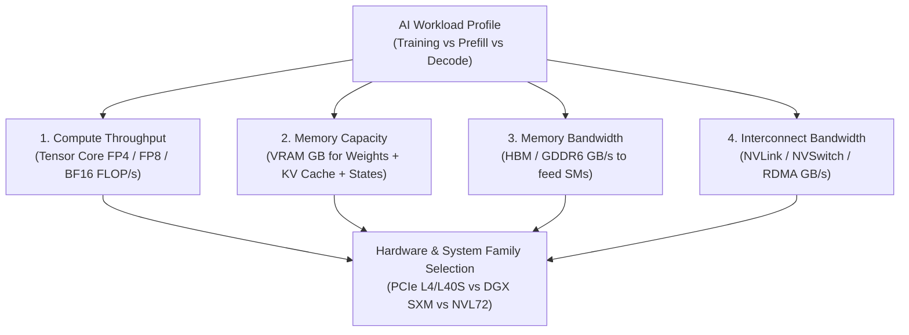
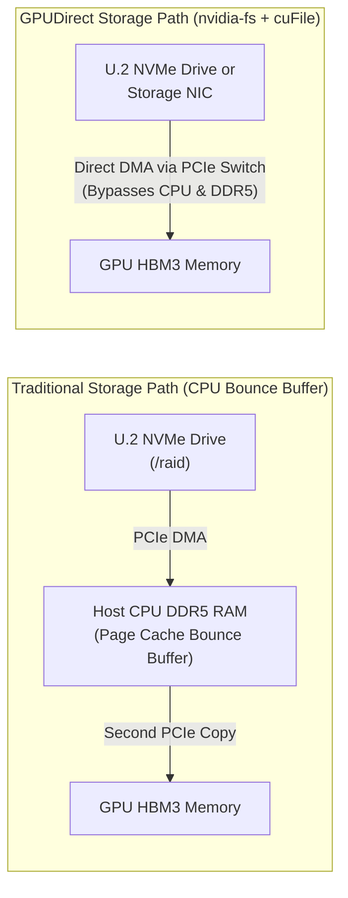

# 9.1 DGX system families and what they are for

| | |
|---|---|
| **Status** | Drafted (`dgx_families_lab.py`: 38 checks pass; hardware commands **untested** on live DGX) |
| **Level** | Basics |
| **Priority tier** | 1b |
| **Lab venue** | none (design / reading) + self-checking Python model (`code/part09/dgx_families_lab.py`) |
| **Part** | Part 9: NVIDIA systems and reference architectures |
| **Sources used** | `nvidia-devops` Volume 04 and Volume 05; *AI Systems Performance Engineering*; *Data Center Best Practices with DGX B200* (`superpod-b200-dc`); *NVIDIA DGX SuperPOD Reference Architecture Featuring NVIDIA DGX GB300 Systems* (`superpod-gb300-ra`) |

## Why this matters for AI infrastructure

An AI factory is not a pile of interchangeable servers with GPUs plugged into PCIe slots. When an organization buys the wrong accelerator family or bolts high-wattage GPUs into a generic whitebox chassis without co-design, the failure is immediate and expensive. Training jobs stall on PCIe switch bottlenecks, and high-concurrency inference violates latency targets because memory bandwidth was ignored on the spec sheet. Under sustained load, uncoordinated cooling quietly throttles cluster throughput in the middle of the night.

To design, buy, or operate AI infrastructure, you need two mental models working together.

- **Workload-first accelerator selection.** You must map the four physical dimensions of a workload across compute throughput, memory capacity, memory bandwidth, and interconnect bandwidth. Those four dimensions determine whether a job belongs on an L4, an L40S, an H100, an H200, a B200, or a Grace Blackwell Superchip.
- **Appliance-level systems engineering.** You must understand why NVIDIA builds turnkey DGX systems, ranging from air-cooled SXM nodes to liquid-cooled NVL72 rack appliances. That appliance architecture governs how internal NVMe storage, three-plane networking, out-of-band management, and facility power envelopes fit together.

:::info Corpus scope note
Standalone NVIDIA DGX H100 and H200 System User Guides and NVIDIA DGX OS 6 User Guide manuals are not in the local book corpus. System internals, management commands, and facility rules in this chapter come from our hardware portfolio notes and *AI Systems Performance Engineering*. They also draw on *Data Center Best Practices with DGX B200* and the *DGX GB300 SuperPOD Reference Architecture*. Later chapters in Part 9 and Part 10 expand 8-GPU node internals, HGX platforms, Grace Superchips, NVL72 racks, facility cooling, and GPU microarchitecture.
:::

## Prerequisites and outcomes

Before reading this chapter, you should know basic server hardware components such as CPUs, PCIe buses, NVMe drives, power supplies, and Baseboard Management Controllers from Part 7. You should also understand how cluster managers provision bare-metal GPU nodes and run health checks from Part 8.

After completing this chapter, you will be able to accomplish the following five engineering tasks.

- Size VRAM capacity and memory bandwidth for training and LLM inference, and score GPU candidates against facility power ceilings and Cost per 1M Tokens.
- Distinguish NVIDIA accelerator generations from Volta through Blackwell across PCIe cards, SXM modules, and Grace-coupled Superchips.
- Explain the Whitebox Fallacy and contrast air-cooled SXM DGX nodes with liquid-cooled rack-scale NVLink appliances.
- Trace how a DGX node separates its internal NVMe storage tiers and its three physical network planes.
- Run a baseline DGX qualification check while avoiding ad-hoc firmware flashes and PCIe Access Control Services traps.

---

## 1. Workload physics and why one GPU cannot rule them all

When an infrastructure team selects GPUs by reading only the peak TFLOPS line on a vendor datasheet, production workloads quickly miss their latency targets. Buying a GPU with massive peak compute FLOP/s but narrow memory bandwidth to serve low-batch LLM token generation is like buying a Ferrari for a moving company. The engine has enormous horsepower, but the cargo bay is tiny and the loading doors are narrow. As a result, the vehicle spends almost all of its time waiting to load boxes.

### 1.1 The four dimensions of workload physics

A GPU is a specialized physics engine balanced across four hardware constraints: math throughput, memory capacity, memory bandwidth, and chip-to-chip interconnect speed. Every AI workload stresses these four hardware subsystems in different proportions.



- **Compute throughput.** This dimension measures how many floating-point or integer matrix operations the Streaming Multiprocessors and Tensor Cores execute per second. Dense matrix multiplications during pre-training and the prefill phase of LLM inference are compute-bound. Prefill speed directly determines Time to First Token.
- **Memory capacity.** This dimension measures how much data can reside on the GPU package at once. If a workload's required footprint exceeds VRAM, the job either crashes with an Out-Of-Memory error or spills over the PCIe bus to host RAM, which ruins throughput.
- **Memory bandwidth.** This dimension measures the rate at which bytes move from GDDR6 or High Bandwidth Memory into the compute registers. The decode phase of LLM inference generates one token at a time sequentially and must read the entire weight matrix from VRAM for every single token. Because arithmetic intensity is tiny during decode, token generation speed is strictly memory-bandwidth-bound and sets Inter-Token Latency.
- **Interconnect bandwidth.** This dimension measures the speed of data movement between GPUs inside a server and across servers over InfiniBand or RoCEv2 RDMA. Whenever a model is split across GPUs via Tensor or Pipeline Parallelism, or synchronizes gradients via Data Parallelism, the interconnect sits in the critical path.

### 1.2 Calculating memory footprints: training versus inference

If an engineer sizes a cluster only for raw model weights, training runs crash on the first optimizer step. Inference servers likewise run out of memory as soon as concurrent users connect. Before looking at hardware catalogs, you must translate the workload into an exact gigabyte requirement for training or inference.

- **Full training and fine-tuning.** Training stores far more than model weights. On top of the model parameters, the GPU must hold master weights, Adam optimizer momentum and variance states, gradients, and forward-pass activations saved for backpropagation. As a baseline rule, full training requires four to six times the raw parameter weight footprint in VRAM.
- **Static model weights in inference.** Inference does not store optimizer states or gradients. Static weight memory simply equals the parameter count multiplied by the bytes per parameter.
- **Dynamic KV cache in inference.** To avoid recomputing attention over previous tokens at every decode step, the GPU caches the Key and Value tensors for every active user sequence. As concurrent users and sequence lengths grow, the KV cache often rivals the model weights in size.
- **Runtime safety margin in inference.** Always multiply the sum of weights and KV cache by a twenty percent buffer. That margin accounts for CUDA context overhead, scratch buffers, and temporary activations.

```text
Workload VRAM sizing formulas and 70B worked example (dgx_families.py):
1. Full training (4x to 6x parameter weight rule):
   - 70B parameters in FP16/BF16 (2 bytes/param) = 140 GB raw weights
   - At a 5x training multiplier: 140 GB * 5 = 700.0 GB aggregate GPU memory

2. Static inference weights (70B model):
   - FP16 / BF16 (2 bytes/param): 140.0 GB
   - FP8 / INT8  (1 byte/param):   70.0 GB
   - FP4 / INT4  (0.5 bytes/param): 35.0 GB

3. Dynamic KV cache per user (70B model, N_layers = 80, N_heads = 128, L_seq = 8,192):
   KV Cache per User (bytes) = Bytes_per_token_element * 2 (K and V) * N_layers * N_heads * L_seq
   KV Cache per User (FP16)  = 8 * 2 * 80 * 128 * 8,192 = 1,342,177,280 bytes = 1.34 GB per user
   For 64 concurrent users   = 64 * 1.342 GB = 85.90 GB of VRAM

4. Total inference VRAM with 1.2x runtime safety margin (20% buffer):
   - FP16 (64 users): (140.0 GB + 85.90 GB) * 1.2 = 225.90 GB * 1.2 = 271.08 GB
   - FP8  (64 users): (70.0 GB + 42.95 GB)  * 1.2 = 112.95 GB * 1.2 = 135.54 GB
     (135.54 GB fits on two 80 GB H100 GPUs = 160 GB total, or one 141 GB H200 GPU at slightly lower concurrency)
```

### 1.3 The five-step selection scorecard and inference economics

Teams frequently buy cheaper PCIe servers to save on capital expenditure, only to discover that each server handles very few concurrent users. As a result, their per-token serving cost doubles. Evaluating candidates with a five-step engineering workflow prevents teams from selecting hardware based on marketing headlines or hourly server price alone.

- **Step 1: Classify the primary workload.** Identify whether the cluster will run pre-training, LoRA or full-parameter fine-tuning, real-time online inference, batch offline inference, or media and graphics rendering.
- **Step 2: Calculate the memory footprint.** Apply the training multiplier rule or the inference KV-cache and safety-margin formula to determine total VRAM required.
- **Step 3: Evaluate bandwidth versus compute needs.** Check whether your latency target is governed by compute-bound prefill or memory-bandwidth-bound decode. For example, an H100 SXM5 has roughly four times the memory bandwidth of an L40S. That bandwidth makes the H100 roughly four times faster during batch-constrained LLM decode despite comparable paper FP8 compute relative to price.
- **Step 4: Determine interconnect requirements.** If a model does not fit on one GPU, Tensor Parallelism requires an `AllReduce` synchronization after every single transformer layer. Across PCIe Gen5, multi-GPU Tensor Parallelism spends up to forty percent of its time waiting on the bus. High-throughput multi-GPU serving and multi-node training require SXM NVLink.
- **Step 5: Apply facility and TCO constraints.** Filter out any candidate that violates hard disqualifiers first. Common disqualifiers include exceeding the data center rack power ceiling or lacking required NVLink or native FP8 hardware support.

```text
Selection scorecard weights, SLO targets, and economics (dgx_families.py):
- Latency SLO targets:
  - Prefill Time to First Token (TTFT): <= 500 ms at P99
  - Decode Inter-Token Latency (ITL):   <= 30 ms per token at P99 (faster than human reading speed)
- Bandwidth and interconnect comparison:
  - H100 SXM5 HBM3 bandwidth: 3.35 TB/s (H200: 4.8 TB/s) vs L40S GDDR6: 864 GB/s (~4x faster decode)
  - PCIe Gen5 x16 bandwidth: 64 GB/s unidirectional (128 GB/s bidirectional)
  - SXM NVLink bandwidth: 900 GB/s per GPU on Hopper, 1.8 TB/s per GPU on Blackwell
- Facility hard disqualifier example:
  - An 8.0 kW legacy air-cooled rack cannot power a single 10.2 kW DGX H100 node.
- Five weighted scorecard dimensions (1-5 normalization in code/part09/dgx_families.py is my inference):
  - Compute: 20% | Memory Capacity: 25% | Memory Bandwidth: 25% | Interconnect: 15% | Power/Thermal Fit: 15%
- Inference Cost per 1M Tokens formula:
  Cost per 1M Tokens ($) = (Hourly System Cost ($) / (Total Tokens/sec * 3,600)) * 1,000,000
```

For candidates that survive the hard disqualifiers, score them across the five weighted dimensions and benchmark the shortlist using Goodput. Goodput measures requests per second that simultaneously pass both P99 TTFT and P99 ITL targets. A server with a higher hourly price such as an SXM H100 or H200 often delivers a lower cost per million tokens than a cheaper PCIe server. Its high HBM bandwidth and NVLink fabric sustain much higher token throughput before breaching the decode latency wall.

:::tip In one minute
- Never size an LLM cluster from peak TFLOPS alone. Prefill is compute-bound, whereas decode is strictly memory-bandwidth-bound.
- Filter GPU candidates by hard facility and feature disqualifiers first, including rack power ceiling, NVLink requirement, and native FP8 support. Rank the surviving systems by Goodput and Cost per 1M Tokens.
:::

---

## 2. Accelerator generations and form factors: PCIe, SXM, and Superchips

When a team treats all GPUs with the same model number or generation name as interchangeable, workloads fail in surprising ways. A legacy Turing card silently emulates BF16 in software at a fraction of expected speed, and a PCIe Hopper card hits a power and bandwidth ceiling far below its SXM5 sibling. Once you know the physics profile of your workload, map it onto NVIDIA's hardware portfolio across architectural generation and physical form factor.

### 2.1 Five architectural generations: Volta to Blackwell

Each major NVIDIA data center GPU microarchitecture introduced specific hardware engines to solve the scaling bottleneck of its era.

| Generation & Year | Flagship GPUs | Process & Scale | Key Architectural Shifts | Memory & Interconnect Leap |
|---|---|---|---|---|
| **Volta (2017)** | `V100` | 12nm | **1st-gen Tensor Cores** (4×4 FP16 matrix multiply-accumulate); **1st-gen NVSwitch** enabling 8-GPU all-to-all SXM2 baseboards; Independent Thread Scheduling. | 16/32 GB HBM2 @ 900 GB/s; 300 GB/s NVLink; 300W TDP |
| **Ampere (2020)** | `A100`, `A30`, `A10` | 7nm | **3rd-gen Tensor Cores** introducing **TF32** (FP32 range with FP16 precision, zero code changes) and hardware **BF16**; **2:4 Structured Sparsity** (2× math throughput); **Multi-Instance GPU (MIG)** partitioning 1 GPU into up to **7 isolated instances** with dedicated SMs, L2 cache, and memory controllers. | 40/80 GB HBM2e @ 2.0 TB/s; 3rd-gen NVLink @ 600 GB/s; 400W TDP |
| **Ada Lovelace (2022)** | `L4`, `L40S` | 4nm | Inference, graphics, and media specialization: **4th-gen Tensor Cores with FP8**, 3rd-gen RT Cores, multiple hardware **AV1 video decoders/encoders**, high GDDR6 capacity, low power, **no NVLink**. | 24 GB (`L4`, 300 GB/s, 72W) / 48 GB (`L40S`, 864 GB/s, 350W) GDDR6 |
| **Hopper (2022–2024)** | `H100`, `H200` | 4nm (80B transistors) | **Transformer Engine** dynamically scaling between **FP8 and FP16/BF16** per layer; **Thread Block Clusters** & Distributed Shared Memory (DSMEM); **Tensor Memory Accelerator (TMA)** for async global-to-shared transfers; **DPX instructions**; Confidential Computing. `H200` upgrades memory to HBM3e. | `H100`: 80 GB HBM3 @ 3.35 TB/s; `H200`: 141 GB HBM3e @ 4.8 TB/s; 4th-gen NVLink @ 900 GB/s; 700W TDP |
| **Blackwell & Blackwell Ultra (2024–2025)** | `B200`, `GB200`, `B300`, `GB300` | 4NP **dual-reticle** (208B transistors) | Two reticle-limited dies linked by a **10 TB/s chip-to-chip interconnect** acting as one unified CUDA GPU (no NUMA split); **2nd-gen Transformer Engine** adding **FP4 and FP6** micro-scaling; **5th-gen NVLink** (1.8 TB/s per GPU) scaling to 72-GPU racks; hardware **Decompression Engine** (up to 800 GB/s); dedicated **RAS Engine** (predictive health telemetry). | `B200`: 180–192 GB HBM3e @ 8.0 TB/s; `B300`: 288 GB HBM3e; 1.8 TB/s NVLink 5; 1,000W–1,400W TDP |

:::note Reconciling B200 HBM3e capacity numbers across sources
In *AI Systems Performance Engineering* and our hardware portfolio notes, the B200 architectural overview describes eight HBM3e stacks totaling 192 GB per GPU. That equals 384 GB across the two GPUs of a GB200 Superchip. Meanwhile, the DGX B200 system specification table in the same chapter lists 180 GB per B200 GPU. That equals 1,440 GB across 8 GPUs in a DGX B200 node and 13,440 GB usable HBM3e across 72 GPUs in a GB200 NVL72 rack. Always check the specific SKU sheet when sizing tight memory footprints.
:::

### 2.2 The PCIe inference workhorses: T4, L4, and L40S

Not every cluster runs multi-node frontier training. In enterprise data centers and edge sites with standard air-cooled racks, three PCIe accelerators dominate inference and multimodal pipelines. Choosing the wrong card among them can stall modern transformer deployments on missing precision formats or PCIe bus saturation.

- **NVIDIA T4.** This low-profile single-slot Turing PCIe Gen3 card draws 70W with no auxiliary power connector required. It is ideal for legacy small models like BERT, ResNet-50, Whisper, and video transcoding, but it lacks BF16 and FP8 hardware support. Running BF16 models on a T4 triggers severe software emulation slowdowns.
- **NVIDIA L4.** This low-profile single-slot Ada Lovelace PCIe Gen4 card draws 72W as the direct drop-in successor to the T4. It increases GDDR6 capacity and adds fourth-generation Tensor Cores with native FP8. It also integrates four hardware AV1 decoders and encoders for small LLMs and dense video analytics.
- **NVIDIA L40S.** This dual-slot full-height full-length Ada Lovelace PCIe Gen4 card draws 350W and packs high GDDR6 capacity, FP8 Tensor compute, RT cores, and media engines. Two or four L40S cards fit easily into standard OEM servers to serve 70B FP8 models at low concurrency. However, the L40S has no NVLink and hits the decode latency wall much earlier than an H100.

```text
PCIe inference accelerator specifications (dgx_families.py):
- NVIDIA T4   (Turing, PCIe Gen3, 70W):       16 GB GDDR6 @ 320 GB/s, no BF16/FP8, no NVLink
- NVIDIA L4   (Ada Lovelace, PCIe Gen4, 72W): 24 GB GDDR6 @ 300 GB/s, native FP8 + BF16, 4x AV1 engines, no NVLink
- NVIDIA L40S (Ada Lovelace, PCIe Gen4, 350W): 48 GB GDDR6 @ 864 GB/s, 733 TFLOPS FP8 (with sparsity), no NVLink
  - 2x L40S = 96 GB VRAM | 4x L40S = 192 GB VRAM (all multi-GPU TP traverses ~64 GB/s PCIe)
```

### 2.3 Form factors: PCIe vs SXM vs Grace Superchips

Engineers new to AI hardware often ask why an H100 PCIe performs so differently from an H100 SXM5 when both carry the same GH100 silicon die. Physical form factor dictates power delivery, thermal dissipation, memory technology, and board-level routing.

| Attribute | PCIe Form Factor (`H100 PCIe`) | SXM Form Factor (`H100 SXM5`) | Grace Superchip (`GH200` / `GB200` / `GB300`) |
|---|---|---|---|
| **Physical mounting** | Edge-connector add-in card in standard 2U/4U server | Mezzanine socket bolted directly to an 8-GPU HGX/DGX baseboard | Co-packaged Arm CPU + GPU(s) on a single board via **NVLink-C2C** |
| **Power envelope (TDP)** | **350W** (70W–350W across PCIe family) | **700W** (`H100/H200`) to **1,000W+** (`B200`) | **1,000W** (`GH200`) to **2,700W+** (`GB200` / `GB300`) |
| **VRAM type & bandwidth** | 80 GB **HBM2e** @ **2.0 TB/s** | 80 GB **HBM3** @ **3.35 TB/s** (`H200`: 141 GB **HBM3e** @ **4.8 TB/s**) | `GB200`: 384 GB **HBM3e** @ **16 TB/s** + up to 480 GB LPDDR5X @ **~500 GB/s** |
| **FP8 Tensor Compute** | ~1,513 TFLOPS (with sparsity) | ~3,958 TFLOPS (with sparsity, **>2× faster** sustained clocks) | `GB200`: up to 20 PFLOPS FP4 / 10 PFLOPS FP8 |
| **GPU-to-GPU interconnect** | PCIe Gen5 x16 (**64 GB/s** uni / **128 GB/s** bi) or optional 2-GPU NVLink bridge | **NVSwitch** full-mesh across all 8 GPUs (**900 GB/s** per GPU on Hopper; **1.8 TB/s** on Blackwell) | **NVLink-C2C** (**900 GB/s** CPU-GPU) + **NVLink 4/5** across up to 72 or 256 GPUs |

In a traditional x86 server, the CPU talks to GPUs over PCIe Gen5 x16. That narrow bus creates a severe bottleneck known as the PCIe tax whenever giant embedding tables, optimizer states, or KV caches spill to host RAM. Grace Superchips (GH200, GB200, and GB300) replace that PCIe bus between CPU and GPU with NVLink-C2C running at 900 GB/s bidirectional and under 5 pJ/bit. This link merges the 72-core Arm Grace CPU's on-package LPDDR5X memory and the GPU's HBM into a single coherent address space with Address Translation Services. Chapter 9.4 covers Grace Superchips in full detail, and Chapter 10.7 covers SM-level microarchitecture.

:::tip In one minute
- Never deploy legacy T4 GPUs for BF16 or FP8 models. T4 lacks hardware BF16 and FP8 support and falls back to slow software emulation, so use L4 or L40S for PCIe inference and media pipelines.
- Use PCIe GPUs when models fit on one or two cards inside standard air-cooled racks. Require SXM baseboards or Grace Superchips whenever multi-GPU Tensor Parallelism or multi-node training sits in the critical path.
:::

---

## 3. Why DGX exists and the DGX family lineup

If major OEM vendors all sell servers powered by NVIDIA GPUs, buyers naturally ask why NVIDIA manufactures and sells its own physical DGX hardware appliances. Trying to save money by assembling eight high-wattage GPUs, two CPUs, and eight network cards from separate catalogs inside a generic chassis frequently backfires. The resulting cluster throttles under load, drops GPUs off the bus, and stalls on cross-socket traffic.

### 3.1 The Whitebox Fallacy

Imagine buying eight Formula One engines and bolting them into a backyard kit car. Individually, each engine is a masterpiece. Together, the frame twists, the radiator boils over in two minutes, and the transmission shears off. In AI infrastructure, assembling bare components in a generic chassis without full-stack validation is known as the Whitebox Fallacy.

- **Internal topology and NUMA bottlenecks.** A naive board layout routes GPU-to-NIC traffic across the CPU socket interconnect such as Intel UPI or AMD Infinity Fabric. This happens when the PCIe switches are not balanced one-to-one with the GPUs. Under a multi-node collective, cross-socket NUMA traffic starves GPUDirect RDMA throughput by thirty to fifty percent.
- **Thermal throttling under synchronized load.** Eight SXM GPUs running a dense collective dissipate massive heat inside a single chassis alongside NVSwitches and optical transceivers. If chassis airflow channels and heatsinks are not aerodynamically balanced for simultaneous peak load, GPUs silently drop their clock frequencies at 3:00 AM to prevent silicon damage.
- **Firmware matrix mismatches.** An 8-GPU accelerated server contains dozens of independent microcontrollers. These span the BMC, BIOS, motherboard CPLDs, PCIe Gen5 retimers, four NVSwitch ASICs, eight GPU VBIOSes, and ten SmartNIC or DPU firmwares. Updating one component out of lockstep with the others causes GPUs to vanish from the PCIe bus or NVLink training to fail.
- **Multi-vendor finger-pointing.** When a distributed training job hangs inside `ncclAllReduce`, the server vendor blames the NIC firmware and the switch vendor blames the CUDA driver. Meanwhile, your cluster sits idle at thousands of dollars per hour.

NVIDIA created the DGX line to serve as the golden reference blueprint for an AI factory. A DGX is a vertically integrated appliance where the chassis, PCIe and NVSwitch routing, unified DGX Firmware Container, DGX OS, and NGC container stack are tested together. Everything ships as a single SKU with a single support boundary.

### 3.2 The three DGX system archetypes and generation comparison

Across generations, we can group the DGX portfolio into three operational archetypes. This three-part grouping is my inference synthesizing the system evolution across our hardware portfolio notes, *Data Center Best Practices with DGX B200*, and the *DGX GB300 SuperPOD Reference Architecture*.

- **Deskside development appliances.** The DGX Station family provides whisper-quiet, office-friendly systems designed for small research teams that lack a data center room. They run the exact same DGX OS and NGC container stack as full cluster nodes.
- **8-GPU air-cooled SXM compute nodes.** Systems including DGX-1, DGX-2, DGX A100, DGX H100, DGX H200, and DGX B200 are self-contained rack servers. Eight SXM GPUs communicate over an internal NVSwitch baseboard and scale out across nodes via eight dedicated InfiniBand or RoCEv2 NICs.
- **Rack-scale multi-node NVLink appliances.** Systems including DGX GH200, DGX GB200 NVL72, and DGX GB300 NVL72 are disaggregated rack computers that break the 8-GPU chassis wall. They extend NVLink across an entire 72-GPU rack or multi-rack fabric up to 256 GPUs so the entire rack acts as one giant GPU.

| DGX System | Archetype & Form Factor | GPUs & CPUs | Total GPU Memory & HBM Bandwidth | NVLink Generation & Fabric Bandwidth | Compute Network (East-West) | Max Power & Cooling |
|---|---|---|---|---|---|---|
| **DGX A100** | 6U air-cooled node (271.5 lbs) | 8x A100 SXM4 (80 GB) + dual 64-core AMD EPYC | **640 GB** HBM2e @ **16.3 TB/s** | NVLink 3 (6 NVSwitches): **600 GB/s** per GPU (**4.8 TB/s** agg) | 8x 200 Gbps HDR InfiniBand (ConnectX-6) | **6.5 kW** (Air) |
| **DGX H100** | 8U air-cooled node (~370 lbs / 168 kg) | 8x H100 SXM5 (80 GB) + dual Intel Xeon Platinum 8480C (112 cores, 2 TB DDR5) | **640 GB** HBM3 @ **26.8 TB/s** | NVLink 4 (4 NVSwitches): **900 GB/s** per GPU (**7.2 TB/s** bi / **3.6 TB/s** bisection) | 8x 400 Gbps NDR InfiniBand (ConnectX-7) = **3.2 Tbps** | **10.2 kW** (Air) |
| **DGX H200** | 8U air-cooled node (~370 lbs / 168 kg) | 8x H200 SXM (141 GB) + dual Intel Xeon Platinum 8480C (112 cores, 2 TB DDR5) | **1,128 GB** HBM3e @ **38.4 TB/s** | NVLink 4 (4 NVSwitches): **900 GB/s** per GPU (**7.2 TB/s** agg) | 8x 400 Gbps NDR InfiniBand (ConnectX-7) = **3.2 Tbps** | **10.2 kW** (Air) |
| **DGX B200** | 10U air-cooled node (>287.6 lbs / 130 kg, 17.5 × 19.0 × 35.3 in) | 8x B200 SXM6 (180 GB) + dual x86 host CPUs (up to 4 TB DDR5) | **1,440 GB** HBM3e @ **64 TB/s** | NVLink 5 (4 NVSwitches): **1.8 TB/s** per GPU (**14.4 TB/s** all-to-all) | 8x 400 Gbps (ConnectX-7) or 800 Gbps (ConnectX-8) + 2x BlueField-3 | **14.3 kW** (Air; 96 dB @ 25°C, 101 dB @ 30°C) |
| **DGX GH200** | Multi-rack NVLink Switch appliance | Up to **256x GH200** Superchips (256 Grace + 256 Hopper) | Up to **144 TB** shared coherent memory (HBM3 + LPDDR5X) | Two-tier NVLink Switch System (**900 GB/s** per GPU across all 256 GPUs) | Quantum-2 400 Gbps NDR InfiniBand | Rack-scale (Liquid/Air) |
| **DGX GB200 NVL72** | 48U liquid-cooled rack (18 compute trays + 9 NVLink switch trays) | **36x Grace CPUs + 72x B200 GPUs** (36x GB200 Superchips) | **13.4–13.8 TB** HBM3e (@ **576 TB/s**) + **17 TB** LPDDR5X (**~30 TB** total fast memory) | NVLink 5 rear copper backplane (passive copper cables): **1.8 TB/s** per GPU (**130 TB/s** agg) | 72x 400 Gbps (ConnectX-7) or 800 Gbps (ConnectX-8) | **~120 kW** per rack (Direct Liquid Cooling) |
| **DGX GB300 NVL72** | 48U hybrid liquid+air rack (18 compute trays + 9 NVLink switch trays + 8x 33 kW power shelves) | **36x Grace CPUs + 72x B300 GPUs** (36x GB300 Superchips) | **20.7 TB** HBM3e (72 × 288 GB) + Grace LPDDR5X | NVLink 5 blind-mate backplane (9 switch trays): **1.8 TB/s** per GPU (**130 TB/s** agg) | 4x ConnectX-8 (**800 Gbps** Quantum-X800 IB) + 1x BlueField-3 (2x400G) per tray | **~150 kW** per rack (**1.2 MW** per 8-rack Scalable Unit) |

### 3.3 Why rack-scale NVL72 changes the physics of trillion-parameter models

When a frontier Mixture-of-Experts or trillion-parameter model outgrows an 8-GPU server, splitting Tensor Parallelism or all-to-all expert routing across servers hits an immediate wall. Inside an 8-GPU node like the DGX H100 or DGX B200, the eight GPUs communicate at NVLink speeds. Adding a ninth GPU in a second server drops communication to the speed of a network card, creating an eighteen-fold bandwidth cliff that stalls multi-node Tensor Parallelism and Mixture-of-Experts routing.

The DGX GB200 NVL72 and DGX GB300 NVL72 eliminate that 8-GPU wall by disaggregating eighteen compute trays and nine NVLink switch trays across a passive blind-mate rear copper backplane. All 72 GPUs share full NVLink 5 bandwidth in a single NVLink domain without the power draw and transceiver failure rates of 72-GPU optical cabling. Chapter 9.5 covers the complete NVL72 compute tray, switch tray, power shelf, and crossbar architecture.

```text
Breaking the 8-GPU NVLink wall in NVL72 (dgx_families.py):
- Intra-node 8-GPU NVLink bandwidth: 900 GB/s (Hopper) to 1,800 GB/s (Blackwell) per GPU
- Inter-node NIC bandwidth: 50 to 100 GB/s per GPU (an 18x bandwidth cliff beyond 8 GPUs)
- NVL72 rack architecture:
  - 18 compute trays (36 Grace CPUs + 72 Blackwell GPUs) + 9 NVLink switch trays
  - Blind-mate rear passive copper backplane: 1.8 TB/s per GPU = 130 TB/s aggregate NVLink
  - Rack compute throughput: 1.44 ExaFLOPS (FP4) in a single 72-GPU NVLink domain
```

:::tip In one minute
- The Whitebox Fallacy is assuming eight high-TDP GPUs in a generic box match a co-designed appliance. Unbalanced PCIe switches, thermal throttling under synchronized load, and uncoordinated firmware matrices silently cripple cluster goodput.
- Choose 8-GPU air-cooled DGX nodes when your facility is air-cooled and Tensor Parallelism fits within eight GPUs. Choose liquid-cooled NVL72 racks when Mixture-of-Experts or frontier models require a 72-GPU NVLink domain.
:::

---

## 4. Inside the DGX data paths: storage tiers, GPUDirect Storage, and the three network planes

If a training job reads datasets through the host CPU page cache or mixes storage traffic with GPU collective traffic on the same network ports, GPUs spend half their cycles waiting on data movement. Every DGX system is wired around CPU-bypass data paths so bytes move directly between NVMe drives, RDMA network cards, and GPU HBM without bouncing through host CPU cores or system DDR5 RAM. Chapter 9.2 walks through the dual-tray mechanical layout and four-switch PCIe Gen5 complex in detail.

### 4.1 The two internal NVMe storage tiers and GPUDirect Storage

When data scientists save their only copy of training checkpoints onto a DGX node's local `/raid` scratch volume, a single NVMe drive failure wipes out days of training progress. To prevent random dataset reads from saturating shared network storage while keeping the operating system safe, a DGX node separates internal flash into two strictly distinct tiers.



- **Tier 1: OS and Management Drives.** Mirrored M.2 NVMe drives in Hardware RAID 1 hold DGX OS, system logs, and container layers under `/var/lib/containerd`.
- **Tier 2: Ephemeral Data Cache.** Dedicated U.2 or E1.S NVMe drives in RAID 0 mounted at `/raid` are striped for high sequential read bandwidth and wired directly under the PCIe Gen5 switches. Because `/raid` is a RAID 0 stripe with zero parity or mirroring, losing a single drive destroys the entire volume. Never store the sole copy of model checkpoints or source code on `/raid`. Always replicate checkpoints immediately to the shared Parallel File System.
- **GPUDirect Storage.** Traditional Linux I/O transfers data from NVMe into a CPU bounce buffer in DDR5 RAM and copies it a second time across PCIe into GPU HBM. GPUDirect Storage uses the `nvidia-fs` kernel module and `cuFile` API to DMA directly between local NVMe or remote RDMA storage and GPU BAR1 memory. It achieves over ninety percent of wire speed with near-zero CPU load, as Chapter 13.3 covers in depth.

```text
Internal NVMe storage layout by platform (dgx_families.py):
- Tier 1 (OS and Management):
  - DGX H100 / H200: 2x 1.92 TB M.2 NVMe in Hardware RAID 1 (1.92 TB usable)
  - DGX GB300 compute tray: 1x 1.92 TB M.2 NVMe OS drive
- Tier 2 (Ephemeral /raid scratch cache in RAID 0, zero redundancy):
  - DGX H100 / H200: 8x 3.84 TB U.2 NVMe = 30.7 TB raw in RAID 0 at /raid (50+ GB/s sequential read)
  - DGX GB300 compute tray: 4x 3.84 TB E1.S NVMe in RAID 0
```

### 4.2 The three physical network planes and rail-optimized topology

When a cluster combines east-west GPU collectives, north-south storage reads, and out-of-band BMC management onto a shared network, storage bursts cause tail-latency spikes that stall every GPU in a collective. Every DGX node isolates network traffic across three physically separate planes, which are expanded at SuperPOD scale in Chapters 9.6 and 9.9.

| Network Plane | Hardware in DGX H100 / H200 / B200 | Hardware in DGX GB300 Compute Tray | Traffic Carried & Key Rule |
|---|---|---|---|
| **1. Compute Fabric (East-West)** | **8x single-port ConnectX-7** (400 Gbps NDR IB or RoCEv2 = **3.2 Tbps / 400 GB/s**) | **4x ConnectX-8** (**800 Gbps** Quantum-X800 XDR IB = **3.2 Tbps** per tray) | Pure GPU-to-GPU NCCL collectives. Uses **1:1 GPU-to-NIC pairing** under the same PCIe switch + **`nvidia-peermem`** (GPUDirect RDMA) + **Rail-Optimized Fat-Tree** (NIC i → Leaf Switch i for 1-hop same-rail routing). |
| **2. Storage & In-Band Management Fabric (North-South)** | **2x dual-port BlueField-3 DPUs** (or ConnectX-7 NICs, up to 4x 200/400 GbE) | **1x BlueField-3 DPU** (**2x 400 Gbps** Ethernet) | Parallel File System I/O (GDS), Slurm/Kubernetes control plane, NGC pulls, Prometheus, SSH. Never mix with East-West NCCL traffic. |
| **3. Out-of-Band (OOB) Management** | **1x 1 GbE RJ45** dedicated BMC port | **1x 1 GbE RJ45** BMC port on trays, switches, and power shelves | **Redfish** REST APIs, IPMI, KVM-over-IP, virtual media on an isolated OOB management VLAN. |

:::tip In one minute
- Treat `/raid` strictly as ephemeral scratch and cache storage because a single drive failure wipes the entire RAID 0 stripe.
- Keep `nvidia-fs` and `nvidia-peermem` loaded so storage and east-west compute traffic bypass host CPU RAM over the local PCIe switches.
:::

---

## 5. The DGX management plane: BMC, Redfish, NVSM, DCGM, and unified firmware

When an operator flashes a standalone NIC or BIOS update downloaded from a component vendor onto a DGX node, link training timings drift out of alignment and GPUs drop off the PCIe bus. Managing a DGX fleet combines Out-of-Band control when the host OS is down with In-Band health daemons while jobs run. Part 7 covers Redfish protocol internals, and Chapter 9.2 covers the dual-BMC hierarchy and 46-component firmware inventory.

- **Out-of-Band Redfish APIs.** The dedicated 1 GbE BMC port on an isolated management VLAN exposes Redfish endpoints for power state, thermal telemetry, power draw, and fleet firmware staging.
- **NVIDIA System Management.** The in-band `nvsm` daemon monitors the entire DGX appliance chassis, including RAID 1 OS mirrors, `/raid` U.2 SMART health, DIMM ECC, PCIe link widths, fans, PSUs, and NVSwitches. Running `sudo nvsm show health` inspects chassis status, and `sudo nvsm dump health` generates the encrypted support bundle required by NVIDIA Enterprise Support.
- **NVIDIA Data Center GPU Manager.** The `dcgmi` tool streams high-frequency GPU and NVSwitch telemetry to Prometheus via `dcgm-exporter` and runs active four-level hardware stress tests (`dcgmi diag -r 1` through `-r 4`) in Slurm prologs and Kubernetes admission gates.
- **The Firmware Golden Rule.** Because a DGX coordinates 46 interdependent firmwares across the chassis, never flash an individual component's firmware from a chip vendor out of band. Always use the unified DGX Firmware Container (`show_version` and `update_fw all`), followed by a full Redfish AC power cycle when updating GPU-tray components.

```text
Key DGX Redfish endpoints and firmware container workflow:
- /redfish/v1/Systems/DGX         (power state, hardware inventory, ComputerSystem.Reset)
- /redfish/v1/Chassis/DGX/Thermal (GPU, NVSwitch, inlet temperatures, and fan RPMs)
- /redfish/v1/Chassis/DGX/Power   (real-time wattage draw and power supply status)
- /redfish/v1/UpdateService       (fleet firmware staging)
- Unified firmware container:     nvfw-dgx-h100_<version>.run (show_version / update_fw all)
```

:::tip In one minute
- Use `nvsm` for full-chassis health across RAID, NVMe, DIMMs, PCIe, fans, and PSUs, and use `dcgmi` (`dcgmi diag -r 3`) for active GPU and NVSwitch stress testing.
- Never flash standalone vendor firmware on a DGX. Apply the unified DGX Firmware Container (`update_fw all`) and execute an AC power cycle to activate GPU-tray updates.
:::

---

## 6. Power, cooling, and physical facility readiness

When a team orders DGX nodes for a legacy data hall built for 5 to 8 kW web racks, delivery day turns into a facility crisis. Breakers trip under peak load, standard 1,000 mm rack doors cannot close over the rear power cords, and raised-floor tiles risk buckling under the concentrated weight. Before rolling a DGX into a data center, validate power density, PSU redundancy, structural weight, and rack depth, which Chapters 9.7 and 9.11 cover at full facility scale.

- **DGX H100 and H200 power and PSU redundancy.** Each 8U node draws up to 10.2 kW and uses six 3.3 kW power supplies in three-plus-three redundancy across Feed A and Feed B via three-phase cords. Losing an entire utility feed leaves three PSUs running near one hundred percent capacity to keep the node alive. Air-cooled rooms typically cap racks at two to four nodes with strict Hot and Cold Aisle Containment.
- **DGX B200 power and rack patterns.** Each 10U air-cooled node draws up to 14.3 kW and requires five of its six PSUs to remain energized. Three-plus-three cord interleaving across two feeds is not viable if one feed fails. Official rack patterns deploy either two nodes per rack or four nodes per 52U rack on dual three-phase circuits.
- **DGX GB200 and GB300 NVL72 liquid cooling.** Each 48U rack draws 120 to 150 kW across eight 33 kW DGX Power Shelves with capacitor energy storage and rear RJ45 power brakes. These racks require Direct Liquid Cooling cold plates connected to a Coolant Distribution Unit.
- **Structural weight, server lifts, and rack depth.** Because individual nodes weigh roughly 288 to 370 pounds and full racks weigh 2,000 to over 3,000 pounds, always verify floor load ratings and use a rated mechanical server lift. Furthermore, the chassis is over 35 inches deep and requires rear cable bend radius. Standard 1,000 mm racks are too shallow, so you must provision 1,200 mm deep racks.

```text
Facility power, airflow, weight, and dimension envelopes (dgx_families.py):
1. DGX H100 / H200 (8U air-cooled node):
   - Max power & heat: 10.2 kW max, ~34,800 BTU/hr (34,804 BTU/hr exact), >1,000 CFM airflow
   - PSU redundancy:   6x 3.3 kW PSUs (19.8 kW installed) in 3+3 redundancy (3 * 3.3 kW = 9.9 kW on 1 feed)
   - Power cords:      3-phase 208V / 415V C19/C20 cords; 2 to 4 nodes per rack (20.4 to 40.8 kW)
   - Weight & depth:   ~370 lbs (168 kg); 890-897 mm (>35 in) deep -> requires 1,200 mm (48-in) rack

2. DGX B200 (10U air-cooled node):
   - Max power & flow: 14.3 kW max, 150 CFM/kW; requires 5 of 6 PSUs (N+1) energized
   - 2 nodes/rack:     28.6 kW peak, 4,290 CFM airflow, 2x 380V 3-phase 32A circuits (42U/52U rack)
   - 4 nodes/52U rack: 57.2 kW peak, 8,580 CFM airflow, 2x 415V 3-phase 60A circuits
   - Scalable Unit:    458 kW per 32-node SU; 127 nodes max in a 4-SU SuperPOD (1 UFM appliance displaced)
   - Weight & size:    >287.6 lbs (130 kg), 17.5 x 19.0 x 35.3 in; 4-node rack exceeds 2,000 lbs

3. DGX GB200 / GB300 NVL72 (48U liquid-cooled rack):
   - Rack power:       ~120 kW (GB200) to ~150 kW (GB300); 1.2 MW per 8-rack GB300 Scalable Unit
   - Power shelves:    8x 33 kW shelves (6x 5.5 kW PSUs per shelf) + capacitor storage + rear RJ45 power brakes
   - Cooling & weight: Direct Liquid Cooling (DLC) cold plates + CDU; rack weight exceeds 3,000 lbs
```

:::tip In one minute
- Match the platform to the facility envelope. Use DGX H100, H200, or B200 for high-density contained air cooling, and use DGX GB200 or GB300 NVL72 for Direct Liquid Cooling with a Coolant Distribution Unit.
- Require 1,200 mm deep racks, verified floor slab and tile load ratings, and a mechanical server lift before delivery day.
:::

---

## Commands and configurations that matter

When a new DGX node arrives on the data center floor or returns from maintenance, run this five-stage baseline and data-path validation sequence before releasing it to Slurm or Kubernetes. These hardware commands are untested on live DGX hardware in this authoring environment, while their validation logic is verified in `code/part09/dgx_families_lab.py`.

### 1. Out-of-Band Redfish health, thermal, and power check

Query the DGX BMC over its isolated OOB management network to confirm system health and power supply redundancy before booting workloads.

```bash
# 1. Inspect overall system health and power state via Redfish
curl -sk -u "${BMC_USER}:${BMC_PASS}" \
  "https://${BMC_IP}/redfish/v1/Systems/DGX" | jq '{PowerState, Status}'

# 2. Check PSU redundancy and real-time wattage draw
curl -sk -u "${BMC_USER}:${BMC_PASS}" \
  "https://${BMC_IP}/redfish/v1/Chassis/DGX/Power" \
  | jq '.PowerControl[0].PowerConsumedWatts, .PowerSupplies[] | {Name, Status, LineInputVoltage}'
```

### 2. Unified DGX Firmware Container check

Verify that all internal microcontrollers across the BMC, BIOS, CPLDs, PCIe retimers, NVSwitches, GPU VBIOS, and NICs match the current NVIDIA-validated matrix.

```bash
# Inspect current vs target firmware versions across all DGX components
sudo ./nvfw-dgx-h100_24.05.1.run show_version

# Apply unified updates atomically (only during a scheduled maintenance window)
sudo ./nvfw-dgx-h100_24.05.1.run update_fw all
```

### 3. In-band GPU, NVLink, PCIe ACS, storage, and kernel module baseline

Run these six host checks to confirm that all GPUs, NVLink sub-links, GPUDirect kernel modules, PCIe switch settings, and storage mounts are healthy.

```bash
# 1. Verify all 8 GPUs are visible and check volatile uncorrected ECC errors (must be 0)
nvidia-smi --query-gpu=index,name,pci.bus_id,temperature.gpu,ecc.errors.uncorrected.volatile.total \
  --format=csv

# 2. Inspect topology matrix (expect NV18 across all 8 GPUs and NODE/SYS to mlx5_0..mlx5_7)
nvidia-smi topo -m

# 3. Verify all 18 NVLink sub-links per GPU (144 total endpoints) are active
nvidia-smi nvlink --status | grep -c "GB/s"

# 4. Verify GPUDirect RDMA (nvidia_peermem) and GPUDirect Storage (nvidia_fs) modules
lsmod | grep -E "nvidia_peermem|nvidia_fs"

# 5. Verify PCIe Access Control Services (ACS) is disabled on PCIe switches (expect SrcValid-)
sudo lspci -vvv | grep -i "ACSCtl:" | grep "SrcValid+" || echo "PASS: PCIe ACS disabled"

# 6. Verify OS RAID 1 mirror and ephemeral 30TB /raid scratch mount
df -h / /raid
```

### 4. NVSM chassis audit, DCGM Level 3 active diagnostics, and InfiniBand rail check

Verify full-chassis health with `nvsm`, run active GPU and NVSwitch stress tests with `dcgmi`, and confirm that all eight compute fabric ports are active.

```bash
# 1. Run full DGX chassis health check via NVIDIA System Management
sudo nvsm show health

# 2. Run DCGM Level 3 active hardware, memory, and PCIe/NVLink stress test (~10-15 mins)
dcgmi discovery -l
dcgmi diag -r 3

# 3. Confirm all 8 East-West compute rails (mlx5_0..mlx5_7) are Active at 400 Gbps NDR
ibstat | grep -E "CA '|State:|Physical state:|Rate:"
```

### 5. Data-path throughput benchmarks

Run intra-node collective and GPUDirect Storage read benchmarks to confirm that actual data-path bandwidth matches hardware specifications.

```bash
# 1. Intra-node 8-GPU NVSwitch AllReduce benchmark (expect ~300-350+ GB/s busbw on DGX H100)
./build/all_reduce_perf -b 8M -e 16G -f 2 -g 8

# 2. GPUDirect Storage (GDS) read benchmark from /raid directly into GPU 0 HBM3 (-x 0 = GDS mode)
/usr/local/cuda/gds/tools/gdsio -f /raid/gds_test.dat -d 0 -w 4 -s 10G -i 1M -x 0 -I 0
```

---

## How it fails

| Failure mode | Symptom | Root cause | Diagnosis & fix |
|---|---|---|---|
| **1. The PCIe ACS P2P trap** | `nccl-tests` intra-node or GPUDirect RDMA bandwidth drops to **~15–25 GB/s** instead of **>300 GB/s** (NVLink) or **~45 GB/s per NIC** (`ib_write_bw --use_cuda=0`), and host CPU cores spike. | **PCIe Access Control Services (ACS)** was enabled in the system BIOS after a BIOS reset or firmware misconfiguration, forcing every peer-to-peer DMA packet between a GPU and its paired ConnectX NIC on the same PCIe switch to detour up through the CPU root complex. | Run `sudo lspci -vvv \| grep -i ACSCtl`. If you see `SrcValid+`, disable ACS in the BIOS or run a startup script clearing the ACS bits (`setpci -s <bdf> ECAP_ACS+0x6.w=0000`) and verify with `p2pBandwidthLatencyTest`. |
| **2. Silent TCP/Socket fallback in multi-node NCCL** | Multi-node training runs without crashing, but throughput drops by **10× to 20×** (~1–5 GB/s `busbw`) while the North-South management network saturates. | Either `NCCL_IB_DISABLE=1` was left in the container environment, the container lacks `IPC_LOCK` / `/dev/infiniband` access, or **`nvidia-peermem`** is not loaded, causing NCCL to abandon GPUDirect RDMA over the 8x 400G Compute Fabric and fall back to TCP sockets over `eth0`/`bond0`. | Set `NCCL_DEBUG=INFO` and inspect the job log for `NET/IB` vs `NET/Socket`. Ensure `sudo modprobe nvidia-peermem` is loaded on the host, pass `--ipc=host --ulimit memlock=-1` to the container, and verify `ibstat` shows all 8 compute HCAs `State: Active`. |
| **3. Lost checkpoints after a `/raid` NVMe drive failure** | A single U.2 NVMe drive throws SMART media errors and the entire 30.7 TB `/raid` volume becomes unreadable, destroying 48 hours of training checkpoints. | The team treated `/raid` as durable storage. On a DGX node, `/raid` is an **8-drive RAID 0 stripe with zero parity or mirroring** designed strictly for high-bandwidth ephemeral dataset caching and scratch staging. | Replace the failed U.2 drive and rebuild `/raid`, then enforce cluster policy: write checkpoints directly to the shared Parallel File System (via GDS over the North-South storage fabric) or run an asynchronous background mover that copies checkpoints off `/raid` after every save step. |
| **4. GPU "fell off the bus" after an ad-hoc firmware flash** | After flashing a new NIC or BIOS version downloaded from a component vendor, `nvidia-smi` reports only **7 GPUs** (`GPU 0000:xx:00.0: Fallen off the bus`) or `nvidia-smi nvlink --status` shows degraded sub-links (`16/18`). | Flashing an individual microcontroller out of sync with the PCIe Gen5 retimers, motherboard CPLDs, and NVSwitch firmware breaks link training timing on the HGX baseboard. | Never flash standalone component firmware on a DGX. Run `sudo ./nvfw-dgx-h100_<version>.run show_version` to identify the mismatched component, run `update_fw all` from the official DGX Firmware Container, and execute a full Redfish **AC power cycle** so all CPLDs and retimers reload cleanly. |
| **5. Decode ITL SLO breach on PCIe GPUs at high concurrency** | A 70B FP8 model running on 4x L40S passes single-user functional tests, but at 64 concurrent users P99 Inter-Token Latency (ITL) climbs above **34 ms** (violating the 30 ms SLO). | The team sized the hardware for VRAM capacity (`4 × 48 GB = 192 GB > 135.54 GB` required) and peak FP8 TFLOPS, ignoring that autoregressive token decode is **memory-bandwidth-bound** and multi-GPU TP is **interconnect-bound** (864 GB/s GDDR6 + 64 GB/s PCIe on L40S vs 3.35–4.8 TB/s HBM + 900 GB/s NVLink on H100/H200 SXM). | Move high-concurrency 70B real-time serving to SXM DGX H100 or DGX H200 (or DGX B200) where HBM3/HBM3e bandwidth and 900–1,800 GB/s NVLink keep P99 ITL under 20 ms and lower the total **Cost per 1M Tokens**. |

---

## Hands-on lab

This chapter includes a self-checking Python model (`code/part09/dgx_families.py`) and lab runner (`code/part09/dgx_families_lab.py`) that implement five verification modules.

| Lab module | What the Python model verifies |
|---|---|
| **1. KV-cache and workload VRAM sizing** | Evaluates 70B FP16 versus FP8 inference with the 1.2× runtime safety margin and the 4× to 6× training multiplier |
| **2. GPU Selection Scorecard** | Enforces hard disqualifiers for rack power limits, NVLink, and FP8, plus weighted scoring across Compute, Memory Capacity, Memory Bandwidth, Interconnect, and Power Fit |
| **3. Inference Shortlist Benchmark Evaluator** | Checks P99 TTFT ≤ 500 ms, P99 ITL ≤ 30 ms, Goodput, and Cost per 1M Tokens |
| **4. DGX Rack Power, Cooling, and Airflow Planner** | Models DGX H100 (10.2 kW / 34,804 BTU/hr), DGX B200 2-node (28.6 kW / 4,290 CFM) and 4-node (57.2 kW / 8,580 CFM) racks, and DGX GB200/GB300 NVL72 liquid cooling |
| **5. DGX Node Readiness Baseline Auditor** | Verifies 8/8 GPUs, 18/18 NVLink sub-links, 0 uncorrected ECC errors, 8/8 Active IB rails, `/raid` mount and checkpoint safety, `nvidia-peermem` + `nvidia-fs` modules, PCIe ACS disabled, and unified firmware compliance |

Run the lab from the repository root.

```bash
python3 -B code/part09/dgx_families_lab.py
```

Expected output verified in this repository appears below.

```text
=== Chapter 9.1 Lab: DGX System Families & Accelerator Selection ===
  [PASS] V4 Ch1 70B 8k-context KV cache for 1 user == 1.34 GB
  [PASS] V4 Ch1 70B 8k-context KV cache for 64 users == 85.90 GB
  [PASS] 70B FP16 weights == 140.0 GB
  [PASS] 70B FP16 + 85.9 GB KV cache with 1.2x overhead == 271.08 GB
  [PASS] 70B FP8 weights (70 GB) + FP8 KV cache (42.95 GB) * 1.2 == 135.54 GB
  [PASS] 70B training VRAM at 5x rule == 700.0 GB
  ...
  [PASS] Flags enabled PCIe ACS (SrcValid+) forcing P2P through CPU root complex
  [PASS] Flags ad-hoc individual firmware flashing outside the DGX Firmware Container
  [PASS] Rejects non-positive KV cache parameters

Summary: 38 passed, 0 failed (total 38)
```

---

## Exercises

1. Work out the memory needed to serve a 13B model in FP16 for 32 users at 4,096 tokens of context. Use 40 layers, 40 heads, and 8 bytes per token element for the KV cache, along with the twenty percent safety margin. Repeat the calculation with FP8 weights and a halved KV cache, and state whether each version fits on one 80 GB H100.
2. Run `python3 -B code/part09/dgx_families_lab.py` and read the output. Pick three checks and state in one sentence each which rule from the chapter they test.
3. A site has racks rated at 8.0 kW. Using the facility specifications in Section 6, state which DGX systems among H100, B200, and GB300 NVL72 it can host in one rack and what must change for each of the others.
4. Draw the three network planes of one DGX H100 on paper. Label the ports, the speed of each plane, and the kind of traffic each plane carries.
5. Write a five-line pre-release checklist for a DGX node that has just been repaired. Use the commands from the chapter and state what result you expect from each command.
6. Using the cost-per-million-tokens formula, compare an SXM server with a PCIe server using the workload rates in `dgx_families_lab.py`. Explain why the server with the higher hourly rate achieves a lower cost per million tokens at high concurrency.

## Checkpoint questions (20)

<details>
<summary>`&lt;strong>`1. Why does an H100 SXM5 generate tokens roughly 4x faster than an L40S during batch-1 LLM decode, even though both GPUs have high peak FP8 Tensor TFLOPS?`&lt;/strong>`</summary>

Autoregressive LLM decode generates one token at a time sequentially and must read the entire model weight matrix from VRAM into the Streaming Multiprocessors for every single token produced. That low arithmetic intensity makes decode strictly memory-bandwidth-bound rather than compute-bound. An H100 SXM5 provides 3.35 TB/s of HBM3 memory bandwidth compared to 864 GB/s of GDDR6 bandwidth on an L40S, giving it roughly a fourfold bandwidth advantage.
</details>

<details>
<summary>`&lt;strong>`2. Calculate the total inference VRAM required for a 70B parameter model in FP16 serving 64 concurrent users with an 8,192-token context window, and explain how quantizing to FP8 changes the hardware requirement.`&lt;/strong>`</summary>

In FP16, the weights require 140 GB and the KV cache for 64 users requires 85.90 GB, totaling 271.08 GB with the twenty percent runtime safety margin. That footprint requires at least four 80 GB GPUs or two 141 GB H200 GPUs. Quantizing both weights and KV cache to FP8 cuts the total with the safety buffer to 135.54 GB, which fits on two 80 GB H100 GPUs or a single 141 GB H200 GPU.
</details>

<details>
<summary>`&lt;strong>`3. Why is the NVIDIA T4 a dangerous choice for modern BF16 or FP8 transformer workloads despite its convenient 70W low-profile PCIe form factor?`&lt;/strong>`</summary>

The T4 is based on the Turing architecture and lacks hardware support for both BF16 and FP8. Attempting to run modern BF16 or FP8 models on a T4 either fails or triggers software emulation, causing severe latency spikes. The NVIDIA L4 is the drop-in low-power replacement with native FP8 and BF16 support plus four AV1 media engines.
</details>

<details>
<summary>`&lt;strong>`4. What is the "PCIe tax," and how do Grace Superchips (GH200, GB200, GB300) eliminate it?`&lt;/strong>`</summary>

In traditional x86 servers, the CPU and GPU communicate across a PCIe Gen5 x16 bus capped at 64 GB/s unidirectional and 128 GB/s bidirectional. Whenever workloads spill embeddings, KV caches, or optimizer states to host RAM, the GPU stalls waiting on PCIe transfers. Grace Superchips replace that PCIe link with NVLink-C2C running at 900 GB/s bidirectional with hardware cache coherence and a unified virtual address space across CPU LPDDR5X and GPU HBM.
</details>

<details>
<summary>`&lt;strong>`5. Contrast the two internal NVMe storage tiers inside a DGX H100. Why is storing your only copy of training checkpoints on `/raid` a critical operational error?`&lt;/strong>`</summary>

Tier 1 uses two 1.92 TB M.2 NVMe drives in Hardware RAID 1 for DGX OS, logs, and container runtimes. Tier 2 uses eight 3.84 TB U.2 NVMe drives in RAID 0 mounted at `/raid`, wired directly to the PCIe switches for high-speed local dataset caching and scratch I/O via GPUDirect Storage. Because `/raid` is a RAID 0 stripe with zero redundancy, if any one of the eight U.2 drives fails, the entire `/raid` volume is lost.
</details>

<details>
<summary>`&lt;strong>`6. What are the three physical network planes in a DGX system, and why does the East-West Compute Fabric use eight separate NICs in a Rail-Optimized topology?`&lt;/strong>`</summary>

The three planes are the East-West Compute Fabric, the North-South Storage and In-Band Management Fabric, and the Out-of-Band Management Network on a dedicated 1 GbE BMC port. Using one dedicated NIC per GPU behind the same PCIe switch enables GPUDirect RDMA via `nvidia-peermem` without crossing the CPU. Connecting each NIC to its corresponding rail leaf switch lets matching GPUs on different servers communicate in a single switch hop without traversing spine switches.
</details>

<details>
<summary>`&lt;strong>`7. How does PSU redundancy work on a DGX H100, and what are the two official rack deployment patterns for an air-cooled DGX B200?`&lt;/strong>`</summary>

A DGX H100 uses six 3.3 kW PSUs in three-plus-three redundancy split across two power feeds. If an entire power feed fails, the remaining three PSUs keep the server running near full capacity at 9.9 kW. An air-cooled DGX B200 deploys either at two systems per rack drawing 28.6 kW and 4,290 CFM, or at four systems per 52U rack drawing 57.2 kW and 8,580 CFM.
</details>

<details>
<summary>`&lt;strong>`8. Why do DGX GB200 NVL72 and DGX GB300 NVL72 use a blind-mate rear copper NVLink backplane across 72 GPUs inside a single rack instead of optical cables across multiple racks?`&lt;/strong>`</summary>

In an 8-GPU node, scaling beyond eight GPUs drops interconnect bandwidth from NVLink speeds down to network card speeds. By packing eighteen compute trays and nine NVLink switch trays into a single liquid-cooled rack linked over a passive rear copper backplane, NVL72 delivers 1.8 TB/s per GPU across all 72 GPUs. Passive copper avoids the multi-kilowatt power draw, cost, and transceiver failure rates of 72-GPU optical interconnects.
</details>

<details>
<summary>`&lt;strong>`9. Why must you never flash a standalone BIOS, NIC, or GPU VBIOS update from a chip vendor onto a DGX node?`&lt;/strong>`</summary>

A DGX system's BMC, BIOS, motherboard CPLDs, PCIe Gen5 retimers, four NVSwitch ASICs, eight GPU VBIOSes, and ten NIC or DPU firmwares are regression-tested as a single lockstep matrix. Flashing one component out of band causes PCIe Gen5 link training failures or NVLink sub-link degradation. Always use the unified DGX Firmware Container with `show_version` and `update_fw all`.
</details>

<details>
<summary>`&lt;strong>`10. During node bring-up, `nvidia-smi` shows all 8 GPUs healthy and `ibstat` shows all 8 NDR ports Active, yet peer-to-peer and RDMA tests achieve only ~18 GB/s instead of ~45 GB/s per NIC. What two settings should you check first?`&lt;/strong>`</summary>

First, check PCIe Access Control Services by running `sudo lspci -vvv | grep -i ACSCtl`. If `SrcValid+` is enabled on the PCIe switches, every peer-to-peer DMA transfer between a GPU and its paired NIC is forced to detour through the CPU root complex. Second, check `lsmod | grep nvidia_peermem` to confirm the GPUDirect RDMA kernel module is loaded.
</details>

<details>
<summary>`&lt;strong>`11. What is the "4× to 6× rule" for training memory, and why is it so much larger than the size of the model weights?`&lt;/strong>`</summary>

Training must keep far more state in memory than the raw model weights. It also holds FP32 master weights, the Adam optimizer's momentum and variance states, gradients, and activations saved for the backward pass. Together these states require roughly four to six times the raw weight footprint, so a 70B model with 140 GB of FP16 weights needs about 700 GB across the GPUs at a fivefold multiplier.
</details>

<details>
<summary>`&lt;strong>`12. Which phase of LLM inference is compute-bound and which is memory-bandwidth-bound, and which latency number does each one set?`&lt;/strong>`</summary>

Prefill processes all input prompt tokens in parallel, so it is compute-bound and sets Time to First Token. Decode generates one output token at a time sequentially and must read all model weights for every token, so it is memory-bandwidth-bound and sets Inter-Token Latency.
</details>

<details>
<summary>`&lt;strong>`13. What is the 1.2× factor in the inference memory formula for?`&lt;/strong>`</summary>

It provides a twenty percent runtime safety margin for CUDA context overhead, scratch buffers, and temporary activations. You apply it to the sum of the static model weights and the dynamic KV cache.
</details>

<details>
<summary>`&lt;strong>`14. Why can a more expensive SXM server have a lower cost per million tokens than a cheaper PCIe server?`&lt;/strong>`</summary>

Cost per million tokens equals the hourly system cost divided by the tokens produced per hour. Because the SXM server has much higher HBM bandwidth and high-speed NVLink, it sustains many more tokens per second before breaching the decode latency target. That higher token throughput outweighs the higher hourly server price.
</details>

<details>
<summary>`&lt;strong>`15. What is the "Whitebox Fallacy"? Give two of the four problems the chapter lists.`&lt;/strong>`</summary>

It is the belief that eight high-wattage GPUs bolted into a generic server chassis will perform like a co-designed DGX appliance. Common failures include unbalanced PCIe topologies that force GPU-to-NIC traffic across the CPU socket link, thermal throttling under synchronized load, mismatched firmware across dozens of controllers, and multi-vendor finger-pointing during hangs.
</details>

<details>
<summary>`&lt;strong>`16. What does GPUDirect Storage change about the path from NVMe to the GPU, and which two components make it work?`&lt;/strong>`</summary>

Without GPUDirect Storage, data travels from NVMe into a host RAM bounce buffer and then crosses PCIe a second time into GPU memory, burning CPU cycles and PCIe bandwidth. With GPUDirect Storage, data transfers directly between the local NVMe drive or storage NIC and GPU BAR1 memory. The `nvidia-fs` kernel module and the `cuFile` API enable this direct DMA path.
</details>

<details>
<summary>`&lt;strong>`17. Why does NIC 0 of every DGX node plug into the same leaf switch (Rail 0)?`&lt;/strong>`</summary>

Connecting NIC 0 of every node to Rail Switch 0 lets GPU 0 on any node reach GPU 0 on any other node in a single switch hop without crossing spine switches. This layout is known as a rail-optimized fat-tree topology. Traffic between different GPU indices first traverses the internal NVSwitch baseboard inside the node and then exits on the matching rail.
</details>

<details>
<summary>`&lt;strong>`18. What is the difference between `nvsm` and `dcgmi`?`&lt;/strong>`</summary>

The `nvsm` tool monitors the entire DGX chassis, including RAID arrays, NVMe drives, DIMMs, PCIe links, fans, and power supplies. The `dcgmi` tool focuses on GPUs and NVSwitches, exposing high-frequency telemetry and running active hardware stress diagnostics from Level 1 through Level 4.
</details>

<details>
<summary>`&lt;strong>`19. A DGX B200 has six PSUs. How many must be energized for it to run, and what does that mean for the way you wire two power sources?`&lt;/strong>`</summary>

Five of the six power supplies must remain energized for a DGX B200 to run. Consequently, you cannot split the six cords three-and-three across two power feeds because losing one feed would leave only three PSUs active and shut down the node.
</details>

<details>
<summary>`&lt;strong>`20. Why do air-cooled racks of DGX H100 usually hold only 2 to 4 nodes even though 5 would fit in 42U?`&lt;/strong>`</summary>

Rack capacity is limited by power delivery and heat rejection rather than vertical rack units. Each DGX H100 draws up to 10.2 kW and produces roughly 34,800 BTU/hr of heat, so racks are capped by the power and airflow that the facility can supply and cool.
</details>

---

## Sources and review notes

The primary books, reference architectures, and portfolio notes read in full for this chapter are:

1. **Chris Fregly, *AI Systems Performance Engineering* (`ai-systems-performance-engineering`):**
   - Chapter 1 (*Introduction and AI System Overview*, pp. 1–19): hardware-software co-design, mechanical sympathy, Goodput, DALI data-loading pipelines, and benchmark tools (`nccl-tests`, `gdsio`, `nvbandwidth`).
   - Chapter 2 (*AI System Hardware Overview*, pp. 20–55): Grace CPU & Grace Blackwell Superchip (pp. 21–24), dual-reticle Blackwell B200 GPU (208B transistors, 10 TB/s chip-to-chip link, 180–192 GB HBM3e @ 8 TB/s, 1.8 TB/s NVLink 5, 2nd-gen Transformer Engine FP4/FP6, Decompression Engine, RAS Engine, pp. 21–26), DGX B200 8-GPU air-cooled node (1,440 GB HBM3e, 64 TB/s HBM bw, 14.4 TB/s NVLink all-to-all, ~14.3 kW, `5-of-6` PSU rule, p. 28), and GB200 NVL72 liquid-cooled rack (36 Grace CPUs, 72 B200 GPUs, 13.4 TB HBM3e + 17 TB LPDDR5X = ~30 TB fast memory, 130 TB/s / 1,296 Gbps per sub-link NVLink for MoE models, 1.44 EFLOPS FP4, ~120 kW, pp. 26–34).
2. **Steven Hambruch & Dennis O'Brien, *Data Center Best Practices with DGX B200* (`superpod-b200-dc`, pp. 1–24):**
   - DGX B200 physical specifications (14.3 kW max, >287.6 lbs / 130 kg, 10 RU, 17.5 × 19.0 × 35.3 in, altitude temperature derating, 96 dB at 25°C / 101 dB at 30°C, p. 4), 32-node / 458 kW Scalable Unit and 127-node SuperPOD maximum with UFM displacement (p. 5), and 2-node (`N=2`, 28.6 kW, 4,290 CFM, 2× 380V 3-phase 32A) vs 4-node (57.2 kW, 8,580 CFM, 52U rack, 2× 415V 3-phase 60A) rack profiles at 150 CFM/kW (p. 10).
3. ***NVIDIA DGX SuperPOD Reference Architecture Featuring NVIDIA DGX GB300 Systems* (`superpod-gb300-ra`, pp. 1–11):**
   - DGX GB300 NVL72 rack architecture (1.2 MW TDP per 8-rack SU, hybrid liquid+air cooling, 18 compute trays × 2 GB300 Superchips = 36 Grace CPUs + 72 B300 GPUs, 9 NVLink switch trays with COMe + BMC ports, 8× 33 kW power shelves with 6× 5.5 kW PSUs + larger energy storage + rear RJ45 power-brake ports, 4× ConnectX-8 800 Gbps Quantum-X800 InfiniBand NICs + 1× BlueField-3 2×400G DPU at the front of each compute tray, and 4× 3.84 TB E1.S RAID 0 + 1× 1.92 TB M.2 OS NVMe per tray).
4. **`nvidia-devops` Volume 04 (*NVIDIA Hardware Portfolio*, all 11 files read in full):**
   - `nvidia-zero-to-hero/volume-04/index.md`
   - `nvidia-zero-to-hero/volume-04/chapter-01-why-nvidia-has-multiple-gpu-families.md` (`chapter-01-why-nvidia-has-multiple-gpu-families.md`)
   - `nvidia-zero-to-hero/volume-04/chapter-02-workload-first-gpu-selection.md` (`chapter-02-workload-first-gpu-selection.md`)
   - `nvidia-zero-to-hero/volume-04/chapter-03-accelerator-generations-and-design-shifts.md` (`chapter-03-accelerator-generations-and-design-shifts.md`, including the 2018 NVSwitch debut and 135.5 GB vs 225.9 GB inference KV-cache sizing examples)
   - `nvidia-zero-to-hero/volume-04/chapter-04-pcie-sxm-and-platform-integration.md` (`chapter-04-pcie-sxm-and-platform-integration.md`)
   - `nvidia-zero-to-hero/volume-04/chapter-05-inference-accelerators-t4-l4-and-l40s.md` (`chapter-05-inference-accelerators-t4-l4-and-l40s.md`)
   - `nvidia-zero-to-hero/volume-04/chapter-06-training-accelerators-v100-to-b200.md` (`chapter-06-training-accelerators-v100-to-b200.md`)
   - `nvidia-zero-to-hero/volume-04/chapter-07-grace-cpu-and-superchips.md` (`chapter-07-grace-cpu-and-superchips.md`)
   - `nvidia-zero-to-hero/volume-04/labs/lab-01-build-a-gpu-selection-scorecard.md`
   - `nvidia-zero-to-hero/volume-04/labs/lab-02-benchmark-an-inference-accelerator-shortlist.md`
5. **`nvidia-devops` Volume 05 (*DGX Systems*, all 11 files read in full):**
   - `nvidia-zero-to-hero/volume-05/index.md`
   - `nvidia-zero-to-hero/volume-05/chapter-01-why-dgx-exists.md` (`chapter-01-why-dgx-exists.md`)
   - `nvidia-zero-to-hero/volume-05/chapter-02-inside-a-dgx-system.md` (`chapter-02-inside-a-dgx-system.md`, `PIX` PCIe switch pairing, 5.6 kW GPU tray heat)
   - `nvidia-zero-to-hero/volume-05/chapter-03-dgx-management-plane.md` (`chapter-03-dgx-management-plane.md`, `/Systems/HGX_Baseboard_0` satellite BMC)
   - `nvidia-zero-to-hero/volume-05/chapter-04-power-cooling-and-rack-readiness.md` (`chapter-04-power-cooling-and-rack-readiness.md`)
   - `nvidia-zero-to-hero/volume-05/chapter-05-dgx-storage-and-data-paths.md` (`chapter-05-dgx-storage-and-data-paths.md`)
   - `nvidia-zero-to-hero/volume-05/chapter-06-dgx-networking-and-fabric-integration.md` (`chapter-06-dgx-networking-and-fabric-integration.md`, MTU 9000, 90% line rate)
   - `nvidia-zero-to-hero/volume-05/chapter-07-dgx-gh200-and-gb200-systems.md` (`chapter-07-dgx-gh200-and-gb200-systems.md`)
   - `nvidia-zero-to-hero/volume-05/labs/lab-01-build-a-dgx-health-baseline.md`
   - `nvidia-zero-to-hero/volume-05/labs/lab-02-validate-dgx-data-and-network-paths.md`
   - Cross-referenced with Chapters 6.1, 6.3, and 9.3.

- **Not in the corpus.** Standalone *NVIDIA DGX H100 / H200 System User Guide* and *NVIDIA DGX OS 6 User Guide* PDFs are not in the local book corpus.
- **Reconciliations and notes on the sources.** In *AI Systems Performance Engineering* Chapter 2 and Volume 04 Chapter 6, the B200 GPU die is described with eight 24 GB HBM3e stacks totaling 192 GB per GPU. That equals 384 GB for the two-GPU GB200 Superchip. The DGX B200 system table in the same chapter lists 180 GB per GPU, totaling 1,440 GB across 8 GPUs on a DGX B200 node and 13,440 GB usable HBM3e across 72 GPUs on GB200 NVL72. Both figures are preserved in Section 2 and Section 3.
- **Executed verification lab.** We ran `python3 -B code/part09/dgx_families_lab.py`, and all 38 checks passed with 0 failures.
- **Labelled inferences.** First, converting the qualitative 1 to 5 scoring tiers from Volume 04 Lab 01 into deterministic Python formulas inside `score_gpu_for_workload` in `code/part09/dgx_families.py` is my inference. It allows the lab to evaluate candidate GPUs deterministically. Second, grouping the DGX product family into deskside development stations, 8-GPU air-cooled SXM nodes, and rack-scale liquid-cooled NVLink appliances in Section 3.2 is my inference synthesizing Volume 05, `superpod-b200-dc`, and `superpod-gb300-ra`.
- **Not verified on live hardware.** Redfish `curl` commands against `/redfish/v1/Systems/DGX`, `./nvfw-dgx-h100_*.run`, `nvsm show health`, `dcgmi diag -r 3`, `nvidia-smi nvlink --status`, `ibstat`, `all_reduce_perf`, and `gdsio` come from the manuals. None of them were executed on a physical DGX system in this environment.

