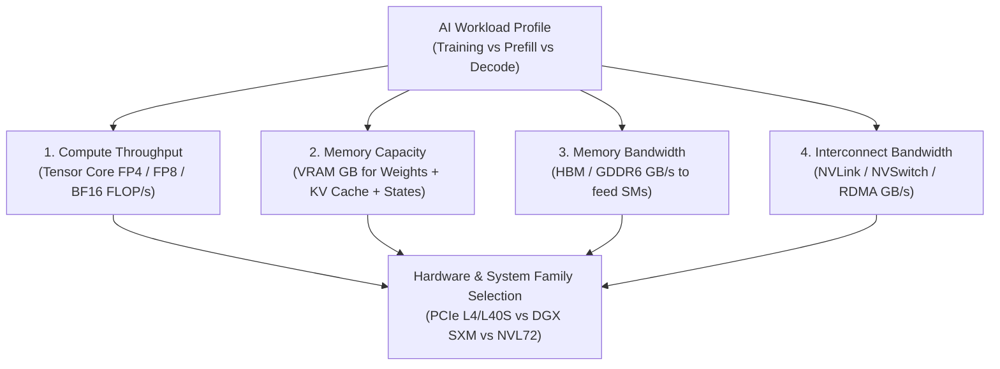
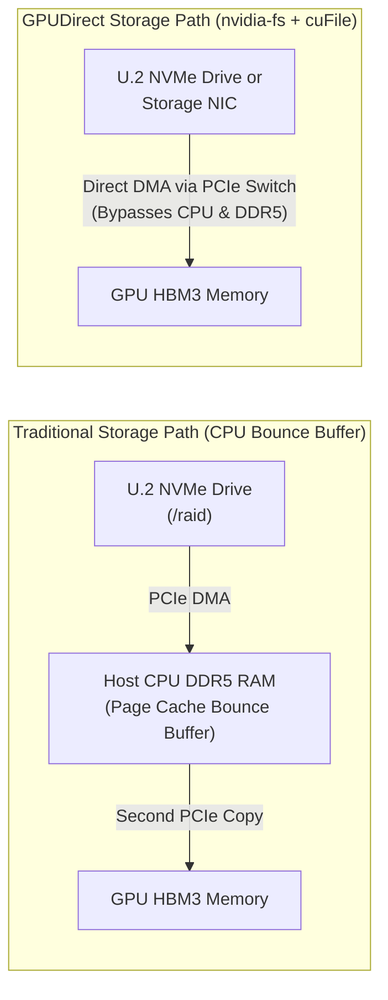

# 9.1 DGX system families and what they are for

| | |
|---|---|
| **Status** | Drafted (`dgx_families_lab.py`: 38 checks pass; hardware commands **untested** on live DGX) |
| **Level** | Basics |
| **Priority tier** | 1b |
| **Lab venue** | none (design / reading) + self-checking Python model (`code/part09/dgx_families_lab.py`) |
| **Part** | Part 9: NVIDIA systems and reference architectures |
| **Sources used** | `nvidia-devops` V4 (Ch. 1–7, Labs 1–2); `nvidia-devops` V5 (Ch. 1–7, Labs 1–2); *AI Systems Performance Engineering* Ch. 1–2; *Data Center Best Practices with DGX B200* (`superpod-b200-dc`); *NVIDIA DGX SuperPOD Reference Architecture Featuring NVIDIA DGX GB300 Systems* (`superpod-gb300-ra`) |

## Why this matters for AI infrastructure

An AI factory is not a pile of interchangeable servers with GPUs plugged into PCIe slots. When an organization buys the wrong accelerator family or attempts to assemble eight 700-watt GPUs inside a generic "whitebox" chassis without full-stack co-design, the failure is immediate and expensive: training jobs stall on PCIe switch bottlenecks, high-concurrency inference violates latency service-level objectives because memory bandwidth was ignored in favor of peak FLOP/s on a spec sheet, or thermal throttling quietly cuts cluster throughput in half at 3:00 AM.

To design, buy, or operate AI infrastructure, you need two mental models working together:
1. **Workload-first accelerator selection:** how the four physical dimensions of a workload—compute (FLOP/s), memory capacity (VRAM), memory bandwidth (GB/s or TB/s), and interconnect bandwidth (NVLink, PCIe, and RDMA)—determine whether a job belongs on an L4, an L40S, an H100/H200, a B200, or a Grace Blackwell Superchip.
2. **Appliance-level systems engineering:** why NVIDIA builds turnkey **DGX** systems—from 8-GPU air-cooled SXM nodes (`DGX A100`, `DGX H100`, `DGX H200`, `DGX B200`) to liquid-cooled rack-scale NVLink systems (`DGX GH200`, `DGX GB200 NVL72`, `DGX GB300 NVL72`)—and how their internal storage, three-plane networking, out-of-band management, and facility envelopes fit together.

:::info Corpus scope note
 Standalone *NVIDIA DGX H100 / H200 System User Guide* and *NVIDIA DGX OS 6 User Guide* manuals are not in the local book corpus. System internals, management commands, and facility rules in this chapter are drawn from `nvidia-devops` Volumes 04 and 05, *AI Systems Performance Engineering* Chapters 1 and 2, *Data Center Best Practices with DGX B200* (`superpod-b200-dc`), and the *NVIDIA DGX SuperPOD Reference Architecture Featuring NVIDIA DGX GB300 Systems* (`superpod-gb300-ra`). Deep component-level walks of an 8-GPU DGX node (`9.2`), HGX OEM platforms (`9.3`), Grace Superchips (`9.4`), NVL72 rack systems (`9.5`), facility power and liquid cooling (`9.11`), and GPU microarchitecture (`10.7`) are expanded in their dedicated chapters.
:::

## Prerequisites and outcomes

**Prerequisites:**
- Basic familiarity with server hardware components (CPUs, PCIe buses, NVMe drives, power supplies, and Baseboard Management Controllers from Part 7).
- Awareness of how cluster managers provision bare-metal GPU nodes and health checks (from Part 8).

**Outcomes:** After completing this chapter, you will be able to:
1. Size VRAM capacity and memory bandwidth for training and LLM inference, and score GPU candidates against facility power ceilings and Cost per 1M Tokens.
2. Distinguish NVIDIA's accelerator generations (`Volta` through `Blackwell`) and physical form factors (`PCIe` cards, `SXM` modules, and Grace-coupled `Superchips`).
3. Explain "The Whitebox Fallacy" and contrast 8-GPU air-cooled DGX nodes (`DGX A100`, `DGX H100`, `DGX H200`, `DGX B200`) with rack-scale NVLink appliances (`DGX GH200`, `DGX GB200 NVL72`, `DGX GB300 NVL72`).
4. Trace how a DGX node separates its internal NVMe tiers (`RAID 1` OS drives versus ephemeral `RAID 0` `/raid` scratch drives) and its three physical network planes.
5. Run a baseline DGX qualification check while avoiding ad-hoc firmware flashes and PCIe Access Control Services (`ACS`) traps.

---

## Concepts: basics → intermediate → advanced

## 1. Workload physics and why one GPU cannot rule them all

A GPU is a specialized physics engine balanced across four hardware constraints: math throughput, memory capacity, memory bandwidth, and chip-to-chip interconnect speed.

Think of choosing an accelerator like choosing a commercial vehicle. Buying a GPU with massive peak compute FLOP/s but narrow memory bandwidth to serve batch-1 autoregressive LLM token generation is like buying a Ferrari for a moving company: the engine has enormous horsepower, but the cargo bay is tiny and the loading doors are narrow, so the vehicle spends almost all of its time waiting to load boxes.

### 1.1 The four dimensions of workload physics

Every AI workload stresses four distinct hardware subsystems on the accelerator:



1. **Compute throughput (FLOP/s):** How many floating-point or integer matrix operations the Streaming Multiprocessors (SMs) and Tensor Cores can execute per second. Dense matrix multiplications during pre-training and the **prefill** phase of LLM inference (processing all input prompt tokens in parallel) are **compute-bound**. Prefill speed directly determines **Time to First Token (TTFT)**.
2. **Memory capacity (VRAM in GB):** How much data can reside on the GPU package at once. If a workload's required footprint exceeds VRAM, the job either crashes with an Out-Of-Memory (OOM) error or spills over the PCIe bus to host RAM, which ruins throughput.
3. **Memory bandwidth (GB/s or TB/s):** The rate at which bytes move from GPU memory (GDDR6 or High Bandwidth Memory, HBM) into the SMs' SRAM registers. The **decode** phase of LLM inference generates one token at a time sequentially: to produce a single token, the GPU must read the entire model weight matrix from VRAM into the compute cores. Because arithmetic intensity (FLOPs per byte read) is tiny during decode, token generation speed—measured as **Inter-Token Latency (ITL)** or **Time Per Output Token (TPOT)**—is strictly **memory-bandwidth-bound**.
4. **Interconnect bandwidth (GB/s):** The speed of data movement between GPUs inside a server (PCIe vs NVLink/NVSwitch) and across servers (InfiniBand or RoCEv2 RDMA). Whenever a model is split across GPUs via Tensor Parallelism (TP) or Pipeline Parallelism (PP), or synchronizes gradients via Data Parallelism (DP / FSDP `AllReduce`), the interconnect sits directly in the critical path.

### 1.2 Calculating memory footprints: training versus inference

Before looking at hardware catalogs, translate the workload into a gigabyte requirement:

- **Full training and fine-tuning (4× to 6× parameter weight rule):** Training stores far more than model weights. On top of the model parameters, the GPU must hold FP32 master weights, Adam optimizer momentum and variance states, gradients, and forward-pass activations saved for backpropagation. As a baseline rule, full training requires **4× to 6× the raw parameter weight footprint** in VRAM. For a 70-billion-parameter model at 2 bytes per parameter (140 GB of raw FP16/BF16 weights), a 5× training multiplier requires **700 GB** of aggregate GPU memory.
- **LLM inference (1.2× overhead rule plus dynamic KV cache):** Inference does not store optimizer states or gradients, but it must hold two large structures in VRAM simultaneously:
  1. **Static model weights:** `Parameters × Bytes per parameter`. A 70B model requires **140 GB** in FP16/BF16 (2 bytes/param), **70 GB** in FP8/INT8 (1 byte/param), or **35 GB** in FP4/INT4 (0.5 bytes/param).
  2. **Dynamic KV cache:** To avoid recomputing attention over previous tokens at every decode step, the GPU caches the Key (`K`) and Value (`V`) tensors for every active user sequence. Using the per-user sizing formula from our portfolio notes:
     ```text
     KV Cache per User (bytes) = Bytes_per_token_element × 2 (K and V) × N_layers × N_heads × L_seq
     ```
     For a 70B model with `N_layers = 80`, `N_heads = 128`, 8 bytes per token element, and a context length of `L_seq = 8,192` tokens:
     ```text
     KV Cache per User = 8 × 2 × 80 × 128 × 8,192 = 1,342,177,280 bytes ≈ 1.34 GB per user
     ```
     If you serve **64 concurrent users** at full 8,192-token context, the KV cache alone consumes **64 × 1.342 GB ≈ 85.9 GB** of VRAM.
  3. **Runtime safety margin (1.2× multiplier):** Always multiply the sum of weights and KV cache by **1.2×** (a 20% buffer) to account for CUDA context overhead, scratch buffers, and temporary activations. For our 70B model in FP16 with 64 users:
     ```text
     Total Inference VRAM = (140 GB + 85.9 GB) × 1.2 = 225.9 GB × 1.2 = 271.08 GB
     ```
     Quantizing both weights and KV cache to FP8 cuts the raw footprint to `70 GB + 42.95 GB = 112.95 GB`, or **135.54 GB** with the 1.2× buffer—allowing the entire workload to fit comfortably on two 80 GB H100 GPUs (160 GB total) or a single 141 GB H200 GPU (at slightly lower concurrency).

### 1.3 The five-step selection scorecard and inference economics

To prevent teams from buying hardware based on marketing headlines, evaluate candidates with a five-step engineering workflow:
1. **Step 1 — Classify the primary workload:** Is it pre-training, fine-tuning (LoRA vs full-parameter), real-time online inference, batch offline inference, or media/graphics rendering?
2. **Step 2 — Calculate the memory footprint:** Apply the 4×–6× rule for training or the `(Weights + KV Cache) × 1.2` rule for inference.
3. **Step 3 — Evaluate bandwidth vs compute needs:** Check whether your latency target is governed by compute-bound prefill (TTFT, typically ≤ 500 ms at P99) or bandwidth-bound decode (ITL, typically ≤ 30 ms per token at P99, faster than human reading speed). For example, an L40S and an H100 have comparable peak FP8 compute on paper relative to their price, but an H100 SXM5 has **3.35 TB/s** of HBM3 memory bandwidth compared to **864 GB/s** of GDDR6 on an L40S—making the H100 roughly **4× faster** during batch-constrained LLM decode.
4. **Step 4 — Determine interconnect requirements:** Does the model fit on one GPU? If not, Tensor Parallelism across multiple GPUs requires an `AllReduce` synchronization after *every single transformer layer*. Across PCIe Gen5 x16 (**64 GB/s** unidirectional, **128 GB/s** bidirectional), multi-GPU tensor parallelism spends up to 40% of its time waiting on the bus. High-throughput multi-GPU TP and multi-node training require SXM **NVLink** (**900 GB/s** on Hopper, **1.8 TB/s** on Blackwell).
5. **Step 5 — Apply facility and TCO constraints:** Check **hard disqualifiers** first:
   - Does the node power multiplied by nodes per rack exceed the data center rack power ceiling (for example, an 8.0 kW legacy air-cooled rack cannot power a single 10.2 kW DGX H100)?
   - Does the workload require NVLink or hardware FP8 instructions that the candidate GPU lacks?

For candidates that survive the hard disqualifiers, score them across five weighted dimensions (**Compute 20%, Memory Capacity 25%, Memory Bandwidth 25%, Interconnect 15%, Power/Thermal Fit 15%**, where the deterministic 1–5 normalization formulas in `code/part09/dgx_families.py` are **my inference** implementing the rubric from our portfolio scorecard lab) and benchmark the shortlist using **Goodput** (requests per second that simultaneously pass both P99 TTFT and P99 ITL SLOs) and **Cost per 1 Million Tokens**:

```text
Cost per 1M Tokens ($) = (Hourly System Cost ($) / (Total Tokens/sec × 3,600)) × 1,000,000
```

Often, a server with a higher hourly price (such as SXM H100/H200) delivers a **lower cost per 1M tokens** than a cheaper PCIe server because its 3.35–4.8 TB/s HBM bandwidth and 900 GB/s NVLink sustain much higher token throughput before breaching the 30 ms P99 ITL wall.

:::tip In one minute
- Never size an LLM cluster from peak TFLOPS alone: **prefill (`TTFT`)** is compute-bound, whereas **decode (`ITL`)** is strictly memory-bandwidth-bound.
- Filter GPU candidates by **hard facility and feature disqualifiers** (rack kW ceiling, NVLink requirement, native FP8 support) before ranking survivors by **Goodput** and **Cost per 1M Tokens**.
:::

---

## 2. Accelerator generations and form factors: PCIe, SXM, and Superchips

Once you know the physics profile of your workload, you can map it onto NVIDIA's hardware portfolio along two axes: **architectural generation** (which silicon capabilities exist on the die) and **physical form factor** (how power, cooling, and interconnects are delivered to the chip).

### 2.1 Five architectural generations: Volta to Blackwell

Each major NVIDIA data center GPU microarchitecture introduced specific hardware engines to solve the scaling bottleneck of its era:

| Generation & Year | Flagship GPUs | Process & Scale | Key Architectural Shifts | Memory & Interconnect Leap |
|---|---|---|---|---|
| **Volta (2017)** | `V100` | 12nm | **1st-gen Tensor Cores** (4×4 FP16 matrix multiply-accumulate); **1st-gen NVSwitch** enabling 8-GPU all-to-all SXM2 baseboards; Independent Thread Scheduling. | 16/32 GB HBM2 @ 900 GB/s; 300 GB/s NVLink; 300W TDP |
| **Ampere (2020)** | `A100`, `A30`, `A10` | 7nm | **3rd-gen Tensor Cores** introducing **TF32** (FP32 range with FP16 precision, zero code changes) and hardware **BF16**; **2:4 Structured Sparsity** (2× math throughput); **Multi-Instance GPU (MIG)** partitioning 1 GPU into up to **7 isolated instances** with dedicated SMs, L2 cache, and memory controllers. | 40/80 GB HBM2e @ 2.0 TB/s; 3rd-gen NVLink @ 600 GB/s; 400W TDP |
| **Ada Lovelace (2022)** | `L4`, `L40S` | 4nm | Inference, graphics, and media specialization: **4th-gen Tensor Cores with FP8**, 3rd-gen RT Cores, multiple hardware **AV1 video decoders/encoders**, high GDDR6 capacity, low power, **no NVLink**. | 24 GB (`L4`, 300 GB/s, 72W) / 48 GB (`L40S`, 864 GB/s, 350W) GDDR6 |
| **Hopper (2022–2024)** | `H100`, `H200` | 4nm (80B transistors) | **Transformer Engine** dynamically scaling between **FP8 and FP16/BF16** per layer; **Thread Block Clusters** & Distributed Shared Memory (DSMEM); **Tensor Memory Accelerator (TMA)** for async global-to-shared transfers; **DPX instructions**; Confidential Computing. `H200` upgrades memory to HBM3e. | `H100`: 80 GB HBM3 @ 3.35 TB/s; `H200`: 141 GB HBM3e @ 4.8 TB/s; 4th-gen NVLink @ 900 GB/s; 700W TDP |
| **Blackwell & Blackwell Ultra (2024–2025)** | `B200`, `GB200`, `B300`, `GB300` | 4NP **dual-reticle** (208B transistors) | Two reticle-limited dies linked by a **10 TB/s chip-to-chip interconnect** acting as one unified CUDA GPU (no NUMA split); **2nd-gen Transformer Engine** adding **FP4 and FP6** micro-scaling; **5th-gen NVLink** (1.8 TB/s per GPU) scaling to 72-GPU racks; hardware **Decompression Engine** (up to 800 GB/s); dedicated **RAS Engine** (predictive health telemetry). | `B200`: 180–192 GB HBM3e @ 8.0 TB/s; `B300`: 288 GB HBM3e; 1.8 TB/s NVLink 5; 1,000W–1,400W TDP |

:::note Reconciling B200 HBM3e capacity numbers across sources
In *AI Systems Performance Engineering* Chapter 2 and `nvidia-devops` Volume 04, the B200 architectural overview describes eight HBM3e stacks (8 stacks × 24 GB = **192 GB** per GPU, or **384 GB** across the two GPUs of a GB200 Superchip), whereas the DGX B200 system specification table in the same chapter lists **180 GB** per B200 GPU (**1,440 GB** across 8 GPUs in a DGX B200 node, and **13,440 GB** usable HBM3e across 72 GPUs in a GB200 NVL72 rack). Always check the specific SKU sheet (`180 GB` air-cooled DGX B200 vs `192 GB` HGX/GB200 SKU) when sizing tight memory footprints.
:::

### 2.2 The PCIe inference workhorses: T4, L4, and L40S

Not every cluster runs multi-node frontier training. In enterprise data centers and edge sites with standard air-cooled racks, three PCIe accelerators dominate inference and multimodal pipelines:
- **NVIDIA T4 (Turing, 70W, low-profile single-slot PCIe Gen3):** Packs **16 GB GDDR6** at **320 GB/s** with no auxiliary power connector required. Ideal for legacy small models (BERT, ResNet-50, Whisper, video transcoding), but **lacks BF16 and FP8 hardware support**—running BF16 models on a T4 triggers catastrophic software emulation slowdowns.
- **NVIDIA L4 (Ada Lovelace, 72W, low-profile single-slot PCIe Gen4):** The direct drop-in successor to the T4. Increases memory to **24 GB GDDR6** (**300 GB/s**), adds **4th-gen Tensor Cores with native FP8**, and integrates **4 hardware AV1 decoders and encoders**. Fits small LLMs (7B–8B in FP8) plus dense computer-vision and video analytics pipelines within a 72W envelope.
- **NVIDIA L40S (Ada Lovelace, 350W, dual-slot full-height full-length PCIe Gen4):** Packs **48 GB GDDR6** at **864 GB/s** and up to **733 TFLOPS of FP8 Tensor compute** (with sparsity), plus RT cores and media engines. Two L40S cards (96 GB total) or four L40S cards (192 GB total) fit easily into standard OEM 2U/4U servers to serve 70B FP8 models at low-to-moderate concurrency. However, the L40S **has no NVLink**; all multi-GPU tensor parallelism traverses PCIe (~64 GB/s), and its 864 GB/s memory bandwidth hits the 30 ms decode latency wall at much lower concurrency than an H100.

### 2.3 Form factors: PCIe vs SXM vs Grace Superchips

Why does an **H100 PCIe** perform so differently from an **H100 SXM5**, even though both use the same GH100 silicon die? Because physical form factor dictates power delivery, thermal dissipation, memory technology, and board-level routing:

| Attribute | PCIe Form Factor (`H100 PCIe`) | SXM Form Factor (`H100 SXM5`) | Grace Superchip (`GH200` / `GB200` / `GB300`) |
|---|---|---|---|
| **Physical mounting** | Edge-connector add-in card in standard 2U/4U server | Mezzanine socket bolted directly to an 8-GPU HGX/DGX baseboard | Co-packaged Arm CPU + GPU(s) on a single board via **NVLink-C2C** |
| **Power envelope (TDP)** | **350W** (70W–350W across PCIe family) | **700W** (`H100/H200`) to **1,000W+** (`B200`) | **1,000W** (`GH200`) to **2,700W+** (`GB200` / `GB300`) |
| **VRAM type & bandwidth** | 80 GB **HBM2e** @ **2.0 TB/s** | 80 GB **HBM3** @ **3.35 TB/s** (`H200`: 141 GB **HBM3e** @ **4.8 TB/s**) | `GB200`: 384 GB **HBM3e** @ **16 TB/s** + up to 480 GB LPDDR5X @ **~500 GB/s** |
| **FP8 Tensor Compute** | ~1,513 TFLOPS (with sparsity) | ~3,958 TFLOPS (with sparsity, **>2× faster** sustained clocks) | `GB200`: up to 20 PFLOPS FP4 / 10 PFLOPS FP8 |
| **GPU-to-GPU interconnect** | PCIe Gen5 x16 (**64 GB/s** uni / **128 GB/s** bi) or optional 2-GPU NVLink bridge | **NVSwitch** full-mesh across all 8 GPUs (**900 GB/s** per GPU on Hopper; **1.8 TB/s** on Blackwell) | **NVLink-C2C** (**900 GB/s** CPU-GPU) + **NVLink 4/5** across up to 72 or 256 GPUs |

In a traditional x86 server, the CPU talks to GPUs over PCIe Gen5 x16 (**64 GB/s** unidirectional, **128 GB/s** bidirectional)—a severe bottleneck (the **"PCIe tax"**) whenever giant embedding tables, optimizer states, or KV caches spill to host RAM. **Grace Superchips (`GH200`, `GB200`, `GB300`)** replace that PCIe bus between CPU and GPU with **NVLink-C2C (Chip-to-Chip)** at **900 GB/s bidirectional** (`<5 pJ/bit`), merging the 72-core Arm Grace CPU's on-package LPDDR5X (`~500 GB/s`) and the GPU's HBM into a single hardware-coherent unified virtual address space with Address Translation Services (`ATS`). See **chapter `9.4`** for the complete Grace, GH200, and GB200 architecture, and **chapter `10.7`** for SM-level generation internals.

:::tip In one minute
- **Never deploy legacy `T4` GPUs for BF16 or FP8 models:** `T4` (Turing) lacks hardware BF16/FP8 support and falls back to slow software emulation; use **`L4`** (72W) or **`L40S`** (350W) for PCIe inference and media.
- Use **PCIe GPUs** (`≤350W`, no 8-GPU NVSwitch) when models fit on 1–2 cards inside standard air-cooled racks; require **SXM baseboards** or **Grace Superchips** whenever multi-GPU Tensor Parallelism or multi-node training sits in the critical path.
:::

---

## 3. Why DGX exists ("The Whitebox Fallacy") and the DGX family lineup

If Dell, HPE, Lenovo, and Supermicro all sell servers powered by NVIDIA GPUs, why does NVIDIA manufacture and sell its own physical **DGX** hardware appliances?

### 3.1 The Whitebox Fallacy

Imagine buying eight formula-one engines and bolting them into a backyard kit car. Individually, each engine is a masterpiece; together, the frame twists, the radiator boils over in two minutes, and the transmission shears off. In AI infrastructure, buying eight bare GPUs, two CPUs, and eight network cards from separate component catalogs and assembling them in a generic chassis is known as **the Whitebox Fallacy**:

1. **Internal topology and NUMA bottlenecks:** A naive board layout routes GPU-to-NIC traffic across the CPU interconnect (Intel UPI or AMD Infinity Fabric) because the PCIe switches are not balanced 1:1 with the GPUs. Under a multi-node `AllReduce`, cross-socket NUMA traffic starves GPUDirect RDMA by 30% to 50%.
2. **Thermal throttling under synchronized load:** Eight SXM5 GPUs running a dense `AllReduce` dissipate **5.6 kW** of pure GPU heat inside a single chassis (and **10.2 kW** to **14.3 kW** total system power on Hopper and Blackwell). If chassis airflow channels and heatsinks are not aerodynamically balanced for simultaneous peak load across GPUs, NVSwitches, and 400G optical transceivers, GPUs silently drop their clock frequencies at 3:00 AM to prevent silicon damage.
3. **Firmware matrix hell:** An 8-GPU accelerated server contains dozens of independent microcontrollers: the BMC, system BIOS, motherboard CPLDs, PCIe Gen5 retimers, four NVSwitch ASICs, eight GPU VBIOSes, and ten SmartNIC/DPU firmwares. Updating one component out of lockstep with the others causes GPUs to vanish from the PCIe bus (` Fallen off the bus`) or NVLink training to fail.
4. **Multi-vendor finger-pointing:** When a distributed training job hangs inside `ncclAllReduce`, the server vendor blames the NIC firmware, the switch vendor blames the CUDA driver, and your cluster sits idle at thousands of dollars per hour.

NVIDIA created the **DGX** line to serve as the golden reference blueprint for an AI factory: a vertically integrated appliance where the mechanical chassis, PCIe/NVSwitch board routing, unified **DGX Firmware Container**, **DGX OS** (Ubuntu LTS with pre-validated drivers, `nvidia-peermem`, `nvidia-fs`, Fabric Manager, DCGM, and NVSM), and NGC container stack are tested as a single SKU with a **single support boundary** ("one throat to choke").

### 3.2 The three DGX system archetypes and generation comparison

Across generations, we can group the DGX portfolio into three operational archetypes (**my inference**, synthesizing the system evolution across `nvidia-devops` Volume 05, *Data Center Best Practices with DGX B200*, and the *DGX GB300 SuperPOD Reference Architecture*):

1. **Deskside / Whisper-Quiet Development Appliances (`DGX Station` family):** Office-friendly systems designed for small research teams that lack a data center room, running the exact same DGX OS and NGC container stack as cluster nodes.
2. **8-GPU Air-Cooled SXM Compute Nodes (`DGX-1`, `DGX-2`, `DGX A100`, `DGX H100`, `DGX H200`, `DGX B200`):** Self-contained 6U to 10U rack servers where 8 SXM GPUs communicate over an internal NVSwitch baseboard (`NVLink Domain = 8 GPUs`) and scale out across nodes via 8 dedicated InfiniBand or RoCEv2 NICs.
3. **Rack-Scale Multi-Node NVLink Appliances (`DGX GH200`, `DGX GB200 NVL72`, `DGX GB300 NVL72`):** Disaggregated, liquid-cooled rack computers that break the 8-GPU chassis wall by extending NVLink across an entire rack (72 GPUs in NVL72) or multi-rack fabric (up to 256 GPUs in DGX GH200) so the entire rack acts as **one giant GPU**.

| DGX System | Archetype & Form Factor | GPUs & CPUs | Total GPU Memory & HBM Bandwidth | NVLink Generation & Fabric Bandwidth | Compute Network (East-West) | Max Power & Cooling |
|---|---|---|---|---|---|---|
| **DGX A100** | 6U air-cooled node (`271.5 lbs`) | 8x `A100` SXM4 (80 GB) + dual 64-core AMD EPYC | **640 GB** HBM2e @ **16.3 TB/s** | NVLink 3 (6 NVSwitches): **600 GB/s** per GPU (**4.8 TB/s** agg) | 8x 200 Gbps HDR InfiniBand (`ConnectX-6`) | **6.5 kW** (Air) |
| **DGX H100** | 8U air-cooled node (`~370 lbs` / `168 kg`) | 8x `H100` SXM5 (80 GB) + dual Intel Xeon Platinum 8480C (112 cores, 2 TB DDR5) | **640 GB** HBM3 @ **26.8 TB/s** | NVLink 4 (4 NVSwitches): **900 GB/s** per GPU (**7.2 TB/s** bi / **3.6 TB/s** bisection) | 8x 400 Gbps NDR InfiniBand (`ConnectX-7`) = **3.2 Tbps** | **10.2 kW** (Air) |
| **DGX H200** | 8U air-cooled node (`~370 lbs` / `168 kg`) | 8x `H200` SXM (141 GB) + dual Intel Xeon Platinum 8480C (112 cores, 2 TB DDR5) | **1,128 GB** HBM3e @ **38.4 TB/s** | NVLink 4 (4 NVSwitches): **900 GB/s** per GPU (**7.2 TB/s** agg) | 8x 400 Gbps NDR InfiniBand (`ConnectX-7`) = **3.2 Tbps** | **10.2 kW** (Air) |
| **DGX B200** | 10U air-cooled node (`>287.6 lbs` / `130 kg`, 17.5 × 19.0 × 35.3 in) | 8x `B200` SXM6 (180 GB) + dual x86 host CPUs (up to 4 TB DDR5) | **1,440 GB** HBM3e @ **64 TB/s** | NVLink 5 (4 NVSwitches): **1.8 TB/s** per GPU (**14.4 TB/s** all-to-all) | 8x 400 Gbps (`ConnectX-7`) or 800 Gbps (`ConnectX-8`) + 2x `BlueField-3` | **14.3 kW** (Air; 96 dB @ 25°C, 101 dB @ 30°C) |
| **DGX GH200** | Multi-rack NVLink Switch appliance | Up to **256x `GH200`** Superchips (256 Grace + 256 Hopper) | Up to **144 TB** shared coherent memory (`HBM3` + `LPDDR5X`) | Two-tier NVLink Switch System (**900 GB/s** per GPU across all 256 GPUs) | Quantum-2 400 Gbps NDR InfiniBand | Rack-scale (Liquid/Air) |
| **DGX GB200 NVL72** | 48U liquid-cooled rack (18 compute trays + 9 NVLink switch trays) | **36x Grace CPUs + 72x `B200` GPUs** (36x GB200 Superchips) | **13.4–13.8 TB** HBM3e (@ **576 TB/s**) + **17 TB** LPDDR5X (**~30 TB** total fast memory) | NVLink 5 rear copper backplane (passive copper cables): **1.8 TB/s** per GPU (**130 TB/s** agg) | 72x 400 Gbps (`ConnectX-7`) or 800 Gbps (`ConnectX-8`) | **~120 kW** per rack (Direct Liquid Cooling) |
| **DGX GB300 NVL72** | 48U hybrid liquid+air rack (18 compute trays + 9 NVLink switch trays + 8x 33 kW power shelves) | **36x Grace CPUs + 72x `B300` GPUs** (36x GB300 Superchips) | **20.7 TB** HBM3e (72 × 288 GB) + Grace LPDDR5X | NVLink 5 blind-mate backplane (9 switch trays): **1.8 TB/s** per GPU (**130 TB/s** agg) | 4x `ConnectX-8` (**800 Gbps** Quantum-X800 IB) + 1x `BlueField-3` (2x400G) per tray | **~150 kW** per rack (**1.2 MW** per 8-rack Scalable Unit) |

### 3.3 Why rack-scale NVL72 changes the physics of trillion-parameter models

In an 8-GPU node like the DGX H100 or DGX B200, the 8 GPUs inside the box enjoy **900 GB/s** to **1,800 GB/s** of NVLink bandwidth, but adding a 9th GPU in a second server drops communication to the **50–100 GB/s** speed of a network card—an **18× bandwidth cliff** that stalls multi-node Tensor Parallelism and Mixture-of-Experts (`MoE`) routing.

The **DGX GB200 NVL72** and **DGX GB300 NVL72** eliminate that 8-GPU wall by disaggregating **18 compute trays (`36 Grace CPUs + 72 Blackwell GPUs`)** and **9 NVLink switch trays** across a passive blind-mate rear copper backplane so all 72 GPUs share **1.8 TB/s per GPU (`130 TB/s` aggregate)** in a single **1.44 ExaFLOPS (`FP4`)** NVLink domain without the power draw and transceiver failure rates of 72-GPU optical cabling. See **chapter `9.5`** for the complete NVL72 compute tray, switch tray, power shelf, and 1,296-port crossbar walk.

:::tip In one minute
- **The Whitebox Fallacy** is assuming 8 high-TDP GPUs in a generic box match a co-designed appliance; in practice, unbalanced PCIe switches, thermal throttling under 5.6 kW+ synchronized load, and uncoordinated firmware matrices silently cripple cluster goodput.
- Choose **8-GPU air-cooled DGX nodes (`DGX H100/H200/B200`)** when your facility is air-cooled and Tensor Parallelism fits within 8 GPUs; choose **liquid-cooled `NVL72` racks** when MoE or frontier models require a 72-GPU NVLink domain.
:::

---

## 4. Inside the DGX data paths: storage tiers, GPUDirect Storage, and the three network planes

Every DGX system is wired around **CPU-bypass data paths** so bytes move directly between NVMe drives, RDMA network cards, and GPU HBM without bouncing through host CPU cores or system DDR5 RAM. (See **chapter `9.2`, sections 1 and 4** for the full component-by-component walk of the 8U dual-tray layout and 4-switch PCIe Gen5 `PIX` complex.)

### 4.1 The two internal NVMe storage tiers and GPUDirect Storage (GDS)

To prevent random dataset reads from saturating shared network storage, a DGX node separates internal flash into **two strictly distinct tiers**:



1. **Tier 1 — OS and Management Drives (`2x 1.92 TB M.2 NVMe` in Hardware RAID 1 on DGX H100/H200; `1x 1.92 TB M.2` on a GB300 tray):** Mirrored for redundancy (`1.92 TB` usable) to hold **DGX OS**, logs, and container layers (`/var/lib/containerd`).
2. **Tier 2 — Ephemeral Data Cache (`8x 3.84 TB U.2 NVMe = 30.7 TB raw` in RAID 0 mounted at `/raid` on DGX H100/H200; `4x 3.84 TB E1.S` RAID 0 on a GB300 tray):** Striped for **50+ GB/s** sequential read and wired directly under the PCIe Gen5 switches.
   - **The golden rule of `/raid`:** Because `/raid` is a **RAID 0 stripe with zero parity or mirroring**, losing a single U.2 drive destroys the entire `/raid` volume. **Never store the sole copy of model checkpoints or source code on `/raid`**; always replicate checkpoints immediately to the shared Parallel File System (see **chapter `9.6`, section 4.2**).
3. **GPUDirect Storage (`GDS`):** Traditional Linux I/O DMAs data from NVMe into a **CPU Bounce Buffer** in DDR5 RAM and copies it a second time across PCIe into GPU HBM. **GDS** uses the **`nvidia-fs`** kernel module and **`cuFile`** API (`DALI`, PyTorch, checkpoint engines) to DMA directly between local NVMe or remote RDMA storage (WEKA, Lustre, GPFS, VAST) and GPU `BAR1` memory at **>90% of wire speed** with near-zero CPU load (covered in depth in **chapter `13.3`**).

### 4.2 The three physical network planes and rail-optimized topology

Every DGX node separates network traffic across **three physically isolated planes** (expanded at SuperPOD scale in **chapters `9.6` and `9.9`**):

| Network Plane | Hardware in DGX H100 / H200 / B200 | Hardware in DGX GB300 Compute Tray | Traffic Carried & Key Rule |
|---|---|---|---|
| **1. Compute Fabric (East-West)** | **8x single-port ConnectX-7** (`400 Gbps` NDR IB or RoCEv2 = **3.2 Tbps / 400 GB/s**) | **4x ConnectX-8** (**`800 Gbps`** Quantum-X800 XDR IB = **3.2 Tbps** per tray) | Pure GPU-to-GPU `NCCL` collectives. Uses **1:1 GPU-to-NIC pairing** under the same PCIe switch + **`nvidia-peermem`** (`GPUDirect RDMA`) + **Rail-Optimized Fat-Tree** (`NIC i` → `Leaf Switch i` for 1-hop same-rail routing). |
| **2. Storage & In-Band Management Fabric (North-South)** | **2x dual-port BlueField-3 DPUs** (or ConnectX-7 NICs, up to 4x 200/400 GbE) | **1x BlueField-3 DPU** (**`2x 400 Gbps`** Ethernet) | Parallel File System I/O (`GDS`), Slurm/Kubernetes control plane, NGC pulls, Prometheus, SSH. Never mix with East-West `NCCL` traffic. |
| **3. Out-of-Band (OOB) Management** | **1x 1 GbE RJ45** dedicated BMC port | **1x 1 GbE RJ45** BMC port on trays, switches, and power shelves | **Redfish** REST APIs, IPMI, KVM-over-IP, virtual media on an isolated OOB management VLAN. |

:::tip In one minute
- Treat `/raid` (`8x 3.84 TB` RAID 0) strictly as **ephemeral scratch/cache**; a single drive failure wipes the stripe.
- Keep `nvidia-fs` (`GDS`) and `nvidia-peermem` (`GPUDirect RDMA`) loaded so storage and East-West compute traffic bypass host CPU RAM over the local PCIe switches.
:::

---

## 5. The DGX management plane: BMC, Redfish, NVSM, DCGM, and unified firmware

Managing a DGX fleet combines **Out-of-Band (`OOB`)** control when the host OS is down with **In-Band** health daemons while jobs run (see **Part 7** for Redfish protocol internals and **chapter `9.2`, section 6** for the dual-BMC `/Systems/DGX` vs `/Systems/HGX_Baseboard_0` architecture and 46-component firmware table):
1. **Out-of-Band Redfish APIs (`1 GbE` BMC on isolated OOB VLAN):** Use `/redfish/v1/Systems/DGX` (power state, inventory, `ComputerSystem.Reset`), `/redfish/v1/Chassis/DGX/Thermal` (GPU/NVSwitch/inlet temperatures and fan RPMs), `/redfish/v1/Chassis/DGX/Power` (wattage draw and power caps), and `/redfish/v1/UpdateService` (fleet firmware staging).
2. **In-Band `nvsm` vs `dcgmi`:**
   - **NVIDIA System Management (`nvsm`):** Monitors the **entire DGX appliance chassis**—RAID 1 OS mirror and `/raid` U.2 SMART health, DIMM ECC, PCIe Gen5 x16 link widths, fans, PSUs, and NVSwitches (`sudo nvsm show health`), and generates the encrypted support bundle (`sudo nvsm dump health`) required by NVIDIA Enterprise Support.
   - **NVIDIA Data Center GPU Manager (`dcgmi`):** Streams high-frequency GPU/NVSwitch telemetry to Prometheus (`dcgm-exporter`) and runs active 4-level hardware stress tests (`dcgmi diag -r 1` through `-r 4`) in Slurm prologs and Kubernetes admission gates.
3. **The Firmware Golden Rule:** Because a DGX coordinates 46 interdependent firmwares across BMC, BIOS, CPLDs, PCIe Gen5 retimers, NVSwitches, GPU VBIOSes, NICs, and PSUs, **never flash an individual component's firmware from a chip vendor out of band.** Always use the unified **DGX Firmware Container** (`nvfw-dgx-h100_<version>.run` with `show_version` and `update_fw all`), followed by a full Redfish **AC power cycle** when updating GPU-tray components (see **chapter `9.2`, section 6.3**).

:::tip In one minute
- Use **`nvsm`** for full-chassis health (RAID, NVMe, DIMMs, PCIe, fans, PSUs) and **`dcgmi`** (`dcgmi diag -r 3`) for active GPU/NVSwitch stress testing.
- Never flash standalone vendor firmware on a DGX; apply the unified **DGX Firmware Container** (`update_fw all`) and execute an **AC power cycle** to activate GPU-tray updates.
:::

---

## 6. Power, cooling, and physical facility readiness

Before rolling a DGX into a data hall built for 5–8 kW web racks, validate three physical facility envelopes (covered in full detail in **chapter `9.7`** for DGX B200 SuperPODs and **chapter `9.11`** for power distribution, thermal physics, and liquid cooling):
1. **Power density and PSU redundancy:**
   - **`DGX H100 / H200` (`8U`, `10.2 kW` max, `~34,800 BTU/hr`, `>1,000 CFM`):** Uses **6x 3.3 kW PSUs (`19.8 kW` installed) in `3+3` redundancy** across Feed A and Feed B via 3-phase 208V/415V `C19/C20` cords. Losing an entire utility feed leaves 3 PSUs running near **100% capacity** (`3 × 3.3 kW = 9.9 kW`) to keep the node alive. Air-cooled rooms typically cap racks at **2 to 4 nodes (`20.4–40.8 kW`)** with strict Hot/Cold Aisle Containment.
   - **`DGX B200` (`10U`, `14.3 kW` max, `150 CFM/kW`):** Requires **5 of 6 PSUs (`N+1`)** to remain energized and deploys in two `N=2` rack patterns: **2 nodes/rack (`28.6 kW`, `4,290 CFM`, `2× 380V 3Φ 32A`)** or **4 nodes/52U rack (`57.2 kW`, `8,580 CFM`, `2× 415V 3Φ 60A`)**, with **458 kW** per 32-node Scalable Unit (`127` nodes max in a 4-SU SuperPOD with 1 UFM appliance displaced; see **chapter `9.7`, sections 1–3** for altitude derating, acoustic limits, and why `3+3` PSU interleaving and rear-door heat exchangers are avoided on B200).
   - **`DGX GB200 / GB300 NVL72` (`48U`, `120–150 kW` per rack, `1.2 MW` per 8-rack GB300 SU):** Uses **8x 33 kW DGX Power Shelves** (`6x 5.5 kW` PSUs + capacitor energy storage + rear RJ45 power brakes per shelf) and requires **Direct Liquid Cooling (`DLC`)** cold plates connected to a **Coolant Distribution Unit (`CDU`)** (see **chapter `9.5`, section 2.3** and **chapter `9.11`, section 4**).
2. **Structural weight, server lifts, and `1,200 mm` rack depth:**
   - A single **DGX H100** weighs **`~370 lbs` (`168 kg`)** and a **DGX B200** weighs **`>287.6 lbs` (`130 kg`)**; a 4-node rack exceeds **`2,000 lbs`** and an NVL72 rack exceeds **`3,000 lbs`**. Always verify floor point-load ratings and **use a rated mechanical server lift**.
   - Because the chassis is over **35 inches (`890–897 mm`) deep** and needs 6–8 inches of rear bend radius for six `C19` power cords and optical fiber bundles, standard `1,000 mm` racks are too shallow—you **must provision `1,200 mm` (48-inch) deep racks**.

:::tip In one minute
- Match the platform to the facility envelope: **`DGX H100/H200` (`10.2 kW`, `3+3` PSUs)** and **`DGX B200` (`14.3 kW`, `5-of-6` PSUs, `28.6/57.2 kW` racks)** for high-density contained air cooling; **`DGX GB200/GB300 NVL72` (`120–150 kW/rack`)** for Direct Liquid Cooling (`DLC` + `CDU`).
- Require **`1,200 mm` deep racks**, verified floor slab/tile load ratings (`>2,000–3,000+ lbs/rack`), and a **mechanical server lift** before delivery day.
:::

---

## Commands and configurations that matter

When a new DGX node arrives on the data center floor (or returns from maintenance), run this five-stage baseline and data-path validation sequence before releasing it to Slurm or Kubernetes (**untested** on live DGX hardware in this authoring environment; logic verified in `code/part09/dgx_families_lab.py`).

### 1. Out-of-Band Redfish health, thermal, and power check

Query the DGX BMC over its isolated OOB management network to confirm system health and power supply redundancy before booting workloads:

```bash
# 1. Inspect overall system health and power state via Redfish
curl -sk -u "${BMC_USER}:${BMC_PASS}" \
  "https://${BMC_IP}/redfish/v1/Systems/DGX" | jq '{PowerState, Status}'

# 2. Check PSU redundancy and real-time wattage draw
curl -sk -u "${BMC_USER}:${BMC_PASS}" \
  "https://${BMC_IP}/redfish/v1/Chassis/DGX/Power" \
  | jq '.PowerControl[0].PowerConsumedWatts, .PowerSupplies[] | {Name, Status, LineInputVoltage}'
```

### 2. Unified DGX Firmware Container check

Verify that all internal microcontrollers (BMC, BIOS, CPLDs, PCIe retimers, NVSwitches, GPU VBIOS, and NICs) match the current NVIDIA-validated matrix:

```bash
# Inspect current vs target firmware versions across all DGX components
sudo ./nvfw-dgx-h100_24.05.1.run show_version

# Apply unified updates atomically (only during a scheduled maintenance window)
sudo ./nvfw-dgx-h100_24.05.1.run update_fw all
```

### 3. In-band GPU, NVLink, PCIe ACS, storage, and kernel module baseline

```bash
# 1. Verify all 8 GPUs are visible and check volatile uncorrected ECC errors (must be 0)
nvidia-smi --query-gpu=index,name,pci.bus_id,temperature.gpu,ecc.errors.uncorrected.volatile.total \
  --format=csv

# 2. Inspect topology matrix (expect NV18 across all 8 GPUs and NODE/SYS to mlx5_0..mlx5_7)
nvidia-smi topo -m

# 3. Verify all 18 NVLink sub-links per GPU (144 total endpoints) are active
nvidia-smi nvlink --status | grep -c "GB/s"

# 4. Verify GPUDirect RDMA (nvidia_peermem) and GPUDirect Storage (nvidia_fs) modules
lsmod | grep -E "nvidia_peermem|nvidia_fs"

# 5. Verify PCIe Access Control Services (ACS) is disabled on PCIe switches (expect SrcValid-)
sudo lspci -vvv | grep -i "ACSCtl:" | grep "SrcValid+" || echo "PASS: PCIe ACS disabled"

# 6. Verify OS RAID 1 mirror and ephemeral 30TB /raid scratch mount
df -h / /raid
```

### 4. NVSM chassis audit, DCGM Level 3 active diagnostics, and InfiniBand rail check

```bash
# 1. Run full DGX chassis health check via NVIDIA System Management
sudo nvsm show health

# 2. Run DCGM Level 3 active hardware, memory, and PCIe/NVLink stress test (~10-15 mins)
dcgmi discovery -l
dcgmi diag -r 3

# 3. Confirm all 8 East-West compute rails (mlx5_0..mlx5_7) are Active at 400 Gbps NDR
ibstat | grep -E "CA '|State:|Physical state:|Rate:"
```

### 5. Data-path throughput benchmarks (`nccl-tests` and `gdsio`)

```bash
# 1. Intra-node 8-GPU NVSwitch AllReduce benchmark (expect ~300-350+ GB/s busbw on DGX H100)
./build/all_reduce_perf -b 8M -e 16G -f 2 -g 8

# 2. GPUDirect Storage (GDS) read benchmark from /raid directly into GPU 0 HBM3 (-x 0 = GDS mode)
/usr/local/cuda/gds/tools/gdsio -f /raid/gds_test.dat -d 0 -w 4 -s 10G -i 1M -x 0 -I 0
```

---

## How it fails

| Failure mode | Symptom | Root cause | Diagnosis & fix |
|---|---|---|---|
| **1. The PCIe ACS P2P trap** | `nccl-tests` intra-node or GPUDirect RDMA bandwidth drops to **~15–25 GB/s** instead of **>300 GB/s** (NVLink) or **~45 GB/s per NIC** (`ib_write_bw --use_cuda=0`), and host CPU cores spike. | **PCIe Access Control Services (ACS)** was enabled in the system BIOS after a BIOS reset or firmware misconfiguration, forcing every peer-to-peer DMA packet between a GPU and its paired ConnectX NIC on the same PCIe switch to detour up through the CPU root complex. | Run `sudo lspci -vvv \| grep -i ACSCtl`. If you see `SrcValid+`, disable ACS in the BIOS or run a startup script clearing the ACS bits (`setpci -s <bdf> ECAP_ACS+0x6.w=0000`) and verify with `p2pBandwidthLatencyTest`. |
| **2. Silent TCP/Socket fallback in multi-node NCCL** | Multi-node training runs without crashing, but throughput drops by **10× to 20×** (~1–5 GB/s `busbw`) while the North-South management network saturates. | Either `NCCL_IB_DISABLE=1` was left in the container environment, the container lacks `IPC_LOCK` / `/dev/infiniband` access, or **`nvidia-peermem`** is not loaded, causing NCCL to abandon GPUDirect RDMA over the 8x 400G Compute Fabric and fall back to TCP sockets over `eth0`/`bond0`. | Set `NCCL_DEBUG=INFO` and inspect the job log for `NET/IB` vs `NET/Socket`. Ensure `sudo modprobe nvidia-peermem` is loaded on the host, pass `--ipc=host --ulimit memlock=-1` to the container, and verify `ibstat` shows all 8 compute HCAs `State: Active`. |
| **3. Lost checkpoints after a `/raid` NVMe drive failure** | A single U.2 NVMe drive throws SMART media errors and the entire 30.7 TB `/raid` volume becomes unreadable, destroying 48 hours of training checkpoints. | The team treated `/raid` as durable storage. On a DGX node, `/raid` is an **8-drive RAID 0 stripe with zero parity or mirroring** designed strictly for high-bandwidth ephemeral dataset caching and scratch staging. | Replace the failed U.2 drive and rebuild `/raid`, then enforce cluster policy: write checkpoints directly to the shared Parallel File System (via GDS over the North-South storage fabric) or run an asynchronous background mover that copies checkpoints off `/raid` after every save step. |
| **4. GPU "fell off the bus" after an ad-hoc firmware flash** | After flashing a new NIC or BIOS version downloaded from a component vendor, `nvidia-smi` reports only **7 GPUs** (`GPU 0000:xx:00.0: Fallen off the bus`) or `nvidia-smi nvlink --status` shows degraded sub-links (`16/18`). | Flashing an individual microcontroller out of sync with the PCIe Gen5 retimers, motherboard CPLDs, and NVSwitch firmware breaks link training timing on the HGX baseboard. | Never flash standalone component firmware on a DGX. Run `sudo ./nvfw-dgx-h100_<version>.run show_version` to identify the mismatched component, run `update_fw all` from the official DGX Firmware Container, and execute a full Redfish **AC power cycle** so all CPLDs and retimers reload cleanly. |
| **5. Decode ITL SLO breach on PCIe GPUs at high concurrency** | A 70B FP8 model running on 4x L40S passes single-user functional tests, but at 64 concurrent users P99 Inter-Token Latency (ITL) climbs above **34 ms** (violating the 30 ms SLO). | The team sized the hardware for VRAM capacity (`4 × 48 GB = 192 GB > 135.5 GB` required) and peak FP8 TFLOPS, ignoring that autoregressive token decode is **memory-bandwidth-bound** and multi-GPU TP is **interconnect-bound** (864 GB/s GDDR6 + 64 GB/s PCIe on L40S vs 3.35–4.8 TB/s HBM + 900 GB/s NVLink on H100/H200 SXM). | Move high-concurrency 70B real-time serving to SXM `DGX H100` / `DGX H200` (or `DGX B200`) where HBM3/HBM3e bandwidth and 900–1,800 GB/s NVLink keep P99 ITL under 20 ms and lower the total **Cost per 1M Tokens**. |

---

## Hands-on lab

This chapter includes a self-checking Python model (`code/part09/dgx_families.py`) and lab runner (`code/part09/dgx_families_lab.py`) that implement:
1. The **KV-cache and workload VRAM sizing formulas** (70B FP16 vs FP8 inference with 1.2× overhead and 4×–6× training multiplier).
2. The **GPU Selection Scorecard** (hard disqualifiers for rack power limits, NVLink, and FP8, plus weighted scoring across Compute, Memory Capacity, Memory Bandwidth, Interconnect, and Power Fit).
3. The **Inference Shortlist Benchmark Evaluator** (P99 TTFT ≤ 500 ms, P99 ITL ≤ 30 ms, and Cost per 1M Tokens).
4. The **DGX Rack Power, Cooling, and Airflow Planner** (`DGX H100` 10.2 kW / 34,804 BTU/hr; `DGX B200` 2-node 28.6 kW / 4,290 CFM and 4-node 57.2 kW / 8,580 CFM; `DGX GB200/GB300 NVL72` liquid cooling).
5. The **DGX Node Readiness Baseline Auditor** (verifying 8/8 GPUs, 18/18 NVLink sub-links, 0 uncorrected ECC errors, 8/8 Active IB rails, `/raid` mount and checkpoint safety, `nvidia-peermem` + `nvidia-fs` modules, PCIe ACS disabled, and unified firmware compliance).

Run the lab from the repository root:

```bash
python3 -B code/part09/dgx_families_lab.py
```

Expected output (verified in this repository):

```text
=== Chapter 9.1 Lab: DGX System Families & Accelerator Selection ===
  [PASS] V4 Ch1 70B 8k-context KV cache for 1 user == 1.34 GB
  [PASS] V4 Ch1 70B 8k-context KV cache for 64 users == 85.90 GB
  [PASS] 70B FP16 weights == 140.0 GB
  [PASS] 70B FP16 + 85.9 GB KV cache with 1.2x overhead == 271.08 GB
  [PASS] 70B FP8 weights (70 GB) + FP8 KV cache (42.95 GB) * 1.2 == 135.54 GB
  [PASS] 70B training VRAM at 5x rule == 700.0 GB
  ...
  [PASS] Flags enabled PCIe ACS (SrcValid+) forcing P2P through CPU root complex
  [PASS] Flags ad-hoc individual firmware flashing outside the DGX Firmware Container
  [PASS] Rejects non-positive KV cache parameters

Summary: 38 passed, 0 failed (total 38)
```

---

## Exercises

1. Work out the memory needed to serve a 13B model in FP16 for 32 users at 4,096 tokens of context. Use 40 layers, 40 heads and 8 bytes per token element for the KV cache, and the 1.2× safety margin. Then repeat it with FP8 weights and a halved KV cache. Does each version fit on one 80 GB H100?
2. Run `python3 -B code/part09/dgx_families_lab.py` and read the output. Pick three checks and say, in one sentence each, which rule from the chapter they test.
3. A site has racks rated at 8 kW. Using the numbers in section 6.1, say which DGX systems (H100, B200, GB300 NVL72) it can host in one rack and what must change for each of the others.
4. Draw the three network planes of one DGX H100 on paper. Label the ports, the speed of each plane, and the kind of traffic each one carries.
5. Write a five-line pre-release checklist for a DGX node that has just been repaired. Use the commands from the chapter and say what result you expect from each one.
6. Using the cost-per-million-tokens formula, compare a $90/hour SXM server that delivers 9,000 tokens/s with a $40/hour PCIe server that delivers 3,000 tokens/s. Which one is cheaper per token, and why does the cheaper-per-hour server lose?

## Checkpoint questions (20)

<details>
<summary><strong>1. Why does an H100 SXM5 generate tokens roughly 4x faster than an L40S during batch-1 LLM decode, even though both GPUs have high peak FP8 Tensor TFLOPS?</strong></summary>

Autoregressive LLM **decode** generates one token at a time sequentially and must read the entire model weight matrix from VRAM into the Streaming Multiprocessors for every single token produced. That low arithmetic intensity makes decode strictly **memory-bandwidth-bound** rather than compute-bound. An H100 SXM5 provides **3.35 TB/s** of HBM3 memory bandwidth compared to **864 GB/s** of GDDR6 bandwidth on an L40S—roughly a 4× bandwidth advantage.
</details>

<details>
<summary><strong>2. Calculate the total inference VRAM required for a 70B parameter model in FP16 serving 64 concurrent users with an 8,192-token context window (80 layers, 128 heads, 8 bytes/token element, and a 20% runtime overhead buffer). How does quantizing weights and KV cache to FP8 change the hardware requirement?</strong></summary>

- **FP16 weights:** `70B × 2 bytes = 140 GB`.
- **FP16 KV cache:** `8 bytes × 2 × 80 × 128 × 8,192 = 1.342 GB/user × 64 users = 85.9 GB`.
- **Total FP16 with 1.2× buffer:** `(140 + 85.9) × 1.2 = 271.08 GB` (requires at least four 80 GB GPUs or two 141 GB H200 GPUs).
- **In FP8 (1 byte/param and halved KV cache):** `(70 + 42.95) × 1.2 = 135.54 GB`, which fits comfortably on **two 80 GB H100 GPUs** (160 GB total) or a single 141 GB H200 GPU.
</details>

<details>
<summary><strong>3. Why is the NVIDIA T4 a dangerous choice for modern BF16 or FP8 transformer workloads despite its convenient 70W low-profile PCIe form factor?</strong></summary>

The T4 is based on the 2018 Turing architecture (16 GB GDDR6, 320 GB/s) and **lacks hardware support for both BF16 and FP8**. Attempting to run modern BF16 or FP8 models on a T4 either fails or triggers software emulation, causing severe latency spikes. The **NVIDIA L4** (Ada Lovelace, 72W, 24 GB GDDR6, native FP8 and BF16 support, 4x AV1 media engines) is the drop-in low-power replacement.
</details>

<details>
<summary><strong>4. What is the "PCIe tax," and how do Grace Superchips (`GH200`, `GB200`, `GB300`) eliminate it?</strong></summary>

In traditional x86 servers, the CPU and GPU communicate across a PCIe Gen5 x16 bus capped at **64 GB/s unidirectional (128 GB/s bidirectional)**—more than 50× slower than GPU HBM3e bandwidth. Whenever workloads spill embeddings, KV caches, or optimizer states to host RAM, the GPU stalls waiting on PCIe transfers. Grace Superchips replace the PCIe link between CPU and GPU with **NVLink-C2C (Chip-to-Chip)** running at **900 GB/s bidirectional** (>7× PCIe Gen5) with hardware cache coherence and a unified virtual address space across CPU LPDDR5X and GPU HBM.
</details>

<details>
<summary><strong>5. Contrast the two internal NVMe storage tiers inside a DGX H100. Why is storing your only copy of training checkpoints on `/raid` a critical operational error?</strong></summary>

- **Tier 1 (OS & Management):** `2x 1.92 TB M.2 NVMe` drives in **Hardware RAID 1** (mirrored redundancy) for DGX OS, logs, and container runtimes.
- **Tier 2 (Data Cache):** `8x 3.84 TB U.2 NVMe` drives (`30.7 TB` raw) in **RAID 0** mounted at `/raid`, wired directly to the PCIe switches for **50+ GB/s** local dataset caching and scratch I/O via GPUDirect Storage.
Because `/raid` is a **RAID 0 stripe with zero redundancy**, if any one of the eight U.2 drives fails, the entire `/raid` volume is lost. Checkpoints must always be written or replicated immediately to the shared Parallel File System.
</details>

<details>
<summary><strong>6. What are the three physical network planes in a DGX system, and why does the East-West Compute Fabric use eight separate NICs (or four dual-GPU NICs per tray on GB300) in a Rail-Optimized topology?</strong></summary>

1. **East-West Compute Fabric:** 8x 400G ConnectX-7 NICs on DGX H100/H200/B200 (or 4x 800G ConnectX-8 NICs per 4-GPU compute tray on DGX GB300) dedicated exclusively to GPU-to-GPU NCCL collectives.
2. **North-South Storage & In-Band Management Fabric:** Dual BlueField-3 DPUs (or ConnectX-7 NICs) for Parallel File System I/O, Kubernetes/Slurm control plane, and monitoring.
3. **Out-of-Band (OOB) Management Network:** Dedicated 1 GbE RJ45 port connected to the BMC on an isolated VLAN.
Using one dedicated NIC per GPU behind the same PCIe switch enables **GPUDirect RDMA (`nvidia-peermem`)** without crossing the CPU, and connecting `NIC i` of every node to `Leaf Switch i` (**Rail-Optimized Fat-Tree**) lets corresponding GPUs on different servers communicate in a **single switch hop** without traversing spine switches.
</details>

<details>
<summary><strong>7. How does PSU redundancy work on a DGX H100 (10.2 kW), and what are the two official rack deployment patterns for an air-cooled DGX B200 (14.3 kW)?</strong></summary>

- **DGX H100:** Uses **6x 3.3 kW PSUs** in **3+3 redundancy** split across two power feeds (PDU A and PDU B). Under normal operation all 6 PSUs run at ~50% load; if an entire power feed fails, the remaining 3 PSUs keep the server running at nearly **100% capacity** (`3 × 3.3 kW = 9.9 kW`).
- **DGX B200 (N=2 power circuits, 150 CFM/kW):**
  1. **Standard 2 systems per rack:** **28.6 kW** peak demand, **4,290 CFM** airflow, 2× 380V 3Φ 32A circuits in a 42U/52U rack (52U recommended).
  2. **Extreme-density 4 systems per 52U rack:** **57.2 kW** peak demand, **8,580 CFM** airflow, 2× 415V 3Φ 60A circuits.
</details>

<details>
<summary><strong>8. Why do DGX GB200 NVL72 and DGX GB300 NVL72 use a blind-mate rear copper NVLink backplane across 72 GPUs inside a single rack instead of optical cables across multiple racks?</strong></summary>

In an 8-GPU node, scaling beyond 8 GPUs drops interconnect bandwidth from **1,800 GB/s** (NVLink 5) to **50–100 GB/s** (InfiniBand/RoCE NICs). By packing **18 compute trays (72 GPUs)** and **9 NVLink switch trays** into a single liquid-cooled rack and linking them over a passive rear backplane of passive copper cables, NVL72 delivers **1.8 TB/s per GPU (130 TB/s aggregate)** across all 72 GPUs without the multi-kilowatt power draw, cost, and transceiver failure rates of 72-GPU optical interconnects.
</details>

<details>
<summary><strong>9. Why must you never flash a standalone BIOS, NIC, or GPU VBIOS update from a chip vendor onto a DGX node?</strong></summary>

A DGX system's BMC, BIOS, motherboard CPLDs, PCIe Gen5 retimers, four NVSwitch ASICs, eight GPU VBIOSes, and ten NIC/DPU firmwares are regression-tested as a single lockstep matrix. Flashing one component out of band causes PCIe Gen5 link training failures (`GPU fallen off the bus`) or NVLink sub-link degradation. Always use the unified **DGX Firmware Container** (`nvfw-dgx-*` with `show_version` and `update_fw all`).
</details>

<details>
<summary><strong>10. During node bring-up, `nvidia-smi` shows all 8 GPUs healthy and `ibstat` shows all 8 NDR ports Active, yet `p2pBandwidthLatencyTest` and `ib_write_bw --use_cuda=0` achieve only ~18 GB/s instead of ~45 GB/s per NIC. What two settings should you check first?</strong></summary>

1. **PCIe Access Control Services (ACS):** Run `sudo lspci -vvv | grep -i ACSCtl`. If `SrcValid+` is enabled on the PCIe switches, every P2P DMA transfer between a GPU and its paired NIC is forced to detour through the CPU root complex.
2. **`nvidia-peermem` kernel module:** Run `lsmod | grep nvidia_peermem`. If it is not loaded, GPUDirect RDMA is inactive and RDMA transfers bounce through host system RAM.
</details>

<details>
<summary><strong>11. What is the "4× to 6× rule" for training memory, and why is it so much larger than the size of the model weights?</strong></summary>

Training must keep more than the weights. It also holds FP32 master weights, the Adam optimizer's two extra values per weight, the gradients, and the activations saved for the backward pass. Together these take roughly 4 to 6 times the raw weight size. A 70B model in FP16 has 140 GB of weights, so full training needs about 700 GB across the GPUs at 5×.
</details>

<details>
<summary><strong>12. Which phase of LLM inference is compute-bound and which is memory-bandwidth-bound, and which latency number does each one set?</strong></summary>

Prefill processes the whole prompt at once, so it is compute-bound. It sets Time to First Token (TTFT). Decode makes one token at a time and must read all the weights for every token, so it is memory-bandwidth-bound. It sets Inter-Token Latency (ITL).
</details>

<details>
<summary><strong>13. What is the 1.2× factor in the inference memory formula for?</strong></summary>

It is a 20% safety margin for CUDA context, scratch buffers and temporary activations. You apply it to the sum of the weights and the KV cache: `(weights + KV cache) × 1.2`.
</details>

<details>
<summary><strong>14. Why can a more expensive SXM server have a lower cost per million tokens than a cheaper PCIe server?</strong></summary>

Cost per million tokens is the hourly price divided by tokens produced. The SXM server has much more memory bandwidth and NVLink, so it makes many more tokens per second before it breaks the latency target. The extra throughput can outweigh the higher hourly price.
</details>

<details>
<summary><strong>15. What is the "Whitebox Fallacy"? Give two of the four problems the chapter lists.</strong></summary>

It is the belief that eight GPUs bolted into a generic server will behave like a tested DGX. Problems include unbalanced PCIe topology that pushes GPU-to-NIC traffic across the CPU link, thermal throttling under synchronized load, firmware that is out of step across many controllers, and vendors blaming each other when a job hangs.
</details>

<details>
<summary><strong>16. What does GPUDirect Storage change about the path from NVMe to the GPU, and which two components make it work?</strong></summary>

Without it, data goes NVMe → host RAM (bounce buffer) → GPU, which uses PCIe twice and burns CPU time. With GDS the data goes straight from the drive or storage NIC into GPU memory. The `nvidia-fs` kernel module and the `cuFile` API make this work.
</details>

<details>
<summary><strong>17. Why does NIC 0 of every DGX node plug into the same leaf switch (Rail 0)?</strong></summary>

It lets GPU 0 on any node reach GPU 0 on any other node in one switch hop, without going through the spine. This is the rail-optimized fat-tree. For other GPU pairs the data first moves inside the node over NVSwitch and then leaves on the right rail.
</details>

<details>
<summary><strong>18. What is the difference between `nvsm` and `dcgmi`?</strong></summary>

`nvsm` watches the whole DGX chassis: drives, DIMMs, PCIe links, fans and power supplies. `dcgmi` focuses on GPUs and NVSwitches and runs active diagnostics (`dcgmi diag -r 1` to `-r 4`) and exposes GPU telemetry.
</details>

<details>
<summary><strong>19. A DGX B200 has six PSUs. How many must be energized for it to run, and what does that mean for the way you wire two power sources?</strong></summary>

Five of six. So you should not split the cords three and three across two sources (a feed failure leaves only three PSUs and the node shuts down). The chapter's safe pattern is "6 to make 5", with six independent sources.
</details>

<details>
<summary><strong>20. Why do air-cooled racks of DGX H100 usually hold only 2 to 4 nodes even though 5 would fit in 42U?</strong></summary>

Power and heat, not space. Each node draws 10.2 kW and makes about 34,800 BTU/hr, and the room's cooling must remove the heat of the whole rack. Racks are capped by what the facility can supply and cool.
</details>

---

## Sources and review notes

### Sources read in full for this chapter
1. **Chris Fregly, *AI Systems Performance Engineering* (`ai-systems-performance-engineering`):**
   - Chapter 1 (*Introduction and AI System Overview*, pp. 1–19): hardware-software co-design, mechanical sympathy, Goodput, and benchmark tools (`nccl-tests`, `gdsio`, `nvbandwidth`).
   - Chapter 2 (*AI System Hardware Overview*, pp. 20–55): Grace CPU & Grace Blackwell Superchip (pp. 21–24), dual-reticle Blackwell B200 GPU (208B transistors, 10 TB/s chip-to-chip link, 180–192 GB HBM3e @ 8 TB/s, 1.8 TB/s NVLink 5, 2nd-gen Transformer Engine FP4/FP6, Decompression Engine, RAS Engine, pp. 21–26), DGX B200 8-GPU air-cooled node (1,440 GB HBM3e, 64 TB/s HBM bw, 14.4 TB/s NVLink all-to-all, ~14.3 kW, p. 28), and GB200 NVL72 liquid-cooled rack (36 Grace CPUs, 72 B200 GPUs, 13.4 TB HBM3e + 17 TB LPDDR5X = ~30 TB fast memory, 130 TB/s NVLink, 1.44 EFLOPS FP4, ~120 kW, pp. 26–34).
2. **Steven Hambruch & Dennis O'Brien, *Data Center Best Practices with DGX B200* (`superpod-b200-dc`, pp. 1–24):**
   - DGX B200 physical specifications (14.3 kW max, >287.6 lbs / 130 kg, 10 RU, 17.5 × 19.0 × 35.3 in, altitude temperature derating, 96 dB at 25°C / 101 dB at 30°C, p. 4), 32-node / 458 kW Scalable Unit and 127-node SuperPOD maximum with UFM displacement (p. 5), and 2-node (28.6 kW, 4,290 CFM, 2× 380V 3Φ 32A) vs 4-node (57.2 kW, 8,580 CFM, 52U rack, 2× 415V 3Φ 60A) rack power/cooling profiles at 150 CFM/kW (p. 10).
3. ***NVIDIA DGX SuperPOD: Next Generation Scalable Infrastructure for AI Factories Reference Architecture Featuring NVIDIA DGX GB300 Systems* (`superpod-gb300-ra`, pp. 1–11):**
   - DGX GB300 NVL72 rack architecture (1.2 MW TDP per 8-rack SU, hybrid liquid+air cooling, 18 compute trays × 2 GB300 Superchips = 36 Grace CPUs + 72 B300 GPUs, 9 NVLink switch trays with COMe + BMC ports, 8x 33 kW power shelves with 6x 5.5 kW PSUs + larger energy storage + rear RJ45 power-brake ports, 4x ConnectX-8 800 Gbps Quantum-X800 InfiniBand NICs + 1x BlueField-3 2x400G DPU at the front of each compute tray, and 4x 3.84 TB E1.S RAID 0 + 1x 1.92 TB M.2 OS NVMe per tray).
4. **`nvidia-devops` Volume 04 (*NVIDIA Hardware Portfolio*, all 10 files read in full):**
   - `chapter-01-why-nvidia-has-multiple-gpu-families.md`, `chapter-02-workload-first-gpu-selection.md`, `chapter-03-accelerator-generations-and-design-shifts.md`, `chapter-04-pcie-sxm-and-platform-integration.md`, `chapter-05-inference-accelerators-t4-l4-and-l40s.md`, `chapter-06-training-accelerators-v100-to-b200.md`, `chapter-07-grace-cpu-and-superchips.md`, `labs/lab-01-build-a-gpu-selection-scorecard.md`, `labs/lab-02-benchmark-an-inference-accelerator-shortlist.md`.
5. **`nvidia-devops` Volume 05 (*DGX Systems*, all 10 files read in full):**
   - `chapter-01-why-dgx-exists.md`, `chapter-02-inside-a-dgx-system.md`, `chapter-03-dgx-management-plane.md`, `chapter-04-power-cooling-and-rack-readiness.md`, `chapter-05-dgx-storage-and-data-paths.md`, `chapter-06-dgx-networking-and-fabric-integration.md`, `chapter-07-dgx-gh200-and-gb200-systems.md`, `labs/lab-01-build-a-dgx-health-baseline.md`, `labs/lab-02-validate-dgx-data-and-network-paths.md`.

### Not in the corpus
- Standalone *NVIDIA DGX H100 / H200 System User Guide* and *NVIDIA DGX OS 6 User Guide* PDFs are not in `~/Desktop/books-toon-rag/`.

### Reconciliations and notes on the sources
- **B200 HBM3e capacity (180 GB vs 192 GB):** *AI Systems Performance Engineering* Chapter 2 (p. 21) and `nvidia-devops` Volume 04 Chapter 6 cite 192 GB (8 stacks × 24 GB) for the B200 GPU die (and 384 GB for the two-GPU GB200 Superchip), whereas the DGX B200 system table on p. 28 of *AI Systems Performance Engineering* Chapter 2 cites **180 GB** per GPU (**1,440 GB** across 8 GPUs on a DGX B200 node, and **13,440 GB** usable HBM3e across 72 GPUs on GB200 NVL72). Both figures are preserved in Section 2 and Section 3.

### Run here
- `python3 -B code/part09/dgx_families_lab.py` — **38 passed, 0 failed**.

### My own choices and inferences, labelled in the text
1. **Scorecard tier normalization formulas (`score_gpu_for_workload` in `code/part09/dgx_families.py` and Section 1.3):** Converting the 1–5 qualitative scoring tiers from `nvidia-devops` Volume 04 Lab 01 into deterministic Python formulas (`cap_ratio * 3.0`, `mem_bw_gbps / 800.0`, and power margin thresholds) is **my inference** so the lab can evaluate candidate GPUs deterministically.
2. **Three DGX system archetypes (Section 3.2):** Grouping the DGX product family into deskside development stations (`DGX Station`), 8-GPU air-cooled SXM nodes (`DGX A100`, `DGX H100`, `DGX H200`, `DGX B200`), and rack-scale liquid-cooled NVLink appliances (`DGX GH200`, `DGX GB200 NVL72`, `DGX GB300 NVL72`) is **my inference** synthesizing `nvidia-devops` Volume 05 Chapters 1–7, `superpod-b200-dc`, and `superpod-gb300-ra`.

### Not verified on live hardware
- Redfish curl commands against `/redfish/v1/Systems/DGX`, `./nvfw-dgx-h100_*.run`, `nvsm show health`, `dcgmi diag -r 3`, `nvidia-smi nvlink --status`, `ibstat`, `all_reduce_perf`, and `gdsio` were not executed on a physical DGX system in this environment.
