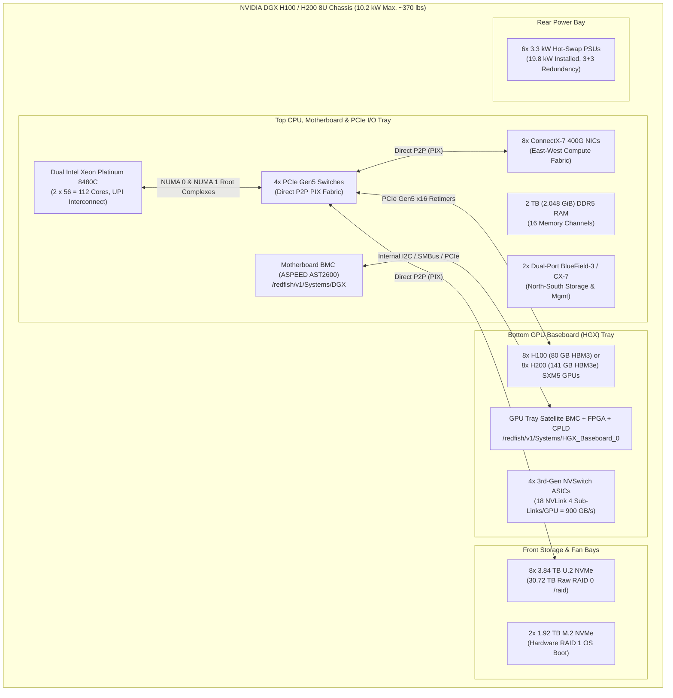
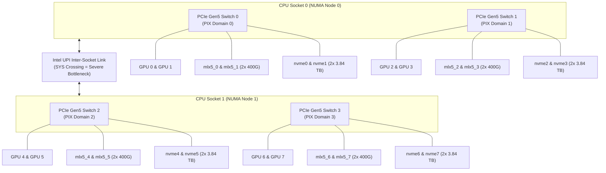

# 9.2 Inside a DGX H100 and H200 system

| | |
|---|---|
| **Status** | Drafted (`dgx_h100_h200_lab.py`: 30 checks pass; hardware commands **untested** on live DGX) |
| **Level** | Intermediate |
| **Priority tier** | 1b |
| **Lab venue** | none (design / reading) + self-checking Python model (`code/part09/dgx_h100_h200_lab.py`) |
| **Part** | Part 9: NVIDIA systems and reference architectures |
| **Sources used** | `nvidia-devops` V5 Ch. 2; `nvidia-devops` V7 Ch. 2; `nvidia-devops` V10 Ch. 1; *AI Systems Performance Engineering* Ch. 2; *Distributed AI Systems* Ch. 2; *NVIDIA Base Command Manager 11 Administrator Manual* (`bcm11-admin`) §14.5 |

## Why this matters for AI infrastructure

A distributed training job suddenly slows to half its expected throughput, or a server returns from maintenance with all eight GPUs stuck in a pending firmware state. Engineers who treat an eight-GPU server as a single motherboard cannot diagnose either failure.

Inside its 8U enclosure, an NVIDIA DGX H100 or DGX H200 is a multi-board system. It is split across separate compute, accelerator, storage, and power trays. Two independent Baseboard Management Controllers and 46 distinct firmware images govern those physical zones.

Every subsystem inside the chassis is wired to prevent data bottlenecks and thermal throttling. Four third-generation NVSwitch chips bond 18 NVLink sub-links per GPU into a single fabric. Four PCIe Gen5 switches pair each GPU with a dedicated 400G ConnectX-7 adapter and a local U.2 NVMe drive. That local switch path bypasses the dual Intel Xeon processors. Meanwhile, the DGX H200 upgrades the HBM3 stacks of the H100 to larger HBM3e stacks inside the same SXM5 socket. Knowing how these trays interact, and why GPU-tray firmware requires an AC power cycle rather than a DC reboot, turns guesswork into deterministic operations.

:::info Corpus scope note
Standalone NVIDIA DGX H100 and H200 system user guides and service manuals are not in the local book corpus. The component specifications, PCIe and NVSwitch topologies, Redfish paths, and firmware inventory in this chapter come from the cited sources. Those sources include the `nvidia-devops` volumes, *AI Systems Performance Engineering*, *Distributed AI Systems*, and the *NVIDIA Base Command Manager 11 Administrator Manual*.
:::

## Prerequisites and outcomes

**Prerequisites:**
- Complete Chapter 9.1 on DGX system families, workload-first sizing, and the three physical network planes.
- Review PCIe lanes, NUMA sockets, and Redfish out-of-band management from Part 7.

**Outcomes:**
1. Map the physical trays of an 8U DGX H100 or H200 chassis. Explain why the host CPU tray is mechanically, thermally, and electrically decoupled from the bottom HGX GPU tray.
2. Contrast the DGX H100 and DGX H200 memory subsystems and calculate Model FLOPs Utilization on large training runs.
3. Trace the internal four-switch PCIe Gen5 peer-to-peer routing in `nvidia-smi topo -m` and diagnose cross-socket Intel UPI bottlenecks.
4. Audit the 46 firmware components split between the motherboard tray and the GPU tray. Explain why activating GPU-tray firmware requires a full Redfish AC power cycle.

---

## Concepts: basics → intermediate → advanced

## 1. The 8U dual-tray physical architecture

Cramming eight 700W GPUs onto one circuit board alongside host CPUs, DDR5 memory, and optical transceivers creates a severe hazard. Over 5.6 kW of concentrated GPU heat would bake the host processors and optics. Worse, replacing one failed component would require unbolting the entire server from the rack.

An 8U DGX H100 or H200 solves this problem with a modular, front- and rear-serviceable chassis. The enclosure physically separates the GPU heat source from the host CPUs, DDR5 memory, PCIe switches, and NVMe drives.

Think of a double-decker aircraft where the lower hold carries eight jet engines with their own dedicated air ducts and telemetry. Meanwhile, the upper deck houses the cockpit, navigation computers, and cabin. Because the two decks are separate modules, heat from the lower engines never cooks the flight computers. Technicians can slide either tray out on heavy-duty rails for maintenance.



Inside the 8U enclosure, components are organized into four physical zones.

1. The bottom GPU tray holds the HGX baseboard and slides out on rails for servicing. It houses eight SXM5 GPUs topped with tall heatsinks, four third-generation NVSwitch ASICs, and eight PCIe Gen5 retimers. It also carries a tray FPGA, Complex Programmable Logic Devices, Hardware Root-of-Trust chips, and a dedicated GPU Tray Satellite BMC named `HGX_FW_BMC_0`.
2. The top CPU, motherboard, and PCIe I/O tray houses dual Intel Xeon Platinum 8480C processors and 2 TB of DDR5 system memory. It also carries the primary ASPEED AST2600 Motherboard BMC and four PCIe Gen5 switches. Behind the switches sit eight single-port ConnectX-7 400G compute NICs and two dual-port BlueField-3 DPUs or ConnectX-7 NICs for storage and management.
3. The front storage and fan bay holds two M.2 NVMe boot drives in hardware RAID 1 for DGX OS. Beside them sit eight U.2 NVMe scratch drives in RAID 0 mounted at `/raid`, cooled by hot-swappable fan modules.
4. The rear power supply bay houses six hot-swap power supplies arranged in three-plus-three feed redundancy across two power feeds.

```text
DGX H100 / H200 Physical Zone Summary:
  - Chassis Envelope:   8U (14-inch tall), ~370 lbs, 10.2 kW peak power draw
  - Bottom GPU Tray:    8x 700W SXM5 GPUs (5.6 kW), 4x NVSwitch ASICs, 8x PCIe Gen5 retimers, HGX_FW_BMC_0
  - Top Host & I/O:     2x 56-core Xeon 8480C (112 cores), 2,048 GiB DDR5, 4x PCIe Gen5 switches, 8x 400G CX-7, 2x BF-3
  - Front NVMe Storage: 2x 1.92 TB M.2 RAID 1 (OS) + 8x 3.84 TB U.2 RAID 0 (30.72 TB raw on /raid)
  - Rear Power Bay:     6x 3.3 kW PSUs (PSU_0..PSU_5 = 19.8 kW total capacity in 3+3 redundancy)
```

:::tip In one minute
- **Decoupling the bottom GPU tray from the top CPU and PCIe tray prevents 5.6 kW of GPU exhaust from heating the CPUs, DIMMs, and 400G optics.**
- Either tray can slide out on rails for independent mechanical service.
- Because the two trays are independent boards, always query both `/redfish/v1/Systems/DGX` and `/redfish/v1/Systems/HGX_Baseboard_0` during hardware triage.
:::

Before replacing components or debugging thermal alerts on a DGX node, check which physical tray owns the faulted sensor in Redfish.

---

## 2. The GPU tray: SXM5 modules, 4-NVSwitch fabric, and H100 vs H200 physics

If eight GPUs had to pass tensors across standard PCIe slots and host CPU sockets during every collective step, intra-node communication would stall training. High-speed tensor parallelism requires all eight accelerators to act as a single coherent memory and compute domain.

The bottom tray achieves this through the HGX eight-GPU baseboard and its four third-generation NVSwitch chips. Think of the four NVSwitch ASICs as a private eight-lane highway cloverleaf built exclusively for the GPUs. Instead of exiting onto slow city streets through the PCIe bus and CPU sockets, any GPU can transfer data at 900 GB/s directly into peer GPU memory in a single hop.

### 2.1 The 18-sub-link NVLink 4.0 and 4-NVSwitch crossbar

Each H100 or H200 SXM5 GPU exposes 18 fourth-generation NVLink sub-links. Every individual sub-link runs at 50 GB/s bidirectional, which equals roughly 25 GB/s in each direction. Bonding 18 sub-links gives each GPU 900 GB/s of bidirectional bandwidth. That is roughly seven times the 128 GB/s bidirectional rate of a 16-lane PCIe Gen5 slot.

None of the eight GPUs wire directly to each other point-to-point. Instead, the 144 NVLink sub-links from the eight GPUs fan out across four third-generation NVSwitch ASICs soldered onto the baseboard. Those four switches are tracked in firmware as `HGX_FW_NVSwitch_0` through `HGX_FW_NVSwitch_3`.

Together, the four NVSwitches form a non-blocking all-to-all crossbar delivering 3.6 TB/s of bisection bandwidth and 7.2 TB/s of aggregate bidirectional bandwidth. The switches also include hardware multicast and in-network reduction engines known as SHARP-over-NVLink. Those engines accelerate `ncclAllReduce` operations without consuming GPU Streaming Multiprocessors. Through this fabric, GPU 0 can issue load and store instructions or `cudaMemcpyPeerAsync()` calls directly into the High Bandwidth Memory of GPU 7. No host CPU intervention is required.

```text
NVLink 4.0 and 4-NVSwitch Crossbar Math (DGX H100 & DGX H200):
  - Per-sub-link rate:         50 GB/s bidirectional (~25 GB/s per direction)
  - Per-GPU NVLink bandwidth:  18 sub-links x 50 GB/s = 900 GB/s bidirectional (450 GB/s TX + 450 GB/s RX)
  - Total baseboard endpoints: 8 GPUs x 18 sub-links = 144 NVLink sub-links across 4x 3rd-Gen NVSwitch ASICs
  - Baseboard fabric capacity: 3.6 TB/s bisection bandwidth / 7.2 TB/s aggregate bidirectional bandwidth
```

### 2.2 DGX H100 versus DGX H200: same 8U chassis, HBM3e leap

Large language model inference and long-context training often run out of GPU memory capacity and memory bandwidth long before they saturate Tensor Core compute. Buying a completely new rack architecture just to gain more memory per GPU would force costly facility changes.

The DGX H100 and DGX H200 solve this by sharing the exact same 8U mechanical chassis, 10.2 kW power budget, and dual Xeon 8480C host tray. Both systems also share the same 700W per-GPU thermal envelope, 900 GB/s NVSwitch fabric, and Tensor Core math engines. What changes between them is the High Bandwidth Memory stack on each SXM5 package. The H200 replaces 80 GB of HBM3 with 141 GB of faster HBM3e inside the same thermal footprint.

| Specification | NVIDIA DGX H100 | NVIDIA DGX H200 | Operational Impact (`H200` vs `H100`) |
|---|---|---|---|
| **GPU SKU & TDP** | 8x `H100` SXM5 @ **700W** | 8x `H200` SXM @ **700W** | Drop-in thermal and power compatibility (**10.2 kW** max node) |
| **Memory Technology** | **HBM3** | **HBM3e** | Faster pin speeds and denser DRAM dies per stack |
| **Per-GPU VRAM Capacity** | **80 GB** (`81920 MiB`) | **141 GB** (`143771 MiB` in `nvidia-smi`) | **1.76× more VRAM** per GPU (fewer GPUs needed for 70B–405B models) |
| **Total Node GPU Memory** | **640 GB** HBM3 | **1,128 GB** (~1.13 TB) HBM3e | Fits a 405B FP8 model + massive KV cache inside **a single 8-GPU node** |
| **Per-GPU HBM Bandwidth** | **3.35 TB/s** | **4.8 TB/s** | **1.43× higher memory bandwidth** (~43% faster bandwidth-bound LLM decode) |
| **Aggregate Node HBM Bandwidth** | **26.8 TB/s** | **38.4 TB/s** | Faster local reductions, fused attention kernels, and KV-cache reads |
| **NVLink 4 Fabric** | 18 links/GPU = **900 GB/s** (**7.2 TB/s** agg) | 18 links/GPU = **900 GB/s** (**7.2 TB/s** agg) | Identical `NV18` full-mesh topology across 4 NVSwitch ASICs |
| **Tensor Peak (BF16 / FP8)** | **989** / **1,979 TFLOPS** | **989** / **1,979 TFLOPS** | Identical dense non-sparse Tensor Core math engines |

### 2.3 Measuring real training efficiency: Model FLOPs Utilization (MFU)

Operators often check `utilization.gpu` in `nvidia-smi` and assume a training job is healthy because the counter reads 99 percent. That metric only indicates whether at least one Streaming Multiprocessor had an active warp during the sampling window. It can report 99 percent even while the GPU stalls waiting on memory reads or slow network collectives.

The true measure of hardware efficiency is Model FLOPs Utilization. Model FLOPs Utilization compares the useful mathematical operations completed per second against the datasheet peak of the accelerator. For a dense transformer, the combined forward and backward pass work per iteration is approximately six times the parameter count multiplied by the tokens per iteration.

```text
Model FLOPs Utilization (MFU) Formula and Worked 70B H100 Example:
  MFU = (Model FLOPs per iteration / Iteration time in seconds) / Peak Hardware FLOPS
  - Transformer work per iteration (70B params, 2,048 tokens): 6 x 70 x 10^9 x 2,048 = 860.16 TFLOP (~860 TFLOP)
  - Measured step time:                                        2.0 seconds per iteration
  - Achieved throughput per GPU:                               860 TFLOP / 2.0 s = 430 TFLOPS
  - H100 non-sparse BF16 Tensor Core peak:                     989 TFLOPS
  - Resulting MFU:                                             430 TFLOPS / 989 TFLOPS = 43.48% (~43% MFU)
```

A result around 43 percent sits cleanly inside the 40 to 60 percent target band for well-tuned large-model training clusters. If Model FLOPs Utilization drops to 20 percent, the DGX node is starving on data loading. It may also be hitting memory bandwidth limits with tiny microbatches, or suffering from a PCIe or NUMA network misconfiguration.

:::tip In one minute
- Use `memory.total` in `nvidia-smi` to distinguish an H100 from an H200 inside their identical 8U chassis.
- **Never judge training health from `utilization.gpu`; compute Model FLOPs Utilization against the 989 TFLOPS BF16 peak and investigate whenever efficiency drops below 40 percent.**
:::

Always calculate Model FLOPs Utilization from actual step times before signing off on a new training cluster or diagnosing throughput regressions.

---

## 3. The CPU and motherboard tray: dual Xeon 8480C, NUMA domains, and 2 TB DDR5

Even though matrix multiplication happens on the bottom GPU baseboard, every training job still depends on the x86 host complex in the top tray. If host processes run on the wrong processor socket or run out of shared memory, GPU pipelines stall waiting for data and kernel launches.

Slide out the top tray of a DGX H100 or H200 and you will find the host motherboard. It boots the operating system, runs data-loading pipelines, launches CUDA kernels, and orchestrates network collectives.

### 3.1 Dual Intel Xeon Platinum 8480C and NUMA split

The DGX H100 and H200 motherboard houses two Intel Xeon Platinum 8480C processors from the Sapphire Rapids generation. Each processor provides 56 physical cores, giving the server 112 physical cores and 224 threads across two Non-Uniform Memory Access domains.

NUMA Node 0 on Socket 0 owns physical cores 0 through 55 and 1 TB of local DDR5 RAM across eight memory channels. Its PCIe Gen5 lanes feed the first half of the PCIe switch complex. That half serves GPUs 0 through 3, NICs `mlx5_0` through `mlx5_3`, and NVMe drives 0 through 3. NUMA Node 1 on Socket 1 owns physical cores 56 through 111 and the second 1 TB of DDR5 RAM across eight channels. It serves GPUs 4 through 7, NICs `mlx5_4` through `mlx5_7`, and NVMe drives 4 through 7.

The two CPU sockets communicate over Intel Ultra Path Interconnect links. Ultra Path Interconnect is designed for CPU cache coherence, not for carrying hundreds of gigabytes per second of GPU tensor traffic. Every PyTorch worker process must be pinned to the CPU cores and memory of its local NUMA node using `numactl --hardware`. That ensures kernel launches and host transfers never cross the inter-socket link.

### 3.2 Why a DGX node ships with 2 TB (2,048 GiB) of DDR5 RAM

Both the DGX H100 and DGX H200 ship with 2 TB of DDR5 system memory populated across 16 memory channels. Operators new to AI infrastructure often ask why a GPU server needs 2,048 GiB of host CPU RAM when the model weights live in GPU High Bandwidth Memory.

During distributed training, host RAM holds memory-mapped dataset shards and feeds CPU `DataLoader` worker processes through `/dev/shm` shared memory. It also holds page-locked `cudaMallocHost` staging buffers. Finally, it accepts asynchronous model checkpoints copied out of GPU memory so training steps can resume immediately while disks write in the background.

```text
Host DDR5 RAM to GPU VRAM Staging Ratios (2,048 GB Host DDR5 across 16 channels, 32-64 DataLoader workers):
  - Industry design guidelines:  2x to 3x GPU VRAM (DGX H100 rule); 1.5x to 2x minimum for 8-GPU nodes
  - DGX H100 (640 GB HBM3):      2,048 GB / 640 GB   = 3.20x host-to-GPU memory ratio
  - DGX H200 (1,128 GB HBM3e):   2,048 GB / 1,128 GB = 1.82x host-to-GPU memory ratio (my inference)
```

Comparing the node VRAM capacities against the 2,048 GB host RAM specification to derive the H200 staging ratio is my inference. While the H200 ratio still satisfies the minimum host RAM guideline, operators offloading full unsharded 1.1 TB H200 states to `/dev/shm` must monitor shared-memory limits carefully.

:::tip In one minute
- **Always bind `LOCAL_RANK` 0 through 3 to NUMA Node 0 and `LOCAL_RANK` 4 through 7 to NUMA Node 1 so host memory transfers and kernel launches never cross the Intel UPI link.**
- Size container `/dev/shm` with `--shm-size=256g` or `--ipc=host` so PyTorch `DataLoader` workers can use the DDR5 pool instead of crashing at the 64 MB container default.
:::

Configure NUMA binding and container shared-memory limits in your job templates before launching multi-GPU training workloads.

---

## 4. The PCIe Gen5 switch complex, networking, and storage wiring

Before a gradient packet can enter a 400G optical cable or a training shard can stream from an NVMe drive, the data must leave the GPU package and cross the internal PCIe bus. If every transfer had to climb up to the host CPU root complex and back down, CPU root ports would bottleneck multi-node scaling.

Think of a budget server without PCIe switches like an office building with no ground-floor hallways between loading docks. To move a crate from Dock A to Dock B five feet away, workers must ride a freight elevator up to the penthouse CPU root complex and ride another elevator back down. In a DGX H100 or H200, NVIDIA solders four high-radix PCIe Gen5 switches directly between the devices. That way, the GPU, NIC, and NVMe drive share a private ground-floor hallway.



### 4.1 The four PCIe Gen5 switch groups (`PIX` domains)

Inside the I/O tray, four PCIe Gen5 switches each deliver 64 GB/s unidirectional and 128 GB/s bidirectional bandwidth per 16-lane link. These switches organize the eight GPUs, eight compute NICs, and eight U.2 NVMe drives into four symmetric Peer-to-Peer groups. Numbering this four-switch symmetric pairing across NUMA 0 and NUMA 1 is my inference from the four-switch architecture.

| PCIe Gen5 Switch | Host NUMA Node | Paired SXM5 GPUs | Paired 400G Compute NICs | Paired U.2 NVMe Drives | Local P2P Symbol |
|---|---|---|---|---|---|
| **Switch 0** | NUMA Node 0 (Socket 0) | `GPU 0`, `GPU 1` | `mlx5_0`, `mlx5_1` | `nvme0`, `nvme1` | `PIX` |
| **Switch 1** | NUMA Node 0 (Socket 0) | `GPU 2`, `GPU 3` | `mlx5_2`, `mlx5_3` | `nvme2`, `nvme3` | `PIX` |
| **Switch 2** | NUMA Node 1 (Socket 1) | `GPU 4`, `GPU 5` | `mlx5_4`, `mlx5_5` | `nvme4`, `nvme5` | `PIX` |
| **Switch 3** | NUMA Node 1 (Socket 1) | `GPU 6`, `GPU 7` | `mlx5_6`, `mlx5_7` | `nvme6`, `nvme7` | `PIX` |

Because each GPU, compute NIC, and NVMe drive sit under the same PCIe Gen5 switch, two hardware acceleration paths run at full wire speed. First, under GPUDirect RDMA, packets leaving GPU 0 turn inside PCIe Switch 0 directly into `mlx5_0` at 50 GB/s wire speed. They never touch the Xeon CPU or DDR5 memory. Second, under GPUDirect Storage, `cuFile` reads from `nvme2` or `nvme3` on `/raid` transfer across PCIe Switch 1 directly into the HBM of GPU 2.

### 4.2 Network and storage bay summary

The network and storage bays separate east-west GPU collectives from north-south file system traffic. Eight single-port ConnectX-7 adapters run at 400 Gbps NDR InfiniBand or 400 GbE RoCEv2. Together they provide 3.2 Tbps or 400 GB/s of total node injection bandwidth wired one-to-one to the eight GPUs. Two dual-port BlueField-3 DPUs or ConnectX-7 NICs provide up to four high-speed ports dedicated to parallel file systems such as Lustre, WEKA, GPFS, or VAST. In the front bay, two M.2 NVMe drives run in RAID 1 for the operating system, while eight U.2 NVMe drives form a RAID 0 array mounted at `/raid`.

```text
Network and Storage Bay Specification Summary:
  - East-West Compute NICs: 8x single-port ConnectX-7 @ 400 Gbps NDR IB / 400 GbE RoCEv2 (3.2 Tbps / 400 GB/s aggregate)
  - North-South Storage/OS: 2x dual-port BlueField-3 DPUs or ConnectX-7 NICs (up to 4x 200/400 GbE ports)
  - OS Boot Storage:        2x 1.92 TB M.2 NVMe in Hardware RAID 1
  - Local Scratch Storage:  8x 3.84 TB U.2 NVMe in RAID 0 mounted at /raid (30.72 TB raw capacity)
```

:::tip In one minute
- **Four PCIe Gen5 switches partition the node into four `PIX` domains, each coupling two GPUs, two ConnectX-7 400G NICs, and two U.2 NVMe drives so GPUDirect RDMA and GPUDirect Storage bypass the host CPUs.**
- Each 16-lane PCIe Gen5 link delivers 64 GB/s per direction, easily saturating a 50 GB/s ConnectX-7 port when routed locally.
:::

Verify that every GPU uses its switch-local `mlx5` adapter and local NVMe drive so DMA transfers stay inside their local PCIe switch.

---

## 5. Reading `nvidia-smi topo -m` and diagnosing the cross-NUMA `SYS` trap

A single misconfigured environment variable or container device assignment can route GPU network traffic across the wrong processor socket and cut multi-node training speed in half. Senior infrastructure engineers never trust cabling diagrams on paper alone. Instead, they verify how the Linux kernel and NVIDIA driver see the physical board traces by running `nvidia-smi topo -m`.

### 5.1 Decoding the topology matrix symbols

When you run `nvidia-smi topo -m` on a DGX H100 or DGX H200, every cell in the matrix reports one of six path symbols between the row device and the column device.

| Symbol | Meaning | Hardware Path | Impact on GPUDirect RDMA & P2P |
|---|---|---|---|
| **`X`** | Self | Same physical device | N/A |
| **`NV18`** | 18 bonded NVLink sub-links | Traverses the **4x NVSwitch baseboard** (**900 GB/s** bidirectional per GPU) | **Ideal GPU-to-GPU path.** Full 900 GB/s bandwidth, zero CPU/PCIe traffic. |
| **`PIX`** | Single PCIe switch | Traverses **at most one PCIe Gen5 switch** (e.g., `GPU 0 ↔ mlx5_0` or `GPU 0 ↔ mlx5_1`) | **Ideal GPU-to-NIC / GPU-to-NVMe path.** Direct hardware P2P DMA (**64 GB/s** uni), bypasses CPU. |
| **`PXB`** | Multiple PCIe switches | Traverses multiple cascaded PCIe switches without hitting the CPU host bridge | Good P2P path; slightly higher switch hop latency than `PIX`, still bypasses CPU. |
| **`PHB` / `NODE`** | Same NUMA node via CPU Root Complex | `PHB` crosses a PCIe Host Bridge; `NODE` crosses host bridges within **one NUMA socket** (e.g., `GPU 0` on Switch 0 to `mlx5_2` on Switch 1, both on NUMA 0) | **Degraded.** Traffic bounces through the Intel Xeon PCIe Root Complex; NCCL's default GDR distance limit may disable GPUDirect RDMA. |
| **`SYS`** | Cross-socket NUMA traversal | Crosses the **Intel UPI inter-socket link** between **NUMA Node 0 and NUMA Node 1** (e.g., `GPU 0` on NUMA 0 to `mlx5_6` on NUMA 1) | **Catastrophic.** Saturates the CPU UPI link and cuts multi-node collective throughput by **~50%**. |

On a healthy DGX H100 or H200, the eight-by-eight GPU block shows `NV18` in every off-diagonal cell. Meanwhile, the GPU-to-NIC block shows `PIX` matching each GPU pair to its local ConnectX-7 pair. It shows `NODE` to the other switch on the same CPU socket, and `SYS` across the inter-socket link.

```text
        GPU0    GPU1    GPU2    GPU3    GPU4    GPU5    GPU6    GPU7    mlx5_0  mlx5_1  mlx5_2  mlx5_6  CPU Affinity    NUMA Affinity
GPU0     X      NV18    NV18    NV18    NV18    NV18    NV18    NV18    PIX     PIX     NODE    SYS     0-55,112-167    0
GPU1    NV18     X      NV18    NV18    NV18    NV18    NV18    NV18    PIX     PIX     NODE    SYS     0-55,112-167    0
GPU2    NV18    NV18     X      NV18    NV18    NV18    NV18    NV18    NODE    NODE    PIX     SYS     0-55,112-167    0
GPU3    NV18    NV18    NV18     X      NV18    NV18    NV18    NV18    NODE    NODE    PIX     SYS     0-55,112-167    0
GPU4    NV18    NV18    NV18    NV18     X      NV18    NV18    NV18    SYS     SYS     SYS     NODE    56-111,168-223  1
GPU5    NV18    NV18    NV18    NV18    NV18     X      NV18    NV18    SYS     SYS     SYS     NODE    56-111,168-223  1
GPU6    NV18    NV18    NV18    NV18    NV18    NV18     X      NV18    SYS     SYS     SYS     PIX     56-111,168-223  1
GPU7    NV18    NV18    NV18    NV18    NV18    NV18    NV18     X      SYS     SYS     SYS     PIX     56-111,168-223  1
```

### 5.2 Real-world failure: the `GPU 0` to `mlx5_6` (`SYS`) mis-binding

Suppose a team runs a multi-node PyTorch training job across four DGX H100 nodes and sees half the expected `AllReduce` bandwidth. All eight GPUs and all eight 400G InfiniBand ports show active links. When you inspect the launch script or Kubernetes device allocation, you discover that a hard-coded `NCCL_IB_HCA` list bound GPU 0 on NUMA 0 to `mlx5_6` on NUMA 1.

Look at the row for GPU 0 and column for `mlx5_6` in the matrix above: the path is `SYS`. Every byte of gradient data leaving GPU 0 must climb PCIe Switch 0 to CPU 0, cross the narrow Intel UPI link to CPU 1, and descend PCIe Switch 3 to `mlx5_6`.

To fix this bottleneck, first dump the topology graph that NCCL computed at startup by setting `NCCL_TOPO_DUMP_FILE=/tmp/nccl_topo.xml` and `NCCL_DEBUG=INFO`. Next, remove the broken `NCCL_IB_HCA` override so NCCL auto-detects the `PIX` adapter. If you run partial-node Kubernetes pods, enable the Kubernetes Topology Manager with `--topology-manager-policy=single-numa-node` and the `static` CPU Manager policy. That guarantees GPU 0 binds strictly to `mlx5_0`.

:::tip In one minute
- **On a healthy DGX H100 or H200, every GPU-to-GPU cell in `nvidia-smi topo -m` must read `NV18`, and every GPU's paired compute NIC must read `PIX`.**
- Use `NCCL_TOPO_DUMP_FILE=/tmp/nccl_topo.xml` and `NCCL_DEBUG=INFO` to confirm that NCCL never routes RDMA traffic over a `NODE` or `SYS` path.
:::

Inspect `nvidia-smi topo -m` and the NCCL topology dump whenever multi-node collective throughput falls below single-node baselines.

---

## 6. Dual-tray Redfish telemetry and the 46-component firmware lifecycle

After flashing a GPU-tray firmware bundle and rebooting a DGX node, operators often find all 30 accelerator components still stuck in a pending state. Because an 8U DGX H100 or H200 is split into two major hardware trays, both out-of-band Redfish monitoring and firmware activation follow that physical boundary.

### 6.1 Dual Redfish endpoints: `/Systems/DGX` and `/Systems/HGX_Baseboard_0`

When you query the DGX BMC over HTTPS at `/redfish/v1`, the URI tree exposes separate objects for the host system and the bottom GPU baseboard.

1. The `/redfish/v1/Systems/DGX` endpoint reports the host motherboard state, dual Intel Xeon Platinum 8480C processor summary, 2,048 GiB memory total, `/Bios` attributes, and `/SecureBoot` state.
2. The `/redfish/v1/Systems/HGX_Baseboard_0` endpoint represents the bottom eight-GPU HGX tray managed by the GPU Tray Satellite BMC. It exposes per-GPU environment and power telemetry at `/redfish/v1/Systems/HGX_Baseboard_0/Processors/GPU_SXM_<1..8>/EnvironmentMetrics`.
3. The `/redfish/v1/Chassis/DGX/Sensors` and `/Managers/BMC/LogServices/SEL` endpoints provide chassis-wide thermal and power readings along with the System Event Log.

### 6.2 The 46 firmware components across the motherboard tray and GPU tray

In production clusters managed by NVIDIA Base Command Manager or the Redfish `/redfish/v1/UpdateService`, firmware for a DGX H100 ships in two distinct `.fwpkg` bundles. Those two packages correspond to the two physical trays and cover 46 individual firmware components.

| Physical Tray & Package | Count | Exact Component Identifiers (`cmsh` `firmware status`) | What They Control |
|---|---|---|---|
| **1. Motherboard Tray (Chassis)** (`nvfw_dgx-h100_*.fwpkg`) | **16** | `CPLDMB_0`, `CPLDMID_0`, `EROT_BIOS_0`, `EROT_BMC_0`, `HostBIOS_0`, `HostBMC_0`, `PCIeRetimer_0`, `PCIeRetimer_1`, `PCIeSwitch_0`, `PCIeSwitch_1`, `PSU_0`, `PSU_1`, `PSU_2`, `PSU_3`, `PSU_4`, `PSU_5` | Host motherboard CPLDs, midplane CPLD, BIOS/BMC hardware roots of trust (`ERoT`), System BIOS (`HostBIOS_0`), primary BMC (`HostBMC_0`), host PCIe retimers/switches, and all six 3.3 kW PSUs (`PSU_0..5`). |
| **2. GPU Tray (HGX Baseboard)** (`nvfw_dgx-hgx-h100x8_*.fwpkg`) | **30** | `HGX_FW_BMC_0`, `HGX_FW_ERoT_BMC_0`, `HGX_FW_ERoT_FPGA_0`, `HGX_FW_ERoT_NVSwitch_0..3` (4), `HGX_FW_ERoT_PCIeSwitch_0`, `HGX_FW_FPGA_0`, `HGX_FW_GPU_SXM_1..8` (8), `HGX_FW_NVSwitch_0..3` (4), `HGX_FW_PCIeRetimer_0..7` (8), `HGX_FW_PCIeSwitch_0` | GPU tray satellite BMC (`HGX_FW_BMC_0`), 7 hardware roots of trust (`HGX_FW_ERoT_*`), tray FPGA (`HGX_FW_FPGA_0`), all 8 SXM GPU VBIOSes (`HGX_FW_GPU_SXM_1..8`), all 4 NVSwitch ASIC firmwares (`HGX_FW_NVSwitch_0..3`), 8 GPU-tray PCIe Gen5 retimers (`HGX_FW_PCIeRetimer_0..7`), and the baseboard PCIe switch (`HGX_FW_PCIeSwitch_0`). |

### 6.3 Why GPU-tray firmware requires a full AC power cycle (not a DC reset)

When you flash the GPU-tray firmware package, the 30 `HGX_FW_*` components stage their new versions in non-volatile memory. In Base Command Manager, `firmware status` then reports a state of `pending` and a result of `success: AC power cycle to activate`.

```text
GPU-Tray Firmware Activation State Transition (bcm11-admin Section 14.5, pp. 758-762):
  - Staged VBIOS example:   HGX_FW_GPU_SXM_1 transitions 96.00.70.00.01 -> 96.00.74.00.01
  - After OS reboot / DC:   State = "pending"   | Result = "success: AC power cycle to activate"
  - After AC power cycle:   State = "completed" | Result = "success: activated"
```

If an operator runs a standard operating system reboot or a board-level DC power reset in `cmsh`, the new GPU-tray firmware does not activate. The GPU Tray Satellite BMC, the seven ERoT security controllers, the tray FPGA, and the eight PCIe retimers remain powered by the standby rails of the six power supplies. Those standby rails stay live whenever AC cords are plugged in.

To transition the 30 GPU-tray components to `completed`, you must execute a full AC power cycle. Cut all six AC power inputs simultaneously by toggling the six outlet relays off and on at your rack PDUs. You can also disconnect all six AC power cords during local maintenance. Once the standby rails drain completely, every FPGA, CPLD, ERoT, NVSwitch, and SXM GPU reloads its newly flashed image from cold power-on. Similarly, after updating the host BMC firmware itself, run `ipmitool -I lanplus -H <bmc-ip> -U <user> -P <pass> mc reset cold` to cold-reset the BMC processor.

:::tip In one minute
- **Standard OS reboots or DC board resets cannot activate the 30 GPU-tray firmware components because standby PSU rails keep the satellite BMC, ERoT chips, and FPGA energized.**
- Always schedule a full AC power cycle across all six PDU outlets during GPU-tray firmware maintenance windows until `firmware status` reports `completed` and `success: activated`.
:::

Build automated PDU outlet toggling into your cluster maintenance playbooks whenever you stage HGX baseboard firmware updates.

---

## Commands and configurations that matter

The commands below verify the internal topology, HBM capacity, PCIe link width, Redfish dual-tray telemetry, and 46-component firmware state. These hardware commands are untested on a live DGX node in this authoring environment. Their rules and outputs are verified by `code/part09/dgx_h100_h200_lab.py`.

### 1. Inspect GPU model, HBM capacity (`81920 MiB` vs `143771 MiB`), and PCIe Gen5 x16 link state

```bash
# Query GPU SKU, total MiB (81920 on H100 vs 143771 on H200), and PCIe Gen5 x16 width
nvidia-smi --query-gpu=index,name,memory.total,pcie.link.gen.current,pcie.link.gen.max,pcie.link.width.current,pcie.link.width.max \
  --format=csv

# Inspect the 8x8 NV18 NVSwitch matrix and GPU-to-NIC PIX/NODE/SYS pairings
nvidia-smi topo -m

# Verify CPU NUMA node layout (Socket 0: cores 0-55, Socket 1: cores 56-111, 1 TB DDR5 each)
numactl --hardware
```

### 2. Query dual-tray Redfish endpoints (`/Systems/DGX` and `/Systems/HGX_Baseboard_0`)

```bash
# 1. Authenticate a Redfish session and capture X-Auth-Token
TOKEN=$(curl -sk -X POST "https://${BMC_IP}/redfish/v1/SessionService/Sessions" \
  -H "Content-Type: application/json" \
  -d "{\"UserName\":\"${BMC_USER}\",\"Password\":\"${BMC_PASS}\"}" -D - \
  | awk '/X-Auth-Token:/ {print $2}' | tr -d '\r')

# 2. Query host motherboard tray (Dual Xeon 8480C, 2048 GiB DDR5)
curl -sk -H "X-Auth-Token: ${TOKEN}" \
  "https://${BMC_IP}/redfish/v1/Systems/DGX" \
  | jq '{Model, PowerState, ProcessorSummary, MemorySummary}'

# 3. Query GPU 1 environment metrics on the bottom HGX baseboard tray
curl -sk -H "X-Auth-Token: ${TOKEN}" \
  "https://${BMC_IP}/redfish/v1/Systems/HGX_Baseboard_0/Processors/GPU_SXM_1/EnvironmentMetrics" | jq .
```

### 3. Flash and verify the 46 DGX H100 firmware components in BCM (`cmsh`)

```text
# 1. Inspect all 46 firmware components (16 motherboard tray + 30 GPU tray)
[basecm11->device]% firmware -n node001 status

# 2. Flash the 30 GPU-tray (HGX) components using the signed .fwpkg bundle
[basecm11->device[node001]]% firmware flash nvfw_dgx-hgx-h100x8_0002_230705.1.1.fwpkg

# 3. Check pending activation status (shows "pending" / "success: AC power cycle to activate")
[basecm11->device[node001]]% firmware status | grep nvfw

# 4. After cutting and restoring all 6 AC PDU outlets (AC power cycle), verify activation
[basecm11->device]% firmware -n node001 status
# Expect State = "completed" and Result = "success: activated" across all 30 HGX_FW_* rows
```

---

## How it fails

| Failure mode | Symptom | Root cause | Diagnosis & fix |
|---|---|---|---|
| **1. Cross-socket `SYS` GPU-to-NIC pairing** | Multi-node PyTorch training on a DGX H100/H200 achieves **~50% of expected `AllReduce` bus bandwidth**, and `perf` / `pcm` shows heavy traffic saturating the Intel UPI links between CPU 0 and CPU 1. | A container orchestrator or manual `NCCL_IB_HCA` setting paired a GPU on **NUMA 0** (such as `GPU 0`) with a ConnectX-7 NIC on **NUMA 1** (such as `mlx5_6`), forcing every RDMA packet across the **`SYS`** path (`GPU 0 → Switch 0 → CPU 0 → Intel UPI → CPU 1 → Switch 3 → mlx5_6`). | Run `nvidia-smi topo -m` and dump NCCL's topology via `NCCL_TOPO_DUMP_FILE=/tmp/nccl_topo.xml`. Ensure each GPU uses its **`PIX`**-paired NIC on the same PCIe Gen5 switch (`GPU 0/1 ↔ mlx5_0/1`, `GPU 2/3 ↔ mlx5_2/3`, `GPU 4/5 ↔ mlx5_4/5`, `GPU 6/7 ↔ mlx5_6/7`), and enable Kubernetes Topology Manager (`single-numa-node`) for partial-node pods. |
| **2. GPU-tray firmware stuck in `pending` after reboot** | After flashing `nvfw_dgx-hgx-h100x8_*.fwpkg` and rebooting the node (or running `cmsh` `power reset`), all 30 `HGX_FW_*` components remain at their old versions with `State: pending` and `Result: success: AC power cycle to activate`. | A standard OS reboot or board-level DC power reset leaves the 6 PSUs' standby power rails active, so the GPU Tray Satellite BMC (`HGX_FW_BMC_0`), 7 `ERoT` security chips, FPGA (`HGX_FW_FPGA_0`), and 8 PCIe retimers never cold-boot into the newly flashed firmware. | Perform a full **AC power cycle** by powering off all 6 AC outlets feeding the server on PDU A and PDU B (or physically disconnecting all 6 AC power leads), waiting for standby rails to drain, and restoring AC power. Confirm `firmware status` transitions to `completed` / `success: activated`. |
| **3. PCIe link width or generation downgrade (`Gen1/Gen3` or `x8`)** | A single GPU's `ib_write_bw --use_cuda` or `gdsio` throughput drops from **~45–50 GB/s** to **~8–16 GB/s**, stalling synchronous `AllReduce` across the entire 8-GPU ring. | Dust or seating issues on the SXM5 mezzanine socket, or a degraded GPU-tray PCIe retimer (`HGX_FW_PCIeRetimer_0..7`), caused the link between the GPU and its PCIe Gen5 switch to train down from **Gen5 x16 (64 GB/s)** to **Gen3 x16** or **Gen5 x8**. | Run `nvidia-smi --query-gpu=index,pcie.link.gen.current,pcie.link.width.current --format=csv` under load. If `gen.current < 5` or `width.current < 16`, verify retimer firmware alignment (`HGX_FW_PCIeRetimer_*`), perform an AC power cycle, and reseat or RMA the affected GPU tray if link training still downgrades. |
| **4. `/dev/shm` exhaustion by PyTorch `DataLoader` workers** | Training crashes mid-epoch with `RuntimeError: DataLoader worker (pid ...) is killed by signal: Bus error` even though `free -h` shows hundreds of gigabytes of free DDR5 RAM on the 2 TB host. | Docker or Kubernetes defaults `/dev/shm` (POSIX shared memory backed by host DDR5 RAM) to **64 MB**, starving the 32–64 CPU `DataLoader` workers that stage batches for the 8 H100/H200 GPUs. | Pass `--shm-size=256g` (or `--ipc=host`) to Docker/containerd, or mount an `emptyDir` with `medium: Memory` and `sizeLimit: 256Gi` at `/dev/shm` in the Kubernetes Pod spec so workers can utilize the node's 2,048 GiB DDR5 pool. |
| **5. Unpinned CPU workers crossing NUMA sockets** | GPU kernel launch latency spikes and step times jitter by 15%–25% across iterations on an 8-GPU job. | The training launcher spawned 8 Python processes without NUMA CPU affinity, so the Linux scheduler migrated `LOCAL_RANK 0` (controlling `GPU 0` on NUMA 0) onto CPU cores `56–111` (Socket 1 / NUMA 1). | Pin ranks `0–3` to NUMA Node 0 (`cores 0-55,112-167`) and ranks `4–7` to NUMA Node 1 (`cores 56-111,168-223`) using `torchrun` NUMA binding, Slurm `--cpu-bind=ldoms`, or `numactl --cpunodebind=$((LOCAL_RANK/4)) --membind=$((LOCAL_RANK/4))`. |

---

## Hands-on lab

This chapter's self-checking Python model in `code/part09/dgx_h100_h200.py` and lab script in `code/part09/dgx_h100_h200_lab.py` verify five architectural invariants.

1. They compare the hardware specifications of the DGX H100 and DGX H200 inside their shared 8U chassis.
2. They validate the host DDR5 RAM to GPU VRAM staging ratios across both platforms.
3. They classify the four-switch PCIe Gen5 and four-NVSwitch topology hops across all GPUs, NICs, and NVMe drives.
4. They compute Model FLOPs Utilization for the 70B H100 transformer training benchmark.
5. They run the 46-component DGX H100 firmware activation state machine. That model proves why a DC reset leaves the 30 GPU-tray components pending while an AC power cycle activates them.

Run the lab from the repository root:

```bash
python3 -B code/part09/dgx_h100_h200_lab.py
```

Expected output verified in this repository:

```text
=== Chapter 9.2 Lab: Inside a DGX H100 and H200 System ===
  [PASS] DGX H100 & H200 share 8U chassis, dual Xeon Platinum 8480C (112 cores), 2048 GB DDR5 across 16 channels
  [PASS] Each GPU has 18 NVLink 4.0 sub-links at 50 GB/s = 900 GB/s per GPU across 4 NVSwitches
  [PASS] NVSwitch baseboard delivers 3.6 TB/s bisection and 7.2 TB/s aggregate bidirectional bandwidth
  [PASS] DGX H100 provides 8x 80 GB HBM3 = 640 GB total at 26.8 TB/s aggregate bandwidth
  [PASS] DGX H200 upgrades to 8x 141 GB HBM3e (143,771 MiB in nvidia-smi) = 1,128 GB at 38.4 TB/s
  [PASS] H200 provides 1.76x VRAM capacity and 1.43x HBM bandwidth over H100 in same 10.2 kW envelope
  ...
  [PASS] BCM 11 p.758: Motherboard tray has 16 firmware components and GPU tray has 30 (46 total)
  [PASS] BCM 11 p.761: DC board reset after GPU-tray flash leaves 30 HGX components pending AC power cycle
  [PASS] BCM 11 p.761: Full AC power cycle activates all 30 GPU-tray firmware components
  [PASS] Motherboard-tray firmware package updates 16 components and leaves 30 GPU-tray components untouched

Summary: 30 passed, 0 failed (total 30)
```

---

## Exercises

1. Run `python3 -B code/part09/dgx_h100_h200_lab.py` and inspect the firmware state machine checks. Explain in your own words why a DC reset leaves the 30 GPU-tray components in a pending state.
2. Calculate the Model FLOPs Utilization of a GPU that completes a 1,200 TFLOP training step in 3.0 seconds on an H100. State whether that result sits inside the healthy target range, and name what you would check first if efficiency dropped to 18 percent.
3. A row of `nvidia-smi topo -m` shows GPU 5 with `SYS` to `mlx5_0` and `mlx5_1`, and `PIX` to `mlx5_4` and `mlx5_5`. Identify which NICs GPU 5 should use. Explain what happens if `NCCL_IB_HCA` forces it onto `mlx5_0`.
4. Write the three commands you would run to confirm that a four-GPU Kubernetes pod is pinned to a single NUMA node. Describe the output you expect to see.
5. A colleague says the team rebooted the node after flashing the GPU tray, so the new firmware is live. Write a short reply explaining how to check `firmware status` and what action is required next.
6. Compute the host-RAM-to-GPU-memory ratio for a DGX H100 and a DGX H200. Identify which system has less host RAM per gigabyte of GPU memory. Explain how that difference affects `/dev/shm` sizing.

## Checkpoint questions (20)

<details>
<summary>`&lt;strong>`1. Why does an 8U DGX H100/H200 physically separate the bottom GPU tray from the top CPU/motherboard tray, and how are the two trays managed out-of-band?`&lt;/strong>`</summary>

Eight 700W SXM5 GPUs and four NVSwitch ASICs generate over 5.6 kW of concentrated heat. Decoupling the bottom HGX GPU tray from the top CPU, DDR5, and PCIe tray prevents GPU exhaust from baking the CPUs, DIMMs, and 400G optical transceivers. It also lets either tray slide out on rails for independent service. The top tray runs the primary Motherboard BMC at `/redfish/v1/Systems/DGX`. The bottom tray runs the GPU Tray Satellite BMC at `/redfish/v1/Systems/HGX_Baseboard_0`.
</details>

<details>
<summary>`&lt;strong>`2. How does the NVSwitch fabric on a DGX H100/H200 achieve 900 GB/s per GPU and 3.6 TB/s of bisection bandwidth?`&lt;/strong>`</summary>

Each of the eight SXM5 GPUs exposes 18 fourth-generation NVLink sub-links running at 50 GB/s bidirectional per sub-link. That provides 900 GB/s bidirectional bandwidth per GPU. All 144 NVLink sub-links across the eight GPUs wire into four third-generation NVSwitch ASICs on the HGX baseboard. Together they form an all-to-all crossbar with 3.6 TB/s of bisection bandwidth and 7.2 TB/s of aggregate bidirectional bandwidth.
</details>

<details>
<summary>`&lt;strong>`3. What exact specifications change between a DGX H100 and a DGX H200, and what stays identical?`&lt;/strong>`</summary>

Both systems share the same 8U chassis, 10.2 kW peak power, 700W per-GPU TDP, dual 56-core Xeon 8480C CPUs, and 2 TB DDR5 RAM. They also share four NVSwitches, eight ConnectX-7 400G NICs, and 989 TFLOPS BF16 Tensor compute per GPU. The DGX H200 upgrades each GPU from 80 GB of HBM3 at 3.35 TB/s to 141 GB of HBM3e at 4.8 TB/s. That raises total node GPU memory from 640 GB to 1,128 GB and aggregate HBM bandwidth from 26.8 TB/s to 38.4 TB/s.
</details>

<details>
<summary>`&lt;strong>`4. A 70B transformer training step on an H100 processes ~860 TFLOP of work per GPU in 2.0 seconds. What is the Model FLOPs Utilization (MFU), and why is MFU a better metric than `nvidia-smi` GPU utilization?`&lt;/strong>`</summary>

Dividing 860 TFLOP by 2.0 seconds yields 430 TFLOPS of achieved throughput per GPU. Dividing 430 TFLOPS by the 989 TFLOPS BF16 peak gives 43.48 percent MFU, which sits inside the healthy 40 to 60 percent target band. The `utilization.gpu` counter in `nvidia-smi` only measures whether any warp was active during the sample interval. MFU measures useful mathematical work completed relative to hardware peak.
</details>

<details>
<summary>`&lt;strong>`5. Why does a DGX H100/H200 ship with 2 TB (2,048 GiB) of DDR5 host RAM across 16 channels?`&lt;/strong>`</summary>

To keep eight Hopper GPUs fed without stalling on I/O, host RAM must hold memory-mapped dataset shards and `/dev/shm` buffers for PyTorch `DataLoader` workers. It also holds pinned DMA staging buffers and asynchronous checkpoints copied off GPU HBM. The 2,048 GB pool provides 3.2 times the 640 GB VRAM of a DGX H100 and 1.82 times the 1,128 GB VRAM of a DGX H200.
</details>

<details>
<summary>`&lt;strong>`6. How are GPUs, ConnectX-7 NICs, and U.2 NVMe drives grouped across the four PCIe Gen5 switches inside a DGX H100/H200?`&lt;/strong>`</summary>

Each of the four PCIe Gen5 switches couples two GPUs, two 400G ConnectX-7 NICs, and two U.2 NVMe drives into a local `PIX` peer-to-peer domain. Switches 0 and 1 sit on NUMA Node 0 serving GPUs 0 through 3. Switches 2 and 3 sit on NUMA Node 1 serving GPUs 4 through 7. This layout lets GPUDirect RDMA and GPUDirect Storage transfers turn directly inside the local PCIe switch without touching the Xeon CPUs.
</details>

<details>
<summary>`&lt;strong>`7. Explain the difference between `PIX`, `NODE`, and `SYS` in `nvidia-smi topo -m` when looking at the cell between a GPU and an `mlx5_*` NIC.`&lt;/strong>`</summary>

The `PIX` symbol means the GPU and NIC share a single PCIe Gen5 switch, allowing peer-to-peer transfers at 64 GB/s without touching the CPU. The `NODE` symbol means the GPU and NIC sit on different PCIe switches attached to the same CPU socket. That forces packets through the CPU PCIe Root Complex. The `SYS` symbol means the devices sit on different CPU sockets, forcing every packet across the Intel UPI link and cutting RDMA bandwidth by roughly half.
</details>

<details>
<summary>`&lt;strong>`8. How many firmware components are tracked across a DGX H100 in BCM (`cmsh` `firmware status`), and how are they divided between the two `.fwpkg` bundles?`&lt;/strong>`</summary>

A DGX H100 tracks 46 firmware components across two tray packages. The motherboard tray bundle contains 16 components covering motherboard and midplane CPLDs, BIOS and BMC roots of trust, System BIOS, primary BMC, host PCIe retimers and switches, and six power supplies. The GPU tray bundle contains 30 `HGX_FW_*` components. Those cover the satellite BMC, seven security roots of trust, the tray FPGA, eight SXM GPU VBIOSes, four NVSwitch ASICs, eight PCIe retimers, and the baseboard PCIe switch.
</details>

<details>
<summary>`&lt;strong>`9. Why does a regular reboot or `cmsh` `power reset` fail to activate newly flashed GPU-tray (`HGX_FW_*`) firmware on a DGX H100, and what action is required instead?`&lt;/strong>`</summary>

A regular reboot or `power reset` performs a board-level DC power cycle, which leaves the standby rails of the six power supplies energized. Because the GPU Tray Satellite BMC, ERoT security chips, FPGA, and retimers run on standby power, they never re-initialize and remain in a pending state. You must perform a full AC power cycle by cutting all six AC power inputs at the rack PDUs. Once standby power drains completely, all 30 components activate.
</details>

<details>
<summary>`&lt;strong>`10. Why is `nvidia-smi` reporting 143771 MiB per GPU a useful way to tell an H200 from an H100?`&lt;/strong>`</summary>

An H100 reports 81,920 MiB of HBM3 memory, whereas an H200 reports 143,771 MiB of HBM3e memory. Because the two GPUs share the same 8U chassis and power specs, checking `memory.total` in `nvidia-smi` immediately confirms whether a node contains H200 accelerators.
</details>

<details>
<summary>`&lt;strong>`11. How many NVLink sub-links does each H100/H200 GPU have, and how many NVLink endpoints are wired into the NVSwitches in total?`&lt;/strong>`</summary>

Each GPU exposes 18 fourth-generation NVLink sub-links. Across eight GPUs, that equals 144 NVLink sub-link endpoints wired into the four NVSwitch chips.
</details>

<details>
<summary>`&lt;strong>`12. What does a `NV18` cell mean in `nvidia-smi topo -m`?`&lt;/strong>`</summary>

The `NV18` symbol means the two GPUs communicate across 18 bonded NVLink sub-links through the four NVSwitch ASICs. This path delivers 900 GB/s of bidirectional bandwidth per GPU and consumes zero PCIe or CPU bandwidth.
</details>

<details>
<summary>`&lt;strong>`13. What is the difference between `PIX`, `NODE` and `SYS` for a GPU-to-NIC path?`&lt;/strong>`</summary>

A `PIX` path crosses a single PCIe switch and is the fastest route. A `NODE` path bounces through the PCIe root complex on the same CPU socket, which degrades performance. A `SYS` path crosses the Intel UPI link between the two CPU sockets, cutting multi-node collective bandwidth by roughly half.
</details>

<details>
<summary>`&lt;strong>`14. Why should each training process be pinned to its own NUMA node?`&lt;/strong>`</summary>

Local ranks 0 through 3 drive GPUs, NICs, and NVMe drives attached to Socket 0, while local ranks 4 through 7 drive devices attached to Socket 1. If a worker process runs on the wrong CPU socket, its host memory copies and kernel launches cross the slow UPI link and create step-time jitter.
</details>

<details>
<summary>`&lt;strong>`15. What are the two management controllers in a DGX H100, and which Redfish path belongs to each?`&lt;/strong>`</summary>

The primary Motherboard BMC in the top tray serves `/redfish/v1/Systems/DGX`. The GPU Tray Satellite BMC in the bottom tray serves `/redfish/v1/Systems/HGX_Baseboard_0` and communicates with the primary BMC over an internal bus.
</details>

<details>
<summary>`&lt;strong>`16. How many firmware components does a DGX H100 track, and how are they split?`&lt;/strong>`</summary>

It tracks 46 firmware components in total. Sixteen belong to the motherboard tray and 30 belong to the bottom HGX GPU tray.
</details>

<details>
<summary>`&lt;strong>`17. Why does the GPU-tray firmware need an AC power cycle and not just a reboot?`&lt;/strong>`</summary>

The satellite BMC, roots of trust, FPGA, and retimers stay powered by the standby rails of the six power supplies whenever AC cords remain plugged in. Only cutting all AC inputs drains those standby rails and forces a cold reload of the newly flashed firmware images.
</details>

<details>
<summary>`&lt;strong>`18. A training job crashes with a "Bus error" from a `DataLoader` worker while `free -h` shows hundreds of GB free. What is the likely cause and fix?`&lt;/strong>`</summary>

The container `/dev/shm` mount is still at its 64 MB default and ran out of space. Start the container with `--shm-size=256g` or `--ipc=host`, or mount a memory-backed `emptyDir` volume at `/dev/shm` in Kubernetes.
</details>

<details>
<summary>`&lt;strong>`19. A GPU's PCIe link shows `Gen3 x16` instead of `Gen5 x16`. What does this do and what do you do?`&lt;/strong>`</summary>

Unidirectional bandwidth drops from 64 GB/s to a fraction of that rate, causing the degraded GPU to stall every synchronous collective step. Verify retimer firmware alignment, execute a full AC power cycle, and reseat or replace the GPU tray if the link still trains down.
</details>

<details>
<summary>`&lt;strong>`20. Why does the 2 TB of host DDR5 matter in a GPU server?`&lt;/strong>`</summary>

It holds memory-mapped dataset shards, shared-memory queues for CPU `DataLoader` workers, pinned DMA buffers, and model checkpoints offloaded from GPU memory. Without ample host RAM, GPUs sit idle waiting on disk reads and checkpoint writes.
</details>

---

## Sources and review notes

### Sources read in full for this chapter

1. **`nvidia-devops` Volume 05 Chapter 2 (`nvidia-zero-to-hero/volume-05/chapter-02-inside-a-dgx-system.md`, 1,176 words):**
   - Modular 8U chassis trays, HGX H100 8-GPU baseboard, 18 NVLink 4.0 sub-links at 50 GB/s = 900 GB/s per GPU across 4 third-generation NVSwitches (3.6 TB/s bisection), dual Intel Xeon Platinum 8480C (112 cores) + 2 TB DDR5 across 16 channels, 4 PCIe Gen5 switches (`PCIeSwitch_0..1` and `PCIeRetimer_0..1`) pairing GPUs (`GPU0/GPU1`..), NICs (`mlx5_0..7`: `mlx5_0..1` / `mlx5_0/mlx5_1`, `mlx5_2..3` / `mlx5_2/mlx5_3`, `mlx5_4..5`, `mlx5_6..7` / `mlx5_4..7`, `mlx5_i`), and NVMe drives (`nvme0..7`: `nvme0..1`, `nvme2..3`, `nvme4..5`, `nvme6..7`, `nvme_i`), 8× ConnectX-7 400G + 2× dual-port BlueField-3/CX-7, 8× 3.84 TB U.2 RAID 0 + 2× 1.92 TB M.2 RAID 1, `nvidia-smi topo -m` (`NV18`, `PIX`, `NODE`, `SYS`, modeled in `classify_dgx_topology_hop` and `compute_host_ram_staging_ratio`), and the GPU 0 <-> `mlx5_6` (`SYS`) troubleshooting scenario.
2. **Chris Fregly, *AI Systems Performance Engineering* (`ai-systems-performance-engineering`), Chapter 2 (pp. 20–55):**
   - Hopper vs Blackwell SXM node architecture, NVLink/NVSwitch topology, and PCIe Gen5 vs NVLink bandwidth hierarchy.
3. ***Distributed AI Systems* (`distributed-ai-systems`), Chapter 2 (GPU Hardware, Networking, and Parallelism Strategies, chunks 0–10):**
   - `nvidia-smi` output on an 8-GPU H200 system (`NVIDIA H200`, `143771 MiB`), `nvidia-smi topo -m` `NV18` all-to-all matrix, NUMA CPU affinity (`numactl --hardware`), 1.5×–2× host RAM staging rule, and the 70B H100 Model FLOPs Utilization (MFU) worked calculation (860 TFLOP / 2.0 s = 430 TFLOPS / 989 TFLOPS BF16 peak = 43.48% MFU).
4. ***NVIDIA Base Command Manager 11 Administrator Manual* (`bcm11-admin`), Section 14.5 (BIOS And Firmware Management, pp. 758–762):**
   - Complete 46-component firmware table for DGX H100 (16 motherboard-tray components in `nvfw_dgx-h100_*.fwpkg` and 30 GPU-tray `HGX_FW_*` components in `nvfw_dgx-hgx-h100x8_*.fwpkg`), version transition states, and the mandatory Redfish `ac_power_cycle` vs `dc_reset` requirement (`pending: success: AC power cycle to activate` -> `completed: success: activated`).
5. **`nvidia-devops` Volume 07 Chapter 2 (`chapter-02-pcie-numa-and-host-data-paths.md`) and Volume 10 Chapter 1 (`01-bare-metal-and-bmc-redfish-lifecycle.md`):**
   - PCIe Gen5 x16 (64 GB/s per direction), CPU Root Complex vs PCIe Switch P2P (`PIX` vs `NODE` vs `SYS`), Intel UPI cross-socket penalty, Kubernetes Topology Manager (`single-numa-node`), and DGX H100/H200 dual-BMC Redfish URI tree (`/redfish/v1/Systems/DGX` and `/redfish/v1/Systems/HGX_Baseboard_0`).

### Not in the corpus
- Standalone NVIDIA DGX H100 and H200 system user guides and service manuals are not in `~/Desktop/books-toon-rag/`.

### Corrections to the sources
- A passing sentence in *Distributed AI Systems* Chapter 2 states that a DGX H100 uses AMD EPYC processors. That was true for the prior DGX A100 generation, which used dual 64-core AMD EPYC 7742 processors. Both the DGX H100 and DGX H200 use dual 56-core Intel Xeon Platinum 8480C processors, as verified in Volume 05 Chapter 2 and the Redfish `/redfish/v1/Systems/DGX` output in Volume 10 Chapter 1.

### Run here
- Running `python3 -B code/part09/dgx_h100_h200_lab.py` passes all 30 checks with zero failures.

### My own choices and inferences, labelled in the text
1. Comparing the 2,048 GB DDR5 host memory against the 1,128 GB HBM3e pool of a DGX H200 is my inference. That comparison yields 1.82x on the H200 versus 3.2x on the 640 GB DGX H100 in Section 3.2 and `code/part09/dgx_h100_h200.py`.
2. Explicitly numbering the four symmetric PCIe Gen5 switch groups across NUMA 0 and NUMA 1 is my inference. It represents the four-switch pairing described in Volume 05 Chapter 2 and `code/part09/dgx_h100_h200.py`.

### Not verified on live hardware
- The `nvidia-smi topo -m` and `numactl --hardware` commands were not executed on a live DGX H100 or H200 in this authoring environment.
- The Redfish queries against `/redfish/v1/Systems/DGX` and `/redfish/v1/Systems/HGX_Baseboard_0` and the `cmsh` firmware commands are also untested on live hardware.

