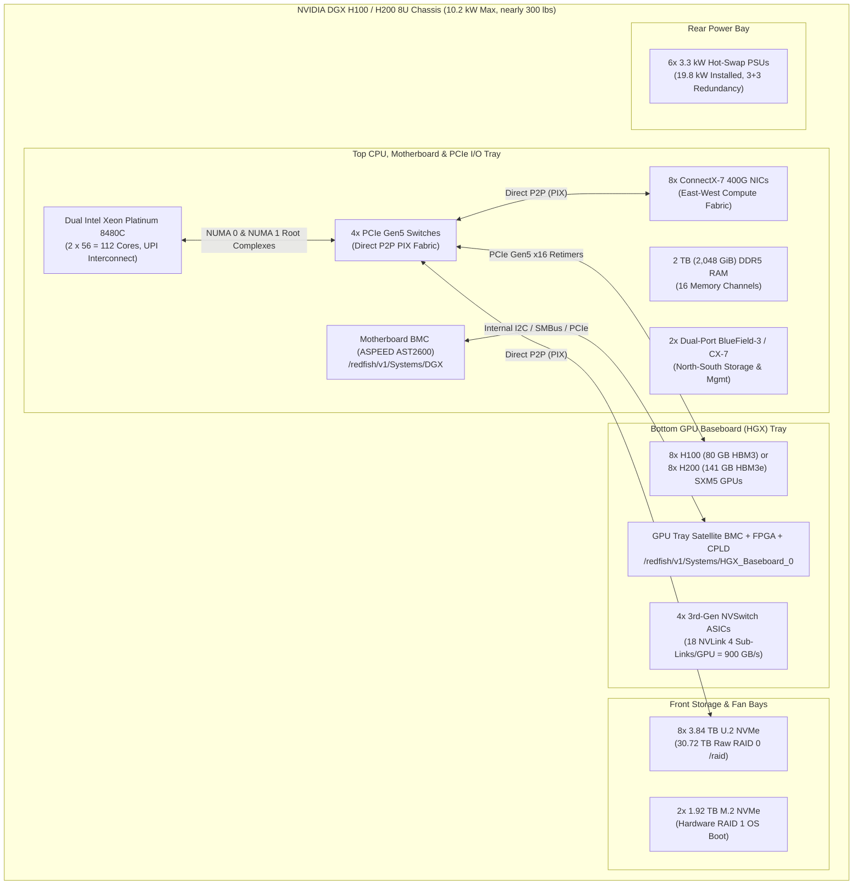
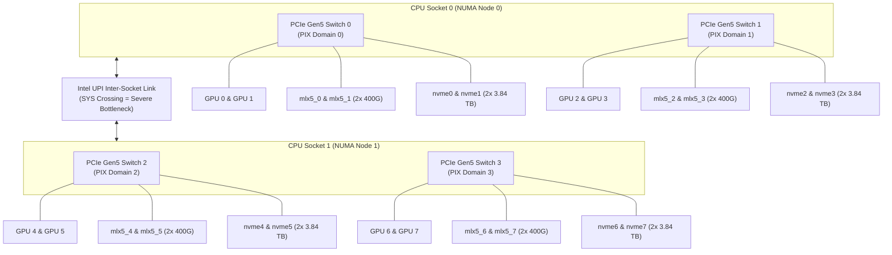

# 9.2 Inside a DGX H100 and H200 system

| | |
|---|---|
| **Status** | Drafted (`dgx_h100_h200_lab.py`: 30 checks pass; hardware commands **untested** on live DGX) |
| **Level** | Intermediate |
| **Priority tier** | 1b |
| **Lab venue** | none (design / reading) + self-checking Python model (`code/part09/dgx_h100_h200_lab.py`) |
| **Part** | Part 9: NVIDIA systems and reference architectures |
| **Sources used** | `nvidia-devops` V5 Ch. 2; `nvidia-devops` V7 Ch. 2; `nvidia-devops` V10 Ch. 1; *AI Systems Performance Engineering* Ch. 2; *Distributed AI Systems* Ch. 2; *NVIDIA Base Command Manager 11 Administrator Manual* (`bcm11-admin`) §14.5 |

## Why this matters for AI infrastructure

A training job suddenly runs at half its expected speed. Or a server comes back from maintenance with every GPU stuck in a pending firmware state. If you picture an eight-GPU server as one motherboard, you cannot diagnose either problem.

An NVIDIA DGX H100 or DGX H200 is not one board. Inside its 8U enclosure it is split into a GPU tray, a host tray, a storage bay and a power bay. Two separate Baseboard Management Controllers (BMCs) and 46 firmware images govern those zones.

The wiring inside the chassis is designed to avoid data bottlenecks and thermal throttling. Four third-generation NVSwitch chips join the 18 NVLink links of every GPU into one fabric. Four PCIe Gen5 switches give each GPU its own 400G ConnectX-7 adapter and a local NVMe drive, so that traffic bypasses the two Intel Xeon processors. The DGX H200 keeps all of this and swaps the H100's HBM3 for larger HBM3e in the same socket.

This chapter walks through those parts in turn. It also explains why GPU-tray firmware needs an AC power cycle and not a reboot, which is the most common maintenance surprise on these machines.

## Prerequisites and outcomes

**Prerequisites:**
- Complete Chapter 9.1 on DGX system families, workload-first sizing, and the three physical network planes.
- Review PCIe lanes, NUMA sockets, and Redfish out-of-band management from Part 7.

**Outcomes:**
1. Map the physical trays of an 8U DGX H100 or H200 chassis. Explain why the host CPU tray is mechanically, thermally, and electrically decoupled from the bottom HGX GPU tray.
2. Contrast the DGX H100 and DGX H200 memory subsystems and calculate Model FLOPs Utilization on large training runs.
3. Trace the internal four-switch PCIe Gen5 peer-to-peer routing in `nvidia-smi topo -m` and diagnose cross-socket Intel UPI bottlenecks.
4. Audit the 46 firmware components split between the motherboard tray and the GPU tray. Explain why activating GPU-tray firmware requires a full Redfish AC power cycle.

---

## 1. The 8U dual-tray physical architecture

Imagine eight 700W GPUs on one circuit board next to the host CPUs, DDR5 memory and optical transceivers. Over 5.6 kW of GPU heat would bake the processors and optics around it. Replacing one failed part would mean unbolting the whole server from the rack.

The 8U DGX H100 and H200 avoid this with a modular chassis that can be serviced from the front and the rear. The GPUs sit in their own tray, away from the host CPUs, DDR5 memory, PCIe switches and NVMe drives. Technicians can slide either tray out on rails, and the GPU exhaust never passes over the host electronics.



The chassis has four physical zones.

1. The bottom GPU tray holds the HGX baseboard. It carries eight SXM5 GPUs under tall heatsinks, four third-generation NVSwitch chips and eight PCIe Gen5 retimers. It also has a tray FPGA, programmable logic devices (CPLDs), hardware roots of trust and its own satellite BMC, `HGX_FW_BMC_0`.
2. The top tray holds the two Intel Xeon Platinum 8480C processors, 2 TB of DDR5, the main ASPEED AST2600 motherboard BMC and four PCIe Gen5 switches. Behind the switches sit eight single-port ConnectX-7 400G compute NICs and two dual-port BlueField-3 DPUs or ConnectX-7 NICs for storage and management.
3. The front bay holds two M.2 NVMe boot drives in hardware RAID 1 for DGX OS and eight U.2 NVMe scratch drives in RAID 0 at `/raid`. Hot-swap fan modules cool them.
4. The rear bay holds six hot-swap power supplies, wired three and three to two power feeds.

```text
DGX H100 / H200 Physical Zone Summary:
  - Chassis Envelope:   8U (14-inch tall), nearly 300 lbs (130 kg), 10.2 kW peak power draw
  - Bottom GPU Tray:    8x 700W SXM5 GPUs (5.6 kW), 4x NVSwitch ASICs, 8x PCIe Gen5 retimers, HGX_FW_BMC_0
  - Top Host & I/O:     2x 56-core Xeon 8480C (112 cores), 2,048 GiB DDR5, 4x PCIe Gen5 switches, 8x 400G CX-7, 2x BF-3
  - Front NVMe Storage: 2x 1.92 TB M.2 RAID 1 (OS) + 8x 3.84 TB U.2 RAID 0 (30.72 TB raw on /raid)
  - Rear Power Bay:     6x 3.3 kW PSUs (PSU_0..PSU_5 = 19.8 kW total capacity in 3+3 redundancy)
```

Because the two trays have separate BMCs, query both `/redfish/v1/Systems/DGX` and `/redfish/v1/Systems/HGX_Baseboard_0` during hardware triage. Before you replace a part or chase a thermal alert, find out which tray owns the sensor that faulted.

---

## 2. The GPU tray: SXM5 modules, the NVSwitch fabric, and H100 versus H200 memory

If eight GPUs had to pass tensors through PCIe slots and CPU sockets at every collective step, training inside one node would stall. Tensor parallelism needs the eight GPUs to behave like one memory and compute domain.

The HGX baseboard does this with four third-generation NVSwitch chips. They form a private network for the GPUs, so any GPU reaches any other in one hop at 900 GB/s without touching the PCIe bus or the CPUs.

### 2.1 Eighteen NVLink 4 links per GPU and the four-NVSwitch crossbar

Each H100 or H200 SXM5 GPU has 18 fourth-generation NVLink links. Each link carries 50 GB/s in both directions together, about 25 GB/s each way. Eighteen links give each GPU 900 GB/s, roughly seven times the 128 GB/s of a 16-lane PCIe Gen5 slot.

The GPUs are not wired to each other directly. The 144 links from the eight GPUs fan out to four NVSwitch chips soldered onto the baseboard. Firmware tracks them as `HGX_FW_NVSwitch_0` through `HGX_FW_NVSwitch_3`.

Together the four switches form a non-blocking crossbar with 3.6 TB/s of bisection bandwidth and 7.2 TB/s of total bandwidth. They also contain engines for multicast and in-network reduction, called SHARP-over-NVLink, which speed up `ncclAllReduce` without using GPU compute units. Through this fabric GPU 0 can read and write the memory of GPU 7 directly, with load and store instructions or `cudaMemcpyPeerAsync()`. The host CPU is not involved.

```text
NVLink 4.0 and 4-NVSwitch Crossbar Math (DGX H100 & DGX H200):
  - Per-link rate:             50 GB/s bidirectional (~25 GB/s per direction)
  - Per-GPU NVLink bandwidth:  18 links x 50 GB/s = 900 GB/s bidirectional (450 GB/s TX + 450 GB/s RX)
  - Total baseboard endpoints: 8 GPUs x 18 links = 144 NVLink links across 4x 3rd-Gen NVSwitch ASICs
  - Baseboard fabric capacity: 3.6 TB/s bisection bandwidth / 7.2 TB/s aggregate bidirectional bandwidth
```

### 2.2 DGX H100 versus DGX H200: same chassis, more memory

Large language model inference and long-context training often run out of GPU memory and memory bandwidth long before they run out of Tensor Core compute. A new rack design just to get more memory per GPU would force facility changes.

The DGX H200 avoids that. It shares the DGX H100's 8U chassis, 10.2 kW power budget, host tray, 700W per-GPU limit and 900 GB/s NVSwitch fabric, and it uses the same Tensor Cores. Only the memory on each SXM5 package changes. The H200 replaces 80 GB of HBM3 with 141 GB of faster HBM3e in the same thermal envelope.

| Specification | NVIDIA DGX H100 | NVIDIA DGX H200 | H200 versus H100 |
|---|---|---|---|
| **GPU SKU & TDP** | 8x `H100` SXM5 @ **700W** | 8x `H200` SXM @ **700W** | Same **10.2 kW** node limit |
| **Memory Technology** | **HBM3** | **HBM3e** | Newer, faster memory generation |
| **Per-GPU VRAM Capacity** | **80 GB** (`81920 MiB`) | **141 GB** (`143771 MiB` in `nvidia-smi`) | 1.76× more per GPU |
| **Total Node GPU Memory** | **640 GB** HBM3 | **1,128 GB** (~1.13 TB) HBM3e | A 405B FP8 model plus KV cache fits in one node |
| **Per-GPU HBM Bandwidth** | **3.35 TB/s** | **4.8 TB/s** | 1.43× higher |
| **Aggregate Node HBM Bandwidth** | **26.8 TB/s** | **38.4 TB/s** | 1.43× higher |
| **NVLink 4 Fabric** | 18 links/GPU = **900 GB/s** (**7.2 TB/s** agg) | 18 links/GPU = **900 GB/s** (**7.2 TB/s** agg) | Same `NV18` topology |
| **Tensor Peak (BF16 / FP8)** | **989** / **1,979 TFLOPS** | **989** / **1,979 TFLOPS** | Same Tensor Cores |

The extra memory and bandwidth help most where decode speed is limited by memory, which is the case for large-model inference. In the H200 this gain is about 43 percent in bandwidth, and it needs no change to the facility.

### 2.3 Measuring real training efficiency with Model FLOPs Utilization

An operator sees `utilization.gpu` at 99 percent in `nvidia-smi` and assumes the training job is healthy. That counter only says that some Streaming Multiprocessor was busy at some point in the sampling window. It stays high even when the GPU is mostly waiting for memory or for a slow collective.

A better measure is Model FLOPs Utilization (MFU): the useful math the job completes per second, divided by the accelerator's datasheet peak. For a dense transformer, one training iteration costs about six times the parameter count times the tokens in that iteration.

```text
Model FLOPs Utilization (MFU) Formula and Worked 70B H100 Example:
  MFU = (Model FLOPs per iteration / Iteration time in seconds) / Peak Hardware FLOPS
  - Transformer work per iteration (70B params, 2,048 tokens): 6 x 70 x 10^9 x 2,048 = 860.16 TFLOP (~860 TFLOP)
  - Measured step time:                                        2.0 seconds per iteration
  - Achieved throughput per GPU:                               860 TFLOP / 2.0 s = 430 TFLOPS
  - H100 non-sparse BF16 Tensor Core peak:                     989 TFLOPS
  - Resulting MFU:                                             430 TFLOPS / 989 TFLOPS = 43.48% (~43% MFU)
```

A result near 43 percent sits inside the 40 to 60 percent band that well-tuned large-model training clusters reach. If MFU falls to 20 percent, the node may be starved by data loading. It may also be limited by memory bandwidth because of tiny microbatches, or suffer from a PCIe or NUMA misconfiguration.

Use `memory.total` in `nvidia-smi` to tell an H100 from an H200 in their identical chassis. Never judge training health from `utilization.gpu`.

Calculate MFU from measured step times before you sign off a new training cluster or chase a throughput regression.

---

## 3. The host tray: two Xeon 8480C CPUs, NUMA domains and 2 TB of DDR5

The matrix math runs on the GPU baseboard, but every training job still depends on the x86 host in the top tray. If host processes run on the wrong socket or run out of shared memory, the GPUs wait for data and kernel launches.

The host motherboard boots the operating system, runs the data-loading pipeline, launches CUDA kernels and starts the network collectives.

### 3.1 Dual Intel Xeon Platinum 8480C and NUMA split

The host has two Intel Xeon Platinum 8480C processors from the Sapphire Rapids generation. Each has 56 cores, so the server has 112 cores and 224 threads in two Non-Uniform Memory Access (NUMA) domains.

NUMA node 0, on socket 0, owns cores 0 through 55 and 1 TB of local DDR5 on eight channels. Its PCIe lanes feed the first half of the switch complex: GPUs 0 to 3, NICs `mlx5_0` to `mlx5_3` and NVMe drives 0 to 3. NUMA node 1, on socket 1, owns cores 56 through 111 and the other 1 TB of DDR5. It serves GPUs 4 to 7, NICs `mlx5_4` to `mlx5_7` and NVMe drives 4 to 7.

The two sockets talk over Intel Ultra Path Interconnect (UPI) links. UPI is built for CPU cache coherence, not for hundreds of gigabytes per second of GPU traffic. Pin every PyTorch worker to the cores and memory of its local NUMA node, and use `numactl --hardware` to see the layout. Then kernel launches and host copies never cross the socket link.

Bind `LOCAL_RANK` 0 to 3 to NUMA node 0 and `LOCAL_RANK` 4 to 7 to NUMA node 1.

### 3.2 Why a DGX node has 2 TB of host memory

Both systems carry 2 TB of DDR5 on 16 memory channels. People new to AI infrastructure ask why a GPU server needs 2,048 GiB of host RAM when the model lives in GPU memory.

During training, host RAM holds memory-mapped dataset shards and feeds the CPU `DataLoader` workers through `/dev/shm`. It holds page-locked `cudaMallocHost` staging buffers. It also receives checkpoints copied out of GPU memory, so training can resume at once while the disks write in the background.

```text
Host DDR5 RAM to GPU VRAM Staging Ratios (2,048 GB Host DDR5 across 16 channels, 32-64 DataLoader workers):
  - Industry design guidelines:  2x to 3x GPU VRAM (DGX H100 rule); 1.5x to 2x minimum for 8-GPU nodes
  - DGX H100 (640 GB HBM3):      2,048 GB / 640 GB   = 3.20x host-to-GPU memory ratio
  - DGX H200 (1,128 GB HBM3e):   2,048 GB / 1,128 GB = 1.82x host-to-GPU memory ratio (derived here)
```

The H200 ratio is this chapter's own division of the host memory by the GPU memory. It still meets the minimum guideline. Even so, a job that stages 1.1 TB of unsharded H200 state in `/dev/shm` can run out of shared memory, so watch that limit.

Size the container `/dev/shm` with `--shm-size=256g` or `--ipc=host`. Otherwise the `DataLoader` workers crash at the 64 MB container default.

Put NUMA binding and the shared-memory limit into your job templates before anyone launches a multi-GPU job.

---

## 4. The PCIe Gen5 switch complex, networking, and storage wiring

Before a gradient can enter a 400G cable, or a training shard can stream from an NVMe drive, the data has to cross the internal PCIe bus. If every transfer had to go up to the host CPU's root complex and back down, the CPU root ports would limit multi-node scaling.

A DGX avoids this with four PCIe Gen5 switches placed between the devices. A GPU, its NIC and an NVMe drive hang off the same switch, so data moves between them without visiting the CPU.



### 4.1 The four PCIe Gen5 switch groups (`PIX` domains)

Each of the four PCIe Gen5 switches offers 64 GB/s in each direction on a 16-lane link. Together they group the eight GPUs, eight compute NICs and eight U.2 NVMe drives into four peer-to-peer groups. The sources describe four switches with paired devices. The exact numbering in the table, and the even split of NVMe drives, is this chapter's own reading of that layout. Check it on a real node with `lspci -t`.

| PCIe Gen5 Switch | Host NUMA Node | Paired SXM5 GPUs | Paired 400G Compute NICs | Paired U.2 NVMe Drives | Local P2P Symbol |
|---|---|---|---|---|---|
| **Switch 0** | NUMA Node 0 (Socket 0) | `GPU 0`, `GPU 1` | `mlx5_0`, `mlx5_1` | `nvme0`, `nvme1` | `PIX` |
| **Switch 1** | NUMA Node 0 (Socket 0) | `GPU 2`, `GPU 3` | `mlx5_2`, `mlx5_3` | `nvme2`, `nvme3` | `PIX` |
| **Switch 2** | NUMA Node 1 (Socket 1) | `GPU 4`, `GPU 5` | `mlx5_4`, `mlx5_5` | `nvme4`, `nvme5` | `PIX` |
| **Switch 3** | NUMA Node 1 (Socket 1) | `GPU 6`, `GPU 7` | `mlx5_6`, `mlx5_7` | `nvme6`, `nvme7` | `PIX` |

Because a GPU, a NIC and an NVMe drive share one switch, two fast paths open up. With GPUDirect RDMA, data leaving GPU 0 turns inside switch 0 into `mlx5_0` at 50 GB/s and never touches the CPU or DDR5. With GPUDirect Storage, `cuFile` reads from `nvme2` or `nvme3` flow across switch 1 straight into the memory of GPU 2.

### 4.2 Network and storage bay summary

The network cards keep GPU-to-GPU traffic apart from file system traffic. Eight single-port ConnectX-7 adapters run at 400 Gbps, as NDR InfiniBand or 400 GbE RoCEv2. Together they give the node 3.2 Tbps, or 400 GB/s, and each adapter is paired with one GPU. Two dual-port BlueField-3 DPUs or ConnectX-7 NICs add up to four fast ports for parallel file systems such as Lustre, WEKA, GPFS or VAST.

In the front bay, two M.2 drives in RAID 1 hold the operating system, and eight U.2 drives in RAID 0 form `/raid`.

```text
Network and Storage Bay Specification Summary:
  - East-West Compute NICs: 8x single-port ConnectX-7 @ 400 Gbps NDR IB / 400 GbE RoCEv2 (3.2 Tbps / 400 GB/s aggregate)
  - North-South Storage/OS: 2x dual-port BlueField-3 DPUs or ConnectX-7 NICs (up to 4x 200/400 GbE ports)
  - OS Boot Storage:        2x 1.92 TB M.2 NVMe in Hardware RAID 1
  - Local Scratch Storage:  8x 3.84 TB U.2 NVMe in RAID 0 mounted at /raid (30.72 TB raw capacity)
```

Check that every GPU uses the `mlx5` adapter and NVMe drive under its own switch, so that DMA stays inside that switch.

---

## 5. Reading `nvidia-smi topo -m` and diagnosing the cross-NUMA `SYS` trap

One wrong environment variable, or one wrong device assignment in a container, can send GPU network traffic across the wrong CPU socket and halve multi-node training speed. A diagram on paper will not show it. `nvidia-smi topo -m` shows how the driver actually sees the board.

### 5.1 Decoding the topology matrix symbols

Each cell of the `nvidia-smi topo -m` matrix names the path between its row device and its column device. The table lists the symbols.

| Symbol | Meaning | Example path | Effect |
|---|---|---|---|
| `X` | Self | Same device | None |
| `NV18` | 18 bonded NVLink links | Through the four NVSwitch chips, 900 GB/s per GPU | Best GPU-to-GPU path |
| `PIX` | At most one PCIe switch | For example GPU 0 to `mlx5_0` | Best GPU-to-NIC and GPU-to-NVMe path, 64 GB/s each way |
| `PXB` | Several PCIe switches, no host bridge | Cascaded switches | Good, slightly more latency than `PIX` |
| `PHB` or `NODE` | Same socket, through the CPU root complex | For example GPU 0 to `mlx5_2` | Degraded, and NCCL may turn off GPUDirect RDMA |
| `SYS` | Across the UPI link between sockets | For example GPU 0 to `mlx5_6` | Worst host path |

`SYS` does not mean NVLink is down. NVIDIA's legend defines it as a path that crosses PCIe and the link between NUMA nodes. For a GPU and a distant NIC that is normal. For two GPUs on an NVSwitch node you expect `NV18`, so a `SYS` between them means the NVLink path is not in use and needs investigation. A mis-bound GPU and NIC pair on `SYS` has been reported to lose about half of its multi-node throughput. That is one case, not an NVIDIA specification.

On a healthy node the 8-by-8 GPU block shows `NV18` in every off-diagonal cell. In the GPU-to-NIC block, each GPU shows `PIX` to its two local NICs, `NODE` to the other switch on the same socket, and `SYS` to the other socket.

```text
        GPU0    GPU1    GPU2    GPU3    GPU4    GPU5    GPU6    GPU7    mlx5_0  mlx5_1  mlx5_2  mlx5_6  CPU Affinity    NUMA Affinity
GPU0     X      NV18    NV18    NV18    NV18    NV18    NV18    NV18    PIX     PIX     NODE    SYS     0-55,112-167    0
GPU1    NV18     X      NV18    NV18    NV18    NV18    NV18    NV18    PIX     PIX     NODE    SYS     0-55,112-167    0
GPU2    NV18    NV18     X      NV18    NV18    NV18    NV18    NV18    NODE    NODE    PIX     SYS     0-55,112-167    0
GPU3    NV18    NV18    NV18     X      NV18    NV18    NV18    NV18    NODE    NODE    PIX     SYS     0-55,112-167    0
GPU4    NV18    NV18    NV18    NV18     X      NV18    NV18    NV18    SYS     SYS     SYS     NODE    56-111,168-223  1
GPU5    NV18    NV18    NV18    NV18    NV18     X      NV18    NV18    SYS     SYS     SYS     NODE    56-111,168-223  1
GPU6    NV18    NV18    NV18    NV18    NV18    NV18     X      NV18    SYS     SYS     SYS     PIX     56-111,168-223  1
GPU7    NV18    NV18    NV18    NV18    NV18    NV18    NV18     X      SYS     SYS     SYS     PIX     56-111,168-223  1
```

### 5.2 Real-world failure: the `GPU 0` to `mlx5_6` (`SYS`) mis-binding

A team runs PyTorch across four DGX H100 nodes and sees half the expected `AllReduce` bandwidth. All eight GPUs and all eight 400G ports show active links. The launch script has a hard-coded `NCCL_IB_HCA` list that binds GPU 0, on NUMA node 0, to `mlx5_6`, on NUMA node 1.

In the matrix above, the cell for GPU 0 and `mlx5_6` reads `SYS`. Every byte of gradient leaving GPU 0 climbs PCIe switch 0 to CPU 0, crosses the UPI link to CPU 1, and descends switch 3 to `mlx5_6`.

To fix it, first dump the topology NCCL built at startup, using `NCCL_TOPO_DUMP_FILE=/tmp/nccl_topo.xml` and `NCCL_DEBUG=INFO`. Then remove the `NCCL_IB_HCA` override so that NCCL picks the `PIX` adapter on its own. For partial-node Kubernetes pods, turn on the Topology Manager with `--topology-manager-policy=single-numa-node` and the `static` CPU Manager policy. That keeps GPU 0 on `mlx5_0`.

On a healthy node every GPU-to-GPU cell reads `NV18` and every GPU's paired compute NIC reads `PIX`.

Read `nvidia-smi topo -m` and the NCCL topology dump whenever multi-node throughput falls below what a single node achieves.

---

## 6. Redfish for both trays and the 46 firmware components

An operator flashes the GPU-tray firmware, reboots the node, and finds all 30 GPU-tray components still pending. The cause is the split into two trays. Out-of-band monitoring and firmware activation both follow that split.

### 6.1 Dual Redfish endpoints: `/Systems/DGX` and `/Systems/HGX_Baseboard_0`

The Redfish tree on the DGX BMC, at `/redfish/v1`, has separate objects for the host and for the GPU baseboard.

1. `/redfish/v1/Systems/DGX` reports the host: processor summary, 2,048 GiB of memory, `/Bios` attributes and `/SecureBoot` state.
2. `/redfish/v1/Systems/HGX_Baseboard_0` is the GPU tray, managed by the satellite BMC. It exposes per-GPU environment and power data under `/redfish/v1/Systems/HGX_Baseboard_0/Processors/GPU_SXM_<1..8>/EnvironmentMetrics`.
3. `/redfish/v1/Chassis/DGX/Sensors` and `/Managers/BMC/LogServices/SEL` give chassis-wide thermal and power readings and the System Event Log.

### 6.2 The 46 firmware components in two bundles

For a DGX H100 managed by NVIDIA Base Command Manager or by the Redfish `/redfish/v1/UpdateService`, firmware ships in two `.fwpkg` bundles. One bundle matches each tray, and together they hold 46 components.

| Tray and package | Count | Component identifiers shown by `cmsh` `firmware status` |
|---|---|---|---|
| Motherboard tray (`nvfw_dgx-h100_*.fwpkg`) | 16 | `CPLDMB_0`, `CPLDMID_0`, `EROT_BIOS_0`, `EROT_BMC_0`, `HostBIOS_0`, `HostBMC_0`, `PCIeRetimer_0`, `PCIeRetimer_1`, `PCIeSwitch_0`, `PCIeSwitch_1`, `PSU_0` to `PSU_5` |
| GPU tray (`nvfw_dgx-hgx-h100x8_*.fwpkg`) | 30 | `HGX_FW_BMC_0`, `HGX_FW_ERoT_BMC_0`, `HGX_FW_ERoT_FPGA_0`, `HGX_FW_ERoT_NVSwitch_0` to `_3`, `HGX_FW_ERoT_PCIeSwitch_0`, `HGX_FW_FPGA_0`, `HGX_FW_GPU_SXM_1` to `_8`, `HGX_FW_NVSwitch_0` to `_3`, `HGX_FW_PCIeRetimer_0` to `_7`, `HGX_FW_PCIeSwitch_0` |

The motherboard bundle covers the host CPLDs, the BIOS and BMC roots of trust, the host BIOS and BMC, the host PCIe retimers and switches, and the six power supplies. The GPU bundle covers the satellite BMC, seven roots of trust, the tray FPGA, the eight GPU VBIOS images, the four NVSwitch firmwares, eight PCIe retimers and the baseboard PCIe switch.

### 6.3 Why GPU-tray firmware needs a full AC power cycle

Flashing the GPU-tray package stages new versions of the 30 `HGX_FW_*` components in non-volatile memory. In Base Command Manager, `firmware status` then reports the state `pending` and the result `success: AC power cycle to activate`.

```text
GPU-Tray Firmware Activation State Transition (bcm11-admin Section 14.5, pp. 758-762):
  - Staged VBIOS example:   HGX_FW_GPU_SXM_1 transitions 96.00.70.00.01 -> 96.00.74.00.01
  - After OS reboot / DC:   State = "pending"   | Result = "success: AC power cycle to activate"
  - After AC power cycle:   State = "completed" | Result = "success: activated"
```

An operating system reboot or a board-level DC power reset in `cmsh` does not activate the new firmware. The satellite BMC, the seven roots of trust, the tray FPGA and the eight PCIe retimers stay powered from the standby rails of the six power supplies. Those rails stay live while AC cords are plugged in.

To move the 30 components to `completed`, cut all six AC inputs at once. Toggle the six outlet relays off and on at the rack PDUs, or pull all six cords during local maintenance. Once the standby rails drain, every FPGA, CPLD, root of trust, NVSwitch and GPU reloads its new image from a cold start. After updating the host BMC firmware itself, run `ipmitool -I lanplus -H <bmc-ip> -U <user> -P <pass> mc reset cold` to cold-reset the BMC processor.

Build PDU outlet toggling into your maintenance playbooks, and keep the node out of the scheduler until `firmware status` reports `completed` and `success: activated`.

---

## Commands and configurations that matter

The commands below verify the internal topology, HBM capacity, PCIe link width, Redfish dual-tray telemetry, and 46-component firmware state. These hardware commands are untested on a live DGX node in this authoring environment. Their rules and outputs are verified by `code/part09/dgx_h100_h200_lab.py`.

### 1. Inspect GPU model, HBM capacity (`81920 MiB` vs `143771 MiB`), and PCIe Gen5 x16 link state

```bash
# Query GPU SKU, total MiB (81920 on H100 vs 143771 on H200), and PCIe Gen5 x16 width
nvidia-smi --query-gpu=index,name,memory.total,pcie.link.gen.current,pcie.link.gen.max,pcie.link.width.current,pcie.link.width.max \
  --format=csv

# Inspect the 8x8 NV18 NVSwitch matrix and GPU-to-NIC PIX/NODE/SYS pairings
nvidia-smi topo -m

# Verify CPU NUMA node layout (Socket 0: cores 0-55, Socket 1: cores 56-111, 1 TB DDR5 each)
numactl --hardware
```

### 2. Query dual-tray Redfish endpoints (`/Systems/DGX` and `/Systems/HGX_Baseboard_0`)

```bash
# 1. Authenticate a Redfish session and capture X-Auth-Token
TOKEN=$(curl -sk -X POST "https://${BMC_IP}/redfish/v1/SessionService/Sessions" \
  -H "Content-Type: application/json" \
  -d "{\"UserName\":\"${BMC_USER}\",\"Password\":\"${BMC_PASS}\"}" -D - \
  | awk '/X-Auth-Token:/ {print $2}' | tr -d '\r')

# 2. Query host motherboard tray (Dual Xeon 8480C, 2048 GiB DDR5)
curl -sk -H "X-Auth-Token: ${TOKEN}" \
  "https://${BMC_IP}/redfish/v1/Systems/DGX" \
  | jq '{Model, PowerState, ProcessorSummary, MemorySummary}'

# 3. Query GPU 1 environment metrics on the bottom HGX baseboard tray
curl -sk -H "X-Auth-Token: ${TOKEN}" \
  "https://${BMC_IP}/redfish/v1/Systems/HGX_Baseboard_0/Processors/GPU_SXM_1/EnvironmentMetrics" | jq .
```

### 3. Flash and verify the 46 DGX H100 firmware components in BCM (`cmsh`)

```text
# 1. Inspect all 46 firmware components (16 motherboard tray + 30 GPU tray)
[basecm11->device]% firmware -n node001 status

# 2. Flash the 30 GPU-tray (HGX) components using the signed .fwpkg bundle
[basecm11->device[node001]]% firmware flash nvfw_dgx-hgx-h100x8_0002_230705.1.1.fwpkg

# 3. Check pending activation status (shows "pending" / "success: AC power cycle to activate")
[basecm11->device[node001]]% firmware status | grep nvfw

# 4. After cutting and restoring all 6 AC PDU outlets (AC power cycle), verify activation
[basecm11->device]% firmware -n node001 status
# Expect State = "completed" and Result = "success: activated" across all 30 HGX_FW_* rows
```

---

## How it fails

### 1. Cross-socket `SYS` GPU-to-NIC pairing

Symptom: Multi-node PyTorch training on a DGX H100/H200 achieves ~50% of expected `AllReduce` bus bandwidth, and `perf` / `pcm` shows heavy traffic saturating the Intel UPI links between CPU 0 and CPU 1.

Cause: A container orchestrator or manual `NCCL_IB_HCA` setting paired a GPU on NUMA 0 (such as `GPU 0`) with a ConnectX-7 NIC on NUMA 1 (such as `mlx5_6`), forcing every RDMA packet across the `SYS` path (`GPU 0 → Switch 0 → CPU 0 → Intel UPI → CPU 1 → Switch 3 → mlx5_6`).

Fix: Run `nvidia-smi topo -m` and dump NCCL's topology via `NCCL_TOPO_DUMP_FILE=/tmp/nccl_topo.xml`. Ensure each GPU uses its `PIX`-paired NIC on the same PCIe Gen5 switch (`GPU 0/1 ↔ mlx5_0/1`, `GPU 2/3 ↔ mlx5_2/3`, `GPU 4/5 ↔ mlx5_4/5`, `GPU 6/7 ↔ mlx5_6/7`), and enable Kubernetes Topology Manager (`single-numa-node`) for partial-node pods.

### 2. GPU-tray firmware stuck in `pending` after reboot

Symptom: After flashing `nvfw_dgx-hgx-h100x8_*.fwpkg` and rebooting the node (or running `cmsh` `power reset`), all 30 `HGX_FW_*` components remain at their old versions with `State: pending` and `Result: success: AC power cycle to activate`.

Cause: A standard OS reboot or board-level DC power reset leaves the standby power rails of the 6 PSUs active. The GPU Tray Satellite BMC (`HGX_FW_BMC_0`), the 7 `ERoT` security chips, the FPGA and the 8 PCIe retimers therefore never cold-boot into the newly flashed firmware.

Fix: Perform a full AC power cycle. Power off all 6 AC outlets that feed the server on PDU A and PDU B, or pull all 6 power cords. Wait for the standby rails to drain, then restore AC power. Confirm that `firmware status` moves to `completed` with `success: activated`.

### 3. PCIe link width or generation downgrade (`Gen1/Gen3` or `x8`)

Symptom: A single GPU's `ib_write_bw --use_cuda` or `gdsio` throughput drops from ~45–50 GB/s to ~8–16 GB/s, stalling synchronous `AllReduce` across the entire 8-GPU ring.

Cause: Dust or a seating problem on the SXM5 socket, or a degraded GPU-tray PCIe retimer, made the link between the GPU and its PCIe Gen5 switch train down. It fell from Gen5 x16 at 64 GB/s to Gen3 x16 or Gen5 x8.

Fix: Run `nvidia-smi --query-gpu=index,pcie.link.gen.current,pcie.link.width.current --format=csv` under load. If `gen.current < 5` or `width.current < 16`, verify retimer firmware alignment (`HGX_FW_PCIeRetimer_*`), perform an AC power cycle, and reseat or RMA the affected GPU tray if link training still downgrades.

### 4. `/dev/shm` exhaustion by PyTorch `DataLoader` workers

Symptom: Training crashes mid-epoch with `RuntimeError: DataLoader worker (pid ...) is killed by signal: Bus error` even though `free -h` shows hundreds of gigabytes of free DDR5 RAM on the 2 TB host.

Cause: Docker or Kubernetes defaults `/dev/shm` (POSIX shared memory backed by host DDR5 RAM) to 64 MB, starving the 32–64 CPU `DataLoader` workers that stage batches for the 8 H100/H200 GPUs.

Fix: Pass `--shm-size=256g` (or `--ipc=host`) to Docker/containerd, or mount an `emptyDir` with `medium: Memory` and `sizeLimit: 256Gi` at `/dev/shm` in the Kubernetes Pod spec so workers can utilize the node's 2,048 GiB DDR5 pool.

### 5. Unpinned CPU workers crossing NUMA sockets

Symptom: GPU kernel launch latency spikes and step times jitter by 15%–25% across iterations on an 8-GPU job.

Cause: The training launcher spawned 8 Python processes without NUMA CPU affinity, so the Linux scheduler migrated `LOCAL_RANK 0` (controlling `GPU 0` on NUMA 0) onto CPU cores `56–111` (Socket 1 / NUMA 1).

Fix: Pin ranks `0–3` to NUMA Node 0 (`cores 0-55,112-167`) and ranks `4–7` to NUMA Node 1 (`cores 56-111,168-223`) using `torchrun` NUMA binding, Slurm `--cpu-bind=ldoms`, or `numactl --cpunodebind=$((LOCAL_RANK/4)) --membind=$((LOCAL_RANK/4))`.

---

## Hands-on lab

This chapter's self-checking Python model in `code/part09/dgx_h100_h200.py` and lab script in `code/part09/dgx_h100_h200_lab.py` verify five architectural invariants.

1. They compare the hardware specifications of the DGX H100 and DGX H200 inside their shared 8U chassis.
2. They validate the host DDR5 RAM to GPU VRAM staging ratios across both platforms.
3. They classify the four-switch PCIe Gen5 and four-NVSwitch topology hops across all GPUs, NICs, and NVMe drives.
4. They compute Model FLOPs Utilization for the 70B H100 transformer training benchmark.
5. They run the 46-component DGX H100 firmware activation state machine. That model proves why a DC reset leaves the 30 GPU-tray components pending while an AC power cycle activates them.

Run the lab from the repository root:

```bash
python3 -B code/part09/dgx_h100_h200_lab.py
```

Expected output verified in this repository:

```text
=== Chapter 9.2 Lab: Inside a DGX H100 and H200 System ===
  [PASS] DGX H100 & H200 share 8U chassis, dual Xeon Platinum 8480C (112 cores), 2048 GB DDR5 across 16 channels
  [PASS] Each GPU has 18 NVLink 4.0 sub-links at 50 GB/s = 900 GB/s per GPU across 4 NVSwitches
  [PASS] NVSwitch baseboard delivers 3.6 TB/s bisection and 7.2 TB/s aggregate bidirectional bandwidth
  [PASS] DGX H100 provides 8x 80 GB HBM3 = 640 GB total at 26.8 TB/s aggregate bandwidth
  [PASS] DGX H200 upgrades to 8x 141 GB HBM3e (143,771 MiB in nvidia-smi) = 1,128 GB at 38.4 TB/s
  [PASS] H200 provides 1.76x VRAM capacity and 1.43x HBM bandwidth over H100 in same 10.2 kW envelope
  ...
  [PASS] BCM 11 p.758: Motherboard tray has 16 firmware components and GPU tray has 30 (46 total)
  [PASS] BCM 11 p.761: DC board reset after GPU-tray flash leaves 30 HGX components pending AC power cycle
  [PASS] BCM 11 p.761: Full AC power cycle activates all 30 GPU-tray firmware components
  [PASS] Motherboard-tray firmware package updates 16 components and leaves 30 GPU-tray components untouched

Summary: 30 passed, 0 failed (total 30)
```

---

## Exercises

1. Run `python3 -B code/part09/dgx_h100_h200_lab.py` and inspect the firmware state machine checks. Explain in your own words why a DC reset leaves the 30 GPU-tray components in a pending state.
2. Calculate the Model FLOPs Utilization of a GPU that completes a 1,200 TFLOP training step in 3.0 seconds on an H100. State whether that result sits inside the healthy target range, and name what you would check first if efficiency dropped to 18 percent.
3. A row of `nvidia-smi topo -m` shows GPU 5 with `SYS` to `mlx5_0` and `mlx5_1`, and `PIX` to `mlx5_4` and `mlx5_5`. Identify which NICs GPU 5 should use. Explain what happens if `NCCL_IB_HCA` forces it onto `mlx5_0`.
4. Write the three commands you would run to confirm that a four-GPU Kubernetes pod is pinned to a single NUMA node. Describe the output you expect to see.
5. A colleague says the team rebooted the node after flashing the GPU tray, so the new firmware is live. Write a short reply explaining how to check `firmware status` and what action is required next.
6. Compute the host-RAM-to-GPU-memory ratio for a DGX H100 and a DGX H200. Identify which system has less host RAM per gigabyte of GPU memory. Explain how that difference affects `/dev/shm` sizing.

## Checkpoint questions (20)

<details>
<summary>**1. Why does an 8U DGX H100/H200 physically separate the bottom GPU tray from the top CPU/motherboard tray, and how are the two trays managed out-of-band?**</summary>

Eight 700W SXM5 GPUs and four NVSwitch ASICs generate over 5.6 kW of concentrated heat. Decoupling the bottom HGX GPU tray from the top CPU, DDR5, and PCIe tray prevents GPU exhaust from baking the CPUs, DIMMs, and 400G optical transceivers. It also lets either tray slide out on rails for independent service. The top tray runs the primary Motherboard BMC at `/redfish/v1/Systems/DGX`. The bottom tray runs the GPU Tray Satellite BMC at `/redfish/v1/Systems/HGX_Baseboard_0`.
</details>

<details>
<summary>**2. How does the NVSwitch fabric on a DGX H100/H200 achieve 900 GB/s per GPU and 3.6 TB/s of bisection bandwidth?**</summary>

Each of the eight SXM5 GPUs exposes 18 fourth-generation NVLink sub-links running at 50 GB/s bidirectional per sub-link. That provides 900 GB/s bidirectional bandwidth per GPU. All 144 NVLink sub-links across the eight GPUs wire into four third-generation NVSwitch ASICs on the HGX baseboard. Together they form an all-to-all crossbar with 3.6 TB/s of bisection bandwidth and 7.2 TB/s of aggregate bidirectional bandwidth.
</details>

<details>
<summary>**3. What exact specifications change between a DGX H100 and a DGX H200, and what stays identical?**</summary>

Both systems share the same 8U chassis, 10.2 kW peak power, 700W per-GPU TDP, dual 56-core Xeon 8480C CPUs, and 2 TB DDR5 RAM. They also share four NVSwitches, eight ConnectX-7 400G NICs, and 989 TFLOPS BF16 Tensor compute per GPU. The DGX H200 upgrades each GPU from 80 GB of HBM3 at 3.35 TB/s to 141 GB of HBM3e at 4.8 TB/s. That raises total node GPU memory from 640 GB to 1,128 GB and aggregate HBM bandwidth from 26.8 TB/s to 38.4 TB/s.
</details>

<details>
<summary>**4. A 70B transformer training step on an H100 processes ~860 TFLOP of work per GPU in 2.0 seconds. What is the Model FLOPs Utilization (MFU), and why is MFU a better metric than `nvidia-smi` GPU utilization?**</summary>

Dividing 860 TFLOP by 2.0 seconds yields 430 TFLOPS of achieved throughput per GPU. Dividing 430 TFLOPS by the 989 TFLOPS BF16 peak gives 43.48 percent MFU, which sits inside the healthy 40 to 60 percent target band. The `utilization.gpu` counter in `nvidia-smi` only measures whether any warp was active during the sample interval. MFU measures useful mathematical work completed relative to hardware peak.
</details>

<details>
<summary>**5. Why does a DGX H100/H200 ship with 2 TB (2,048 GiB) of DDR5 host RAM across 16 channels?**</summary>

To keep eight Hopper GPUs fed without stalling on I/O, host RAM must hold memory-mapped dataset shards and `/dev/shm` buffers for PyTorch `DataLoader` workers. It also holds pinned DMA staging buffers and asynchronous checkpoints copied off GPU HBM. The 2,048 GB pool provides 3.2 times the 640 GB VRAM of a DGX H100 and 1.82 times the 1,128 GB VRAM of a DGX H200.
</details>

<details>
<summary>**6. How are GPUs, ConnectX-7 NICs, and U.2 NVMe drives grouped across the four PCIe Gen5 switches inside a DGX H100/H200?**</summary>

Each of the four PCIe Gen5 switches couples two GPUs, two 400G ConnectX-7 NICs, and two U.2 NVMe drives into a local `PIX` peer-to-peer domain. Switches 0 and 1 sit on NUMA Node 0 serving GPUs 0 through 3. Switches 2 and 3 sit on NUMA Node 1 serving GPUs 4 through 7. This layout lets GPUDirect RDMA and GPUDirect Storage transfers turn directly inside the local PCIe switch without touching the Xeon CPUs.
</details>

<details>
<summary>**7. Explain the difference between `PIX`, `NODE`, and `SYS` in `nvidia-smi topo -m` when looking at the cell between a GPU and an `mlx5_*` NIC.**</summary>

The `PIX` symbol means the GPU and NIC share a single PCIe Gen5 switch, allowing peer-to-peer transfers at 64 GB/s without touching the CPU. The `NODE` symbol means the GPU and NIC sit on different PCIe switches attached to the same CPU socket. That forces packets through the CPU PCIe Root Complex. The `SYS` symbol means the devices sit on different CPU sockets, forcing every packet across the Intel UPI link and cutting RDMA bandwidth by roughly half.
</details>

<details>
<summary>**8. How many firmware components are tracked across a DGX H100 in BCM (`cmsh` `firmware status`), and how are they divided between the two `.fwpkg` bundles?**</summary>

A DGX H100 tracks 46 firmware components across two tray packages. The motherboard tray bundle contains 16 components covering motherboard and midplane CPLDs, BIOS and BMC roots of trust, System BIOS, primary BMC, host PCIe retimers and switches, and six power supplies. The GPU tray bundle contains 30 `HGX_FW_*` components. Those cover the satellite BMC, seven security roots of trust, the tray FPGA, eight SXM GPU VBIOSes, four NVSwitch ASICs, eight PCIe retimers, and the baseboard PCIe switch.
</details>

<details>
<summary>**9. Why does a regular reboot or `cmsh` `power reset` fail to activate newly flashed GPU-tray (`HGX_FW_*`) firmware on a DGX H100, and what action is required instead?**</summary>

A regular reboot or `power reset` performs a board-level DC power cycle, which leaves the standby rails of the six power supplies energized. Because the GPU Tray Satellite BMC, ERoT security chips, FPGA, and retimers run on standby power, they never re-initialize and remain in a pending state. You must perform a full AC power cycle by cutting all six AC power inputs at the rack PDUs. Once standby power drains completely, all 30 components activate.
</details>

<details>
<summary>**10. Why is `nvidia-smi` reporting 143771 MiB per GPU a useful way to tell an H200 from an H100?**</summary>

An H100 reports 81,920 MiB of HBM3 memory, whereas an H200 reports 143,771 MiB of HBM3e memory. Because the two GPUs share the same 8U chassis and power specs, checking `memory.total` in `nvidia-smi` immediately confirms whether a node contains H200 accelerators.
</details>

<details>
<summary>**11. How many NVLink sub-links does each H100/H200 GPU have, and how many NVLink endpoints are wired into the NVSwitches in total?**</summary>

Each GPU exposes 18 fourth-generation NVLink sub-links. Across eight GPUs, that equals 144 NVLink sub-link endpoints wired into the four NVSwitch chips.
</details>

<details>
<summary>**12. What does a `NV18` cell mean in `nvidia-smi topo -m`?**</summary>

The `NV18` symbol means the two GPUs communicate across 18 bonded NVLink sub-links through the four NVSwitch ASICs. This path delivers 900 GB/s of bidirectional bandwidth per GPU and consumes zero PCIe or CPU bandwidth.
</details>

<details>
<summary>**13. What is the difference between `PIX`, `NODE` and `SYS` for a GPU-to-NIC path?**</summary>

A `PIX` path crosses a single PCIe switch and is the fastest route. A `NODE` path bounces through the PCIe root complex on the same CPU socket, which degrades performance. A `SYS` path crosses the Intel UPI link between the two CPU sockets, cutting multi-node collective bandwidth by roughly half.
</details>

<details>
<summary>**14. Why should each training process be pinned to its own NUMA node?**</summary>

Local ranks 0 through 3 drive GPUs, NICs, and NVMe drives attached to Socket 0, while local ranks 4 through 7 drive devices attached to Socket 1. If a worker process runs on the wrong CPU socket, its host memory copies and kernel launches cross the slow UPI link and create step-time jitter.
</details>

<details>
<summary>**15. What are the two management controllers in a DGX H100, and which Redfish path belongs to each?**</summary>

The primary Motherboard BMC in the top tray serves `/redfish/v1/Systems/DGX`. The GPU Tray Satellite BMC in the bottom tray serves `/redfish/v1/Systems/HGX_Baseboard_0` and communicates with the primary BMC over an internal bus.
</details>

<details>
<summary>**16. How many firmware components does a DGX H100 track, and how are they split?**</summary>

It tracks 46 firmware components in total. Sixteen belong to the motherboard tray and 30 belong to the bottom HGX GPU tray.
</details>

<details>
<summary>**17. Why does the GPU-tray firmware need an AC power cycle and not just a reboot?**</summary>

The satellite BMC, roots of trust, FPGA, and retimers stay powered by the standby rails of the six power supplies whenever AC cords remain plugged in. Only cutting all AC inputs drains those standby rails and forces a cold reload of the newly flashed firmware images.
</details>

<details>
<summary>**18. A training job crashes with a "Bus error" from a `DataLoader` worker while `free -h` shows hundreds of GB free. What is the likely cause and fix?**</summary>

The container `/dev/shm` mount is still at its 64 MB default and ran out of space. Start the container with `--shm-size=256g` or `--ipc=host`, or mount a memory-backed `emptyDir` volume at `/dev/shm` in Kubernetes.
</details>

<details>
<summary>**19. A GPU's PCIe link shows `Gen3 x16` instead of `Gen5 x16`. What does this do and what do you do?**</summary>

Unidirectional bandwidth drops from 64 GB/s to a fraction of that rate, causing the degraded GPU to stall every synchronous collective step. Verify retimer firmware alignment, execute a full AC power cycle, and reseat or replace the GPU tray if the link still trains down.
</details>

<details>
<summary>**20. Why does the 2 TB of host DDR5 matter in a GPU server?**</summary>

It holds memory-mapped dataset shards, shared-memory queues for CPU `DataLoader` workers, pinned DMA buffers, and model checkpoints offloaded from GPU memory. Without ample host RAM, GPUs sit idle waiting on disk reads and checkpoint writes.
</details>

---

## Sources and review notes

### Sources read in full for this chapter

1. **`nvidia-devops` Volume 05 Chapter 2 (`nvidia-zero-to-hero/volume-05/chapter-02-inside-a-dgx-system.md`, 1,176 words):**
   - Chassis trays, the HGX H100 baseboard, 18 NVLink 4 links per GPU at 50 GB/s, four NVSwitch chips, dual Xeon 8480C, 2 TB DDR5 on 16 channels, four PCIe Gen5 switches pairing GPUs, NICs and NVMe drives, and the firmware inventory.
2. **Chris Fregly, *AI Systems Performance Engineering* (`ai-systems-performance-engineering`), Chapter 2 (pp. 20–55):**
   - Hopper vs Blackwell SXM node architecture, NVLink/NVSwitch topology, and PCIe Gen5 vs NVLink bandwidth hierarchy.
3. ***Distributed AI Systems* (`distributed-ai-systems`), Chapter 2 (GPU Hardware, Networking, and Parallelism Strategies, chunks 0–10):**
   - `nvidia-smi` output on an 8-GPU H200 system, the NV18 topology matrix, NUMA CPU affinity, a host RAM staging rule, and the 70B H100 MFU worked example (43.48 percent).
4. ***NVIDIA Base Command Manager 11 Administrator Manual* (`bcm11-admin`), Section 14.5 (BIOS And Firmware Management, pp. 758–762):**
   - Complete 46-component firmware table for DGX H100 (16 motherboard-tray components in `nvfw_dgx-h100_*.fwpkg` and 30 GPU-tray `HGX_FW_*` components in `nvfw_dgx-hgx-h100x8_*.fwpkg`), version transition states, and the mandatory Redfish `ac_power_cycle` vs `dc_reset` requirement (`pending: success: AC power cycle to activate` -> `completed: success: activated`).
5. **`nvidia-devops` Volume 07 Chapter 2 (`chapter-02-pcie-numa-and-host-data-paths.md`) and Volume 10 Chapter 1 (`01-bare-metal-and-bmc-redfish-lifecycle.md`):**
   - PCIe Gen5 x16 bandwidth, the PIX, NODE and SYS path symbols, the UPI cross-socket penalty, the Kubernetes Topology Manager, and the dual-BMC Redfish tree.

### Not in the corpus
- Standalone NVIDIA DGX H100 and H200 system user guides and service manuals are not in `~/Desktop/books-toon-rag/`.

### Corrections to the sources
- A passing sentence in *Distributed AI Systems* Chapter 2 states that a DGX H100 uses AMD EPYC processors. That was true for the prior DGX A100 generation, which used dual 64-core AMD EPYC 7742 processors. Both the DGX H100 and DGX H200 use dual 56-core Intel Xeon Platinum 8480C processors, as verified in Volume 05 Chapter 2 and the Redfish `/redfish/v1/Systems/DGX` output in Volume 10 Chapter 1.

### Run here
- Running `python3 -B code/part09/dgx_h100_h200_lab.py` passes all 30 checks with zero failures.

### Choices and inferences, labelled in the text
1. Comparing the 2,048 GB DDR5 host memory against the 1,128 GB HBM3e pool of a DGX H200 is the chapter's own calculation. That comparison yields 1.82x on the H200 versus 3.2x on the 640 GB DGX H100 in Section 3.2 and `code/part09/dgx_h100_h200.py`.
2. Numbering the four symmetric PCIe Gen5 switch groups across NUMA 0 and NUMA 1, and splitting the NVMe drives two per switch, is the chapter's own reading. It represents the four-switch pairing described in Volume 05 Chapter 2 and `code/part09/dgx_h100_h200.py`.

### Not verified on live hardware
- The `nvidia-smi topo -m` and `numactl --hardware` commands were not executed on a live DGX H100 or H200 in this authoring environment.
- The Redfish queries against `/redfish/v1/Systems/DGX` and `/redfish/v1/Systems/HGX_Baseboard_0` and the `cmsh` firmware commands are also untested on live hardware.

corrected 2026-11-11: the nvidia-devops-core-interview book says `SYS` in `nvidia-smi topo -m` always means the NVLink fabric is down. That is wrong. The legend in the NVIDIA nvidia-smi manual defines SYS as PCIe plus the SMP interconnect between NUMA nodes, and NV# as a bonded set of NVLinks. The chapter's numbers match the NVIDIA H100 page: NVLink 900 GB/s and PCIe Gen5 128 GB/s bidirectional. The book's 63 GB/s per direction and the chapter's 64 GB/s are the same figure before and after line encoding. The roughly 50 percent SYS penalty is a case figure from course material, not an NVIDIA specification.
