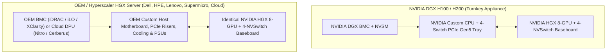
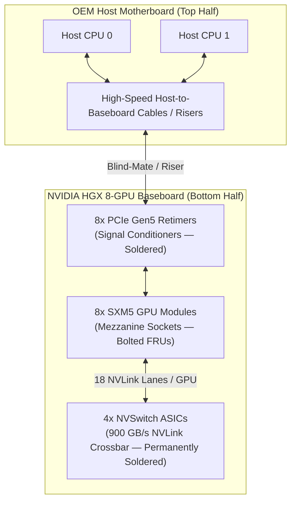
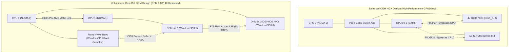

# 9.3 HGX platforms and OEM integration

| | |
|---|---|
| **Status** | Drafted (`hgx_oem_platform_lab.py`: 28 checks pass; the hardware commands were not run on live HGX servers) |
| **Level** | Intermediate |
| **Priority tier** | 1b |
| **Lab venue** | none (design / reading) + self-checking Python model (`code/part09/hgx_oem_platform_lab.py`) |
| **Part** | Part 9: NVIDIA systems and reference architectures |
| **Sources used** | `nvidia-devops` V6 (Ch. 1–7, Labs 1–2); *Distributed AI Systems* Ch. 2; *AI Systems Performance Engineering* Ch. 2 |

## Why this matters for AI infrastructure

Picture an enterprise that buys a fleet of eight-GPU servers from a reseller at a lower price than an NVIDIA DGX. For the first few weeks the cluster looks fine, because single-node jobs run at full speed. Then multi-node training starts, and the cluster scales worse than expected. In a cold room the rear GPUs throttle, and nobody can explain why at first. The reseller said the GPU board inside was the same as the DGX board. The difference was in everything around that board.

NVIDIA's DGX is NVIDIA's own complete server design. Most data center SXM GPUs, however, do not sit inside NVIDIA-branded servers. They run inside servers built by enterprise Original Equipment Manufacturers (OEMs), which are the companies that put the parts together and sell the finished machine under their own name. Common examples include the Dell PowerEdge XE9680, Supermicro SYS-821GE, HPE ProLiant XD, and Lenovo ThinkSystem. The same GPUs also run inside custom cloud racks engineered by hyperscalers such as AWS, Microsoft Azure, and Google Cloud, which are the very large cloud providers that build their own hardware.

None of those companies buy loose SXM GPU chips and solder them onto their own circuit boards. Instead, they purchase the NVIDIA HGX Baseboard. That board is the same eight-GPU and four-NVSwitch bottom assembly used inside a DGX. The buyer then engineers its own top half of the server around it. Two OEM servers that contain an HGX H100 baseboard have identical GPU-to-GPU NVLink performance on the bottom half. A cost-cut top half, however, can cripple multi-node scaling. Missing PCIe Gen5 switches, under-provisioned network cards, CPU-wired NVMe bays, or poor internal air baffling turn a fast baseboard into a bottlenecked server. The rest of this chapter shows where those top-half choices show up and how to check them.

## Prerequisites and outcomes

Before you start, complete Chapters 9.1 and 9.2. The first of them covers the DGX system families and workload sizing, and the second covers the internal dual-tray architecture of an eight-GPU DGX H100 and H200. Then review Chapter 7.13 on OEM BMC ecosystems, which covers Dell iDRAC, HPE iLO, Lenovo XClarity and Supermicro MegaRAC. Each of these vendor tools is a BMC management stack, so knowing them helps you read the firmware sections below.

The chapter starts with NVIDIA's merchant silicon strategy, which explains why HGX exists and what the baseboard does and does not include. It then looks at the parts of the baseboard itself, the field-replaceable units, and the electrical reasons for the 48V to 54V power bus. Next comes the support and firmware boundary between the OEM, NVIDIA and your own team, with the rule for escalating an `Xid 79` fault. The topology section compares balanced and unbalanced PCIe designs. After that come cooling, a proposal comparison, an 18 kW rack review and a list of eight commissioning gates. The chapter ends with the MGX rack era. Along the way you practice reading a vendor proposal the way an acceptance engineer would.

---

## 1. Why HGX exists: the merchant silicon strategy

Picture a buyer who needs a few hundred GPU servers next quarter, and who also has a security team that wants its own hardware controls. If NVIDIA sold only complete turnkey DGX appliances, many buyers could not deploy SXM GPUs at that scale. Cloud providers rely on custom security hardware, and enterprises are often locked into a single vendor's maintenance contract. To serve the whole market, NVIDIA sells the core accelerator assembly as a merchant-silicon building block. Merchant silicon means a chip or module that a company sells to other companies, which then build their own products around it.

An NVIDIA HGX baseboard is the pre-validated GPU and NVSwitch engine block of an AI server. Server manufacturers and cloud providers buy that baseboard from NVIDIA. They then wrap it in their own chassis, CPU motherboard, power supplies and management plane. The baseboard is the part that is hard to get right, and the rest is where each buyer differs.

Think of the DGX versus HGX choice like buying an aircraft. A DGX is the complete turnkey jet, bought from the engine maker, with the engine maker's cockpit, fuselage and maintenance crew. An HGX-based server is like an airframe manufacturer buying a pre-assembled twin-engine wing assembly. The airframe builder then integrates its own fuselage, cockpit avionics and maintenance crew around it. Both jets can fly the same route, but the support and the fit depend on who built the rest of the plane.



The diagram shows the two designs with the same bottom half. Both have a baseboard of eight GPUs and four NVSwitch chips. The difference is the top half and the management layer above it, and that is where the buyer's choices live. When you read a vendor proposal, look at the boxes in the top half first.

### 1.1 What is on the HGX baseboard and what is missing

When an OEM unboxes an HGX H100, H200, or B200 eight-GPU baseboard from NVIDIA, it receives a full-width horizontal printed circuit board. A printed circuit board, or PCB, is the green board that carries the chips and the copper traces that connect them. This one holds four factory-assembled subsystems.

1. The SXM GPU subsystem holds four or eight SXM mezzanine GPU modules, which are GPU packages that plug into high-density sockets on the board. These sockets exist across the A100, H100, H200 and B200 generations.
2. The NVSwitch fabric on eight-GPU baseboards uses four NVSwitch ASICs on Hopper and Blackwell, or six on A100. An ASIC is a custom chip built for one job. That crossbar creates a non-blocking 900 GB/s mesh on Hopper with 3.6 TB/s of bisection bandwidth, or an 1,800 GB/s mesh on Blackwell.
3. The baseboard controller and signal layer integrates PCIe Gen5 retimer chips, an HGX Management Controller, and External Root of Trust security microcontrollers. A retimer cleans up a PCIe signal so it can travel further, and a root of trust is a small chip that verifies firmware before it runs.
4. The on-board Voltage Regulation Modules act as point-of-load regulators. A point-of-load regulator sits next to the chip it powers and steps the incoming DC bus voltage down to roughly 1V for the GPU dies.

What is completely missing from the HGX board is just as important. An HGX baseboard has no host CPUs, no DDR5 system RAM, no NVMe storage drives, and no InfiniBand or Ethernet network cards. It also ships with no power supply units, no cooling fans or cold plates, and no sheet-metal chassis. Every one of those surrounding subsystems is designed, sourced and wired by the OEM or hyperscaler. That is why two servers built on the same board can behave so differently.

### 1.2 Why hyperscalers and enterprise IT buy HGX instead of DGX

Cloud giants and enterprise data centers buy HGX servers for two different operational reasons.

The first reason is control. Hyperscalers such as AWS, Azure, and Google Cloud run proprietary hardware control planes, such as AWS Nitro and Azure Cerberus. A control plane is the software and hardware layer that manages the machines in a fleet. Those control planes enforce hardware root-of-trust attestation, bare-metal virtualization, and virtual private cloud SDN offload. SDN is software-defined networking, and offload means the network work moves from the host CPU onto a dedicated chip. A turnkey DGX appliance with its own NVIDIA BMC and DGX OS conflicts with a hyperscaler's automated fleet control plane. It also conflicts with their custom rack power and cooling manifolds. Buying raw HGX baseboards lets cloud providers put NVIDIA's fastest NVLink fabric directly into their own cloud sleds, which are the trays that each cloud provider designs for its racks.

The second reason is support. Enterprise data centers standardize on server vendors such as Dell, HPE, Lenovo and Supermicro. Those vendors provide global procurement agreements and four-hour on-site parts replacement SLAs, which are service-level agreements promising a technician on site within that time. Enterprises also rely on unified out-of-band management tools such as Dell iDRAC, HPE iLO and Lenovo XClarity. Buying an OEM HGX server lets operations teams manage eight-GPU nodes through their existing Redfish automation, so the GPU nodes look like every other server in the building. The same field-technician contract that covers their 10,000 CPU servers also covers the GPU fleet.

### 1.3 Why a cheaper OEM HGX quote is never automatically equivalent

Suppose a reseller quotes an OEM eight-GPU HGX H100 server at a lower price than an NVIDIA DGX H100. The reseller claims that both systems use the exact same NVIDIA HGX H100 baseboard inside, so performance is identical.

That claim holds only for single-node math that stays inside the VRAM and never leaves the bottom HGX baseboard. The moment your workload reads data from storage, or scales out across multiple nodes, performance is governed by the top half of the server. OEMs can cut major corners in the top half to lower the bill of materials, which is the total cost of the parts. For example, a vendor might quote only two network cards instead of eight, or wire the GPUs directly to CPU sockets without PCIe switches. Those choices do not show up in a single-node benchmark, so they can stay hidden until the cluster grows.

Before approving any OEM HGX quote, verify that the top-half PCIe switch, NIC and storage specifications match your multi-node workload requirements. Ask for the topology output as evidence, not as a promise. The sections below show what that evidence should look like.

A practical habit helps here. Before the vendor meeting, write down the two or three workloads that matter most, such as a large multi-node training run and a checkpoint restart. Then ask the vendor to show how the hardware behaves under exactly those workloads. A quote that is strong on the spec sheet but silent on your workloads has answered a different question.

---

## 2. Inside the HGX baseboard: bolted SXM FRUs, soldered NVSwitches, and 48V–54V power

When an NVLink error halts a training job on an OEM server, the instinct is to swap the GPU that reports the error. A swap is expensive. Replacing a $30,000 SXM GPU module will waste two days if the fault sits inside a soldered NVSwitch chip, because the new GPU will connect to the same faulty switch. Operators need to know which components on the HGX tray can be swapped in the rack. They must also know which faults require replacing the entire baseboard, so that the repair matches the fault.

### 2.1 Field Replaceable Units (FRUs): bolted SXM modules vs soldered NVSwitches

A field replaceable unit (FRU) is a part that a technician can swap on site without sending the whole server to a repair center. The question for each HGX part is simple. Can it be unbolted and replaced in the field, or is it soldered to the board? The answer decides the repair path, and it decides how much a fault will cost.



The diagram splits the baseboard into what a technician can touch and what he or she cannot. The SXM modules are bolted down and can be replaced. The NVSwitch chips and the retimers are soldered to the board. Follow the lines from the GPUs to the switches, because the NVLink lanes that run along them are the path a fault will often follow.

Four physical rules govern repairs and upgrades on an HGX baseboard.

1. Are SXM GPU modules replaceable in the field? Yes. Each SXM GPU mates with a high-density flat mezzanine socket and is bolted down with torque screws under its heatsink or cold plate. If a single SXM GPU suffers an internal silicon or HBM failure, an OEM technician can unbolt the heatsink, unscrew the faulty SXM module and install a replacement SXM GPU FRU. The baseboard stays in the chassis.
2. What happens when an NVSwitch fails? NVSwitch ASICs are permanently soldered to the circuit board. Suppose `nvidia-smi` shows GPU 2 is healthy on PCIe and computes math normally. Yet `nvidia-smi nvlink --status`, the Fabric Manager logs and `dcgmi diag` reveal a dead NVSwitch endpoint or a broken trace. Swapping the $30,000 SXM GPU module accomplishes nothing, and the OEM must replace the entire bottom-half HGX baseboard.
3. Why are the retimers a problem? PCIe Gen5 retimers are also soldered to the baseboard. Because 32 GT/s PCIe Gen5 signals weaken quickly across OEM risers and cables, these retimers capture, re-clock and amplify the waveforms between the host motherboard and the SXM sockets. A retimer that fails looks like a missing GPU, so check it in the same place you check the GPU.
4. Can a four-GPU board become an eight-GPU board? No. Four-GPU Redstone-class HGX boards cannot be upgraded to eight-GPU Delta-class boards. Four-GPU HGX boards typically wire the four GPUs through direct point-to-point NVLink traces, without NVSwitch chips. Their socket count, PCB traces and power delivery are fixed at manufacturing, so an upgrade means a different board.

### 2.2 Electrical physics: why high-power GPU servers shift from 12V to 48V–54V DC

Eight 700W SXM5 GPUs draw 5.6 kW by themselves. A full eight-GPU HGX server draws 8 kW to 10.2 kW or more, and that rises past 14 kW on Blackwell B200. Delivering 10 kW across a traditional 12V server rail would require over 833 amps of current, which would melt cables and waste kilowatts as resistive heat.

The reason is a basic rule of electricity. For a fixed amount of power, the current is the power divided by the voltage. Higher voltage means lower current, and lower current means less heat. The loss in a cable goes with the square of the current, so a small drop in current gives a large drop in heat.

```text
DC Bus Electrical Physics (I = P / V and P_loss = I^2 x R):
  - 1 kW reference at 12V:           1,000 W / 12 V  = 83.33 Amps (> 80 Amps per kW)
  - 5.6 kW GPU tray (8x 700W) @ 12V: 5,600 W / 12 V  = 466.67 Amps
  - 5.6 kW GPU tray (8x 700W) @ 54V: 5,600 W / 54 V  = 103.70 Amps
  - 10 kW server at 12V DC bus:      10,000 W / 12 V = 833.33 Amps (baseline current & I^2 x R loss)
  - 10 kW server at 48V DC bus:      10,000 W / 48 V = 208.33 Amps (4.0x lower current, 4.0^2 = 16.0x lower I^2 x R loss)
  - 10 kW server at 54V DC bus:      10,000 W / 54 V = 185.19 Amps (4.5x lower current, 4.5^2 = 20.25x lower I^2 x R loss)
```

Read the block from the top. The first two lines show the 12V current for one kilowatt and for the GPU tray. The third line shows that the same tray at 54V draws far less current. The later lines compare a full server at 12V with the same server at 48V and 54V. The loss column is the one that matters for heat, because the wasted power in a cable is the current squared times the resistance.

By raising internal DC distribution from 12V to the 48V to 54V class, server engineers cut current by 4.0 to 4.5 times. Because resistive power loss scales with the square of current, stepping up to 48V or 54V slashes resistive heat loss by 16 to 20.25 times. The cables also stay thinner and cooler, which matters in a dense chassis where every cubic inch is needed for airflow.

Inside the server, redundant multi-kilowatt power supplies convert facility three-phase AC into the 48V to 54V DC bus. Three-phase AC is the standard high-power supply in a data center. Heavy copper busbars carry that power onto the HGX baseboard, and busbars are thick copper bars that carry large currents with little resistance. Point-of-load voltage regulators sitting close to each SXM socket then step the voltage down to the roughly 1V needed by the GPU silicon. Always confirm the exact input voltage range in the OEM design documentation for your specific server model, because the 48V and 54V classes are ranges and not single fixed values.

Run `nvidia-smi nvlink --status` and `dcgmi diag -r 3` before you request an RMA, so you know whether to ask the OEM for a single SXM GPU FRU or a full HGX baseboard. The two results point to different parts, and asking for the wrong one costs a week.

---

## 3. OEM integration, firmware rules, and support boundaries

When a GPU drops off the PCIe bus in a Dell or Lenovo HGX cluster, calling NVIDIA Enterprise Support directly to ask for a replacement GPU will stall your repair for days. Unlike a turnkey DGX, where NVIDIA owns every component, an OEM HGX deployment operates under a three-party shared responsibility model. The three parties are NVIDIA, the OEM and your own platform team. Each owns different parts of the machine, and the repair goes to whoever owns the part that failed.

### 3.1 The nine-domain responsibility matrix

Before you sign a purchase order or open a severity-one ticket, map out who owns each architectural domain across the stack. A domain is one area of the system, such as power or firmware. Read the matrix row by row, and in each row ask who designs the part, who builds the server around it and who is responsible for keeping it running.

| Architectural Domain | NVIDIA / HGX Scope | OEM Responsibility (Dell, HPE, Lenovo, Supermicro) | Customer / Platform Team Responsibility |
|---|---|---|---|
| **1. Accelerator Subsystem** | Designs SXM GPUs, NVSwitch ASICs, retimers, HMC/ERoT, and releases base VBIOS/NVSwitch code. | Physical/thermal integration around the HGX baseboard, **and primary hardware warranty / on-site RMA dispatch for all GPUs and baseboards**. | Keep VBIOS/NVSwitch firmware strictly within the **OEM-qualified bundle** (never flash raw "latest" files from the web). |
| **2. Host CPUs & Memory** | None (outside HGX scope). | Selects dual-socket x86 CPUs, NUMA layout, and symmetric 16/32-DIMM DDR5 population. | Verify NUMA-to-GPU locality at acceptance (`numactl --hardware`) and pin worker processes. |
| **3. PCIe & NIC Topology** | Defines the 8 PCIe Gen5 x16 endpoints on the HGX baseboard. | Designs host root complexes, **PCIe Gen5 switch placement**, and physical PCIe riser slotting for NICs. | Demand and verify `nvidia-smi topo -m` (`NV18` + `PIX` to all compute NICs) before production admission. |
| **4. Local NVMe Storage** | None. | Selects U.2 or **E1.S (EDSFF)** drives, backplane wiring (PCIe switch vs CPU), and drive firmware. | Verify GPUDirect Storage path (`gdscheck -p`) and benchmark real I/O (`fio` / `gdsio`). |
| **5. Power & Cooling** | Publishes per-SKU SXM TDP (700W–1,000W) and thermal envelope. | Engineers complete-system PSUs, 48V–54V busbars, fan baffles or cold plates, and thermal fan curves. | Verify facility rack kW, single-feed PDU derating, and run a **60-minute sustained thermal soak test**. |
| **6. BIOS, BMC & Firmware** | Provides HMC and ERoT reference firmware to the OEM. | Authors, tests, and publishes the **unified OEM firmware bundle** (BIOS, BMC, CPLD, NIC, VBIOS, NVSwitch). | Enforce strict change control and verify staged rollback (`≤ 30 minutes`). |
| **7. Driver, CUDA & Software** | Publishes CUDA/driver compatibility and supports **NVIDIA AI Enterprise (NVAIE)** commercial stack. | Validates driver branches against their specific server SKU. | Pin driver/CUDA versions across the cluster; note that open-source Python code is self-supported unless under NVAIE. |
| **8. Cluster Network Fabric** | Internal HGX NVLink fabric only (unless customer also buys NVIDIA Quantum/Spectrum switches). | Selects and slots internal ConnectX-7/8 and BlueField-3 cards. | Designs leaf-spine fabric, **Rail-Optimized cabling**, RoCE/IB congestion control, and cable labeling. |
| **9. Shared External Storage** | N/A. | N/A (unless bundled in turn-key solution). | Parallel File System capacity, ≥40 GB/s checkpoint throughput, and off-node replication. |

The matrix has one pattern worth remembering. Each row has a column for the customer, and the customer's column is the one people forget. The OEM sells the hardware and its warranty, but the platform team still has to verify the topology, the firmware bundle and the facility power. Domain 3 is the most useful row to check first, because a wrong PCIe layout is the cause of many performance problems that look like software faults.

### 3.2 The Firmware Danger Zone and NVIDIA-Certified Systems

On an OEM HGX server, firmware spans both the OEM controllers and the HGX baseboard controllers. The OEM side includes System BIOS, the iDRAC, iLO or XClarity BMC, and PSU firmware. The HGX side includes GPU VBIOS, NVSwitch firmware, the HGX Management Controller and External Root of Trust microcontrollers. A microcontroller is a small computer on a chip that runs one dedicated program. Two firmware sets come from two companies, and they have to work together.

Never download a raw GPU VBIOS, NVSwitch firmware or ConnectX NIC binary directly from NVIDIA's website and force-flash it onto an OEM server. The OEM BMC fan curves, power-capping loops and PCIe riser retimers are regression-tested against one specific HGX firmware build. Flashing an unvalidated standalone binary creates what this chapter calls a Frankenstein server, a machine assembled from parts that were never tested together. Its thermal loop may fail to ramp the fans under load, or it may refuse to train PCIe Gen5 links at boot. Always apply updates using the OEM certified update bundle, such as Dell Update Packages, HPE Service Pack for ProLiant, Lenovo XClarity bundles or Supermicro Update Manager. The bundle is the test record for the whole machine, so using it keeps the parts in agreement.

To prevent OEMs from shipping under-cooled or bottlenecked servers, NVIDIA operates the NVIDIA-Certified Systems program. Participating OEMs must pass the NVIDIA Qualification test suite, which covers stress, thermal and bandwidth tests, before they receive certification. Even with an NVIDIA-Certified badge, you must still verify the exact SKU configuration you ordered. For example, confirm that all eight compute NICs were populated, because a certificate for the design does not prove that your unit was built to it.

### 3.3 How to escalate `Xid 79` (`GPU has fallen off the bus`) on an OEM server

Suppose Node 12 in a 50-node Lenovo HGX H100 cluster halts mid-training with `NVRM: Xid (PCI:0000:8a:00): 79, pid=..., GPU has fallen off the bus` on GPU 4. Xid is the NVIDIA driver's numbered error message, and `Xid 79` specifically means the GPU has dropped off the PCIe bus. The first instinct is to open a hardware RMA ticket with NVIDIA Enterprise Support, asking for a replacement GPU. Do not do that. Because you bought the server from Lenovo, the OEM holds the hardware warranty and dispatches field technicians to your rack.

An `Xid 79` error means the host CPU lost PCIe link framing with GPU 4. Framing is the way the bits of a PCIe transfer are packed and recognized, so losing it means the link no longer works. On an OEM server, that signal path crosses the OEM motherboard, the OEM PCIe riser card, the high-speed internal interconnect cable, the HGX PCIe Gen5 retimer and the SXM5 mezzanine socket. A slightly loose PCIe riser cable, shaken by high-RPM chassis fans, produces the exact same `Xid 79` error as a dead GPU. The error message alone cannot tell the two apart, so the escalation has to collect evidence from the whole path.

Follow a deterministic escalation runbook on the first call, so that everyone works from the same steps. First, run `sudo nvidia-bug-report.sh` on the host OS to capture kernel, driver and Xid state. Second, export the OEM BMC hardware diagnostic bundle from Lenovo XClarity, Dell SupportAssist or HPE Active Health System, so that the PCIe root-port link errors and the power rails are on record. Third, open a severity-one hardware ticket with your OEM Premier Support, attaching both bundles. Request that the field engineer bring both a replacement OEM PCIe riser cable assembly and a replacement SXM GPU FRU. Bringing both parts avoids a second visit.

Document the OEM Premier Support escalation path and the firmware bundle policy in your operations runbook before you put OEM HGX nodes into production. A runbook written during an outage is slower and more error-prone than one written on a calm day.

The order of the escalation also protects your working relationship with the vendor. A ticket that arrives with both bundles attached can be triaged in one pass. A ticket that arrives with only a complaint is sent back with a request for logs, and that request costs the time you were trying to save.
---

## 4. HGX topology and data paths: balanced vs unbalanced OEM designs

Two eight-GPU H100 servers from different vendors can deliver identical single-GPU math speed, yet differ by two-fold in multi-node training throughput. The reason is that the OEM designs the top half of an HGX server. The internal PCIe switch hierarchy and the storage wiring vary a great deal from one server SKU to another, and those differences decide how the data moves between GPUs, NICs and drives.

### 4.1 Balanced PCIe-switched tree vs Unbalanced CPU-attached tree

The two diagrams below show the two extremes. The first is a balanced design, where the PCIe switches group each GPU with its own NIC and drives. The second is an unbalanced design, where the devices hang directly off the CPUs. Compare them by following the arrows that carry the GPU traffic.



In the balanced design, each GPU reaches its NIC and its drives through a switch that sits under the same CPU, so the traffic never has to climb to the CPU. In the unbalanced design, the GPU traffic crosses the link between the two CPUs, and the storage traffic bounces through host memory. Those two paths explain most of the throughput gap between the servers.

A balanced OEM layout mirrors the DGX reference architecture covered in Chapter 9.2 Section 5.1. It places dedicated Broadcom or PLX PCIe Gen5 switch chips between the CPUs and the peripherals. Eight 400G ConnectX-7 NICs in a one-to-one GPU-to-NIC ratio, and local E1.S ruler NVMe drives, wire directly into those PCIe switches. An E1.S ruler is a thin, long solid-state drive format that fits the front bay densely. A one-to-one ratio means every GPU has its own NIC, so no two GPUs compete for the same link.

Under a balanced layout, `nvidia-smi topo -m` reports `PIX` or `PXB` between every GPU and its paired 400G NIC and local NVMe drive. Both GPUDirect RDMA and GPUDirect Storage transfer tensors at full line rate without touching the host CPUs or DDR5 RAM. Using thin E1.S EDSFF ruler SSDs in the front bay also maximizes local scratch density. That geometry leaves wide airflow channels, so cold intake air reaches the 5.6 kW HGX baseboard behind them.

In an unbalanced cost-cut OEM layout, the vendor omits PCIe switches to build a cheaper SKU or to reuse an older chassis. The server wires GPUs and NICs directly into the CPU PCIe root complexes. It may also install only two or four NICs instead of eight, or wire the front-panel NVMe drives directly to the host CPU.

Under an unbalanced layout, `nvidia-smi topo -m` reports `NODE` or `SYS` across the inter-socket Intel UPI or AMD xGMI link. That distance causes the default `NCCL_NET_GDR_LEVEL` threshold to disable GPUDirect RDMA and bounce network traffic through host RAM. The threshold is the NCCL setting that decides how close a GPU and a NIC must be before NCCL uses direct transfers. Worse, when the front-panel NVMe drives wire directly to the CPU root complex instead of the GPU PCIe switches, `gdscheck -p` shows that GPUDirect Storage falls back to a CPU bounce buffer in DDR5 RAM. Saturating the CPUs and DDR5 channels with storage copies starves the CPU threads that orchestrate NCCL collectives. The symptom you see is GPU utilization in `nvidia-smi` dropping to 0 percent in erratic stalls, and InfiniBand traffic graphs showing choppy bursts instead of smooth 400 Gbps plateaus.

### 4.2 Two deadly operational mistakes on OEM HGX clusters

Two common mistakes frequently destroy performance on OEM HGX clusters. Both look like sensible fixes at the time, which is why they are dangerous.

The first mistake is setting `NCCL_P2P_DISABLE=1` to work around PCIe errors on an unbalanced OEM server. When junior administrators see PCIe errors on a cost-cut server, they sometimes search forums and export `NCCL_P2P_DISABLE=1`. It disables all direct GPU peer-to-peer memory access, including the 900 GB/s NVLink and NVSwitch mesh on the HGX baseboard. The fix makes the fast path disappear and leaves the slow path in place. Instead, inspect `NCCL_DEBUG=INFO` and constrain interface selection with `NCCL_IB_HCA` and `NCCL_SOCKET_IFNAME`. Align rank-to-NUMA placement, and install the missing NICs in the proper PCIe switch slots.

The second mistake is crossed rails on scattered OEM rear PCIe risers. On an NVIDIA DGX node, the eight compute NIC ports on the rear panel sit in a clean, numbered row from 0 to 7. On many OEM 4U and 8U servers, the PCIe risers sit scattered across the rear panel. If a technician plugs NIC 0 into Leaf Switch 1 instead of Leaf Switch 0, the rails of your Rail-Optimized Fat-Tree are crossed. A rail is the set of links that connect the same NIC position on every node, and the wiring is designed so that rail traffic reaches its peer in one switch hop. With crossed rails, synchronous `AllReduce` traffic between GPU 0 on Node A and GPU 0 on Node B can no longer finish in a single leaf-switch hop. Instead, the traffic climbs up to the spine switches and back down, adding latency and congestion across the entire pod.

Run `nvidia-smi topo -m` and `gdscheck -p` on a single pilot unit before you accept delivery of an OEM server fleet. A pilot unit is one machine tested before the rest arrive, so that a wiring problem is found once and not forty times.

---

## 5. Cooling, airflow shadowing, proposal comparison, and 18 kW rack readiness

Even when an OEM HGX server has a balanced PCIe switch tree, it can still fail in production if the rear GPUs overheat, or if a single rack power feed trips during a storm. You must validate the thermal airflow, the quality of the proposal evidence and the single-feed electrical survival before deployment. Each of these checks catches a different kind of failure, and skipping any one of them leaves a gap.

### 5.1 Airflow shadowing and Closed-Loop Liquid Cooling (CLLC)

On an eight-GPU HGX baseboard, the eight SXM modules sit in two physical rows of four GPUs. GPUs 0 through 3 sit in the front row, and GPUs 4 through 7 sit in the back row along the front-to-back airflow path. Air enters at the front, passes over the front row, and then reaches the back row. The back row therefore gets whatever the front row left behind.

In an air-cooled OEM chassis, high-RPM fans pull cold air from the 18°C cold aisle and force it over the heatsinks of GPUs 0 through 3. Each front GPU dumps up to 700W of heat into that airstream. If the OEM internal air baffles do not duct fresh bypass air directly to the rear row, GPUs 4 through 7 breathe pre-heated exhaust from the front row. Baffles are the plastic or sheet-metal guides that steer air to where it is needed. Even in an 18°C room, the rear GPUs hit their thermal slowdown threshold and drop their clock frequencies. You can spot this condition when `SW Thermal Slowdown: Active` appears in `nvidia-smi -q -d TEMPERATURE,PERFORMANCE`. Because synchronous distributed training moves at the speed of the slowest GPU in the ring, thermal throttling on GPUs 4 through 7 slows down the entire cluster, not just those four GPUs.

What if an air-cooled chassis cannot prevent airflow shadowing, yet your building lacks chilled facility water pipes and Coolant Distribution Units for Direct Liquid Cooling? Several OEMs offer Closed-Loop Liquid Cooling inside a 4U to 8U HGX chassis. In a closed loop, the same liquid circulates over and over with no connection to the building water. Cold plates bolted to the eight SXM GPUs circulate the liquid, through an internal pump, to a large liquid-to-air radiator inside the server chassis itself. Chassis fans then blow air through the radiator. Closed-Loop Liquid Cooling requires no facility plumbing, and it removes the GPU-to-GPU thermal shadowing from the rear row. Room cooling units still absorb the total heat load as warm air, so the room still needs its cooling capacity.

### 5.2 Engineering comparison of two OEM HGX proposals (`Verified` vs `Partial` vs `Missing`)

When you evaluate two OEM proposals that both advertise eight NVIDIA H100 80 GB SXM5 GPUs, never treat missing proposal data as equivalent to a passing design. Silence is not a pass. Score every requirement on both technical compliance and evidence quality, using `Verified`, `Partial`, or `Missing`. A requirement that is met but not proven is `Partial`, and a requirement with no evidence at all is `Missing`.

| Evaluation Area | Mandatory Requirement | OEM Platform A Proposal | OEM Platform B Proposal | Verdict & Evidence Quality |
|---|---|---|---|---|
| **1. Accelerator Mesh** | 8x H100 80 GB SXM5, full NVSwitch mesh | 8x H100 80 GB; attached `nvidia-smi topo -m` confirms `NV18` all-to-all | 8x H100 80 GB spec sheet only; no `topo -m` output supplied | A: `Verified` (Pass) / B: `Missing` |
| **2. Host CPUs & RAM** | Dual-socket, ≥1.5 TB symmetric DDR5 | 2x 64-core, 2 TB DDR5 across 32 DIMMs, symmetric NUMA | 2x 56-core, 1.5 TB DDR5; DIMM channel population undisclosed | A: `Verified` (Pass) / B: `Partial` |
| **3. Compute Fabric** | 8x 400G RDMA (1:1 GPU-to-NIC, `PIX`) | 8x 400G ConnectX-7, 1:1 ratio, `topo -m` confirms `PIX` | **4x 400G** (2 GPUs/NIC), PCIe switch locality unconfirmed | A: `Verified` (Pass) / B: **Fails 1:1 rule** + `Missing` locality |
| **4. Storage Network** | Physically isolated from Compute Fabric | Dedicated 2x 200G storage NICs on isolated VLAN | **Shared with compute fabric** (no isolation) | A: `Verified` (Pass) / B: `Verified` (**Mandatory Failure**) |
| **5. Local NVMe Scratch** | ≥15 TB/node behind PCIe switches | 8x 3.84 TB E1.S/U.2 NVMe in RAID 0 (`PIX` to GPUs) | 4x 7.68 TB NVMe; RAID mode and PCIe root attachment unstated | A: `Verified` (Pass) / B: `Partial` |
| **6. BMC & Telemetry** | Redfish API + Prometheus GPU/BMC export | Redfish + vendor telemetry agent + Prometheus exporter | BMC present; Prometheus telemetry marked "on roadmap" | A: `Verified` (Pass) / B: `Missing` |
| **7. Firmware & SLA** | Qualified bundle, ≤30m rollback, 4-hr onsite SLA | Documented bundle + rollback SOP + contracted 4-hr SLA | Bundle exists; rollback undocumented; best-effort SLA | A: `Verified` (Pass) / B: `Partial` / `Missing` |

Notice the distinction in Platform B. Omitting `nvidia-smi topo -m` is an evidence gap, marked `Missing`, and it lowers your confidence until the gap is closed. In contrast, sharing the storage and compute network, or supplying only four compute NICs, is a verified failure of a mandatory requirement. The first can be fixed with a document. The second is a design fact that the vendor has to change.

### 5.3 Worked 18 kW rack elevation, power derating, and single-feed survival test

Suppose your existing air-cooled data center provides 42U racks capped at 18.0 kW per rack. A U is one unit of rack height. Each rack is fed by dual redundant three-phase 415V, 32A PDUs on panels RPP-3 and RPP-4. You want to deploy Platform A, where each OEM HGX H100 server has an illustrative full-system design power estimate of 7.9 kW and weighs 82 kg. Illustrative means this is a planning number, not a measured one.

First, placing four nodes in one rack is an automatic no-go. Four nodes physically fit in 32U of rack space, but their power draw plus 0.6 kW of switches reaches 32.2 kW. That exceeds the 18.0 kW rack ceiling by more than 14 kW, so you must drop the density to two nodes per rack. Power is the limit that decides the rack, not the space.

```text
Worked 42U / 18.0 kW Rack Elevation and Single-Feed Survival Math (V6 Lab 01 & Lab 02):
  - 4-Node Density Check (No-go): 4 x 7.9 kW + 0.6 kW switches = 32.2 kW (31.6 kW nodes alone) > 18.0 kW limit (exceeds by >14 kW)
  - 2-Node Rack Elevation Plan:
      RU 1-2:   Top-of-Rack Compute Switch (32x 400G, 18 kg, Feeds A+B)
      RU 3-4:   Out-of-Band Management Switch (48x 1G, 6 kg, Feed A)
      RU 6-9:   HGX Server Node 1 (82 kg, Feeds A+B, 7.9 kW)
      RU 10-11: 3U open/baffled service and thermal gap
      RU 12-15: HGX Server Node 2 (82 kg, Feeds A+B, 7.9 kW)
      RU 20-22: Storage Leaf Switch (24x 200G, 14 kg, Feeds A+B)
  - 2-Node Rack Total Load:       (2 x 7.9 kW) + 0.6 kW switches = 16.4 kW <= 18.0 kW limit (1.6 kW facility headroom)
  - 3-Phase 415V 32A Nameplate:   sqrt(3) x 415 V x 32 A = 1.73205 x 415 x 32 = 23.00 kW
  - 80% Continuous Derated Limit: 23.00 kW x 0.80 = 18.40 kW continuous capacity per feed
  - Single-Feed Survival Margin:  18.40 kW - 16.40 kW = +2.00 kW margin (PASS; 3 nodes @ 24.3 kW would trip Feed B)
```

Second, check whether the rack survives a single power feed failure. If Power Feed A trips offline, Power Feed B must carry the entire 16.4 kW rack load by itself. A three-phase 415V, 32A feed has a 23.0 kW nameplate rating, and the 80 percent derating rule brings that down to an 18.40 kW continuous limit. Derating means running a circuit below its rated maximum so that it does not overheat over long hours. Because 16.4 kW is less than 18.40 kW, Feed B survives a full Feed A outage with 2.0 kW of continuous margin.

Third, determine the final rack review verdict. In `review_hgx_rack_power` inside `code/part09/hgx_oem_platform.py`, a rule maps less than 3.0 kW of facility headroom, or non-redundant single-port compute NICs, to a `Conditional go` verdict. That threshold is a convention this chapter uses for the review, not a vendor rule. It formalizes a qualitative rack review decision table. Facilities and platform teams must sign off on the 1.6 kW rack headroom, and they must configure link-down alerting for the non-redundant 1:1 compute NICs before energization.

### 5.4 Eight mandatory commissioning acceptance tests

Before you sign off on a new OEM HGX cluster delivery, require the vendor and the acceptance team to pass eight measurable gates. Each gate has one tool and one pass criterion. If a gate fails, the delivery is not accepted until the failure is fixed and the gate passes again.

| Gate # | Acceptance Test | Tool / Command | Mandatory Pass Criterion |
|---|---|---|---|
| **1** | Hardware inventory check | `nvidia-smi -L` & BOM audit | `0` discrepancies against approved order |
| **2** | Internal topology check | `nvidia-smi topo -m` | `NV18` across all GPU pairs; `PIX` to paired 400G compute NICs |
| **3** | Active GPU diagnostics | `dcgmi diag -r 3` | Passes with `0` errors across all nodes |
| **4** | Network line-rate test | `ib_write_bw --use_cuda=0` | Achieves `>= 90%` of rated line rate per ConnectX-7 adapter |
| **5** | Storage throughput test | `fio` / `gdsio` sequential read | Achieves `>= 40 GB/s` aggregate across pod for checkpoint restart |
| **6** | Multi-node collective scaling | `nccl-tests` `all_reduce_perf` | 4-node bus bandwidth stays within `10%` of single-node baseline |
| **7** | Power and thermal soak | 60-minute full-load soak | `0` thermal throttle events; inlet temperature stable within `2°C` |
| **8** | Firmware rollback drill | OEM BMC update rollback SOP | Rollback to prior OEM-qualified bundle completes in `<= 30 minutes` |

Make the final vendor payment milestones contingent on passing all eight commissioning acceptance gates on the delivered racks. A payment tied to passing gates gives the vendor a reason to fix problems before the handover, and it gives you a clear point at which the delivery is done.

The gates also work as a shared checklist. The vendor, your acceptance engineer and your facilities team can each run the tests they own, and the table gives all of them the same pass criterion. When a gate fails, write the measured value next to the criterion. A measured value tells the vendor exactly what to fix, while a vague report that the rack ran hot does not.
---

## 6. Beyond the 8-GPU HGX baseboard: the MGX modular rack era (`GB200 NVL72`)

For three hardware generations across Volta V100, Ampere A100, and Hopper H100 and H200, the eight-GPU HGX baseboard was the universal building block of OEM AI servers. Then two physical limits began to push the design past its useful size. With the arrival of Blackwell B200 and GB200, and of trillion-parameter Mixture-of-Experts models, those limits forced an architectural shift for the flagship rack systems.

The first limit is heat. Eight 1,000W GPUs create an 8 kW thermal wall of GPU heat alone inside a single server enclosure. The second limit is bandwidth. Frontier tensor-parallel and expert-parallel groups now span 32 to 72 GPUs. Those groups hit a bandwidth cliff whenever their collectives leave the eight-GPU baseboard and travel over 400G or 800G networking.

A single circuit board holding 72 GPUs would never fit through a data center door, and it would still be a heat problem. At the same time, linking nine eight-GPU servers with optical NVLink transceivers would burn roughly 20 kW of extra rack power just to drive the optical transceivers. A transceiver converts electrical signals into light and back again, and each one uses power. To solve both problems, NVIDIA created the MGX Modular Reference Architecture and the GB200 and GB300 NVL72 rack, which we examine in detail in Chapter 9.5.

Instead of one monolithic eight-GPU HGX board, the NVL72 rack splits the system into 18 1U compute trays and nine 1U NVLink switch trays. Those trays blind-mate into a passive rear copper backplane, which delivers 130 TB/s of NVLink 5 bandwidth across all 72 GPUs. Blind-mate means the trays slide in and connect without a person reaching in to plug cables. The copper backplane also saves roughly 20 kW of optical transceiver power per rack. OEMs still manufacture traditional eight-GPU HGX B200 servers for standard racks. In the MGX and NVL72 era, however, OEMs can no longer invent custom tray dimensions. Every compute tray, cold-plate manifold and blind-mate connector must line up to the millimeter with the copper backplane. That requirement shifts the OEM role toward rack-scale integration, BMC telemetry and global field service.

Choose eight-GPU HGX servers when you deploy into standard air-cooled or moderate-density racks. Move to MGX NVL72 racks when your workloads need a 72-GPU NVLink domain with facility liquid cooling. The choice follows the facility and the model together, so make both decisions before you order.

---

## Commands and configurations that matter

Use this command sequence during OEM HGX server acceptance and troubleshooting. It verifies PCIe and NVLink topology, GPUDirect Storage locality, thermal shadowing, and `Xid 79` fault isolation. Run the blocks in order during acceptance, and use the later blocks when a node misbehaves. These hardware commands were not run on live OEM HGX servers. Their rules are checked by `code/part09/hgx_oem_platform_lab.py`.

### 1. Acceptance gate: verify `NV18` NVSwitch mesh, `PIX` NIC locality, and NUMA balance

The first block checks the inventory, the topology, the NUMA balance and the GPUDirect Storage path. Each command answers one acceptance question.

```bash
# 1. Confirm all 8 SXM GPUs match the ordered SKU and serial numbers
nvidia-smi -L

# 2. Verify every GPU-to-GPU cell is NV18 and every GPU-to-Compute-NIC cell is PIX/PXB
nvidia-smi topo -m

# 3. Verify symmetric CPU core and DDR5 memory population across NUMA 0 and NUMA 1
numactl --hardware

# 4. Verify GPUDirect Storage (GDS) compatibility and PCIe switch path to E1.S/U.2 NVMe drives
/usr/local/cuda/gds/tools/gdscheck -p
```

### 2. Detect Airflow Shadowing on rear-row GPUs (`GPUs 4–7` vs `GPUs 0–3`)

The first command logs the temperatures and clocks over time under load. The second command looks at one rear GPU in detail, so you can see whether its slowdown flag is active.

```bash
# Poll GPU temperatures, SM clocks, power draw, and thermal slowdown flags under sustained load
nvidia-smi --query-gpu=index,name,temperature.gpu,temperature.memory,clocks.current.sm,power.draw,clocks_throttle_reasons.sw_thermal_slowdown,clocks_throttle_reasons.hw_thermal_slowdown \
  --format=csv -l 5

# Inspect detailed thermal and performance state on a suspected shadowed rear GPU (e.g., GPU 6)
nvidia-smi -i 6 -q -d TEMPERATURE,PERFORMANCE
```

### 3. Diagnose NVLink / NVSwitch baseboard faults vs SXM GPU FRU faults

These four checks sort an NVLink fault into one of two groups. A link-level error that runs through the whole switch points to the baseboard. An error that stays on one GPU points to that GPU's module. The last check is the diagnostic to run before any RMA request.

```bash
# 1. Check per-GPU NVLink sub-link status (all 18 links per GPU must report active GB/s)
nvidia-smi nvlink --status

# 2. Check NVLink error counters across all GPUs
nvidia-smi nvlink -e

# 3. Inspect NVIDIA Fabric Manager logs for NVSwitch ASIC or port training errors
sudo journalctl -u nvidia-fabricmanager --no-pager -n 100

# 4. Run DCGM Level 3 active hardware and NVLink diagnostic before requesting an OEM RMA
dcgmi diag -r 3
```

### 4. First-call evidence collection for `Xid 79 (GPU has fallen off the bus)`

These two commands collect the evidence that the OEM needs on the first call. The kernel log shows the link drops, and the bug report packages the driver state. Attach both to the ticket together with the BMC bundle.

```bash
# 1. Check kernel ring buffer for Xid 79 and PCIe AER (Advanced Error Reporting) link drops
sudo dmesg -T | grep -E "NVRM: Xid|AER|pcieport"

# 2. Generate the official NVIDIA kernel/driver debug archive to attach to the OEM ticket
sudo nvidia-bug-report.sh
# Attach nvidia-bug-report.log.gz + OEM BMC support bundle (iDRAC TSR / XClarity / iLO AHS) to OEM Premier Support
```

---

## How it fails

Each row in the table below is one failure that has happened on OEM HGX clusters. Read across a row in order. The symptom is what someone noticed, the root cause is what was really wrong, and the last column is how to confirm it and fix it. Notice that several of the causes are not in the GPU at all.

| Failure mode | Symptom | Root cause | Diagnosis & fix |
|---|---|---|---|
| **1. Swapping a $30k SXM GPU for a dead NVSwitch ASIC** | `nvidia-smi` shows `GPU 2` is healthy on PCIe and runs single-GPU CUDA math fine, but multi-GPU NCCL jobs fail on NVLink (`falling back to PCIe`). The admin replaces `GPU 2`'s SXM module and the failure persists. | On an 8-GPU HGX board, GPUs connect through **4 permanently soldered NVSwitch ASICs**. If `GPU 2` works over PCIe, its SXM die is healthy; the fault is either bent SXM socket pins, a damaged PCB trace, or a failed **NVSwitch ASIC** on the HGX baseboard. | Run `nvidia-smi nvlink --status`, `dcgmi diag -r 3`, and inspect `nvidia-fabricmanager` logs. If an NVSwitch ASIC or baseboard trace has failed, request an **OEM RMA for the entire bottom-half HGX baseboard** (not the SXM GPU FRU). |
| **2. Escalating `Xid 79` directly to NVIDIA instead of the OEM** | `Node 12` drops `GPU 4` with `Xid 79 (GPU has fallen off the bus)`. The team opens a ticket with NVIDIA demanding a replacement GPU and waits 48 hours with no dispatch. | On an OEM HGX server, **the OEM holds the hardware warranty** and field dispatch, and `Xid 79` is frequently caused by a loose **OEM PCIe riser or high-speed host-to-HGX cable** rather than the GPU silicon. | Run `nvidia-bug-report.sh` and export the **OEM BMC hardware log bundle** (XClarity / iDRAC / iLO). Open a Sev-1 ticket with **OEM Premier Support** so they dispatch a field engineer with *both* a replacement PCIe riser/cable and an SXM GPU FRU. |
| **3. Setting `NCCL_P2P_DISABLE=1` on an unbalanced 2-NIC OEM server** | A cost-cut OEM server with only 2 NICs wired to CPU 0 (`SYS` path from GPUs 4–7) experiences slow collectives and timeouts; someone sets `NCCL_P2P_DISABLE=1` and intra-node throughput collapses by **10×**. | `NCCL_P2P_DISABLE=1` disables **all direct GPU peer-to-peer transfers, including the 900 GB/s NVLink mesh** on the HGX baseboard. | Remove `NCCL_P2P_DISABLE=1` immediately. Use `NCCL_DEBUG=INFO`, `NCCL_IB_HCA`, and NUMA rank alignment as a short-term mitigation, and install the missing 6 ConnectX-7 NICs into the proper PCIe switch slots to achieve a 1:1 `PIX` ratio. |
| **4. CPU-wired front NVMe bays causing erratic InfiniBand bursts** | An OEM cluster has 8x 400G NICs in a clean rail-optimized fabric, yet `nvidia-smi` utilization drops to `0%` periodically and InfiniBand throughput charts show jagged bursts instead of smooth plateaus. | The OEM wired the front-panel NVMe drives directly to the **CPU PCIe Root Complex** instead of the GPU PCIe switches. GPUDirect Storage falls back to a **CPU Bounce Buffer in DDR5 RAM**, saturating CPU memory bandwidth and delaying CPU threads that orchestrate NCCL network rings. | Verify with `gdscheck -p` and `nvidia-smi topo -m`. Re-cabling/re-slotting NVMe risers behind the GPU PCIe switches restores direct GDS (`PIX`), or move dataset streaming onto the RDMA Parallel File System via the storage NICs. |
| **5. Airflow Shadowing throttling rear GPUs (`GPUs 4–7`) in a cold room** | On air-cooled OEM HGX nodes, `GPUs 4–7` drop clock speeds by 20%–30% during training even though cold-aisle inlet air is `18°C (64°F)`. | Front-row `GPUs 0–3` dump 2.8 kW of heat into the chassis airflow, and inadequate internal baffling starves rear-row `GPUs 4–7` with pre-heated air (`sw_thermal_slowdown = Active`). | Verify with `nvidia-smi -q -d TEMPERATURE,PERFORMANCE` and BMC fan/inlet sensors. Install missing rack blanking panels, verify OEM baffle/fan curves via the OEM-certified firmware bundle, or transition to **Closed-Loop Liquid Cooling (CLLC)** / **Direct Liquid Cooling (DLC)**. |
| **6. "Frankenstein" thermal or boot failure after raw VBIOS/NVSwitch flash** | An admin flashes a standalone GPU VBIOS or NVSwitch binary downloaded from the web onto an OEM HGX server; fans stick at 100% or fail to ramp under load, or GPUs fail link training. | OEM BMC thermal control loops, HMC/ERoT security handshakes, and PCIe retimers are coupled to the OEM's specific tested HGX firmware revision. | Roll back to the **OEM's certified update package** (Dell DUP / Lenovo XClarity / HPE SPP / Supermicro SUM) within the 30-minute maintenance window and lock out ad-hoc in-band flashing. |

Rows 1 and 2 share a lesson. The component that reports the error is often not the component that failed. Row 3 is the classic quick fix that makes things worse, and row 4 shows how a storage choice can slow the GPUs without any GPU fault. Rows 5 and 6 are about the physical room and the firmware bundle, so they are as much an operations problem as a hardware one.

---

## Hands-on lab

The lab checks the chapter's arithmetic and its support rules. The self-checking Python model is in `code/part09/hgx_oem_platform.py`, and the lab script is in `code/part09/hgx_oem_platform_lab.py`. You do not need an OEM server to run it, because it checks the numbers and the decision rules and not the live hardware. The model implements four verification engines.

1. The first engine runs the 12V versus 48V and 54V DC bus electrical calculator across 1 kW, 5.6 kW, and 10 kW loads.
2. The second engine tests the HGX FRU and OEM RMA fault-boundary classifier. That model separates bolted SXM GPU swaps from soldered NVSwitch baseboard RMAs and `Xid 79` riser escalations.
3. The third engine executes the OEM HGX Proposal and Topology Auditor. It catches missing `topo -m` evidence gaps, NIC under-provisioning, `NODE` or `SYS` paths, CPU-wired NVMe bounce buffers, `NCCL_P2P_DISABLE=1` mistakes, four-GPU upgrade myths, Frankenstein firmware flashes, and rear-GPU airflow shadowing.
4. The fourth engine runs the 18 kW Rack Power and Single-Feed Survival Reviewer. That check shows why four nodes per rack is a no-go, why two nodes per rack survives a single-feed outage on a 415V 32A circuit, and how `Go`, `Conditional go`, and `No-go` verdicts are assigned.

Run the lab from the repository root. The command below runs it without writing bytecode files.

```bash
python3 -B code/part09/hgx_oem_platform_lab.py
```

Expected output for this repository is shown below. Every line should read PASS, and the summary should show 28 passed. A failing line means one of the rules above no longer matches the code, so read the check name first.

```text
=== Chapter 9.3 Lab: HGX Platforms and OEM Integration ===
  [PASS] V6 Ch5: 10 kW at 12V draws 833.33 A vs 185.19 A at 54V
  [PASS] V6 Ch5: 54V reduces current by 4.5x and I^2*R resistive loss by 20.25x vs 12V
  [PASS] V6 Ch2/Ch5: 10 kW at 48V draws 208.33 A (4.0x lower current, 16.0x lower I^2*R loss)
  [PASS] Rejects non-positive power in DC bus calculator
  [PASS] V6 Ch2 Customer Scenario: Failed NVSwitch ASIC requires full HGX baseboard RMA via OEM (GPU swap = no)
  [PASS] V6 Ch3 Customer Scenario: Xid 79 escalates to Lenovo with riser/cable + SXM GPU FRU
  ...
  [PASS] Under-sized 208V 3-phase 30A feed (8.65 kW derated) fails single-feed survival test -> No-go
  [PASS] Rejects non-positive nodes_per_rack in rack power review
  [PASS] V6 Ch2 rule: 1 kW at 12V is 83.33 A (> 80 Amps per kW)
  [PASS] V6 Ch2/Ch5: 8x 700W GPUs (5.6 kW) draw 466.67 A at 12V vs 103.70 A at 54V

Summary: 28 passed, 0 failed (total 28)
```

---

## Exercises

Each exercise is one short task. Work them in order, because later ones reuse the numbers from earlier ones.

1. Run `python3 -B code/part09/hgx_oem_platform_lab.py` and find the check that covers the `Xid 79` escalation. Who do you call first? Which two parts do you ask the field engineer to bring?
2. Compute the current draw for an 8 kW server at 12V. Then compute it at 48V. Then compute it at 54V. For each voltage, state the resistive loss reduction factor compared with 12V.
3. A rack allows 18 kW, and its dual feeds are three-phase 415V, 32A circuits. Each node draws 7.9 kW. The switches draw 0.6 kW. How many nodes fit in the rack? Does the rack survive losing one power feed?
4. Draw a blank table of the nine responsibility domains from Section 3.1. Without looking at the text, write whether NVIDIA, the OEM, or your platform team owns each domain. Then check your answers.
5. Write a short reply to a reseller who claims a cheaper OEM server is identical because it uses the same HGX baseboard. Ask for three specific pieces of evidence that prove the top half of the server is also equivalent.
6. Using Section 5.1, write the command you would run to check whether GPUs 4 through 7 are suffering from airflow shadowing. Then state which output field proves it.

## Checkpoint questions (20)

<details>
<summary>**1. What is the fundamental difference between an NVIDIA DGX server and an NVIDIA HGX baseboard, and why do hyperscalers (AWS, Azure, GCP) prefer HGX?**</summary>

A DGX is a complete turnkey server appliance designed end-to-end by NVIDIA. It includes the chassis, CPUs, RAM, storage, NICs, BMC, and DGX OS. An HGX baseboard is strictly the bottom-half GPU assembly containing four or eight bolted SXM GPUs, soldered NVSwitch ASICs, PCIe retimers, HMC and ERoT controllers, and VRMs. It ships with no CPUs, RAM, NICs, storage, PSUs, or chassis. Hyperscalers buy HGX baseboards because turnkey DGX appliances conflict with their proprietary security control planes like AWS Nitro and Azure Cerberus and their custom rack designs.
</details>

<details>
<summary>**2. On an 8-GPU HGX H100 baseboard, which major silicon components are bolted Field Replaceable Units (FRUs) and which are permanently soldered to the PCB? What happens if one NVSwitch chip fails?**</summary>

The eight SXM5 GPU modules bolt onto high-density mezzanine sockets as individual FRUs that a field technician can unscrew and replace. In contrast, the four NVSwitch ASICs and eight PCIe Gen5 retimers are permanently soldered to the HGX circuit board. If an NVSwitch chip fails, replacing a GPU module does nothing. The OEM must replace the entire eight-GPU HGX baseboard.
</details>

<details>
<summary>**3. Calculate the current draw at 12V versus 54V (and 48V) for a 10 kW server, and explain why high-power HGX servers abandon 12V distribution.**</summary>

Dividing 10,000W by 12V gives 833.33 Amps of current. At 48V, current drops four-fold to 208.33 Amps and resistive heat loss drops 16-fold. At 54V, current drops 4.5-fold to 185.19 Amps and resistive heat loss drops 20.25-fold. Lowering current by more than four times lets OEMs deliver multi-kilowatt power over compact copper busbars to Point-of-Load VRMs without melting cables.
</details>

<details>
<summary>**4. Can an enterprise buy a 4-GPU HGX server today and upgrade it to 8 GPUs next year by buying 4 more SXM modules? Why or why not?**</summary>

No, a four-GPU HGX baseboard is a completely different physical PCB from an eight-GPU HGX baseboard. Four-GPU boards typically wire the four GPUs via direct point-to-point NVLink traces without NVSwitch chips. Their socket count and power envelope are permanently fixed at manufacturing.
</details>

<details>
<summary>**5. On a Lenovo or Dell HGX H100 server that throws `Xid 79 (GPU has fallen off the bus)`, who do you call for hardware replacement, and why might the GPU itself be completely healthy?**</summary>

You escalate to the OEM Premier Support team rather than NVIDIA because the customer bought the server from the OEM. The OEM holds the hardware warranty. An `Xid 79` fault means the CPU lost PCIe link framing with the GPU across the OEM motherboard, PCIe riser card, internal cable, and HGX retimer. A vibrated or loose OEM PCIe riser cable triggers the exact same `Xid 79` as a faulty GPU. The technician should therefore bring both a replacement riser cable and an SXM GPU FRU.
</details>

<details>
<summary>**6. Why is setting `NCCL_P2P_DISABLE=1` to work around PCIe errors on an unbalanced OEM HGX server a catastrophic mistake?**</summary>

Setting `NCCL_P2P_DISABLE=1` disables all direct GPU-to-GPU peer-to-peer memory access. That includes the 900 GB/s NVLink and NVSwitch fabric on the HGX baseboard. Disabling peer-to-peer access forces even intra-node GPU communication through host memory and destroys training throughput.
</details>

<details>
<summary>**7. How can wiring front-panel NVMe drives directly to the host CPUs on an OEM HGX server cause erratic bursts on the InfiniBand compute network?**</summary>

When NVMe drives wire to the CPU Root Complex instead of the GPU PCIe switches, GPUDirect Storage cannot use a direct `PIX` peer-to-peer path. Instead, it falls back to a CPU bounce buffer in DDR5 RAM. Every training batch is copied into host DDR5 RAM and copied a second time to the GPUs. That double copy saturates host memory bandwidth and starves the CPU threads that orchestrate NCCL InfiniBand rings.
</details>

<details>
<summary>**8. What is "Airflow Shadowing" in an air-cooled OEM HGX server, and how does Closed-Loop Liquid Cooling (CLLC) solve it when a data center has no facility chilled water?**</summary>

Airflow shadowing occurs when cold intake air passes through the heatsinks of the front row of GPUs and reaches the rear row of GPUs already pre-heated. That causes GPUs 4 through 7 to hit thermal slowdown and throttle the entire job. Closed-Loop Liquid Cooling bolts cold plates to all eight GPUs and pumps liquid to an internal radiator inside the server chassis cooled by fans. That loop keeps all GPUs at uniform temperatures without facility water pipes.
</details>

<details>
<summary>**9. Walk through the power math for placing two 7.9 kW OEM HGX servers (plus 0.6 kW of switches) into an 18.0 kW rack fed by dual 3-phase 415V 32A PDUs. Does the rack survive a single-feed failure under an 80% continuous-load derating rule?**</summary>

Two 7.9 kW nodes plus 0.6 kW of switches draw 16.4 kW total. That load fits under the 18.0 kW rack limit with 1.6 kW of headroom. Each three-phase 415V, 32A feed has a 23.00 kW nameplate rating and an 18.40 kW continuous rating under the 80 percent derating rule. When Feed A fails, Feed B carries the 16.4 kW load with 2.0 kW of continuous margin.
</details>

<details>
<summary>**10. Why did NVIDIA move from the monolithic 8-GPU HGX baseboard to the disaggregated MGX / GB200 NVL72 rack architecture for frontier trillion-parameter models?**</summary>

Eight 1,000W Blackwell GPUs draw 8 kW of GPU power alone, and trillion-parameter MoE models need high-bandwidth all-to-all communication across 32 to 72 GPUs. A 72-GPU PCB is physically impossible, and optical fibers for 72 GPUs would burn roughly 20 kW of extra rack power. The NVL72 rack therefore separates the GPUs into 18 compute trays and nine NVSwitch trays. Those trays blind-mate into a passive rear copper backplane delivering 130 TB/s of NVLink bandwidth across all 72 GPUs.
</details>

<details>
<summary>**11. Which parts of the HGX baseboard are bolted FRUs and which are soldered?**</summary>

The SXM GPU modules bolt onto mezzanine sockets as individually replaceable FRUs. The NVSwitch chips and PCIe retimers are permanently soldered to the board, so a failed NVSwitch requires replacing the whole baseboard.
</details>

<details>
<summary>**12. Why is swapping a healthy-looking SXM GPU a bad first reaction to a failed NVLink link?**</summary>

If the GPU works normally over PCIe, its silicon die is healthy. The fault is much more likely a failed NVSwitch ASIC or a damaged trace on the baseboard, so swapping the GPU module changes nothing.
</details>

<details>
<summary>**13. Can you upgrade a 4-GPU HGX server to 8 GPUs later? Why or why not?**</summary>

No, a four-GPU board is a completely different PCB that usually omits NVSwitch chips. Its socket count, power delivery, and cooling are permanently fixed at manufacture.
</details>

<details>
<summary>**14. Why do large GPU servers move from a 12V to a 48V–54V internal power bus?**</summary>

For the same power, higher voltage reduces current proportionally. Lower current allows thinner busbars and slashes resistive heat loss, which grows with the square of the current.
</details>

<details>
<summary>**15. What is the "Frankenstein firmware" problem on OEM servers, and what is the safe rule?**</summary>

Flashing standalone GPU, NVSwitch, or NIC firmware downloaded from NVIDIA onto an OEM server can break BMC fan control, security handshakes, or PCIe link training. Always apply the OEM certified update bundle instead.
</details>

<details>
<summary>**16. What does the NVIDIA-Certified Systems program give you, and what does it not guarantee?**</summary>

It confirms that the OEM server design passed NVIDIA stress, thermal, and bandwidth tests under NVQual. It does not guarantee that the specific SKU you ordered was populated with all eight NICs or balanced risers, so you must still audit your exact quote.
</details>

<details>
<summary>**17. What is the difference between a balanced and an unbalanced OEM HGX design?**</summary>

A balanced design places GPUs, one-to-one NICs, and local NVMe drives under dedicated PCIe switches for direct `PIX` or `PXB` transfers. An unbalanced design wires devices directly to CPU root ports and often includes only two or four NICs, creating slow `NODE` or `SYS` paths and DDR5 bounce buffers.
</details>

<details>
<summary>**18. What are "crossed rails" and how do they hurt performance?**</summary>

Crossed rails happen when a technician cables a compute NIC to the wrong leaf switch on a server with scattered rear risers. Traffic between same-numbered GPUs must then climb up to the spine switches and back down, adding latency and congestion across the pod.
</details>

<details>
<summary>**19. What is airflow shadowing, and what are two ways to fix it?**</summary>

Front-row GPUs heat the intake air that rear-row GPUs 4 through 7 then breathe, causing the rear GPUs to throttle even in a cool room. You can fix it with proper internal baffles and rack blanking panels, Closed-Loop Liquid Cooling, or facility Direct Liquid Cooling.
</details>

<details>
<summary>**20. Name four of the eight commissioning acceptance tests for a new OEM HGX cluster.**</summary>

Four core acceptance tests are verifying `NV18` and `PIX` paths in `nvidia-smi topo -m`, passing `dcgmi diag -r 3` with zero errors, reaching at least 90 percent line rate in `ib_write_bw`, and sustaining a 60-minute full-load thermal soak with zero throttle events.
</details>

---

## Sources and review notes

### Sources read in full for this chapter

1. **`nvidia-devops` Volume 06 (*HGX Platforms & OEM Integration*, all 10 files read in full):**
   - `chapter-01-why-hgx-exists.md` (`nvidia-zero-to-hero/volume-06/chapter-01-why-hgx-exists.md`, 1,240 words): HGX merchant silicon strategy, hyperscaler (AWS Nitro, Azure Cerberus) vs enterprise OEM (Dell iDRAC, HPE iLO, 4-hour SLA) drivers, and why a 15%-cheaper OEM server is not automatically performance-equivalent to a DGX.
   - `chapter-02-inside-an-hgx-platform.md` (`nvidia-zero-to-hero/volume-06/chapter-02-inside-an-hgx-platform.md`, 1,303 words): bolted SXM mezzanine FRUs vs permanently soldered NVSwitch ASICs, PCIe Gen5 retimers, 12V (>80 A/kW) vs 48V–54V DC busbar + PoL VRM power delivery, 8-GPU Delta vs 4-GPU Redstone boards, and the GPU 2 NVLink vs NVSwitch RMA scenario.
   - `chapter-03-oem-integration-and-support-boundaries.md` (`nvidia-zero-to-hero/volume-06/chapter-03-oem-integration-and-support-boundaries.md`, 1,158 words): physical and RMA boundary (OEM owns primary hardware dispatch), firmware danger zone (BIOS/BMC, NIC, VBIOS, NVSwitch, HMC, ERoT) and Frankenstein firmware risk, NVIDIA-Certified Systems and NVQual, and the Lenovo `Xid 79` escalation runbook.
   - `chapter-04-hgx-topology-and-data-paths.md` (`nvidia-zero-to-hero/volume-06/chapter-04-hgx-topology-and-data-paths.md`, 1,167 words): balanced PCIe-switched OEM layout (`PIX`/`PXB`) vs unbalanced CPU-attached layout (`PHB`/`NODE`/`SYS` across UPI), the 2× 100GbE Supermicro scenario, and why `NCCL_P2P_DISABLE=1` must never be set.
   - `chapter-05-hgx-power-cooling-and-rack-integration.md` (`nvidia-zero-to-hero/volume-06/chapter-05-hgx-power-cooling-and-rack-integration.md`, 1,197 words): 10 kW at 12V (~833 A) vs 48V–54V (~185–208 A), Airflow Shadowing on rear GPUs (GPUs 4–7), `nvidia-smi -q -d TEMPERATURE,PERFORMANCE`, and Closed-Loop Liquid Cooling (CLLC) vs Direct Liquid Cooling (DLC).
   - `chapter-06-hgx-networking-storage-and-cluster-integration.md` (`nvidia-zero-to-hero/volume-06/chapter-06-hgx-networking-storage-and-cluster-integration.md`, 1,242 words): 1:1 GPU-to-NIC rule (8× 400G ConnectX-7), PCIe switch proximity, Rail-Optimized cabling hazard on scattered OEM rear risers, E1.S (EDSFF) vs U.2 NVMe placement for GPUDirect Storage (`gdscheck -p`), and CPU-wired NVMe bounce buffers starving InfiniBand collectives.
   - `chapter-07-gb200-nvl72-rack-scale-architecture.md` (`nvidia-zero-to-hero/volume-06/chapter-07-gb200-nvl72-rack-scale-architecture.md`, 1,098 words): 8 kW GPU power and 8-GPU NVLink domain limits, MGX disaggregation into 18 Compute Trays + 9 NVSwitch Trays + passive rear Copper Backplane (saving ~20 kW of optical transceiver power), and the shift of OEMs to rack-scale integrators.
   - `nvidia-zero-to-hero/volume-06/index.md` (555 words): Volume 06 overview and architectural synthesis.
   - `nvidia-zero-to-hero/volume-06/labs/lab-01-compare-hgx-server-designs.md` (2,460 words): 9-domain responsibility matrix, 11-row Platform A vs Platform B comparison with Verified/Partial/Missing evidence quality, 18 kW facility fit, and 8 acceptance tests.
   - `nvidia-zero-to-hero/volume-06/labs/lab-02-review-an-hgx-rack-design.md` (2,151 words): 42U rack elevation with 3U thermal/service gap, 2 × 7.9 kW + 0.6 kW = 16.4 kW power budget, 415V 3-phase 32A (`sqrt(3) = 1.732` -> 23.0 kW nameplate / 18.4 kW 80% derated across `PDU-A` and `PDU-B`) single-feed failure survival test, failure domain trace, and Go / Conditional go / No-go decision table.
2. ***Distributed AI Systems* (`distributed-ai-systems`), Chapter 2 (chunk 9) & Chris Fregly, *AI Systems Performance Engineering* (`ai-systems-performance-engineering`), Chapter 2 (pp. 20–55):**
   - HGX vs DGX vs GB200 NVL72 system integration comparisons.

### Not in the corpus
- Confidential NVIDIA HGX system design guides for OEMs and vendor-specific OEM service manuals for the Dell PowerEdge XE9680, HPE ProLiant XD, Lenovo ThinkSystem, and Supermicro SYS-821GE are not in `~/Desktop/books-toon-rag/`.

### Run here
- Running `python3 -B code/part09/hgx_oem_platform_lab.py` passes all 28 checks with zero failures.

### Choices and inferences made in this chapter
1. The earlier opening claimed a 15 percent discount and a 40 to 50 percent slowdown for OEM HGX servers. No source states either number, so both were removed. The qualitative point stays: the top half of an OEM server (PCIe switches, NIC count, NVMe routing, cooling) decides multi-node performance.
2. Mapping less than 3.0 kW of facility power headroom or non-redundant single-port compute NICs to a `Conditional go` verdict in Section 5.3 and `review_hgx_rack_power` inside `code/part09/hgx_oem_platform.py` is this chapter's own rule. It formalizes the qualitative decision table in Volume 06 Lab 02 Step 10.

### Not verified on live hardware
- The `nvidia-smi topo -m`, `gdscheck -p`, and `nvidia-smi -q -d TEMPERATURE,PERFORMANCE` commands were not executed on a live OEM HGX server in this authoring environment.
- The `nvidia-smi nvlink --status`, `dcgmi diag -r 3`, and `nvidia-bug-report.sh` commands are also untested on live OEM hardware.

