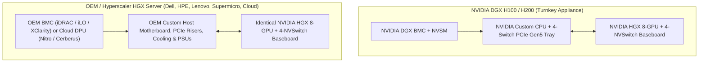
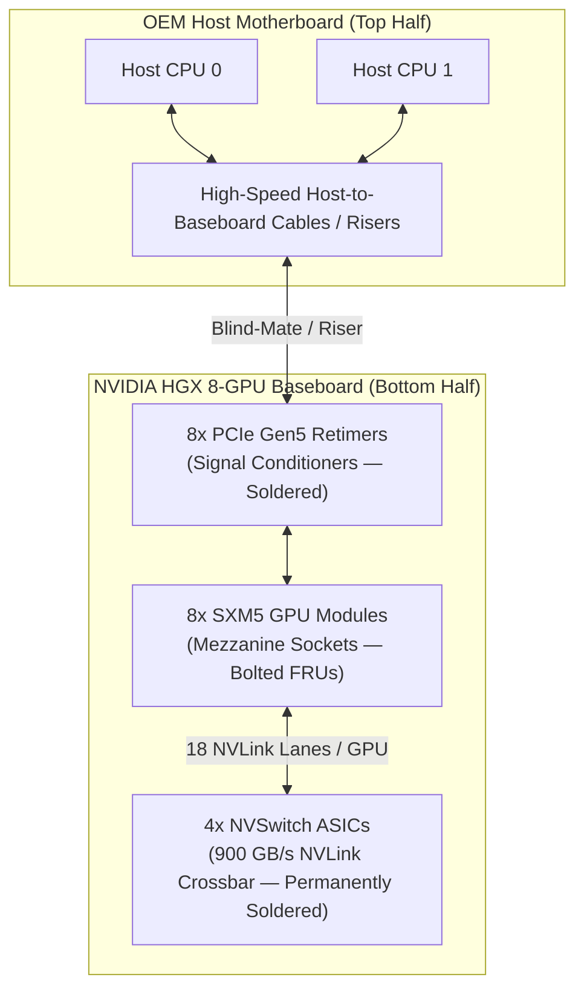
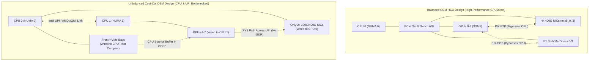

# 9.3 HGX platforms and OEM integration

| | |
|---|---|
| **Status** | Drafted (`hgx_oem_platform_lab.py`: 28 checks pass; hardware commands **untested** on live HGX servers) |
| **Level** | Intermediate |
| **Priority tier** | 1b |
| **Lab venue** | none (design / reading) + self-checking Python model (`code/part09/hgx_oem_platform_lab.py`) |
| **Part** | Part 9: NVIDIA systems and reference architectures |
| **Sources used** | `nvidia-devops` V6 (Ch. 1–7, Labs 1–2); *Distributed AI Systems* Ch. 2; *AI Systems Performance Engineering* Ch. 2 |

## Why this matters for AI infrastructure

Although the NVIDIA DGX is the golden reference appliance for an AI factory, the majority of data center SXM GPUs deployed globally do not sit inside NVIDIA-branded DGX servers. Instead, they run inside servers built by enterprise Original Equipment Manufacturers (**OEMs**)—such as the Dell PowerEdge XE9680, Supermicro SYS-821GE, HPE ProLiant XD, and Lenovo ThinkSystem—or inside custom cloud racks engineered by hyperscalers like AWS, Microsoft Azure, and Google Cloud.

None of those companies buy individual SXM GPU chips and solder them onto their own circuit boards; NVIDIA does not sell loose SXM silicon. Instead, they purchase the **NVIDIA HGX (Hyperscale Graphics Extension) Baseboard**—the exact same 8-GPU + 4-NVSwitch bottom tray used inside a DGX—and engineer their own top half of the server around it. That architectural split creates both a major opportunity and a dangerous trap: while two OEM servers containing an HGX H100 baseboard have identical GPU-to-GPU NVLink performance on the bottom half, a cost-cut OEM top half (missing PCIe Gen5 switches, under-provisioned NICs, CPU-wired NVMe bays, or poor front-to-back baffling) can train multi-node models **40% to 50% slower** than a balanced design.

:::info Corpus scope note
Confidential *NVIDIA HGX System Design Guides* for OEMs and vendor-specific service manuals (Dell, HPE, Lenovo, Supermicro) are not in the local book corpus. The HGX baseboard anatomy, 48V–54V power math, OEM support and firmware rules, balanced vs unbalanced topology patterns, proposal comparison matrix, and rack readiness review in this chapter are drawn from `nvidia-devops` Volume 06 (Chapters 1–7 and Labs 01–02), *Distributed AI Systems* Chapter 2, and *AI Systems Performance Engineering* Chapter 2.
:::

## Prerequisites and outcomes

**Prerequisites:**
- Chapters `9.1` and `9.2` (DGX system families and the internal dual-tray architecture of an 8-GPU DGX H100/H200).
- Chapter `7.13` (OEM BMC ecosystems: Dell iDRAC, HPE iLO, Lenovo XClarity, Supermicro MegaRAC).

**Outcomes:** After completing this chapter, you will be able to:
1. Explain NVIDIA's **merchant silicon strategy** (what an HGX baseboard includes versus what the OEM or hyperscaler must engineer around it).
2. Distinguish **Field Replaceable Units (`FRUs`)** on an HGX tray from permanently soldered components, and calculate why high-density GPU trays use a **48V–54V DC bus** instead of 12V.
3. Navigate the **shared-responsibility support and firmware boundary** between an OEM and NVIDIA, avoiding the "Frankenstein firmware" trap and escalating `Xid 79` faults to the right party on the first call.
4. Audit OEM server proposals for **balanced PCIe-switched topologies (`PIX`/`PXB`)**, 1:1 GPU-to-NIC ratios, isolated storage networks, and E1.S NVMe GPUDirect Storage paths, and run an **18 kW rack readiness and single-feed survival review**.

---

## Concepts: basics → intermediate → advanced

## 1. Why HGX exists: the merchant silicon strategy

An **NVIDIA HGX baseboard** is the pre-validated GPU-and-NVSwitch engine block of an AI server, sold by NVIDIA as a component to server manufacturers and cloud providers so they can wrap it in their own chassis, CPU motherboard, power supplies, and management plane.

Think of NVIDIA's DGX versus HGX strategy like an aircraft engine manufacturer that also sells a flagship private jet. Buying a **DGX** is buying the complete turnkey jet directly from the engine maker. Buying an **HGX-based server** is like Boeing or Airbus buying the pre-assembled twin-engine wing assembly (the HGX baseboard) and integrating their own fuselage, cockpit avionics (Dell iDRAC or AWS Nitro), and maintenance crew around it.



### 1.1 What is on the HGX baseboard—and what is missing

When an OEM unboxes an **HGX H100, H200, or B200 8-GPU baseboard** from NVIDIA, they receive a heavy, full-width horizontal Printed Circuit Board (PCB) containing four factory-assembled subsystems:
1. **The SXM GPUs:** 4 or 8 SXM mezzanine GPU modules (`A100`, `H100`, `H200`, `B200`) bolted onto high-density sockets.
2. **The NVSwitch Fabric:** On 8-GPU baseboards, 4 NVSwitch ASICs (`6` on A100) creating the non-blocking **900 GB/s** (Hopper) or **1,800 GB/s** (Blackwell) all-to-all GPU mesh (**3.6 TB/s** bisection on Hopper).
3. **PCIe Gen5 Retimers and Baseboard Controllers:** Signal-conditioning retimer chips, an **HGX Management Controller (HMC)**, and **External Root of Trust (ERoT)** security microcontrollers.
4. **On-board Voltage Regulation Modules (VRMs):** Point-of-load regulators that step incoming DC bus power down to the ~1V needed by the GPU dies.

**What is completely missing from the HGX box?** An HGX baseboard has **no host CPUs, no DDR5 system RAM, no NVMe storage drives, no InfiniBand/Ethernet NICs, no power supply units (PSUs), no cooling fans or cold plates, and no sheet-metal chassis**. Every single one of those surrounding subsystems is designed, sourced, and wired by the OEM or hyperscaler.

### 1.2 Why hyperscalers and enterprise IT buy HGX instead of DGX

If the DGX is already engineered by NVIDIA, why do cloud giants and enterprises buy HGX servers?
- **The Hyperscaler Reality (AWS, Azure, Google Cloud):** Hyperscalers operate proprietary hardware control planes—such as **AWS Nitro** or **Azure Cerberus**—that enforce hardware root-of-trust attestation, bare-metal virtualization, and VPC SDN offload. A turnkey DGX appliance with its own NVIDIA BMC and DGX OS conflicts with a hyperscaler's automated fleet control plane and custom rack power/cooling manifolds. By purchasing raw HGX baseboards, hyperscalers inject NVIDIA's fastest NVLink GPU fabric directly into their bespoke cloud sleds.
- **The Enterprise OEM Reality (Dell, HPE, Lenovo, Supermicro):** Most enterprise data centers standardize on one or two server vendors with existing global procurement agreements, **4-hour on-site parts replacement SLAs**, and unified out-of-band management tools (**Dell iDRAC**, **HPE iLO**, **Lenovo XClarity**). Buying an OEM HGX server (such as a Dell PowerEdge XE9680) lets operations teams manage 8-GPU H100/H200 nodes through the exact same Redfish/iDRAC automation and field-technician contract as their 10,000 existing CPU servers.

### 1.3 Why a "15% cheaper" OEM HGX quote is never automatically equivalent

Suppose a reseller quotes an OEM 8-GPU HGX H100 server at 15% less than an NVIDIA DGX H100 and claims: *"They both use the exact same NVIDIA HGX H100 baseboard inside, so performance is 100% identical."* That claim is only true for **single-node, in-VRAM math** that stays exclusively on the bottom HGX baseboard. The moment your workload reads data from storage or scales out across multiple nodes, performance is governed by the **top half of the server**—where OEMs can cut major corners to lower the bill of materials (for example, quoting only 2 network cards instead of 8, or wiring GPUs directly to CPU sockets without PCIe switches).

:::tip In one minute
- **HGX** is NVIDIA's merchant-silicon baseboard containing **4 or 8 SXM GPUs, soldered NVSwitches, PCIe retimers, HMC/ERoT controllers, and VRMs**—with **no CPUs, RAM, NICs, storage, PSUs, or chassis**.
- **Hyperscalers** use HGX to integrate with custom security/DPU control planes (AWS Nitro, Azure Cerberus) and custom racks; **enterprises** use OEM HGX servers to keep their existing BMC tools (iDRAC, iLO, XClarity) and 4-hour on-site RMA contracts.
- While the bottom HGX baseboard is identical across vendors, the **top half of the server** (PCIe switches, NIC count/placement, NVMe routing, and cooling) varies widely across OEM configurations and must be verified before purchase.
:::

---

## 2. Inside the HGX baseboard: bolted SXM FRUs, soldered NVSwitches, and 48V–54V power

When a hardware fault strikes an HGX server in production, you need to know which components on the HGX tray can be swapped in the rack by a field technician and which require replacing the entire baseboard.

### 2.1 Field Replaceable Units (FRUs): bolted SXM modules vs soldered NVSwitches



1. **SXM GPU Modules (Bolted Field Replaceable Units):** Unlike consumer GPUs, SXM modules are not plugged into vertical edge slots, nor are they permanently soldered to the HGX PCB. Each SXM GPU mates with a high-density flat **mezzanine socket** and is bolted down with precision torque screws under its heatsink or cold plate. If **a single SXM GPU suffers an internal silicon or HBM failure**, an OEM field technician can unbolt the heatsink, unscrew the faulty SXM module, and install a replacement **SXM GPU FRU** without replacing the entire 8-GPU baseboard.
2. **NVSwitch ASICs (Permanently Soldered to the PCB):** Embedded directly into the HGX circuit board are the **four NVSwitch chips** (on 8-GPU Hopper/Blackwell boards) and thousands of high-speed differential NVLink traces. Unlike SXM GPUs, **NVSwitch ASICs are permanently soldered to the baseboard**. If an NVSwitch chip fails—for example, `nvidia-smi` shows `GPU 2` is healthy on PCIe and computes math normally, but `nvidia-smi nvlink --status`, Fabric Manager logs, and `dcgmi diag` reveal a dead NVSwitch endpoint or broken PCB trace—**swapping the $30,000 SXM GPU module will accomplish nothing**. The OEM must RMA and replace the **entire bottom-half HGX baseboard**.
3. **PCIe Gen5 Retimers:** Because PCIe Gen5 signals (32 GT/s per lane) attenuate rapidly as they travel from the OEM host motherboard through riser cards or high-density cables down to the HGX tray, the HGX baseboard integrates **PCIe Gen5 retimers**. These chips capture the incoming signal, re-clock and amplify it, and drive clean waveforms to the SXM sockets.
4. **8-GPU (Delta-class) vs 4-GPU (Redstone-class) Baseboards:** Not all HGX boards have 8 GPUs. NVIDIA also produces **4-GPU HGX baseboards** (historically code-named *Redstone* in the A100 generation vs 8-GPU *Delta*). Crucial architectural rule: **4-GPU HGX boards typically omit NVSwitch chips entirely**, wiring the 4 GPUs via direct point-to-point NVLink traces on the PCB, and **you can never upgrade a 4-GPU HGX server to 8 GPUs later**—the PCB traces, absence of NVSwitches, and chassis power delivery are permanently fixed at manufacturing.

### 2.2 Electrical physics: why high-power GPU servers shift from 12V to 48V–54V DC

Eight 700W SXM5 GPUs draw **5.6 kW** by themselves, and a full 8-GPU HGX server draws **8 kW to 10.2+ kW** (rising to **14+ kW** on Blackwell B200). Delivering 10 kilowatts inside a metal box exposes a fundamental law of electricity:

```text
Current (Amps) = Power (Watts) / Voltage (Volts)      [ I = P / V ]
Resistive Heat Loss (Watts) = Current^2 × Resistance   [ P_loss = I^2 × R ]
```

- **At traditional 12-Volt server distribution:** Every 1 kW of power requires `1,000 W / 12 V = 83.33 Amps`. Pushing **10,000 W (10 kW)** across a 12V rail requires **`10,000 / 12 = 833.33 Amps`** (and `5,600 W` of GPU power alone requires **`466.67 Amps`**). Carrying 833 Amps would require busbars as thick as welding cables, and resistive losses (`I^2 × R`) would waste enormous energy as heat.
- **Stepping up to a 48V–54V high-voltage DC bus:** By raising internal DC distribution from 12V to the **48V–54V class** (as used in modern OCP and HGX server designs; always confirm the exact input voltage in NVIDIA's HGX design collateral for your OEM platform):
  - At **48V**, 10 kW draws **`10,000 / 48 = 208.33 Amps`**—a **4.0× reduction in current** and a **`4.0^2 = 16.0×` reduction in resistive `I^2 × R` power loss**.
  - At **54V**, 10 kW draws **`10,000 / 54 = 185.19 Amps`** (and 5.6 kW of GPUs draws **`103.70 Amps`**)—a **4.5× reduction in current** and a **`4.5^2 = 20.25×` reduction in resistive `I^2 × R` loss**.
  - Inside the server, redundant multi-kilowatt PSUs convert facility 3-phase AC into the 48V–54V DC bus, heavy **copper busbars** carry that power onto the HGX baseboard, and **Point-of-Load (PoL) VRMs** sitting millimeters from each SXM socket step the voltage down to the **~1V** required by the GPU silicon.

:::tip In one minute
- On an HGX baseboard, **SXM GPUs are bolted mezzanine FRUs** (individually replaceable), whereas **NVSwitch ASICs are permanently soldered to the PCB** (an NVSwitch silicon failure requires replacing the entire HGX baseboard).
- **4-GPU HGX boards** typically use point-to-point NVLink without NVSwitches and **cannot be upgraded to 8 GPUs**.
- Raising internal DC power distribution from **12V (`833.33 A` at 10 kW)** to **48V–54V (`208.33 A` at 48V; `185.19 A` at 54V)** cuts current by **4.0×–4.5×** and cuts resistive `I^2 × R` losses by **16×–20.25×**.
:::

---

## 3. OEM integration, firmware rules, and support boundaries

When you buy a turnkey DGX from NVIDIA, one vendor owns every layer from the sheet metal to the CUDA container. When you buy an OEM HGX server from Dell, HPE, Lenovo, or Supermicro, you operate under a **three-party shared responsibility model** (NVIDIA, the OEM, and your own infrastructure team).

### 3.1 The nine-domain responsibility matrix

Before signing a purchase order or opening a Sev-1 ticket, map out who owns each architectural domain across the stack:

| Architectural Domain | NVIDIA / HGX Scope | OEM Responsibility (Dell, HPE, Lenovo, Supermicro) | Customer / Platform Team Responsibility |
|---|---|---|---|
| **1. Accelerator Subsystem** | Designs SXM GPUs, NVSwitch ASICs, retimers, HMC/ERoT, and releases base VBIOS/NVSwitch code. | Physical/thermal integration around the HGX baseboard, **and primary hardware warranty / on-site RMA dispatch for all GPUs and baseboards**. | Keep VBIOS/NVSwitch firmware strictly within the **OEM-qualified bundle** (never flash raw "latest" files from the web). |
| **2. Host CPUs & Memory** | None (outside HGX scope). | Selects dual-socket x86 CPUs, NUMA layout, and symmetric 16/32-DIMM DDR5 population. | Verify NUMA-to-GPU locality at acceptance (`numactl --hardware`) and pin worker processes. |
| **3. PCIe & NIC Topology** | Defines the 8 PCIe Gen5 x16 endpoints on the HGX baseboard. | Designs host root complexes, **PCIe Gen5 switch placement**, and physical PCIe riser slotting for NICs. | Demand and verify `nvidia-smi topo -m` (`NV18` + `PIX` to all compute NICs) before production admission. |
| **4. Local NVMe Storage** | None. | Selects U.2 or **E1.S (EDSFF)** drives, backplane wiring (PCIe switch vs CPU), and drive firmware. | Verify GPUDirect Storage path (`gdscheck -p`) and benchmark real I/O (`fio` / `gdsio`). |
| **5. Power & Cooling** | Publishes per-SKU SXM TDP (700W–1,000W) and thermal envelope. | Engineers complete-system PSUs, 48V–54V busbars, fan baffles or cold plates, and thermal fan curves. | Verify facility rack kW, single-feed PDU derating, and run a **60-minute sustained thermal soak test**. |
| **6. BIOS, BMC & Firmware** | Provides HMC and ERoT reference firmware to the OEM. | Authors, tests, and publishes the **unified OEM firmware bundle** (BIOS, BMC, CPLD, NIC, VBIOS, NVSwitch). | Enforce strict change control and verify staged rollback (`≤ 30 minutes`). |
| **7. Driver, CUDA & Software** | Publishes CUDA/driver compatibility and supports **NVIDIA AI Enterprise (NVAIE)** commercial stack. | Validates driver branches against their specific server SKU. | Pin driver/CUDA versions across the cluster; note that open-source Python code is self-supported unless under NVAIE. |
| **8. Cluster Network Fabric** | Internal HGX NVLink fabric only (unless customer also buys NVIDIA Quantum/Spectrum switches). | Selects and slots internal ConnectX-7/8 and BlueField-3 cards. | Designs leaf-spine fabric, **Rail-Optimized cabling**, RoCE/IB congestion control, and cable labeling. |
| **9. Shared External Storage** | N/A. | N/A (unless bundled in turn-key solution). | Parallel File System capacity, ≥40 GB/s checkpoint throughput, and off-node replication. |

### 3.2 The Firmware Danger Zone ("Frankenstein Firmware") and NVIDIA-Certified Systems

On an OEM HGX server, firmware spans both the OEM's controllers (System BIOS, iDRAC/iLO/XClarity BMC, PSU firmware) and the HGX baseboard's controllers (**GPU VBIOS, NVSwitch firmware, HGX Management Controller `HMC`, and External Root of Trust `ERoT`**).

**The Golden Firmware Rule on OEM HGX servers:** Never download a raw GPU VBIOS, NVSwitch firmware, or ConnectX NIC firmware image directly from NVIDIA's website and force-flash it onto an OEM server. The OEM's BMC fan curves, power-capping loops, and PCIe riser retimers are regression-tested against a specific HGX firmware build. Flashing unvalidated standalone binaries creates a **"Frankenstein" server** whose thermal control loop may fail to ramp fans under load or refuse to train PCIe Gen5 links at boot. Always apply updates using the **OEM's certified update bundle** (such as Dell Update Packages / DUPs, HPE Service Pack for ProLiant, Lenovo XClarity bundles, or Supermicro Update Manager).

To ensure OEMs do not ship under-cooled or bottlenecked servers, NVIDIA operates the **NVIDIA-Certified Systems** program, requiring OEMs to pass **NVIDIA Qualification (NVQual)** stress, thermal, and bandwidth test suites before receiving certification. Even with an NVIDIA-Certified badge, you must still verify the exact SKU configuration you ordered (for example, confirming that all 8 compute NICs were actually populated).

### 3.3 How to escalate `Xid 79 (GPU has fallen off the bus)` on an OEM server

Suppose `Node 12` in a 50-node Lenovo HGX H100 cluster halts mid-training with `NVRM: Xid (PCI:0000:8a:00): 79, pid=..., GPU has fallen off the bus` on `GPU 4`.
- **What NOT to do:** Do not open a hardware RMA ticket directly with NVIDIA Enterprise Support asking NVIDIA to ship a replacement GPU. Because you bought the server from Lenovo, **NVIDIA does not hold the hardware warranty and cannot dispatch a field technician to your rack**.
- **What `Xid 79` actually means:** It means the host CPU lost PCIe link framing with `GPU 4`. On an OEM server, that signal path traverses the **OEM motherboard → OEM PCIe riser card → high-speed internal interconnect cable → HGX PCIe Gen5 retimer → SXM5 mezzanine socket**. A slightly loose PCIe riser cable vibrated by high-RPM chassis fans produces the exact same `Xid 79` error as a dead GPU.
- **The deterministic escalation runbook:**
  1. Run `sudo nvidia-bug-report.sh` on the host OS to capture kernel, driver, and Xid state.
  2. Export the **OEM BMC hardware diagnostic bundle** (for example, Lenovo XClarity Service Data, Dell SupportAssist TSR, or HPE Active Health System log) to inspect PCIe root-port link errors and power rails.
  3. Open a Sev-1 hardware ticket with **your OEM's Premier Support**, attaching *both* bundles, and request that the field engineer bring **both a replacement OEM PCIe riser/cable assembly and a replacement SXM GPU FRU** so the node is repaired on the first visit.

:::tip In one minute
- Even though NVIDIA manufactures the bottom HGX baseboard, **the OEM owns the primary hardware warranty and on-site RMA dispatch for the entire server**, including SXM GPUs and HGX baseboards.
- **Never flash raw NVIDIA VBIOS or NVSwitch files onto an OEM server** ("Frankenstein risk"); always use the **OEM's certified firmware bundle** so BMC thermal fan curves and HMC/ERoT handshakes remain valid.
- On an **`Xid 79 (GPU has fallen off the bus)`**, collect `nvidia-bug-report.sh` plus the OEM BMC log bundle and escalate to the **OEM** to dispatch both the host-to-HGX PCIe riser/cable and an SXM GPU FRU.
:::

---

## 4. HGX topology and data paths: balanced vs unbalanced OEM designs

Because the OEM designs the top half of an HGX server, two 8-GPU H100 servers from different vendors (or two different SKUs from the *same* vendor) can have radically different internal PCIe wiring.

### 4.1 Balanced PCIe-switched tree vs Unbalanced CPU-attached tree



1. **The Balanced OEM Layout (`PIX` / `PXB`):** Mirrors the DGX reference architecture (see **chapter `9.2`, section 5.1** for the full `nvidia-smi topo -m` symbol reference) by placing dedicated **PCIe Gen5 switch chips** (Broadcom/PLX) between the CPUs and the peripherals, with **eight 400G ConnectX-7 NICs (1:1 GPU-to-NIC ratio)** and **E1.S (EDSFF) "ruler" NVMe drives** wired directly to those same PCIe switches:
   - `nvidia-smi topo -m` reports **`PIX`** (or `PXB`) between every GPU and its paired 400G NIC and local NVMe drive, so **GPUDirect RDMA** and **GPUDirect Storage (`GDS`)** transfer tensors at full line rate without touching the host CPUs or DDR5 RAM.
   - Using thin **E1.S (EDSFF) ruler SSDs** in the front bay also maximizes local scratch density while leaving wide open airflow channels so cold intake air can reach the 5.6 kW HGX baseboard behind them.
2. **The Unbalanced Cost-Cut OEM Layout (`NODE` / `SYS`):** To build a cheaper SKU or reuse an older chassis, an OEM may omit PCIe switches (wiring GPUs and NICs directly into the CPU PCIe Root Complexes), install only **2 or 4 NICs** instead of 8, or wire front-panel NVMe drives directly to the host CPU:
   - `nvidia-smi topo -m` reports **`NODE`** or **`SYS`** (crossing the inter-socket **Intel UPI / AMD xGMI link**), causing NCCL's default `NCCL_NET_GDR_LEVEL` threshold to disable GPUDirect RDMA and bounce network traffic through host RAM.
   - Worse, when front-panel NVMe drives are wired directly to the CPU root complex instead of the GPU PCIe switches, **GPUDirect Storage falls back to a CPU Bounce Buffer in DDR5 RAM** (`gdscheck -p`). Saturating the CPUs and DDR5 channels with storage copies starves the CPU threads orchestrating NCCL collectives, causing GPU utilization (`nvidia-smi`) to drop to `0%` in erratic stalls and InfiniBand traffic graphs to show choppy bursts instead of smooth 400 Gbps plateaus.

### 4.2 Two deadly operational mistakes on OEM HGX clusters

1. **Never set `NCCL_P2P_DISABLE=1` to "work around" an unbalanced PCIe bus:** When junior administrators see PCIe or NCCL errors on an unbalanced OEM server, they sometimes search forums and set `export NCCL_P2P_DISABLE=1`. **This is a serious mistake:** `NCCL_P2P_DISABLE=1` disables *all* direct GPU peer-to-peer memory access—**including the 900 GB/s NVLink/NVSwitch mesh on the HGX baseboard.** Instead, inspect `NCCL_DEBUG=INFO`, constrain interface selection with `NCCL_IB_HCA` and `NCCL_SOCKET_IFNAME`, align rank-to-NUMA placement, and install the missing NICs in the proper PCIe switch slots.
2. **Crossed rails on scattered OEM rear PCIe risers:** On an NVIDIA DGX node, the 8 compute NIC ports on the rear panel are arranged in a clean, numbered row (`0` to `7`). On many OEM 4U/8U servers, PCIe risers are scattered across the rear panel (`NIC 0` on the top-left riser, `NIC 1` on the bottom-right riser, etc.). If a cabling technician plugs `NIC 0` into `Leaf Switch 1` instead of `Leaf Switch 0`, you have **crossed the rails** of your Rail-Optimized Fat-Tree: synchronous `AllReduce` traffic between `GPU 0` on Node A and `GPU 0` on Node B can no longer complete in a single leaf-switch hop and is forced to climb up to the Spine switches and back down, adding latency and congestion across the entire pod.

:::tip In one minute
- Audit every OEM HGX server with **`nvidia-smi topo -m`** and **`gdscheck -p`**: require **`NV18`** across all 8 GPUs, a **1:1 GPU-to-NIC ratio (8x 400G)** with **`PIX`/`PXB`** locality, and **E1.S/U.2 NVMe drives behind the GPU PCIe switches**.
- If front NVMe bays are wired to the CPU root complex, storage reads bounce through DDR5 RAM and starve the CPU threads driving InfiniBand collectives.
- **Never set `NCCL_P2P_DISABLE=1`** on an HGX server (it turns off 900 GB/s NVLink P2P.). Always label scattered OEM rear PCIe riser ports carefully so technicians do not cross rails during leaf-switch cabling.
:::

---

## 5. Cooling, airflow shadowing, proposal comparison, and 18 kW rack readiness

Even when an OEM HGX server has a balanced PCIe switch tree, it must survive the thermal and electrical realities of your data center rack.

### 5.1 Airflow shadowing and Closed-Loop Liquid Cooling (CLLC)

On an 8-GPU HGX baseboard, the eight SXM modules are arranged in two physical rows of four GPUs (`GPUs 0–3` in the front row, `GPUs 4–7` in the back row along the front-to-back airflow path).

- **The Airflow Shadowing problem:** In an air-cooled OEM chassis, high-RPM dual-rotor fans pull cold air from the cold aisle (`18°C / 64°F`) and force it over the heatsinks of the front row of GPUs (`GPUs 0–3`). Each of those front GPUs dumps up to **700W of heat** into the air stream. If the OEM's internal air baffles do not duct fresh bypass air directly to the rear row, **`GPUs 4–7` breathe pre-heated exhaust air from `GPUs 0–3`**. Even in a freezing-cold data center room, the rear GPUs hit their thermal slowdown threshold (`SW Thermal Slowdown: Active` in `nvidia-smi -q -d TEMPERATURE,PERFORMANCE`) and drop their clock frequencies. Because synchronous distributed training moves at the speed of the slowest GPU in the ring, thermal throttling on `GPUs 4–7` slows down the entire cluster.
- **Closed-Loop Liquid Cooling (CLLC) vs Facility Direct Liquid Cooling (DLC):** What if an air-cooled chassis cannot prevent airflow shadowing, yet your data center building lacks chilled facility water pipes and Coolant Distribution Units (CDUs)? Several OEMs offer **Closed-Loop Liquid Cooling (CLLC)** inside a 4U–8U HGX chassis: cold plates bolted to the 8 SXM GPUs circulate liquid via an internal pump to a large **internal liquid-to-air radiator** inside the server chassis itself, where chassis fans blow air through the radiator. CLLC requires zero facility plumbing while eliminating GPU-to-GPU thermal shadowing (though the room CRAC units still absorb the total heat load as warm air).

### 5.2 Engineering comparison of two OEM HGX proposals (`Verified` vs `Partial` vs `Missing`)

When evaluating two OEM proposals (`Platform A` vs `Platform B`) that both advertise *"8x NVIDIA H100 80 GB SXM5 GPUs,"* never treat missing proposal data as equivalent to a passing design. Score every requirement on both **technical compliance** and **evidence quality** (`Verified`, `Partial`, or `Missing`):

| Evaluation Area | Mandatory Requirement | OEM Platform A Proposal | OEM Platform B Proposal | Verdict & Evidence Quality |
|---|---|---|---|---|
| **1. Accelerator Mesh** | 8x H100 80 GB SXM5, full NVSwitch mesh | 8x H100 80 GB; attached `nvidia-smi topo -m` confirms `NV18` all-to-all | 8x H100 80 GB spec sheet only; no `topo -m` output supplied | A: `Verified` (Pass) / B: `Missing` |
| **2. Host CPUs & RAM** | Dual-socket, ≥1.5 TB symmetric DDR5 | 2x 64-core, 2 TB DDR5 across 32 DIMMs, symmetric NUMA | 2x 56-core, 1.5 TB DDR5; DIMM channel population undisclosed | A: `Verified` (Pass) / B: `Partial` |
| **3. Compute Fabric** | 8x 400G RDMA (1:1 GPU-to-NIC, `PIX`) | 8x 400G ConnectX-7, 1:1 ratio, `topo -m` confirms `PIX` | **4x 400G** (2 GPUs/NIC), PCIe switch locality unconfirmed | A: `Verified` (Pass) / B: **Fails 1:1 rule** + `Missing` locality |
| **4. Storage Network** | Physically isolated from Compute Fabric | Dedicated 2x 200G storage NICs on isolated VLAN | **Shared with compute fabric** (no isolation) | A: `Verified` (Pass) / B: `Verified` (**Mandatory Failure**) |
| **5. Local NVMe Scratch** | ≥15 TB/node behind PCIe switches | 8x 3.84 TB E1.S/U.2 NVMe in RAID 0 (`PIX` to GPUs) | 4x 7.68 TB NVMe; RAID mode and PCIe root attachment unstated | A: `Verified` (Pass) / B: `Partial` |
| **6. BMC & Telemetry** | Redfish API + Prometheus GPU/BMC export | Redfish + vendor telemetry agent + Prometheus exporter | BMC present; Prometheus telemetry marked "on roadmap" | A: `Verified` (Pass) / B: `Missing` |
| **7. Firmware & SLA** | Qualified bundle, ≤30m rollback, 4-hr onsite SLA | Documented bundle + rollback SOP + contracted 4-hr SLA | Bundle exists; rollback undocumented; best-effort SLA | A: `Verified` (Pass) / B: `Partial` / `Missing` |

Notice the distinction in `Platform B`: omitting `nvidia-smi topo -m` is an **evidence gap (`Missing`)** that reduces confidence until proved, whereas sharing the storage and compute network or supplying only 4 compute NICs is a **verified mandatory requirement failure**.

### 5.3 Worked 18 kW rack elevation, power derating, and single-feed survival test

Suppose your existing air-cooled data center provides **42U racks** capped at **18.0 kW per rack**, fed by dual redundant **3-phase 415V, 32A** PDUs (`PDU-A` on panel `RPP-3` and `PDU-B` on panel `RPP-4`). You want to deploy `Platform A` (where each 4U/8U OEM HGX H100 server has an illustrative full-system design power estimate of **~7.9 kW** and weighs **82 kg**):

1. **Why 4 nodes per rack is an automatic `No-go`:** Four nodes physically fit in 42U (`32U`), but `4 × 7.9 kW + 0.6 kW (switches) = 32.2 kW`, exceeding the **18.0 kW** rack limit by more than 14 kW. You must drop density to **2 nodes per rack** (doubling the rack count).
2. **2-node rack elevation and total load:**
   - `RU 1–2`: Top-of-Rack Compute Switch (`32x 400G`, `18 kg`, `A+B` feeds)
   - `RU 3–4`: Out-of-Band Management Switch (`48x 1G`, `6 kg`, `Feed A`)
   - `RU 6–9`: **HGX Server Node 1** (`82 kg`, `A+B` feeds, **7.9 kW**)
   - `RU 10–11`: *3U open/baffled service and thermal gap* (never pack air-cooled high-kW nodes tight if thermal margin is thin)
   - `RU 12–15`: **HGX Server Node 2** (`82 kg`, `A+B` feeds, **7.9 kW**)
   - `RU 20–22`: Storage Leaf Switch (`24x 200G`, `14 kg`, `A+B` feeds)
   - **Total rack design load:** `(2 × 7.9 kW) + 0.6 kW switches = 16.4 kW` against the **18.0 kW** facility ceiling (**1.6 kW headroom**).
3. **Single-feed failure survival math (3-phase 415V 32A at 80% continuous derating):**
   If `Power Feed A` (`RPP-3`) trips offline, **`Power Feed B` (`PDU-B`) must carry the entire 16.4 kW rack load by itself**. Can a 3-phase 415V 32A circuit survive 16.4 kW continuously?
   ```text
   Nameplate 3-Phase Power = sqrt(3) × Voltage × Current = 1.73205 × 415 V × 32 A = 23.00 kW
   Continuous Derated Limit (80% rule) = 23.00 kW × 0.80 = 18.40 kW continuous capacity
   Single-Feed Survival Margin = 18.40 kW - 16.40 kW = +2.00 kW margin (PASS)
   ```
   Because **16.4 kW ≤ 18.40 kW**, `Feed B` survives a full `Feed A` outage with **2.0 kW of continuous margin** (and adding a third node at `24.3 kW` would trip `Feed B` instantly during a failover.).
4. **Final rack review verdict (`Conditional go`):** In our deterministic rack reviewer (`review_hgx_rack_power` in `code/part09/hgx_oem_platform.py`, where the threshold rules `< 3.0 kW headroom` or non-redundant single-port compute NICs map to `Conditional go` as **my inference** formalizing the decision table from our rack review lab), the design receives a **Conditional go**: facilities and platform teams must explicitly sign off on the thin 1.6 kW rack headroom (no third node allowed) and configure link-down alerting for the non-redundant 1:1 compute NICs before energization.

### 5.4 Eight mandatory commissioning acceptance tests

Before signing off on a new OEM HGX cluster delivery, require the vendor and acceptance team to pass eight measurable gates:
1. **Hardware inventory:** `nvidia-smi -L` and system BOM match the approved order (`0` discrepancies).
2. **Topology inspection:** `nvidia-smi topo -m` shows **`NV18`** between all GPU pairs and **`PIX`** between every GPU and its paired 400G compute NIC.
3. **Active GPU diagnostics:** `dcgmi diag -r 3` passes with zero errors across all nodes.
4. **Network line-rate test:** `ib_write_bw --use_cuda=0` achieves **≥ 90% of rated line rate** per ConnectX-7 adapter.
5. **Storage throughput test:** `fio` / `gdsio` sequential read achieves **≥ 40 GB/s aggregate** across the pod for checkpoint restart.
6. **Multi-node collective scaling:** `nccl-tests` `all_reduce_perf` bus bandwidth at 4-node scale stays **within 10% of the single-node baseline**.
7. **Power and thermal soak:** **60-minute sustained full-load soak** with **`0` thermal throttle events** and server inlet temperature stable within `2°C`.
8. **Firmware rollback drill:** Documented rollback to the prior OEM-qualified firmware bundle completes in **≤ 30 minutes** and boots cleanly.

:::tip In one minute
- **Airflow shadowing** occurs when front-row GPUs (`0–3`) pre-heat intake air, causing rear-row GPUs (`4–7`) to thermal-throttle even in an 18°C room; diagnose with `nvidia-smi -q -d TEMPERATURE,PERFORMANCE` and mitigate with proper baffling, **Closed-Loop Liquid Cooling (CLLC)**, or facility **Direct Liquid Cooling (DLC)**.
- Always check **single-feed PDU survival** with continuous derating: a **415V 3-phase 32A** feed has **23.0 kW** nameplate capacity and **18.4 kW** continuous capacity (at 80% derating), safely carrying two 7.9 kW HGX nodes + 0.6 kW switches (**16.4 kW total**, **2.0 kW margin**).
- Never accept an OEM HGX delivery without passing the **8 commissioning gates** (`topo -m` `NV18`+`PIX`, `dcgmi diag -r 3`, `≥90%` RDMA line rate, `≥40 GB/s` storage read, `≤10%` multi-node NCCL dropoff, 60-minute thermal soak, and `≤30m` firmware rollback).
:::

---

## 6. Beyond the 8-GPU HGX baseboard: the MGX modular rack era (`GB200 NVL72`)

For three generations—Volta (`V100`), Ampere (`A100`), and Hopper (`H100`/`H200`)—the 8-GPU HGX baseboard was the universal building block of OEM AI servers. With the arrival of **Blackwell (`B200`/`GB200`)** and trillion-parameter Mixture-of-Experts models, two physical walls forced an architectural shift for flagship rack systems:
1. **The 8 kW+ thermal wall** of eight 1,000W+ GPUs inside a single box.
2. **The 8-GPU NVLink domain wall** when tensor- and expert-parallel groups span 32 to 72 GPUs across separate servers.

Because a single PCB holding 72 GPUs would not fit through a data center door—and connecting nine 8-GPU servers with optical NVLink transceivers would burn **roughly 20 kW of extra power per rack just for the optics**—NVIDIA created the **MGX (Modular Reference Architecture)** and the **GB200 / GB300 NVL72** rack (examined in full detail in **chapter `9.5`**).

Instead of one monolithic 8-GPU HGX board, MGX splits the rack into **18 1U Compute Trays** and **9 1U NVLink Switch Trays** that blind-mate into a passive rear copper backplane (**130 TB/s** NVLink 5 across 72 GPUs, saving **~20 kW** of optical power per rack). While OEMs still manufacture traditional 8-GPU air- and liquid-cooled **HGX B200** servers for standard racks, in the **MGX / NVL72** era OEMs can no longer invent custom tray dimensions—every compute tray, cold-plate manifold, and blind-mate connector must align to the millimeter with the NVL72 copper backplane, shifting the OEM's role toward rack-scale system integration, BMC telemetry, and global field service.

:::tip In one minute
- While 8-GPU **HGX B200** baseboards continue for node-based servers, the **MGX / NVL72** standard disaggregates trays across a blind-mate rear copper backplane (**saving ~20 kW of optical power per rack**) and requires OEMs to build to strict rack-scale mechanical tolerances (see **chapter `9.5`**).
:::

---

## Commands and configurations that matter

Use this command sequence during OEM HGX server acceptance and troubleshooting to verify PCIe/NVLink topology, GPUDirect Storage locality, thermal shadowing, and `Xid 79` fault isolation (**untested** on live OEM HGX hardware in this authoring environment; rules verified in `code/part09/hgx_oem_platform_lab.py`).

### 1. Acceptance gate: verify `NV18` NVSwitch mesh, `PIX` NIC locality, and NUMA balance

```bash
# 1. Confirm all 8 SXM GPUs match the ordered SKU and serial numbers
nvidia-smi -L

# 2. Verify every GPU-to-GPU cell is NV18 and every GPU-to-Compute-NIC cell is PIX/PXB
nvidia-smi topo -m

# 3. Verify symmetric CPU core and DDR5 memory population across NUMA 0 and NUMA 1
numactl --hardware

# 4. Verify GPUDirect Storage (GDS) compatibility and PCIe switch path to E1.S/U.2 NVMe drives
/usr/local/cuda/gds/tools/gdscheck -p
```

### 2. Detect Airflow Shadowing on rear-row GPUs (`GPUs 4–7` vs `GPUs 0–3`)

```bash
# Poll GPU temperatures, SM clocks, power draw, and thermal slowdown flags under sustained load
nvidia-smi --query-gpu=index,name,temperature.gpu,temperature.memory,clocks.current.sm,power.draw,clocks_throttle_reasons.sw_thermal_slowdown,clocks_throttle_reasons.hw_thermal_slowdown \
  --format=csv -l 5

# Inspect detailed thermal and performance state on a suspected shadowed rear GPU (e.g., GPU 6)
nvidia-smi -i 6 -q -d TEMPERATURE,PERFORMANCE
```

### 3. Diagnose NVLink / NVSwitch baseboard faults vs SXM GPU FRU faults

```bash
# 1. Check per-GPU NVLink sub-link status (all 18 links per GPU must report active GB/s)
nvidia-smi nvlink --status

# 2. Check NVLink error counters across all GPUs
nvidia-smi nvlink -e

# 3. Inspect NVIDIA Fabric Manager logs for NVSwitch ASIC or port training errors
sudo journalctl -u nvidia-fabricmanager --no-pager -n 100

# 4. Run DCGM Level 3 active hardware and NVLink diagnostic before requesting an OEM RMA
dcgmi diag -r 3
```

### 4. First-call evidence collection for `Xid 79 (GPU has fallen off the bus)`

```bash
# 1. Check kernel ring buffer for Xid 79 and PCIe AER (Advanced Error Reporting) link drops
sudo dmesg -T | grep -E "NVRM: Xid|AER|pcieport"

# 2. Generate the official NVIDIA kernel/driver debug archive to attach to the OEM ticket
sudo nvidia-bug-report.sh
# Attach nvidia-bug-report.log.gz + OEM BMC support bundle (iDRAC TSR / XClarity / iLO AHS) to OEM Premier Support
```

---

## How it fails

| Failure mode | Symptom | Root cause | Diagnosis & fix |
|---|---|---|---|
| **1. Swapping a $30k SXM GPU for a dead NVSwitch ASIC** | `nvidia-smi` shows `GPU 2` is healthy on PCIe and runs single-GPU CUDA math fine, but multi-GPU NCCL jobs fail on NVLink (`falling back to PCIe`). The admin replaces `GPU 2`'s SXM module and the failure persists. | On an 8-GPU HGX board, GPUs connect through **4 permanently soldered NVSwitch ASICs**. If `GPU 2` works over PCIe, its SXM die is healthy; the fault is either bent SXM socket pins, a damaged PCB trace, or a failed **NVSwitch ASIC** on the HGX baseboard. | Run `nvidia-smi nvlink --status`, `dcgmi diag -r 3`, and inspect `nvidia-fabricmanager` logs. If an NVSwitch ASIC or baseboard trace has failed, request an **OEM RMA for the entire bottom-half HGX baseboard** (not the SXM GPU FRU). |
| **2. Escalating `Xid 79` directly to NVIDIA instead of the OEM** | `Node 12` drops `GPU 4` with `Xid 79 (GPU has fallen off the bus)`. The team opens a ticket with NVIDIA demanding a replacement GPU and waits 48 hours with no dispatch. | On an OEM HGX server, **the OEM holds the hardware warranty** and field dispatch, and `Xid 79` is frequently caused by a loose **OEM PCIe riser or high-speed host-to-HGX cable** rather than the GPU silicon. | Run `nvidia-bug-report.sh` and export the **OEM BMC hardware log bundle** (XClarity / iDRAC / iLO). Open a Sev-1 ticket with **OEM Premier Support** so they dispatch a field engineer with *both* a replacement PCIe riser/cable and an SXM GPU FRU. |
| **3. Setting `NCCL_P2P_DISABLE=1` on an unbalanced 2-NIC OEM server** | A cost-cut OEM server with only 2 NICs wired to CPU 0 (`SYS` path from GPUs 4–7) experiences slow collectives and timeouts; someone sets `NCCL_P2P_DISABLE=1` and intra-node throughput collapses by **10×**. | `NCCL_P2P_DISABLE=1` disables **all direct GPU peer-to-peer transfers, including the 900 GB/s NVLink mesh** on the HGX baseboard. | Remove `NCCL_P2P_DISABLE=1` immediately. Use `NCCL_DEBUG=INFO`, `NCCL_IB_HCA`, and NUMA rank alignment as a short-term mitigation, and install the missing 6 ConnectX-7 NICs into the proper PCIe switch slots to achieve a 1:1 `PIX` ratio. |
| **4. CPU-wired front NVMe bays causing erratic InfiniBand bursts** | An OEM cluster has 8x 400G NICs in a clean rail-optimized fabric, yet `nvidia-smi` utilization drops to `0%` periodically and InfiniBand throughput charts show jagged bursts instead of smooth plateaus. | The OEM wired the front-panel NVMe drives directly to the **CPU PCIe Root Complex** instead of the GPU PCIe switches. GPUDirect Storage falls back to a **CPU Bounce Buffer in DDR5 RAM**, saturating CPU memory bandwidth and delaying CPU threads that orchestrate NCCL network rings. | Verify with `gdscheck -p` and `nvidia-smi topo -m`. Re-cabling/re-slotting NVMe risers behind the GPU PCIe switches restores direct GDS (`PIX`), or move dataset streaming onto the RDMA Parallel File System via the storage NICs. |
| **5. Airflow Shadowing throttling rear GPUs (`GPUs 4–7`) in a cold room** | On air-cooled OEM HGX nodes, `GPUs 4–7` drop clock speeds by 20%–30% during training even though cold-aisle inlet air is `18°C (64°F)`. | Front-row `GPUs 0–3` dump 2.8 kW of heat into the chassis airflow, and inadequate internal baffling starves rear-row `GPUs 4–7` with pre-heated air (`sw_thermal_slowdown = Active`). | Verify with `nvidia-smi -q -d TEMPERATURE,PERFORMANCE` and BMC fan/inlet sensors. Install missing rack blanking panels, verify OEM baffle/fan curves via the OEM-certified firmware bundle, or transition to **Closed-Loop Liquid Cooling (CLLC)** / **Direct Liquid Cooling (DLC)**. |
| **6. "Frankenstein" thermal or boot failure after raw VBIOS/NVSwitch flash** | An admin flashes a standalone GPU VBIOS or NVSwitch binary downloaded from the web onto an OEM HGX server; fans stick at 100% or fail to ramp under load, or GPUs fail link training. | OEM BMC thermal control loops, HMC/ERoT security handshakes, and PCIe retimers are coupled to the OEM's specific tested HGX firmware revision. | Roll back to the **OEM's certified update package** (Dell DUP / Lenovo XClarity / HPE SPP / Supermicro SUM) within the 30-minute maintenance window and lock out ad-hoc in-band flashing. |

---

## Hands-on lab

This chapter's self-checking Python model (`code/part09/hgx_oem_platform.py`) and lab script (`code/part09/hgx_oem_platform_lab.py`) implement:
1. The **12V vs 48V–54V DC bus electrical calculator** (`I = P / V` and `I^2 × R` resistive loss reduction at `1 kW`, `5.6 kW`, and `10 kW`).
2. The **HGX FRU and OEM RMA fault-boundary classifier** (distinguishing bolted SXM GPU FRU swaps from permanently soldered NVSwitch baseboard RMAs and `Xid 79` riser/cable escalations).
3. The **OEM HGX Proposal & Topology Auditor** (reproducing the `Platform A` vs `Platform B` comparison matrix, catching missing `topo -m` evidence gaps, 2:8 / 4:8 NIC under-provisioning, `NODE`/`PHB`/`SYS` GPU-to-NIC paths, CPU-wired NVMe bounce buffers, `NCCL_P2P_DISABLE=1` anti-patterns, 4-GPU to 8-GPU upgrade myths, Frankenstein firmware flashes, and rear-GPU airflow shadowing).
4. The **18 kW Rack Power & Single-Feed Survival Reviewer** (proving why 4 nodes/rack at `7.9 kW` = `32.2 kW` is a `No-go`, why 2 nodes/rack + switches = `16.4 kW` survives a single-feed outage on a `415V 3-phase 32A` PDU with `23.0 kW` nameplate / `18.4 kW` 80%-derated capacity and `2.0 kW` margin, and issuing `Go`, `Conditional go`, or `No-go` verdicts).

Run the lab from the repository root:

```bash
python3 -B code/part09/hgx_oem_platform_lab.py
```

Expected output (verified in this repository):

```text
=== Chapter 9.3 Lab: HGX Platforms and OEM Integration ===
  [PASS] V6 Ch5: 10 kW at 12V draws 833.33 A vs 185.19 A at 54V
  [PASS] V6 Ch5: 54V reduces current by 4.5x and I^2*R resistive loss by 20.25x vs 12V
  [PASS] V6 Ch2/Ch5: 10 kW at 48V draws 208.33 A (4.0x lower current, 16.0x lower I^2*R loss)
  [PASS] Rejects non-positive power in DC bus calculator
  [PASS] V6 Ch2 Customer Scenario: Failed NVSwitch ASIC requires full HGX baseboard RMA via OEM (GPU swap = no)
  [PASS] V6 Ch3 Customer Scenario: Xid 79 escalates to Lenovo with riser/cable + SXM GPU FRU
  ...
  [PASS] Under-sized 208V 3-phase 30A feed (8.65 kW derated) fails single-feed survival test -> No-go
  [PASS] Rejects non-positive nodes_per_rack in rack power review
  [PASS] V6 Ch2 rule: 1 kW at 12V is 83.33 A (> 80 Amps per kW)
  [PASS] V6 Ch2/Ch5: 8x 700W GPUs (5.6 kW) draw 466.67 A at 12V vs 103.70 A at 54V

Summary: 28 passed, 0 failed (total 28)
```

---

## Exercises

1. Run `python3 -B code/part09/hgx_oem_platform_lab.py`. Pick the check about the `Xid 79` escalation and write, in plain words, who you call and which two parts you ask the engineer to bring.
2. Compute the current for an 8 kW server at 12V, 48V and 54V. Then compute the `I²×R` loss factor compared with 12V for each. Show your working.
3. A rack allows 18 kW and the feeds are 3-phase 415V 32A. A node draws 7.9 kW. Work out how many nodes fit with 0.6 kW of switches, and whether the rack survives losing one feed.
4. Fill in a blank table of the nine responsibility domains from section 3.1. For each, write who owns it (NVIDIA, OEM, or you) without looking at the chapter, then check yourself.
5. Write a short email to a reseller who says a cheaper OEM server is "identical because it uses the same HGX board". Ask for three pieces of evidence that would show the top half is also equal.
6. Using the airflow-shadowing section, write the command you would run to check whether GPUs 4–7 are throttling, and say what output proves it.

## Checkpoint questions (20)

<details>
<summary><strong>1. What is the fundamental difference between an NVIDIA DGX server and an NVIDIA HGX baseboard, and why do hyperscalers (AWS, Azure, GCP) prefer HGX?</strong></summary>

A **DGX** is a complete, turnkey server appliance designed end-to-end by NVIDIA (chassis, CPUs, RAM, storage, NICs, BMC, and DGX OS). An **HGX baseboard** is strictly the bottom-half GPU assembly (4 or 8 bolted SXM GPUs, soldered NVSwitch ASICs, PCIe retimers, HMC/ERoT, and VRMs—with no CPUs, RAM, NICs, storage, PSUs, or chassis). Hyperscalers buy HGX baseboards because turnkey DGX appliances conflict with their proprietary security/hypervisor control planes (such as AWS Nitro and Azure Cerberus) and custom rack power/cooling designs.
</details>

<details>
<summary><strong>2. On an 8-GPU HGX H100 baseboard, which major silicon components are bolted Field Replaceable Units (FRUs) and which are permanently soldered to the PCB? What happens if one NVSwitch chip fails?</strong></summary>

The **8 SXM5 GPU modules** are bolted onto high-density mezzanine sockets as individual **FRUs** that a field technician can unscrew and replace. The **4 NVSwitch ASICs** and **8 PCIe Gen5 retimers** are **permanently soldered to the HGX PCB**. If an NVSwitch chip fails, replacing a GPU module does nothing—the OEM must RMA and replace the **entire 8-GPU HGX baseboard**.
</details>

<details>
<summary><strong>3. Calculate the current draw at 12V versus 54V (and 48V) for a 10 kW server, and explain why high-power HGX servers abandon 12V distribution.</strong></summary>

Using `I = P / V`:
- At **12V**: `10,000 W / 12 V = 833.33 Amps`.
- At **48V**: `10,000 W / 48 V = 208.33 Amps` (**4.0× lower current**, **16.0× lower `I^2 × R` resistive heat loss**).
- At **54V**: `10,000 W / 54 V = 185.19 Amps` (**4.5× lower current**, **20.25× lower `I^2 × R` resistive heat loss**).
Cutting amperage by 4× to 4.5× allows OEMs to deliver multi-kilowatt power over compact copper busbars to Point-of-Load VRMs next to the SXM sockets without melting cables or wasting kilowatts in resistive heating.
</details>

<details>
<summary><strong>4. Can an enterprise buy a 4-GPU HGX server today and upgrade it to 8 GPUs next year by buying 4 more SXM modules? Why or why not?</strong></summary>

**No.** A 4-GPU HGX baseboard is a completely different physical PCB from an 8-GPU HGX baseboard: 4-GPU boards typically wire the 4 GPUs via direct point-to-point NVLink traces **without NVSwitch chips**, and have only 4 SXM sockets and 4-GPU power/cooling envelopes fixed at manufacturing.
</details>

<details>
<summary><strong>5. On a Lenovo or Dell HGX H100 server that throws `Xid 79 (GPU has fallen off the bus)`, who do you call for hardware replacement, and why might the GPU itself be completely healthy?</strong></summary>

You escalate to **the OEM (Lenovo or Dell Premier Support)**, never directly to NVIDIA for hardware dispatch, because the customer purchased the server from the OEM and the OEM holds the hardware warranty. Furthermore, `Xid 79` means the CPU lost PCIe link framing with the GPU—which travels across the **OEM motherboard, OEM PCIe riser card, high-speed cable, and HGX retimer**. A vibrated or loose OEM PCIe riser cable triggers the exact same `Xid 79` as a faulty GPU, so the OEM technician should bring both a replacement riser/cable and an SXM GPU FRU.
</details>

<details>
<summary><strong>6. Why is setting `NCCL_P2P_DISABLE=1` to work around PCIe errors on an unbalanced OEM HGX server a catastrophic mistake?</strong></summary>

`NCCL_P2P_DISABLE=1` disables **all direct GPU-to-GPU peer-to-peer memory access, including the 900 GB/s NVLink/NVSwitch fabric** on the HGX baseboard, forcing even intra-node GPU communication through host memory and destroying training throughput.
</details>

<details>
<summary><strong>7. How can wiring front-panel NVMe drives directly to the host CPUs on an OEM HGX server cause erratic bursts on the InfiniBand compute network?</strong></summary>

When NVMe drives are wired to the CPU Root Complex instead of the GPU PCIe switches, **GPUDirect Storage (GDS)** cannot use a direct `PIX` peer-to-peer path and falls back to a **CPU Bounce Buffer in DDR5 RAM**. Every training batch must be copied from NVMe into host DDR5 RAM and then copied a second time down to the GPUs, saturating host memory bandwidth and starving the CPU threads that orchestrate NCCL InfiniBand collective rings.
</details>

<details>
<summary><strong>8. What is "Airflow Shadowing" in an air-cooled OEM HGX server, and how does Closed-Loop Liquid Cooling (CLLC) solve it when a data center has no facility chilled water?</strong></summary>

**Airflow Shadowing** occurs when cold intake air (`18°C`) passes through the heatsinks of the front row of GPUs (`GPUs 0–3`, absorbing 2.8 kW of heat) and reaches the rear row of GPUs (`GPUs 4–7`) already pre-heated, causing the rear GPUs to hit thermal slowdown (`sw_thermal_slowdown = Active`) and throttle the entire job. **Closed-Loop Liquid Cooling (CLLC)** bolts cold plates to all 8 GPUs and pumps liquid to an internal radiator inside the server chassis cooled by fans, keeping all 8 GPUs at uniform temperatures without requiring facility water plumbing.
</details>

<details>
<summary><strong>9. Walk through the power math for placing two 7.9 kW OEM HGX servers (plus 0.6 kW of switches) into an 18.0 kW rack fed by dual 3-phase 415V 32A PDUs. Does the rack survive a single-feed failure under an 80% continuous-load derating rule?</strong></summary>

- **Total rack load:** `(2 × 7.9 kW) + 0.6 kW = 16.4 kW` (fits under the `18.0 kW` rack limit with `1.6 kW` headroom; whereas 4 nodes = `32.2 kW`, an automatic `No-go`).
- **Single 415V 3-phase 32A feed nameplate:** `1.732 × 415 V × 32 A = 23.00 kW`.
- **80% continuous-load derated capacity:** `23.00 kW × 0.80 = 18.40 kW`.
- **Single-feed failure survival:** When Feed A fails, Feed B must carry `16.4 kW <= 18.40 kW`, passing with **`+2.0 kW` of continuous margin**.
</details>

<details>
<summary><strong>10. Why did NVIDIA move from the monolithic 8-GPU HGX baseboard to the disaggregated MGX / GB200 NVL72 rack architecture for frontier trillion-parameter models?</strong></summary>

Eight 1,000W Blackwell GPUs draw 8 kW of GPU power alone, and trillion-parameter MoE models require high-bandwidth all-to-all communication across 32–72 GPUs without hitting the 8-GPU chassis cliff down to InfiniBand. Because a 72-GPU PCB is physically impossible and optical fibers for 72 GPUs would burn **~20 kW of extra rack power** for optical transceivers, NVL72 separates the GPUs into **18 Compute Trays** and **9 NVSwitch Trays** that blind-mate into a passive rear **Copper Backplane** (**130 TB/s** NVLink across all 72 GPUs).
</details>

<details>
<summary><strong>11. Which parts of the HGX baseboard are bolted FRUs and which are soldered?</strong></summary>

The SXM GPU modules are bolted on mezzanine sockets, so a technician can replace one. The NVSwitch chips and the PCIe retimers are soldered to the board, so a failed NVSwitch means replacing the whole baseboard.
</details>

<details>
<summary><strong>12. Why is swapping a healthy-looking SXM GPU a bad first reaction to a failed NVLink link?</strong></summary>

If the GPU works over PCIe, its die is probably fine. The fault is more likely a failed NVSwitch or a damaged trace on the baseboard, so a new GPU changes nothing.
</details>

<details>
<summary><strong>13. Can you upgrade a 4-GPU HGX server to 8 GPUs later? Why or why not?</strong></summary>

No. A 4-GPU board is a different PCB, usually with no NVSwitch chips, and its power and cooling are fixed at manufacture.
</details>

<details>
<summary><strong>14. Why do large GPU servers move from a 12V to a 48V–54V internal power bus?</strong></summary>

For the same power, higher voltage means lower current (`I = P / V`). Lower current means thinner busbars and much less resistive loss, because loss grows with the square of the current.
</details>

<details>
<summary><strong>15. What is the "Frankenstein firmware" problem on OEM servers, and what is the safe rule?</strong></summary>

Flashing raw GPU, NVSwitch or NIC firmware from NVIDIA's site onto an OEM server can break fan control, security handshakes or PCIe link training. Always use the OEM's certified update bundle.
</details>

<details>
<summary><strong>16. What does the NVIDIA-Certified Systems program give you, and what does it not guarantee?</strong></summary>

It means the OEM design passed NVIDIA's stress, thermal and bandwidth tests (NVQual). It does not prove that the exact configuration you ordered was built that way, for example that all eight NICs were fitted, so you must still verify the SKU.
</details>

<details>
<summary><strong>17. What is the difference between a balanced and an unbalanced OEM HGX design?</strong></summary>

A balanced design has PCIe switches with GPUs, 1:1 NICs and NVMe drives under them (`PIX`/`PXB`). An unbalanced one wires devices straight to the CPUs and may have only 2–4 NICs, giving `NODE` or `SYS` paths and bounce buffers.
</details>

<details>
<summary><strong>18. What are "crossed rails" and how do they hurt performance?</strong></summary>

It means a NIC was cabled to the wrong leaf switch. Traffic between same-numbered GPUs then has to go up to the spine and back, adding latency and congestion for the whole pod.
</details>

<details>
<summary><strong>19. What is airflow shadowing, and what are two ways to fix it?</strong></summary>

Front GPUs heat the air that the rear GPUs then breathe, so GPUs 4–7 throttle even in a cool room. Fixes are proper baffles and blanking panels, closed-loop liquid cooling, or facility direct liquid cooling.
</details>

<details>
<summary><strong>20. Name four of the eight commissioning acceptance tests for a new OEM HGX cluster.</strong></summary>

Any four of: inventory matches the order, `nvidia-smi topo -m` shows `NV18` and `PIX`, `dcgmi diag -r 3` passes, `ib_write_bw` reaches at least 90% of line rate, storage reads reach at least 40 GB/s, multi-node NCCL stays within 10% of single-node, a 60-minute thermal soak with no throttling, and a firmware rollback in 30 minutes or less.
</details>

---

## Sources and review notes

### Sources read in full for this chapter
1. **`nvidia-devops` Volume 06 (*HGX Platforms & OEM Integration*, all 10 files read in full):**
   - `chapter-01-why-hgx-exists.md` (1,240 words): HGX merchant silicon strategy, hyperscaler (AWS Nitro, Azure Cerberus) vs enterprise OEM (Dell iDRAC, HPE iLO, 4-hour SLA) drivers, and why a 15%-cheaper OEM server is not automatically performance-equivalent to a DGX.
   - `chapter-02-inside-an-hgx-platform.md` (1,303 words): bolted SXM mezzanine FRUs vs permanently soldered NVSwitch ASICs, PCIe Gen5 retimers, 12V (`>80 A/kW`) vs 48V–54V DC busbar + PoL VRM power delivery, 8-GPU Delta vs 4-GPU Redstone boards, and the `GPU 2` NVLink vs NVSwitch RMA scenario.
   - `chapter-03-oem-integration-and-support-boundaries.md` (1,158 words): physical and RMA boundary (OEM owns primary hardware dispatch), firmware danger zone (BIOS/BMC, NIC, VBIOS, NVSwitch, HMC, ERoT) and "Frankenstein" firmware risk, NVIDIA-Certified Systems and NVQual, and the Lenovo `Xid 79` escalation runbook.
   - `chapter-04-hgx-topology-and-data-paths.md` (1,167 words): balanced PCIe-switched OEM layout (`PIX`/`PXB`) vs unbalanced CPU-attached layout (`NODE`/`SYS` across UPI), the 2x 100GbE Supermicro scenario, and why `NCCL_P2P_DISABLE=1` must never be set.
   - `chapter-05-hgx-power-cooling-and-rack-integration.md` (1,197 words): 10 kW at 12V (~833 A) vs 48V–54V (~185–208 A), Airflow Shadowing on rear GPUs (`GPUs 4–7`), `nvidia-smi -q -d TEMPERATURE,PERFORMANCE`, and Closed-Loop Liquid Cooling (CLLC) vs Direct Liquid Cooling (DLC).
   - `chapter-06-hgx-networking-storage-and-cluster-integration.md` (1,242 words): 1:1 GPU-to-NIC rule (8x 400G ConnectX-7), PCIe switch proximity, Rail-Optimized cabling hazard on scattered OEM rear risers, E1.S (EDSFF) vs U.2 NVMe placement for GPUDirect Storage (`gdscheck -p`), and CPU-wired NVMe bounce buffers starving InfiniBand collectives.
   - `chapter-07-gb200-nvl72-rack-scale-architecture.md` (1,098 words): 8 kW GPU power and 8-GPU NVLink domain limits, MGX disaggregation into 18 Compute Trays + 9 NVSwitch Trays + passive rear Copper Backplane (saving ~20 kW of optical transceiver power), and the shift of OEMs to rack-scale integrators.
   - `labs/lab-01-compare-hgx-server-designs.md` (2,460 words): 9-domain responsibility matrix, 11-row `Platform A` vs `Platform B` comparison with `Verified`/`Partial`/`Missing` evidence quality, 18 kW facility fit, and 8 acceptance tests.
   - `labs/lab-02-review-an-hgx-rack-design.md` (2,151 words): 42U rack elevation with 3U thermal/service gap, `2 × 7.9 kW + 0.6 kW = 16.4 kW` power budget, `415V 3-phase 32A` (`23.0 kW` nameplate / `18.4 kW` 80% derated) single-feed failure survival test, failure domain trace, and `Go` / `Conditional go` / `No-go` decision table.
2. ***Distributed AI Systems* (`distributed-ai-systems`), Chapter 2 (chunk 9) & Chris Fregly, *AI Systems Performance Engineering* (`ai-systems-performance-engineering`), Chapter 2 (pp. 20–55):**
   - HGX vs DGX vs GB200 NVL72 system integration comparisons.

### Not in the corpus
- Confidential *NVIDIA HGX System Design Guides* for OEMs and vendor-specific OEM service manuals (Dell PowerEdge XE9680, HPE ProLiant XD, Lenovo ThinkSystem, Supermicro SYS-821GE) are not in `~/Desktop/books-toon-rag/`.

### Run here
- `python3 -B code/part09/hgx_oem_platform_lab.py` — **28 passed, 0 failed**.

### My own choices and inferences, labelled in the text
1. **Deterministic `Go` / `Conditional go` / `No-go` threshold rule (`review_hgx_rack_power` in `code/part09/hgx_oem_platform.py` and Section 5.3):** Mapping `< 3.0 kW` facility power headroom or non-redundant single-port compute NICs to `Conditional go` (when total kW is within both the facility limit and the 80%-derated single-feed limit) is **my inference** formalizing the qualitative decision table in Volume 06 Lab 02 Step 10.

### Not verified on live hardware
- `nvidia-smi topo -m`, `gdscheck -p`, `nvidia-smi -q -d TEMPERATURE,PERFORMANCE`, `nvidia-smi nvlink --status`, `dcgmi diag -r 3`, and `nvidia-bug-report.sh` were not executed on a live OEM HGX server in this authoring environment.

