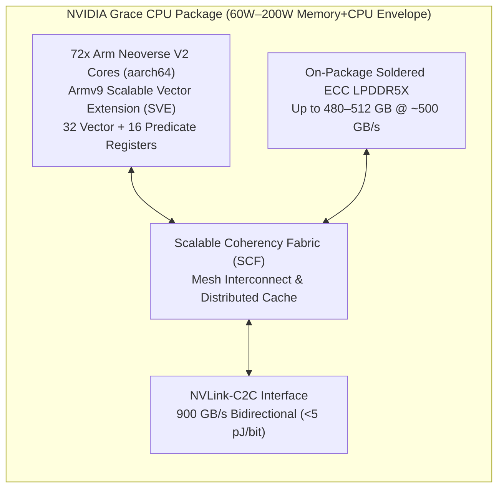
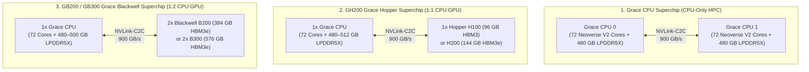
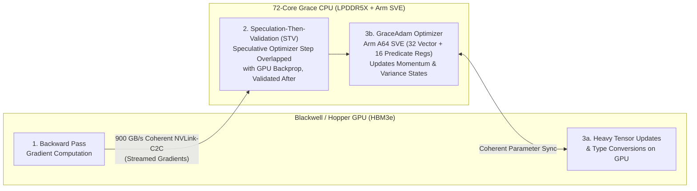

# 9.4 Grace CPU, GH200 and GB200 superchips

| Field | Value |
|---|---|
| **Status** | Drafted (`grace_superchips_lab.py`: 30 checks pass; hardware commands **untested** on live Grace Superchip nodes) |
| **Level** | Intermediate |
| **Priority tier** | 1b |
| **Lab venue** | none (design / reading) + self-checking Python model (`code/part09/grace_superchips_lab.py`) |
| **Part** | Part 9: NVIDIA systems and reference architectures |
| **Sources used** | `nvidia-devops` V4 Ch. 7; `nvidia-devops` V5 Ch. 7; *AI Systems Performance Engineering* Ch. 2, Ch. 3, Ch. 13; *Distributed AI Systems* Ch. 2; *NVIDIA DGX SuperPOD Reference Architecture Featuring NVIDIA DGX GB300 Systems* (`superpod-gb300-ra`) |

## Why this matters for AI infrastructure

For fifteen years, accelerated computing lived with a painful compromise. Even as GPU High Bandwidth Memory soared into the multi-terabyte-per-second range, the host CPU stayed stranded behind a narrow PCIe bus. Whenever a recommender model looked up giant embedding tables in host RAM, the GPU sat idle. Long-context language models offloading key-value caches or graph networks sampling massive datasets paid the exact same PCIe tax. Engineers watched expensive accelerators stall while waiting for bytes to crawl across an I/O bus designed for network cards and storage drives.

To remove this wall between the CPU and GPU, NVIDIA designed its own data center processor. The Grace CPU pairs 72 Arm Neoverse V2 cores with fast on-package LPDDR5X memory. It bonds directly to Hopper and Blackwell GPUs over NVLink-C2C at 900 GB/s bidirectional with full hardware cache coherence and a single virtual address space. Understanding how Grace, GH200, GB200, and GB300 Superchips work is essential for running modern rack-scale clusters. You must also learn what they do not solve automatically. GPU-to-GPU caches remain non-coherent across NVSwitch, and hot tensors must stay in HBM.

:::info Corpus scope note
Standalone *NVIDIA Grace CPU Superchip Architecture Whitepaper* and *NVIDIA GH200 Grace Hopper Superchip Datasheet* PDFs are not in the local book corpus. The architectural specifications, NVLink-C2C coherence model, memory placement rules, and SuperOffload or GraceAdam algorithms in this chapter come from the cited corpus books and notes.
:::

## Prerequisites and outcomes

**Prerequisites:**
- Chapters 9.1 to 9.3 covering DGX and HGX system families, PCIe Gen5 switch complexes, and NUMA domains.

**Outcomes:** After completing this chapter, you will be able to:
1. Quantify the PCIe Gen5 tax against NVLink-C2C bandwidth and energy efficiency.
2. Explain the internal design of the NVIDIA Grace CPU, including its Arm Neoverse V2 cores, Armv9 SVE vector units, and soldered on-package ECC LPDDR5X.
3. Contrast the Grace CPU Superchip, GH200 Grace Hopper, GB200 Grace Blackwell, GB300 Grace Blackwell Ultra, and the Vera Rubin roadmap.
4. Distinguish CPU-to-GPU hardware cache coherence over NVLink-C2C from GPU-to-GPU memory sharing over NVSwitch. Configure Linux NUMA pinning, hugepages, and SuperOffload.

---

## Concepts: basics → intermediate → advanced

## 1. The bottleneck: the PCIe tax on x86 GPU servers

When a model or dataset outgrows GPU memory on a traditional x86 server, training and inference speeds collapse. Platform engineers and ML researchers feel this slowdown immediately when a job fits in host DDR5 RAM but runs ten times slower than expected. The culprit is the narrow PCIe bus separating the Intel Xeon or AMD EPYC processor from the GPU.

In a standard x86 server, the CPU and GPU live on separate boards with separate physical memory pools. Think of the GPU HBM3e memory as a factory floor moving materials on wide conveyor belts at 8,000 GB/s. The host CPU DDR5 RAM is a giant warehouse across the street. Connecting them with a 16-lane PCIe Gen5 slot is like linking that warehouse to the factory with a single garden hose. As long as all materials fit inside the factory floor, production flies. The moment the factory fetches parts from across the street, the machines grind to a halt.

### 1.1 Quantifying the PCIe Gen5 bandwidth gap

The table below compares the three memory and interconnect tiers inside a traditional x86 Hopper or Blackwell server.

| Memory or Interconnect Tier | Hardware Example | Unidirectional Bandwidth | Bidirectional or Total Bandwidth | Relative Speed vs PCIe Gen5 x16 |
|---|---|---|---|---|
| **GPU HBM3 / HBM3e** | H100, H200, B200 | N/A | 3,350 GB/s (H100), 4,800 GB/s (H200), 8,000 GB/s (B200) | 50× to 125× faster |
| **GPU-to-GPU NVLink** | Hopper NVLink 4, Blackwell NVLink 5 | 450 GB/s or 900 GB/s | 900 GB/s (Hopper) or 1,800 GB/s (Blackwell) | 7× to 14× faster |
| **CPU-to-GPU PCIe Gen5 x16** | x86 Host to GPU | 64 GB/s | 128 GB/s | 1× baseline |

Whenever a workload exceeds local HBM capacity and spills into host CPU memory, it pays the PCIe tax across three common AI workloads.
1. **Giant Recommendation Models:** Deep learning recommendation models store multi-terabyte embedding tables in host RAM and query them on every mini-batch.
2. **Long-context KV-cache offloading and MoE streaming:** Evicting inactive key-value cache blocks or unscheduled Mixture-of-Experts weights to host DDR5 stalls the decode loop when transfers are capped at 64 GB/s.
3. **Massive Graph Neural Networks:** A fraud-detection graph of 1.2 TB cannot fit inside 80 GB of GPU HBM. Streaming those node features across PCIe Gen5 leaves the GPU compute cores idle for days.

```text
Portfolio GNN host-to-GPU transfer time on PCIe Gen5 x16 (my inference):
Dataset size: 1.2 TB = 1,200 GB (from Volume 04 Chapter 7 customer scenario)
PCIe Gen5 x16 unidirectional limit: 64 GB/s
Pure bus transfer time per pass = 1,200 GB / 64 GB/s = 18.75 seconds
```

:::tip In one minute
- A 16-lane PCIe Gen5 bus delivers only 64 GB/s in one direction and 128 GB/s bidirectional, which is over 50× slower than Hopper HBM3 and 125× slower than Blackwell HBM3e.
- Workloads that spill embeddings, graph features, optimizer states, or long-context KV caches to host RAM pay the PCIe tax and starve the GPU SMs.
:::

---

## 2. Inside the NVIDIA Grace CPU: 72 Arm Neoverse V2 cores and on-package LPDDR5X

General-purpose x86 server processors burn hundreds of watts and huge board area on legacy instruction decoders and bulky DDR5 DIMM slots. In a dense liquid-cooled AI rack, every watt wasted on the host CPU or its memory DIMMs is a watt stolen from the GPUs. NVIDIA needed a compact, high-bandwidth host processor built specifically to feed accelerators.

To remove the CPU-to-GPU bottleneck, NVIDIA engineered the Grace CPU from a clean sheet of paper. A general-purpose x86 CPU acts like a Swiss Army knife carrying decades of legacy attachments for older desktop and enterprise software. By contrast, the Grace CPU is a purpose-built fuel pump. Its sole job is to pre-process tensors, orchestrate CUDA graphs, and stream memory into attached GPUs at maximum bandwidth per watt.



### 2.1 72 Arm Neoverse V2 cores and Armv9 Scalable Vector Extension

Instead of licensing x86, NVIDIA built Grace around the Armv9 architecture. Each socket integrates 72 high-performance Arm Neoverse V2 cores linked by a high-bandwidth on-die mesh called the Scalable Coherency Fabric. All 72 cores feed data loaders, tokenizers, and network rings without legacy x86 decode overhead.

For CPU-side math such as offloaded Adam optimizer steps or data augmentations, Grace implements the Arm Scalable Vector Extension. SVE provides 32 vector registers and 16 predicate registers per core. Operators migrating containers from x86 servers must keep one compatibility rule in mind. Any C++ or Cython Python wheel that hard-codes x86 AVX2 or AVX-512 intrinsics will fail on Grace and must be compiled for `aarch64` and Arm SVE.

### 2.2 Soldered on-package ECC LPDDR5X memory

Look at a Grace Superchip board and you will notice that there are no DIMM slots. Instead of using socketed DDR5 RDIMMs, NVIDIA solders low-power server-grade ECC LPDDR5X memory directly onto the module substrate millimeters from the Grace CPU die. That physical proximity delivers high sustained bandwidth inside a fraction of the power and board area required by 8-channel or 12-channel x86 DDR5 subsystems. The saved power and board area go directly to the GPUs and liquid cold plates.

| Grace CPU Subsystem Feature | Specification | Operational Impact |
|---|---|---|
| **CPU Core Architecture** | 72 Arm Neoverse V2 cores (`aarch64`) per Grace socket | Drives data loaders, tokenization, and control loops without x86 bloat |
| **Vector Execution Units** | Armv9 SVE with 32 vector registers and 16 predicate registers | Accelerates vectorized GraceAdam CPU optimizer updates |
| **On-Package Memory Capacity** | Up to 480 GB (500 GB to 512 GB on high-capacity GH200 and GB300 SKUs) | Holds giant embedding tables, graph features, and offloaded KV caches |
| **Sustained Memory Bandwidth** | ~500 GB/s per Grace CPU | Matches or beats bulky multi-channel x86 DDR5 DIMM banks |
| **Combined CPU + Memory Power** | 60W to 200W total envelope | Frees rack power and PCB area for high-TDP GPUs and cold plates |

:::tip In one minute
- The NVIDIA Grace CPU integrates 72 Arm Neoverse V2 cores with Arm SVE vector units for fast data preprocessing and CPU-offloaded optimizer math.
- Instead of bulky DDR5 DIMM slots, Grace solders up to 480–512 GB of ECC LPDDR5X directly onto the package, delivering ~500 GB/s within a 60W–200W power envelope.
:::

---

## 3. NVLink-C2C and the hardware-coherent unified memory model

Having a fast Arm CPU with half a terabyte of LPDDR5X only helps if the attached GPU can read and write that memory without squeezing through a 64 GB/s PCIe straw. On traditional systems, developers also waste weeks writing explicit host-to-device memory copies and managing pinned staging buffers whenever data spills out of GPU HBM.

The bridge that removes both bottlenecks is NVLink-C2C. NVLink-C2C is a custom, ultra-short-reach die-to-die and package-to-package coherent interconnect etched directly onto the Superchip substrate between the Grace CPU and its paired Hopper or Blackwell GPUs.

### 3.1 Physical specs of NVLink-C2C vs PCIe Gen5 x16

| Metric | Traditional x86 PCIe Gen5 x16 | NVIDIA NVLink-C2C (Superchip) | Advantage (NVLink-C2C vs PCIe Gen5) |
|---|---|---|---|
| **Unidirectional Bandwidth** | 64 GB/s | 450 GB/s | 7.03× higher one-way throughput |
| **Bidirectional Bandwidth** | 128 GB/s | 900 GB/s | 7.03× higher aggregate throughput |
| **Energy Efficiency** | ~25+ picojoules/bit across PCB traces | `< 5 picojoules/bit` | `> 5×` more energy-efficient per bit moved |
| **Memory Address Space** | Separate host RAM and GPU BAR spaces | Single Unified Virtual Address Space with hardware ATS | CPU and GPU threads share standard pointers without explicit `cudaMemcpy()` |
| **Hardware Cache Coherence** | Non-coherent by default | Full hardware cache coherence between Grace CPU caches and GPU memory | Zero software staging buffer overhead for CPU–GPU access |

### 3.2 What hardware cache coherence means and the crucial GPU-to-GPU boundary

On a Grace Hopper or Grace Blackwell Superchip, NVLink-C2C implements hardware Address Translation Services and full cache coherence across the Grace CPU and its paired GPUs. A CUDA kernel running on the GPU can dereference a pointer residing in the Grace CPU LPDDR5X memory at 450 GB/s per direction without a single `cudaMemcpy()` call. The programmer does not need to allocate a page-locked staging buffer for that transfer.

On a DGX GB300 compute tray, which houses two GB300 Superchips, a coherent NVLink-C2C link also bridges the two Superchips together. That bridge allows both Grace CPUs and all four B300 GPUs on the tray to act as a single logical unit under one Linux OS instance.

:::caution Critical distinction: CPU–GPU coherence vs GPU–GPU non-coherence
Do not confuse CPU-to-GPU coherence over NVLink-C2C with GPU-to-GPU memory sharing over NVSwitch. As detailed in *AI Systems Performance Engineering*, only the CPU-to-GPU path over NVLink-C2C is hardware cache-coherent. Across multiple GPUs connected by NVLink and NVSwitch, there is a shared global physical address space for peer-to-peer loads and stores. However, GPU L1 and L2 caches are not globally hardware cache-coherent across GPUs. Multi-GPU communication still requires explicit software synchronization and memory ordering via NCCL collectives or NVSHMEM symmetric memory barriers.
:::

### 3.3 Real-world impact: solving the 1.2 TB Graph Neural Network bottleneck

Return to the financial-services team from Section 1. Their fraud-detection Graph Neural Network took 4 days per training epoch on an x86 and H100 PCIe server. Streaming 1,200 GB of graph node features across a 64 GB/s PCIe Gen5 slot took 18.75 seconds of pure bus transfer time per pass.

When the team moves that workload onto two GH200 Grace Hopper Superchips, the entire dataset fits inside the hardware-coherent memory pool. When the Hopper GPUs sample graph neighbors stored in Grace LPDDR5X, they read the features directly over the NVLink-C2C highway. That direct memory access collapses epoch times from days to hours.

```text
Two-Superchip GH200 GNN memory and transfer math (my inference from code/part09/grace_superchips.py):
Per-Superchip coherent memory (144 GB SKU): 480 GB LPDDR5X + 144 GB HBM3e = 624 GB
Two-Superchip total coherent pool: 2 × 624 GB = 1,248 GB
Dataset placement (1,200 GB total): 240 GB hot GNN weights/activations in HBM3e + 960 GB feature tables in LPDDR5X
NVLink-C2C unidirectional pass time: 1,200 GB / 450 GB/s = 2.67 seconds (7.03× faster than 18.75 seconds on PCIe Gen5)
```

:::tip In one minute
- NVLink-C2C links the Grace CPU to its paired GPUs at 900 GB/s bidirectional, which is 7.03× faster than PCIe Gen5 x16 while consuming less than 5 picojoules per bit.
- Only the CPU-to-GPU NVLink-C2C path is hardware cache-coherent with ATS unified virtual addressing. GPU-to-GPU caches across NVSwitch are not globally coherent and require NCCL or NVSHMEM synchronization.
:::

---

## 4. The Superchip lineup: Grace CPU Superchip, GH200, GB200, GB300, and the Vera Rubin roadmap

Cluster architects sizing a new AI factory must choose between CPU-only Grace nodes, single-GPU Grace Hopper nodes, and dual-GPU Grace Blackwell compute trays. Picking the wrong module or misreading memory SKU tables leads to under-provisioned HBM capacity or wasted rack power.

NVIDIA packages the Grace CPU and NVLink-C2C into four production Superchip modules today, with the next-generation Vera Rubin and Feynman architectures on the roadmap.



### 4.1 Complete comparison of Grace-based Superchip modules

| Superchip Module | CPU Configuration | On-Package LPDDR5X & Bandwidth | Paired GPU(s) | Total GPU HBM & Bandwidth | Total Coherent Memory Pool | Module TDP Envelope |
|---|---|---|---|---|---|---|
| **Grace CPU Superchip** | 2x Grace CPUs (144 Arm Neoverse V2 cores) linked via NVLink-C2C | Up to 960 GB ECC LPDDR5X @ ~1.0 TB/s | None (CPU-only HPC / cloud server) | 0 GB | 960 GB | ~500W (including memory) |
| **GH200 Grace Hopper (96 GB SKU)** | 1x Grace CPU (72 Arm cores) | 480 GB (or 512 GB SKU) LPDDR5X @ ~500 GB/s | 1x Hopper GPU (H100-class) | 96 GB HBM3 @ 4.0 TB/s | 576 GB (480+96) or 608 GB (512+96) | ~1,000W |
| **GH200 Grace Hopper (144 GB SKU)** | 1x Grace CPU (72 Arm cores) | 480 GB LPDDR5X @ ~500 GB/s | 1x Hopper H200-class GPU | 144 GB HBM3e @ 4.9 TB/s | 624 GB (480 + 144 GB) | ~1,000W |
| **GB200 Grace Blackwell Superchip** | 1x Grace CPU (72 Arm cores) | Up to 480 GB LPDDR5X @ ~500 GB/s | 2x Blackwell B200 GPUs (dual-reticle dies each) | 384 GB HBM3e (2 × 192 GB, or 360 GB usable on 180 GB SKU) @ 16.0 TB/s | Up to 864 GB (480 + 384 GB) per Superchip | ~2,700W (liquid-cooled) |
| **GB300 Grace Blackwell Ultra Superchip** | 1x Grace CPU (72 Arm cores) | ~500 GB LPDDR5X @ ~500 GB/s (18 TB across 36 modules) | 2x Blackwell Ultra B300 GPUs (1.5× FP4 compute vs B200) | 576 GB HBM3e (2 × 288 GB, 1.5× B200) @ 16.0 TB/s | ~1,076 GB (~1.08 TB) per Superchip (~2.15 TB per 2-superchip compute tray) | ~2,800W+ (liquid-cooled) |

:::note Reconciling GH200 and GB200 memory SKU numbers across sources
Different books and reference guides quote either raw or usable memory capacities depending on the SKU. The table below reconciles all figures from our corpus.
:::

| Platform | Source Citation | LPDDR5X Capacity | GPU HBM Capacity | Combined Memory Pool |
|---|---|---|---|---|
| **GH200 (96 GB / 144 GB)** | `nvidia-devops` V4 Ch 7 | 480 GB | 96 GB HBM3 or 144 GB HBM3e | 576 GB or 624 GB per Superchip |
| **GH200 (512 GB variant)** | *Distributed AI Systems* Ch 2 | 512 GB | 96 GB HBM3 | 608 GB per Superchip |
| **GB200 Superchip** | `nvidia-devops` V4 Ch 6/7 & *AI Systems Performance Engineering* Ch 2 | 480 GB | 384 GB HBM3e (2 × 192 GB) | 864 GB per Superchip |
| **GB200 NVL72 (36 Superchips)** | *AI Systems Performance Engineering* Ch 2 NVL72 table | ~17 TB | 13.4 TB HBM3e (180 GB per B200 GPU) | ~30 TB across 36 Superchips |
| **GB300 NVL72 (36 Superchips)** | *AI Systems Performance Engineering* Ch 2 | ~18 TB (~500 GB per Superchip) | ~20.7 TB HBM3e (288 GB per B300 GPU, 576 GB per Superchip) | ~38 TB across 36 Superchips |

### 4.2 Why GB200 and GB300 move from a 1:1 to a 1:2 CPU-to-GPU ratio

Notice the architectural shift from GH200, which pairs one Grace CPU with one Hopper GPU, to GB200 and GB300, which pair one Grace CPU with two Blackwell GPUs. A single 72-core Grace CPU with 500 GB/s of LPDDR5X and 900 GB/s of NVLink-C2C has more than enough CPU cores and memory capacity to drive two GPUs simultaneously. Providing 36 Arm cores per GPU while pairing one Grace CPU with two Blackwell GPUs doubles GPU compute density inside every 1U tray.

In a GB200 or GB300 NVL72 compute tray, two Superchips sit side-by-side and are bridged by a coherent NVLink-C2C link. A single Linux OS kernel manages both Grace CPUs and all four GPUs as one node.

```text
NVL72 compute tray and full-rack scaling math:
1 compute tray (1U) = 2 Superchips = 2 Grace CPUs (144 Arm cores) + 4 Blackwell GPUs
18 compute trays per NVL72 rack = 36 Superchips = 36 Grace CPUs (2,592 Arm Neoverse V2 cores) + 72 Blackwell GPUs
```

### 4.3 The multi-year Superchip roadmap: Vera Rubin and Feynman

As documented in *AI Systems Performance Engineering* Chapter 2, NVIDIA continues the one-CPU-to-two-GPU Superchip design across three upcoming generations.

| Generation & Target Year | CPU Architecture & Memory | GPU Architecture & HBM | Interconnect & Rack Scale |
|---|---|---|---|
| **Vera Rubin (`VR200`, 2026)** | 1x Vera Arm CPU (TSMC 3nm, more cores, LPDDR6 at ~1 TB/s) | 2x Rubin GPUs (~200 SMs per die, 288 GB HBM4 at ~13–14 TB/s) | 6th-generation NVLink 6 doubling CPU–GPU and GPU–GPU bandwidth |
| **Vera Rubin Ultra (`VR300` / `R300`, 2027)** | Vera Arm CPU complex | Quad-die Rubin Ultra GPU module (4 GPU dies, 16 HBM stacks, 1 TB HBM per GPU module) | NVL144 and NVL576 rack configurations (~3–4 ExaFLOPS per rack) |
| **Feynman (2028)** | Next-generation Arm host CPU | 2nm process node with HBM5 and multi-tier on-package memory | On-package optical NVLink interconnects for reasoning-era scaling |

:::tip In one minute
- Moving from GH200 (1 Grace to 1 Hopper) to GB200 and GB300 (1 Grace to 2 Blackwell GPUs) doubles GPU compute density per 1U tray while still providing 36 Arm Neoverse V2 cores per GPU.
- Always check the specific SKU sheet (180 GB vs 192 GB B200, or 288 GB B300) when sizing tight memory footprints across a 36-Superchip NVL72 rack.
:::

---

## 5. Software co-design on Grace Superchips: data placement, NUMA, hugepages, and SuperOffload

When teams treat an 864 GB GB200 Superchip as a flat pool of uniform memory, training step times and inference token latencies suddenly spike by an order of magnitude. Having a 900 GB/s coherent NVLink-C2C link between the CPU and GPU prevents out-of-memory crashes, but it does not change memory physics or eliminate Linux page-table overhead.

### 5.1 Two-tier memory placement: keeping hot tensors in HBM and cold overflow in LPDDR5X

Even though Grace LPDDR5X and NVLink-C2C are over seven times faster than PCIe Gen5, Blackwell HBM3e is still roughly 16× to 32× faster than LPDDR5X. Therefore, you must treat a Grace Superchip as an explicit two-tier coherent memory complex.

| Memory Tier | Bandwidth | What to Place Here | Prefetching Strategy |
|---|---|---|---|
| **Tier 1: GPU HBM3 / HBM3e** | 4.0–8.0 TB/s per GPU (8,000 GB/s per B200, 16,000 GB/s per Superchip) | Hot working-set tensors, active layer weights, forward/backward activations, and active KV-cache blocks | Resident in HBM during active kernel execution |
| **Tier 2: Grace CPU LPDDR5X** | ~500 GB/s (accessed at 450 GB/s per direction via NVLink-C2C) | Cold or overflow structures, unscheduled MoE expert weights, master FP32 weights, Adam momentum/variance buffers, DLRM/GNN feature tables, and evicted KV-cache blocks | Use `cudaMallocAsync` and prefetch upcoming slices into HBM via `cudaMemPrefetchAsync()` on a secondary CUDA stream |

### 5.2 Linux NUMA pinning, `pin_memory`, and Transparent Hugepages on Grace

Even though NVLink-C2C is hardware cache-coherent, the Linux kernel still models each Grace CPU LPDDR5X pool as a CPU NUMA node and each GPU HBM pool as a distinct memory domain. On a dual-Superchip compute tray with two Grace CPUs and four Blackwell GPUs, crossing from Grace CPU 0 to a GPU attached to Grace CPU 1 adds hop latency. Always pin each training rank and its PyTorch `DataLoader` workers via `worker_init_fn` to the local Grace CPU NUMA node.

On standard x86 PCIe servers, setting `pin_memory=True` for page-locked memory is mandatory to achieve two to three times faster DMA copies. On Grace Superchips, CPU-to-GPU transfers already use the coherent NVLink-C2C path without explicit page-locking. You must still enable Linux hugepages of 2 MB or 1 GB so the CPU and GPU Translation Lookaside Buffers do not thrash on millions of 4 KB page translations. When the `DataLoader` thread is CPU-bound during heavy LLM tokenization, combine `pin_memory=True` or hugepages with `ulimit -l unlimited`, `non_blocking=True`, and `persistent_workers=True`. Always verify transfer overlap with Nsight Systems.

| Linux Tuning Parameter | Setting for Throughput Training | Setting for Low-Latency Inference | Reason and Measured Impact |
|---|---|---|---|
| **NUMA Node Binding** | `numactl --cpunodebind=$NODE --membind=$NODE` | `numactl --cpunodebind=$NODE --membind=$NODE` | Local NUMA memory latency is ~80 ns versus ~139 ns cross-node (~75% remote latency penalty) |
| **Transparent Hugepages (THP)** | `always` (2 MB pages) | `madvise` or `never` (`transparent_hugepage=never` + explicit `hugetlbfs` / `vm.nr_hugepages`) | `always` yields a ~3%–5% training throughput gain by cutting TLB misses, while `madvise` or `never` avoids background THP compaction pauses that hurt P99 ITL |

### 5.3 SuperOffload and GraceAdam: superchip-native training optimization

Traditional CPU offload engines such as standard ZeRO-Offload were built for slow 64 GB/s PCIe buses. They wait for global gradient reductions and NaN or Inf norm checks to finish on the GPU before copying gradients to the CPU. Next, they run the CPU Adam step sequentially and copy updated weights back. On a Grace Superchip, that sequential barrier wastes both the 72 Arm cores and the 900 GB/s NVLink-C2C link.

SuperOffload, which is detailed in *AI Systems Performance Engineering* Chapter 13, re-architects CPU-to-GPU offloading around four Grace-native mechanisms.



1. **Speculation-Then-Validation:** Instead of waiting for the backward pass and global gradient norm check to finish, STV speculatively runs the optimizer updates on the Grace CPU in parallel with GPU backpropagation. It then validates to commit or roll back the updates once the global check completes, eliminating the end-of-step synchronization bubble.
2. **Heterogeneous Optimizer Computation:** Rather than running 100% of the optimizer on the CPU or 100% on the GPU, SuperOffload partitions optimizer work across both chips simultaneously. Compute-heavy tensor updates run on the GPU Tensor and SIMT cores. Lighter state updates for Adam first-moment and second-moment buffers in LPDDR5X run on the 72 Grace CPU cores.
3. **Superchip-Aware Type Casts and Copies:** Because NVLink-C2C provides 900 GB/s of coherent bandwidth, SuperOffload shifts FP32 to BF16 or FP8 precision conversions onto the GPU. That avoids burning CPU memory bandwidth on type casting before transfer.
4. **GraceAdam Vectorized Optimizer:** Standard x86 PyTorch CPU Adam kernels rely on x86 AVX intrinsics. SuperOffload replaces them with GraceAdam, an Adam implementation hand-tuned for the Grace CPU Arm A64 Scalable Vector Extension. GraceAdam exploits all 32 SVE vector registers and 16 predicate registers across all 72 Neoverse V2 cores.

:::tip In one minute
- Keep hot tensors in GPU HBM and place overflow or cold states in Grace LPDDR5X, using `cudaMemPrefetchAsync()` to hide NVLink-C2C transfer latency.
- Pin worker threads to the local Grace NUMA node. Enable THP `always` for training throughput, and use `madvise` or `never` with explicit hugepages for low-latency LLM inference.
- SuperOffload unlocks Grace Superchip performance via Speculation-Then-Validation, heterogeneous CPU and GPU optimizer partitioning, and GraceAdam compiled for Arm SVE.
:::

---

## Commands and configurations that matter

Use these commands on a Grace Hopper or Grace Blackwell node to inspect the Arm Neoverse V2 CPU, verify NVLink-C2C coherence and NUMA topology, configure hugepages, and pin PyTorch workers. These commands are **untested** on live Grace Superchip hardware in this authoring environment. Their rules are verified in `code/part09/grace_superchips_lab.py`.

### 1. Inspect the 72-core or 144-core Grace Arm Neoverse V2 CPU and SVE capabilities

```bash
# 1. Verify aarch64 architecture, 72 cores per socket (144 cores on dual-Superchip tray), and SVE flags
lscpu | grep -E "Architecture:|Model name:|Socket\(s\):|Core\(s\) per socket:|NUMA node|Flags:"

# 2. Confirm Arm Scalable Vector Extension (sve / sve2) support in /proc/cpuinfo
grep -m 1 -oE "sve[^ ]*" /proc/cpuinfo
```

### 2. Inspect Grace LPDDR5X and GPU HBM NUMA topology and NVLink-C2C links

```bash
# 1. View CPU and memory NUMA nodes (LPDDR5X vs GPU memory nodes)
numactl --hardware

# 2. View GPU-to-GPU NVLink and CPU/NUMA affinity matrix
nvidia-smi topo -m

# 3. Query NVLink link speeds and active sub-links
nvidia-smi nvlink --status
```

### 3. Tune Linux virtual memory, locked memory limits, and Transparent Hugepages

```bash
# 1. Disable swapping on GPU/Superchip compute nodes so LPDDR5X never swaps to NVMe
sudo sysctl -w vm.swappiness=0
sudo swapoff -a

# 2. Ensure unlimited locked (pinned) memory in /etc/security/limits.conf or container ulimits
ulimit -l unlimited

# 3. For throughput training: enable Transparent Hugepages (2 MB pages reduce TLB pressure by ~3-5%)
echo always | sudo tee /sys/kernel/mm/transparent_hugepage/enabled

# 4. For latency-sensitive LLM inference: use madvise (or never) to prevent background compaction pauses
echo madvise | sudo tee /sys/kernel/mm/transparent_hugepage/enabled
```

### 4. Launch a training process pinned to each GPU local Grace CPU NUMA node

```bash
# Dynamically query each GPU's local NUMA node from nvidia-smi topo -m and bind CPU + memory
for GPU in 0 1 2 3; do
  NODE=$(nvidia-smi topo -m -i "$GPU" | awk '/NUMA Affinity/ {print $NF}')
  numactl --cpunodebind="$NODE" --membind="$NODE" \
    bash -c "CUDA_VISIBLE_DEVICES=$GPU python3 train.py --gpu $GPU" &
done
wait
```

---

## How it fails

| Failure mode | Symptom | Root cause | Diagnosis & fix |
|---|---|---|---|
| **1. Assuming GPU-to-GPU caches are hardware cache-coherent across NVSwitch** | Custom multi-GPU CUDA kernels reading/writing peer GPU memory directly across NVLink produce silent stale-cache data corruption or race conditions on a GB200/GB300 node. | Engineers hear *"Grace Blackwell has coherent unified memory"* and assume all 4 or 72 GPUs have globally coherent L1/L2 caches. In reality, **only the CPU–GPU NVLink-C2C link is hardware cache-coherent**; GPU-to-GPU memory across NVSwitch has a shared global address space but **non-coherent GPU caches**. | Use **NCCL** collectives or **NVSHMEM** symmetric memory APIs (`nvshmem_barrier_all()`, `triton.nvshmem.put()/get()`) to enforce explicit memory ordering and cache invalidation across GPUs. |
| **2. Placing "hot" activations or active KV cache in Grace LPDDR5X** | A model fits inside the 864 GB coherent pool of a GB200 Superchip without OOM errors, but step time or decode ITL is **8× to 15× slower** than expected. | Relying blindly on automatic CUDA Unified Memory placed frequently accessed ("hot") weights, activations, or active KV-cache tensors in **Grace LPDDR5X (`~500 GB/s`, accessed at `450 GB/s` over NVLink-C2C)** instead of **GPU HBM3e (`8,000 GB/s`)**. | Explicitly place hot weights, activations, and active KV cache in **GPU HBM3e**, restrict LPDDR5X to cold/overflow tiers (optimizer states, unscheduled MoE experts, historical KV blocks), and stream upcoming layers into HBM ahead of use via **`cudaMemPrefetchAsync()`**. |
| **3. Using Unified Memory on Grace without Hugepages (`4 KB` TLB thrashing)** | Profiling with Nsight Systems shows frequent CPU/GPU page-translation stalls and high kernel overhead during coherent CPU–GPU memory access. | The workload accesses hundreds of gigabytes of unified virtual memory across NVLink-C2C using default **4 KB Linux pages** without `pin_memory=True` or hugepages, flooding the CPU and GPU Address Translation Services (ATS) / TLBs. | Enable **2 MB Transparent Hugepages** (`always` for training; `madvise` + explicit `hugetlbfs` for low-latency inference), set `ulimit -l unlimited`, and verify H2D/D2H overlap in Nsight Systems. |
| **4. `Illegal instruction (core dumped)` or 10× slower CPU preprocessing on Grace** | Moving an x86 Docker container or custom C++ optimizer extension onto a GH200/GB200 node either fails to start (`exec format error` / `SIGILL`) or runs CPU Adam updates painfully slowly. | The Grace CPU is **Armv9 `aarch64` (Neoverse V2)** with **Arm SVE** (`32` vector + `16` predicate registers), not x86_64. Containers built for `amd64` or C++ extensions compiled with x86 `AVX2`/`AVX-512` intrinsics either crash or fall back to scalar C loops. | Build multi-arch (`linux/arm64`) NGC containers, recompile native wheels with `-march=armv9-a+sve2`, and use **`GraceAdam` / SuperOffload** to vectorize offloaded optimizer updates on Arm SVE. |
| **5. Unbound DataLoader workers migrating across dual Grace Superchips** | On a 2-Superchip compute tray (`144` Arm cores, `4` GPUs), training throughput fluctuates by 5%–10% with periodic GPU launch bubbles. | Linux CFS migrated `DataLoader` workers for `GPU 0` (attached to `Grace CPU 0`) onto `Grace CPU 1` cores, incurring a **~75% remote NUMA memory latency penalty** (`~139 ns` vs `~80 ns`). | Bind both the main rank process (`numactl --cpunodebind --membind`) and every forked `DataLoader` worker (`worker_init_fn` with `psutil.Process().cpu_affinity()` + `libnuma`) to the GPU's local Grace CPU NUMA node, and set `persistent_workers=True`. |

---

## Hands-on lab

This chapter provides a self-checking Python model in `code/part09/grace_superchips.py` and a lab runner in `code/part09/grace_superchips_lab.py` that verify four core areas.

| Lab Component | Verified Calculations and Rules |
|---|---|
| **1. NVLink-C2C vs PCIe Gen5 x16 Calculator** | 450 GB/s vs 64 GB/s unidirectional = 7.03× speedup, 900 GB/s vs 128 GB/s bidirectional, `< 5 pJ/bit`, and 1.2 TB GNN pass taking 18.75 s on PCIe Gen5 vs 2.67 s on NVLink-C2C |
| **2. Superchip Architecture Catalog** | Grace CPU Superchip (144 cores / 960 GB); GH200-96GB (576 GB); GH200-144GB (624 GB); GB200 (384 GB HBM3e + 480 GB LPDDR5X = 864 GB); GB300 (576 GB HBM3e + 500 GB LPDDR5X = 1,076 GB, scaling to 2,592 Arm cores, 20,736 GB HBM3e, and 18,000 GB LPDDR5X across a 36-Superchip NVL72 rack) |
| **3. Two-Tier Coherent Memory Placement Evaluator** | Verifies whether hot working sets fit in HBM3 or HBM3e and how overflow spills into Grace LPDDR5X |
| **4. Runtime & OS Configuration Auditor** | Checks CPU–GPU vs GPU–GPU cache-coherence assumptions, local Grace NUMA pinning, large-page enablement, THP `always` vs `madvise`, hot tensor placement, and Arm A64 SVE vs x86 AVX compatibility |

Run the lab from the repository root.

```bash
python3 -B code/part09/grace_superchips_lab.py
```

Expected output verified in this repository:

```text
=== Chapter 9.4 Lab: Grace CPU, GH200, GB200 & GB300 Superchips ===
  [PASS] PCIe Gen5 x16 is 64 GB/s unidirectional and 128 GB/s bidirectional
  [PASS] NVLink-C2C is 450 GB/s unidirectional and 900 GB/s bidirectional (7.03x PCIe Gen5)
  [PASS] Grace CPU Superchip bonds 2x 72-core Arm Neoverse V2 CPUs (144 cores) + up to 960 GB LPDDR5X at ~1 TB/s
  [PASS] GH200-96GB combines 72-core Grace (480 GB LPDDR5X) + H100 (96 GB HBM3) = 576 GB coherent memory
  [PASS] GH200-144GB HBM3e variant delivers 480 + 144 = 624 GB coherent memory
  [PASS] GB200 combines 1x 72-core Grace + 2x B200 GPUs (384 GB HBM3e @ 16 TB/s + 480 GB LPDDR5X = 864 GB)
  [PASS] GB300 combines 1x Grace + 2x B300 GPUs (2x 288 GB = 576 GB HBM3e + 500 GB LPDDR5X = 1,076 GB)
  ...
  [PASS] 1.2 TB (1,200 GB) host-to-GPU pass takes 18.75 s over PCIe Gen5 x16 vs 2.67 s over NVLink-C2C
  [PASS] Rejects unknown superchip SKU
  [PASS] Rejects negative payload in transfer time estimator
  [PASS] Rejects unsupported link_type in transfer time estimator
  [PASS] Unidirectional NVLink-C2C (450 GB/s) is 7.03x unidirectional PCIe Gen5 x16 (64 GB/s)

Summary: 30 passed, 0 failed (total 30)
```

---

## Exercises

1. Run `python3 -B code/part09/grace_superchips_lab.py`. Pick the check that compares PCIe Gen5 and NVLink-C2C transfer time for the 1,200 GB graph. Reproduce the two numbers of 18.75 s and 2.67 s by hand.
2. Work out the total coherent memory of one GB300 Superchip and of the whole 36-Superchip NVL72 rack, using the numbers in Section 4.1. Which two numbers in the chapter should you compare when sizing a model that must stay in HBM?
3. You have a GB200 node and a 600 GB model with a 200 GB KV cache. Sketch which tensors you would place in HBM and which in LPDDR5X, and say what you would prefetch and when.
4. Write the three commands that show whether a node is `aarch64`, has SVE, and how many NUMA nodes it has. Say what you expect on a GB200 compute tray.
5. A teammate moves an x86 container to a GH200 node and gets `exec format error`. Write the checklist you would give them covering image build, wheels, and native code.
6. Explain in five lines to a colleague why unified memory on a Grace Superchip does not mean the 864 GB behaves like HBM.

## Checkpoint questions (20)

<details>
<summary>**1. Compare the unidirectional and bidirectional bandwidth of NVLink-C2C against PCIe Gen5 x16, and state its energy efficiency per bit.**</summary>

PCIe Gen5 x16 provides 64 GB/s unidirectional and 128 GB/s bidirectional bandwidth. NVLink-C2C provides 450 GB/s unidirectional and 900 GB/s bidirectional, which is a 7.03× bandwidth increase. It consumes less than 5 picojoules per bit, making it more than 5× more energy-efficient than standard PCB PCIe Gen5 traces.
</details>

<details>
<summary>**2. Why does the NVIDIA Grace CPU solder ECC LPDDR5X memory directly onto the package instead of using standard DDR5 DIMM slots?**</summary>

Soldering server-grade ECC LPDDR5X millimeters from the 72 Arm Neoverse V2 cores delivers ~500 GB/s of sustained memory bandwidth for up to 480–512 GB per Grace CPU. The entire CPU and memory package operates inside a compact 60W–200W total power envelope. That uses a fraction of the power and board space consumed by 8-channel to 12-channel x86 DDR5 DIMMs.
</details>

<details>
<summary>**3. Contrast the CPU-to-GPU ratio and coherent memory capacity across the GH200, GB200, and GB300 Superchips.**</summary>

| Superchip | CPU-to-GPU Ratio | Grace LPDDR5X | GPU HBM | Coherent Memory Pool |
|---|---|---|---|---|
| **GH200 Grace Hopper** | 1:1 | 480–512 GB | 96 GB HBM3 or 144 GB HBM3e | 576 GB to 624 GB |
| **GB200 Grace Blackwell** | 1:2 | 480 GB | 384 GB HBM3e (or 360 GB on 180 GB SKUs) at 16 TB/s | Up to 864 GB |
| **GB300 Grace Blackwell Ultra** | 1:2 | ~500 GB | 576 GB HBM3e (2 × 288 GB, 1.5× B200 capacity) | ~1,076 GB (~1.08 TB) |
</details>

<details>
<summary>**4. On a Grace Blackwell NVL72 system, is memory hardware cache-coherent between two GPUs, or only between a Grace CPU and its paired GPUs? Why does this matter for programmers?**</summary>

Only the CPU-to-GPU path over NVLink-C2C is hardware cache-coherent with Address Translation Services. Across GPUs over NVLink and NVSwitch, there is a shared global physical address space for peer-to-peer access, but GPU L1 and L2 caches are not globally hardware cache-coherent across GPUs. Programmers must still use NCCL collectives or NVSHMEM synchronization barriers to maintain consistency across GPUs.
</details>

<details>
<summary>**5. If a GB200 Superchip has an 864 GB unified virtual address space, why must you still carefully separate hot tensors from cold overflow tensors?**</summary>

Blackwell HBM3e delivers 8,000 GB/s per GPU or 16,000 GB/s per Superchip, whereas Grace LPDDR5X delivers ~500 GB/s and is accessed at 450 GB/s per direction over NVLink-C2C. Because of this roughly 18× bandwidth difference, active weights, activations, and active KV caches must reside in HBM3e. LPDDR5X should hold overflow layers, optimizer states, or cold embeddings prefetched into HBM asynchronously via `cudaMemPrefetchAsync()`.
</details>

<details>
<summary>**6. How many GB300 Superchips reside on a single DGX GB300 compute tray, and how are they connected to run under a single OS instance?**</summary>

Each 1U DGX GB300 compute tray houses two GB300 Superchips, providing 2 Grace CPUs with 144 Arm cores and 4 B300 GPUs. A coherent NVLink-C2C interconnect bridges the two Superchips so they operate as a single logical SMP system under one Linux OS instance.
</details>

<details>
<summary>**7. How should Transparent Hugepages be configured on a Grace Superchip node for throughput-focused training versus low-latency LLM inference, and why?**</summary>

For training, set THP to `always` so 2 MB pages reduce page-fault overhead and TLB misses across huge LPDDR5X and unified memory pools, improving throughput by ~3%–5%. For low-latency LLM inference, set THP to `madvise` or `never` via `transparent_hugepage=never` and use explicit `hugetlbfs` hugepages instead. Kernel background THP compaction causes unpredictable latency pauses during token generation.
</details>

<details>
<summary>**8. What are the three core innovations in SuperOffload and GraceAdam for Grace-based Superchips?**</summary>

1. **Speculation-Then-Validation:** Overlaps speculative CPU optimizer updates with GPU backpropagation before global gradient checks complete, then validates afterward to eliminate synchronization stalls.
2. **Heterogeneous Optimizer Computation:** Splits optimizer work between the GPU for compute-heavy tensor updates and precision casts, and the 72 Grace CPU cores for lighter momentum and variance buffer updates in LPDDR5X.
3. **GraceAdam on Arm SVE:** Vectorizes CPU Adam updates using the Grace CPU Arm A64 Scalable Vector Extension with 32 vector registers and 16 predicate registers.
</details>

<details>
<summary>**9. What is the Vera Rubin Superchip on NVIDIA post-Blackwell roadmap?**</summary>

The Vera Rubin `VR200` Superchip targeted for 2026 pairs one Vera Arm CPU on TSMC 3nm with LPDDR6 at ~1 TB/s and two Rubin GPUs with ~200 SMs per die, 288 GB HBM at ~13–14 TB/s, and NVLink 6. It is followed by Vera Rubin Ultra `VR300` or `R300` in 2027 with quad-die GPU modules holding 1 TB HBM per GPU module in NVL144 and NVL576 racks.
</details>

<details>
<summary>**10. What is the PCIe tax?**</summary>

It is the slowdown a GPU suffers when it needs data from host RAM over a PCIe Gen5 x16 link at 64 GB/s per direction, which is far slower than the GPU HBM. Workloads like huge embedding tables, long KV caches, or big graphs pay it.
</details>

<details>
<summary>**11. How many cores and how much memory does a Grace CPU have, and why is its memory soldered?**</summary>

A Grace CPU has 72 Arm Neoverse V2 cores and up to about 480–512 GB of LPDDR5X. The memory is soldered close to the CPU to achieve about 500 GB/s of bandwidth inside a small 60–200 W power budget together with the CPU.
</details>

<details>
<summary>**12. What does NVLink-C2C let a CUDA kernel do that PCIe does not?**</summary>

With hardware coherence and a single virtual address space, a GPU kernel can use a pointer to Grace LPDDR5X memory directly. It requires no `cudaMemcpy` call and no page-locked staging buffer.
</details>

<details>
<summary>**13. What is the CPU-to-GPU ratio in a GH200 and in a GB200, and why did it change?**</summary>

GH200 is 1 Grace to 1 Hopper, while GB200 and GB300 are 1 Grace to 2 Blackwell GPUs. One 72-core Grace has enough cores, memory, and link bandwidth to drive two GPUs, so the tray holds more GPUs.
</details>

<details>
<summary>**14. How many Arm cores and GPUs are in one NVL72 compute tray, and in the whole rack?**</summary>

One compute tray has 2 Grace CPUs with 144 cores and 4 GPUs. The rack has 18 trays, which gives 36 Grace CPUs with 2,592 cores and 72 GPUs.
</details>

<details>
<summary>**15. Why are the 864 GB GB200 memory figure and the 8,000 GB/s HBM figure not interchangeable?**</summary>

The 864 GB figure is the size of the combined coherent pool of HBM plus LPDDR5X. HBM is much faster than LPDDR5X at about 8,000 GB/s versus 500 GB/s, so only hot data should live in HBM.
</details>

<details>
<summary>**16. What does `cudaMemPrefetchAsync()` do for you on a Grace node?**</summary>

It moves upcoming weights or expert slices from LPDDR5X into HBM on a second stream while the GPU computes the current layer. That way, kernels do not stall on page faults.
</details>

<details>
<summary>**17. How does Linux see a Grace compute tray, and what should you pin?**</summary>

Each Grace CPU LPDDR5X pool is a NUMA node and the GPUs have their own memory domains. Pin each rank and its `DataLoader` workers to the NUMA node of the Grace CPU attached to its GPU with `numactl --cpunodebind --membind`.
</details>

<details>
<summary>**18. Do you still need `pin_memory=True` on a Grace Superchip?**</summary>

You do not need it for coherent transfers if you use hugepages. When the `DataLoader` is CPU-bound, the chapter still recommends pinned memory with `non_blocking=True` and `persistent_workers=True`, and advises checking overlap in Nsight Systems.
</details>

<details>
<summary>**19. Why must C++ or Python extensions be rebuilt for Grace?**</summary>

Grace is Armv9 `aarch64`, not x86. Code with AVX2 or AVX-512 intrinsics will crash or fall back to slow scalar code, so build `linux/arm64` images and compile native code for Arm SVE.
</details>

<details>
<summary>**20. Give one fact about the Vera Rubin roadmap from this chapter.**</summary>

The `VR200` Superchip in 2026 pairs a Vera Arm CPU using LPDDR6 at about 1 TB/s with two Rubin GPUs offering 288 GB HBM at about 13–14 TB/s and NVLink 6. `VR300` in 2027 moves to quad-die GPU modules with 1 TB of HBM each.
</details>

---

## Sources and review notes

### Sources read in full for this chapter

| Source | Chapters / Pages Read | Topics Extracted |
|---|---|---|
| **`nvidia-devops` Volume 04 & Volume 05** | `nvidia-zero-to-hero/volume-04/chapter-07-grace-cpu-and-superchips.md` (`chapter-07-grace-cpu-and-superchips.md`, 1,007 words) and `nvidia-zero-to-hero/volume-05/chapter-07-dgx-gh200-and-gb200-systems.md` (`chapter-07-dgx-gh200-and-gb200-systems.md`, 982 words) | The PCIe tax (64 GB/s unidirectional / 128 GB/s bidirectional PCIe Gen5 x16 vs 3.35 TB/s / 3,350 GB/s HBM3 and 1,990 TFLOPS FP8), 72-core Arm Neoverse V2 Grace CPU with soldered ECC LPDDR5X (~500 GB/s at 60W–200W), NVLink-C2C (900 GB/s bidirectional, `< 5 pJ/bit`, ATS), Superchip lineup (Grace CPU Superchip 144 cores / 960 GB, GH200 480 GB + 96/144 GB = 576/624 GB, GB200 480 GB + 384 GB = 864 GB), `THP=always` vs `madvise`/`never`, and 1.2 TB GNN customer scenario |
| **Chris Fregly, *AI Systems Performance Engineering* (`ai-systems-performance-engineering`)** | Chapter 2 (pp. 20–55, chunks 1, 6–9), Chapter 3 (lines 49–331), Chapter 13 (chunk 71 & summary) | Grace Blackwell architecture, CPU–GPU NVLink-C2C hardware cache coherence vs GPU–GPU non-coherent caches across NVSwitch (requiring NCCL/NVSHMEM), Blackwell Ultra GB300 (288 GB HBM3e per B300 GPU, 1.5× FP4 compute, ~20.7 TB HBM + ~18 TB LPDDR across 36 modules in NVL72), Vera Rubin (`VR200`/`VR300`) and Feynman roadmap, NUMA latency (~80 ns local vs ~139 ns remote), THP (`always` +3%–5% vs `madvise`/`never`), `cudaMemPrefetchAsync`, SuperOffload, STV, and GraceAdam on Arm SVE (32 vector + 16 predicate registers) |
| ***NVIDIA DGX SuperPOD Reference Architecture Featuring NVIDIA DGX GB300 Systems* (`superpod-gb300-ra`) & *Distributed AI Systems* (`distributed-ai-systems`)** | `superpod-gb300-ra` pp. 8–10; `distributed-ai-systems` Chapter 2, chunk 9 | Dual GB300 Superchips per 1U compute tray bridged by coherent NVLink-C2C acting as a single logical unit under one OS instance, and the 512 GB LPDDR5X + 96 GB HBM3 = 608 GB GH200 variant |

### Not in the corpus
- Standalone *NVIDIA Grace CPU Superchip Architecture Whitepaper* and *NVIDIA GH200 Grace Hopper Superchip Datasheet* PDFs are not in `~/Desktop/books-toon-rag/`.

### Run here
- `python3 -B code/part09/grace_superchips_lab.py` passes all 30 checks with 0 failures.

### My own choices and inferences, labelled in the text
1. **Unidirectional 1.2 TB host-to-GPU pass transfer-time comparison (`estimate_host_to_gpu_transfer_seconds` in `code/part09/grace_superchips.py` and Sections 1.1 and 3.3):** Dividing the 1,200 GB GNN feature payload from Volume 04 Chapter 7 by the 64 GB/s PCIe Gen5 x16 unidirectional limit gives 18.75 seconds, versus 2.67 seconds on the 450 GB/s NVLink-C2C unidirectional limit, which is a 7.03× link speedup and is **my inference** to make the customer scenario bandwidth math concrete and testable.

### Not verified on live hardware
- `lscpu`, `numactl --hardware`, `nvidia-smi topo -m`, and `sysfs` Transparent Hugepage toggles were not executed on a live Grace Superchip node in this authoring environment.

