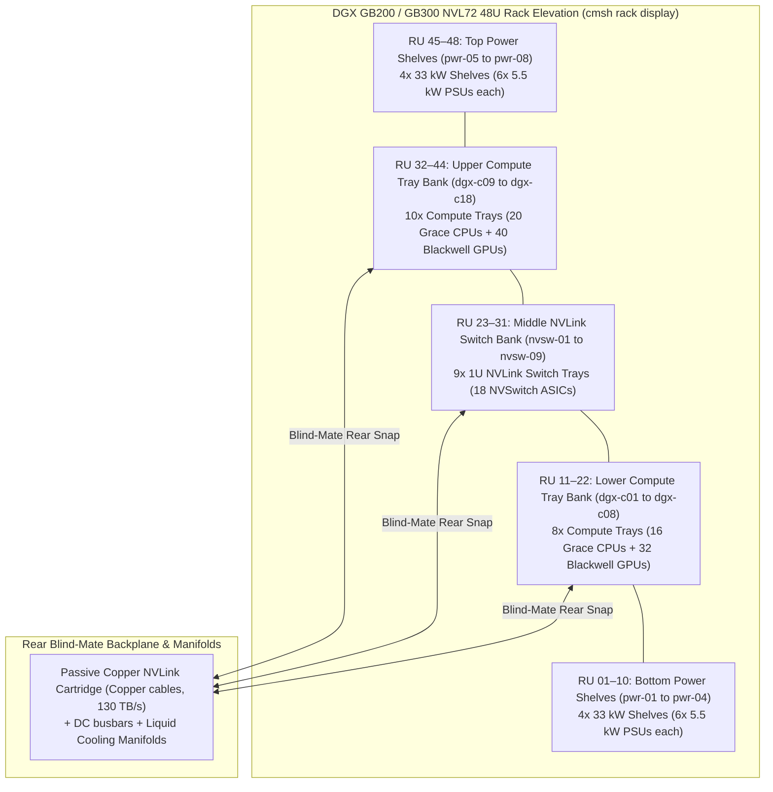
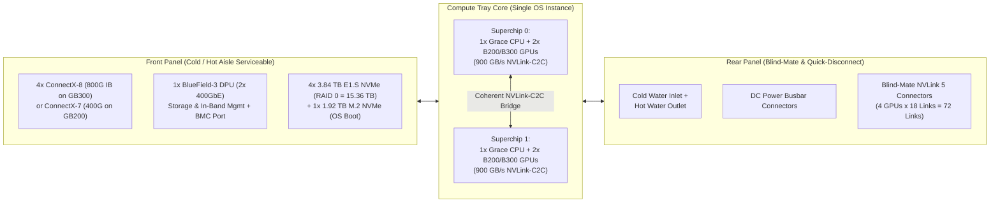
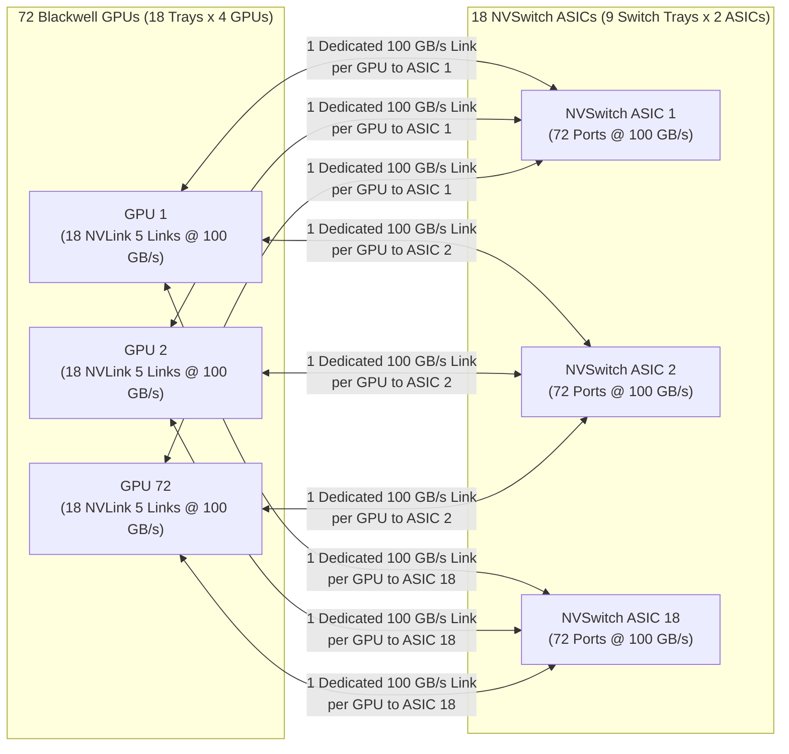
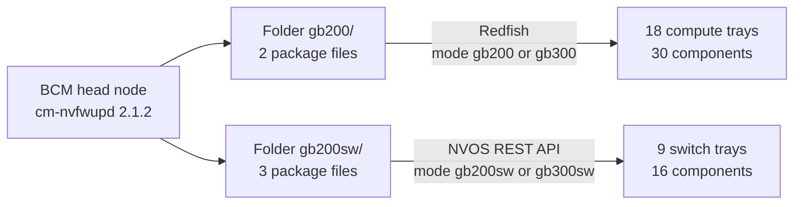

# 9.5 GB200 and GB300 NVL72 rack-scale systems

| Field | Value |
|---|---|
| **Status** | Drafted (`nvl72_rack_lab.py`: 30 checks pass; hardware commands **untested** on live NVL72 racks) |
| **Level** | Advanced |
| **Priority tier** | 1b |
| **Lab venue** | none (design / reading) + self-checking Python model (`code/part09/nvl72_rack_lab.py`) |
| **Part** | Part 9: NVIDIA systems and reference architectures |
| **Sources used** | `nvidia-devops` V5 Ch. 7; `nvidia-devops` V6 Ch. 7; *AI Systems Performance Engineering* Ch. 2; *NVIDIA DGX SuperPOD Reference Architecture Featuring NVIDIA DGX GB300 Systems* (`superpod-gb300-ra`); *NVIDIA Base Command Manager 11 Administrator Manual* (`bcm11-admin`) §3.16, §14.5 |

## Why this matters for AI infrastructure

An engineer serves a 1.8-trillion-parameter Mixture-of-Experts model on H100 nodes. Inside one eight-GPU server, GPUs exchange data over NVSwitch at full NVLink speed. The model needs more than eight GPUs, so its expert-parallel and tensor-parallel groups spill onto a ninth GPU in the next server. From then on, every collective crosses the network cards. In the benchmark this chapter uses, the first token takes more than five seconds and each GPU decodes about 3.4 tokens per second.

The GB200 NVL72 and DGX GB300 NVL72 change the unit of computing from the server to the rack. The Grace CPUs and Blackwell GPUs sit in 18 compute trays. Nine NVLink switch trays join them over a passive copper backplane at the rear. That backplane carries 130 TB/s of aggregate NVLink 5 bandwidth, so the whole rack is one NVLink domain. The same benchmark on one NVL72 rack reports roughly 30 times more throughput per GPU and a first token in about 50 milliseconds. Section 4 shows the figures behind that claim.

For an SRE the rack is also the new unit of failure, power and cooling. Sections 3 and 7 cover those operational questions.

## Prerequisites and outcomes

**Prerequisites:**
- Chapters 9.1 to 9.4 covering DGX and HGX baseboards, PCIe versus NVLink fabrics, and Grace Blackwell Superchips.
- Basic familiarity with Base Command Manager device and rack management via `cmsh` from Part 8.

**Outcomes:** After completing this chapter, you will be able to:
1. Map the physical rack elevation of a DGX GB200 or GB300 NVL72 system across its five vertical zones.
2. Describe the front and rear of a compute tray, an NVLink switch tray and a power shelf.
3. Work out the 1,296-port, one-stage NVLink 5 crossbar and explain NVLink SHARP, NCCL Parallel Aggregated Tree and NMX-M.
4. Contrast GB200 NVL72 with DGX GB300 NVL72, state the power and cooling facts that are sourced, and run the BCM dual-protocol firmware workflow across Redfish and the NVOS REST API.

---

## 1. Breaking the 8-GPU wall: why the rack became the computer

A model outgrows an eight-GPU server, so its tensor-parallel or expert-parallel groups must span several nodes. Users see multi-second pauses before a reply starts. Operators see expensive GPUs idle while they wait on network packets. Inside a server, GPUs talk at 600 to 1,800 GB/s over NVSwitch. Outside it, bandwidth drops to 50 or 100 GB/s over the network cards. That drop is 18 to 36 times, and it breaks interactive serving for trillion-parameter models.

An NVL72 rack avoids the drop by keeping all 72 GPUs on one NVLink fabric. Nine separate 8-GPU servers joined by InfiniBand cannot do that.

### 1.1 From DGX GH200 to GB200 and GB300 NVL72

NVIDIA first proved multi-node NVLink at rack scale with the DGX GH200. That system used a two-tier NVLink Switch System to connect up to 256 Grace Hopper Superchips into one 144 TB shared memory space. With 1,000 W to 1,400 W Blackwell GPUs, NVIDIA folded that multi-rack idea into a single dense 48U rack built on the modular MGX design. The result is the GB200 NVL72 and the DGX GB300 NVL72.

Why not connect 72 GPUs across several racks with optical fiber? Two reasons.

The first is reach. A copper link is cheap and needs no power for lasers, but it only works over short distances. If all 18 compute trays and 9 switch trays sit in one rack, every GPU is within a few feet of the switch bank, and plain copper cables are enough. Across racks the distance would force optics.

The second is power. Optical transceivers with lasers and retimer chips for all 72 GPUs would add roughly 20 kW of electrical load per rack, plus more parts that can fail. The copper backplane carries 130 TB/s with no transceiver power at all.

### 1.2 The five vertical zones of the 48U rack

The nine switch trays sit at the vertical midpoint of the rack, between the lower and upper compute banks. That placement keeps the longest copper run from the farthest top and bottom trays as short as possible.



Walking the rack from bottom to top in the Base Command Manager `rack display` layout for `a05-p1-dgx-01` shows five zones.

| Rack Unit Range | Zone Name | BCM Device Names | Installed Hardware |
|---|---|---|---|
| RU 01–10 | 1. Bottom Power Shelf Zone | `pwr-01` to `pwr-04` | Four 33 kW DGX Power Shelves feeding the lower busbar section |
| RU 11–22 | 2. Lower Compute Tray Bank | `c01` to `c08` | Eight 1U compute trays (16 Grace CPUs + 32 Blackwell GPUs) |
| RU 23–31 | 3. Middle NVLink Switch Tray Bank | `nvsw-01` to `nvsw-09` | Nine 1U NVLink Switch Trays (18 NVSwitch ASICs) at the rack midpoint |
| RU 32–44 | 4. Upper Compute Tray Bank | `c09` to `c18` | Ten 1U compute trays (20 Grace CPUs + 40 Blackwell GPUs) |
| RU 45–48 | 5. Top Power Shelf Zone | `pwr-05` to `pwr-08` | Four additional 33 kW DGX Power Shelves (bringing the rack total to 8 power shelves) |

### AI factories: many racks, one plan

An NVL72 is a complete supercomputer on its own, but it is also a building block. NVIDIA uses the term AI factory for a large AI data center made of such racks. Think of each rack as one production line in a plant. The plant only works when the lines are connected well.

Inside a rack, NVLink carries all GPU-to-GPU traffic. Outside the rack, traffic moves onto InfiniBand or Ethernet. Cross-rack links are slower than the links inside a rack, so keep the chattiest work inside one rack when you can. The DGX GB300 SuperPOD builds on this: each Scalable Unit holds 8 NVL72 racks, which is 576 GPUs, and the reference architecture scales to 128 racks and 9,216 GPUs.

### A preintegrated rack

NVIDIA delivers the NVL72 as a preintegrated rack in a single cabinet. It arrives with all 18 compute trays, all 9 NVSwitch trays, the internal NVLink cabling, power distribution and cooling already assembled. Base Command Manager, Slurm and Kubernetes are the management and scheduling software around it. On site you connect facility power, attach the water cooling interfaces, connect the InfiniBand and Ethernet cables, and power it on.

## 2. Inside the compute tray, switch tray and power shelf

In a traditional air-cooled rack, technicians weave power cords and network cables behind the servers. In an NVL72 the rear of the cabinet is packed with water manifolds, DC power busbars and the blind-mate NVLink copper cartridge. Network ports and drives on the rear panel would be unreachable without draining coolant or unseating the backplane.

So every tray keeps serviceable parts at the front and blind-mating connections at the rear. Network cables and NVMe drives are serviced from the front aisle. Liquid cooling, DC power and NVLink 5 connect at the rear without any cable work.

### 2.1 The 1U compute tray

Each of the 18 compute trays is a self-contained, liquid-cooled 1U Linux node.



| Compute Tray Subsystem | Hardware Components | Capacity and Operational Role |
|---|---|---|
| 1. Internal Superchips | 2x Grace Blackwell Superchips (2 Grace CPUs + 4 Blackwell GPUs) | Bridged by a coherent NVLink-C2C link (900 GB/s) to run as a single SMP unit under one Linux OS instance (144 Arm cores + 4 GPUs per tray) |
| 2. Front East-West Compute NICs | 4x ConnectX-8 (800 Gbps Quantum-X800 XDR IB on DGX GB300) or 4x ConnectX-7 (400 Gbps NDR on DGX GB200) | Strict 1:1 GPU-to-NIC ratio (4 GPUs to 4 Compute NICs per tray = 72 Compute NICs per rack) |
| 3. Front North-South Storage & Mgmt | 1x dual-port BlueField-3 DPU (2x 400 Gbps Ethernet) + BMC RJ45 port | 400 Gbps line-rate to High-Performance RoCEv2 Storage plus bonded 200 Gbps to In-Band Management |
| 4. Front Local NVMe Storage | 1x 1.92 TB M.2 NVMe (OS boot) + 4x 3.84 TB E1.S EDSFF NVMe in RAID 0 | 15.36 TB raw ephemeral scratch per compute tray, or `18 × 15.36 TB = 276.48 TB` across the rack |
| 5. Rear Blind-Mate & Cooling | Cold water inlet, hot water outlet, DC busbar clips, and 72 NVLink 5 lanes | Direct-to-chip liquid cold plates, DC busbar mating, and rear copper NVLink cartridge snap-in |

### 2.2 The 1U NVLink switch tray

Each of the 9 switch trays (`nvsw-01` to `nvsw-09`) is a 1U sled with two fifth-generation NVSwitch ASICs. All 18 ASICs in the rack are liquid cooled and blind-mated into the rear copper cartridge.

The front panel has two RJ45 COMe ports for NVOS and one RJ45 BMC port. NVOS is the switch operating system. NMX-M and Base Command Manager manage it. The BMC port carries out-of-band hardware telemetry. Do not mix the two up: the COMe ports are where NVOS credentials apply, and the BMC port is for hardware telemetry.

### 2.3 The power shelf

When 72 GPUs jump from idle to full load within milliseconds, the rack suddenly pulls tens of kW more. The rack therefore carries eight DGX power shelves, `pwr-01` to `pwr-08`. Each shelf holds six 5.5 kW power supplies in an N-redundant arrangement and delivers up to 33 kW.

| Power Shelf Feature | Specification | Purpose |
|---|---|---|
| Installed PSUs per Shelf | 6x 5.5 kW Power Supply Units (N redundant) | Delivers up to 33 kW per shelf (`8 shelves × 33 kW = 264 kW` total installed shelf capacity per rack) |
| Internal Energy Storage | Enhanced capacitor banks on the DGX GB300 power shelf | Smooths millisecond-scale GPU load transients so sudden training spikes do not hit the utility grid |
| Management & Power Brake Ports | Front RJ45 BMC port + rear RJ45 hardware power brake ports | Provides out-of-band telemetry and fast hardware throttling if a power fault occurs |

## 3. Power and cooling: what the sources support

An SRE asked "will this rack fit in our room" needs three numbers: how much power it draws, how that power is delivered, and how the heat leaves. The sources give them in different places, so this section settles each one and says where it comes from.

### 3.1 Rack power

Two documents give the rack power figures. For the GB200 NVL72, the published description is up to about 130 kW under maximum load, and decomposes it as 18 compute trays at about 6 kW each, about 110 kW, plus about 20 kW for the switch trays, network switches, pumps and fans. The *NVIDIA DGX SuperPOD Reference Architecture Featuring NVIDIA DGX GB300 Systems* states that each Scalable Unit of 8 racks needs 1.2 MW of thermal design power. Divided by 8, that is 150 kW per DGX GB300 NVL72 rack. This chapter uses 130 kW for GB200 and 150 kW for GB300 and does not quote the intermediate 120 to 130 kW ranges that appear elsewhere in the literature.

The two numbers are different kinds of figure. The first is a stated maximum from a published description. The second is a design allocation per rack from the reference architecture. Plan GB300 rooms with the 150 kW allocation.

The previous generation of NVIDIA AI racks drew 50 to 60 kW, so the NVL72 more than doubles the load. A standard feed cannot carry it. Data centers commonly provision two independent power feeds, each sized to carry the whole rack, so that one feed can fail without tripping a breaker. Eight racks at 130 kW draw nearly 1 MW.

### 3.2 How power reaches the chips: AC to DC

Facility power arrives as AC, for example 415 V three-phase. It does not go to each compute tray. The AC feeds the power shelves, which hold the power supply units. The shelves convert it to DC. The compute tray rear panels have DC power connectors that blind-mate to the rack, so the trays receive DC. The switch trays and other parts of the rack are powered in the same rack.

Some descriptions place the AC to DC conversion inside each compute node. The NVIDIA reference architecture shows the power supplies in the power shelf and DC power connectors on the compute tray, so this chapter follows the NVIDIA documents. The sources do not give the busbar voltage, so the chapter does not state one.

Each DGX GB300 power shelf also carries larger internal energy storage. NVIDIA states the purpose as reducing the peak load that the rack puts on the data center power supply. The rear RJ45 ports on the shelf are for power brakes and other out-of-band management. A power brake is the hardware path that throttles the rack quickly when a power fault occurs.

Eight shelves of 33 kW give 264 kW of installed capacity per rack. That is well above the 130 to 150 kW draw, which fits the N-redundant design.

```text
Rack power picture (sourced figures only)
GB200 NVL72 maximum draw   ~130 kW  = 18 trays x ~6 kW + ~20 kW overhead
GB300 NVL72 allocation      150 kW  = 1.2 MW per 8-rack Scalable Unit / 8
Installed shelf capacity    264 kW  = 8 shelves x 33 kW
```

### 3.3 Cooling: hybrid, not fully liquid

Air cannot cool a rack at this density. Each of the 72 GPUs can dissipate about 1,000 to 1,200 W, and blowing air over them would take hurricane-like airflow. Water carries far more heat per unit of flow, so the hottest parts are liquid cooled.

Most of the rack is liquid cooled, but not all of it. The DGX GB300 reference architecture says each rack uses hybrid cooling with both direct liquid cooling and air cooling, and that the most power-intensive parts such as the GPUs and CPUs are the liquid-cooled ones. NVIDIA marketing pages call the rack fully liquid cooled. For facility planning, trust the reference architecture. Plan for some residual heat into room air and ask NVIDIA for the exact split for your site, because the sources used here do not give one.

Each Grace Blackwell Superchip module and each NVSwitch chip has a cold plate on it. A cold plate is a metal block with internal tubing that carries coolant over the chip. Hoses, manifolds and pumps link all cold plates into one loop. Quick-disconnect couplings let you slide a tray out without spilling coolant.

The rack connects to the facility's chilled water through a Coolant Distribution Unit, or CDU, which moves heat from the rack's loop into the data center's water loop. Facility water is often supplied at 20 to 30 degrees Celsius. Newer designs run warm-water cooling, with water entering at 30 and leaving at 45 degrees, so evaporative towers can cool it without refrigeration.

A rough first-pass estimate is 150 to 200 liters per minute with a 10 to 12 degree rise to remove about 130 kW. The sources do not give a site-ready flow specification, so use it only for first-pass sizing. GPU temperatures stay in the 50 to 70 degree range under load. The loop watches coolant temperature, pressure and leaks, and can isolate a section if a sensor fires.

### 3.4 Weight and the rack controller

A filled NVL72, with coolant, weighs about 3,000 lbs, or 1.3 to 1.4 metric tons. Check the raised-floor rating in pounds per square foot before delivery. High-density racks often sit on reinforced slabs. A rack management controller oversees pumps, valves, power use and the status of every node, and administrators use it to update firmware across nodes or shut the rack down safely.

Chapter 9.11 is the canonical facility chapter. It covers cooling loops, power delivery and commissioning in depth.

## 4. The one-stage NVLink 5 crossbar, NVLink SHARP and MoE scaling

If GPUs in a rack had to cross several switch hops, tail latency and congestion would stall tensor-parallel layers. The design goal is that any of the 72 GPUs reaches any other in one switch hop at full bandwidth.

### 4.1 Working out the 1,296-port crossbar

The port arithmetic below is checked by `verify_nvl72_crossbar_topology()` in `code/part09/nvl72_rack.py`.



Each Blackwell GPU exposes 18 fifth-generation NVLink ports at 100 GB/s bidirectional per port. That doubles the 50 GB/s per-link speed of Hopper NVLink 4. The rack has exactly 18 NVSwitch ASICs, so every GPU wires one link to each ASIC through the rear copper backplane.

```text
NVL72 1-stage non-blocking NVLink 5 crossbar math:
Per-GPU NVLink 5 bandwidth = 18 links × 100 GB/s (50 GB/s per direction) = 1,800 GB/s = 1.8 TB/s bidirectional
Total NVSwitch ASICs in rack = 9 switch trays × 2 ASICs per tray = 18 NVSwitch ASICs
1-to-1 plane wiring rule: Link k (1..18) of all 72 GPUs connects to NVSwitch ASIC k (1..18)
Ports per NVSwitch ASIC = 72 ports at 100 GB/s
Ports per 1U NVLink Switch Tray (2 ASICs) = 2 × 72 = 144 NVLink 5 ports at 100 GB/s
Total backplane NVLink 5 ports across rack = 9 switch trays × 144 ports = 1,296 ports (= 72 GPUs × 18 links)
Exact aggregate NVLink 5 bandwidth = 72 GPUs × 1.8 TB/s = 129.6 TB/s (~130 TB/s), with 1 to 2 us latency
```

### 4.2 NVLink SHARP, NCCL PAT and NMX-M

The 18 NVSwitch ASICs include collective engines and a management plane.

1. NVLink SHARP, or NVLS, puts reduction arithmetic inside the NVSwitch ASICs. During an AllReduce, GPUs stream their data into the switch fabric, the switches perform the floating-point sums, and they multicast the result back. That cuts traffic and frees GPU cores for compute.
2. The NCCL Parallel Aggregated Tree algorithm, or PAT, is a collective algorithm in modern NCCL releases tuned for NVLink switch topologies like the NVL72.
3. NVIDIA Network Manager eXperience, or NMX-M, plays the role for NVLink that Unified Fabric Manager plays for InfiniBand. It manages the 9 switch trays running NVOS and the NVLink partitions of the rack.

### 4.3 Why the NVL72 changes 1.8-trillion-parameter MoE inference

A published benchmark covers serving a 1.8-trillion-parameter Mixture-of-Experts model. On 8-GPU H100 nodes over InfiniBand, the model spans several servers. For every token the expert-parallel AllToAll and the tensor-parallel AllReduce cross 50 GB/s links, and interactive serving is unusable. In one NVL72 rack, all 72 GPUs share one NVLink 5 domain.

| Benchmark metric, 1.8T MoE model | 8-GPU H100 nodes over InfiniBand | Single GB200 NVL72 rack | Improvement |
|---|---|---|---|
| Fabric between GPUs | 50 GB/s InfiniBand, 5 to 10 µs or more | 1.8 TB/s NVLink 5, 1 to 2 µs | 36 times per-GPU bandwidth |
| Decode throughput | about 3.4 tokens per second per GPU | about 150 tokens per second per GPU | roughly 30 times, as the source states |
| Time to first token | over 5,000 ms | about 50 ms | 100 times |

Dividing the two per-GPU rates gives 44 times, and the lab computes that ratio. The source states roughly 30 times and does not say how the two figures were measured, so quote the 30 times figure and treat the benchmark as a vendor result, not a measurement of your workload.

## 5. GB200 NVL72 compared with DGX GB300 NVL72

Before sizing floor loading, cooling loops and spine switches, an architect has to choose between the two racks. The GB300 uses Grace CPUs and Blackwell Ultra B300 GPUs. Its tray layout and NVLink 5 backplane match the GB200. It adds HBM3e capacity and FP4 compute, and it doubles the east-west network speed.

| Rack specification | GB200 NVL72 | DGX GB300 NVL72 | Change |
|---|---|---|---|
| Compute trays and superchips | 18 trays, 36 GB200 Superchips | 18 trays, 36 GB300 Superchips | same density |
| CPUs and GPUs per rack | 36 Grace CPUs (2,592 cores), 72 B200 GPUs | 36 Grace CPUs (2,592 cores), 72 B300 GPUs | B300 gives about 1.5 times the AI compute |
| HBM3e | 180 GB usable per GPU (192 GB raw), 13.4 TB usable, 576 TB/s | 288 GB per GPU, about 20.7 TB, 576 TB/s | 1.5 times capacity |
| Grace LPDDR5X | about 17 TB (36 x 480 GB) | about 17 TB (36 x 480 GB) | same |
| Fast memory in total | about 30.4 TB | about 37.7 TB | NVIDIA's page lists 37 TB |
| NVLink 5 fabric | 9 switch trays, 18 ASICs, 1.8 TB/s per GPU | the same | same crossbar |
| East-west NICs | 4 x ConnectX-7 at 400 Gbps per tray, 28.8 Tbps per rack | 4 x ConnectX-8 at 800 Gbps per tray, 57.6 Tbps per rack | 2 times |
| Storage and in-band DPU | 1 BlueField-3 per tray | 1 BlueField-3 per tray, 2 x 400 Gbps | similar |
| Local NVMe | 4 x 3.84 TB E1.S RAID 0 plus 1.92 TB M.2 OS | 15.36 TB per tray, 276.48 TB per rack, plus M.2 OS | same layout |
| Rack power | about 130 kW maximum | 150 kW allocation (1.2 MW per 8-rack SU) | about 20 kW more |
| Cooling and weight | liquid cooled, about 3,000 lbs | hybrid liquid and air cooling | GB300 shelves add energy storage |

A note on memory: some descriptions give the GB300 Grace memory as 36 x 500 GB, about 18 TB. NVIDIA's GB300 NVL72 specification lists 17 TB of LPDDR5X, which is 36 x 480 GB, so the chapter and its lab use 17 TB.

## 6. Failure domains and NVLink partitions

An SRE gets paged when something in the rack fails. The question is how far the failure reaches. The sources used in this chapter give the structure, so a part of the answer can be worked out. The rest they do not cover.

**What the structure gives.** The rack has 18 compute trays, each its own Linux instance with 4 GPUs. It has 9 switch trays, each carrying 2 of the 18 NVLink planes. Every GPU has one link into every plane.

- A switch tray that is unseated or powered off removes 2 of the 18 planes from every GPU at once. Each GPU keeps 16 of 18 links, so per-GPU NVLink bandwidth drops from 1.8 to 1.6 TB/s. This follows from the wiring arithmetic in section 4 and is an inference, not a vendor test result.
- A compute tray failure removes its 4 GPUs and its Linux instance. The other 68 GPUs still have all 18 links to the switches.
- A rack is the NVLink domain. A job that needs more than 72 GPUs must cross InfiniBand or Ethernet.

**NVLink partitions.** The reference architecture says NMX-M manages the NVLink fabric, and Base Command Manager documents the memory-sharing service for NVLink domains. The Inter-node Memory Exchange service, IMEX, maps GPU memory over NVLink between the GPUs of one NVLink domain. BCM can run IMEX globally or per Slurm job, and it can create a per-rack IMEX configuration. Per-job IMEX has one security advantage: a user's job cannot read memory mappings left by another job.

**Not covered by the sources.** The sources do not say what happens to a running job when a compute tray or switch tray fails, how NMX-M repartitions the domain, or how long recovery takes. Do not assume the job continues. Test failure behaviour on your own rack with your scheduler and NCCL version, and record it in a runbook.

## 7. Dual-protocol firmware management on GB200 and GB300 NVL72

An administrator flashes an NVL72 rack the way they flash an x86 server. The switch trays reject the login, and the compute trays are left half updated. The *NVIDIA Base Command Manager 11 Administrator Manual*, Section 14.5, explains why. BCM 11.34.0 introduces `cm-nvfwupd` version 2.1.2, and the two tray types differ in protocol, `firmwaremanagemode` setting and number of `.fwpkg` bundles.

### 7.1 Compute trays versus switch trays in Base Command Manager



Both staging folders sit under `/cm/local/apps/cmd/etc/htdocs/bios/firmware/` and are used for both GB200 and GB300 racks.

| Attribute | NVL72 Compute Tray (`c01..c18`) | NVL72 NVLink Switch Tray (`nvsw-01..09`) |
|---|---|---|
| **BCM `firmwaremanagemode`** | `gb200` or `gb300` | `gb200sw` or `gb300sw` |
| **Management Protocol** | DMTF Redfish (via compute tray BMC) | NVOS REST API (requires setting `username` and `password` in `cmsh` `device -> accesssettings`) |
| **Head Node Staging Directory** | `/cm/local/apps/cmd/etc/htdocs/bios/firmware/gb200/` (used for both GB200 and GB300) | `/cm/local/apps/cmd/etc/htdocs/bios/firmware/gb200sw/` (used for both GB200 and GB300) |
| **Required `.fwpkg` Bundles** | 2 packages (must flash both):<br/>1. `nvfw_DGX-GBX00_*` (GB200-BMC: BMC, ERoT, CPLD)<br/>2. `nvfw_HGX-GBX00_*` (GB200-Compute: HGX BMC, CPU 0/1, GPU 0..3, ERoT, FPGA 0/1, CPLD) | 3 packages (must flash all three):<br/>1. `nvfw_GB200-P4978_0004_*` (BMC, ERoT, FPGA)<br/>2. `nvfw_GB200-P4978_0006_*` (SBIOS and ERoT)<br/>3. `nvfw_GB200-P4978_0007_*` (CPLD) |
| **Tracked Component Count** | 30 components: `CX8_0..3` (4), `FW_BMC_0`, `FW_CPLD_0..1`, `FW_ERoT_BMC_0`, `HGX_FW_BMC_0`, `HGX_FW_CPLD_0`, `HGX_FW_CPU_0..1` (2), `HGX_FW_ERoT_BMC_0`, `HGX_FW_ERoT_CPU_0..1` (2), `HGX_FW_ERoT_FPGA_0..1` (2), `HGX_FW_FPGA_0..1` (2), `HGX_FW_GPU_0..3` (4), `HGX_InfoROM_GPU_0..3` (4), `HGX_PCIeSwitchConfig_0`, `NIC_1` (`NIC_0` on GB300), `UEFI` | 16 components: `ASIC`, `BIOS`, `BMC`, `CPLD1..4` (4), `EROT`, `EROT-ASIC1..2` (2), `EROT-BMC`, `EROT-CPU`, `EROT-FPGA`, `FPGA`, `SSD`, `transceiver` |

:::caution Two critical operational rules from the BCM 11 manual
1. **Never flash only a subset of the `.fwpkg` files on a tray:** Each `.fwpkg` file requires its own `firmware flash` command invocation. That means two commands for a compute tray and three commands for an NVLink switch tray. Flashing only one of the two compute packages or two of the three switch packages leaves the tray in a partially updated, inconsistent state.
2. **Same directory and identical switch-tray hardware for GB200 and GB300:** Both GB200 and GB300 store their packages under the `gb200/` and `gb200sw/` subdirectories. The NVLink switch tray hardware and 16-component `firmware status` output are 100% identical between GB200 and GB300 racks. On the compute tray, the only component-name difference is that the BlueField DPU row is reported as `NIC_1` on GB200 and `NIC_0` on GB300.
:::

## 8. Running the rack day to day

### 8.1 Off-rack traffic: NICs, DPUs and optics

Traffic leaving the rack uses different hardware. Each compute tray carries ConnectX network cards and a BlueField-3 Data Processing Unit, or DPU, which takes networking, storage, security and management work off the host CPU. The DPU handles line-rate packet processing, RDMA and NVMe over Fabrics. It can move data from the network straight into GPU memory while the Grace CPU keeps preprocessing. It also isolates traffic between jobs and users, which makes secure multitenancy possible.

Co-packaged optics, where the optical transmitters sit next to the switch silicon, is NVIDIA's next step for the network. It is being added to Quantum-X800 InfiniBand and Spectrum-X800 Ethernet. The electrical path gets much shorter, so links carry more bandwidth for less power.

### 8.2 Monitoring utilization and power

A rack this powerful pays off only while it is busy. NVIDIA's Data Center GPU Manager, DCGM, tracks per-GPU utilization, memory use, temperature and NVLink throughput. During training you want GPUs near full utilization most of the time. If they sit near 50 percent, look for a data-loading or synchronization bottleneck. If the NVLink counters often saturate, communication is the limit. Administrators can cap power or clocks for jobs that do not need full speed, which can save kilowatts over weeks of training.

### 8.3 Sharing the rack: scheduling and MIG

Rarely does one job need all 72 GPUs. A scheduler such as Slurm or Kubernetes with NVIDIA's plugins can give 8 GPUs to one user, 16 to another and 48 to a third inside one rack.

Multi-Instance GPU, or MIG, goes one level deeper. It splits one physical GPU into smaller hardware-isolated GPUs, each with dedicated memory and compute units. Each Blackwell GPU supports up to seven MIG instances. MIG suits inference, where many small models share one GPU, and together with the DPU's isolation role it lets departments share a system safely.

### 8.4 Utilization, chargeback and return on investment

An NVL72 is a multimillion-dollar asset with a large power bill. The useful measure is goodput, the work actually done. Track GPU hours used against GPU hours available, and consolidate workloads or offer spare time to other teams when the rack is underused. Some organizations charge each team per GPU hour to cover electricity and depreciation.

As an illustration, 100 H100 GPUs drawing about 70 kW might be replaced by 50 Blackwell GPUs drawing about 50 kW for the same work. Whether the upgrade pays for itself depends on prices and utilization, so run your own numbers.

### 8.5 Key takeaways

- The NVL72 puts 72 GPUs in one NVLink domain inside one rack.
- Plan for about 130 kW (GB200) or 150 kW (GB300), two independent feeds and a CDU loop. Cooling is hybrid on GB300.
- Keep traffic inside the rack. Use InfiniBand or Ethernet to scale past one rack.
- Failure behaviour of a running job is not given by the sources, so test it.


## Commands and configurations that matter

The `cmsh` and Linux commands below display the NVL72 rack layout, configure NVOS REST API access on the switch trays, inspect the firmware components, and flash all five `.fwpkg` bundles. The commands below were not run on live GB200 or GB300 NVL72 hardware. Their rules are checked in `code/part09/nvl72_rack_lab.py`.

### 1. Inspect the 48U NVL72 rack slot elevation in BCM

```text
# View the 48U slot map (pwr-01..04, c01..c08, nvsw-01..09, c09..c18, pwr-05..08)
[basecm11->rack]% display | less -R
```

### 2. Stage `.fwpkg` files and configure NVOS REST API credentials for NVLink switch trays

```bash
# 1. Verify the 2 compute-tray packages and 3 switch-tray packages on the BCM head node
ls -l /cm/local/apps/cmd/etc/htdocs/bios/firmware/gb200/
# Expect: nvfw_DGX-GBX00_*_prod-signed.fwpkg and nvfw_HGX-GBX00_*_prod-signed.fwpkg

ls -l /cm/local/apps/cmd/etc/htdocs/bios/firmware/gb200sw/
# Expect: nvfw_GB200-P4978_0004_*, nvfw_GB200-P4978_0006_*, nvfw_GB200-P4978_0007_*
```

```text
# 2. Configure NVOS REST API credentials on the NVLink switch trays in cmsh
[basecm11->device[switch001]]% set firmwaremanagemode gb300sw
[basecm11->device*[switch001*]]% accesssettings
[basecm11->device*[switch001*]->accesssettings]% set username admin
[basecm11->device*[switch001*]->accesssettings*]% set password <password>
[basecm11->device*[switch001*]->accesssettings*]% commit
```

### 3. Inspect and flash all 2 compute-tray packages and 3 switch-tray packages

```text
# 1. Verify available packages and inspect the 30 compute-tray and 16 switch-tray components
[basecm11->device[node001]]% firmware info
[basecm11->device]% firmware status -n node001
[basecm11->device]% firmware status -n switch001

# 2. Flash BOTH packages on the compute tray (DGX-side + HGX-side)
[basecm11->device[node001]]% firmware flash nvfw_DGX-GBX00_0023_250901.1.0_custom_prod-signed.fwpkg
[basecm11->device[node001]]% firmware flash nvfw_HGX-GBX00_0023_250908.1.0_custom_prod-signed.fwpkg

# 3. Flash ALL THREE packages on the NVLink switch tray (BMC/EROT/FPGA + SBIOS/EROT + CPLD)
[basecm11->device[switch001]]% firmware flash nvfw_GB200-P4978_0004_250821.1.0_prod-signed.fwpkg
[basecm11->device[switch001]]% firmware flash nvfw_GB200-P4978_0006_250710.1.1_prod-signed.fwpkg
[basecm11->device[switch001]]% firmware flash nvfw_GB200-P4978_0007_250831.1.0_prod-signed.fwpkg
```

---

## How it fails

| Failure mode | Symptom | Root cause | Diagnosis & fix |
|---|---|---|---|
| **1. NVLink switch tray firmware flash fails with authentication / connection error** | `firmware info` or `firmware flash` works on compute trays (`node001..018`) but fails to connect to `switch001..009` even though the switch tray BMC is reachable. | Unlike compute trays (which use Redfish), **NVLink switch trays execute firmware commands over the NVOS REST API** on the COMe management interface and require `firmwaremanagemode` (`gb200sw` / `gb300sw`) plus explicit `username` and `password` configured in `cmsh` `device -> accesssettings`. | In `cmsh`, set `firmwaremanagemode` to `gb200sw` (or `gb300sw`), enter `accesssettings`, set the NVOS `username` and `password`, `commit`, and verify connectivity to the switch tray's NVOS COMe IP. |
| **2. Partially updated compute tray or switch tray after flashing only one `.fwpkg`** | After a maintenance window, `firmware status -n node001` shows `FW_BMC_0` updated but `HGX_FW_GPU_0..3` and `HGX_FW_CPU_0..1` still on old versions (or `switch001` has updated BMC/FPGA but stale SBIOS/CPLD). | The admin ran `firmware flash` for only one `.fwpkg` file. A GB200/GB300 compute tray requires **two separate `firmware flash` invocations** (`nvfw_DGX-GBX00_*` and `nvfw_HGX-GBX00_*`), and an NVLink switch tray requires **three separate invocations** (`_0004`, `_0006`, and `_0007`). | Always flash both packages on every compute tray and all three packages on every NVLink switch tray before activating the firmware across the rack. |
| **3. Treating NVL72 as "one single GPU" without explicit TP/PP/DP sharding** | A developer attempts to launch a single-process CUDA script expecting automatic transparent memory striping across all 72 GPUs (`13.4–20.7 TB`), and only `GPU 0` (`180–288 GB`) is used before throwing an OOM error. | Marketing calls NVL72 "one giant GPU," but at the CUDA/OS level **an NVL72 rack is 18 separate Linux OS instances managing 4 GPUs each (72 CUDA devices total)**, and GPU L1/L2 caches are not hardware coherent across GPUs. | Partition the model explicitly across the 72 GPUs using Tensor Parallelism (TP), Pipeline Parallelism (PP), Expert Parallelism (EP), and Data Parallelism (DP/FSDP), using **NCCL** (`PAT` / `NVLS`) or **NVSHMEM** for collective synchronization across the 1.8 TB/s NVLink 5 fabric. |
| **4. Blind-mate NVLink pin misalignment or failed switch tray degrading the 18-plane crossbar** | `nvidia-smi nvlink --status` or `NMX-M` reports that every GPU in the rack has lost 2 of its 18 NVLink 5 lanes (`16/18 active`, dropping per-GPU NVLink bandwidth from `1.8 TB/s` to `1.6 TB/s`). | Because each of the 9 NVLink switch trays holds **2 NVSwitch ASICs** and terminates **1 link from each of the 72 GPUs (`144 ports/tray`)**, an unseated or powered-off NVLink switch tray removes 2 of the 18 NVLink planes across all 72 GPUs simultaneously. | Inspect `NMX-M` telemetry and `cmsh` `firmware status -n switch001..009`. Reseat the affected 1U NVLink switch tray into the rear blind-mate copper cartridge and verify all 144 ports on that tray train to 100 GB/s. |
| **5. Raised-floor structural overload from the 3,000+ lb (1.3–1.4 metric ton) rack** | Standard raised-floor tiles deflect or crack during rack roll-in when a fully populated NVL72 rack filled with coolant is moved into position. | An NVL72 rack with 18 liquid-cooled compute trays, 9 switch trays, 8 power shelves, manifolds, and rear copper cartridges weighs **~3,000–3,200 lbs (1.3–1.4 metric tons)** concentrated on a single rack footprint. | Verify slab and raised-floor point/distributed load ratings with structural engineers before delivery, reinforce raised floors with heavy-duty pedestals/struts or mount on a concrete slab, and use rated transport rigging. |

---

## Hands-on lab

This chapter provides a self-checking Python model in `code/part09/nvl72_rack.py` and a lab runner in `code/part09/nvl72_rack_lab.py` that verify five core areas.

| Lab Component | Verified Calculations and Rules |
|---|---|
| **1. 1-Stage NVLink 5 Crossbar Verifier** | 18 compute trays × 4 GPUs = 72 GPUs, 9 switch trays × 2 ASICs = 18 NVSwitch ASICs, 18 links/GPU @ 100 GB/s = 1.8 TB/s, 72 ports/ASIC, 144 ports/switch tray, 1,296 total backplane ports, and 129.6 TB/s (~130 TB/s) aggregate bandwidth |
| **2. GB200 vs GB300 NVL72 Rack Catalog** | 13.4 TB vs 20.7 TB HBM3e, 30.4 TB vs 37.7 TB total fast memory, 400G ConnectX-7 vs 800G ConnectX-8 = 57.6 Tbps per rack, 276.48 TB aggregate E1.S RAID 0 scratch, 8 × 33 kW = 264 kW power shelves, 130 kW vs 150 kW rack draw, and 1.2 MW per 8-rack GB300 Scalable Unit |
| **3. 48U NVL72 Rack Elevation Zone Mapper** | RU 01–10 `pwr-01..04`, RU 11–22 `c01..c08`, RU 23–31 `nvsw-01..09`, RU 32–44 `c09..c18`, RU 45–48 `pwr-05..08` |
| **4. 1.8T MoE Inference Speedup Calculator** | 3.4 vs 150 tokens/sec/GPU = 44.12× exact ratio / ~30× prose summary, and 5,000 ms vs 50 ms TTFT = 100× speedup |
| **5. BCM 11.34.0 Dual-Protocol Firmware Validator** | 30 compute-tray components over Redfish with 2 `.fwpkg` files vs 16 switch-tray components over the NVOS REST API with 3 `.fwpkg` files and `accesssettings` |

Run the lab from the repository root.

```bash
python3 -B code/part09/nvl72_rack_lab.py
```

Expected output verified in this repository:

```text
=== Chapter 9.5 Lab: GB200 and GB300 NVL72 Rack-Scale Systems ===
  [PASS] 18 compute trays * 4 GPUs == 72 GPUs and 9 switch trays * 2 ASICs == 18 NVSwitch ASICs
  [PASS] 18 NVLink 5 links/GPU matches 18 NVSwitch ASICs for a 1-hop non-blocking crossbar
  [PASS] Each NVSwitch ASIC terminates 72 ports and each 1U switch tray terminates 144 ports (1,296 total)
  [PASS] Per-GPU NVLink 5 bandwidth is 1.8 TB/s and exact 72-GPU aggregate is 129.6 TB/s (~130 TB/s)
  [PASS] Rejects non-positive compute_trays in crossbar verifier
  [PASS] GB200 NVL72 has 36 Grace CPUs, 72 B200 GPUs, 13.4 TB HBM3e + 17.0 TB LPDDR5X = 30.4 TB fast memory
  [PASS] GB300 NVL72 upgrades to 288 GB/GPU = 20.7 TB HBM3e + 17.0 TB LPDDR5X = 37.7 TB fast memory
  ...
  [PASS] ASP Ch2 chunk 9 power decomposition: 18 compute trays * 6 kW + 22 kW NVSwitch/cooling == 130 kW
  [PASS] superpod-gb300-ra p.5: 8x DGX GB300 NVL72 racks per Scalable Unit == 576 GPUs and 1.2 MW (1,200 kW) TDP
  [PASS] Total E1.S local NVMe scratch across 18 compute trays in a rack == 18 * 15.36 TB == 276.48 TB
  [PASS] Total East-West ConnectX-8 ports across 18 compute trays in a GB300 rack == 72 x 800 Gbps (57.6 Tbps)
  [PASS] Detects broken 1-stage crossbar if switch_trays != 9 (16 ASICs != 18 links/GPU)

Summary: 30 passed, 0 failed (total 30)
```

---

## Exercises

1. Run the lab script. Then work out by hand how many NVLink ports the rack backplane has. Start from 72 GPUs with 18 links each. What aggregate bandwidth follows at 100 GB/s per link?
2. Draw the 48U rack from bottom to top and mark the RU range of each zone. Then explain why the switch trays sit in the middle.
3. Every GPU in an NVL72 rack reports 16 of 18 NVLink links active. Which hardware is the likely cause? How many ports does one unit of it terminate?
4. Write the `cmsh` steps that let BCM flash an NVLink switch tray. Which mode do you set, and which credentials do you add? How many `.fwpkg` files must you flash afterwards?
5. A developer says that NVL72 is one big GPU, so they will run one Python process on it. Write a short reply. Say what is true and what is not, and use Failure Mode 3.
6. Use the two columns of the Section 4 table. Compute the rack HBM for GB200 and for GB300, and the ratio between them. Then do the same for rack network bandwidth.

## Checkpoint questions (20)

<details>
<summary>**1. How are the 18 compute trays, 9 NVLink switch trays, and 8 power shelves physically arranged from bottom to top in a 48U NVL72 rack, and why do the switch trays sit in the middle?**</summary>

| RU Range | Zone | Hardware |
|---|---|---|
| **RU 01–10** | Bottom Power Shelves | 4x 33 kW shelves (`pwr-01..04`) |
| **RU 11–22** | Lower Compute Tray Bank | 8x compute trays (`c01..c08`, 32 GPUs) |
| **RU 23–31** | Middle NVLink Switch Bank | 9x 1U NVLink switch trays (`nvsw-01..09`, 18 NVSwitch ASICs) |
| **RU 32–44** | Upper Compute Tray Bank | 10x compute trays (`c09..c18`, 40 GPUs) |
| **RU 45–48** | Top Power Shelves | 4x 33 kW shelves (`pwr-05..08`) |

Placing the 9 NVLink switch trays in the vertical center of the rack minimizes the maximum passive copper trace distance to the farthest top and bottom compute trays in the rear blind-mate backplane.
</details>

<details>
<summary>**2. Prove mathematically why any GPU in an NVL72 rack can reach any other GPU in a single NVSwitch hop at 1.8 TB/s per GPU.**</summary>

```text
72 GPUs × 18 NVLink 5 ports/GPU @ 100 GB/s bidirectional = 1,800 GB/s (1.8 TB/s) per GPU
9 switch trays × 2 NVSwitch ASICs/tray = 18 NVSwitch ASICs
18 links/GPU == 18 NVSwitch ASICs -> 1 dedicated 100 GB/s link from every GPU to each of the 18 ASICs
72 ports/ASIC, 144 ports/switch tray, 1,296 total ports, 72 × 1.8 TB/s = 129.6 TB/s (~130 TB/s) aggregate
```

Because every NVSwitch ASIC connects to all 72 GPUs directly, any GPU reaches any other GPU in a single switch hop.
</details>

<details>
<summary>**3. List all front-panel and rear-panel components of a single 1U DGX GB300 Compute Tray.**</summary>

| Location | Components |
|---|---|
| **Internal compute** | 2x GB300 Superchips (2x 72-core Grace CPUs + 4x B300 288 GB GPUs bridged by coherent NVLink-C2C under one OS instance) |
| **Front panel** | 4x ConnectX-8 NICs (800 Gbps Quantum-X800 XDR IB), 1x BlueField-3 DPU (2x 400 Gbps Ethernet for RoCE HPS + 200G bonded In-Band), BMC port, 4x 3.84 TB E1.S NVMe in RAID 0 (15.36 TB scratch), 1x 1.92 TB M.2 NVMe OS drive |
| **Rear panel** | Cold water inlet and hot water outlet manifolds, DC power busbar blind-mate connectors, 72 blind-mate NVLink 5 lanes (4 GPUs × 18 links) |
</details>

<details>
<summary>**4. How much power does a single DGX GB300 Power Shelf deliver, how many PSUs are inside each shelf, and what two special features are built into the GB300 power shelf?**</summary>

Each DGX GB300 Power Shelf contains six 5.5 kW PSUs with N redundancy, delivering up to 33 kW per shelf or 264 kW across 8 shelves. Compared to earlier shelves, the GB300 power shelf adds larger internal energy storage to smooth peak GPU load transients on the data center utility supply. It also includes rear RJ45 ports for hardware power brakes alongside a front RJ45 BMC port for out-of-band management.
</details>

<details>
<summary>**5. Contrast the total HBM3e capacity, total Grace LPDDR5X capacity, and East-West InfiniBand NIC speed between a GB200 NVL72 rack and a DGX GB300 NVL72 rack.**</summary>

| Metric | GB200 NVL72 | DGX GB300 NVL72 |
|---|---|---|
| **HBM3e Capacity** | `72 × 180 GB = 13.4 TB` usable (`13.8 TB` raw at 192 GB/GPU) | `72 × 288 GB = 20.7 TB` HBM3e (1.5× B200) |
| **Grace LPDDR5X & Total Fast Memory** | ~17 TB LPDDR5X (~30.4 TB total fast memory) | ~17 TB LPDDR5X (~37.7 TB total fast memory) |
| **East-West Compute NICs** | 4x 400 Gbps ConnectX-7 per tray (`72 × 400G = 28.8 Tbps`) | 4x 800 Gbps ConnectX-8 per tray (`72 × 800G = 57.6 Tbps`, 2× bandwidth) |
</details>

<details>
<summary>**6. What are NVLS, PAT, and NMX-M in an NVL72 rack?**</summary>

- **NVLS (NVLink SHARP):** Hardware reduction engines built into the 18 NVSwitch ASICs that perform floating-point collective reductions and multicast replication inside the switch silicon, offloading GPU SMs.
- **PAT (Parallel Aggregated Tree):** The collective reduction algorithm in NCCL optimized specifically for high-radix NVLink Switch topologies like NVL72.
- **NMX-M (NVIDIA Network Manager eXperience):** The management and telemetry software plane that operates the NVLink switches running NVOS across the rack.
</details>

<details>
<summary>**7. Why does BCM 11.34.0 require configuring `accesssettings` username and password on NVLink switch trays before flashing firmware, whereas compute trays do not require that extra step?**</summary>

Compute trays using `firmwaremanagemode` `gb200` or `gb300` execute firmware commands via Redfish over their BMC settings. NVLink switch trays using `firmwaremanagemode` `gb200sw` or `gb300sw` execute firmware commands over the NVOS REST API on the switch tray COMe processor. That API requires explicit NVOS credentials in `cmsh` under `device -> accesssettings`.
</details>

<details>
<summary>**8. How many `.fwpkg` firmware files must be flashed on a GB200 or GB300 compute tray versus an NVLink switch tray in BCM, and what happens if an administrator flashes only one package on a tray?**</summary>

| Tray Type | Staging Directory | Packages & Components |
|---|---|---|
| **Compute tray** | `gb200/` | 2 packages (`nvfw_DGX-GBX00_*` for BMC/ERoT/CPLD and `nvfw_HGX-GBX00_*` for HGX BMC/CPU/GPU/ERoT/FPGA/CPLD, covering 30 components) |
| **NVLink switch tray** | `gb200sw/` | 3 packages (`nvfw_GB200-P4978_0004_*` for BMC/ERoT/FPGA, `_0006_*` for SBIOS/ERoT, and `_0007_*` for CPLD, covering 16 components) |

Each package requires its own `firmware flash` command. Flashing only a subset leaves the tray in a partially updated, inconsistent state.
</details>

<details>
<summary>**9. Why does NVL72 use passive copper inside one rack instead of optical links between racks?**</summary>

Inside one rack the distances are short enough for passive copper. Optical transceivers for 72 GPUs would add roughly 20 kW of power per rack and more parts that can fail.
</details>

<details>
<summary>**10. What does one NVLink switch tray contain, and what ports are on its front?**</summary>

It contains two 5th-generation NVSwitch chips. The front panel has two RJ45 COMe ports for the NVOS switch operating system and one RJ45 BMC port.
</details>

<details>
<summary>**11. What is inside one compute tray?**</summary>

One compute tray holds two Superchips with 2 Grace CPUs and 4 Blackwell GPUs under one OS. It also includes four ConnectX NICs, one BlueField-3 DPU, four 3.84 TB E1.S drives in RAID 0, and one 1.92 TB M.2 OS drive.
</details>

<details>
<summary>**12. How much power can one DGX power shelf deliver, and what is special about the GB300 shelf?**</summary>

One shelf delivers 33 kW from six 5.5 kW PSUs. The GB300 shelf has larger internal energy storage to smooth fast GPU load swings and rear RJ45 ports for hardware power brakes.
</details>

<details>
<summary>**13. How many NVLink ports does one GPU have and how are they wired to the switch chips?**</summary>

Each GPU has 18 ports at 100 GB/s each. Port 1 of all 72 GPUs goes to NVSwitch chip 1, port 2 goes to chip 2, and so on, so each chip terminates 72 ports.
</details>

<details>
<summary>**14. What is NVLink SHARP?**</summary>

The NVSwitch chips perform the arithmetic of a reduction such as part of `AllReduce` inside the switch silicon and send the result back. This cuts network traffic and frees GPU cores.
</details>

<details>
<summary>**15. What is NMX-M?**</summary>

NMX-M is the management and telemetry tool for the NVLink switch trays and NVLink partitions, much like UFM manages the InfiniBand fabric.
</details>

<details>
<summary>**16. What is the benchmark behind 3.4 versus 150 tokens per second per GPU, and what should you remember about it?**</summary>

It is a 1.8-trillion-parameter MoE model running on H100 nodes over InfiniBand versus one NVL72 rack. The reported gain is roughly 30 times. Dividing the two stated rates gives 44 times, which is only arithmetic on the two numbers, so quote the 30 times figure and treat it as a vendor result.
</details>

<details>
<summary>**17. What changes between GB200 and GB300 NVL72, and what stays the same?**</summary>

Both systems share the same trays, switch fabric, and NVLink 5 backplane. GB300 raises HBM per GPU from about 180 to 192 GB to 288 GB, increases AI compute by about 1.5 times, and doubles network speed per NIC from 400G to 800G. The GB300 rack power allocation is 150 kW, against about 130 kW for GB200, and its cooling is described as hybrid liquid and air.
</details>

<details>
<summary>**18. How many `.fwpkg` files must you flash on a compute tray and on a switch tray, and why does it matter?**</summary>

You must flash two on a compute tray and three on a switch tray. Flashing only some of them leaves the tray partly updated and inconsistent.
</details>

<details>
<summary>**19. Which management protocol does BCM use for compute trays and which for switch trays?**</summary>

Compute trays use Redfish through their BMC. Switch trays use the NVOS REST API and need a username and password set in `accesssettings`.
</details>

<details>
<summary>**20. Why must you check floor load before delivery of an NVL72 rack?**</summary>

A loaded rack weighs about 3,000 lbs (1.3–1.4 metric tons) on one footprint. Tiles can crack or deflect, so check structural ratings and use rated rigging.
</details>

---

## Sources and review notes

- **Power and cooling corrections (this revision).** The AC to DC path follows the DGX GB300 SuperPOD Reference Architecture (power shelves with six 5.5 kW supplies, DC power connectors on the compute tray rear), not the per-compute-tray conversion described in *AI Systems Performance Engineering* Chapter 2. Cooling follows the same reference architecture ("hybrid cooling with both direct liquid cooling and air cooling", p. 5); the book and NVIDIA's GB300 NVL72 product page say fully liquid cooled, and the exact liquid and air split is not stated in any source used here. Rack power is 130 kW for GB200 (book, 18 x 6 kW + about 20 kW) and 150 kW for GB300 (1.2 MW per 8-rack Scalable Unit, same reference architecture, p. 5, divided by 8). The 120 to 130 kW range was dropped as unsourced. The busbar voltage "48 to 54 V" was removed because no source used here states it.
- **GB300 Grace memory.** NVIDIA's GB300 NVL72 product page (nvidia.com/en-us/data-center/gb300-nvl72, fetched 2026-11-12) lists 17 TB LPDDR5X, 20 TB GPU memory and 37 TB fast memory. The chapter and lab use 36 x 480 GB, about 17 TB, and 37.7 TB fast memory; the earlier 36 x 500 GB figure from the book is not used. `code/part09/nvl72_rack.py` and the lab were updated to match.
- **Failure domains and partitions.** The one-plane-per-ASIC arithmetic is derived from the crossbar wiring and is an inference. The IMEX statements come from the Base Command Manager 11 Administrator Manual, chapter on workload management. No source used here describes job behaviour on tray failure or NMX-M partition procedures, so the chapter says so.
- **Cable count.** The chapter does not give a cable count for the backplane, because no source in the corpus states one. The ~20 kW copper-versus-optics saving comes from `nvidia-devops` Volume 05 Chapter 7.

### Sources read in full for this chapter

| Source | Chapters / Pages Read | Topics Extracted |
|---|---|---|
| **Chris Fregly, *AI Systems Performance Engineering* (`ai-systems-performance-engineering`)** | Chapter 2 (pp. 26–40, chunks 6–9) and Chapter 17 / Summary | GB200/GB300 NVL72 rack architecture (18 compute trays × 4 GPUs = 72 GPUs, 9 switch trays × 2 NVSwitch ASICs = 18 ASICs, 144 ports/tray at 100 GB/s, 1-hop non-blocking crossbar with 129.6 TB/s / ~130 TB/s aggregate NVLink 5 bandwidth and 1–2 µs latency), NVLink SHARP (`NVLS`), NCCL Parallel Aggregated Tree (`PAT`), 1.8T MoE benchmark (3.4 tokens/sec/GPU & >5s TTFT on H100 vs 150 tokens/sec/GPU & ~50 ms TTFT on GB200 NVL72), rack power breakdown (`130 kW = 18 nodes × 6 kW + ~20 kW NVSwitch/cooling/overhead`), rack weight (~3,000 lbs / 1.3–1.4 metric tons), and GB300 NVL72 memory specs (72 × 288 GB = ~20.7 TB HBM3e + 36 × 500 GB = ~18 TB LPDDR5X = ~38 TB fast memory) |
| ***NVIDIA DGX SuperPOD Reference Architecture Featuring NVIDIA DGX GB300 Systems* (`superpod-gb300-ra`)** | Pages 1–20 | DGX GB300 NVL72 rack, compute tray front and rear anatomy (4x ConnectX-8 800 Gbps Quantum-X800 IB NICs + 1x BlueField-3 2x400G DPU at front cold/hot aisle, 4x 3.84 TB E1.S RAID 0 + 1x 1.92 TB M.2 OS NVMe, rear liquid-cooling inlet/outlet, DC power, and blind-mate NVLink connectors), 9 NVLink switch trays (2x COMe RJ45 ports for NVOS + 1x BMC RJ45 port, managed by NMX-M), 8x 33 kW DGX Power Shelves (6x 5.5 kW PSUs per shelf, larger energy storage, front BMC port, rear RJ45 power-brake ports), and 1.2 MW TDP per 8-rack Scalable Unit |
| ***NVIDIA Base Command Manager 11 Administrator Manual* (`bcm11-admin`)** | Section 3.16 (pp. 190–191) and Section 14.5 (pp. 762–765) | Exact 48U NVL72 rack slot map (`pwr-01..08` / `pwr-01..04`, `c01..c08`, `nvsw-01..09`, `c09..c18`, `pwr-05..08`), `cm-nvfwupd` 2.1.2 (BCM 11.34.0) GB200/GB300 firmware management (`gb200`/`gb300` over Redfish with 2 `.fwpkg` bundles and 30 components; `gb200sw`/`gb300sw` over the NVOS REST API with `accesssettings` and 3 `.fwpkg` bundles and 16 components; `NIC_1` on GB200 vs `NIC_0` on GB300) |
| **`nvidia-devops` Volume 05 & Volume 06** | `nvidia-zero-to-hero/volume-05/chapter-07-dgx-gh200-and-gb200-systems.md` (`chapter-07-dgx-gh200-and-gb200-systems.md`, 982 words) and `nvidia-zero-to-hero/volume-06/chapter-07-gb200-nvl72-rack-scale-architecture.md` (`chapter-07-gb200-nvl72-rack-scale-architecture.md`, 1,098 words) | Breaking the 8-GPU ceiling, DGX GH200 (up to 256 Superchips / 144 TB), passive rear copper backplane (copper cables, saving ~20 kW of optical transceiver power), MGX modular rack shift, and 1T MoE serving scenario |

### Not in the corpus
- Standalone *NVIDIA Mission Control Rack Bring-Up and Installation Guide* and *NVIDIA GB200 NVL72 Hardware User Guide* PDFs are not in `~/Desktop/books-toon-rag/`.

### Run here
- `python3 -B code/part09/nvl72_rack_lab.py` passes all 30 checks with 0 failures.

### Choices and inferences made in this chapter
1. **Exact arithmetic ratio 44.12× for the 1.8T MoE benchmark:** The function `compare_moe_inference_h100_vs_nvl72` in `code/part09/nvl72_rack.py` computes `150.0 / 3.4 = 44.12×`. *AI Systems Performance Engineering* Chapter 2 summarizes the gain as "roughly 30×". The chapter keeps both: the lab verifies the exact ratio of the two stated token rates, and the book's wording stays attributed to the book.

### Not verified on live hardware
- `cmsh` `rack display`, `firmware info`, `firmware status`, and `firmware flash` commands on live GB200 or GB300 NVL72 compute trays and NVOS switch trays were not executed in this authoring environment.

