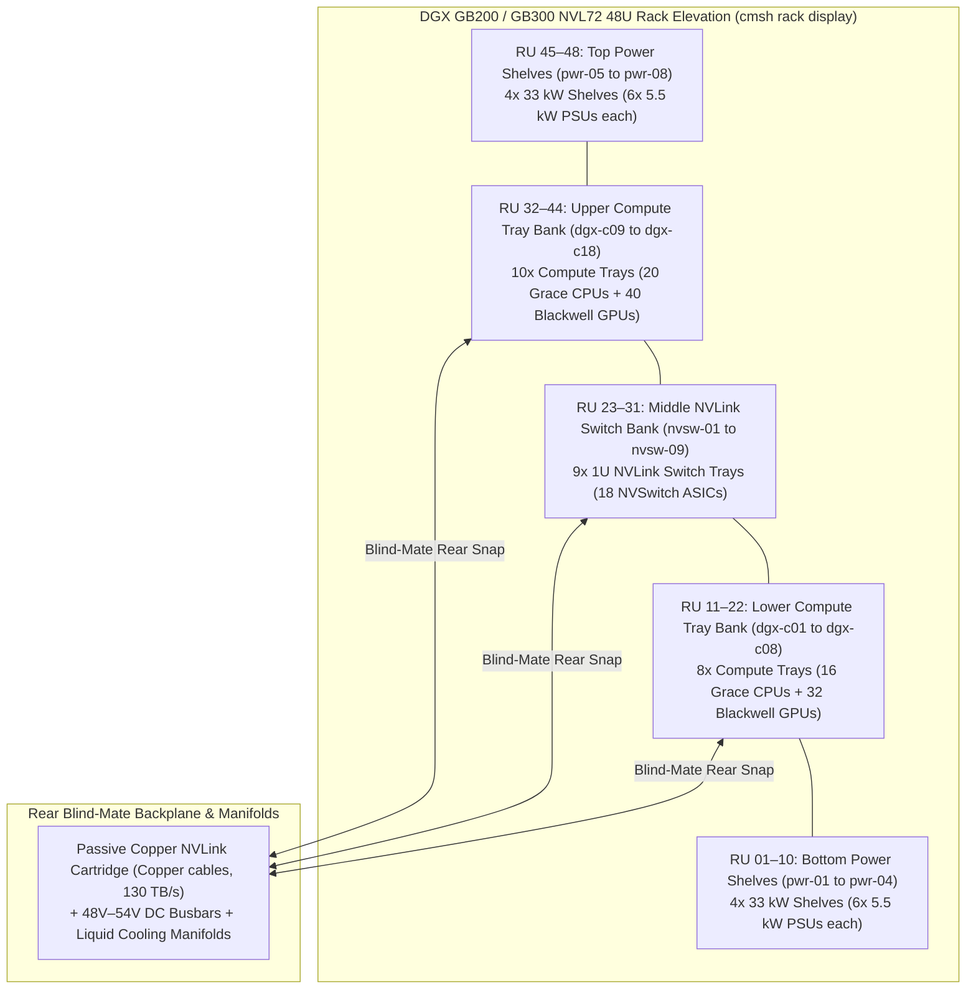
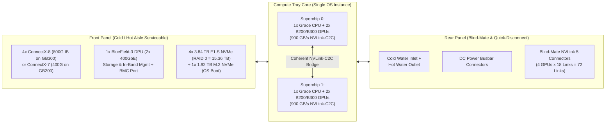
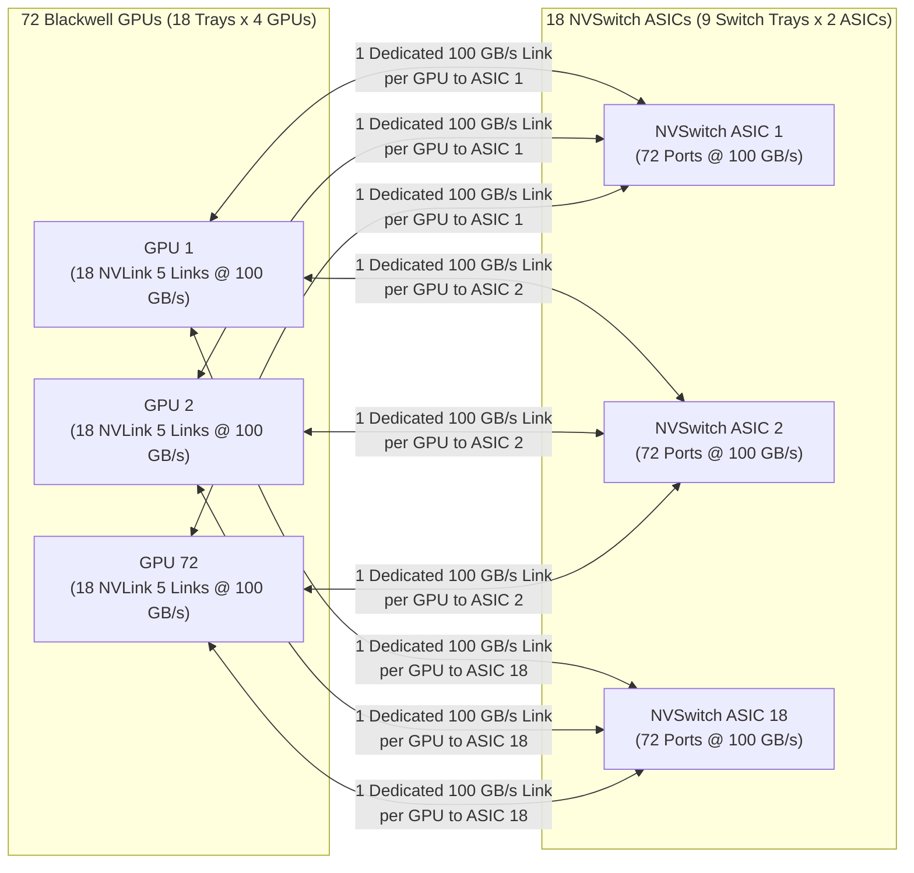
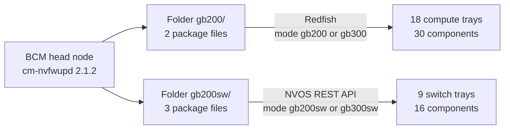

# 9.5 GB200 and GB300 NVL72 rack-scale systems

| Field | Value |
|---|---|
| **Status** | Drafted (`nvl72_rack_lab.py`: 30 checks pass; hardware commands **untested** on live NVL72 racks) |
| **Level** | Advanced |
| **Priority tier** | 1b |
| **Lab venue** | none (design / reading) + self-checking Python model (`code/part09/nvl72_rack_lab.py`) |
| **Part** | Part 9: NVIDIA systems and reference architectures |
| **Sources used** | `nvidia-devops` V5 Ch. 7; `nvidia-devops` V6 Ch. 7; *AI Systems Performance Engineering* Ch. 2; *NVIDIA DGX SuperPOD Reference Architecture Featuring NVIDIA DGX GB300 Systems* (`superpod-gb300-ra`); *NVIDIA Base Command Manager 11 Administrator Manual* (`bcm11-admin`) §3.16, §14.5 |

## Why this matters for AI infrastructure

An engineer serves a 1.8-trillion-parameter Mixture-of-Experts model on H100 nodes. Inside one eight-GPU server, GPUs exchange data over NVSwitch at full NVLink speed. The model needs more than eight GPUs, so its expert-parallel and tensor-parallel groups spill onto a ninth GPU in the next server. From then on, every collective crosses the network cards. In the benchmark this chapter uses, the first token takes more than five seconds and each GPU decodes about 3.4 tokens per second.

The GB200 NVL72 and DGX GB300 NVL72 change the unit of computing from the server to the rack. The Grace CPUs and Blackwell GPUs sit in 18 compute trays. Nine NVLink switch trays join them over a passive copper backplane in the rear. That backplane carries 130 TB/s of aggregate NVLink 5 bandwidth, so the whole liquid-cooled rack is one NVLink domain. *AI Systems Performance Engineering* reports roughly 30 times more throughput per GPU on that same benchmark, and a first token in about 50 milliseconds. Section 3.3 shows the figures behind that claim.

:::info Corpus scope note
The chapter does not draw on the *NVIDIA Mission Control Rack Bring-Up and Installation Guide* or the *NVIDIA GB200 NVL72 Hardware User Guide*. The rack slot map, tray port layouts, crossbar math, power shelf specifications, NVLink SHARP algorithms, and BCM firmware workflows come from the books and volumes listed under Sources.
:::

## Prerequisites and outcomes

**Prerequisites:**
- Chapters 9.1 to 9.4 covering DGX and HGX baseboards, PCIe versus NVLink fabrics, and Grace Blackwell Superchips.
- Basic familiarity with Base Command Manager device and rack management via `cmsh` from Part 8.

**Outcomes:** After completing this chapter, you will be able to:
1. Map the physical rack elevation of a DGX GB200 or GB300 NVL72 system across its five vertical zones.
2. Dissect the front and rear of a Compute Tray, an NVLink Switch Tray, and a DGX Power Shelf.
3. Prove the 1,296-port 1-stage NVLink 5 crossbar math and explain NVLink SHARP, NCCL Parallel Aggregated Tree, and NMX-M.
4. Contrast DGX GB200 NVL72 with DGX GB300 NVL72, and execute the BCM dual-protocol firmware workflow across Redfish and the NVOS REST API.

---

## Concepts: basics → intermediate → advanced

## 1. Breaking the 8-GPU wall: why the rack became the computer

A model outgrows an eight-GPU server, so its tensor-parallel or expert-parallel groups must span several nodes. Users see multi-second pauses before a reply starts. Operators see expensive GPUs idle while they wait on network packets. Inside a server, GPUs talk at 600 to 1,800 GB/s over NVSwitch. Outside it, bandwidth drops to 50 or 100 GB/s over the network cards. That drop is 18 to 36 times, and it breaks interactive serving for trillion-parameter models.

An NVL72 rack avoids the drop by keeping all 72 GPUs on one NVLink fabric. Nine separate 8-GPU servers joined by InfiniBand cannot do that.

### 1.1 From DGX GH200 to MGX and GB200 or GB300 NVL72

NVIDIA first proved multi-node NVLink at rack scale with the DGX GH200. That system used a two-tier NVLink Switch System to connect up to 256 Grace Hopper Superchips into a single 144 TB shared memory space. With the arrival of 1,000W to 1,400W Blackwell GPUs, NVIDIA consolidated that multi-rack concept into a single, dense, liquid-cooled 48U MGX rack. That modular rack design produced the GB200 NVL72 and DGX GB300 NVL72.

Why could NVIDIA not connect 72 GPUs across multiple racks using optical fiber cables?
- **The 20 kW optical power penalty:** Optical transceivers with lasers and DSP retimers for all 72 GPUs would consume roughly 20 kW of extra electrical power per rack just to light the fibers. They would also add transceiver failure points and high hardware cost.
- **The passive copper backplane solution:** Packing all 18 compute trays and 9 NVLink switch trays vertically into a single rack keeps every GPU within a few feet of the switch bank. That short physical reach allows the trays to blind-mate directly into a rear Copper Backplane cartridge made of passive copper cables. It delivers 130 TB/s of aggregate NVLink 5 bandwidth with zero optical transceiver power penalty.

### 1.2 The five vertical zones of the 48U NVL72 rack elevation

Why are the 9 NVLink switch trays mounted in the exact middle of the rack between the upper and lower compute tray banks? Placing the switch bank at the vertical midpoint minimizes the maximum copper trace length from the farthest top and bottom compute trays to the middle switch bank.



Walking the 48U rack from bottom to top in Base Command Manager's `rack display` layout for `a05-p1-dgx-01` reveals five distinct vertical zones.

| Rack Unit Range | Zone Name | BCM Device Names | Installed Hardware |
|---|---|---|---|
| **RU 01–10** | 1. Bottom Power Shelf Zone | `pwr-01` to `pwr-04` | Four 33 kW DGX Power Shelves feeding the lower busbar section |
| **RU 11–22** | 2. Lower Compute Tray Bank | `c01` to `c08` | Eight 1U compute trays (16 Grace CPUs + 32 Blackwell GPUs) |
| **RU 23–31** | 3. Middle NVLink Switch Tray Bank | `nvsw-01` to `nvsw-09` | Nine 1U NVLink Switch Trays (18 NVSwitch ASICs) at the rack midpoint |
| **RU 32–44** | 4. Upper Compute Tray Bank | `c09` to `c18` | Ten 1U compute trays (20 Grace CPUs + 40 Blackwell GPUs) |
| **RU 45–48** | 5. Top Power Shelf Zone | `pwr-05` to `pwr-08` | Four additional 33 kW DGX Power Shelves (bringing the rack total to 8 power shelves) |

:::tip In one minute
- The GB200 and GB300 NVL72 turn a 48U rack into a single 72-GPU computer. The 9 NVLink switch trays sit in the middle of the rack between the lower and upper compute trays, flanked by power shelves at the top and bottom.
- Keeping all 72 GPUs inside one rack allows a passive rear copper backplane to carry 130 TB/s of NVLink 5 bandwidth while saving ~20 kW of optical transceiver power per rack.
:::

---

### AI factories: many racks, one plan

An NVL72 is a complete supercomputer on its own, but it is also a building block. Large AI clusters are built by joining many racks together. NVIDIA uses the term AI factory for a large AI data center made of such racks. Think of each rack as one production line in a plant. The plant only works when the lines are connected well.

Inside a rack, NVLink carries all the GPU-to-GPU traffic. Outside the rack, the traffic moves onto ordinary high-speed networking gear. An 8-rack NVL72 cluster with 576 GPUs is one NVLink 5 domain. InfiniBand or Ethernet then links that domain to other domains or to storage. Cross-rack links are slower than the links inside a rack, so keep the chattiest work inside one rack when you can.

### Preintegrated rack appliance

Because the NVL72 is so complex, NVIDIA delivers it as a preintegrated rack appliance in a single cabinet. The rack arrives with all 18 compute nodes, all 9 NVSwitch units, the internal NVLink cabling, power distribution, and the cooling system already assembled. Nobody has to cable 72 GPUs by hand. The NVIDIA Base Command Manager cluster-management software is included, along with SLURM (Simple Linux Utility for Resource Management) and Kubernetes for job scheduling.

On site, the work is short. You connect the rack to facility power, attach the water cooling interfaces, connect the InfiniBand cables to your network, and power it on. The rack is built and validated before it ships. That is why an organization can treat it as one unit that is ready when it arrives.

## 2. Dissecting the Compute Tray, Switch Tray, and Power Shelves

In a traditional air-cooled rack, technicians weave power cords, InfiniBand fibers, and Ethernet cables together behind the servers. In a high-density liquid-cooled NVL72 rack, the rear of the cabinet is packed solid with water manifolds, high-current DC busbars, and the blind-mate NVLink copper cartridge. If network ports or NVMe drives lived on the rear panel, technicians could never reach them without draining coolant or unseating the backplane.

For that reason, every tray in an NVL72 rack keeps serviceable parts at the front and blind-mating connections at the rear. All optical or copper network cables and NVMe drives are serviced from the front cold or hot aisle, while liquid cooling, DC power, and NVLink 5 connections blind-mate automatically at the rear.

### 2.1 Inside a 1U DGX GB200 or GB300 Compute Tray

Each of the 18 compute trays is a self-contained, liquid-cooled 1U Linux compute node.



| Compute Tray Subsystem | Hardware Components | Capacity and Operational Role |
|---|---|---|
| **1. Internal Superchips** | 2x Grace Blackwell Superchips (2 Grace CPUs + 4 Blackwell GPUs) | Bridged by a coherent NVLink-C2C link (900 GB/s) to run as a single SMP unit under one Linux OS instance (144 Arm cores + 4 GPUs per tray) |
| **2. Front East-West Compute NICs** | 4x ConnectX-8 (800 Gbps Quantum-X800 XDR IB on DGX GB300) or 4x ConnectX-7 (400 Gbps NDR on DGX GB200) | Strict 1:1 GPU-to-NIC ratio (4 GPUs to 4 Compute NICs per tray = 72 Compute NICs per rack) |
| **3. Front North-South Storage & Mgmt** | 1x dual-port BlueField-3 DPU (2x 400 Gbps Ethernet) + BMC RJ45 port | 400 Gbps line-rate to High-Performance RoCEv2 Storage plus bonded 200 Gbps to In-Band Management |
| **4. Front Local NVMe Storage** | 1x 1.92 TB M.2 NVMe (OS boot) + 4x 3.84 TB E1.S EDSFF NVMe in RAID 0 | 15.36 TB raw ephemeral scratch per compute tray, or `18 × 15.36 TB = 276.48 TB` across the rack |
| **5. Rear Blind-Mate & Cooling** | Cold water inlet, hot water outlet, DC busbar clips, and 72 NVLink 5 lanes | Direct-to-chip liquid cold plates, 48V–54V DC busbar mating, and rear copper NVLink cartridge snap-in |

### 2.2 Inside a 1U NVLink Switch Tray

Each of the 9 NVLink Switch Trays (`nvsw-01` to `nvsw-09`) is a 1U sled that houses two fifth-generation NVSwitch ASICs. Across the switch bank, all 18 NVSwitch ASICs are liquid-cooled and blind-mated into the rear copper NVLink cartridge.

On the front panel, each switch tray exposes two RJ45 COMe ports for NVOS. NVOS is the switch operating system managed by NVIDIA Network Manager eXperience (NMX-M) and Base Command Manager. Beside the COMe ports sits one RJ45 BMC module port for out-of-band hardware telemetry.

### 2.3 Inside a DGX Power Shelf

When 72 GPUs jump from idle to full load within microseconds, the rack suddenly pulls 130 kW to 150 kW. That can drop the voltage or disturb the facility's supply. The rack therefore carries eight DGX Power Shelves, named `pwr-01` to `pwr-08`.

| Power Shelf Feature | Specification | Purpose |
|---|---|---|
| **Installed PSUs per Shelf** | 6x 5.5 kW Power Supply Units (N redundant) | Delivers up to 33 kW per shelf (`8 shelves × 33 kW = 264 kW` total installed shelf capacity per rack) |
| **Internal Energy Storage** | Enhanced capacitor banks on the DGX GB300 power shelf | Smooths millisecond-scale GPU load transients so sudden training spikes do not hit the utility grid |
| **Management & Power Brake Ports** | Front RJ45 BMC port + rear RJ45 hardware power brake ports | Provides out-of-band telemetry and fast hardware throttling if a power fault occurs |

:::tip In one minute
- All optical or copper network cables and NVMe drives are serviced from the front aisle. Liquid cooling, DC busbars, and NVLink 5 blind-mate at the rear.
- Never confuse the two management interfaces on an NVLink Switch Tray. The single BMC RJ45 port provides out-of-band hardware telemetry, while the two COMe RJ45 ports run NVOS managed by NMX-M and BCM firmware updates.
:::

---

### Power draw and facility feeds

A fully loaded NVL72 can draw up to about 130 kW under maximum load. That is more than twice the 50–60 kW of NVIDIA's previous generation AI rack. A standard wall feed cannot carry that load. Data centers usually provision two fully independent power feeds, and each one is sized to carry the entire rack. If one feed goes offline, the other one carries the full 130 kW without tripping a breaker.

Inside the rack, power is distributed to each 1U compute node, where AC is converted to DC for the local electronics. Each node holds two Grace Blackwell Superchips, which together draw on the order of 6 kW. Eighteen nodes draw about 110 kW. The NVSwitch trays, network switches, air cooling, and water cooling pumps add about 20 kW, for a total of 130 kW.

Power transients need attention too. When 72 GPUs ramp from idle to full power, the rack can pull tens of kW within milliseconds. Good designs add capacitors or sequencing to avoid large voltage drops. A system might also stagger GPU boost clocks by tiny intervals so the surge is smoothed out. Eight racks together, at 576 GPUs, would draw nearly 1 MW.

### Liquid cooling loop

Air cannot cool 130 kW in one rack. Each of the 72 GPUs dissipates about 1,200 W. Moving that much heat with air would need hurricane-like airflow, and the result would be loud, inefficient, and hot. Water carries far more heat per unit of flow, so liquid cooling is the practical choice at this density.

The NVL72 is fully liquid cooled. Each Grace Blackwell Superchip module and each NVSwitch chip has a cold plate on it. A cold plate is a metal block with internal tubing, and coolant flows through the tubing to carry heat away. Hoses, manifolds, and pumps link all the cold plates into one loop. Each node usually has quick-disconnect couplings, so you can slide a server out without spilling coolant.

The rack connects to the facility's chilled water system. A Coolant Distribution Unit (CDU) moves heat from the rack's internal loop to the data center's water loop. Facility water is often supplied at 20–30°C. Newer designs can run warm-water cooling, with water entering at 30°C and leaving at 45°C. That water can be cooled by evaporative towers without active refrigeration.

Coolant flow has to match the heat load. A rough estimate is 150–200 liters per minute, with a 10–12°C rise in water temperature, to remove about 130 kW. With this design, GPU temperatures stay in the 50–70°C range under load. Cooler chips throttle less and leak less power. The system also watches coolant temperature, pressure, and leaks. If a drip or pressure-loss sensor fires, the system can shut down or isolate that section. Self-sealing connections and a secondary containment tray reduce the risk further.

### Rack controller and rack weight

NVIDIA adds a rack management controller. It oversees the coolant pumps and valve positions, tracks power use, and monitors the status of every node. Administrators use it to update firmware across all nodes or to shut the system down safely.

The weight matters as much as the cooling. A filled NVL72, with coolant, weighs about 3,000 lbs (1.3–1.4 metric tons). That is roughly the weight of a small car, packed onto a few square feet of floor. Raised floors must be checked against the load rating in pounds per square foot. High-density racks often sit on reinforced slabs or get extra struts. Moving one needs forklifts or similar equipment.

## 3. The 1-stage NVLink 5 crossbar math, NVLink SHARP, and MoE scaling

If GPUs inside a rack-scale cluster had to route traffic through multiple switch hops, tail latency and congestion would stall tensor-parallel layers. System architects need a mathematical guarantee that any of the 72 GPUs can talk to any other GPU in a single switch hop at full 1.8 TB/s bisection bandwidth.

### 3.1 Proving the 1,296-port 1-stage NVLink 5 crossbar

The port arithmetic below is checked by `verify_nvl72_crossbar_topology()` in `code/part09/nvl72_rack.py`.



Each Blackwell B200 or B300 GPU exposes 18 fifth-generation NVLink ports running at 100 GB/s bidirectional per port. That doubles the 50 GB/s link speed of Hopper NVLink 4. Because the number of NVLink 5 ports per GPU equals the exact number of NVSwitch ASICs in the rack, every GPU wires one dedicated link to each of the 18 NVSwitch ASICs through the rear copper backplane.

```text
NVL72 1-stage non-blocking NVLink 5 crossbar math:
Per-GPU NVLink 5 bandwidth = 18 links × 100 GB/s (50 GB/s per direction) = 1,800 GB/s = 1.8 TB/s bidirectional
Total NVSwitch ASICs in rack = 9 switch trays × 2 ASICs per tray = 18 NVSwitch ASICs
1-to-1 plane wiring rule: Link k (1..18) of all 72 GPUs connects to NVSwitch ASIC k (1..18)
Ports per NVSwitch ASIC = 72 ports at 100 GB/s
Ports per 1U NVLink Switch Tray (2 ASICs) = 2 × 72 = 144 NVLink 5 ports at 100 GB/s
Total backplane NVLink 5 ports across rack = 9 switch trays × 144 ports = 1,296 ports (= 72 GPUs × 18 links)
Exact aggregate NVLink 5 bandwidth = 72 GPUs × 1.8 TB/s = 129.6 TB/s (~130 TB/s), with 1 to 2 us latency
```

### 3.2 NVLink SHARP, NCCL Parallel Aggregated Tree, and NMX-M

Beyond raw point-to-point bandwidth, the 18 NVSwitch ASICs inside an NVL72 rack include dedicated in-silicon collective engines and a specialized management plane.

1. **NVLink SHARP (NVLS):** Integrates Scalable Hierarchical Aggregation and Reduction Protocol arithmetic units directly inside the NVSwitch ASICs. During an `AllReduce` or `ReduceScatter`, GPUs do not send full gradient buffers to every peer to sum on their SMs. Instead, GPUs stream operands into the NVSwitch fabric, and the NVSwitch ASICs perform the floating-point reductions in-network and multicast the result back. That cuts traffic volume and frees GPU SMs for compute.
2. **NCCL Parallel Aggregated Tree (PAT) algorithm:** Modern NCCL releases include the PAT collective algorithm tuned for NVLink Switch topologies like NVL72. It exploits full 18-plane parallelism with minimal synchronization latency.
3. **NVIDIA Network Manager eXperience (NMX-M):** Just as Unified Fabric Manager operates the external InfiniBand fabric, NMX-M is the dedicated management and telemetry control plane for the NVLink domain. It manages the 9 NVLink switch trays running NVOS and configures NVLink partitions across the rack.

### 3.3 Why NVL72 transforms 1.8-trillion-parameter MoE inference

*AI Systems Performance Engineering* Chapter 2 gives a benchmark for serving a 1.8-trillion-parameter Mixture-of-Experts model. On 8-GPU H100 nodes over InfiniBand, the model and its active experts span several servers. For every token, the expert-parallel `AllToAll` shuffle and the tensor-parallel `AllReduce` cross 50 GB/s InfiniBand links. That latency makes interactive serving unusable. In a single GB200 NVL72 rack, all 72 GPUs share one NVLink 5 domain with microsecond latency and FP4 Tensor Cores. The table compares the two setups.

| Benchmark Metric (1.8T MoE Model) | 8-GPU H100 Nodes over InfiniBand | Single GB200 NVL72 Rack | Improvement Factor |
|---|---|---|---|
| **Inter-Node / Inter-GPU Fabric** | 50 GB/s InfiniBand (5–10+ µs latency) | 1.8 TB/s NVLink 5 (1–2 µs latency, 13.4–13.8 TB HBM3e; 20.7 TB on GB300) | 36× higher per-GPU fabric bandwidth |
| **Per-GPU Decode Throughput** | ~3.4 tokens/second per GPU | ~150 tokens/second per GPU | `150 / 3.4 = 44.12×` from the two stated rates. The book itself summarizes the gain as "roughly 30×". |
| **Time to First Token (TTFT)** | `> 5,000 ms` (over 5 seconds) | ~50 ms | 100× faster first-token response |

:::tip In one minute
- Each of the 72 GPUs wires its 18 NVLink 5 links 1-to-1 to the 18 NVSwitch ASICs across 9 switch trays. That wiring forms a 1-hop non-blocking crossbar with 129.6 TB/s aggregate bandwidth and microsecond latency.
- NVLink SHARP offloads collective reductions into the 18 NVSwitch ASICs, NCCL PAT optimizes tree reductions on NVSwitch domains, and NMX-M manages the NVLink switch fabric.
- Keeping a 1.8T MoE model inside one NVL72 rack jumps throughput from 3.4 to 150 tokens/sec/GPU and cuts TTFT from over 5,000 ms to ~50 ms.
:::

---

### Off-rack traffic: NICs, DPUs and optics

Traffic leaving the rack needs a different kind of hardware. Each compute node carries high-speed network interface cards and a Data Processing Unit (DPU). A DPU takes networking, storage, security, and management work off the host CPU. In the NVL72 design, the BlueField-3 DPU handles line-rate packet processing, RDMA, and NVMe over Fabrics (NVMe-oF), which extends NVMe storage across a network.

The DPU matters most when data streams in from storage. It can move data straight from the network into GPU memory, while the Grace CPU keeps doing preprocessing. It also isolates traffic for different jobs and users, so it acts as a firewall and virtual switch on the node. That makes it useful for secure multitenancy.

Looking ahead, co-packaged optics (CPO) is the next step for the network. NVIDIA is adding silicon photonics to its Quantum-X800 InfiniBand and Spectrum-X800 Ethernet platforms, which run at 800 Gb/s. With CPO, the optical transmitters sit right next to the switch silicon. The electrical path becomes much shorter, so links carry more bandwidth and use less power. That is how hundreds or thousands of racks can act as one fabric.

## 4. Comparing DGX GB200 NVL72 versus DGX GB300 NVL72

An architect planning a multi-rack deployment has to choose between GB200 NVL72 and DGX GB300 NVL72 racks before sizing floor loading, cooling loops, and spine switches. The GB300 uses Grace CPUs and Blackwell Ultra B300 GPUs. Its tray layout and NVLink 5 backplane match the GB200. It adds HBM3e capacity and FP4 compute, and it doubles East-West InfiniBand bandwidth.

| Rack Specification | NVIDIA GB200 NVL72 | NVIDIA DGX GB300 NVL72 | Generational Delta (GB300 vs GB200) |
|---|---|---|---|
| **Compute Trays & Superchips** | 18 Compute Trays (36x GB200 Superchips) | 18 Compute Trays (36x GB300 Superchips) | Identical 18-node, 36-Superchip tray density |
| **CPUs & GPUs per Rack** | 36x Grace CPUs (2,592 cores) + 72x B200 GPUs | 36x Grace CPUs (2,592 cores) + 72x B300 GPUs | B300 adds 1.5× AI compute (45%–50% higher inference throughput) |
| **Per-GPU & Total HBM3e** | 180 GB (13.4 TB usable; 192 GB / 13.8 TB raw) @ 576 TB/s | 288 GB per B300 GPU = 20,736 GB (~20.7 TB) @ 576 TB/s | 1.5× HBM3e capacity (+7.3 TB HBM3e per rack) |
| **Total Grace LPDDR5X** | ~17.0 TB (36 × 480 GB) | ~18.0 TB (36 × 500 GB) | ~38.7 TB (~38 TB) combined fast memory per rack (vs ~30.4 TB) |
| **NVLink 5 Switch Fabric** | 9 Switch Trays (18 ASICs), 1.8 TB/s per GPU (130 TB/s agg) | 9 Switch Trays (18 ASICs), 1.8 TB/s per GPU (130 TB/s agg) | Same 1-stage NVLink 5 crossbar & switch tray hardware |
| **East-West Compute NICs** | 4x ConnectX-7 (400 Gbps) per tray = 72 × 400G (28.8 Tbps) | 4x ConnectX-8 (800 Gbps Quantum-X800 XDR IB) per tray = 72 × 800G (57.6 Tbps) | 2× inter-rack network bandwidth (3.2 Tbps per tray) |
| **Storage & In-Band DPU** | 1x BlueField-3 DPU per tray (2x 200G/400G) | 1x BlueField-3 DPU per tray (2x 400 Gbps; 400G RoCE HPS + 200G bonded In-Band) | 720-port / 64x800G Spectrum-4 SN5600 storage fabric |
| **Local NVMe per Tray / Rack** | 4x 3.84 TB E1.S RAID 0 + 1x 1.92 TB M.2 OS | 4x 3.84 TB E1.S RAID 0 (15.36 TB/tray = 276.48 TB/rack) + 1x 1.92 TB M.2 OS | Identical per-tray E1.S RAID 0 + M.2 OS layout |
| **Power, Cooling & Weight** | ~120–130 kW (18 × 6 kW + ~20 kW overhead), DLC, ~3,000 lbs (1.3–1.4 t) | ~150 kW (1.2 MW per 8-rack SU), 8x 33 kW shelves, hybrid liquid+air cooling | Enhanced capacitor energy storage in GB300 power shelves |

:::tip In one minute
- DGX GB300 NVL72 upgrades each GPU from B200 to B300 HBM3e, raising rack HBM and total fast memory while doubling inter-rack networking with ConnectX-8 NICs.
- A loaded NVL72 rack weighs ~3,000–3,200 lbs with hardware and coolant and draws 130–150 kW, reaching 1.2 MW across an 8-rack, 576-GPU GB300 Scalable Unit.
:::

---

## 5. Dual-protocol firmware management on GB200 and GB300 NVL72

An administrator flashes an NVL72 rack the way they flash an x86 server. The switch trays reject the login, and the compute trays are left half updated. The *NVIDIA Base Command Manager 11 Administrator Manual*, Section 14.5, explains why. BCM 11.34.0 introduces `cm-nvfwupd` version 2.1.2, and the two tray types differ in protocol, `firmwaremanagemode` setting, and number of `.fwpkg` bundles.

### 5.1 Compute Trays versus Switch Trays in Base Command Manager



Both staging folders sit under `/cm/local/apps/cmd/etc/htdocs/bios/firmware/` and are used for both GB200 and GB300 racks. The package names, management protocols, and component counts are detailed in the table below.

| Attribute | NVL72 Compute Tray (`c01..c18`) | NVL72 NVLink Switch Tray (`nvsw-01..09`) |
|---|---|---|
| **BCM `firmwaremanagemode`** | `gb200` or `gb300` | `gb200sw` or `gb300sw` |
| **Management Protocol** | DMTF Redfish (via compute tray BMC) | NVOS REST API (requires setting `username` and `password` in `cmsh` `device -> accesssettings`) |
| **Head Node Staging Directory** | `/cm/local/apps/cmd/etc/htdocs/bios/firmware/gb200/` (used for both GB200 and GB300) | `/cm/local/apps/cmd/etc/htdocs/bios/firmware/gb200sw/` (used for both GB200 and GB300) |
| **Required `.fwpkg` Bundles** | 2 packages (must flash both):<br/>1. `nvfw_DGX-GBX00_*` (GB200-BMC: BMC, ERoT, CPLD)<br/>2. `nvfw_HGX-GBX00_*` (GB200-Compute: HGX BMC, CPU 0/1, GPU 0..3, ERoT, FPGA 0/1, CPLD) | 3 packages (must flash all three):<br/>1. `nvfw_GB200-P4978_0004_*` (BMC, ERoT, FPGA)<br/>2. `nvfw_GB200-P4978_0006_*` (SBIOS and ERoT)<br/>3. `nvfw_GB200-P4978_0007_*` (CPLD) |
| **Tracked Component Count** | 30 components: `CX8_0..3` (4), `FW_BMC_0`, `FW_CPLD_0..1`, `FW_ERoT_BMC_0`, `HGX_FW_BMC_0`, `HGX_FW_CPLD_0`, `HGX_FW_CPU_0..1` (2), `HGX_FW_ERoT_BMC_0`, `HGX_FW_ERoT_CPU_0..1` (2), `HGX_FW_ERoT_FPGA_0..1` (2), `HGX_FW_FPGA_0..1` (2), `HGX_FW_GPU_0..3` (4), `HGX_InfoROM_GPU_0..3` (4), `HGX_PCIeSwitchConfig_0`, `NIC_1` (`NIC_0` on GB300), `UEFI` | 16 components: `ASIC`, `BIOS`, `BMC`, `CPLD1..4` (4), `EROT`, `EROT-ASIC1..2` (2), `EROT-BMC`, `EROT-CPU`, `EROT-FPGA`, `FPGA`, `SSD`, `transceiver` |

:::caution Two critical operational rules from the BCM 11 manual
1. **Never flash only a subset of the `.fwpkg` files on a tray:** Each `.fwpkg` file requires its own `firmware flash` command invocation. That means two commands for a compute tray and three commands for an NVLink switch tray. Flashing only one of the two compute packages or two of the three switch packages leaves the tray in a partially updated, inconsistent state.
2. **Same directory and identical switch-tray hardware for GB200 and GB300:** Both GB200 and GB300 store their packages under the `gb200/` and `gb200sw/` subdirectories. The NVLink switch tray hardware and 16-component `firmware status` output are 100% identical between GB200 and GB300 racks. On the compute tray, the only component-name difference is that the BlueField DPU row is reported as `NIC_1` on GB200 and `NIC_0` on GB300.
:::

:::tip In one minute
- In BCM 11.34.0, compute trays use `firmwaremanagemode` `gb200` or `gb300` over Redfish and require flashing two `.fwpkg` packages covering 30 components.
- NVLink switch trays use `firmwaremanagemode` `gb200sw` or `gb300sw` over the NVOS REST API with `accesssettings` credentials and require flashing three `.fwpkg` packages covering 16 components.
:::

---

### Monitoring utilization and power in practice

A rack this powerful only pays off while it is busy. NVIDIA's Data Center GPU Manager (DCGM) tracks per-GPU metrics such as GPU utilization, memory usage, temperature, and NVLink throughput. During a training run, you want GPUs near 100% utilization most of the time. If they sit at 50%, something is idle half the time. The cause might be a data loading bottleneck or a synchronization problem.

Watch the NVLink counters too. If the links saturate often, communication is probably the limit. The DPUs and NICs expose their own statistics, so you can confirm that storage links are not saturated during data reads. Power needs the same attention. At about 130 kW, a small misconfiguration wastes real money. Administrators can cap power or clocks when a job does not need full speed. Dialing down clocks can save kilowatts over weeks of training while still meeting the throughput target.

### Sharing the rack: scheduling and MIG

Rarely does one job need all 72 GPUs. Several teams usually run experiments on different slices of the same rack. A cluster scheduler such as SLURM or Kubernetes, with NVIDIA's plugins, can assign 8 GPUs to one user, 16 to another, and 48 to a third, all inside one rack.

Multi-Instance GPU (MIG) goes one level deeper. It splits a single physical GPU into smaller GPUs, partitioned in hardware. A Blackwell GPU with 180 GB of usable memory can be cut into smaller pieces that each run a small inference job at the same time. Each Blackwell GPU supports up to seven fully isolated MIG instances, each with dedicated memory and SMs. MIG sizes are fixed by product generation.

MIG suits inference well. Use it to serve many models on one GPU. Combined with the DPU's firewall role, it lets separate departments, or even outside clients, share one system safely. The partitions do not interfere with one another, much like a cloud provider sharing one big server among customers.

### Utilization, chargeback and ROI

An NVL72 is a multimillion-dollar asset, and it can use tens of thousands of dollars of electricity per month. The useful measure is goodput, the work that actually gets done. An idle rack wastes both capital and running cost. Track the GPU hours used against the GPU hours available. If the rack is underused, consolidate workloads or offer the spare time to other teams.

Some organizations use a chargeback model. Each internal team pays per GPU-hour from its own budget. That covers electricity and depreciation, and it makes people value the resource. Transparency of this kind keeps usage honest.

Return on investment usually comes down to performance per dollar. Suppose you run 100 H100 GPUs today. Blackwell GPUs are more than twice as fast, or faster still with FP8 and FP4, so 50 of them might handle the same work. Even if each Blackwell costs more, buying half as many can be cost-neutral or better. The power picture improves too, from about 70 kW for the H100s to about 50 kW for the Blackwells. Over a year, that gap saves tens of thousands of dollars. Fewer servers also means less CPU, RAM, and networking overhead. In some cases the upgrade pays for itself in one to two years, especially if the hardware stays busy around the clock. The exact math depends on prices and usage, so run your own numbers.

### Key takeaways for the NVL72

- The NVL72 puts 72 GPUs in one rack, joined by NVLink and NVSwitch into one fabric.
- It needs about 130 kW, two independent feeds, and liquid cooling with a CDU loop.
- Keep traffic inside the rack. Use InfiniBand or Ethernet only to scale past one rack.
- Its value depends on keeping GPUs busy, so monitor utilization and power together.

## Commands and configurations that matter

The `cmsh` and Linux commands below display the NVL72 rack layout, configure NVOS REST API access on the switch trays, inspect the firmware components, and flash all five `.fwpkg` bundles. These commands are **untested** on live GB200 or GB300 NVL72 hardware in this authoring environment. Their rules are verified in `code/part09/nvl72_rack_lab.py`.

### 1. Inspect the 48U NVL72 rack slot elevation in BCM

```text
# View the 48U slot map (pwr-01..04, c01..c08, nvsw-01..09, c09..c18, pwr-05..08)
[basecm11->rack]% display | less -R
```

### 2. Stage `.fwpkg` files and configure NVOS REST API credentials for NVLink switch trays

```bash
# 1. Verify the 2 compute-tray packages and 3 switch-tray packages on the BCM head node
ls -l /cm/local/apps/cmd/etc/htdocs/bios/firmware/gb200/
# Expect: nvfw_DGX-GBX00_*_prod-signed.fwpkg and nvfw_HGX-GBX00_*_prod-signed.fwpkg

ls -l /cm/local/apps/cmd/etc/htdocs/bios/firmware/gb200sw/
# Expect: nvfw_GB200-P4978_0004_*, nvfw_GB200-P4978_0006_*, nvfw_GB200-P4978_0007_*
```

```text
# 2. Configure NVOS REST API credentials on the NVLink switch trays in cmsh
[basecm11->device[switch001]]% set firmwaremanagemode gb300sw
[basecm11->device*[switch001*]]% accesssettings
[basecm11->device*[switch001*]->accesssettings]% set username admin
[basecm11->device*[switch001*]->accesssettings*]% set password <password>
[basecm11->device*[switch001*]->accesssettings*]% commit
```

### 3. Inspect and flash all 2 compute-tray packages and 3 switch-tray packages

```text
# 1. Verify available packages and inspect the 30 compute-tray and 16 switch-tray components
[basecm11->device[node001]]% firmware info
[basecm11->device]% firmware status -n node001
[basecm11->device]% firmware status -n switch001

# 2. Flash BOTH packages on the compute tray (DGX-side + HGX-side)
[basecm11->device[node001]]% firmware flash nvfw_DGX-GBX00_0023_250901.1.0_custom_prod-signed.fwpkg
[basecm11->device[node001]]% firmware flash nvfw_HGX-GBX00_0023_250908.1.0_custom_prod-signed.fwpkg

# 3. Flash ALL THREE packages on the NVLink switch tray (BMC/EROT/FPGA + SBIOS/EROT + CPLD)
[basecm11->device[switch001]]% firmware flash nvfw_GB200-P4978_0004_250821.1.0_prod-signed.fwpkg
[basecm11->device[switch001]]% firmware flash nvfw_GB200-P4978_0006_250710.1.1_prod-signed.fwpkg
[basecm11->device[switch001]]% firmware flash nvfw_GB200-P4978_0007_250831.1.0_prod-signed.fwpkg
```

---

## How it fails

| Failure mode | Symptom | Root cause | Diagnosis & fix |
|---|---|---|---|
| **1. NVLink switch tray firmware flash fails with authentication / connection error** | `firmware info` or `firmware flash` works on compute trays (`node001..018`) but fails to connect to `switch001..009` even though the switch tray BMC is reachable. | Unlike compute trays (which use Redfish), **NVLink switch trays execute firmware commands over the NVOS REST API** on the COMe management interface and require `firmwaremanagemode` (`gb200sw` / `gb300sw`) plus explicit `username` and `password` configured in `cmsh` `device -> accesssettings`. | In `cmsh`, set `firmwaremanagemode` to `gb200sw` (or `gb300sw`), enter `accesssettings`, set the NVOS `username` and `password`, `commit`, and verify connectivity to the switch tray's NVOS COMe IP. |
| **2. Partially updated compute tray or switch tray after flashing only one `.fwpkg`** | After a maintenance window, `firmware status -n node001` shows `FW_BMC_0` updated but `HGX_FW_GPU_0..3` and `HGX_FW_CPU_0..1` still on old versions (or `switch001` has updated BMC/FPGA but stale SBIOS/CPLD). | The admin ran `firmware flash` for only one `.fwpkg` file. A GB200/GB300 compute tray requires **two separate `firmware flash` invocations** (`nvfw_DGX-GBX00_*` and `nvfw_HGX-GBX00_*`), and an NVLink switch tray requires **three separate invocations** (`_0004`, `_0006`, and `_0007`). | Always flash both packages on every compute tray and all three packages on every NVLink switch tray before activating the firmware across the rack. |
| **3. Treating NVL72 as "one single GPU" without explicit TP/PP/DP sharding** | A developer attempts to launch a single-process CUDA script expecting automatic transparent memory striping across all 72 GPUs (`13.4–20.7 TB`), and only `GPU 0` (`180–288 GB`) is used before throwing an OOM error. | Marketing calls NVL72 "one giant GPU," but at the CUDA/OS level **an NVL72 rack is 18 separate Linux OS instances managing 4 GPUs each (72 CUDA devices total)**, and GPU L1/L2 caches are not hardware coherent across GPUs. | Partition the model explicitly across the 72 GPUs using Tensor Parallelism (TP), Pipeline Parallelism (PP), Expert Parallelism (EP), and Data Parallelism (DP/FSDP), using **NCCL** (`PAT` / `NVLS`) or **NVSHMEM** for collective synchronization across the 1.8 TB/s NVLink 5 fabric. |
| **4. Blind-mate NVLink pin misalignment or failed switch tray degrading the 18-plane crossbar** | `nvidia-smi nvlink --status` or `NMX-M` reports that every GPU in the rack has lost 2 of its 18 NVLink 5 lanes (`16/18 active`, dropping per-GPU NVLink bandwidth from `1.8 TB/s` to `1.6 TB/s`). | Because each of the 9 NVLink switch trays holds **2 NVSwitch ASICs** and terminates **1 link from each of the 72 GPUs (`144 ports/tray`)**, an unseated or powered-off NVLink switch tray removes 2 of the 18 NVLink planes across all 72 GPUs simultaneously. | Inspect `NMX-M` telemetry and `cmsh` `firmware status -n switch001..009`. Reseat the affected 1U NVLink switch tray into the rear blind-mate copper cartridge and verify all 144 ports on that tray train to 100 GB/s. |
| **5. Raised-floor structural overload from the 3,000+ lb (1.3–1.4 metric ton) rack** | Standard raised-floor tiles deflect or crack during rack roll-in when a fully populated NVL72 rack filled with coolant is moved into position. | An NVL72 rack with 18 liquid-cooled compute trays, 9 switch trays, 8 power shelves, manifolds, and rear copper cartridges weighs **~3,000–3,200 lbs (1.3–1.4 metric tons)** concentrated on a single rack footprint. | Verify slab and raised-floor point/distributed load ratings with structural engineers before delivery, reinforce raised floors with heavy-duty pedestals/struts or mount on a concrete slab, and use rated transport rigging. |

---

## Hands-on lab

This chapter provides a self-checking Python model in `code/part09/nvl72_rack.py` and a lab runner in `code/part09/nvl72_rack_lab.py` that verify five core areas.

| Lab Component | Verified Calculations and Rules |
|---|---|
| **1. 1-Stage NVLink 5 Crossbar Verifier** | 18 compute trays × 4 GPUs = 72 GPUs, 9 switch trays × 2 ASICs = 18 NVSwitch ASICs, 18 links/GPU @ 100 GB/s = 1.8 TB/s, 72 ports/ASIC, 144 ports/switch tray, 1,296 total backplane ports, and 129.6 TB/s (~130 TB/s) aggregate bandwidth |
| **2. GB200 vs GB300 NVL72 Rack Catalog** | 13.4 TB vs 20.7 TB HBM3e, 30.4 TB vs 38.7 TB total fast memory, 400G ConnectX-7 vs 800G ConnectX-8 = 57.6 Tbps per rack, 276.48 TB aggregate E1.S RAID 0 scratch, 8 × 33 kW = 264 kW power shelves, 130 kW vs 150 kW rack draw, and 1.2 MW per 8-rack GB300 Scalable Unit |
| **3. 48U NVL72 Rack Elevation Zone Mapper** | RU 01–10 `pwr-01..04`, RU 11–22 `c01..c08`, RU 23–31 `nvsw-01..09`, RU 32–44 `c09..c18`, RU 45–48 `pwr-05..08` |
| **4. 1.8T MoE Inference Speedup Calculator** | 3.4 vs 150 tokens/sec/GPU = 44.12× exact ratio / ~30× prose summary, and 5,000 ms vs 50 ms TTFT = 100× speedup |
| **5. BCM 11.34.0 Dual-Protocol Firmware Validator** | 30 compute-tray components over Redfish with 2 `.fwpkg` files vs 16 switch-tray components over the NVOS REST API with 3 `.fwpkg` files and `accesssettings` |

Run the lab from the repository root.

```bash
python3 -B code/part09/nvl72_rack_lab.py
```

Expected output verified in this repository:

```text
=== Chapter 9.5 Lab: GB200 and GB300 NVL72 Rack-Scale Systems ===
  [PASS] 18 compute trays * 4 GPUs == 72 GPUs and 9 switch trays * 2 ASICs == 18 NVSwitch ASICs
  [PASS] 18 NVLink 5 links/GPU matches 18 NVSwitch ASICs for a 1-hop non-blocking crossbar
  [PASS] Each NVSwitch ASIC terminates 72 ports and each 1U switch tray terminates 144 ports (1,296 total)
  [PASS] Per-GPU NVLink 5 bandwidth is 1.8 TB/s and exact 72-GPU aggregate is 129.6 TB/s (~130 TB/s)
  [PASS] Rejects non-positive compute_trays in crossbar verifier
  [PASS] GB200 NVL72 has 36 Grace CPUs, 72 B200 GPUs, 13.4 TB HBM3e + 17.0 TB LPDDR5X = 30.4 TB fast memory
  [PASS] GB300 NVL72 upgrades to 288 GB/GPU = 20.7 TB HBM3e + 18.0 TB LPDDR5X = 38.7 TB fast memory
  ...
  [PASS] ASP Ch2 chunk 9 power decomposition: 18 compute trays * 6 kW + 22 kW NVSwitch/cooling == 130 kW
  [PASS] superpod-gb300-ra p.5: 8x DGX GB300 NVL72 racks per Scalable Unit == 576 GPUs and 1.2 MW (1,200 kW) TDP
  [PASS] Total E1.S local NVMe scratch across 18 compute trays in a rack == 18 * 15.36 TB == 276.48 TB
  [PASS] Total East-West ConnectX-8 ports across 18 compute trays in a GB300 rack == 72 x 800 Gbps (57.6 Tbps)
  [PASS] Detects broken 1-stage crossbar if switch_trays != 9 (16 ASICs != 18 links/GPU)

Summary: 30 passed, 0 failed (total 30)
```

---

## Exercises

1. Run the lab script. Then work out by hand how many NVLink ports the rack backplane has. Start from 72 GPUs with 18 links each. What aggregate bandwidth follows at 100 GB/s per link?
2. Draw the 48U rack from bottom to top and mark the RU range of each zone. Then explain why the switch trays sit in the middle.
3. Every GPU in an NVL72 rack reports 16 of 18 NVLink links active. Which hardware is the likely cause? How many ports does one unit of it terminate?
4. Write the `cmsh` steps that let BCM flash an NVLink switch tray. Which mode do you set, and which credentials do you add? How many `.fwpkg` files must you flash afterwards?
5. A developer says that NVL72 is one big GPU, so they will run one Python process on it. Write a short reply. Say what is true and what is not, and use Failure Mode 3.
6. Use the two columns of the Section 4 table. Compute the rack HBM for GB200 and for GB300, and the ratio between them. Then do the same for rack network bandwidth.

## Checkpoint questions (20)

<details>
<summary>**1. How are the 18 compute trays, 9 NVLink switch trays, and 8 power shelves physically arranged from bottom to top in a 48U NVL72 rack, and why do the switch trays sit in the middle?**</summary>

| RU Range | Zone | Hardware |
|---|---|---|
| **RU 01–10** | Bottom Power Shelves | 4x 33 kW shelves (`pwr-01..04`) |
| **RU 11–22** | Lower Compute Tray Bank | 8x compute trays (`c01..c08`, 32 GPUs) |
| **RU 23–31** | Middle NVLink Switch Bank | 9x 1U NVLink switch trays (`nvsw-01..09`, 18 NVSwitch ASICs) |
| **RU 32–44** | Upper Compute Tray Bank | 10x compute trays (`c09..c18`, 40 GPUs) |
| **RU 45–48** | Top Power Shelves | 4x 33 kW shelves (`pwr-05..08`) |

Placing the 9 NVLink switch trays in the vertical center of the rack minimizes the maximum passive copper trace distance to the farthest top and bottom compute trays in the rear blind-mate backplane.
</details>

<details>
<summary>**2. Prove mathematically why any GPU in an NVL72 rack can reach any other GPU in a single NVSwitch hop at 1.8 TB/s per GPU.**</summary>

```text
72 GPUs × 18 NVLink 5 ports/GPU @ 100 GB/s bidirectional = 1,800 GB/s (1.8 TB/s) per GPU
9 switch trays × 2 NVSwitch ASICs/tray = 18 NVSwitch ASICs
18 links/GPU == 18 NVSwitch ASICs -> 1 dedicated 100 GB/s link from every GPU to each of the 18 ASICs
72 ports/ASIC, 144 ports/switch tray, 1,296 total ports, 72 × 1.8 TB/s = 129.6 TB/s (~130 TB/s) aggregate
```

Because every NVSwitch ASIC connects to all 72 GPUs directly, any GPU reaches any other GPU in a single switch hop.
</details>

<details>
<summary>**3. List all front-panel and rear-panel components of a single 1U DGX GB300 Compute Tray.**</summary>

| Location | Components |
|---|---|
| **Internal compute** | 2x GB300 Superchips (2x 72-core Grace CPUs + 4x B300 288 GB GPUs bridged by coherent NVLink-C2C under one OS instance) |
| **Front panel** | 4x ConnectX-8 NICs (800 Gbps Quantum-X800 XDR IB), 1x BlueField-3 DPU (2x 400 Gbps Ethernet for RoCE HPS + 200G bonded In-Band), BMC port, 4x 3.84 TB E1.S NVMe in RAID 0 (15.36 TB scratch), 1x 1.92 TB M.2 NVMe OS drive |
| **Rear panel** | Cold water inlet and hot water outlet manifolds, DC power busbar blind-mate connectors, 72 blind-mate NVLink 5 lanes (4 GPUs × 18 links) |
</details>

<details>
<summary>**4. How much power does a single DGX GB300 Power Shelf deliver, how many PSUs are inside each shelf, and what two special features are built into the GB300 power shelf?**</summary>

Each DGX GB300 Power Shelf contains six 5.5 kW PSUs with N redundancy, delivering up to 33 kW per shelf or 264 kW across 8 shelves. Compared to earlier shelves, the GB300 power shelf adds larger internal energy storage to smooth peak GPU load transients on the data center utility supply. It also includes rear RJ45 ports for hardware power brakes alongside a front RJ45 BMC port for out-of-band management.
</details>

<details>
<summary>**5. Contrast the total HBM3e capacity, total Grace LPDDR5X capacity, and East-West InfiniBand NIC speed between a GB200 NVL72 rack and a DGX GB300 NVL72 rack.**</summary>

| Metric | GB200 NVL72 | DGX GB300 NVL72 |
|---|---|---|
| **HBM3e Capacity** | `72 × 180 GB = 13.4 TB` usable (`13.8 TB` raw at 192 GB/GPU) | `72 × 288 GB = 20.7 TB` HBM3e (1.5× B200) |
| **Grace LPDDR5X & Total Fast Memory** | ~17.0 TB LPDDR5X (~30.4 TB total fast memory) | ~18.0 TB LPDDR5X (~38.7 TB total fast memory) |
| **East-West Compute NICs** | 4x 400 Gbps ConnectX-7 per tray (`72 × 400G = 28.8 Tbps`) | 4x 800 Gbps ConnectX-8 per tray (`72 × 800G = 57.6 Tbps`, 2× bandwidth) |
</details>

<details>
<summary>**6. What are NVLS, PAT, and NMX-M in an NVL72 rack?**</summary>

- **NVLS (NVLink SHARP):** Hardware reduction engines built into the 18 NVSwitch ASICs that perform floating-point collective reductions and multicast replication inside the switch silicon, offloading GPU SMs.
- **PAT (Parallel Aggregated Tree):** The collective reduction algorithm in NCCL optimized specifically for high-radix NVLink Switch topologies like NVL72.
- **NMX-M (NVIDIA Network Manager eXperience):** The management and telemetry software plane that operates the NVLink switches running NVOS across the rack.
</details>

<details>
<summary>**7. Why does BCM 11.34.0 require configuring `accesssettings` username and password on NVLink switch trays before flashing firmware, whereas compute trays do not require that extra step?**</summary>

Compute trays using `firmwaremanagemode` `gb200` or `gb300` execute firmware commands via Redfish over their BMC settings. NVLink switch trays using `firmwaremanagemode` `gb200sw` or `gb300sw` execute firmware commands over the NVOS REST API on the switch tray COMe processor. That API requires explicit NVOS credentials in `cmsh` under `device -> accesssettings`.
</details>

<details>
<summary>**8. How many `.fwpkg` firmware files must be flashed on a GB200 or GB300 compute tray versus an NVLink switch tray in BCM, and what happens if an administrator flashes only one package on a tray?**</summary>

| Tray Type | Staging Directory | Packages & Components |
|---|---|---|
| **Compute tray** | `gb200/` | 2 packages (`nvfw_DGX-GBX00_*` for BMC/ERoT/CPLD and `nvfw_HGX-GBX00_*` for HGX BMC/CPU/GPU/ERoT/FPGA/CPLD, covering 30 components) |
| **NVLink switch tray** | `gb200sw/` | 3 packages (`nvfw_GB200-P4978_0004_*` for BMC/ERoT/FPGA, `_0006_*` for SBIOS/ERoT, and `_0007_*` for CPLD, covering 16 components) |

Each package requires its own `firmware flash` command. Flashing only a subset leaves the tray in a partially updated, inconsistent state.
</details>

<details>
<summary>**9. Why does NVL72 use passive copper inside one rack instead of optical links between racks?**</summary>

Optical transceivers for 72 GPUs at 1.8 TB/s would use roughly 20 kW of extra power per rack and add more parts that can fail. Inside one rack, the distances are short enough for passive copper.
</details>

<details>
<summary>**10. What does one NVLink switch tray contain, and what ports are on its front?**</summary>

It contains two 5th-generation NVSwitch chips. The front panel has two RJ45 COMe ports for the NVOS switch operating system and one RJ45 BMC port.
</details>

<details>
<summary>**11. What is inside one compute tray?**</summary>

One compute tray holds two Superchips with 2 Grace CPUs and 4 Blackwell GPUs under one OS. It also includes four ConnectX NICs, one BlueField-3 DPU, four 3.84 TB E1.S drives in RAID 0, and one 1.92 TB M.2 OS drive.
</details>

<details>
<summary>**12. How much power can one DGX power shelf deliver, and what is special about the GB300 shelf?**</summary>

One shelf delivers 33 kW from six 5.5 kW PSUs. The GB300 shelf has larger internal energy storage to smooth fast GPU load swings and rear RJ45 ports for hardware power brakes.
</details>

<details>
<summary>**13. How many NVLink ports does one GPU have and how are they wired to the switch chips?**</summary>

Each GPU has 18 ports at 100 GB/s each. Port 1 of all 72 GPUs goes to NVSwitch chip 1, port 2 goes to chip 2, and so on, so each chip terminates 72 ports.
</details>

<details>
<summary>**14. What is NVLink SHARP?**</summary>

The NVSwitch chips perform the arithmetic of a reduction such as part of `AllReduce` inside the switch silicon and send the result back. This cuts network traffic and frees GPU cores.
</details>

<details>
<summary>**15. What is NMX-M?**</summary>

NMX-M is the management and telemetry tool for the NVLink switch trays and NVLink partitions, much like UFM manages the InfiniBand fabric.
</details>

<details>
<summary>**16. What is the benchmark behind 3.4 versus 150 tokens per second per GPU, and what should you remember about it?**</summary>

It is a 1.8-trillion-parameter MoE model running on H100 nodes over InfiniBand versus one NVL72 rack, as reported in *AI Systems Performance Engineering*. The book calls the gain "roughly 30×". The 44.12× figure in this chapter is the author's own division, so treat it as an arithmetic ratio of the two stated numbers.
</details>

<details>
<summary>**17. What changes between GB200 and GB300 NVL72, and what stays the same?**</summary>

Both systems share the same trays, switch fabric, and NVLink 5 backplane. GB300 raises HBM per GPU from about 180–192 GB to 288 GB, increases FP4 compute by about 1.5×, and doubles network speed per NIC from 400G to 800G at about 150 kW of rack power.
</details>

<details>
<summary>**18. How many `.fwpkg` files must you flash on a compute tray and on a switch tray, and why does it matter?**</summary>

You must flash two on a compute tray and three on a switch tray. Flashing only some of them leaves the tray partly updated and inconsistent.
</details>

<details>
<summary>**19. Which management protocol does BCM use for compute trays and which for switch trays?**</summary>

Compute trays use Redfish through their BMC. Switch trays use the NVOS REST API and need a username and password set in `accesssettings`.
</details>

<details>
<summary>**20. Why must you check floor load before delivery of an NVL72 rack?**</summary>

A loaded rack weighs about 3,000 lbs (1.3–1.4 metric tons) on one footprint. Tiles can crack or deflect, so check structural ratings and use rated rigging.
</details>

---

## Sources and review notes

- **Cable count.** The chapter does not give a cable count for the backplane, because no source in the corpus states one. The ~20 kW copper-versus-optics saving comes from `nvidia-devops` Volume 05 Chapter 7.

### Sources read in full for this chapter

| Source | Chapters / Pages Read | Topics Extracted |
|---|---|---|
| **Chris Fregly, *AI Systems Performance Engineering* (`ai-systems-performance-engineering`)** | Chapter 2 (pp. 26–40, chunks 6–9) and Chapter 17 / Summary | GB200/GB300 NVL72 rack architecture (18 compute trays × 4 GPUs = 72 GPUs, 9 switch trays × 2 NVSwitch ASICs = 18 ASICs, 144 ports/tray at 100 GB/s, 1-hop non-blocking crossbar with 129.6 TB/s / ~130 TB/s aggregate NVLink 5 bandwidth and 1–2 µs latency), NVLink SHARP (`NVLS`), NCCL Parallel Aggregated Tree (`PAT`), 1.8T MoE benchmark (3.4 tokens/sec/GPU & >5s TTFT on H100 vs 150 tokens/sec/GPU & ~50 ms TTFT on GB200 NVL72), rack power breakdown (`130 kW = 18 nodes × 6 kW + ~20 kW NVSwitch/cooling/overhead`), rack weight (~3,000 lbs / 1.3–1.4 metric tons), and GB300 NVL72 memory specs (72 × 288 GB = ~20.7 TB HBM3e + 36 × 500 GB = ~18 TB LPDDR5X = ~38 TB fast memory) |
| ***NVIDIA DGX SuperPOD Reference Architecture Featuring NVIDIA DGX GB300 Systems* (`superpod-gb300-ra`)** | Pages 1–20 | DGX GB300 NVL72 rack, compute tray front and rear anatomy (4x ConnectX-8 800 Gbps Quantum-X800 IB NICs + 1x BlueField-3 2x400G DPU at front cold/hot aisle, 4x 3.84 TB E1.S RAID 0 + 1x 1.92 TB M.2 OS NVMe, rear liquid-cooling inlet/outlet, DC power, and blind-mate NVLink connectors), 9 NVLink switch trays (2x COMe RJ45 ports for NVOS + 1x BMC RJ45 port, managed by NMX-M), 8x 33 kW DGX Power Shelves (6x 5.5 kW PSUs per shelf, larger energy storage, front BMC port, rear RJ45 power-brake ports), and 1.2 MW TDP per 8-rack Scalable Unit |
| ***NVIDIA Base Command Manager 11 Administrator Manual* (`bcm11-admin`)** | Section 3.16 (pp. 190–191) and Section 14.5 (pp. 762–765) | Exact 48U NVL72 rack slot map (`pwr-01..08` / `pwr-01..04`, `c01..c08`, `nvsw-01..09`, `c09..c18`, `pwr-05..08`), `cm-nvfwupd` 2.1.2 (BCM 11.34.0) GB200/GB300 firmware management (`gb200`/`gb300` over Redfish with 2 `.fwpkg` bundles and 30 components; `gb200sw`/`gb300sw` over the NVOS REST API with `accesssettings` and 3 `.fwpkg` bundles and 16 components; `NIC_1` on GB200 vs `NIC_0` on GB300) |
| **`nvidia-devops` Volume 05 & Volume 06** | `nvidia-zero-to-hero/volume-05/chapter-07-dgx-gh200-and-gb200-systems.md` (`chapter-07-dgx-gh200-and-gb200-systems.md`, 982 words) and `nvidia-zero-to-hero/volume-06/chapter-07-gb200-nvl72-rack-scale-architecture.md` (`chapter-07-gb200-nvl72-rack-scale-architecture.md`, 1,098 words) | Breaking the 8-GPU ceiling, DGX GH200 (up to 256 Superchips / 144 TB), passive rear copper backplane (copper cables, saving ~20 kW of optical transceiver power), MGX modular rack shift, and 1T MoE serving scenario |

### Not in the corpus
- Standalone *NVIDIA Mission Control Rack Bring-Up and Installation Guide* and *NVIDIA GB200 NVL72 Hardware User Guide* PDFs are not in `~/Desktop/books-toon-rag/`.

### Run here
- `python3 -B code/part09/nvl72_rack_lab.py` passes all 30 checks with 0 failures.

### My own choices and inferences, labelled in the text
1. **Exact arithmetic ratio 44.12× for the 1.8T MoE benchmark:** The function `compare_moe_inference_h100_vs_nvl72` in `code/part09/nvl72_rack.py` computes `150.0 / 3.4 = 44.12×`. *AI Systems Performance Engineering* Chapter 2 summarizes the gain as "roughly 30×". The chapter keeps both: the lab verifies the exact ratio of the two stated token rates, and the book's wording stays attributed to the book.

### Not verified on live hardware
- `cmsh` `rack display`, `firmware info`, `firmware status`, and `firmware flash` commands on live GB200 or GB300 NVL72 compute trays and NVOS switch trays were not executed in this authoring environment.

