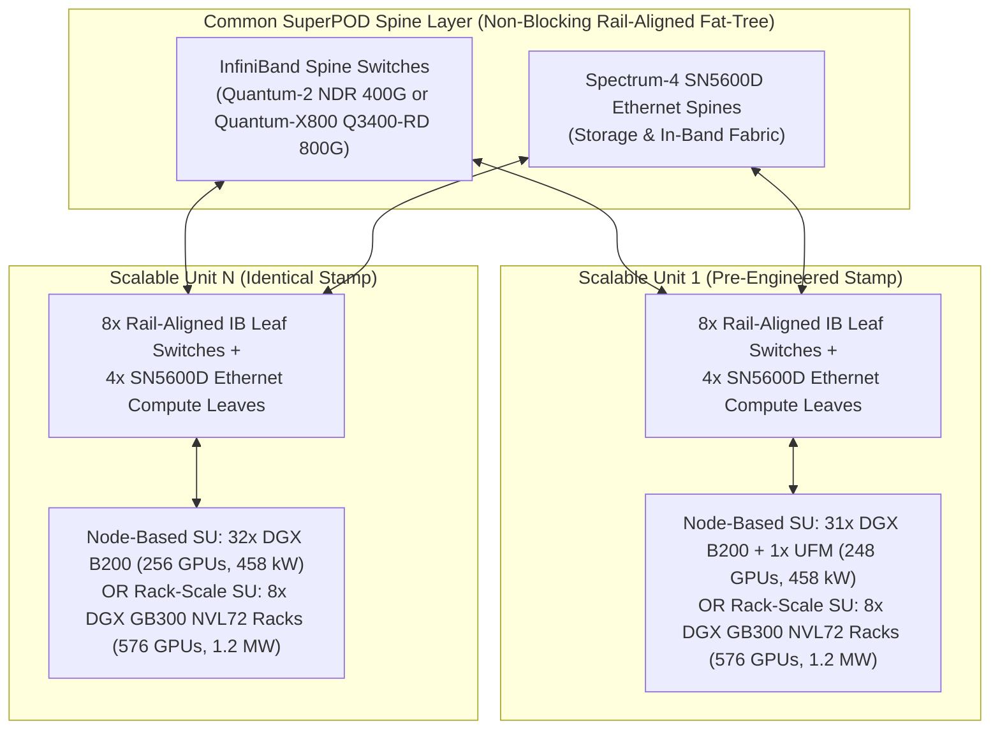
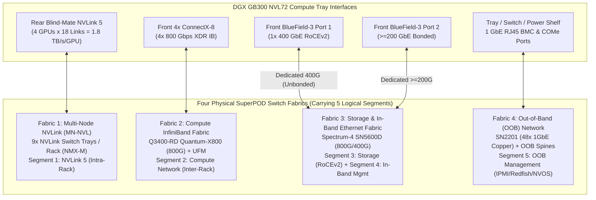

# 9.6 DGX SuperPOD concepts: scalable units, fabrics and tiers

| | |
|---|---|
| **Status** | Drafted (`superpod_concepts_lab.py`: 30 checks pass; cluster commands **untested** on live SuperPOD) |
| **Level** | Advanced |
| **Priority tier** | 1b |
| **Lab venue** | none (design / reading) + self-checking Python model (`code/part09/superpod_concepts_lab.py`) |
| **Part** | Part 9: NVIDIA systems and reference architectures |
| **Sources used** | *Data Center Best Practices with DGX B200* (`superpod-b200-dc`); *NVIDIA DGX SuperPOD Reference Architecture Featuring NVIDIA DGX GB300 Systems* (`superpod-gb300-ra`); `nvidia-devops` V21 (Ch. 1–4) |

## Why this matters for AI infrastructure

When an enterprise or cloud provider scales from a single 8-GPU node to 256, 1,024, or 9,216 GPUs, custom one-off cluster design becomes a multi-month trap. If your network team designs an ad-hoc spine-leaf ratio, your storage team buys a generic NAS without testing simultaneous 1-terabyte checkpoint bursts, and your facilities team cables racks without accounting for InfiniBand attenuation limits, the cluster takes six months to commission and spends half its life debugging collective timeouts.

To turn AI cluster construction from a bespoke science project into repeatable industrial manufacturing, NVIDIA created the **DGX SuperPOD** reference architecture: a physical twin of NVIDIA's own internal R&D supercomputers (`Eos` and `Selene`), built from pre-engineered **Scalable Units (SUs)**, five standardized network segments carried over four physical fabrics, and certified **Standard** and **Enhanced** storage performance tiers. Understanding how a Scalable Unit is defined across generations (`32 nodes / 256 GPUs` in node-based DGX H100/B200 vs `8 NVL72 racks / 576 GPUs` in rack-scale DGX GB200/GB300), why the UFM appliance displaces one DGX B200 node (`31`, `63`, `95`, `127` nodes), why partial-SU deployments must still install the full SU leaf-spine fabric, and how to balance compute, network, and storage tiers is the foundation of AI factory architecture.

:::info Corpus scope note
The standalone historical *NVIDIA DGX H100 SuperPOD Reference Architecture* PDF is not in `~/Desktop/books-toon-rag/`. In this chapter, DGX SuperPOD principles and exact scaling tables are drawn from *Data Center Best Practices with DGX B200* (`superpod-b200-dc`, pp. 1–24), *NVIDIA DGX SuperPOD: Next Generation Scalable Infrastructure for AI Factories Reference Architecture Featuring NVIDIA DGX GB300 Systems* (`superpod-gb300-ra`, pp. 1–36), and `nvidia-devops` Volume 21 (Chapters 1–4). Deep dives into DGX B200 data center power/cooling/cabling (`9.7`), the GB300 SuperPOD reference architecture (`9.8`), the four SuperPOD network fabrics (`9.9`), and BasePOD (`9.10`) follow in the next chapters.
:::

## Prerequisites and outcomes

**Prerequisites:**
- Chapters `9.1` to `9.5` (DGX node families, 8-GPU Hopper/Blackwell internals, Grace Superchips, and GB200/GB300 NVL72 racks).
- Chapter `8.15` and `8.16` (BCM and NVIDIA Mission Control in a SuperPOD).

**Outcomes:** After completing this chapter, you will be able to:
1. Define the **AI Factory** supply-chain mindset and the **Tier 3 / Rated 3 / Class 3** facility availability baseline.
2. Contrast **Node-Based Scalable Units** (`DGX H100` / `DGX B200`) against **Rack-Scale Scalable Units** (`DGX GB200` / `DGX GB300 NVL72`) and enforce the **Partial-SU Fabric Rule**.
3. Map the **five logical network segments** onto the **four physical fabrics**, and compare collective algorithms (`Ring`, `Tree`, `Recursive Doubling`) and InfiniBand versus RoCEv2 trade-offs.
4. Size the two SuperPOD storage systems (**High-Performance Storage** over RoCEv2 versus **User Storage** over NFS) across the **Standard** and **Enhanced** tiers, plus the **14-byte/parameter** AdamW checkpoint footprint.

---

## Concepts: basics → intermediate → advanced

## 1. The AI Factory mindset and why SuperPOD is a "physical twin"

An **AI Factory** is an industrial manufacturing plant whose raw material is data and whose finished product is trained model weights and real-time intelligence tokens.

Think of a modern automotive assembly plant: if you install 1,000 robotic welding arms (the GPUs) but feed them with a single slow conveyor belt (a 10 GbE network) and a tiny loading dock (an under-sized NAS), the robots sit idle 80% of the day. Worse, if every factory manager designs their own custom conveyor-belt widths and electrical panels from scratch, building a new plant takes two years instead of six weeks.

### 1.1 The "Physical Twin" principle and Tier 3 facility standard

NVIDIA designed the **DGX SuperPOD** to eliminate custom cluster trial-and-error:
1. **A physical twin of NVIDIA's own R&D supercomputers:** Every DGX SuperPOD deployed at a customer data center or colocation facility is a physical and logical twin of the clusters NVIDIA's own engineering teams run internally. That means the **NVIDIA Mission Control** / **Base Command Manager (BCM)** software stack, firmware bundles, **NGC** containers, **Magnum IO** libraries, and **Run:ai** / **Slurm** schedulers are regression-tested at full scale by NVIDIA before reaching customer racks.
2. **Turnkey support across compute, network, storage, and software:** While a customer owns and operates the on-premises hardware (and integrates their Building Management System, BMS), **NVIDIA Enterprise Support (NVEX)** provides unified full-system support across the DGX systems, NVIDIA InfiniBand and Spectrum Ethernet fabrics, Mission Control software, and certified partner storage validated under the **DGX Storage Program**.
3. **Data center availability tier requirement:** Because a multi-megawatt AI factory cannot tolerate single-point utility or cooling failures, the DGX SuperPOD reference architecture specifies that the hosting data center should meet or exceed **Uptime Institute Tier 3**, **TIA-942-B Rated 3**, or **EN 50600 Availability Class 3** design standards—guaranteeing **concurrent maintainability** and **no single point of failure** across power and cooling distribution.

### 1.2 The five dimensions of workload characterization and three SLA tiers

Before choosing how many Scalable Units or which storage tier to deploy, characterize your AI factory's workloads across five orthogonal dimensions:
1. **Model Tier:** Small (`< 7B` params, `< 15 GB`), Medium (`7B–70B`, `15–140 GB`), Large (`70B–500B+`, `140 GB–1 TB+`), or Mixture-of-Experts (`MoE` with dynamic token routing).
2. **Execution Mode:** Offline batch pre-training (days to weeks), continuous training, online real-time inference (`TTFT ≤ 500 ms`, `ITL ≤ 30–100 ms`), batch inference, or multi-tenant fine-tuning (`LoRA`).
3. **Concurrency Profile:** Single large synchronous job (e.g., 64–9,216 GPUs), medium (10–100 inference replicas), high (`1,000+ QPS`), or heterogeneous mixed training + inference.
4. **Primary Resource Bottleneck:** Compute-bound (prefill, dense matmuls), memory-bandwidth-bound (autoregressive decode), network-bound (multi-node `AllReduce` / `AllToAll`), or storage-bound (multimodal video/image streaming and checkpoint writes).
5. **Availability & SLA Tier:**
   - **Tier 1 — Best-Effort (Research / Dev):** `90%–95%` availability, manual restart, zero geo-redundancy overhead.
   - **Tier 2 — Production High-Availability:** `99.0%–99.5%` availability, `5–30 min` MTTR, automatic checkpoint resume (`~30%` infrastructure redundancy overhead).
   - **Tier 3 — Mission-Critical Revenue SLA:** `99.9%–99.99%` availability (`99.95%` = **21.6 minutes/month** total error budget, or **43.2 seconds/day**), `< 1 min` automated failover, active-active multi-region redundancy (`~50%+` GPU capacity overhead).

:::tip In one minute
- A **DGX SuperPOD** is an on-premises **physical twin** of NVIDIA's own internal R&D supercomputer, backed by full-stack **NVIDIA Enterprise Support (NVEX)** and **NVIDIA Mission Control**.
- Hosting facilities should meet **Uptime Institute Tier 3 / TIA-942-B Rated 3 / EN 50600 Class 3** standards (concurrent maintainability, no single point of failure).
- Design top-down from **business SLAs and Cost per Output** (`99.95%` availability allows only **21.6 minutes/month** of downtime) before selecting SU counts and storage tiers.
:::

---

## 2. The Scalable Unit (SU): the modular Lego brick of a SuperPOD

Instead of designing a 500-GPU or 4,000-GPU cluster as one monolithic hairball of cables, a DGX SuperPOD is stamped out in pre-engineered, fixed-size building blocks called **Scalable Units (SUs)**. Adding capacity to an AI factory simply means stamping out another Scalable Unit and connecting its leaf switches to the common spine fabric.



### 2.1 Node-Based Scalable Units (`DGX H100` / `DGX B200`: 32 nodes / 256 GPUs per SU)

In 8-GPU air-cooled node architectures (`DGX H100`, `DGX H200`, and `DGX B200`), a **Scalable Unit** is defined around the radix of 64-port NDR InfiniBand leaf switches:
- **Nominal SU size:** **Up to 32 DGX systems (256 GPUs)** per Scalable Unit. On **DGX B200** (14.3 kW per node), one 32-node SU draws **458 kW** (`32 × 14.3 kW = 457.6 kW ≈ 458 kW`).
- **The UFM Appliance Displacement Rule (`31`, `63`, `95`, `127` nodes):** In the DGX B200 SuperPOD deployment pattern, an **NVIDIA Unified Fabric Manager (UFM) appliance displaces one DGX B200 server** in the first Scalable Unit. As a result, a full 4-SU DGX B200 SuperPOD contains a maximum of **127 DGX B200 servers (1,016 GPUs)** rather than 128:

| SU Count | Nominal 32-Node Slots | Actual DGX B200 Nodes (with 1 UFM Displaced) | Total B200 GPUs | IB Leaf Switches | IB Spine Switches | Compute + UFM Cables (`Nodes×8 + 4`) | Spine–Leaf Cables (`SUs × 256`) | Estimated Compute Power |
|---|---|---|---|---|---|---|---|---|
| **1 SU** | 32 | **31 nodes** + 1 UFM | **248 GPUs** | **8** | **4** | **252** | **256** | **~458 kW** |
| **2 SUs** | 64 | **63 nodes** + 1 UFM | **504 GPUs** | **16** | **8** | **508** | **512** | **~916 kW** |
| **3 SUs** | 96 | **95 nodes** + 1 UFM | **760 GPUs** | **24** | **16** | **764** | **768** | **~1,374 kW** |
| **4 SUs** | 128 | **127 nodes** + 1 UFM | **1,016 GPUs** | **32** | **16** | **1,020** | **1,024** | **~1,832 kW** |

*(While a typical node-based SuperPOD contains **1 to 4 Scalable Units**, the reference architecture can scale up to **64 Scalable Units** with a multi-tier spine/super-spine fabric.)*

### 2.2 Rack-Scale Scalable Units (`DGX GB200` / `DGX GB300 NVL72`: 8 racks / 576 GPUs / 1.2 MW per SU)

When the server becomes a 72-GPU NVL72 rack, the Scalable Unit scales up correspondingly:
- **1 Rack-Scale SU = 8 DGX GB300 (or GB200) NVL72 racks:**
  - `8 racks × 18 compute trays/rack = 144 compute trays`
  - `8 racks × 72 GPUs/rack = 576 Blackwell GPUs` (and `288 Grace CPUs`) per SU
  - **Thermal Design Power (TDP):** **1.2 Megawatts (MW)** per Scalable Unit (`~150 kW` per rack).
- **Scaling to 16 SUs (128 racks = 9,216 GPUs) in a 2-layer fabric:** Because the **NVIDIA Q3400-RD Quantum-X800 (800 Gbps XDR)** InfiniBand switch provides a massive **144-port radix**, a DGX GB300 SuperPOD can scale all the way from **1 SU (576 GPUs)** to **16 SUs (128 racks = 9,216 GPUs, 19.2 MW TDP)** using a simple **two-layer leaf-spine fat-tree** without needing a third core/super-spine tier.

### 2.3 Three non-negotiable SuperPOD physical rules

1. **The Partial-SU Fabric Rule:** What if your initial budget or power envelope only allows deploying 5 NVL72 racks instead of a full 8-rack SU (or 20 DGX B200 nodes instead of 31)? **You must still install all leaf switches and all leaf-to-spine cables for the full Scalable Unit**, leaving the switch ports where the missing nodes would plug in unused. Never shrink the leaf count or uplink count for a partial SU; keeping the full SU switch/cable stamp guarantees symmetric ECMP/adaptive routing and lets you slide in the remaining racks later with zero network re-architecture.
2. **Zero unrelated IT equipment in DGX racks or cooling gaps:** A DGX Scalable Unit is a thermally balanced appliance. Never mount third-party customer appliances in empty RU slots inside a DGX rack, and when air-cooled DGX B200 racks are spaced apart to aggregate room cooling capacity, **never place unrelated IT equipment in the spaces between DGX racks**.
3. **Never use patch panels or intermediary ToR switches on InfiniBand:** InfiniBand 400G NDR and 800G XDR cable length limits (up to **3 m** for 400G passive Direct Attached Copper `DAC`, up to **5 m** for 100G DAC, and up to **30 m** for Active Optical Cables `AOC`, keeping all runs **under 90% of max rated distance**) are governed by end-to-end signal attenuation and latency. Structured fiber patch panels add optical loss that breaks link training, and intermediary switches ruin single-hop rail latency.

:::tip In one minute
- A **Node-Based SU (`DGX B200`)** holds up to **32 nodes (458 kW)**, with **1 UFM appliance displacing 1 node** in SU 1 (`31`, `63`, `95`, `127` nodes = `248`, `504`, `760`, `1,016` GPUs across 1–4 SUs).
- A **Rack-Scale SU (`DGX GB300 NVL72`)** holds **8 NVL72 racks = 144 compute trays = 576 GPUs** at **1.2 MW TDP**, scaling to **16 SUs (128 racks = 9,216 GPUs, 19.2 MW)** in a 2-layer 144-port `Q3400-RD` Quantum-X800 fat-tree.
- **Partial-SU Rule:** Always install the **full SU leaf switches and leaf-spine cables** even when deploying fewer nodes/racks, and **never** put patch panels on InfiniBand or unrelated IT gear in DGX racks.
:::

---

## 3. The five network segments across four physical fabrics

A DGX SuperPOD never mixes GPU collective traffic, storage I/O, user SSH/Kubernetes traffic, and BMC management on a shared network. In the DGX GB300 (and GB200) SuperPOD reference architecture, **five logical network segments** are carried over **four physically distinct switch fabrics**:



### 3.1 Mapping the 5 logical segments to the 4 physical fabrics

| Physical Fabric | Switch Hardware & Manager | Logical Segment(s) Carried | Speed, Blocking Ratio & Design Purpose |
|---|---|---|---|
| **1. Multi-Node NVLink Fabric (`MN-NVL`)** | **9x NVLink Switch Trays** per rack (`18 NVSwitch ASICs`), managed by **`NMX-M`** | **Segment 1: NVLink 5** | **1.8 TB/s per GPU (`130 TB/s`/rack)**, **1:1 non-blocking** intra-rack all-to-all GPU memory fabric. |
| **2. Compute InfiniBand Fabric** | **NVIDIA Q3400-RD Quantum-X800** (`144x 800G XDR` on GB300) or **QM9700** (`64x 400G NDR` on H100/B200), managed by **`UFM Enterprise`** | **Segment 2: Compute Network** | **4x 800 Gbps per tray** (`4 rails × 2 leaves/rail = 8 leaves/SU`), **1:1 non-blocking** rail-optimized full fat-tree for inter-rack GPU collectives (`SHARPv3`, `AR`, `SHIELD`). |
| **3. Storage & In-Band Ethernet Fabric** | **NVIDIA Spectrum-4 SN5600D** (`64x 800 GbE` / `128x 400 GbE` ports) | **Segment 3: Storage Network** + **Segment 4: In-Band Management Network** | Uses separate ports on the dual-port **BlueField-3 (`BF3240`)**: **Port 1 (400 GbE unbonded)** carries lossless **RoCEv2** to High-Performance Storage (**1:3 blocking** on compute leaves; **72x 400G non-blocking** on storage leaves); **Port 2 (≥200 GbE)** carries In-Band Management, NFS User Storage, Slurm/K8s, and `≥2x 100GbE DR1` eBGP border uplinks. |
| **4. Out-of-Band (OOB) Ethernet Network** | **NVIDIA SN2201** (`48x 1 Gbps` copper RJ45) + dedicated OOB Aggregation Spines | **Segment 5: Out-of-Band Management Network** | Physically isolated 1 GbE network connecting all compute/switch/storage BMCs, BlueField BMCs, NVSwitch `COMe` (`NVOS`) ports, and smart rack PDUs (rolled up per SU via VXLAN). |

:::note Why Storage RoCEv2 and In-Band Management are never bonded on the same interface
On a DGX GB300 compute tray, the dual-port BlueField-3 DPU dedicates one physical **400 Gbps port exclusively to the RoCEv2 Storage Network** and the second port (**≥200 Gbps**) to the **In-Band Management Network**. Separating them onto dedicated physical ports ensures that RoCEv2 storage traffic is never perturbed by In-Band TCP bursts, and avoids error-prone per-host policy routing tables.
:::

### 3.2 How the four fabrics scale across 1 to 16 Scalable Units (`DGX GB300 SuperPOD`)

Using the 144-port **Q3400-RD Quantum-X800** InfiniBand switch (`8 compute leaves per SU`, organized as `4 rails × 2 leaves per rail`, where compute trays in the same SU and same rail are **1 hop apart** and cross-rack/cross-rail traffic traverses the spine) and the **Spectrum-4 SN5600D** Ethernet switch (`4 compute leaves per SU` at a `1:3` blocking ratio alongside non-blocking storage leaves), a GB300 SuperPOD scales from **1 SU (`576 GPUs`, `8` IB leaves, `4` optional IB spines)** to **2 SUs (`1,152 GPUs`, `16` IB leaves, `8` IB spines)**, **4 SUs (`2,304 GPUs`, `32` IB leaves, `18` IB spines)**, **8 SUs (`4,608 GPUs`, `64` IB leaves, `36` IB spines)**, and **16 SUs (`9,216 GPUs`, `128` IB leaves, `72` IB spines, `24` Ethernet spines, `8` storage leaves supporting `1,024 × 400GbE`)** in just two switching layers. See **chapter `9.8`, sections 3 and 4** for the complete `72 downlink + 72 uplink = 144 port` InfiniBand proof, the `24:72 = 1:3` Ethernet compute-leaf proof, and the full multi-SU switch tables (`Tables 3 & 4`).

### 3.3 Collective algorithms (`Ring`, `Tree`, `Recursive Doubling`) and InfiniBand vs RoCEv2 economics

Why does the Compute Fabric require a lossless, non-blocking fat-tree? Because every distributed training step ends with a synchronous collective (`AllReduce`, or `AllGather` + `ReduceScatter` in FSDP) where the slowest link paces the entire cluster—the **Communication Tax**:
- **Ring AllReduce (`2(N - 1)` steps):** Each rank sends chunks of size `Buffer / N` around a logical ring, transferring `2(N - 1) / N` of the buffer per GPU. **Bandwidth-optimal for large messages**, but latency scales linearly as `O(N)`. (For an 800 MB gradient across 4 GPUs on 50 GB/s NDR links: `200 MB / 50 GB/s = 4 ms/step × 6 steps ≈ 24 ms`.)
- **Pipelined Double Binary Tree (`O(log N)` depth):** Selected automatically by NCCL (`NCCL_ALGO=Tree`) at larger rank counts where ring latency grows too large.
- **Recursive Doubling (`log2(N)` rounds):** Exchanges buffers at distance `1, 2, 4, ...` (`3 rounds` for 8 GPUs). **Latency-optimal for small messages**, but exchanges the full buffer each round.
- **Hiding the Communication Tax via backward-pass bucketing:** PyTorch DDP and FSDP group gradients into buckets (`bucket_cap_mb = 25 MB` default in DDP) and launch asynchronous `AllReduce` calls during `loss.backward()` so communication overlaps backward compute, leaving only the final bucket tail exposed.
- **When to pay the InfiniBand premium vs 400GbE RoCEv2:** In our Volume 21 64-GPU H100 case study, InfiniBand NDR ($15K/node) costs **$448K more upfront** than 400GbE RoCEv2 ($8K/node across 64 GPUs). Even if RoCE adds 8% iteration overhead on a 7-day Llama-70B run (`13.4 extra hours × 64 GPUs × $2.14/GPU-hr ≈ $1,835/run`, or **~$44K/year** across 24 runs), **pure compute-time savings alone do not pay back $448K at 64-GPU scale**. Be honest in architecture reviews: at ≤64 GPUs with no growth plan, RoCEv2 is economically defensible; you buy InfiniBand when scaling to **128–256+ GPUs**, where credit-based lossless flow control, hardware Adaptive Routing (`AR`), `SHARPv3`, and `SHIELD` self-healing avoid RoCE PFC pause storms and mid-life fabric rip-and-replace costs.

:::tip In one minute
- SuperPOD carries **5 network segments** (`NVLink 5`, `Compute`, `Storage`, `In-Band Mgmt`, `OOB Mgmt`) over **4 physical fabrics** (`MN-NVL`, `Compute InfiniBand`, `Storage & In-Band Ethernet`, `OOB Ethernet`).
- On `DGX GB300`, `144-port Q3400-RD` Quantum-X800 switches (`8 leaves/SU`) and `SN5600D` Ethernet switches (`4 compute leaves/SU` at `1:3` blocking; non-blocking storage leaves) scale to **16 SUs (9,216 GPUs)** in two layers.
- Never bond the **400G RoCEv2 Storage port** with the **In-Band Management port** on the BlueField-3 DPU.
:::

---

## 4. SuperPOD storage architecture: HPS vs User Storage, Standard vs Enhanced tiers, and 14-byte/param checkpoints

To prevent 576 to 9,216 GPUs from stalling on dataset reads or checkpoint bursts, a DGX SuperPOD separates external storage into **two distinct storage systems** and defines **two certified performance tiers**.

### 4.1 High-Performance Storage (HPS) vs User Storage, and Standard vs Enhanced tiers

1. **System 1 — High-Performance Storage (HPS):**
   - **What it is:** A resilient, POSIX-compliant parallel file system (from a certified **DGX Storage Program** partner such as WEKA, VAST, Lustre/DDN, or IBM Storage Scale / GPFS) accessed over **400 Gbps lossless RoCEv2** from each compute tray's dedicated BlueField-3 storage port.
   - **What it requires:** Native RoCEv2 RDMA + GPUDirect Storage (`GDS`), explicit certification for **Grace-based (`aarch64`) systems**, transparent read/write caching across local system RAM and local E1.S/U.2 NVMe flash, and non-disruptive software/firmware upgrades.
2. **System 2 — User Storage (NFS over In-Band Ethernet):**
   - **What it is:** An enterprise NFS share exposed over the **In-Band Management Ethernet fabric** (requiring **at least 100 GbE DR1** connectivity) optimized for high metadata IOPS rather than multi-terabyte parallel streaming.
   - **What it holds:** User `/home` directories (for Slurm and interactive users), administrative scratch scripts, centralized cluster log collection, and shared state for High Availability control-plane services (such as **NVIDIA Mission Control** and **Base Command Manager**).

Depending on whether your AI factory runs compute-dominated text LLMs or I/O-intensive multimodal (video/image/audio) pipelines, `superpod-gb300-ra` specifies two **High-Performance Storage throughput tiers** (where linear scaling per SU is **my inference** generalizing the 1-SU and 4-SU rows of the reference architecture table):

| Storage Tier | Target Workload Profile | Dataset Fit | 1 SU Aggregate Read / Write | 4 SUs Aggregate Read / Write | Read : Write Ratio |
|---|---|---|---|---|---|
| **Standard Tier** | Concurrent text LLM pre-training, fine-tuning, and periodic checkpoints + inference where **compute dominates I/O**. | Single-modality datasets that largely fit inside local compute node memory/NVMe cache during runs. | **90 GB/s Read**<br/>**45 GB/s Write** | **360 GB/s Read**<br/>**180 GB/s Write** | **2 : 1** |
| **Enhanced Tier** | Concurrent **multimodal** (video, image, sensor) training + frequent billion/trillion-param checkpoints + RAG vector serving where **I/O is in the critical path**. | Multi-modality datasets too large to fit in local node cache, requiring continuous high-rate streaming. | **280 GB/s Read**<br/>**140 GB/s Write** | **1,120 GB/s Read (`1.12 TB/s`)**<br/>**560 GB/s Write** | **2 : 1** |

### 4.2 Why text LLM pre-training is checkpoint-write-bound (the 14-byte/parameter rule)

Why does text LLM training barely touch storage read bandwidth during normal steps, yet crash enterprise NAS boxes every few hours? Run the data pipeline math from `nvidia-devops` Volume 21 Chapter 4:
- **Steady-state text read bandwidth is tiny:** A 64-GPU H100 cluster training Llama-3-70B at 40% MFU processes roughly **`60,000 tokens/second`** (`~940 tokens/s/GPU`). At 2 to 4 bytes per pre-tokenized integer ID, the entire 64-GPU cluster reads only **120 to 240 KB/s** of text. (In contrast, 64 GPUs training on uncompressed image/video frames require **tens of GB/s** of continuous read bandwidth—the **Enhanced Tier**.)
- **Checkpoint writes are explosive (`14 bytes per parameter`):** When training a transformer with mixed-precision **AdamW**, each checkpoint saves:
  ```text
  BF16 model weights:          2 bytes / parameter
  FP32 master weights:         4 bytes / parameter
  Adam 1st moment (m, FP32):   4 bytes / parameter
  Adam 2nd moment (v, FP32):   4 bytes / parameter
  ────────────────────────────────────────────────
  Total Checkpoint State:     14 bytes / parameter
  (Active training VRAM adds 2 bytes/param for BF16 gradients = 16 bytes/parameter)
  ```
  For a **70-billion-parameter model**, a single checkpoint is **`70 × 10^9 × 14 bytes = 980 GB (~1 TB)`**.
- **Two-stage sharded checkpointing (Local NVMe → Shared PFS → S3 Archive):**
  - Instead of gathering 980 GB onto `Rank 0` (which OOMs the host and serializes I/O), use **PyTorch Distributed Checkpoint (`torch.distributed.checkpoint`)** so all 64 GPUs write their own **15.31 GB shard** (**122.48 GB per 8-GPU node**) in parallel.
  - Stage each node's 122.48 GB shard to **Tier 1 Local NVMe (`/raid`)** first (at 15 GB/s per node, the write finishes in **`8.17 seconds`** so GPUs resume training immediately), and flush asynchronously in the background to **Tier 2 High-Performance Storage** (where 980 GB at 10 GB/s takes `98 seconds`, or at 45 GB/s Standard SU write rate takes `21.8 seconds`) and **Tier 3 Object Storage (S3)** with atomic temp-file rename and SHA-256 manifest verification.

:::tip In one minute
- SuperPOD deploys two storage systems: **High-Performance Storage (HPS)** over **400G RoCEv2** for parallel training/checkpoint I/O, and **User Storage (NFS)** over **≥100 GbE In-Band Ethernet** for `/home`, logs, and Mission Control/BCM HA state.
- Size HPS to either the **Standard Tier (`90 GB/s` read / `45 GB/s` write per SU)** for text LLMs or the **Enhanced Tier (`280 GB/s` read / `140 GB/s` write per SU)** for multimodal workloads.
- Mixed-precision AdamW checkpoints require **14 bytes/parameter** (`980 GB` for a 70B model; `16 bytes/param` = `1,120 GB` in active training memory). Write sharded checkpoints to **local NVMe first (`~8.2 s`)**, then flush asynchronously to HPS and S3.
:::

---

## 5. SuperPOD software stack and AI factory TCO economics

### 5.1 The five-layer NVIDIA Mission Control and Run:ai architecture

Every DGX SuperPOD is operated through **NVIDIA Mission Control**, which unifies five operational layers: (1) **Base Command Manager (`BCM`)** for bare-metal provisioning and firmware lifecycle, (2) **`UFM Enterprise` and `NMX-M`** for InfiniBand and NVLink switch management, (3) **high-frequency telemetry** integrated with the data center **Building Management System (`BMS`)** over eBGP in the untrusted edge zone, (4) **validation and autonomous hardware/job recovery** with in-memory checkpointing, and (5) **Slurm and NVIDIA Run:ai** workload orchestration (with the Run:ai control plane on the user-space Kubernetes cluster and cluster operands on the administrative Kubernetes infrastructure). See **chapter `8.16`**, **chapter `9.8`, section 6**, and **chapter `9.12`, section 1** for the full software architecture.

### 5.2 AI Factory TCO and Cost-per-Output discipline

When presenting a SuperPOD design to executive leadership, translate CAPEX and OPEX into **Cost per GPU-Hour** and **Cost per Million Tokens**:
- **16-node (128-GPU H100 SXM5) illustrative 3-year TCO:** At `$285K/node` (`$4.56M` compute) + `$400K` IB fabric + `$200K` racks/PDUs + `$100K` install = **`$5.26M` CAPEX**, plus **`$644K/year` OPEX** (`$171.6K` electricity at 163 kW and `$0.12/kWh`, `$400K` for 2 FTEs, `$52.6K` support, `$20K` software), the 3-year TCO is **`$5.26M + 3 × $644K = $7.19M`**, or **`$2.14 per GPU-hour`** (`$7.19M / (128 GPUs × 8,760 hrs × 3 yrs)`).
- **Utilization dominates electricity in token economics:** On a 40-GPU H100 inference cluster generating 60,000 tokens/sec aggregate (`37.8 kW` with 1.35 PUE), electricity costs only **`$0.021` per 1M tokens**, whereas amortized hardware + operations (`$500K/year`) costs **`$0.26` per 1M tokens at 100% utilization** (**`$0.28/1M tokens` total**, or `~$0.0003/1K tokens`), rising to **`~$0.68/1M tokens` (`~$0.0007/1K tokens`) at 40% utilization**. Keeping GPUs busy via Mission Control, Run:ai bin-packing, and fast checkpoint recovery is worth more than any electricity discount.

:::tip In one minute
- **NVIDIA Mission Control** unifies **BCM** (provisioning), **UFM** (InfiniBand), **NMX-M** (NVLink switches), **BMS telemetry**, **autonomous recovery**, and **Slurm / Run:ai** scheduling.
- Customer edge connectivity uses **≥2x 100 GbE DR1** single-mode uplinks with **eBGP** route handover for In-Band, OOB, and BMS networks.
- In AI factory TCO, **hardware amortization and utilization dominate electricity** (`$0.26/1M tokens` HW vs `$0.021/1M tokens` power at 100% utilization), making high cluster Goodput the primary financial lever.
:::

---

## Commands and configurations that matter

Use these commands and NCCL environment settings to benchmark multi-node SuperPOD collective scaling, inspect InfiniBand and RoCEv2 congestion counters, and execute sharded PyTorch Distributed Checkpoints (**untested** on live Multi-SU SuperPOD hardware in this authoring environment; sizing and rules verified in `code/part09/superpod_concepts_lab.py`).

### 1. Multi-node `nccl-tests` scaling benchmark across Scalable Units

```bash
# Run an 8 MB to 8 GB AllReduce sweep across 16 nodes (128 GPUs, 8 processes/node)
mpirun -np 128 --map-by ppr:8:node \
  -x NCCL_DEBUG=INFO \
  -x NCCL_IB_PCI_RELAXED_ORDERING=2 \
  ./build/all_reduce_perf -b 8M -e 8G -f 2 -g 1
# Compare 'busbw (GB/s)' against the single-node baseline (target <= 10% multi-node dropoff)
```

### 2. Inspect InfiniBand credit-wait / symbol errors and RoCEv2 PFC/ECN counters

```bash
# 1. On Compute InfiniBand fabric: check port state (Active / 400G NDR or 800G XDR) and error counters
ibstat | grep -E "CA '|State:|Physical state:|Rate:"
ibqueryerrors -s RcvSwRelayErrors,LinkDowned,VL15Dropped
perfquery -x | grep -E "PortXmitWait|SymbolErrorCounter|LinkErrorRecoveryCounter"

# 2. On Storage RoCEv2 Ethernet fabric (BlueField-3 Port 1): check PFC pause and ECN marks
ethtool -S enp3s0f0np0 | grep -iE "pause|pfc|ecn|cnp|out_of_buffer"
```

### 3. Production NCCL environment variable reference (NCCL 2.24+)

```bash
# Leave NCCL_ALGO unset in production so NCCL auto-selects by message size and topology.
# Valid tokens when benchmarking (invalid tokens fail since NCCL 2.24):
#   Ring | Tree | CollnetDirect | CollnetChain | NVLS | NVLSTree
export NCCL_IB_HCA="=mlx5_0:1,mlx5_1:1,mlx5_2:1,mlx5_3:1"   # '=' enforces exact HCA list
export NCCL_BUFFSIZE=4194304                                # Default 4 MiB per channel
export NCCL_IB_PCI_RELAXED_ORDERING=2                       # 2 = auto-enable PCIe relaxed ordering
```

### 4. Two-stage sharded checkpointing with `torch.distributed.checkpoint`

```python
import os
import torch.distributed.checkpoint as dcp

def save_sharded_checkpoint_atomic(model, optimizer, step: int, raid_stage_dir: str) -> None:
    """Each rank writes its own ~15.3 GB shard to local NVMe (/raid) and renames atomically."""
    tmp_dir = f"{raid_stage_dir}/step-{step}.tmp"
    final_dir = f"{raid_stage_dir}/step-{step}"
    state = {"model": model.state_dict(), "optim": optimizer.state_dict(), "step": step}
    dcp.save(state, storage_writer=dcp.FileSystemWriter(tmp_dir))
    if int(os.environ.get("LOCAL_RANK", "0")) == 0:
        os.replace(tmp_dir, final_dir)  # Atomic directory rename after shard barrier
```

---

## How it fails

| Failure mode | Symptom | Root cause | Diagnosis & fix |
|---|---|---|---|
| **1. Under-provisioning leaf/spine switches on a partial-SU deployment** | A customer deploys 5 NVL72 racks (half an SU) with only 4 IB leaf switches instead of 8; when they add 3 more racks six months later, the entire cluster must be powered down and re-cabled, and cross-rack jobs suffer 2:1 oversubscription. | Violating the **Partial-SU Fabric Rule**: shrinking the switch count or leaf-spine Inter-Switch Links (ISLs) to match initial node count breaks rail symmetry and bisection bandwidth. | Always provision **all 8 IB leaf switches per SU and all leaf-spine cables** up front even for a partial SU, leaving the unpopulated node ports dark until expansion racks arrive. |
| **2. Bonding the 400G RoCEv2 Storage port with the In-Band Management port** | Periodic checkpoint writes or dataset prefetches cause Slurm/Kubernetes heartbeats to time out, or SSH/Prometheus scrapes trigger RoCEv2 latency spikes on High-Performance Storage. | The administrator bonded both BlueField-3 DPU ports into a single LACP bond carrying both RoCEv2 storage and TCP in-band management traffic. | Follow the DGX GB200/GB300 SuperPOD segmentation design: dedicate **Port 1 (400 Gbps unbonded)** strictly to lossless **RoCEv2 Storage**, and dedicate **Port 2 (≥200 Gbps)** to **In-Band Management and NFS User Storage**. |
| **3. Using fiber patch panels or intermediary ToR switches to extend InfiniBand runs** | Links on the Compute InfiniBand fabric flap between `Polling` and `Active`, log high `SymbolErrorCounter` / `LinkErrorRecoveryCounter` rates, or add 2+ extra switch hops to `AllReduce`. | Data center facilities routed 400G/800G InfiniBand cables through structured overhead fiber patch panels or an extra ToR switch because the spine racks were placed too far away (>30 m for AOC). | Never use patch panels or intermediary ToR switches on InfiniBand. Place SU racks around the central management/switch racks so direct point-to-point **DAC (≤3 m at 400G)** or **AOC (≤30 m, kept `< 90%` of max length)** cables reach directly from each compute NIC to its rail leaf switch. |
| **4. `Rank 0` gather OOM and 10-minute stall during 70B checkpoint saves** | Every 8 hours, training freezes for 10+ minutes or crashes with CPU/GPU OOM while saving the 980 GB Llama-70B AdamW checkpoint over NFS. | The training script called `torch.save()` on `Rank 0` and wrote to the NFS **User Storage** tier instead of writing sharded checkpoints to **Local NVMe** + **RoCEv2 High-Performance Storage**. | Switch to **`torch.distributed.checkpoint` (`dcp.save`)** so all 64 GPUs write their `15.31 GB` shards (`122.48 GB/node`) in parallel to local `/raid` NVMe in **`~8.2 seconds`**, then flush asynchronously to the RoCEv2 Parallel File System. |
| **5. Unrecognized token crash after setting legacy `NCCL_ALGO=Collnet` on NCCL 2.24+** | Distributed training jobs exit immediately during communicator initialization after upgrading the NGC PyTorch container to NCCL 2.24+. | Starting in NCCL 2.14, `Collnet` was split into `CollnetDirect` and `CollnetChain`, and **since NCCL 2.24 invalid tokens in `NCCL_ALGO` cause a hard failure** (and omitting `Ring` removes the ring fallback). | Unset `NCCL_ALGO` so NCCL selects the optimal algorithm (`Ring`, `Tree`, `NVLS`, `NVLSTree`, `CollnetDirect`) automatically by message size and topology, or use exact valid tokens verified with `NCCL_DEBUG=INFO`. |

---

## Hands-on lab

This chapter's self-checking Python model (`code/part09/superpod_concepts.py`) and lab runner (`code/part09/superpod_concepts_lab.py`) implement:
1. The **DGX B200 SuperPOD Scalable Unit Sizer** (`1 to 4 SUs`, modeling the 32-node / 458 kW SU, the 1-node UFM displacement rule yielding `31, 63, 95, 127` nodes and `248, 504, 760, 1,016` GPUs, `8/16/24/32` IB leaves, `4/8/16/16` IB spines, `252/508/764/1,020` compute+UFM cables, and `256/512/768/1,024` spine–leaf cables).
2. The **DGX GB300 NVL72 SuperPOD Scalable Unit Sizer** (`1, 2, 4, 8, and 16 SUs` = `576 to 9,216` GPUs and `1.2 to 19.2 MW` TDP, `144-port Q3400-RD` IB leaf/spine counts, `SN5600D` Ethernet spine/compute-leaf/storage-leaf counts, and `64x400GbE` to `1024x400GbE` storage ports).
3. The **SuperPOD Storage Tier Calculator** (`Standard` `90/45 GB/s` per SU vs `Enhanced` `280/140 GB/s` per SU, reproducing `360/180 GB/s` and `1,120/560 GB/s` at 4 SUs).
4. The **Mixed-Precision AdamW Checkpoint Calculator** (`14 bytes/param` = `980 GB` checkpoint vs `16 bytes/param` = `1,120 GB` training state for 70B, `15.31 GB/GPU` and `122.48 GB/node` shards, and `8.17 s` local NVMe staging vs `98.0 s` direct NAS write).
5. The **SuperPOD Reference Architecture Rule Auditor** (enforcing Tier 3 concurrent maintainability, the Partial-SU full-fabric rule, dedicated unbonded RoCEv2 storage ports, no InfiniBand patch panels, and no unrelated IT gear in DGX racks).

Run the lab from the repository root:

```bash
python3 -B code/part09/superpod_concepts_lab.py
```

Expected output (verified in this repository):

```text
=== Chapter 9.6 Lab: DGX SuperPOD Concepts: Scalable Units, Fabrics & Tiers ===
  [PASS] SPB200 p.5/p.19: 1 SU has 31 DGX B200 nodes (248 GPUs, 1 UFM displaced), 8 leaves, 4 spines, 458 kW
  [PASS] SPB200 p.19: 2 SUs have 63 DGX B200 nodes (504 GPUs), 16 leaves, 8 spines, 508 compute cables, 512 ISL cables
  [PASS] SPB200 p.19: 3 SUs have 95 DGX B200 nodes (760 GPUs), 24 leaves, 16 spines, 764 compute cables, 768 ISL cables
  [PASS] SPB200 p.5/p.19: 4 SUs have 127 DGX B200 nodes (1,016 GPUs), 32 leaves, 16 spines, 1,020 compute cables, 1,024 ISL cables
  [PASS] Rejects unsupported SU count in B200 table
  [PASS] SPGB300 p.5/p.13: 1 GB300 SU has 8 NVL72 racks, 576 GPUs, 1.2 MW TDP, 8 IB leaves, 4 SN5600 compute leaves
  ...
  [PASS] SPB200 cable formula: N_nodes * 8 compute ports + 4 UFM ports == compute_plus_ufm_cables across 1..4 SUs
  [PASS] SPB200 spine-leaf cable formula: N_su * 256 == spine_leaf_cables across 1..4 SUs
  [PASS] SPGB300 16 SUs (9,216 GPUs) total thermal design power == 19.2 MW
  [PASS] Rejects non-standard SU count (3) in GB300 table
  [PASS] Rejects non-positive params_billions in checkpoint calculator

Summary: 30 passed, 0 failed (total 30)
```

---

## Exercises

1. Run `python3 -B code/part09/superpod_concepts_lab.py`. Rebuild the 3-SU row of the DGX B200 table by hand: nodes, GPUs, leaf switches, compute cables (`nodes×8+4`), spine cables (`SUs×256`) and power.
2. A customer can only afford 5 NVL72 racks now but will grow to 8. List what you must buy and cable on day one, and what you can leave for later.
3. Work out the checkpoint size and per-GPU shard for a 30B-parameter model trained with mixed-precision AdamW on 32 GPUs (4 nodes). How long does the local NVMe stage take at 15 GB/s per node?
4. Draw the five logical network segments and the four physical fabrics. Draw an arrow from each BlueField-3 port to the segment it carries.
5. A colleague wants to bond both BlueField-3 ports for "more bandwidth". Write two sentences that explain why the design keeps them apart.
6. Using the Mission Control five-layer list, decide which layer would detect and cordon a bad node, and which layer would restart the job elsewhere.

## Checkpoint questions (20)

<details>
<summary><strong>1. Why does a 1-SU DGX B200 SuperPOD contain 31 DGX B200 servers (248 GPUs) and a 4-SU DGX B200 SuperPOD contain 127 DGX B200 servers (1,016 GPUs), even though a Scalable Unit is nominally 32 nodes?</strong></summary>

In the DGX B200 SuperPOD reference architecture, an **NVIDIA Unified Fabric Manager (UFM) appliance displaces one DGX B200 server** in the first Scalable Unit (`32 - 1 = 31` nodes in 1 SU; `64 - 1 = 63` in 2 SUs; `96 - 1 = 95` in 3 SUs; `128 - 1 = 127` in 4 SUs). Notice that the compute + UFM cable count is `N_nodes × 8 + 4` (`31 × 8 + 4 = 252` cables in 1 SU; `127 × 8 + 4 = 1,020` cables in 4 SUs).
</details>

<details>
<summary><strong>2. Contrast a single Scalable Unit (SU) in a `DGX B200 SuperPOD` against a single Scalable Unit in a `DGX GB300 SuperPOD` in terms of unit count, GPU count, and power budget.</strong></summary>

- **DGX B200 SU (node-based):** Up to **32 air-cooled 10U nodes** (`31` with UFM displacement = **248–256 GPUs**) drawing **458 kW per SU**.
- **DGX GB300 SU (rack-scale):** **8 hybrid liquid-cooled DGX GB300 NVL72 racks** (`144 compute trays` = **576 B300 GPUs**) requiring **1.2 MW (1,200 kW) TDP per SU**.
</details>

<details>
<summary><strong>3. What is the Partial-SU Fabric Rule in a DGX SuperPOD, and why does it exist?</strong></summary>

If budgetary or data center constraints require deploying fewer nodes or racks than a full Scalable Unit, **you must still deploy the complete SU network fabric**—all leaf switches and all leaf-to-spine cables for a full SU—leaving the switch ports for the missing nodes unused. This preserves symmetric routing and bisection bandwidth across the fabric and allows future nodes to be plugged in without re-cabling or re-architecting the spine-leaf topology.
</details>

<details>
<summary><strong>4. Name the five logical network segments and the four physical switch fabrics that carry them in a DGX GB300 SuperPOD.</strong></summary>

- **Five logical network segments:** (1) `NVLink 5`, (2) `Compute Network`, (3) `Storage Network`, (4) `In-Band Management Network`, and (5) `Out-of-Band Management Network`.
- **Four physical fabrics:**
  1. **Multi-Node NVLink Fabric (`MN-NVL`):** 9 NVLink switch trays per rack (`NMX-M`) carrying `NVLink 5`.
  2. **Compute InfiniBand Fabric:** `Q3400-RD` Quantum-X800 (800G) switches (`UFM`) carrying the `Compute Network`.
  3. **Storage and In-Band Ethernet Fabric:** `Spectrum-4 SN5600D` (800G/400G) switches carrying both the `Storage Network` (dedicated 400G RoCEv2 port on BlueField-3) and the `In-Band Management Network` (dedicated ≥200G port on BlueField-3).
  4. **Out-of-Band (OOB) Network:** `SN2201` (48x 1GbE copper) switches carrying the `Out-of-Band Management Network`.
</details>

<details>
<summary><strong>5. Contrast the three `NCCL` collective algorithms (`Ring`, `Pipelined Double Binary Tree`, and `Recursive Doubling`) and state how PyTorch DDP hides the Communication Tax during backpropagation.</strong></summary>

- **Ring AllReduce (`2(N - 1)` steps):** Bandwidth-optimal for large gradient buffers, but latency scales linearly as `O(N)`.
- **Pipelined Double Binary Tree (`O(log N)` depth):** Selected automatically by NCCL (`NCCL_ALGO=Tree`) at larger rank counts where ring latency grows too large.
- **Recursive Doubling (`log2(N)` rounds):** Latency-optimal for small messages (`3 rounds` across 8 GPUs), but exchanges the full buffer each round.
- **Backward-pass bucketing:** PyTorch DDP and FSDP group gradients into buckets (`bucket_cap_mb = 25 MB` default in DDP) and launch asynchronous `AllReduce` calls during `loss.backward()` so communication overlaps backward compute, leaving only the final bucket tail exposed.
</details>

<details>
<summary><strong>6. Contrast the `Standard` and `Enhanced` storage performance tiers in a DGX SuperPOD for 1 SU and 4 SUs, and explain how `High-Performance Storage (HPS)` differs from `User Storage`.</strong></summary>

- **Standard Tier** (compute-dominated LLM jobs where datasets fit in local cache): **90 GB/s read / 45 GB/s write** for 1 SU; **360 GB/s read / 180 GB/s write** for 4 SUs.
- **Enhanced Tier** (I/O-intensive multimodal training/inference exceeding local cache): **280 GB/s read / 140 GB/s write** for 1 SU; **1,120 GB/s read / 560 GB/s write** for 4 SUs.
- **HPS vs User Storage:** HPS is a parallel POSIX file system over **400G RoCEv2** certified for Grace and GDS, whereas **User Storage** is an **NFS** share over **≥100 GbE In-Band Ethernet** for `/home` directories, logs, and Mission Control/BCM HA state.
</details>

<details>
<summary><strong>7. Derive the exact byte-per-parameter footprint of a mixed-precision AdamW checkpoint, calculate the total checkpoint size for a 70B model, and explain how two-stage sharded checkpointing avoids stalling the GPUs.</strong></summary>

- **Per-parameter checkpoint state:** `2 B` (BF16 weights) + `4 B` (FP32 master weights) + `4 B` (FP32 Adam first moment `m`) + `4 B` (FP32 Adam second moment `v`) = **`14 bytes/parameter`** (`70B × 14 B = 980 GB` total; active training memory adds `2 B` BF16 gradients = `16 B/param` = `1,120 GB`).
- **Two-stage sharded write:** Across 64 GPUs (`ZeRO-3` / `FSDP`), each GPU writes its own **`15.31 GB` shard** (**`122.48 GB` per 8-GPU node**) via `torch.distributed.checkpoint` to **local NVMe (`/raid`)** in **`~8.17 seconds`** (at 15 GB/s/node) so training resumes immediately, while a background mover flushes the shards to the shared PFS and S3.
</details>

<details>
<summary><strong>8. Can you use fiber patch panels to extend InfiniBand cable runs or mount a customer's firewall appliance in an empty RU slot of a DGX SuperPOD rack?</strong></summary>

**No to both.**
1. InfiniBand cable length limits (≤3 m for 400G passive DAC, ≤30 m for AOC, kept `< 90%` of max distance) depend on end-to-end attenuation; patch panels introduce optical loss and signal reflections that break link integrity.
2. A DGX Scalable Unit rack (and any spacing gap between racks used for cooling aggregation) must never cohabitate with unrelated IT equipment.
</details>

<details>
<summary><strong>9. What is an AI factory and why is the SuperPOD called a "physical twin"?</strong></summary>

An AI factory turns data into trained models and tokens. A SuperPOD is built to match the clusters NVIDIA runs itself, so the software, firmware and containers are tested at scale before they reach your racks.
</details>

<details>
<summary><strong>10. What availability tier should the hosting data center meet?</strong></summary>

Uptime Institute Tier 3, TIA-942-B Rated 3 or EN 50600 Class 3. These mean concurrent maintainability and no single point of failure in power and cooling.
</details>

<details>
<summary><strong>11. How much downtime does a 99.95% availability target allow per month?</strong></summary>

About 21.6 minutes per month, or 43.2 seconds per day.
</details>

<details>
<summary><strong>12. What are the three SLA tiers in the chapter and their availability?</strong></summary>

Best-effort (90–95%), production high-availability (99.0–99.5%), and mission-critical (99.9–99.99%, with automatic failover and active-active regions).
</details>

<details>
<summary><strong>13. How big is a rack-scale scalable unit, and how far can a GB300 SuperPOD scale in two switch layers?</strong></summary>

One SU is 8 NVL72 racks, 144 compute trays, 576 GPUs and 1.2 MW. The 144-port Q3400-RD switch lets it scale to 16 SUs (128 racks, 9,216 GPUs, 19.2 MW) with leaf and spine layers only.
</details>

<details>
<summary><strong>14. What cable limits does the chapter give for InfiniBand, and why no patch panels?</strong></summary>

About 3 m for passive copper (DAC) at 400G and about 30 m for active optical cable, staying under 90% of the maximum length. Patch panels add optical loss that breaks link training, and extra switches add hops.
</details>

<details>
<summary><strong>15. Why must you not put other IT equipment in DGX racks or in the gaps between them?</strong></summary>

A DGX unit is thermally balanced. Other gear changes the airflow and the cooling plan.
</details>

<details>
<summary><strong>16. What does the Standard storage tier suit, and what does the Enhanced tier suit?</strong></summary>

Standard (90/45 GB/s per SU) suits text LLM work where compute dominates. Enhanced (280/140 GB/s per SU) suits multimodal training and frequent large checkpoints where I/O is in the critical path.
</details>

<details>
<summary><strong>17. Why is text LLM training "checkpoint-write-bound" rather than read-bound?</strong></summary>

Token IDs are tiny, so reads are a few hundred KB/s even for 64 GPUs. A checkpoint with AdamW is about 14 bytes per parameter, which is about 980 GB for a 70B model, and it is written in bursts.
</details>

<details>
<summary><strong>18. Why use sharded checkpoints with `torch.distributed.checkpoint` instead of `torch.save` on rank 0?</strong></summary>

Rank 0 would have to gather about 980 GB, which can run out of memory and serializes the I/O. With sharding every GPU writes its own shard in parallel to local NVMe, then a background job flushes to shared storage.
</details>

<details>
<summary><strong>19. When is RoCEv2 a reasonable choice over InfiniBand, according to the chapter's case study?</strong></summary>

At 64 GPUs or fewer with no growth plan, where the extra cost of InfiniBand does not pay back. From about 128–256 GPUs InfiniBand's lossless flow control, adaptive routing and SHARP matter more.
</details>

<details>
<summary><strong>20. In AI factory token economics, why does cluster utilization (`Goodput`) matter far more than the local price of electricity?</strong></summary>

On the chapter's 40-GPU H100 inference cluster generating 60,000 tokens/sec (`37.8 kW` at 1.35 PUE), electricity costs only **`$0.021` per 1M tokens**, whereas amortized hardware and operations (`$500K/year`) costs **`$0.26` per 1M tokens at 100% utilization** (`$0.28/1M` total)—rising to **`~$0.68/1M tokens` at 40% utilization**. Keeping GPUs busy via Mission Control, Run:ai bin-packing, and fast checkpoint recovery saves far more money than any electricity discount.
</details>

---

## Sources and review notes

### Sources read in full for this chapter
1. **Steven Hambruch & Dennis O'Brien, *Data Center Best Practices with DGX B200* (`superpod-b200-dc`, pp. 1–24):**
   - DGX B200 Scalable Unit (`up to 32 DGX B200 systems = 458 kW per SU`), UFM appliance displacing 1 DGX B200 server (`127 DGX B200 servers max in 4 SUs`, p. 5), the 1-to-4 SU switch and cable table (`31/63/95/127` nodes, `248/504/760/1,016` GPUs, `8/16/24/32` leaves, `4/8/16/16` spines, `252/508/764/1,020` compute+UFM cables, `256/512/768/1,024` spine–leaf cables, p. 19), Passive DAC (`100G ≤ 5 m`, `400G ≤ 3 m`) vs AOC (`≤ 30 m`, `< 90%` rule, pp. 20–21), and FAQs on rack dimensions (`600×1100 mm` min, `700×1200 mm 52U` recommended), no InfiniBand patch panels, smart rPDU specs, up to 4 SUs typical / 64 SUs max RA, and no unrelated IT equipment in DGX racks or cooling gaps (p. 23).
2. ***NVIDIA DGX SuperPOD: Next Generation Scalable Infrastructure for AI Factories Reference Architecture Featuring NVIDIA DGX GB300 Systems* (`superpod-gb300-ra`, pp. 1–36):**
   - Physical twin concept and 8-rack / 576-GPU / 1.2 MW Scalable Unit (pp. 2, 5), Uptime Institute Tier 3 / TIA942-B Rated 3 / EN50600 Class 3 baseline (p. 5), Table 1 & Table 2 hardware/software components (`Q3400` IB, `Spectrum-4 SN5600` Ethernet, `UFM Enterprise`, `NMX-M`, `SN2201` OOB, `Mission Control`, `NVAIE`, `Magnum IO`, `NGC`, `Slurm`, `Run:ai`, pp. 13–14), NVEX support (p. 15), High-Performance Storage (400G RoCEv2, Grace-certified) vs User Storage (≥100 GbE DR1 NFS, pp. 15–17), the Partial-SU fabric rule and 5 network segments over 4 physical fabrics (p. 18), Table 3 IB scaling (`2, 4, 8, 16 SUs` up to `9,216 GPUs`, p. 21), Table 4 Ethernet scaling (`SN5600D` 1:3 compute leaves, 72x400G non-blocking storage leaves, p. 22–23), unbonded BlueField-3 400G storage vs ≥200G in-band ports (p. 24), customer edge ≥2x 100GbE DR1 eBGP uplink + BMS untrusted zone (p. 27), Table 4 & Table 5 Standard (`90/45 GB/s` per SU; `360/180 GB/s` for 4 SUs) vs Enhanced (`280/140 GB/s` per SU; `1,120/560 GB/s` for 4 SUs) storage tiers (pp. 30–31), and the 5-layer Mission Control + Run:ai architecture (pp. 32–34).
3. **`nvidia-devops` Volume 21 (*AI Factory: Building Large-Scale Production Systems*, Chapters 1–4 read in full):**
   - `chapter-01-ai-factory-fundamentals-and-design-principles.md` (3,846 words): AI Factory mindset, 5 workload characterization axes, 3 SLA tiers (`99.95% = 21.6 min/month` error budget), and cost per compute-day / cost per 1M tokens (`$0.021` electricity + `$0.26` HW = `$0.28/1M` at 100% util vs `~$0.68/1M` at 40% util).
   - `chapter-02-gpu-compute-cluster-design.md` (4,137 words): GPU $/TFLOP table, single-node configs, 3 multi-node topologies, 16-node (128-GPU) 3-year TCO (`$7.19M = $2.14/GPU-hr`), and the 64-GPU IB NDR vs 400GbE RoCEv2 `$448K` vs `$44K/yr` engineering analysis.
   - `chapter-03-high-speed-networking-architecture.md` (3,321 words): Communication Tax, `Ring` (`2(N-1)` steps) vs `Recursive Doubling` (`log2(N)`) vs `Tree` (`O(log N)`), DDP `25 MB` bucket overlap, IB credit flow control vs RoCE PFC/ECN, and NCCL 2.24+ tuning variables.
   - `chapter-04-storage-infrastructure-for-ai-pipelines.md` (2,186 words): Text vs multimodal read bandwidth math, 3-tier storage hierarchy, and 70B AdamW checkpoint math (`14 bytes/param = 980 GB` checkpoint vs `16 bytes/param = 1,120 GB` training state; `15.31 GB/GPU` and `122.48 GB/node` shards).

### Not in the corpus
- The standalone historical *NVIDIA DGX H100 SuperPOD Reference Architecture* PDF is not in `~/Desktop/books-toon-rag/`.

### Run here
- `python3 -B code/part09/superpod_concepts_lab.py` — **30 passed, 0 failed**.

### My own choices and inferences, labelled in the text
1. **Linear per-SU interpolation for Standard and Enhanced storage bandwidth (`size_superpod_storage_tier` in `code/part09/superpod_concepts.py` and Section 4.1):** Expressing aggregate read and write targets for `N` Scalable Units as `N × 90 / 45 GB/s` (`Standard`) and `N × 280 / 140 GB/s` (`Enhanced`) is **my inference** generalizing the 1-SU (`90/45` and `280/140 GB/s`) and 4-SU (`360/180` and `1,120/560 GB/s`) rows of Table 5 in `superpod-gb300-ra` (p. 31).

### Not verified on live hardware
- `mpirun` `all_reduce_perf`, `ibstat`, `ibqueryerrors`, `perfquery`, and `ethtool -S` commands were not executed on a live Multi-SU DGX SuperPOD in this authoring environment.

