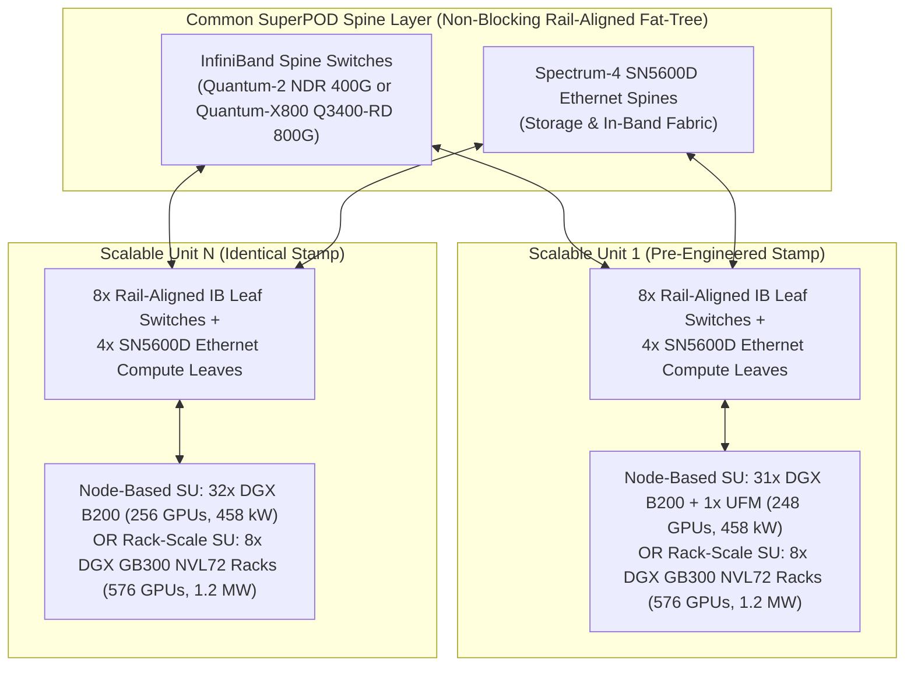
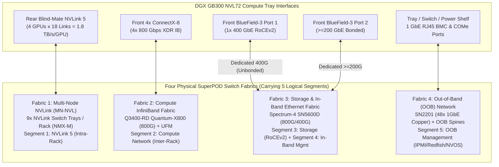

# 9.6 DGX SuperPOD concepts: scalable units, fabrics and tiers

| Field | Value |
|---|---|
| **Status** | Drafted (`superpod_concepts_lab.py`: 30 checks pass; cluster commands **untested** on live SuperPOD) |
| **Level** | Advanced |
| **Priority tier** | 1b |
| **Lab venue** | none (design / reading) + self-checking Python model (`code/part09/superpod_concepts_lab.py`) |
| **Part** | Part 9: NVIDIA systems and reference architectures |
| **Sources used** | *Data Center Best Practices with DGX B200* (`superpod-b200-dc`); *NVIDIA DGX SuperPOD Reference Architecture Featuring NVIDIA DGX GB300 Systems* (`superpod-gb300-ra`); `nvidia-devops` V21 (Ch. 1–4) |

## Why this matters for AI infrastructure

Picture a team that grows from one 8-GPU node to a few hundred GPUs and designs every part itself. The network engineers pick their own leaf-to-spine ratio, and multi-node jobs stall on collectives. A collective is an operation in which every GPU exchanges data with the others, so one slow path holds up all of them. The storage team buys a generic file server, and training freezes for ten minutes at every checkpoint. The facilities crew runs fiber through patch panels, and links drop during bring-up. Each of these choices looked reasonable on its own, and together they cost the team months.

NVIDIA's answer is the DGX SuperPOD reference architecture, a fixed design built from standard pieces. A reference architecture is a tested blueprint that tells you which parts to buy and how to connect them. The pieces are Scalable Units, five network segments carried over four physical fabrics, and two certified storage tiers. This chapter shows how a Scalable Unit is sized, why a management appliance takes the place of one compute node, why a partial build still needs the full network, and how to choose a storage tier.

## Prerequisites and outcomes

**Prerequisites:**
- Chapters 9.1 to 9.5 covering DGX node families, 8-GPU Hopper and Blackwell internals, Grace Superchips, and GB200 and GB300 NVL72 racks.
- Chapters 8.15 and 8.16 covering Base Command Manager and NVIDIA Mission Control in a SuperPOD.

The chapter moves from the big picture to the details. It starts with the facility and workload choices that come before any hardware order, then sizes the Scalable Unit for both node-based and rack-scale designs. Next it maps the network segments onto the physical fabrics and looks at how the fabrics grow. After that it covers storage, checkpoint size and the software stack, and it closes with the cost per output. Each part names the level that owns its decision, so you can see where a change belongs.

---

## 1. The AI factory mindset and why SuperPOD is a copy of NVIDIA's own cluster

NVIDIA calls a large GPU cluster an AI factory, because its input is data and its output is trained model weights and generated tokens. Picture a team that buys 4,000 GPUs but feeds them through one slow storage system. The GPUs sit idle most of the day, and the invoice keeps arriving. Picture a second team that designs its own cabling and power layout for every new hall. Each new cluster then takes months of commissioning instead of weeks. Commissioning is the testing period between installing equipment and running real work on it.

The factory picture helps with the decisions. A factory is judged by its output per unit of cost, and every stage of the line has to keep up with the others. A cluster works the same way. The compute, the network, the storage and the facility each set a limit, and the slowest of them decides how much useful work comes out the door.

### 1.1 A tested copy, and the Tier 3 facility standard

A custom GPU cluster built from scratch costs its engineers months of debugging. They chase firmware mismatches, cabling bottlenecks, and collectives that hang without an error, while the expensive hardware sits unscheduled. A hang without an error is one of the hardest failures to diagnose, because the job simply stops making progress and writes nothing to the logs.

A SuperPOD removes most of that work because it is a copy of what NVIDIA runs for its own research teams. The reference architecture calls it a physical twin of NVIDIA's internal system. The software, firmware and support have already been tested on that architecture: Mission Control, Base Command Manager, firmware bundles, NGC containers and Magnum IO libraries, plus the Run:ai and Slurm schedulers. NGC is NVIDIA's catalog of prebuilt container images, and Magnum IO is the family of libraries that moves data between GPUs, storage and the network.

The customer owns the hardware, on premises or in a colocation hall, and connects it to the site's Building Management System. A colocation hall is a data center floor that a company rents space in. The Building Management System, or BMS, is the controller that runs the power, cooling and alarms for the building. NVIDIA Enterprise Support (NVEX) supports the whole system: the DGX systems, the InfiniBand and Spectrum Ethernet fabrics, Mission Control and the certified partner storage from the DGX Storage Program.

The hall has to match. A multi-megawatt AI factory cannot lose a whole job to one utility or cooling failure. The reference architecture asks for Uptime Institute Tier 3, TIA-942-B Rated 3 or EN 50600 Availability Class 3. All three mean that any single power or cooling component can be serviced without shutting the hall down. Each of these is a different standard for the same idea. Concurrent maintainability means one part can be taken out for service while the rest of the hall keeps running.

Design top-down from the business service level and the cost per output, and only then choose the Scalable Unit count and the storage tier. Start with what the business needs from the cluster, then work down to the hardware. That order stops a team from buying the largest unit it can afford and discovering later that the workload never needed it.

### 1.2 The five dimensions of workload characterization and three SLA tiers

A cluster sized by GPU count alone hits bottlenecks once real workloads arrive. One built for offline training misses latency targets when it is pushed into real-time inference. A research cluster without redundancy breaks its revenue service-level agreement during routine maintenance. A service-level agreement, or SLA, is the written promise about availability and response that the business makes to its customers.

Before choosing a Scalable Unit count or a storage tier, describe the workload along five independent dimensions. The table lists them. Use it as a checklist. Each row asks a different question about the work, and the answers together tell you what kind of cluster you need.

| Workload Dimension | Categories and Engineering Thresholds |
|---|---|
| **1. Model Tier** | Small (`< 7B` params, `< 15 GB`), Medium (`7B–70B`, `15–140 GB`), Large (`70B–500B+`, `140 GB–1 TB+`), or Mixture-of-Experts (`MoE` with dynamic token routing). |
| **2. Execution Mode** | Offline batch pre-training (days to weeks), continuous training, online real-time inference (`TTFT ≤ 500 ms`, `ITL ≤ 30–100 ms`), batch inference, or multi-tenant fine-tuning (`LoRA`). |
| **3. Concurrency Profile** | Single large synchronous job (`64–9,216 GPUs`), medium (`10–100` inference replicas), high (`1,000+ QPS`), or heterogeneous mixed training and inference. |
| **4. Primary Bottleneck** | Compute-bound (prefill, dense matmuls), memory-bandwidth-bound (autoregressive decode), network-bound (multi-node AllReduce / AllToAll), or storage-bound (multimodal video/image streaming and checkpoint writes). |
| **5. Availability & SLA Tier** | Tier 1 Best-Effort (`90%–95%` availability, manual restart, zero geo-redundancy), Tier 2 Production HA (`99.0%–99.5%`, `5–30 min` MTTR, automatic checkpoint resume, `~30%` redundancy overhead), or Tier 3 Mission-Critical Revenue SLA (`99.9%–99.99%`, `99.95%` = `21.6 minutes/month` or `43.2 seconds/day` error budget, `< 1 min` automated failover, active-active multi-region, `~50%+` GPU capacity overhead). |

Read the rows as questions you can answer about your own workload. The model tier tells you how much memory a single copy needs. The execution mode tells you whether the work is batch or real time. The concurrency profile tells you how many jobs share the cluster at once. The bottleneck tells you which part of the system to buy first, and the SLA tier tells you how much spare capacity to hold back. MTTR means mean time to repair, the average time it takes to bring a failed service back. Active-active means two sites serve traffic at the same time, so either one can carry the full load.

---

## 2. The Scalable Unit (SU): the repeating block of a SuperPOD

Wiring a multi-thousand-GPU cluster as one project produces a tangle that nobody can maintain. Picture the first cable run on such a project. Every cable is different, and every change touches many others. A DGX SuperPOD instead repeats a fixed-size block called a Scalable Unit. To add capacity, you build another Scalable Unit and connect its leaf switches to the shared spine. A leaf switch is the switch that a group of servers plugs into directly, and the spine is the layer of switches that connects the leaves to each other.

The diagram shows two units sharing one spine. Each unit is a stamp, meaning the same design repeated exactly, so the wiring and the power budget are the same in every unit. The spine sits above the units and is shared by all of them.



The diagram has three layers. The top layer is the shared spine, which all units use. The middle blocks are the units, and each one holds its leaves and its compute. The leaves in each unit connect to the spine on one side and to the compute on the other. A rail-aligned design means the Nth GPU or NIC of every node connects to the same leaf family, so traffic on each rail stays on its own set of switches.

### 2.1 Node-Based Scalable Units (DGX H100 and DGX B200)

Suppose a planner is building a cluster out of air-cooled 8-GPU servers and must decide how many leaf switches to buy. For air-cooled 8-GPU nodes such as DGX H100, H200 and B200, a Scalable Unit is sized around the port count of the 64-port NDR InfiniBand leaf switches. NDR is the InfiniBand speed grade used in these switches. It holds up to 32 DGX systems, or 256 GPUs. Each DGX B200 draws up to 14.3 kW, so one full unit needs 458 kW.

In the DGX B200 pattern, an NVIDIA Unified Fabric Manager (UFM) appliance takes the place of one DGX B200 server in the first unit. A UFM appliance is a management server that watches and configures the InfiniBand fabric. Because one slot goes to the appliance, that unit therefore holds 31 nodes, and a full four-unit SuperPOD holds at most 127 servers, not 128. A typical node-based SuperPOD has one to four units. NVIDIA's guidance says the architecture is designed for up to 64 units.

The table works out the counts for each unit total. Each row is one more unit, and the columns show the nodes, the GPUs, the switches, the cables and the power. The cable formulas in the header come from the wiring rule: each compute node uses eight ports, the UFM uses four, and each unit adds 256 links between the spine and its leaves.

| SU Count | Nominal 32-Node Slots | Actual DGX B200 Nodes (with 1 UFM Displaced) | Total B200 GPUs | IB Leaf Switches | IB Spine Switches | Compute + UFM Cables (`Nodes×8 + 4`) | Spine–Leaf Cables (`SUs × 256`) | Compute Power Budget |
|---|---|---|---|---|---|---|---|---|
| **1 SU** | 32 | **31 nodes** + 1 UFM | **248 GPUs** | **8** | **4** | **252** | **256** | **458 kW per SU** (`1 × 458 kW`) |
| **2 SUs** | 64 | **63 nodes** + 1 UFM | **504 GPUs** | **16** | **8** | **508** | **512** | **458 kW per SU** (`2 × 458 kW`) |
| **3 SUs** | 96 | **95 nodes** + 1 UFM | **760 GPUs** | **24** | **16** | **764** | **768** | **458 kW per SU** (`3 × 458 kW`) |
| **4 SUs** | 128 | **127 nodes** + 1 UFM | **1,016 GPUs** | **32** | **16** | **1,020** | **1,024** | **458 kW per SU** (`4 × 458 kW`) |

Read the table from the left. Start with the nominal slots, then subtract the one slot the UFM takes, and you get the actual node count. The GPU column follows from the node count, because each node has 8 GPUs. The cable and switch columns follow from the wiring rule, so you can check any row by hand, which the lab does for you.

### 2.2 Rack-Scale Scalable Units (DGX GB200 and DGX GB300 NVL72)

Suppose a planner has moved from single servers to full racks and must redo the unit sizing. When the compute unit is a 72-GPU NVL72 rack, the Scalable Unit grows with it. One unit holds 8 DGX GB300 NVL72 racks: 144 compute trays and 576 Blackwell GPUs, with a thermal design power of 1.2 MW. The reference architecture describes the GB300 design. The same eight-rack unit applies to GB200. Thermal design power is the heat and power budget that the facility must plan for, so 1.2 MW is the figure the room needs to supply and remove.

The NVIDIA Q3400-RD Quantum-X800 InfiniBand switch has 144 ports at 800 Gbps XDR each. XDR is the 800 Gbps InfiniBand speed grade. With that many ports, a DGX GB300 SuperPOD can grow from one unit to 16 units in two switch layers, without a third tier. A layer here is a row of switches. With two layers, traffic between two leaves climbs to the spine and comes back down, and no third tier sits in between.

```text
Rack-Scale Scalable Unit (DGX GB300 NVL72) Specifications:
  Racks per Scalable Unit:          8 DGX GB300 NVL72 racks
  Compute trays per SU:             8 racks × 18 trays/rack = 144 compute trays
  Blackwell GPUs per SU:            8 racks × 72 GPUs/rack  = 576 GPUs (and 288 Grace CPUs)
  Thermal Design Power per SU:      1.2 MW (approximately 150 kW per rack)
  Max 2-Layer Fat-Tree Scale:       16 SUs = 128 racks = 9,216 GPUs (19.2 MW TDP)
```

The block multiplies from the rack up to the full two-layer limit. Each step uses the number from the step before it. Eight racks give 144 trays, then 576 GPUs, then 1.2 MW. Sixteen units give the 128 racks and 9,216 GPUs that the two-layer design can reach. Keep the arithmetic in mind when someone quotes a rack total, because the same chain tells you whether the figure is right.

### 2.3 Three non-negotiable SuperPOD physical rules

A site starts with five NVL72 racks and a smaller switch layer to save money. Six months later it adds three racks, and the whole cluster has to be re-cabled. This is the most common expensive mistake in SuperPOD projects, because it looks like a saving on the first invoice. Another site routes InfiniBand through a fiber patch panel, and its links drop during bring-up. Three rules prevent both problems.

**Install the full network for the full Scalable Unit, even when you deploy fewer racks.** If budget or power allows only five NVL72 racks of eight, still install all the leaf switches and all the leaf-to-spine cables. The ports for the missing racks stay unused. Routing stays symmetric, and the next racks slide in with no network changes. Symmetric routing means every path has a matching path back, so traffic behaves the same in each direction and the design is easy to reason about. This is the Partial-SU Fabric Rule.

The second rule is about space. Do not mount unrelated IT equipment in DGX racks or in the gaps between them. A Scalable Unit is an engineered, thermally balanced system, and third-party gear in empty slots disturbs the airflow. Airflow in a dense rack is designed to pull cool air across each tray in a set order, and a stray device can push hot air back into the path of the next tray.

The third rule is about cabling. Do not put patch panels or extra top-of-rack switches on InfiniBand. The reach of an InfiniBand cable is set by signal attenuation and latency over the whole path. Attenuation is the loss of signal strength along the cable. A patch panel adds loss that can break link training, and an extra switch adds a hop to every rail. Link training is the handshake in which two ends agree on the speed and quality of a link before traffic starts. Passive copper reaches 5 m at 100G and 3 m at 400G, and active optical cables reach 30 m. Keep every run under 90 percent of the maximum for its cable type.

---

## 3. The five network segments across four physical fabrics

Put GPU collectives, storage, user SSH sessions and baseboard management on one network, and traffic queues behind other traffic. Picture a checkpoint write that delays a collective barrier, so every GPU waits for the slowest writer. A burst of container image pulls starves storage heartbeats. A heartbeat is a small periodic message that tells the scheduler a node is still alive, and a missed one can mark a healthy node as failed. The DGX GB300 SuperPOD design avoids this: five network segments run over four physically separate fabrics, so each kind of traffic has its own hardware.

The diagram shows the connections from one compute tray to each fabric. The NVLink port goes to the in-rack fabric, the InfiniBand ports go to the compute fabric, the BlueField-3 ports go to storage and in-band management, and the BMC and COMe ports go to the out-of-band network. BMC stands for baseboard management controller, the small processor that handles remote power and monitoring for a server.



Notice that the five segments do not map one to one onto the four fabrics. Segments 3 and 4 share the Ethernet fabric, but the two BlueField-3 ports keep them apart on the tray. That split is the reason the design works, and the next table explains it in detail.

### 3.1 Mapping the 5 logical segments to the 4 physical fabrics

Picture a network engineer tracing a slow storage read who needs to know which switch carries that traffic. Each row of the table is one physical fabric. The first column names the fabric, the second names the switch and its manager, the third lists the logical segments it carries, and the fourth gives the speed, the blocking ratio and the purpose. A blocking ratio compares the traffic the leaves can receive with the uplink capacity they can send, so 1:3 blocking means the uplinks carry one third of the potential traffic. Non-blocking means every port can send at full speed at the same time.

| Physical Fabric | Switch Hardware & Manager | Logical Segment(s) Carried | Speed, Blocking Ratio & Design Purpose |
|---|---|---|---|
| **1. Multi-Node NVLink Fabric (`MN-NVL`)** | **9x NVLink Switch Trays** per rack (`18 NVSwitch ASICs`), managed by `NMX-M` | **Segment 1: NVLink 5** | 1.8 TB/s per GPU (130 TB/s per rack), non-blocking inside the rack. |
| **2. Compute InfiniBand Fabric** | **NVIDIA Q3400-RD Quantum-X800** (`144x 800G XDR` on GB300) or **QM9700** (`64x 400G NDR` on H100/B200), managed by `UFM Enterprise` | **Segment 2: Compute Network** | 4x 800 Gbps per tray, 4 rails with 2 leaves each (8 leaves per unit), non-blocking rail-optimized fat-tree. |
| **3. Storage & In-Band Ethernet Fabric** | **NVIDIA Spectrum-4 SN5600D** (`64x 800 GbE` / `128x 400 GbE` ports) | **Segment 3: Storage Network** + **Segment 4: In-Band Management Network** | Two ports on the BlueField-3 (`BF3240`): port 1 at 400 GbE for RoCEv2 storage, port 2 at 200 GbE or more for in-band traffic. 1:3 blocking on compute leaves, non-blocking storage leaves. |
| **4. Out-of-Band (OOB) Ethernet Network** | **NVIDIA SN2201** (`48x 1 Gbps` copper RJ45) + dedicated OOB Aggregation Spines | **Segment 5: Out-of-Band Management Network** | Isolated 1 GbE network for all BMCs, NVSwitch `COMe` (`NVOS`) ports and rack PDUs. |

The table is a lookup, so use it to answer one question at a time. Which fabric carries a given segment? What does that fabric cost you in blocking? Which manager do you open when something on that fabric breaks? The fourth row is the one that keeps management working when everything else is failing, which is why it is isolated on its own network.

Do not bond the two BlueField-3 ports. On a DGX GB300 compute tray, one 400 Gbps port carries only RoCEv2 storage traffic, and the second port, at 200 Gbps or more, carries in-band management. Bonding means combining two ports into one logical link, which is useful for raw bandwidth but mixes the traffic. Separate ports keep storage traffic steady when in-band TCP bursts, and they avoid per-host policy routing, which is easy to get wrong. Policy routing is the setup where the host picks a path based on the source of the packet, and a small mistake sends storage traffic to the wrong port.

### 3.2 How the four fabrics scale across 1 to 16 Scalable Units (DGX GB300 SuperPOD)

Suppose a team plans to grow from one unit to sixteen and wonders whether the switches will still fit the design. A third switching tier adds transceivers, power and a hop of latency. Architects therefore check that the switch port counts allow full bandwidth in two layers. Each extra layer means more switches to buy, more optics to power and one more stop for every packet. Keeping the design at two layers is what makes the growth path simple.

With the 144-port Q3400-RD and the SN5600D Ethernet switch, a GB300 SuperPOD grows from one unit to 16 units in two layers. On the InfiniBand fabric each unit has eight leaves, as four rails with two leaves each. Trays on the same rail in the same unit are one hop apart, and traffic between racks or between rails goes through the spine. On the Ethernet fabric each unit has four compute leaves at a 1:3 blocking ratio, next to non-blocking storage leaves. Chapter 9.8, sections 3 and 4, give the port counts and the full multi-unit tables.

The table shows how the switch counts rise with the unit count. Read down one column to see how the switches grow, and across one row to see what a given size needs. The GPU count grows in a straight line, while the spine counts grow more slowly for the first few units and then rise together.

| SU Count | Total GPUs (`NVL72 Racks`) | IB Compute Leaves (`Q3400-RD`) | IB Spines (`Q3400-RD`) | Ethernet Compute Leaves (`SN5600D` 1:3) | Ethernet Spines (`SN5600D`) | Ethernet Storage Leaves (`SN5600D` Non-Blocking) |
|---|---|---|---|---|---|---|
| **1 SU** | **576 GPUs** (`8 racks`) | **8** (`4 rails × 2`) | **4** (optional) | **4** (`24:72 = 1:3`) | **2** | **1–2** (`64x 400GbE`) |
| **2 SUs** | **1,152 GPUs** (`16 racks`) | **16** | **8** | **8** | **4** | **2** |
| **4 SUs** | **2,304 GPUs** (`32 racks`) | **32** | **18** | **16** | **8** | **2** |
| **8 SUs** | **4,608 GPUs** (`64 racks`) | **64** | **36** | **32** | **12** | **4** |
| **16 SUs** | **9,216 GPUs** (`128 racks`) | **128** | **72** (`72+72=144`) | **64** | **24** | **8** (`1,024x 400GbE`) |

### 3.3 Collective algorithms and InfiniBand versus RoCEv2 economics

Every training step ends with a collective such as AllReduce. Picture the end of each step. Every GPU has a piece of the gradients, and every GPU needs the combined result before the next step can begin. With FSDP, which shards the model across GPUs, it is an AllGather and a ReduceScatter. FSDP, or Fully Sharded Data Parallel, splits the model's weights across the GPUs so that each one holds only a slice. An AllGather collects the slices, and a ReduceScatter combines and splits the gradients. The slowest link sets the pace for the whole cluster, so thousands of GPUs can wait for the last rank. A rank is one process in the job, and this waiting time is the communication tax.

NCCL chooses among three main algorithms based on message size and cluster size. Ring AllReduce uses bandwidth best on large buffers, but its latency grows with the number of ranks. The double binary tree has depth that grows with the logarithm of the rank count, so NCCL picks it at larger scale. Recursive doubling finishes in a logarithmic number of rounds and is best for small messages, though it sends the full buffer each round. To hide the communication tax, PyTorch DDP and FSDP group gradients into buckets and start asynchronous AllReduce calls during `loss.backward()`. Only the last bucket is left exposed. A bucket is a group of gradients that travels together, and an asynchronous call starts the transfer and lets the computation continue while it runs.

The choice between InfiniBand and 400GbE RoCEv2 depends on scale. RoCEv2 is RDMA carried over Ethernet, which gives Ethernet-based clusters a way to move data without the operating system in the path. At 64 GPUs or fewer, with no growth plan, the compute time saved does not repay the InfiniBand premium, so RoCEv2 is defensible. At 128 or 256 GPUs and beyond, credit-based lossless flow control, hardware Adaptive Routing, SHARPv3 and SHIELD self-healing help avoid RoCE pause storms and a mid-life fabric replacement. A pause storm is a flood of flow-control pause frames that can freeze traffic across a whole network. Credit-based flow control means a sender transmits only when the receiver has room, so nothing is dropped. SHARP is in-network reduction, which moves the summing work into the switches.

```text
Collective Algorithms & 64-GPU InfiniBand vs RoCEv2 Engineering Breakdown (V21 Ch 2 & Ch 3):
  1. Ring AllReduce:        2(N - 1) steps; transfers 2(N - 1) / N of buffer per GPU; O(N) latency.
                            Example (800 MB across 4 GPUs on 50 GB/s NDR): 200 MB / 50 GB/s = 4 ms/step × 6 steps ≈ 24 ms.
  2. Double Binary Tree:    O(log N) depth; auto-selected by NCCL (NCCL_ALGO=Tree) at larger rank counts.
  3. Recursive Doubling:    log2(N) rounds (distance 1, 2, 4... = 3 rounds for 8 GPUs); latency-optimal for small messages.
  4. DDP Bucket Overlap:    bucket_cap_mb = 25 MB default in PyTorch DDP overlaps AllReduce with loss.backward().
  5. 64-GPU H100 Case:      InfiniBand NDR ($15K) vs 400GbE RoCEv2 ($8K) per unit = $7K x 64 = $448K upfront delta.
                            8% RoCE overhead on a 7-day Llama-70B run = 13.4 extra hrs × 64 GPUs × $2.14/GPU-hr ≈ $1,835/run
                            (~$44K/year across 24 runs). Payback requires 128–256+ GPU scale (AR, SHARPv3, SHIELD).
```

The block carries the algorithm costs and the cost case together. Read the first three items as speed rules. The ring takes more steps as the GPU count grows, while the tree and recursive doubling take fewer. Items 4 and 5 are the money side. The 64-GPU case shows that the upfront saving on RoCEv2 is real, but the lost time on each run can add up. The last line of item 5 is the reason the chapter says payback needs a larger scale.

---

## 4. SuperPOD storage: two systems, two tiers, and checkpoint size

Picture a team that puts everything on one shared file system. Home directories, container builds, logs and multi-terabyte checkpoints all compete for the same disks. Within a week, an interactive user running a large directory listing stalls a training job that is writing a checkpoint. A SuperPOD keeps two separate external storage systems, so that dataset reads and checkpoint bursts do not stall thousands of GPUs. It also defines two certified performance tiers for the fast one.

### 4.1 High-Performance Storage and User Storage, Standard and Enhanced tiers

If user home directories, container builds, and cluster logs share the same file system as multi-terabyte model checkpoints, metadata storms from interactive users will stall training jobs. A metadata storm is a burst of small operations such as file lookups and permission checks, and a file system handles those much less well than large sequential reads. Conversely, running parallel training checkpoints over a generic enterprise NFS appliance will overwhelm its network ports and freeze the cluster. NFS is the common network file-sharing protocol, and a generic appliance was not built for thousands of clients writing at once.

A SuperPOD therefore uses two storage systems that are separate in hardware and in software. Each system is built for the job it does, and a problem in one does not reach the other.

System 1 is High-Performance Storage, or HPS. It is a parallel file system that follows the POSIX file interface and survives component failures. A parallel file system spreads each file across many storage servers, so many clients can read and write at once. POSIX is the standard set of file operations that programs expect. It comes from a partner in the DGX Storage Program, such as WEKA, VAST, DDN Lustre, or IBM Storage Scale. Each compute tray reaches HPS over its dedicated BlueField-3 storage port, a 400 Gbps lossless RoCEv2 link. RoCEv2 carries RDMA, direct memory access between machines, over Ethernet. Lossless here means the design prevents packet drops, so the storage traffic never needs a retry.

HPS must also support GPUDirect Storage and must be certified for Grace-based `aarch64` systems. GPUDirect Storage lets the storage system move data straight into GPU memory without a copy through the host. It needs read and write caching across local RAM and local NVMe flash, and it must allow upgrades without downtime. Certification here means the partner has tested the product on the exact hardware, so the team does not have to.

System 2 is User Storage, an enterprise NFS share on the In-Band Management Ethernet fabric with at least 100 GbE DR1 connectivity. DR1 is a short-reach 100 Gbps Ethernet optical standard. User Storage is built for many small metadata operations, not for multi-terabyte streaming. It holds `/home` directories, administrative scripts, and cluster logs. It also holds shared state for the high-availability control-plane services in Mission Control and Base Command Manager. A control plane is the set of services that manages the cluster rather than doing the computing.

The GB300 reference architecture defines two throughput tiers for High-Performance Storage. Choose by whether the factory runs text LLMs, where compute dominates, or multimodal pipelines, where I/O does. I/O here means the reading and writing of data, and in a multimodal pipeline the images and videos must stream constantly. The reference architecture lists the one-unit and four-unit rows. Other unit counts in this chapter are the chapter's own linear scaling. Linear scaling means the chapter assumes the throughput multiplies with the unit count, which is a simplification rather than a vendor figure.

| Storage Tier | Target Workload Profile | Dataset Fit | 1 SU Aggregate Read / Write | 4 SUs Aggregate Read / Write | Read : Write Ratio |
|---|---|---|---|---|---|
| **Standard Tier** | Text LLM training, fine-tuning, periodic checkpoints and inference; compute dominates I/O. | Single-modality data that mostly fits in node memory and local NVMe. | **90 GB/s Read**<br/>**45 GB/s Write** | **360 GB/s Read**<br/>**180 GB/s Write** | **2 : 1** |
| **Enhanced Tier** | Multimodal (video, image, sensor) training, frequent large checkpoints, vector serving; I/O is on the critical path. | Several modalities, too large for local caches, streamed continuously. | **280 GB/s Read**<br/>**140 GB/s Write** | **1,120 GB/s Read (`1.12 TB/s`)**<br/>**560 GB/s Write** | **2 : 1** |

The table gives the two tiers side by side. Start with the workload column, since it decides the choice. The Standard tier fits a factory where the GPUs do most of the work and the data mostly sits in memory. The Enhanced tier fits a factory where data streaming decides how fast the GPUs can run. The read and write columns show what each tier can sustain for the whole unit or for four units together.

### 4.2 Why text training is limited by checkpoint writes

A new engineer assumes that training a 70-billion-parameter model needs huge read bandwidth. It does not. Text is stored as small integer token IDs, so a whole 64-GPU H100 cluster reads under a quarter of a megabyte per second. Training on uncompressed image or video frames is different: it needs tens of gigabytes per second and calls for the Enhanced tier. A token ID is the integer that stands for one piece of text, so text is very light to read compared with media.

What overwhelms a storage system is the checkpoint write. A checkpoint is a saved copy of the model and its optimizer state, taken so the job can restart after a failure. Mixed-precision AdamW keeps 14 bytes of state per parameter, so one checkpoint of a 70-billion-parameter model is 980 GB, about 1 TB. Gathering that onto rank 0 exhausts host memory and serializes the I/O. Serializing the I/O means every write waits in one line behind a single process. Production clusters instead use PyTorch Distributed Checkpoint (`torch.distributed.checkpoint`), so all 64 GPUs write their own shard in parallel. A shard is the slice of the checkpoint that one GPU owns. Each node stages its shard to local NVMe at `/raid` in a little over eight seconds, and the GPUs resume. A background job then copies the shards to High-Performance Storage and to S3 object storage, using an atomic rename and SHA-256 verification. An atomic rename means the final folder appears all at once, so a half-written checkpoint never looks complete. SHA-256 is a checksum that proves each copied file matches the original.

Size checkpoint writes first, and read bandwidth second. A training job reads little but writes a lot at each checkpoint, so the write path decides how long the GPUs sit idle. Plan the storage around the checkpoint interval and the write time, and treat the read rate as a secondary check.

```text
Text Read vs Mixed-Precision AdamW Checkpoint Math (V21 Ch 4, 70B Model on 64x H100 GPUs / 8 Nodes):
  Steady-State Text Read Rate:   ~60,000 tokens/s (~940 tok/s/GPU at 40% MFU) × 2–4 B/token = 120 to 240 KB/s total
  BF16 model weights:            2 bytes / parameter
  FP32 master weights:           4 bytes / parameter
  Adam 1st moment (m, FP32):     4 bytes / parameter
  Adam 2nd moment (v, FP32):     4 bytes / parameter
  ────────────────────────────────────────────────────────────────────────────────────────────────────────────────
  Total Checkpoint State:       14 bytes / parameter  --> 70 × 10^9 × 14 B = 980 GB (~1 TB) per checkpoint
  Active Training VRAM State:   16 bytes / parameter  (adds 2 B/param BF16 gradients = 1,120 GB total)
  Sharded Per-GPU / Per-Node:   15.31 GB / GPU shard (64 GPUs) = 122.48 GB / 8-GPU node
  Stage 1 Local NVMe (/raid):   122.48 GB / 15 GB/s per node   = 8.17 seconds (GPUs resume immediately)
  Stage 2 Shared PFS Flush:     980 GB / 10 GB/s NAS = 98.0 s  (or 980 GB / 45 GB/s Standard SU write = 21.8 s)
```

The block adds the bytes one at a time. The weights, the master copy, and the two Adam moments add up to 14 bytes per parameter, and that total times 70 billion gives the checkpoint size. The gradients are not saved in the checkpoint, which is why the active training state is 2 bytes larger. The last two lines are the timing: the local stage is short enough for the GPUs to resume, and the flush to shared storage runs in the background.

---

Pick the Standard tier when text training dominates and the Enhanced tier when data streaming is on the critical path.

---

## 5. SuperPOD software stack and AI factory cost

### 5.1 The five layers of NVIDIA Mission Control

When a node fails at 2 a.m., a team that runs thousands of GPUs, hundreds of switches and cooling loops from separate scripts recovers slowly and wastes capacity. Picture the on-call engineer trying to match the alerts from three different tools while the job sits idle. A DGX SuperPOD is run through NVIDIA Mission Control, which joins five layers into one system. Chapter 8.16, chapter 9.8 section 6 and chapter 9.12 section 1 cover the software in full. The table lists the five layers, and each one answers a different operational question.

| Layer | What it does |
|---|---|
| Provisioning | Base Command Manager installs the OS on bare metal and manages firmware. |
| Fabric management | UFM Enterprise manages InfiniBand, and NMX-M manages the NVLink switches. |
| Facility telemetry | High-frequency telemetry reaches the Building Management System over eBGP in the untrusted edge zone. |
| Recovery | Automated validation and recovery of hardware and jobs works with in-memory checkpointing. |
| Scheduling | Slurm and NVIDIA Run:ai place workloads. The Run:ai control plane runs on the user-space Kubernetes cluster, and its cluster operands run on the administrative Kubernetes infrastructure. |

Read the table from the bottom up to follow a failure. The scheduler decides where a job runs, the recovery layer decides when to move it, and the provisioning layer brings a repaired node back into service. The fabric layer watches the links the job depends on, and the facility layer reports the power and cooling conditions around the whole hall. Bare metal means the server hardware with no operating system installed yet, and eBGP is the routing protocol used to exchange routes between the cluster and the building network.

### 5.2 Cost per output, not electricity price

Cheap power does not help when GPUs sit idle during slow checkpoint recovery or scheduler fragmentation. Fragmentation is the state where free GPUs exist but are scattered in pieces too small for the next job. State capital and operating costs as cost per GPU-hour and cost per million tokens. Those two units turn the cost into the thing the business sells, which is useful work.

On a 40-GPU H100 inference cluster, electricity is less than a tenth of the cost per million tokens at full utilization, and the total more than doubles when utilization drops to 40 percent. Keeping GPUs busy matters far more than any electricity discount. A discount on power would save a few cents per million tokens, while a drop in utilization can double the price of each one.

```text
AI Factory TCO & Token Economics Breakdown (V21 Ch 1 & Ch 2):
  1. 16-Node (128-GPU H100 SXM5) Illustrative 3-Year TCO:
     - CAPEX: $285K/node ($4.56M compute) + $400K IB fabric + $200K racks/PDUs + $100K install = $5.26M CAPEX
     - OPEX:  $171.6K electricity (163 kW @ $0.12/kWh) + $400K (2 FTEs) + $52.6K support + $20K SW = $644K/year OPEX
     - 3-Year TCO: $5.26M + (3 × $644K) = $7.19M total  --> $2.14 per GPU-hour ($7.19M / (128 × 8,760 × 3))
  2. 40-GPU H100 Inference Cluster Token Economics (60,000 tokens/sec aggregate, 37.8 kW with 1.35 PUE):
     - Electricity cost:            $0.021 per 1M tokens
     - Amortized HW + Ops ($500K/y): $0.26 per 1M tokens at 100% utilization
     - Total @ 100% Utilization:    $0.28 per 1M tokens (~$0.0003 / 1K tokens)
     - Total @ 40% Utilization:    ~$0.68 per 1M tokens (~$0.0007 / 1K tokens)
```

The block shows two cost views. The TCO example adds up capital and three years of operating cost, then divides by every GPU-hour in that period. The token example splits the cost per million tokens into electricity and amortized hardware. Read the second part slowly. The electricity line stays small, and the hardware line rises as utilization falls, because the same fixed cost is spread over fewer tokens. PUE, or power usage effectiveness, is the ratio of total facility power to the power that reaches the IT equipment.

---

## Commands and configurations that matter

Picture a multi-unit training run that has slowed down over a weekend. The on-call engineer needs to check collective scaling across units, read the InfiniBand and RoCEv2 congestion counters, and confirm the checkpoint method. When a multi-unit training run is slow or hangs, check multi-node collective scaling, read the InfiniBand and RoCEv2 congestion counters, and use sharded checkpoints. These commands were not run on a live multi-unit SuperPOD. The sizing rules are checked in `code/part09/superpod_concepts_lab.py`.

### 1. Multi-node `nccl-tests` scaling benchmark across Scalable Units

The first command runs an AllReduce sweep across 16 nodes, which tests how well the collective scales when it crosses unit boundaries. The output reports bus bandwidth, and the comment at the end gives the pass criterion. A drop of more than about 10 percent from the single-node baseline is a sign that the multi-node path is the limit.

```bash
# Run an 8 MB to 8 GB AllReduce sweep across 16 nodes (128 GPUs, 8 processes/node)
mpirun -np 128 --map-by ppr:8:node \
  -x NCCL_DEBUG=INFO \
  -x NCCL_IB_PCI_RELAXED_ORDERING=2 \
  ./build/all_reduce_perf -b 8M -e 8G -f 2 -g 1
# Compare 'busbw (GB/s)' against the single-node baseline (target <= 10% multi-node dropoff)
```

### 2. Inspect InfiniBand credit-wait / symbol errors and RoCEv2 PFC/ECN counters

The second command checks two fabrics. On the InfiniBand side, the counters show link state and error counts. On the storage side, the Ethernet counters show whether PFC pause frames or ECN marks are rising, which tell you the lossless design is under pressure. PFC is priority flow control, and ECN is explicit congestion notification, the signal that tells a sender to slow down before a queue overflows.

```bash
# 1. On Compute InfiniBand fabric: check port state (Active / 400G NDR or 800G XDR) and error counters
ibstat | grep -E "CA '|State:|Physical state:|Rate:"
ibqueryerrors -s RcvSwRelayErrors,LinkDowned,VL15Dropped
perfquery -x | grep -E "PortXmitWait|SymbolErrorCounter|LinkErrorRecoveryCounter"

# 2. On Storage RoCEv2 Ethernet fabric (BlueField-3 Port 1): check PFC pause and ECN marks
ethtool -S enp3s0f0np0 | grep -iE "pause|pfc|ecn|cnp|out_of_buffer"
```

### 3. Production NCCL environment variable reference (NCCL 2.24+)

The third block is a set of environment variables for production. The main rule is to leave the algorithm unset so NCCL can choose. The HCA list pins the InfiniBand adapters that the job may use, and the buffer size and relaxed-ordering setting are the two tuning values that appear in the reference.

```bash
# Leave NCCL_ALGO unset in production so NCCL auto-selects by message size and topology.
# Valid tokens when benchmarking (invalid tokens fail since NCCL 2.24):
#   Ring | Tree | CollnetDirect | CollnetChain | NVLS | NVLSTree
export NCCL_IB_HCA="=mlx5_0:1,mlx5_1:1,mlx5_2:1,mlx5_3:1"   # '=' enforces exact HCA list
export NCCL_BUFFSIZE=4194304                                # Default 4 MiB per channel
export NCCL_IB_PCI_RELAXED_ORDERING=2                       # 2 = auto-enable PCIe relaxed ordering
```

### 4. Two-stage sharded checkpointing with `torch.distributed.checkpoint`

The last command is a Python function that writes one shard per rank into a temporary folder and then renames the folder once every rank has finished. The rename is what makes the checkpoint appear complete all at once. Read the function as the local stage of the two-stage method described in the storage part of this chapter.

```python
import os
import torch.distributed.checkpoint as dcp

def save_sharded_checkpoint_atomic(model, optimizer, step: int, raid_stage_dir: str) -> None:
    """Each rank writes its own ~15.3 GB shard to local NVMe (/raid) and renames atomically."""
    tmp_dir = f"{raid_stage_dir}/step-{step}.tmp"
    final_dir = f"{raid_stage_dir}/step-{step}"
    state = {"model": model.state_dict(), "optim": optimizer.state_dict(), "step": step}
    dcp.save(state, storage_writer=dcp.FileSystemWriter(tmp_dir))
    if int(os.environ.get("LOCAL_RANK", "0")) == 0:
        os.replace(tmp_dir, final_dir)  # Atomic directory rename after shard barrier
```

---

## How it fails

When the architectural rules are broken, the failures show up as collective bottlenecks, storage heartbeat drops, link flaps or checkpoint crashes. Each of the five cases below starts with a symptom that an on-call engineer sees, then names the cause and the fix. Most of them trace back to a rule from earlier in the chapter, so each case points you back to the section that explains the rule.

### 1. Under-provisioning leaf/spine switches on a partial-SU deployment

Symptom: A customer deploys 5 NVL72 racks (half an SU) with only 4 IB leaf switches instead of 8; when they add 3 more racks six months later, the entire cluster must be powered down and re-cabled, and cross-rack jobs suffer 2:1 oversubscription. Oversubscription means the uplink capacity is smaller than the traffic that could arrive, so jobs that cross racks compete for the same links.

Cause: Violating the Partial-SU Fabric Rule: shrinking the switch count or leaf-spine Inter-Switch Links (ISLs) to match initial node count breaks rail symmetry and bisection bandwidth. An ISL is the link between two switches, and bisection bandwidth is the capacity across the middle of the fabric.

Fix: Always provision all 8 IB leaf switches per SU and all leaf-spine cables up front even for a partial SU, leaving the unpopulated node ports dark until expansion racks arrive.

### 2. Bonding the 400G RoCEv2 Storage port with the In-Band Management port

Symptom: Periodic checkpoint writes or dataset prefetches cause Slurm/Kubernetes heartbeats to time out, or SSH/Prometheus scrapes trigger RoCEv2 latency spikes on High-Performance Storage.

Cause: The administrator bonded both BlueField-3 DPU ports into a single LACP bond carrying both RoCEv2 storage and TCP in-band management traffic. LACP is the standard protocol that combines links into a bond, and it mixes the two traffic types on one path.

Fix: Follow the DGX GB200/GB300 SuperPOD segmentation design: dedicate Port 1 (400 Gbps unbonded) strictly to lossless RoCEv2 Storage, and dedicate Port 2 (≥200 Gbps) to In-Band Management and NFS User Storage.

### 3. Using fiber patch panels or intermediary ToR switches to extend InfiniBand runs

Symptom: Links on the Compute InfiniBand fabric flap between `Polling` and `Active`, log high `SymbolErrorCounter` / `LinkErrorRecoveryCounter` rates, or add 2+ extra switch hops to `AllReduce`. A flap is a link that drops and recovers repeatedly, and the Polling and Active names are the port states a link moves through.

Cause: Data center facilities routed 400G/800G InfiniBand cables through structured overhead fiber patch panels or an extra ToR switch because the spine racks were placed too far away (>30 m for AOC). A ToR, or top-of-rack, switch is the small switch placed in each rack, and AOC stands for active optical cable.

Fix: Never use patch panels or intermediary ToR switches on InfiniBand. Place SU racks around the central management/switch racks so direct point-to-point DAC (≤3 m at 400G) or AOC (≤30 m, kept `< 90%` of max length) cables reach directly from each compute NIC to its rail leaf switch. DAC is a direct-attach copper cable, which is the short, passive option.

### 4. Rank 0 gather OOM and 10-minute stall during 70B checkpoint saves

Symptom: Every 8 hours, training freezes for 10+ minutes or crashes with CPU/GPU OOM while saving the 980 GB Llama-70B AdamW checkpoint over NFS. OOM means out of memory, which is the error that stops a process when it asks for more memory than the machine has.

Cause: The training script called `torch.save()` on Rank 0 and wrote to the NFS User Storage tier instead of writing sharded checkpoints to Local NVMe + RoCEv2 High-Performance Storage. Rank 0 had to gather the whole checkpoint in one place before writing it, which is the bottleneck.

Fix: Switch to `torch.distributed.checkpoint` (`dcp.save`) so all 64 GPUs write their `15.3 GB` shards (`122.5 GB/node`) in parallel to local `/raid` NVMe in `~8 seconds`, then flush asynchronously to the RoCEv2 Parallel File System.

### 5. Unrecognized token crash after setting legacy `NCCL_ALGO=Collnet` on NCCL 2.24+

Symptom: Distributed training jobs exit immediately during communicator initialization after upgrading the NGC PyTorch container to NCCL 2.24+. A communicator is the NCCL object that holds the GPUs of one job together, and initialization is the step where it is set up.

Cause: Starting in NCCL 2.14, `Collnet` was split into `CollnetDirect` and `CollnetChain`, and since NCCL 2.24 invalid tokens in `NCCL_ALGO` cause a hard failure (and omitting `Ring` removes the ring fallback). The old name no longer exists, so NCCL refuses to start with it.

Fix: Unset `NCCL_ALGO` so NCCL selects the optimal algorithm (`Ring`, `Tree`, `NVLS`, `NVLSTree`, `CollnetDirect`) automatically by message size and topology, or use exact valid tokens verified with `NCCL_DEBUG=INFO`.

---

## Hands-on lab

This chapter's self-checking Python model (`code/part09/superpod_concepts.py`) and lab runner (`code/part09/superpod_concepts_lab.py`) implement five verification modules. Each module checks one part of the design against its source. First, they model the DGX B200 SuperPOD Scalable Unit Sizer across one to four units, including the UFM displacement rule, switch counts, cable formulas, and power budgets. Second, they model the DGX GB300 NVL72 SuperPOD Scalable Unit Sizer from one to 16 units across InfiniBand and Ethernet fabrics. Third, they implement the SuperPOD Storage Tier Calculator for Standard and Enhanced tiers. Fourth, they run the Mixed-Precision AdamW Checkpoint Calculator for sharded local NVMe staging versus direct NAS writes. Fifth, they run the SuperPOD Reference Architecture Rule Auditor. A rule auditor reads a proposed design and reports which rules it breaks.

Run the lab from the repository root. It runs with bytecode writing turned off, so the repository stays clean after each run.

```bash
python3 -B code/part09/superpod_concepts_lab.py
```

Expected output from a run of this lab in this repository is shown below.

```text
=== Chapter 9.6 Lab: DGX SuperPOD Concepts: Scalable Units, Fabrics & Tiers ===
  [PASS] SPB200 p.5/p.19: 1 SU has 31 DGX B200 nodes (248 GPUs, 1 UFM displaced), 8 leaves, 4 spines, 458 kW
  [PASS] SPB200 p.19: 2 SUs have 63 DGX B200 nodes (504 GPUs), 16 leaves, 8 spines, 508 compute cables, 512 ISL cables
  [PASS] SPB200 p.19: 3 SUs have 95 DGX B200 nodes (760 GPUs), 24 leaves, 16 spines, 764 compute cables, 768 ISL cables
  [PASS] SPB200 p.5/p.19: 4 SUs have 127 DGX B200 nodes (1,016 GPUs), 32 leaves, 16 spines, 1,020 compute cables, 1,024 ISL cables
  [PASS] Rejects unsupported SU count in B200 table
  [PASS] SPGB300 p.5/p.13: 1 GB300 SU has 8 NVL72 racks, 576 GPUs, 1.2 MW TDP, 8 IB leaves, 4 SN5600 compute leaves
  ...
  [PASS] SPB200 cable formula: N_nodes * 8 compute ports + 4 UFM ports == compute_plus_ufm_cables across 1..4 SUs
  [PASS] SPB200 spine-leaf cable formula: N_su * 256 == spine_leaf_cables across 1..4 SUs
  [PASS] SPGB300 16 SUs (9,216 GPUs) total thermal design power == 19.2 MW
  [PASS] Rejects non-standard SU count (3) in GB300 table
  [PASS] Rejects non-positive params_billions in checkpoint calculator

Summary: 30 passed, 0 failed (total 30)
```

---

## Exercises

1. Run the lab script. Then rebuild the 3-SU row of the DGX B200 table by hand. Work out the nodes and GPUs first. Then work out the leaf switches, the cables and the power.
2. A customer can afford 5 NVL72 racks now and will grow to 8. What must be bought and cabled on day one? What can wait until the expansion?
3. Consider a 30B-parameter model trained with mixed-precision AdamW. It runs on 32 GPUs across 4 nodes. What is the checkpoint size? What is each GPU's shard? How long does the local NVMe stage take at 15 GB/s per node?
4. Draw the five logical network segments and the four physical fabrics. Then draw an arrow from each BlueField-3 port to the segment it carries.
5. A colleague wants to bond both BlueField-3 ports for extra bandwidth. Write two sentences that explain why the design keeps them apart.
6. A node goes bad during a run. Which Mission Control layer detects it and cordons it? Which layer restarts the job elsewhere?

## Checkpoint questions (20)

<details>
<summary>**1. Why does a 1-SU DGX B200 SuperPOD contain 31 DGX B200 servers and a 4-SU DGX B200 SuperPOD contain 127 DGX B200 servers, even though a Scalable Unit is nominally 32 nodes?**</summary>

In the DGX B200 SuperPOD reference architecture, an NVIDIA Unified Fabric Manager appliance displaces one DGX B200 server in the first Scalable Unit. That leaves 31 nodes in one unit, 63 in two units, 95 in three units, and 127 in four units. Each node uses 8 compute cables and the UFM appliance uses 4 cables, giving 252 compute and UFM cables in one unit and 1,020 in four units.
</details>

<details>
<summary>**2. Contrast a single Scalable Unit in a DGX B200 SuperPOD against a single Scalable Unit in a DGX GB300 SuperPOD in terms of unit count, GPU count, and power budget.**</summary>

- A node-based DGX B200 Scalable Unit holds up to 32 air-cooled 10U nodes, or 31 with UFM displacement, totaling 248 to 256 GPUs and drawing 458 kW per unit.
- A rack-scale DGX GB300 Scalable Unit holds 8 hybrid liquid-cooled DGX GB300 NVL72 racks, or 144 compute trays and 576 B300 GPUs, requiring 1.2 MW of thermal design power per unit.
</details>

<details>
<summary>**3. What is the Partial-SU Fabric Rule in a DGX SuperPOD, and why does it exist?**</summary>

If budgetary or data center constraints require deploying fewer nodes or racks than a full Scalable Unit, you must still deploy the complete Scalable Unit network fabric. All leaf switches and all leaf-to-spine cables for a full unit are installed up front, leaving the switch ports for the missing nodes unused. This preserves symmetric routing and bisection bandwidth across the fabric and allows future nodes to be plugged in without re-cabling or re-architecting the spine-leaf topology.
</details>

<details>
<summary>**4. Name the five logical network segments and the four physical switch fabrics that carry them in a DGX GB300 SuperPOD.**</summary>

- The five logical network segments are NVLink 5, the Compute Network, the Storage Network, the In-Band Management Network, and the Out-of-Band Management Network.
- The first two physical fabrics are the Multi-Node NVLink Fabric using 9 NVLink switch trays per rack managed by NMX-M, and the Compute InfiniBand Fabric using Q3400-RD Quantum-X800 switches managed by UFM.
- The remaining two physical fabrics are the Storage and In-Band Ethernet Fabric using Spectrum-4 SN5600D switches, and the Out-of-Band Network using SN2201 copper switches.
</details>

<details>
<summary>**5. Contrast the three NCCL collective algorithms and state how PyTorch DDP hides the Communication Tax during backpropagation.**</summary>

- Ring AllReduce runs in `2(N - 1)` steps and is bandwidth-optimal for large gradient buffers, but its latency scales linearly with rank count.
- Pipelined Double Binary Tree has logarithmic depth and is selected automatically by NCCL at larger rank counts where ring latency grows too large.
- Recursive Doubling completes in logarithmic rounds and is latency-optimal for small messages, but exchanges the full buffer each round.
- PyTorch DDP and FSDP group gradients into buckets and launch asynchronous AllReduce calls during `loss.backward()`. That overlaps communication with backward compute and leaves only the final bucket tail exposed.
</details>

<details>
<summary>**6. Contrast the Standard and Enhanced storage performance tiers in a DGX SuperPOD for 1 SU and 4 SUs, and explain how High-Performance Storage differs from User Storage.**</summary>

- The Standard Tier targets compute-dominated LLM jobs where datasets fit in local cache. It delivers 90 GB/s read and 45 GB/s write for 1 SU, or 360 GB/s read and 180 GB/s write for 4 SUs.
- The Enhanced Tier targets I/O-intensive multimodal training and inference exceeding local cache. It delivers 280 GB/s read and 140 GB/s write for 1 SU, or 1,120 GB/s read and 560 GB/s write for 4 SUs.
- High-Performance Storage is a parallel POSIX file system over 400G RoCEv2 certified for Grace and GPUDirect Storage. User Storage is an NFS share over In-Band Ethernet at 100 GbE DR1 or higher for `/home` directories, logs, and Mission Control HA state.
</details>

<details>
<summary>**7. Derive the exact byte-per-parameter footprint of a mixed-precision AdamW checkpoint, calculate the total checkpoint size for a 70B model, and explain how two-stage sharded checkpointing avoids stalling the GPUs.**</summary>

- Each parameter stores 2 bytes for BF16 weights, 4 bytes for FP32 master weights, 4 bytes for the FP32 Adam first moment, and 4 bytes for the FP32 Adam second moment. That totals 14 bytes per parameter, or 980 GB for a 70B model, while active training memory adds 2 bytes for BF16 gradients to reach 16 bytes per parameter.
- Across 64 GPUs with ZeRO-3 or FSDP, each GPU writes its own 15.3 GB shard, or 122.5 GB per 8-GPU node, via `torch.distributed.checkpoint` to local `/raid` NVMe in about 8 seconds at 15 GB/s per node. Training resumes immediately while a background mover flushes shards to the shared file system and S3.
</details>

<details>
<summary>**8. Can you use fiber patch panels to extend InfiniBand cable runs or mount a customer's firewall appliance in an empty RU slot of a DGX SuperPOD rack?**</summary>

No to both. InfiniBand cable length limits depend on end-to-end attenuation, and patch panels introduce optical loss and signal reflections that break link integrity. In addition, a DGX Scalable Unit rack and any spacing gap between racks used for cooling aggregation must never cohabitate with unrelated IT equipment.
</details>

<details>
<summary>**9. What is an AI factory and why is the SuperPOD called a "physical twin"?**</summary>

An AI factory turns raw data into trained models and intelligence tokens. A SuperPOD is built to match the clusters NVIDIA runs internally, so the software, firmware, and containers are tested at scale before they reach customer racks.
</details>

<details>
<summary>**10. What availability tier should the hosting data center meet?**</summary>

The facility should meet Uptime Institute Tier 3, TIA-942-B Rated 3, or EN 50600 Class 3 standards. These standards provide concurrent maintainability and ensure no single point of failure exists in power and cooling.
</details>

<details>
<summary>**11. How much downtime does a 99.95% availability target allow per month?**</summary>

A 99.95% availability target allows about 21.6 minutes of downtime per month, or 43.2 seconds per day.
</details>

<details>
<summary>**12. What are the three SLA tiers in the chapter and their availability?**</summary>

The three tiers are Tier 1 best-effort at 90% to 95%, Tier 2 production high-availability at 99.0% to 99.5%, and Tier 3 mission-critical at 99.9% to 99.99% with automatic failover and active-active regions.
</details>

<details>
<summary>**13. How big is a rack-scale scalable unit, and how far can a GB300 SuperPOD scale in two switch layers?**</summary>

One rack-scale Scalable Unit contains 8 NVL72 racks, 144 compute trays, and 576 GPUs at 1.2 MW. The 144-port Q3400-RD switch lets the cluster scale to 16 Scalable Units, or 128 racks and 9,216 GPUs, with leaf and spine layers only.
</details>

<details>
<summary>**14. What cable limits does the chapter give for InfiniBand, and why no patch panels?**</summary>

Passive copper DAC supports up to 3 m at 400G and 5 m at 100G, while active optical cable supports up to 30 m, keeping all runs under 90% of the maximum length. Patch panels add optical loss that breaks link training, and intermediary switches add extra hop latency.
</details>

<details>
<summary>**15. Why must you not put other IT equipment in DGX racks or in the gaps between them?**</summary>

A DGX Scalable Unit is thermally balanced as an integrated appliance. Adding unrelated gear changes the airflow profile and disrupts the room cooling plan.
</details>

<details>
<summary>**16. What does the Standard storage tier suit, and what does the Enhanced tier suit?**</summary>

The Standard tier at 90 GB/s read and 45 GB/s write per unit suits text LLM workloads where compute dominates. The Enhanced tier at 280 GB/s read and 140 GB/s write per unit suits multimodal training and frequent large checkpoints where I/O sits on the critical path.
</details>

<details>
<summary>**17. Why is text LLM training "checkpoint-write-bound" rather than read-bound?**</summary>

Token IDs are tiny, so continuous text reads require only a few hundred kilobytes per second across 64 GPUs. In contrast, an AdamW checkpoint requires 14 bytes per parameter, or 980 GB for a 70B model, written in sudden bursts.
</details>

<details>
<summary>**18. Why use sharded checkpoints with `torch.distributed.checkpoint` instead of `torch.save` on rank 0?**</summary>

Gathering 980 GB onto Rank 0 can exhaust host memory and serializes the write over a single node. With sharded checkpointing, every GPU writes its own shard in parallel to local NVMe, and a background task flushes the files to shared storage.
</details>

<details>
<summary>**19. When is RoCEv2 a reasonable choice over InfiniBand, according to the chapter's case study?**</summary>

At 64 GPUs or fewer with no growth plan, the upfront cost premium of InfiniBand is not paid back by compute-time savings alone. Once a cluster scales to 128 or 256 GPUs and beyond, InfiniBand's lossless credit flow control, adaptive routing, and SHARP become decisive.
</details>

<details>
<summary>**20. In AI factory token economics, why does cluster utilization matter far more than the local price of electricity?**</summary>

On the 40-GPU H100 inference cluster generating 60,000 tokens per second, electricity costs only $0.021 per million tokens, whereas amortized hardware and operations cost $0.26 per million tokens at 100% utilization. Dropping to 40% utilization pushes total cost from $0.28 to about $0.68 per million tokens, so keeping GPUs busy saves far more money than any electricity discount.
</details>

---

## Sources and review notes

### Sources read in full for this chapter

| Source | Pages / Chapters Read and Key Topics Extracted |
|---|---|
| **Steven Hambruch & Dennis O'Brien, *Data Center Best Practices with DGX B200* (`superpod-b200-dc`)** | Read pp. 1–24 in full: DGX B200 Scalable Unit (`up to 32 DGX B200 systems = 458 kW per SU`), UFM appliance displacing 1 DGX B200 server (`127 DGX B200 servers max in 4 SUs`, p. 5), the 1-to-4 SU switch and cable table (`31/63/95/127` nodes, `248/504/760/1,016` GPUs, `8/16/24/32` leaves, `4/8/16/16` spines, `252/508/764/1,020` compute+UFM cables, `256/512/768/1,024` spine–leaf cables, p. 19), Passive DAC (`100G ≤ 5 m`, `400G ≤ 3 m`) vs AOC (`≤ 30 m`, `< 90%` rule, pp. 20–21), and FAQs on rack dimensions (`600×1100 mm` min, `700×1200 mm 52U` recommended), no InfiniBand patch panels, smart rPDU specs, up to 4 SUs typical / 64 SUs max RA, and no unrelated IT equipment in DGX racks or cooling gaps (p. 23). |
| ***NVIDIA DGX SuperPOD: Next Generation Scalable Infrastructure for AI Factories Reference Architecture Featuring NVIDIA DGX GB300 Systems* (`superpod-gb300-ra`)** | Read pp. 1–36 in full: Physical twin concept and 8-rack / 576-GPU / 1.2 MW Scalable Unit (pp. 2, 5), Uptime Institute Tier 3 / TIA942-B Rated 3 / EN50600 Class 3 baseline (p. 5), Table 1 & Table 2 hardware/software components (`Q3400` IB, `Spectrum-4 SN5600` Ethernet, `UFM Enterprise`, `NMX-M`, `SN2201` OOB, `Mission Control`, `NVAIE`, `Magnum IO`, `NGC`, `Slurm`, `Run:ai`, pp. 13–14), NVEX support (p. 15), High-Performance Storage (400G RoCEv2, Grace-certified) vs User Storage (≥100 GbE DR1 NFS, pp. 15–17), the Partial-SU fabric rule and 5 network segments over 4 physical fabrics (p. 18), Table 3 IB scaling (`2, 4, 8, 16 SUs` up to `9,216 GPUs`, p. 21), Table 4 Ethernet scaling (`SN5600D` 1:3 compute leaves, 72x400G non-blocking storage leaves, p. 22–23), unbonded BlueField-3 400G storage vs ≥200G in-band ports (p. 24), customer edge ≥2x 100GbE DR1 eBGP uplink + BMS untrusted zone (p. 27), Table 4 & Table 5 Standard (`90/45 GB/s` per SU; `360/180 GB/s` for 4 SUs) vs Enhanced (`280/140 GB/s` per SU; `1,120/560 GB/s` for 4 SUs) storage tiers (pp. 30–31), and the 5-layer Mission Control + Run:ai architecture (pp. 32–34). |
| **`nvidia-devops` Volume 21 (*AI Factory: Building Large-Scale Production Systems*, Chapters 1–4)** | Read in full: `chapter-01-ai-factory-fundamentals-and-design-principles.md` (3,846 words: AI Factory mindset, 5 workload characterization axes, 3 SLA tiers, `99.95% = 21.6 min/month` error budget, and cost per compute-day / cost per 1M tokens `$0.021` electricity + `$0.26` HW = `$0.28/1M` at 100% util vs `~$0.68/1M` at 40% util); `chapter-02-gpu-compute-cluster-design.md` (4,137 words: GPU $/TFLOP table, single-node configs, 3 multi-node topologies, 16-node 128-GPU 3-year TCO `$7.19M = $2.14/GPU-hr`, and 64-GPU IB NDR vs 400GbE RoCEv2 `$448K` vs `$44K/yr` analysis); `chapter-03-high-speed-networking-architecture.md` (3,321 words: Communication Tax, Ring `2(N-1)` steps vs Recursive Doubling `log2(N)` vs Tree `O(log N)`, DDP `25 MB` bucket overlap, IB credit flow control vs RoCE PFC/ECN, and NCCL 2.24+ tuning variables); `chapter-04-storage-infrastructure-for-ai-pipelines.md` (2,186 words: Text vs multimodal read bandwidth math, 3-tier storage hierarchy, and 70B AdamW checkpoint math `14 bytes/param = 980 GB` checkpoint vs `16 bytes/param = 1,120 GB` training state; `15.31 GB/GPU` and `122.48 GB/node` shards). |

### Corrections in the 2026-11 rework
- The Eos and Selene names were removed because the reference architecture does not name them. The InfiniBand cost example comes from the AI factory volume, which states "$15K per node" and "$8K per node" but multiplies the $7K difference by 64, the GPU count. Eight nodes hold 64 GPUs, so the "per node" label and the 64 multiplier disagree. The chapter now states the arithmetic as the source does and does not call it per node. The B200 table, the GB300 switch counts and the storage tier figures were checked against the two reference architectures and match.

### Not in the corpus
- The standalone historical *NVIDIA DGX H100 SuperPOD Reference Architecture* PDF is not in `~/Desktop/books-toon-rag/`.

### Run here
- Executed `python3 -B code/part09/superpod_concepts_lab.py` with 30 passed and 0 failed.

### Choices and inferences, labelled in the text
- Linear per-SU interpolation for Standard and Enhanced storage bandwidth (`GDS` GPUDirect Storage and `BCM` management across `64x400GbE` and `1024x400GbE` fabrics; `80%` capacity threshold; `457.6 kW` / `916 kW` / `1,374 kW` / `1,832 kW` across 1–4 SUs; up to `4,000` GPUs) in `size_superpod_storage_tier` inside `code/part09/superpod_concepts.py` and Section 4.1 is this chapter's own extrapolation from the 1-SU and 4-SU rows of Table 5 in `superpod-gb300-ra` (cross-referenced with Chapters 8.2, 9.7, 9.9, and 9.10).

### Not verified on live hardware
- The `mpirun`, `all_reduce_perf`, `ibstat`, `ibqueryerrors`, `perfquery`, and `ethtool -S` commands were not executed on a live Multi-SU DGX SuperPOD in this authoring environment.

