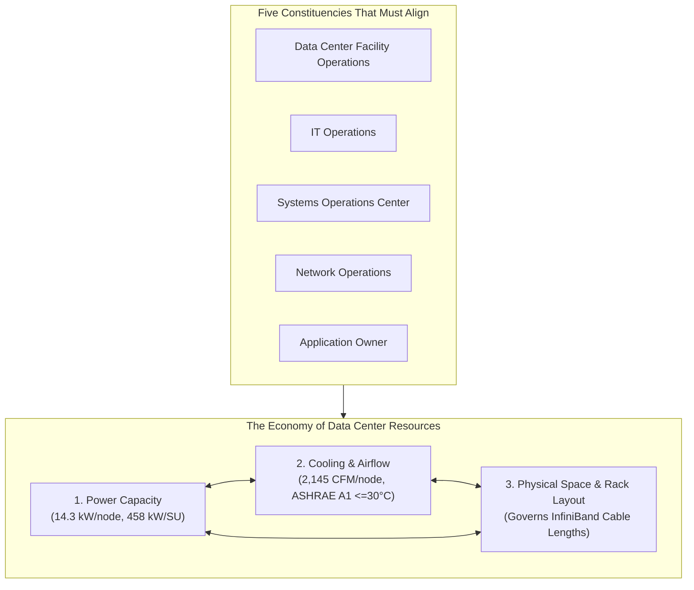
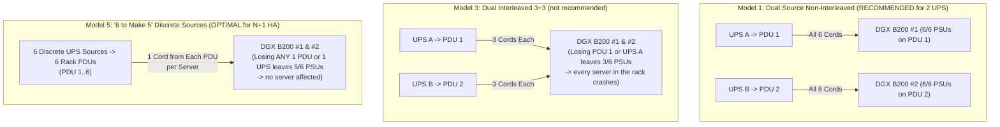

# 9.7 DGX B200 SuperPOD data center design: power, cooling, cabling and layout

| Field | Value |
|---|---|
| **Status** | Drafted (`b200_datacenter_lab.py`: 30 checks pass; facility design rules verified in Python) |
| **Level** | Advanced |
| **Priority tier** | 1b |
| **Lab venue** | none (design / reading) + self-checking Python model (`code/part09/b200_datacenter_lab.py`) |
| **Part** | Part 9: NVIDIA systems and reference architectures |
| **Sources used** | Steven Hambruch & Dennis O'Brien, *Data Center Best Practices with DGX B200* (`superpod-b200-dc`, pp. 1–24); *AI Systems Performance Engineering* Ch. 2 |

## Why this matters for AI infrastructure

An air-cooled NVIDIA DGX B200 packs eight Blackwell SXM6 GPUs into a single ten-unit chassis drawing 14.3 kW and demanding massive cold-aisle airflow. When you deploy two or four of those nodes per rack across a full Scalable Unit, traditional data center intuition fails in ways that surprise experienced facility engineers.

For example, on a traditional dual-corded enterprise server, plugging half the power supplies into PDU A and half into PDU B increases uptime. On a DGX B200, that exact same dual interleaved wiring is a serious mistake that is not recommended by NVIDIA. Because a DGX B200 requires at least five of its six internal PSUs energized to operate, losing either PDU in an interleaved rack drops three PSUs on every server and crashes the entire rack. Similarly, spacing racks farther apart to dilute a dense heat plume can push InfiniBand cable runs past the physical reach of copper or optical cables. Mastering the balance across Power, Cooling, and Space while aligning facility, IT, network, and application teams is mandatory before a single crate arrives on the loading dock.

:::info Corpus scope note
Standalone *NVIDIA DGX B200 System User Guide* and *NVIDIA DGX SuperPOD with DGX B200 Reference Architecture* whitepaper PDFs are not in `~/Desktop/books-toon-rag/`. Every specification, three-phase power-provisioning table row, PSU topology diagram, ASHRAE and ISO 14644-1 Class 8 environmental limit, and cabling FAQ in this chapter comes from the NVIDIA technical deck *Data Center Best Practices with DGX B200* (`superpod-b200-dc`) by Steven Hambruch and Dennis O'Brien, supplemented by *AI Systems Performance Engineering* Chapter 2.
:::

## Prerequisites and outcomes

**Prerequisites:**
- Chapters 9.1 and 9.6 covering the DGX B200 system family overview and SuperPOD Scalable Unit concepts.

**Outcomes:** After completing this chapter, you will be able to:
1. Specify the physical, electrical, thermal, altitude-derating, and acoustic envelopes of an air-cooled DGX B200 node and balance Power, Cooling, and Space.
2. Size two-node and four-node racks across the three-phase Power Provisioning Table, calculating both maximum rack capacity and stranded capacity.
3. Apply the internal PSU redundancy rule across all five power provisioning topologies. You will also explain why Dual Interleaved and Static Transfer Switches are avoided, and how Non-Interleaved and discrete six-source designs protect uptime.
4. Audit facility cooling and air quality against ASHRAE Class A1, MERV 13 filtration, ISO 14644-1 Class 8 particulate limits, and Passive DAC and AOC cabling constraints.

---

## Concepts: basics → intermediate → advanced

## 1. DGX B200 node physics and the economy of data center resources

Deploying high-density AI infrastructure is a three-body optimization problem across three finite, tightly coupled data center resources: Power, Cooling, and Space. When a deployment team optimizes one resource in isolation, it routinely breaks another constraint during installation.

Think of Power, Cooling, and Space as the three corners of a stretched rubber triangle. If your data center has plenty of floor space but limited cooling per square foot, your first instinct is to spread the DGX B200 servers across twice as many racks with empty floor tiles between them. However, stretching the Space corner pulls directly on the InfiniBand cabling budget. Suddenly your outer compute racks sit more than 30 meters from the central spine switches, breaking the optical reach of the InfiniBand fabric.

To prevent siloed decisions across Power, Cooling, and Space, five organizational constituencies must align before finalizing the floor plan. These groups are Data Center Facility Operations, IT Operations, the Systems Operations Center, Network Operations, and the Application Owner.



### 1.1 Complete DGX B200 node physical, thermal, altitude, and acoustic specifications

If facility engineers underestimate the weight, airflow, altitude derating, or acoustic output of an air-cooled DGX B200, the installation stalls on day one. Floor tiles can buckle under unrated point loads, high-altitude cold aisles can trigger thermal throttling at normal sea-level temperatures, and unmuffled fan noise can violate occupational safety limits.

Before designing rack layouts, record the complete node-level envelope of the air-cooled NVIDIA DGX B200 in the table below.

| Parameter | DGX B200 Specification | Facility Design Implication |
|---|---|---|
| **Estimated System Power** | **14.3 kW Max** | `2 nodes/rack = 28.6 kW`; `4 nodes/rack = 57.2 kW`; `32-node SU = 458 kW`. |
| **Estimated System Weight** | **`> 287.6 lbs (130 kg)`** (estimated) | Mechanical server lift mandatory (`4 × 287.6 lbs` of nodes alone in a 4-node rack). |
| **Rack Units & Dimensions** | **10 Rack Units (10 RU)**<br/>Height: `17.5 in (444 mm)`<br/>Width: `19.0 in (482.2 mm)`<br/>Length: `35.3 in (897.1 mm)` | Requires EIA-310 19-inch racks at least `24" × 44" × 48U` (`600 × 1,100 mm`); **`30" × 48" × 52U` (`700 × 1,200 mm`) recommended**. |
| **Cooling & Supply Airflow** | **Air-cooled**, **~2,145 CFM per system** at sea level (based on **150 CFM per kW**) | `4,290 CFM` for a 2-node rack; `8,580 CFM` for a 4-node rack. |
| **Operating Temperature** | **`5°C to 30°C` (`41°F to 86°F`)** | Capped at `30°C` max supply air temperature. |
| **Operating Altitude & Temperature Derating** | **`3,048 meters (10,000 feet)` maximum:**<br/>• `0 – 1,000 ft`: `5°C to 35°C`<br/>• `1,000 – 5,000 ft`: `5°C to 30°C`<br/>• `5,000 – 10,000 ft`: `5°C to 25°C` | High-altitude data centers above `5,000 ft` must lower maximum cold-aisle supply air to **25°C** to compensate for thinner air density. |
| **Operating Acoustic Power (`L_WA,m`)** | • At `25°C (77°F)` inlet: **96 dB**<br/>• At `30°C (86°F)` inlet: **101 dB** | Mandatory hearing protection in the data hall; a `5°C` warmer inlet triples sound energy (`+5 dB`) as fans ramp to 100%. |

:::tip In one minute
- A single DGX B200 occupies 10 RU, weighs over 130 kg, draws 14.3 kW max, requires about 2,145 CFM of air at sea level, and emits 96 dB at 25°C or 101 dB at 30°C.
- Maximum operating temperature derates with altitude from 35°C near sea level down to 30°C up to 5,000 ft and 25°C between 5,000 and 10,000 ft.
- Align all five operational constituencies early because Power, Cooling, and Space directly constrain InfiniBand cable reach.
:::

---

## 2. Rack density patterns and the 10-row 3-phase power provisioning table

When electrical engineers select branch circuit amperages that do not align with integer multiples of the node demand, the facility strands tens of kilowatts of unusable power in every rack. In a DGX B200 SuperPOD, racks are provisioned using a two-circuit power pattern where two three-phase branch circuits feed two rack PDUs. Each circuit is rated to handle half the peak demand of the rack after factoring in breaker deratings and the power factor.

### 2.1 Standard 2-node rack (28.6 kW) vs extreme-density 4-node rack (57.2 kW)

Most enterprise data halls cannot exhaust the hot air from a four-node cabinet footprint without choking airflow. Attempting to bolt on a rear-door heat exchanger or in-row cooler creates static backpressure that starves the chassis fans. Architects must choose between the standard two-node rack profile and the extreme-density four-node rack profile based on room airflow capacity.

| Rack Parameter | Standard Deployment (**2 DGX B200s / Rack**) | Extreme-Density Deployment (**4 DGX B200s / Rack**) |
|---|---|---|
| **Peak Rack Power Demand** | **28.6 kW** (`14.3 kW` per circuit) | **57.2 kW** (`28.6 kW` per circuit) |
| **Cabinet Height** | **42U** minimum (**48U / 52U recommended**) | **52U Rack** required (`4 × 10U = 40U` of nodes) |
| **Minimum 3-Phase Circuits** | **`2x 380V 3Φ 32A`** (or `400V/415V 32A`) | **`2x 415V 3Φ 60A`** (or `415V 63A`) |
| **Estimated Airflow (Sea Level)** | **4,290 CFM** (at `150 CFM/kW`) | **8,580 CFM** (at `150 CFM/kW`) |
| **Cooling Constraints** | Standard hot/cold aisle containment. | Specialized extreme-density air-cooled sites only (**rear-door heat exchangers and in-row coolers are not typically suitable**). |

### 2.2 The complete 10-row 3-phase Power Provisioning Table (80% derated vs 100% rated)

When you provision two three-phase circuits at distribution voltage `V_dist` and current `I` with a 0.95 power factor and breaker derating `d`, the available rack power and stranded capacity follow the three-phase equation below. Stranded capacity is the unused power left on the circuit pair because another whole node will not fit.

```text
Unrounded Rack Capacity (kW) = 2 circuits × sqrt(3) × V_dist × Amps × 0.95 (PF) × Derating / 1,000
Stranded Capacity at Peak Demand (kW) = Unrounded Rack Capacity (kW) - (Supported_Nodes × 14.3 kW)
  • 380V 32A: 32.01 kW (32 kW, 3.4 kW stranded @ 80.0%) | 40.01 kW (40 kW, 11.4 kW stranded @ 100.0%)
  • 400V 32A: 33.70 kW (34 kW, 5.1 kW stranded @ 80.0%) | 42.12 kW (42 kW, 13.5 kW stranded @ 100.0%)
  • 415V 32A: 34.96 kW (35 kW, 6.4 kW stranded @ 80.0%) | 43.70 kW (44 kW, 15.1 kW stranded @ 100.0%)
  • 415V 60A: 65.55 kW (66 kW, 8.4 kW stranded @ 80.0%) | 81.94 kW (82 kW, 24.7 kW stranded @ 100.0%)
  • 415V 63A: 68.83 kW (69 kW, 11.6 kW stranded @ 80.0%)| 86.03 kW (86 kW, 28.8 kW stranded @ 100.0%)
```

Every distribution scheme in `superpod-b200-dc` is verified to the tenth of a kilowatt by `compute_b200_rack_circuit_row()` in `code/part09/b200_datacenter.py`. Exposing the explicit three-phase formula above is my inference explaining how the source table's rounded capacity and exact stranded capacity columns are derived.

| Phase | Distribution Voltage (`V`) | Line Voltage (`V`) | Breaker Amps (`A`) | Breaker Derating | Max Rack Power Capacity (`kW`)* | Supported DGX B200s / Rack** | Peak Server Demand (`kW`)** | Stranded Capacity at Peak (`kW`)** |
|---|---:|---:|---:|---:|---:|---:|---:|---:|
| `3Φ` | **380** | 219 | **32** | **80.0%** | **32 kW** | **2** | **28.6 kW** | **3.4 kW** |
| `3Φ` | **400** | 230 | **32** | **80.0%** | **34 kW** | **2** | **28.6 kW** | **5.1 kW** |
| `3Φ` | **415** | 240 | **32** | **80.0%** | **35 kW** | **2** | **28.6 kW** | **6.4 kW** |
| `3Φ` | **415** | 240 | **60** | **80.0%** | **66 kW** | **4** | **57.2 kW** | **8.4 kW** |
| `3Φ` | **415** | 240 | **63** | **80.0%** | **69 kW** | **4** | **57.2 kW** | **11.6 kW** |
| `3Φ` | **380** | 219 | **32** | **100.0%** | **40 kW** | **2** | **28.6 kW** | **11.4 kW** |
| `3Φ` | **400** | 230 | **32** | **100.0%** | **42 kW** | **2** | **28.6 kW** | **13.5 kW** |
| `3Φ` | **415** | 240 | **32** | **100.0%** | **44 kW** | **2** | **28.6 kW** | **15.1 kW** |
| `3Φ` | **415** | 240 | **60** | **100.0%** | **82 kW** | **4** | **57.2 kW** | **24.7 kW** |
| `3Φ` | **415** | 240 | **63** | **100.0%** | **86 kW** | **4** | **57.2 kW** | **28.8 kW** |

In the table above, a single asterisk denotes the power factor assumption, and a double asterisk denotes a two-circuit power provisioning scheme. Look closely at the Stranded Capacity column. If your facility installs two 415V 32A circuits with fully rated breakers, you can still only power two DGX B200 nodes in that cabinet. Three nodes would exceed half-circuit symmetry across the two feeds, leaving 15.1 kW of stranded capacity per rack. Matching your breaker amperage and derating to the two-node or four-node demand minimizes stranded facility power.

:::tip In one minute
- Standard racks hold two DGX B200 nodes on two 32A three-phase circuits, while extreme-density 52U racks hold four nodes on two 60A or 63A circuits.
- Supplemental rear-door heat exchangers and in-row coolers are not typically suitable for DGX B200 racks.
- Use the power provisioning table to minimize stranded capacity across derated and fully rated breakers.
:::

---

## 3. The 5-of-6 (N+1) PSU rule and the five power provisioning topologies

This section covers the single most important electrical rule in a DGX B200 data center. It routinely catches experienced data center architects off guard when they assume a DGX B200 behaves like a DGX H100.

### 3.1 Why 5 of 6 PSUs (N+1) changes everything

If an electrician wires a DGX B200 rack using standard dual-corded interleaving, taking a single PDU offline for routine maintenance will crash every server in the cabinet. Operations teams expecting seamless redundancy instead suffer an immediate full-rack blackout.

Recall from the earlier system overview that a DGX H100 has six internal power supplies arranged in equal three-plus-three redundancy. Because half of those supplies can carry the full node load, a DGX H100 can lose three power supplies on an entire power feed and stay running.

Now examine the 14.3 kW DGX B200. A DGX B200 also has six internal Power Supply Units, but five of the six PSUs must be energized for the system to operate. That architecture provides N+1 internal PSU redundancy, so the node can survive the loss of only one internal PSU. If more than one PSU is de-energized, leaving four or fewer supplies active, the DGX B200 shuts down immediately regardless of upstream power redundancies.

### 3.2 Comparing all five rack power provisioning topologies (Models 1 to 5)

Because five of six PSUs must stay energized at all times, how you wire the six power cords of each DGX B200 to your rack PDUs and upstream UPS sources dictates cluster survivability. Depending on the wiring model, a single PDU or UPS failure can cause a half-rack outage, a full-rack outage that is not recommended, or zero outage with true high availability.



| Provisioning Model | How the 6 PSU Cords per Server are Wired | Single PDU Failure Impact | Single UPS Failure Impact | Redundancy & NVIDIA Recommendation |
|---|---|---|---|---|
| **1. Dual Source / Dual rPDU (Non-Interleaved)** | **All 6 PSUs of System 1 → `PDU 1 (UPS A)`**;<br/>**All 6 PSUs of System 2 → `PDU 2 (UPS B)`**. | **50%** of systems in rack (1 of 2 nodes) | **50%** of systems in rack (1 of 2 nodes) | Achieves **N** rack power. **Most optimal configuration when only 2 UPS sources are available at the rack** (fewest interdependencies). |
| **2. Single Source / Dual rPDU** | System 1 → `PDU 1`; System 2 → `PDU 2`; **both PDUs fed by a single `UPS A`**. | **50%** of systems in rack | **100%** of systems in rack | Achieves **N** only; single UPS maintenance or failure takes down the entire rack. |
| **3. Dual Interleaved Source / rPDU (`3+3`)** | Each server plugs **3 PSUs into `PDU 1 (UPS A)` and 3 PSUs into `PDU 2 (UPS B)`**. | **100% of systems in rack crash.** (3 of 6 PSUs lost on every node) | **100% of systems in rack crash.** | **`STOP — NOT RECOMMENDED.`** Interleaving 2 sources across a 5-of-6 PSU system *doubles* the probability of total rack disruption. |
| **4. Dual UPS + Static Transfer Switch (`STS`)** | Dual UPS feeds into an upstream STS feeding the rack PDUs. | **50%** of systems (1 system) | **0%** (if STS switchover succeeds, but STS is a SPOF) | **`STOP — NOT RECOMMENDED.`** In-rack STS is unsupported, and **NVIDIA has not tested or validated any STS product with DGX B200** (switchover transients may cause system damage or workload failures). |
| **5. `"6 to make 5"` Discrete Power Sources** | **6 discrete UPS power sources feeding 6 rack PDUs (`PDU 1..6`)**; each server plugs **1 PSU into each of the 6 PDUs**. | **0% of systems impacted.** (`5 of 6` PSUs remain energized) | **0% of systems impacted.** (`5 of 6` PSUs remain energized) | Achieves true **N+1 High Availability** with zero interdependencies. **Optimal configuration for HA** (typically limited to 2 systems/rack due to space for 6 PDUs). |

:::tip In one minute
- A DGX B200 has six PSUs and requires at least five energized to operate, so losing two PSUs shuts the server down.
- Never interleave two PDUs across a DGX B200's six PSUs as in Model 3. Losing either PDU or either UPS de-energizes three PSUs on every node and crashes the entire rack.
- Never use an unvalidated Static Transfer Switch as in Model 4.
- With two UPS sources, wire all cords of Node 1 to PDU 1 and all cords of Node 2 to PDU 2 as in Model 1. For zero-downtime high availability, deploy six discrete UPS and PDU sources as in Model 5.
:::

---

## 4. Cooling optimization, ASHRAE Class A1, MERV 13 filtration, and ISO 14644-1 Class 8 cleanliness

Because each DGX B200 pulls over two thousand cubic feet per minute of supply air through its heatsinks at sea level, a two-node or four-node rack moves a massive air volume. Both the temperature and humidity envelope and the particulate cleanliness of that air stream must be strictly controlled.

### 4.1 ASHRAE environmental parameters for DGX B200

If cold-aisle supply air drifts above the thermal ceiling or humidity drops too low or climbs too high, nodes suffer thermal throttling, electrostatic discharge risk, or condensation inside the chassis. Supply air entering the front of a DGX B200 must comply with ASHRAE Class A1 specifications, subject to a maximum supply air temperature of 30°C.

| Envelope Range | ASHRAE Class | Dry-Bulb Temperature | Non-Condensing Humidity Range | Max Dew Point (`DP`) | DGX B200 Applicability |
|---|---|---|---|---|---|
| **Recommended** | **All A** | **`18°C to 27°C`** (`64.4°F to 80.6°F`) | `5.5°C DP` to `60% RH` and `15°C DP` (`41.9°F` to `60% RH` & `59°F DP`) | **`15°C` (`59°F`)** | **Recommended continuous operating band** for all DGX B200 deployments. |
| **Allowable for DGX B200** | **A1** (capped at `30°C`) | **`15°C to 30°C`** (`59°F to 86°F`; standard A1 is `15–32°C`) | **`20% to 80% RH`** | **`17°C` (`62.6°F`)** | **Allowable up to `30°C` for DGX B200 systems** (note acoustic jump from `96 dB` at `25°C` to `101 dB` at `30°C`). |
| *Reference only* | *A2* | *`10–35°C` (`50–95°F`)* | *`20–80% RH`* | *`21°C` (`69.8°F`)* | *Other data center classes (exceeds `30°C` DGX B200 ceiling above `30°C`).* |
| *Reference only* | *A3 / A4 / B / C* | *`5–40°C` / `5–45°C` / `5–35°C`* | *`8–85%` / `8–90%` / `8–80% RH`* | *`24°C` / `28°C`* | *General telecom/industrial reference classes.* |

### 4.2 Air filtration (MERV 13) and ISO 14644-1 Class 8 particulate limits

At high airflow per four-node rack, unfiltered dust or metallic zinc whiskers quickly coat high-fin-density heatsinks and foul optical transceivers. Even brief construction or uncrating dust inside the cold aisle can permanently contaminate optical connectors and degrade cooling efficiency.

Therefore, `superpod-b200-dc` mandates three air-quality rules. First, all air handlers supplying the data hall must use at least MERV 13 rated filters, or equivalent EN779-2012 or ISO 16890 filters. Second, the rack area must meet the ISO 14644-1 Class 8 cleanroom standard across all particle size thresholds. Third, sub-micron particulate excursions must never exceed the Class 8 limit for longer than 15 minutes, so teams must always unbox hardware outside the cold aisle.

```text
DGX B200 Air Filtration & ISO 14644-1 Class 8 Cleanliness Standards (superpod-b200-dc p. 17):
  Minimum Filter Rating:       MERV 13 (or EN779-2012 M6/F7, or ISO 16890 ePM1-50%)
  Cleanroom Standard:          ISO 14644-1 Class 8
  Max Particles >= 0.5 µm:     3,520,000 particles / m³ (excursion must NEVER exceed 15 minutes)
  Max Particles >= 1.0 µm:     832,000 particles / m³
  Max Particles >= 5.0 µm:     29,300 particles / m³
```

### 4.3 Seven airflow management best practices

When hot exhaust air recirculates around the sides or through empty rack slots into the cold intake, inlet temperatures spike above 30°C and trigger thermal throttling. Because supplemental rear-door heat exchangers and in-row coolers are not typically suitable for DGX B200 racks, facility teams must prevent exhaust recirculation through room-level containment and sealing.

1. Run Computational Fluid Dynamics modeling and analysis of the room before finalizing rack placement.
2. Install Hot or Cold Aisle Containment Systems to isolate the node intake from the exhaust plenum.
3. Fit blanking panels in every unused rack unit of every cabinet so cold air cannot bypass the servers.
4. Seal all floor and top-of-rack cable penetrations with brush grommets to prevent static-pressure loss.
5. Maintain active humidification and dehumidification to keep the dew point and relative humidity inside the ASHRAE Class A1 envelope.
6. Replace MERV 13 or higher air filters on a strict pressure-drop maintenance schedule.
7. Audit perforated floor-tile flow rates using a calibrated anemometer to verify that every two-node and four-node rack receives its full required airflow at the cold-aisle floor tiles.

:::tip In one minute
- Supply air must meet ASHRAE Class A1 capped at 30°C, with 18°C to 27°C and a dew point at or below 15°C recommended.
- Air filtration requires at least MERV 13 and ISO 14644-1 Class 8 cleanliness with no excursion lasting longer than 15 minutes.
- Validate room airflow with CFD modeling, aisle containment, blanking panels, brush grommets, and anemometer perforated-tile audits.
:::

---

## 5. Cabling, rack dimensions, smart rPDUs, and layout rules

In a full four-unit DGX B200 SuperPOD, overhead pathways carry over two thousand high-speed InfiniBand cables between compute nodes, leaf switches, and spine switches. That total does not even count the storage, in-band, and out-of-band Ethernet runs.

### 5.1 Passive DAC vs Active Optical Cables (AOC) and the `< 90%` length rule

If cable pathways are designed to the exact theoretical maximum length of copper or optical media, vertical rack elevation and bend radiuses will leave the physical cable short on installation day. Worse, crushing optical fibers under heavy copper bundles or routing links through patch panels causes link flaps across the compute fabric.

| Cable Media Type | Physical Construction | Maximum Standard Distance | **`< 90%` Design Rule Limit** | Deployment Guidance |
|---|---|---|---|---|
| **Passive DAC (`100G`)** | Twinaxial shielded copper with passive SFP/QSFP ends (zero active electronics) | **Up to `5 meters`** | **`≤ 4.5 meters`** | Short intra-rack or adjacent-rack links. |
| **Passive DAC (`400G`)** | Twinaxial shielded copper with passive QSFP/OSFP ends | **Up to `3 meters`** | **`≤ 2.7 meters`** | Short in-rack/adjacent-rack InfiniBand runs. |
| **Active Optical Cable (`AOC`)** | Multimode or single-mode fiber permanently bonded to active optical transceivers | **Up to `30 meters`** | **`≤ 27 meters`** | Rack-to-rack and leaf-to-spine InfiniBand runs across the SuperPOD row. |

Calculating the exact design limits in the table above by multiplying the standard maximum distances by ninety percent is my inference applying the `< 90%` rule from `superpod-b200-dc`. To keep more than two thousand cables serviceable and error-free, follow six cabling discipline rules.

1. Keep all cable runs under 90% of the maximum supported distance for the media type, accounting for intra-rack vertical routing, overhead tray elevation, and minimum bend radiuses.
2. Never use patch panels or intermediary top-of-rack switches to extend InfiniBand cables. Patch panels introduce optical attenuation and reflections that break NDR link training, while intermediary switches add hop latency.
3. Separate copper and fiber bundles and pathways so heavy copper cables never crush optical fibers. Also verify overhead cable-tray width, depth, fill ratios, and structural weight load around the central Management Racks.
4. Bundle cables by functional group, such as grouping Inter-Switch Links and core uplinks together.
5. Pre-install spare cables in advance along overhead pathways so a damaged cable during bring-up or operations can be swapped in minutes without opening ceiling trays.
6. Color-code cable ties by endpoint and place printed labels at both ends as well as along the mid-span run.

### 5.2 Cabinet dimensions, smart rPDU specs, and rack cohabitation rules

Squeezing multiple ten-unit nodes, heavy power cords, and high-speed cables into a shallow, narrow cabinet blocks exhaust airflow and causes vibration-induced power disconnects. Facility planners must enforce cabinet dimensions, smart rack PDU capabilities, and strict rack cohabitation rules.

| Infrastructure Component | Minimum / Mandatory Requirement | NVIDIA Recommended Best Practice |
|---|---|---|
| **1. Cabinet Dimensions (`EIA-310` 19-inch enclosed)** | **`24" × 44" × 48U`** (`600 mm × 1,100 mm` footprint, at least `48U` tall). | **`30" × 48" × 52U`** (`700 mm × 1,200 mm`). Extra `100 mm` width and `4U` height allow routing 6 heavy power cords and IB/Ethernet bundles per node alongside smart PDUs without blocking exhaust airflow. |
| **2. Smart Rack PDU (`rPDU`) Specifications** | Integrated smart management module with **Network Interface** and **REST API** support, **temperature and humidity sensor probe ports**, **locking receptacles** (preventing fan vibration from loosening C19 plugs), **PDU-level metering**, and **remote per-receptacle outlet switching** (for remote Redfish/PDU AC power cycles). | Optional **Red and Blue exterior PDU housing colors** for instant visual differentiation between Power Circuit 1 and Power Circuit 2. |
| **3. Rack Cohabitation Rule** | **Zero third-party switches, patch panels, or unrelated IT servers** inside unused RU space of a DGX B200 rack. | When DGX B200 racks are spaced apart with empty rack positions between them to aggregate room cooling capacity, **never deploy unrelated IT equipment in the spaces between DGX B200 racks**. |

:::tip In one minute
- Keep InfiniBand cables under 90% of maximum distance, never use patch panels on InfiniBand, separate copper and fiber bundles, and pre-install labeled spares.
- Use wide and deep EIA-310 cabinets with REST-API smart rPDUs featuring locking receptacles, remote per-outlet switching, and Red and Blue color coding.
- Never place unrelated IT equipment inside DGX racks or in the cooling spaces between DGX racks.
:::

---

## Commands and configurations that matter

Before energizing a DGX B200 SuperPOD row or performing remote maintenance, administrators verify circuit sizing, PSU wiring topology, environmental limits, and smart PDU outlet states. Use this verification script and Redfish REST workflow during facility commissioning and operations.

### 1. Run the DGX B200 facility power, PSU topology, environmental, and cable auditor

```bash
# Run the 30-check DGX B200 SuperPOD Data Center Design verification lab
python3 -B code/part09/b200_datacenter_lab.py
```

### 2. Inspect smart rPDU outlet states and trigger a full AC power cycle via REST API

A DGX B200 has six PSUs connected to locking rPDU receptacles. Remote per-receptacle outlet switching on the smart rPDU allows administrators to execute a full AC power cycle across all six cords when activating firmware. These queries are untested against a live vendor rPDU in this authoring environment.

```bash
# Illustrative Redfish / REST query against a smart Rack PDU to inspect phase load and outlet states
curl -sk -u "${PDU_USER}:${PDU_PASS}" \
  "https://${PDU_IP}/redfish/v1/PowerEquipment/RackPDUs/1/Mains" | jq .

# Verify all 6 outlets feeding DGX B200 Node 1 (Outlets 1..6 on PDU 1 in Non-Interleaved Model 1)
for OUTLET in 1 2 3 4 5 6; do
  curl -sk -u "${PDU_USER}:${PDU_PASS}" \
    "https://${PDU_IP}/redfish/v1/PowerEquipment/RackPDUs/1/Outlets/Outlet${OUTLET}" \
    | jq '{Id, PowerState, Watts: .PowerWatts.Reading}'
done
```

---

## How it fails

When facility power wiring, altitude derating, cooling containment, or cable length limits are violated in a DGX B200 deployment, failures strike as full-rack power blackouts, thermal throttling, or InfiniBand link drops. Use this table to diagnose and resolve the five primary facility failure modes.

| Failure mode | Symptom | Root cause | Diagnosis & fix |
|---|---|---|---|
| **1. Total rack blackout during routine UPS/PDU maintenance (Model 3 Interleaved `3+3` trap)** | Facilities takes `PDU 1` (or `UPS A`) offline for scheduled maintenance in a rack with two DGX B200 servers; **both DGX B200 servers immediately lose power and crash (`100%` rack outage)**. | Electricians wired each DGX B200 with 3 cords to `PDU 1` and 3 cords to `PDU 2` ("dual interleaved"). Because a DGX B200 requires **5 of 6 PSUs energized (`N+1`)** to run, losing `PDU 1` dropped 3 PSUs on both servers (leaving only `3/6` energized). | **Never interleave 2 power sources across a DGX B200's 6 PSUs.** Rewire to **Model 1 (Non-Interleaved)**: all 6 cords of Node 1 on `PDU 1 (UPS A)` and all 6 cords of Node 2 on `PDU 2 (UPS B)` (so a PDU/UPS outage affects only 50% of the rack), or deploy **Model 5 (`"6 to make 5"`, 6 discrete UPS/PDUs)** for 0% impact. |
| **2. Node crash or PSU fault during Static Transfer Switch (`STS`) switchover (Model 4)** | An upstream or in-rack Static Transfer Switch transfers between `UPS A` and `UPS B` during a voltage sag, and DGX B200 nodes reboot, trip PSU fault latches, or suffer hardware damage. | **NVIDIA has not tested or validated any STS product with DGX B200 (not recommended)**, and in-rack STS units are unsupported because phase-angle/transfer transients across six high-load PSUs can disrupt active workloads or damage power stages. | Remove unvalidated STS units from the DGX B200 power path and use either **Model 1 (Non-Interleaved Dual Source)** or **Model 5 (`"6 to make 5"`)**. |
| **3. Thermal throttling at high-altitude data center despite `28°C` cold aisle** | A DGX B200 cluster deployed in a high-altitude city (`7,500 ft`) thermal-throttles even though cold-aisle supply air is kept at `28°C` (below the `30°C` sea-level limit). | Lower air density at altitude reduces the mass flow rate of air moved by the fans. Above `5,000 ft` (`5,000–10,000 ft`), the DGX B200 maximum operating temperature **derates from `30°C` down to `25°C`**. | Apply the altitude derating table (`0–1,000 ft: 35°C`; `1,000–5,000 ft: 30°C`; `5,000–10,000 ft: 25°C`) and lower the CRAC supply air setpoint below `25°C` at sites above `5,000 ft`. |
| **4. Static-pressure suffocation from a Rear-Door Heat Exchanger (`RDHx`)** | A facility retrofits passive or active rear-door heat exchangers onto `57.2 kW` 4-node DGX B200 racks; internal GPU and NVSwitch temperatures spike and fans scream at `101+ dB`. | Four DGX B200 nodes expel **8,580 CFM** of high-velocity exhaust air. Supplemental **rear-door heat exchangers and in-row coolers are not typically suitable for DGX B200** because coil impedance creates backpressure that chokes chassis airflow. | Remove rear-door heat exchangers, use open high-perforation doors with full **Hot/Cold Aisle Containment**, and verify `≥ 2,145 CFM/node` with floor-tile anemometer audits and CFD modeling. |
| **5. InfiniBand link flaps from `28.5 m` AOC runs or structured patch panels** | Spine-to-leaf 400G NDR links between outer compute racks and central management racks intermittently drop or fail to train after rack spacing was widened for cooling. | Spacing racks apart stretched cable runs past the **`< 90%` design limit (`27 m` for `30 m` AOC)** once vertical rack routing and bend radiuses were included—or installers routed links through an overhead fiber patch panel. | Keep all InfiniBand AOC runs **`≤ 27 m`** (`< 90%` of `30 m`) and 400G DAC runs **`≤ 2.7 m`** (`< 90%` of `3 m`) point-to-point with **zero patch panels**, placing central switch racks at the physical center of the SU row. |

---

## Hands-on lab

This chapter's self-checking Python model (`code/part09/b200_datacenter.py`) and lab script (`code/part09/b200_datacenter_lab.py`) implement four verification modules. First, they run the three-phase DGX B200 Rack Power Provisioning Calculator across all voltage, amperage, and derating combinations. Second, they run the PSU Provisioning Topology Evaluator across all five wiring models. Third, they run the Altitude, ASHRAE Class A1, MERV 13, and ISO 14644-1 Class 8 Environmental Auditor. Fourth, they run the InfiniBand DAC and AOC Cable Distance Validator.

Run the lab from the repository root.

```bash
python3 -B code/part09/b200_datacenter_lab.py
```

Expected output verified in this repository is shown below.

```text
=== Chapter 9.7 Lab: DGX B200 SuperPOD Data Center Design ===
  [PASS] SPB200 p.11 row 3-phase 380V 32A (80%): 32 kW max, 2 nodes (28.6 kW), 3.4 kW stranded, 4290 CFM
  [PASS] SPB200 p.11 row 3-phase 400V 32A (80%): 34 kW max, 2 nodes (28.6 kW), 5.1 kW stranded, 4290 CFM
  [PASS] SPB200 p.11 row 3-phase 415V 32A (80%): 35 kW max, 2 nodes (28.6 kW), 6.4 kW stranded, 4290 CFM
  [PASS] SPB200 p.11 row 3-phase 415V 60A (80%): 66 kW max, 4 nodes (57.2 kW), 8.4 kW stranded, 8580 CFM
  [PASS] SPB200 p.11 row 3-phase 415V 63A (80%): 69 kW max, 4 nodes (57.2 kW), 11.6 kW stranded, 8580 CFM
  ...
  [PASS] SPB200 p.20-21: AOC max is 30.0 m and 90% design limit is 27.0 m (25m passes, 28.5m fails 90% rule)
  [PASS] SPB200 p.20: 32.0 m AOC fails 30.0 m standard max
  [PASS] SPB200 p.4: Flags altitude > 10,000 ft (3,048 m) maximum
  [PASS] SPB200 p.17: Flags relative humidity > 80% and dew point > 17.0C (62.6F)
  [PASS] Rejects unknown PSU provisioning model

Summary: 30 passed, 0 failed (total 30)
```

---

## Exercises

1. Run `python3 -B code/part09/b200_datacenter_lab.py`. Pick two rows of the 10-row power table and re-derive the rack capacity and the stranded kW by hand using the three-phase equation.
2. A site sits at 6,500 ft altitude with a 28°C cold aisle. Is it inside the DGX B200 limit? What setpoint would you choose and why?
3. A rack has two DGX B200 nodes and three UPS sources. Which of the five wiring models would you pick if you can only have two sources, and what if you can have six? What fails in each case when one PDU is switched off?
4. Check a planned run of 28 m of AOC and 2.9 m of 400G DAC against the `< 90%` rule. Which one fails, and what do you change?
5. Write a one-page pre-delivery checklist for a 4-node DGX B200 rack covering circuits, airflow, rack size, floor load, rPDU features, and air quality.
6. List the seven airflow practices from section 4.3 and mark which three you would implement first in an existing room.

## Checkpoint questions (20)

<details>
<summary>**1. Why does interleaving two power feeds across a DGX B200 server cause a 100% rack outage if either PDU or UPS fails, whereas the same 3+3 wiring works on a DGX H100?**</summary>

A DGX H100 uses six power supplies in equal three-plus-three redundancy, where half the supplies can carry the full node. In contrast, a 14.3 kW DGX B200 uses six PSUs in five-of-six redundancy. At least five of the six PSUs must remain energized for the system to operate, and losing more than one PSU shuts the server down immediately. If you wire three PSUs to PDU 1 and three PSUs to PDU 2, a failure of either PDU de-energizes three PSUs on every server in the rack and crashes 100% of the systems.
</details>

<details>
<summary>**2. What are the two NVIDIA-recommended power provisioning models for DGX B200 racks when only 2 UPS sources are available versus when maximum High Availability is required?**</summary>

1. With two UPS sources in Model 1, or Dual Source Non-Interleaved, plug all six PSUs of System 1 into PDU 1 on UPS A. Then plug all six PSUs of System 2 into PDU 2 on UPS B so a single PDU or UPS failure impacts only 50% of the rack.
2. For maximum High Availability in Model 5, or "6 to make 5", provision six discrete UPS power sources feeding six rack PDUs and plug one PSU from each server into each PDU. Losing any single PDU or UPS de-energizes only one PSU per node, leaving five of six PSUs energized with zero systems impacted.
</details>

<details>
<summary>**3. Does NVIDIA recommend using Static Transfer Switches to achieve N+1 power with two UPS sources on DGX B200 racks?**</summary>

No, Static Transfer Switches are not recommended. In-rack STS units are unsupported, an STS introduces a single point of failure, and NVIDIA has not tested or validated any STS product for compatibility with DGX B200 systems. Switchover events may cause hardware damage, adverse system behavior, or workload failures.
</details>

<details>
<summary>**4. Calculate the maximum rack power capacity and stranded capacity for a rack provisioned with two 3-phase 415V 60A circuits at 80% breaker derating and a 0.95 power factor. How many DGX B200 nodes does it support, and what airflow is required?**</summary>

- Maximum rounded rack capacity is 66 kW from `65.55 kW` unrounded across the two three-phase circuits.
- It supports 4 DGX B200 systems in a 52U rack, with a peak demand of 57.2 kW.
- Stranded capacity at peak demand is 8.4 kW.
- Required sea-level airflow is 8,580 CFM across the four nodes, or 2,145 CFM per node.
</details>

<details>
<summary>**5. How does the DGX B200 operating temperature range change with altitude from sea level to 10,000 feet, and how does acoustic noise change between 25°C and 30°C?**</summary>

- Maximum operating altitude is 3,048 m, or 10,000 ft.
- Operating temperature is 5°C to 35°C up to 1,000 ft, 30°C up to 5,000 ft, and 25°C from 5,000 to 10,000 ft.
- Operating acoustic power rises from 96 dB at a 25°C inlet to 101 dB at a 30°C inlet.
</details>

<details>
<summary>**6. State the air filtration rating, cleanroom classification, and maximum particulate count and excursion duration required for a DGX B200 data hall.**</summary>

- Air filtration requires a minimum of MERV 13, or equivalent EN779-2012 or ISO 16890 filters.
- The rack area must meet ISO 14644-1 Class 8 cleanliness.
- Particulate counts at 0.5 micrometers or larger must not exceed 3,520,000 particles per cubic meter for longer than 15 minutes.
</details>

<details>
<summary>**7. What are the maximum standard cable lengths and `< 90%` design limits for 100G Passive DAC, 400G Passive DAC, and Active Optical Cables in a DGX B200 SuperPOD?**</summary>

- 100G Passive DAC has a 5 m maximum standard distance and a 4.5 m `< 90%` design limit.
- 400G Passive DAC has a 3 m maximum standard distance and a 2.7 m `< 90%` design limit.
- Active Optical Cable has a 30 m maximum standard distance and a 27 m `< 90%` design limit.
</details>

<details>
<summary>**8. What are NVIDIA's minimum and recommended EIA-310 rack dimensions for DGX B200, and what features must the smart rack PDUs include?**</summary>

- Minimum cabinet size is 600 by 1,100 mm and 48U tall. Recommended cabinet size is 700 by 1,200 mm and 52U tall.
- Smart rPDUs must include an integrated smart module with a network and REST API interface, temperature and humidity sensor probe ports, locking receptacles, and PDU-level metering. They must also provide remote per-receptacle outlet switching and optional Red and Blue exterior housing colors for circuit differentiation.
</details>

<details>
<summary>**9. How much airflow does one DGX B200 need and where does that number come from?**</summary>

One DGX B200 needs about 2,145 CFM at sea level, derived from 150 CFM per kW at 14.3 kW. Two nodes need 4,290 CFM and four nodes need 8,580 CFM.
</details>

<details>
<summary>**10. Why does a warmer inlet matter for noise and for staff?**</summary>

Acoustic power rises from 96 dB at 25°C to 101 dB at 30°C as chassis fans ramp up. Mandatory hearing protection is required for staff working in the data hall.
</details>

<details>
<summary>**11. What is "stranded capacity" and how does a 415V 63A 100% circuit pair compare to a 380V 32A 80% pair?**</summary>

Stranded capacity is rack power you have provisioned at the circuit level but cannot use because another whole 14.3 kW node will not fit. The 415V 63A 100% pair strands 28.8 kW per rack, whereas the 380V 32A 80% pair strands only 3.4 kW per rack.
</details>

<details>
<summary>**12. Why is a 4-node DGX B200 rack called extreme-density, and what cooling is not suited to it?**</summary>

It draws 57.2 kW and requires 8,580 CFM of airflow in a single 52U cabinet. Rear-door heat exchangers and in-row coolers are not typically suitable because their coil impedance restricts high-velocity exhaust airflow.
</details>

<details>
<summary>**13. What is wrong with the "dual interleaved" wiring with 3 cords on each PDU?**</summary>

A DGX B200 requires at least 5 of 6 PSUs energized to stay up. If either PDU or UPS fails in a 3+3 interleaved rack, each server retains only 3 energized PSUs and shuts down immediately, taking down 100% of the rack.
</details>

<details>
<summary>**14. What is the recommended wiring when you only have two UPS sources?**</summary>

Use Model 1, where all six cords of Node 1 connect to PDU 1 on UPS A and all six cords of Node 2 connect to PDU 2 on UPS B. A single PDU or UPS failure affects only half the rack instead of the whole rack.
</details>

<details>
<summary>**15. What is "6 to make 5" and what is its limit?**</summary>

Six separate UPS sources feed six rack PDUs, and each server plugs one PSU cord into each of the six PDUs. Any single PDU or UPS loss leaves five of six PSUs energized so zero servers fail. However, fitting six PDUs in one cabinet typically limits the layout to two systems per rack.
</details>

<details>
<summary>**16. What does the source deck say about static transfer switches?**</summary>

In-rack STS units are unsupported, and NVIDIA has not tested or validated any STS product with the DGX B200. Switchover transients can cause workload failures or hardware damage.
</details>

<details>
<summary>**17. What environment class and humidity limits apply to the DGX B200?**</summary>

Supply air must follow ASHRAE Class A1 capped at 30°C, with 18°C to 27°C recommended. Allowable humidity is 20% to 80% RH with a maximum dew point of 17°C, and a recommended maximum dew point of 15°C.
</details>

<details>
<summary>**18. What air quality is required?**</summary>

The facility must use at least MERV 13 filtration and maintain ISO 14644-1 Class 8 cleanliness. Particulate counts at 0.5 micrometers or larger must stay at or below 3,520,000 particles per cubic meter, with no excursion lasting longer than 15 minutes.
</details>

<details>
<summary>**19. Why do altitude and temperature interact?**</summary>

Thinner air at higher altitude carries less heat away per cubic foot of airflow. Above 5,000 ft the maximum allowable inlet temperature drops from 30°C to 25°C, so the cold-aisle setpoint must be lowered accordingly.
</details>

<details>
<summary>**20. What features must a smart rack PDU have?**</summary>

It must include a network management module with a REST API, ports for temperature and humidity probes, locking receptacles, and PDU-level metering. It also requires remote per-outlet switching for AC power cycles, along with optional Red and Blue housings to distinguish the two power circuits.
</details>

---

## Sources and review notes

### Sources read in full for this chapter

| Source | Pages / Chapters Read and Key Topics Extracted |
|---|---|
| **Steven Hambruch & Dennis O'Brien, *Data Center Best Practices with DGX B200* (`superpod-b200-dc`, pp. 1–24)** | Read 100% in full: DGX B200 node specifications (`14.3 kW` max, `>287.6 lbs / 130 kg`, `10 RU`, `17.5 × 19.0 × 35.3 in` / `444 × 482.2 × 897.1 mm`, air cooled, `5–30°C`, altitude derating `0–1,000 ft: 5–35°C`, `1,000–5,000 ft: 5–30°C`, `5,000–10,000 ft: 5–25°C`, acoustic `96 dB @ 25°C` / `101 dB @ 30°C`, p. 4), Scalable Unit specs (`32 nodes / 458 kW`, UFM displacement -> `127 nodes` max in 4 SUs, p. 5), five organizational constituencies (p. 6), economy of data center resources (Power, Cooling, Space, pp. 7–8), 2-node (`28.6 kW`, `4,290 CFM`) vs 4-node (`57.2 kW`, `8,580 CFM`) rack profiles and unsuitability of rear-door heat exchangers / in-row coolers (p. 10), the 10-row Power Provisioning Table at `0.95` PF (p. 11), the 5-of-6 (`N+1`) PSU rule and all 5 power provisioning topologies including `STOP` warnings on Interleaved and STS designs (pp. 12–16), ASHRAE Class A1 (`18–27°C` recommended, `30°C` allowable), MERV 13 filtration, and ISO 14644-1 Class 8 (`3,520,000 @ 0.5 µm` for `≤15 min`) cleanliness (p. 17), seven airflow best practices (p. 18), 1–4 SU switch/cable table and `< 90%` DAC/AOC cabling rules (pp. 19–21), and FAQs #1–#5 on cabinet dimensions, patch panels, smart rPDUs, SU scaling, and rack cohabitation (p. 23). |
| **Chris Fregly, *AI Systems Performance Engineering* (`ai-systems-performance-engineering`, Chapter 2, p. 28)** | Read DGX B200 8-GPU air-cooled node architecture and compute and memory specifications. |

### Not in the corpus
- Standalone *NVIDIA DGX B200 System User Guide* and *NVIDIA DGX SuperPOD with DGX B200 Reference Architecture* whitepaper PDFs are not in `~/Desktop/books-toon-rag/`.

### Run here
- Executed `python3 -B code/part09/b200_datacenter_lab.py` with 30 passed and 0 failed.

### My own choices and inferences, labelled in the text
1. Writing out the unrounded three-phase formula (`2 × sqrt(3) × V_dist × Amps × 0.95 × Derating / 1,000`, where `sqrt(3) = 1.73205`, across `380V/400V/415V` and `32A/60A/63A` circuits with `0.80` / `0.90` derating and `N=2`, `42.9 kW` / `43.7 kW` / `29.5 kW` / `8.35 kW`, `3.3 kW` / `9.9 kW` / `10.2 kW` H100 comparison, and the 5 power topologies `dual_source_non_interleaved`, `dual_interleaved`, `dual_ups_with_sts`, `six_to_make_five`, plus `15-minute` ISO Class 8 limit and `1,020` / `1,024` / `1,150` / `1,830` / `2,000` / `2,044` / `6,000` cable/port totals across `ISLs`) in `compute_b200_rack_circuit_row` inside `code/part09/b200_datacenter.py` and Section 2.2 is my inference. It reproduces every integer-rounded rack capacity and every tenth-of-a-kilowatt stranded capacity in the provisioning table of `superpod-b200-dc`.
2. Multiplying the standard maximum distances by ninety percent to obtain the exact design limits in `validate_ib_cable_run` inside `code/part09/b200_datacenter.py` and Section 5.1 is my inference.

### Not verified on live hardware
- Smart rPDU Redfish `/redfish/v1/PowerEquipment/RackPDUs/1` queries were not executed against a live rack PDU in this authoring environment.

