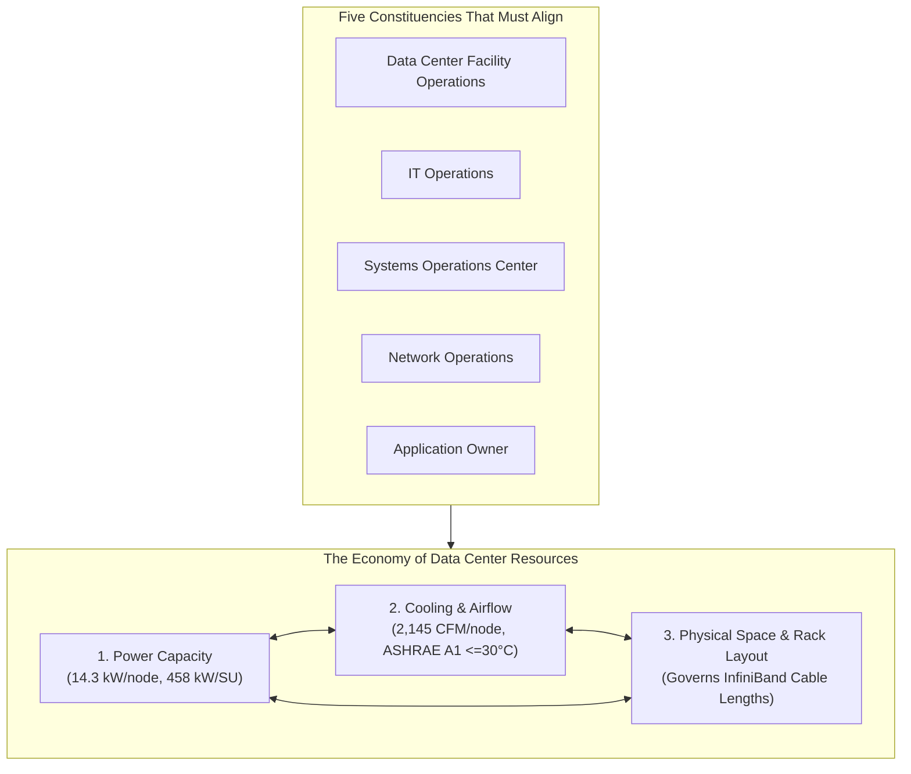
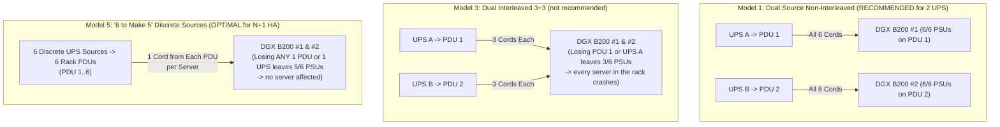

# 9.7 DGX B200 SuperPOD data center design: power, cooling, cabling and layout

| Field | Value |
|---|---|
| **Status** | Drafted (`b200_datacenter_lab.py`: 30 checks pass; facility design rules verified in Python) |
| **Level** | Advanced |
| **Priority tier** | 1b |
| **Lab venue** | none (design / reading) + self-checking Python model (`code/part09/b200_datacenter_lab.py`) |
| **Part** | Part 9: NVIDIA systems and reference architectures |
| **Sources used** | Steven Hambruch & Dennis O'Brien, *Data Center Best Practices with DGX B200* (`superpod-b200-dc`, pp. 1–24); *AI Systems Performance Engineering* Ch. 2 |

## Why this matters for AI infrastructure

An electrician wires a rack of DGX B200 servers the way almost every dual-corded enterprise server is wired. Three power supplies go to PDU A and three go to PDU B. A PDU, or power distribution unit, is the metered power strip mounted inside the rack that carries power from the room's circuits to the servers. Splitting each server's cords across two PDUs is good practice for ordinary servers, because either feed can fail and the server keeps running. Months later, facilities takes PDU A offline for maintenance, and every server in the rack loses power at once. A DGX B200 needs at least five of its six internal power supplies energized. Losing one PDU takes out three of them on every server, so NVIDIA advises against this interleaved wiring.

Cooling and space cause the same kind of surprise. Each air-cooled B200 is a ten-unit chassis that draws 14.3 kW and needs about 2,145 cubic feet of air per minute. A kilowatt (kW) is a unit of power, and nearly all of the power a server draws leaves the chassis as heat that the air has to carry away. A team that spreads the racks apart to thin the heat can stretch the InfiniBand runs past what the cables can reach. Power, cooling and space must be decided together, and the facility, IT, network and application teams must agree before the first crate arrives.

This chapter reads the building around a DGX B200 SuperPOD the way a facility team would. Each section takes one limit, shows the rule NVIDIA gives for it, and then shows what goes wrong when that rule is broken during the build. The node envelope comes first, then the power table, the five wiring models, cooling and air quality, and finally the cables and racks.

## Prerequisites and outcomes

You should be comfortable with the DGX B200 system family from chapters 9.1 and 9.6, which covers the family overview and the SuperPOD Scalable Unit concepts. A Scalable Unit (SU) is the repeatable block of nodes, switches and cables that a SuperPOD is built from, so you already know that the design is a multiple of one block.

The chapter sizes one node first, then sizes a rack against the power table, then checks the five wiring models, the air and the cables. The lab recomputes the power and environment rules from the reference, and the failure cases show what happens when a rule is skipped during construction.

---

## 1. The DGX B200 node and the three limited resources

Picture a hall where the power is ready and the cooling is still on order. The crew starts racking nodes, and two weeks later the cooling contractor says the room can only remove heat for half of them. Power, cooling and space are three limited resources, and they pull on each other. A team that optimizes one on its own usually breaks another during installation.

Suppose a hall has plenty of floor space but little cooling per square foot. The first instinct is to spread the DGX B200 servers over twice as many racks, with empty tiles between them. That stretches the InfiniBand cabling, and the outer racks end up more than 30 meters from the central spine switches, past the reach of the optical cables. InfiniBand is the high-speed network that links the nodes together. The spine switches sit at the center of that network, and the leaf switches sit closer to the nodes. Every extra meter of cable is a meter that has to be routed, supported and kept within its bend limits.

To avoid decisions made in silos, five groups must agree on the floor plan before it is final. They are data center facility operations, IT operations, the systems operations center, network operations and the application owner. Each group sees one part of the problem, and the floor plan only works when all five views fit together.



### 1.1 Node specifications: size, weight, power, air, altitude and noise

A facility team underestimates the weight, airflow or noise of an air-cooled DGX B200, and installation stalls on day one. Floor tiles are not rated for the point load of a heavy chassis sitting on one spot. A cold aisle at a high-altitude site is too warm for the nodes even though the same temperature would be fine at sea level. Fan noise exceeds occupational limits, so the people working in the hall need protection. Each of these problems shows up on the first day of the build, and each one is cheap to avoid if the numbers are written down before the floor plan is drawn.

The table gives the node envelope to record before any rack layout is drawn. NVIDIA marks the weight as an estimate.

| Parameter | DGX B200 specification | What it means for the facility |
|---|---|---|
| **Estimated System Power** | **14.3 kW Max** | 28.6 kW for two nodes, 57.2 kW for four, 458 kW for a 32-node unit. |
| **Estimated System Weight** | **`> 287.6 lbs (130 kg)`** (estimated) | Use a mechanical server lift. |
| **Rack Units & Dimensions** | **10 Rack Units (10 RU)**<br/>Height: `17.5 in (444 mm)`<br/>Width: `19.0 in (482.2 mm)`<br/>Length: `35.3 in (897.1 mm)` | EIA-310 19-inch racks, at least 600 × 1,100 mm and 48U; 700 × 1,200 mm and 52U recommended. |
| **Cooling & Supply Airflow** | **Air-cooled**, **~2,145 CFM per system** at sea level (based on **150 CFM per kW**) | `4,290 CFM` for a 2-node rack; `8,580 CFM` for a 4-node rack. |
| **Operating Temperature** | **`5°C to 30°C` (`41°F to 86°F`)** | Supply air is capped at 30°C. |
| **Operating Altitude & Temperature Derating** | **`3,048 meters (10,000 feet)` maximum:**<br/>• `0 – 1,000 ft`: `5°C to 35°C`<br/>• `1,000 – 5,000 ft`: `5°C to 30°C`<br/>• `5,000 – 10,000 ft`: `5°C to 25°C` | Above 5,000 ft the supply air limit drops to 25°C. |
| **Operating Acoustic Power (`L_WA,m`)** | • At `25°C (77°F)` inlet: **96 dB**<br/>• At `30°C (86°F)` inlet: **101 dB** | A 5°C warmer inlet adds 5 dB, about three times the sound energy, as fans ramp up. Plan hearing protection. |

Read the table one row at a time, and ask what each number means for the room. The power row is the most a single node can draw, measured in kilowatts. Multiply it by the number of nodes to get the load of a rack or a row. That is why the table also lists the two-node, four-node and 32-node totals. The weight row matters because a chassis that is heavy for its size needs a lift, and the floor under it has to be rated for the load on its footprint.

The airflow row uses CFM, which stands for cubic feet per minute. It is the volume of air a fan moves each minute. The room's cooling has to deliver that volume to the front of each node, not just cool the room on average. The altitude row shows why the same room can behave differently in two cities. Air is thinner at altitude, so each cubic foot of air carries less heat away, and the allowed supply temperature falls as the site climbs. The acoustic row uses decibels (dB), a logarithmic scale for sound. On that scale, a small step in the number is a large step in sound energy, which is why the warm-inlet case in the last row is worth planning for.

Before you draw a floor plan, record these numbers and get all five teams to sign them off.

---

## 2. Rack density patterns and the three-phase power table

An electrical engineer picks branch circuits that do not match whole multiples of the node demand, and every rack strands tens of kilowatts that nobody can use. A branch circuit is one breaker and the wiring behind it, running from the building's distribution board to the rack. If the circuit is sized for a little more than one node but less than two, the second node cannot be installed, and the leftover power is paid for and never used.

A DGX B200 rack takes two three-phase branch circuits feeding two rack PDUs. Three-phase power uses three live conductors, each carrying a wave offset from the others, so a three-phase circuit delivers more power than a single-phase circuit of the same wire size. Each circuit must be rated for half the rack's peak demand, after breaker derating. Derating means the breaker is not loaded to its full rating for long periods, so the usable current is set lower than the breaker's label.

### 2.1 The two-node rack and the four-node rack

Picture a facility manager who has a hall built for ordinary racks and is asked to fit four-node cabinets into it. The design review starts with one question: can the room take the heat? Most enterprise halls cannot remove the hot air from a four-node cabinet. NVIDIA says rear-door heat exchangers and in-row coolers are not typically suitable for the DGX B200. Choose between the two-node and four-node profile by the airflow the room can deliver.

| Rack Parameter | Standard Deployment (**2 DGX B200s / Rack**) | Extreme-Density Deployment (**4 DGX B200s / Rack**) |
|---|---|---|
| **Peak Rack Power Demand** | **28.6 kW** (`14.3 kW` per circuit) | **57.2 kW** (`28.6 kW` per circuit) |
| **Cabinet Height** | 42U in the power table; the deck's FAQ sets 48U as the minimum cabinet and 52U as recommended | **52U Rack** required (`4 × 10U = 40U` of nodes) |
| **Minimum 3-Phase Circuits** | **`2x 380V 3Φ 32A`** (or `400V/415V 32A`) | **`2x 415V 3Φ 60A`** (or `415V 63A`) |
| **Estimated Airflow (Sea Level)** | **4,290 CFM** (at `150 CFM/kW`) | **8,580 CFM** (at `150 CFM/kW`) |
| **Cooling** | Hot and cold aisle containment. | Sites built for extreme-density air cooling only. |

Read the table as two choices, one for each rack profile. The two-node rack is the standard design. It is easier to cool and it needs smaller circuits. The four-node rack packs twice the power and twice the airflow into the same footprint, so the cooling plan is the hard part. The cabinet height row explains why the extra nodes need a taller cabinet. Each node takes 10U, and four of them take 40U, so the cabinet has to be at least 52U once the rest of the rack is added.

### 2.2 The three-phase power provisioning table

An operations lead asks how many nodes fit in a rack fed by two 415V 32A circuits. The answer is not the one that looks obvious from the breaker size, because nodes come in whole units and any power left over has to be counted. The three-phase table turns that question into arithmetic.

Two three-phase circuits at a given voltage and current, with a 0.95 power factor and a breaker derating, give a rack capacity. The power factor is the share of the circuit's apparent power that does useful work, so a 0.95 factor means the usable real power is a little below the raw volt-amp figure. Stranded capacity is the power left over because one more whole node will not fit. The block below shows the arithmetic and the results. The formula is a reconstruction for this lesson, so you can check each step yourself. It is not quoted from NVIDIA.

```text
Unrounded Rack Capacity (kW) = 2 circuits × sqrt(3) × V_dist × Amps × 0.95 (PF) × Derating / 1,000
Stranded Capacity at Peak Demand (kW) = Unrounded Rack Capacity (kW) - (Supported_Nodes × 14.3 kW)
  • 380V 32A: 32.01 kW (32 kW, 3.4 kW stranded @ 80.0%) | 40.01 kW (40 kW, 11.4 kW stranded @ 100.0%)
  • 400V 32A: 33.70 kW (34 kW, 5.1 kW stranded @ 80.0%) | 42.12 kW (42 kW, 13.5 kW stranded @ 100.0%)
  • 415V 32A: 34.96 kW (35 kW, 6.4 kW stranded @ 80.0%) | 43.70 kW (44 kW, 15.1 kW stranded @ 100.0%)
  • 415V 60A: 65.55 kW (66 kW, 8.4 kW stranded @ 80.0%) | 81.94 kW (82 kW, 24.7 kW stranded @ 100.0%)
  • 415V 63A: 68.83 kW (69 kW, 11.6 kW stranded @ 80.0%)| 86.03 kW (86 kW, 28.8 kW stranded @ 100.0%)
```

The first line is the capacity of the pair of circuits. The square root of three is the factor that comes from the three-phase layout, and the 0.95 is the power factor. Dividing by 1,000 converts watts to kilowatts. The second line subtracts the power of the nodes that actually fit from the capacity, and what remains is the stranded part. Notice that the rows at the two derating levels differ only in the derating, so the derating alone changes the answer by a large amount.

The function `compute_b200_rack_circuit_row()` in `code/part09/b200_datacenter.py` reproduces every row of NVIDIA's table to the tenth of a kilowatt. This is a reconstruction of how the capacity and stranded-capacity columns follow from voltage, current and derating, written so you can check it against the reference.

| Phase | Distribution Voltage (`V`) | Line Voltage (`V`) | Breaker Amps (`A`) | Breaker Derating | Max Rack Power Capacity (`kW`)* | Supported DGX B200s / Rack** | Peak Server Demand (`kW`)** | Stranded Capacity at Peak (`kW`)** |
|---|---:|---:|---:|---:|---:|---:|---:|---:|
| `3Φ` | **380** | 219 | **32** | **80.0%** | **32 kW** | **2** | **28.6 kW** | **3.4 kW** |
| `3Φ` | **400** | 230 | **32** | **80.0%** | **34 kW** | **2** | **28.6 kW** | **5.1 kW** |
| `3Φ` | **415** | 240 | **32** | **80.0%** | **35 kW** | **2** | **28.6 kW** | **6.4 kW** |
| `3Φ` | **415** | 240 | **60** | **80.0%** | **66 kW** | **4** | **57.2 kW** | **8.4 kW** |
| `3Φ` | **415** | 240 | **63** | **80.0%** | **69 kW** | **4** | **57.2 kW** | **11.6 kW** |
| `3Φ` | **380** | 219 | **32** | **100.0%** | **40 kW** | **2** | **28.6 kW** | **11.4 kW** |
| `3Φ` | **400** | 230 | **32** | **100.0%** | **42 kW** | **2** | **28.6 kW** | **13.5 kW** |
| `3Φ` | **415** | 240 | **32** | **100.0%** | **44 kW** | **2** | **28.6 kW** | **15.1 kW** |
| `3Φ` | **415** | 240 | **60** | **100.0%** | **82 kW** | **4** | **57.2 kW** | **24.7 kW** |
| `3Φ` | **415** | 240 | **63** | **100.0%** | **86 kW** | **4** | **57.2 kW** | **28.8 kW** |

One asterisk marks the power factor assumption and two mark a two-circuit scheme. Look at the stranded capacity column. A site with two 415V 32A circuits and fully rated breakers can still power only two nodes in that cabinet, which strands 15.1 kW. The reference does not say why a third node is not counted. A likely reason is that whole nodes must split evenly across the two circuits. That reading is a guess from this lesson, not a statement from the reference.

The practical lesson is to choose the breaker amperage and the derating together, so that the rack fits its planned number of nodes with little power left over. A circuit that is much bigger than the nodes need is not a safety margin. It is money spent on capacity that never runs a server.

---

## 3. The five-of-six power supply rule and five ways to wire a rack

Picture a team that has run DGX H100 racks for years. They order DGX B200 racks, reuse the same wiring drawing, and sign off the power plan without a second look. This is the most important electrical rule for a DGX B200 hall, and it catches experienced architects who assume a DGX B200 behaves like a DGX H100.

### 3.1 Why five of six power supplies changes the wiring

An electrician wires a DGX B200 rack with the usual dual-corded interleaving. One PDU goes offline for routine maintenance and every server in the cabinet crashes. The team expected seamless redundancy and got a full-rack blackout.

A DGX H100 has six power supplies in an equal three-plus-three arrangement. Half of them can carry the whole node, so it survives the loss of an entire feed. A DGX B200 also has six power supplies, but five of the six must be energized for it to run. This is an N+1 arrangement, where N is the number of supplies the node needs and the extra one is a spare. The node survives the loss of one supply. If two or more are de-energized, it shuts down, whatever redundancy exists upstream. The spare is only one supply, so the wiring must never put three of them on the same feed.

### 3.2 Comparing all five rack power provisioning topologies (Models 1 to 5)

Picture an operator who asks which racks survive a UPS failure. The answer depends on how the cords are wired, because five of six supplies must stay energized, and the way each server's six cords reach the rack PDUs and the upstream UPS sources decides what survives a failure. A UPS, or uninterruptible power supply, is the battery-backed unit that holds power steady when the grid drops out. Depending on the model, one PDU or UPS failure causes a half-rack outage, a full-rack outage or no outage at all.



| Model | How the six cords are wired | One PDU fails | One UPS fails | Verdict |
|---|---|---|---|---|
| **1. Dual Source / Dual rPDU (Non-Interleaved)** | All 6 PSUs of system 1 to `PDU 1 (UPS A)`; all 6 of system 2 to `PDU 2 (UPS B)` | Half the systems | Half the systems | Best choice with only two UPS sources |
| **2. Single Source / Dual rPDU** | System 1 to `PDU 1`, system 2 to `PDU 2`, both fed by one `UPS A` | Half the systems | All systems | A single UPS failure takes down the rack |
| **3. Dual Interleaved Source / rPDU (`3+3`)** | Each server: 3 PSUs on `PDU 1 (UPS A)`, 3 on `PDU 2 (UPS B)` | All systems | All systems | Not recommended |
| **4. Dual UPS + Static Transfer Switch (`STS`)** | Two UPS feed an STS that feeds the rack PDUs | One system | None, if the switchover works | Not recommended; NVIDIA has not tested any STS with DGX B200 |
| **5. `"6 to make 5"` Discrete Power Sources** | Six UPS sources feed six rack PDUs; each server plugs one PSU into each PDU | None | None | Best for high availability; usually limited to two systems per rack |

Read the table column by column. The two failure columns answer the question the electrician asked at the start. Ask what happens when one PDU goes dark, then ask what happens when one UPS goes dark. Model 1 keeps the damage to half the rack, because each server sits entirely on one feed. Model 3 is the trap, because every server loses three of its supplies at once. Model 5 spreads each server across six sources, so losing any single one leaves five supplies running.

A static transfer switch, called an STS in the table, is a device that moves a load from one source to another. It can look like the easy answer to two UPS sources, but NVIDIA has not tested any STS product with the DGX B200, and the switchover itself can disturb the supplies. The next sections show how each model fails in practice.

When you design the rack power, wire each node entirely to one PDU, and use six discrete sources only where you can afford them. Model 1 is the everyday answer when you have two UPS sources. Model 5 is the answer when the budget and the room allow six separate sources, and it usually limits the rack to two systems.

---

## 4. Cooling, air filtration and cleanliness

Picture a cooling engineer walking the cold aisle on a hot afternoon with a thermometer. The air near the floor reads cool, but the air at the top of the rack is noticeably warmer. The problem is not the chiller. Hot air is leaking back into the cold side of the rack, and the nodes at the top are paying for it. Each DGX B200 pulls about 2,145 cubic feet of air per minute through its heatsinks at sea level. A two-node rack moves 4,290 CFM and a four-node rack 8,580 CFM. The temperature, humidity and cleanliness of that air all have to stay inside limits.

### 4.1 Temperature and humidity limits

If the cold aisle runs too hot, nodes throttle, which means the processors slow themselves down to protect the hardware. If humidity falls too low, static discharge becomes a risk, because dry air lets static charge build up and jump. If it rises too high, condensation can form inside the chassis. Supply air entering a DGX B200 must meet ASHRAE Class A1, capped at a supply temperature of 30°C.

ASHRAE is the professional body whose published classes describe the environments IT equipment should run in. Each class has a recommended band, where operation is ideal, and an allowable band, where the equipment still runs but with less margin. The dew point is the temperature at which water vapor in the air begins to condense, so a dew point limit is a limit on how much moisture the air can hold.

| Envelope Range | ASHRAE Class | Dry-Bulb Temperature | Non-Condensing Humidity Range | Max Dew Point (`DP`) | DGX B200 Applicability |
|---|---|---|---|---|---|
| **Recommended** | **All A** | **`18°C to 27°C`** (`64.4°F to 80.6°F`) | `5.5°C DP` to `60% RH` and `15°C DP` (`41.9°F` to `60% RH` & `59°F DP`) | **`15°C` (`59°F`)** | **Recommended continuous operating band** for all DGX B200 deployments. |
| **Allowable for DGX B200** | **A1** (capped at `30°C`) | **`15°C to 30°C`** (`59°F to 86°F`; standard A1 is `15–32°C`) | **`20% to 80% RH`** | **`17°C` (`62.6°F`)** | **Allowable up to `30°C` for DGX B200 systems** (note acoustic jump from `96 dB` at `25°C` to `101 dB` at `30°C`). |
| *Reference only* | *A2* | *`10–35°C` (`50–95°F`)* | *`20–80% RH`* | *`21°C` (`69.8°F`)* | *Other data center classes (exceeds `30°C` DGX B200 ceiling above `30°C`).* |
| *Reference only* | *A3 / A4 / B / C* | *`5–40°C` / `5–45°C` / `5–35°C`* | *`8–85%` / `8–90%` / `8–80% RH`* | *`24°C` / `28°C`* | *General telecom/industrial reference classes.* |

Start with the recommended row. It is the band you aim to hold every day. The allowable row is the outer edge, the band the DGX B200 tolerates at its supply limit of 30°C. The reference rows at the bottom are there for comparison, so you can see why the other classes do not give the DGX B200 the same ceiling. Notice that the allowable row has a higher temperature but a lower dew point limit than the recommended row. A hall can be warm and still be too humid, so both numbers have to be watched.

### 4.2 Filtration and particle limits

A four-node rack moves so much air that unfiltered dust quickly coats the finned heatsinks. Dust on the fins blocks the airflow the fins were built to carry, so the chip runs hotter for the same work. Dust also reaches the optical transceivers, the small modules where the fiber plugs in, and it can foul their connectors. Even a short burst of construction or uncrating dust in the cold aisle can contaminate those connectors and cut cooling efficiency.

NVIDIA's guidance sets three air-quality rules. The air handlers supplying the hall use filters rated MERV 13 or better, or the equivalent EN779-2012 or ISO 16890 grade. MERV stands for Minimum Efficiency Reporting Value, a scale for how well a filter catches particles. The rack area meets ISO 14644-1 Class 8, the cleanroom standard, at every particle size. ISO 14644-1 is the international standard that sets how many particles of each size a cubic meter of air may hold. Particle counts must not exceed the Class 8 limit for longer than 15 minutes. Hardware is best unboxed outside the cold aisle, so that the packing material and dust stay out of the airflow path.

```text
DGX B200 Air Filtration & ISO 14644-1 Class 8 Cleanliness Standards (superpod-b200-dc p. 17):
  Minimum Filter Rating:       MERV 13 (or EN779-2012 M6/F7, or ISO 16890 ePM1-50%)
  Cleanroom Standard:          ISO 14644-1 Class 8
  Max Particles >= 0.5 µm:     3,520,000 particles / m³ (excursion must NEVER exceed 15 minutes)
  Max Particles >= 1.0 µm:     832,000 particles / m³
  Max Particles >= 5.0 µm:     29,300 particles / m³
```

Each particle line sets a limit for one particle size. The sizes are in micrometers, and a micrometer is one millionth of a meter. Small particles are the most numerous, which is why the 0.5 µm line has the largest count. Large particles are rare in clean air, so their limit is much smaller. The rule about the excursion time is as important as the counts. A short spike that clears within 15 minutes is a different problem from air that stays dirty for a whole shift.

### 4.3 Seven airflow practices

Hot exhaust leaks around the sides or through empty rack slots into the cold intake. Inlet temperatures climb above 30°C and the nodes throttle. Because rear-door heat exchangers and in-row coolers are not typically suitable, the facility must stop recirculation with containment and sealing. Containment means building walls or doors that keep the hot and cold air apart. Seven practices do this, and they work best together rather than one at a time.

1. Run Computational Fluid Dynamics (CFD) modeling and analysis of the room before finalizing rack placement. CFD is a simulation of how air moves through a room, so the layout can be tested before any cabinet is bolted down.
2. Install Hot or Cold Aisle Containment Systems to isolate the node intake from the exhaust plenum. The plenum is the space where the hot exhaust collects before it leaves the room.
3. Fit blanking panels in every unused rack unit of every cabinet so cold air cannot bypass the servers. A gap in the rack lets cold air flow past the servers instead of through them.
4. Seal all floor and top-of-rack cable penetrations with brush grommets to prevent static-pressure loss. A hole in a raised floor leaks pressure, and the air that should reach the nodes goes somewhere else.
5. Maintain active humidification and dehumidification to keep the dew point and relative humidity inside the ASHRAE Class A1 envelope. This is the humidity control described in the temperature and humidity part of this chapter, kept working every day.
6. Replace MERV 13 or higher air filters on a strict pressure-drop maintenance schedule. A dirty filter adds resistance, so the fans push less air. Measuring the pressure drop across the filter tells you when it is time to change it.
7. Audit perforated floor-tile flow rates using a calibrated anemometer to verify that every two-node and four-node rack receives its full required airflow at the cold-aisle floor tiles. An anemometer is a meter that measures air speed, and a calibrated one gives trustworthy readings.

Before you accept the room, measure the cold-aisle temperature and the perforated-tile airflow under load. A room that looks right with no servers running can behave very differently once the fans are pulling full volume.

---

## 5. Cabling, rack dimensions, smart rPDUs, and layout rules

Picture a technician standing at a rack with two thousand cables overhead, looking for the one link that is flapping. A full four-unit DGX B200 SuperPOD has over two thousand InfiniBand cables overhead, between nodes, leaf switches and spine switches. The Ethernet runs for storage, in-band and out-of-band come on top. One bad cable is hard to find in that bundle, so the rules below matter. The layout of the cables is part of the design, not an afterthought, because a cable that is hard to reach is a cable that stays broken longer.

### 5.1 Copper and optical cables, and the 90 percent length rule

A pathway designed to the exact maximum length of the cable leaves it too short on installation day, once vertical runs and bend radii are counted. A bend radius is the tightest curve a cable can take before its signal starts to suffer, so the cable needs slack around every turn. Fibers crushed under heavy copper bundles, or links routed through patch panels, cause link flaps across the compute fabric. A link flap is a link that goes down and comes back up, and each flap interrupts the traffic on it.

| Cable type | Construction | Maximum distance | 90 percent limit | Use |
|---|---|---|---|---|
| **Passive DAC (`100G`)** | Shielded copper, no active electronics | 5 m | 4.5 m | Short links inside or between neighbouring racks |
| **Passive DAC (`400G`)** | Shielded copper, no active electronics | 3 m | 2.7 m | Short InfiniBand runs |
| **Active Optical Cable (`AOC`)** | Fiber bonded to optical transceivers | 30 m | 27 m | Rack-to-rack and leaf-to-spine runs |

DAC stands for direct attach copper, a cable with the connectors built onto both ends. Passive means the cable has no active electronics inside. An AOC is an optical cable with the transceivers already attached. The limits in the last column are the maximum distances multiplied by 0.9, which is the 90 percent rule. The margin covers the vertical drops and bends that a straight-line measurement misses. Six cabling rules keep more than two thousand cables serviceable.

1. How long can a run be? Keep all cable runs under 90% of the maximum supported distance for the media type, counting intra-rack vertical routing, overhead tray elevation, and minimum bend radiuses.
2. Can you extend a cable through a patch panel? Never use patch panels or intermediary top-of-rack switches to extend InfiniBand cables. Patch panels introduce optical attenuation and reflections that break NDR link training, and NDR is the InfiniBand generation this chapter uses. Intermediary switches add hop latency, which is the extra delay each switch adds to a packet.
3. What stops heavy cable from crushing fiber? Separate copper and fiber bundles and pathways so heavy copper cables never crush optical fibers. Also verify overhead cable-tray width, depth, fill ratios, and structural weight load around the central Management Racks.
4. How should cables be grouped? Bundle cables by functional group, such as grouping Inter-Switch Links and core uplinks together. A group is easier to trace when you need to find one cable.
5. What if a cable is damaged during bring-up? Pre-install spare cables in advance along overhead pathways so a damaged cable during bring-up or operations can be swapped in minutes without opening ceiling trays.
6. How do you find the other end of a cable? Color-code cable ties by endpoint and place printed labels at both ends as well as along the mid-span run. A label at only one end forces the technician to trace the whole run.

### 5.2 Cabinets, smart rack PDUs and sharing the rack

Several ten-unit nodes, heavy power cords and bundles of cable in a shallow, narrow cabinet block the exhaust airflow. Fan vibration can also work a power plug loose. Planners therefore fix the cabinet size, the smart rack PDU features and the rules for what else may share the rack. A smart rack PDU is a PDU with a network module, so the operator can read and switch its outlets remotely.

| Item | Minimum | NVIDIA recommends |
|---|---|---|
| **1. Cabinet (`EIA-310` 19-inch enclosed)** | 24 by 44 inches (600 by 1,100 mm), at least 48U | 30 by 48 inches (700 by 1,200 mm), 52U |
| **2. Smart rack PDU (`rPDU`)** | Network interface, REST API, sensor probe ports, locking receptacles, metering, remote per-outlet switching | Red and blue housings to tell the two circuits apart |
| **3. Sharing the rack** | No third-party switches, patch panels or unrelated servers in unused rack units | No unrelated equipment in the gaps between spaced-out DGX B200 racks |

The cabinet row sets the room the nodes need. The smart PDU row lists what lets someone manage power from a remote desk. A REST API is a web interface that a script can call, and locking receptacles keep a plug from working loose. Metering shows how much power each outlet is drawing. The sharing row is about keeping the rack clean. Every foreign device in a DGX rack is one more thing that can block airflow, pull power, or be touched by mistake during service.

Before you order cables, add the vertical runs and bend allowances to every path and compare the total with the 90 percent limit.

---

## Commands and configurations that matter

Before you energize a DGX B200 row or do remote maintenance, verify circuit sizing, power supply wiring, environmental limits and the smart PDU outlet states. Use the lab script and the REST queries below during commissioning. Commissioning is the stage where a new system is checked and handed over, and these checks are cheapest to run before the power goes on.

### 1. Run the DGX B200 facility power, PSU topology, environmental, and cable auditor

Run the lab script first. It checks the same rules as this chapter, so a failing check tells you which rule the design breaks.

```bash
# Run the 30-check DGX B200 SuperPOD Data Center Design verification lab
python3 -B code/part09/b200_datacenter_lab.py
```

### 2. Inspect smart rPDU outlet states and trigger a full AC power cycle via REST API

A DGX B200 has six power supplies on locking rPDU receptacles. Remote per-outlet switching lets you cycle AC power on all six cords when you activate firmware. A power cycle means turning the power off and back on, and it is sometimes needed to finish a firmware update. These queries were not run against a live vendor rPDU.

The first query reads the phase load and the state of the PDU as a whole. The loop then reads each outlet in turn, so you can confirm that all six power supplies of one node are on the PDU you expect. Redfish is a standard web interface for managing hardware, and `jq` is a small tool that formats the JSON it returns. The `-k` flag in curl tells it to skip checking the server's certificate, which is convenient in a lab but should not be used against a production PDU.

```bash
# Illustrative Redfish / REST query against a smart Rack PDU to inspect phase load and outlet states
curl -sk -u "${PDU_USER}:${PDU_PASS}" \
  "https://${PDU_IP}/redfish/v1/PowerEquipment/RackPDUs/1/Mains" | jq .

# Verify all 6 outlets feeding DGX B200 Node 1 (Outlets 1..6 on PDU 1 in Non-Interleaved Model 1)
for OUTLET in 1 2 3 4 5 6; do
  curl -sk -u "${PDU_USER}:${PDU_PASS}" \
    "https://${PDU_IP}/redfish/v1/PowerEquipment/RackPDUs/1/Outlets/Outlet${OUTLET}" \
    | jq '{Id, PowerState, Watts: .PowerWatts.Reading}'
done
```

---

## How it fails

When power wiring, altitude derating, cooling containment or cable limits are violated, the result is a full-rack blackout, thermal throttling or InfiniBand link drops. Each failure below follows the same pattern. A symptom shows up first, the cause sits behind it, and the fix removes the cause rather than hiding the symptom. These are the five main failure modes.

### 1. Total rack blackout during routine UPS/PDU maintenance (Model 3 Interleaved `3+3` trap)

Symptom: Facilities takes `PDU 1` (or `UPS A`) offline for scheduled maintenance in a rack with two DGX B200 servers; both DGX B200 servers immediately lose power and crash (`100%` rack outage).

Cause: Electricians wired each DGX B200 with 3 cords to `PDU 1` and 3 cords to `PDU 2` ("dual interleaved"). Because a DGX B200 requires 5 of 6 PSUs energized (`N+1`) to run, losing `PDU 1` dropped 3 PSUs on both servers (leaving only `3/6` energized). The maintenance was routine, and the wiring turned it into an outage. Nothing in the nodes was broken.

Fix: Never interleave 2 power sources across a DGX B200's 6 PSUs. Rewire to Model 1 (Non-Interleaved): all 6 cords of Node 1 on `PDU 1 (UPS A)` and all 6 cords of Node 2 on `PDU 2 (UPS B)` (so a PDU/UPS outage affects only 50% of the rack), or deploy Model 5 (`"6 to make 5"`, 6 discrete UPS/PDUs) for 0% impact.

### 2. Node crash or PSU fault during Static Transfer Switch (`STS`) switchover (Model 4)

Symptom: An upstream or in-rack Static Transfer Switch transfers between `UPS A` and `UPS B` during a voltage sag, and DGX B200 nodes reboot, trip PSU fault latches, or suffer hardware damage.

Cause: NVIDIA has not tested or validated any STS product with DGX B200 (not recommended), and in-rack STS units are unsupported because phase-angle/transfer transients across six high-load PSUs can disrupt active workloads or damage power stages. A voltage sag is a short dip in the supply voltage. A transfer switch that moves the load during that dip can create a sudden jolt in the power that the supplies must absorb.

Fix: Remove unvalidated STS units from the DGX B200 power path and use either Model 1 (Non-Interleaved Dual Source) or Model 5 (`"6 to make 5"`). Both avoid a switchover event on the node's power path.

### 3. Thermal throttling at high-altitude data center despite `28°C` cold aisle

Symptom: A DGX B200 cluster deployed in a high-altitude city (`7,500 ft`) thermal-throttles even though cold-aisle supply air is kept at `28°C` (below the `30°C` sea-level limit).

Cause: Lower air density at altitude reduces the mass flow rate of air moved by the fans. In plain words, each fan turn moves less air, so less heat leaves the chassis. Above `5,000 ft` (`5,000–10,000 ft`), the DGX B200 maximum operating temperature derates from `30°C` down to `25°C`. The team was within the sea-level number and outside the altitude number.

Fix: Apply the altitude derating table (`0–1,000 ft: 35°C`; `1,000–5,000 ft: 30°C`; `5,000–10,000 ft: 25°C`) and lower the CRAC supply air setpoint below `25°C` at sites above `5,000 ft`. CRAC stands for computer room air conditioner, the unit that supplies the cold air. The setpoint is the temperature the unit is told to hold.

### 4. Static-pressure suffocation from a Rear-Door Heat Exchanger (`RDHx`)

Symptom: A facility retrofits passive or active rear-door heat exchangers onto `57.2 kW` 4-node DGX B200 racks; internal GPU and NVSwitch temperatures spike and fans scream at `101+ dB`.

Cause: Four DGX B200 nodes expel 8,580 CFM of high-velocity exhaust air. Supplemental rear-door heat exchangers and in-row coolers are not typically suitable for DGX B200 because coil impedance creates backpressure that chokes chassis airflow. Backpressure is the resistance the air meets on its way out. The fans have to push harder against it, and they move less air while doing so. The retrofit looked like a cooling upgrade, but it blocked the airflow the nodes need.

Fix: Remove rear-door heat exchangers, use open high-perforation doors with full Hot/Cold Aisle Containment, and verify `≥ 2,145 CFM/node` with floor-tile anemometer audits and CFD modeling. An open perforated door lets the exhaust leave without much resistance, and the containment keeps the hot air from wandering back to the intakes.

### 5. InfiniBand link flaps from `28.5 m` AOC runs or structured patch panels

Symptom: Spine-to-leaf 400G NDR links between outer compute racks and central management racks intermittently drop or fail to train after rack spacing was widened for cooling.

Cause: Spacing racks apart stretched cable runs past the `< 90%` design limit (`27 m` for `30 m` AOC) once vertical rack routing and bend radiuses were included—or installers routed links through an overhead fiber patch panel. The first cause is a planning mistake. The second is an installation shortcut that adds reflections the link cannot tolerate.

Fix: Keep all InfiniBand AOC runs `≤ 27 m` (`< 90%` of `30 m`) and 400G DAC runs `≤ 2.7 m` (`< 90%` of `3 m`) point-to-point with zero patch panels, placing central switch racks at the physical center of the SU row. Putting the central racks in the middle keeps every run as short as the layout allows.

---

## Hands-on lab

The Python model in `code/part09/b200_datacenter.py` and the lab script in `code/part09/b200_datacenter_lab.py` implement four verification modules. The first runs the three-phase DGX B200 Rack Power Provisioning Calculator across all voltage, amperage, and derating combinations. The second runs the PSU Provisioning Topology Evaluator across all five wiring models. The third runs the Altitude, ASHRAE Class A1, MERV 13, and ISO 14644-1 Class 8 Environmental Auditor. The fourth runs the InfiniBand DAC and AOC Cable Distance Validator.

Run the lab from the repository root.

```bash
python3 -B code/part09/b200_datacenter_lab.py
```

The lab runs on a laptop against the repository. It does not touch a PDU, a cooling unit or a switch, so it checks the design rules and not the building itself. Each PASS line names the rule it checks and the page of the reference the rule came from, which makes it easy to trace a failure back to its source.

Expected output verified in this repository is shown below.

```text
=== Chapter 9.7 Lab: DGX B200 SuperPOD Data Center Design ===
  [PASS] SPB200 p.11 row 3-phase 380V 32A (80%): 32 kW max, 2 nodes (28.6 kW), 3.4 kW stranded, 4290 CFM
  [PASS] SPB200 p.11 row 3-phase 400V 32A (80%): 34 kW max, 2 nodes (28.6 kW), 5.1 kW stranded, 4290 CFM
  [PASS] SPB200 p.11 row 3-phase 415V 32A (80%): 35 kW max, 2 nodes (28.6 kW), 6.4 kW stranded, 4290 CFM
  [PASS] SPB200 p.11 row 3-phase 415V 60A (80%): 66 kW max, 4 nodes (57.2 kW), 8.4 kW stranded, 8580 CFM
  [PASS] SPB200 p.11 row 3-phase 415V 63A (80%): 69 kW max, 4 nodes (57.2 kW), 11.6 kW stranded, 8580 CFM
  ...
  [PASS] SPB200 p.20-21: AOC max is 30.0 m and 90% design limit is 27.0 m (25m passes, 28.5m fails 90% rule)
  [PASS] SPB200 p.20: 32.0 m AOC fails 30.0 m standard max
  [PASS] SPB200 p.4: Flags altitude > 10,000 ft (3,048 m) maximum
  [PASS] SPB200 p.17: Flags relative humidity > 80% and dew point > 17.0C (62.6F)
  [PASS] Rejects unknown PSU provisioning model

Summary: 30 passed, 0 failed (total 30)
```

When a check fails in your own copy, read its line first. The page tag tells you where to look in the reference, and the numbers in the line show you which input broke the rule.

---

## Exercises

1. Run the lab script first. Pick two rows of the 10-row power table. Re-derive the rack capacity of each row by hand with the three-phase equation. Then work out the stranded kW for each one.
2. A site sits at 6,500 ft with a 28°C cold aisle. Is that inside the DGX B200 limit for its altitude? Which setpoint would you choose instead? Why does the altitude matter?
3. A rack has two DGX B200 nodes and only two UPS sources. Which of the five wiring models would you pick? In that same rack, what fails when one PDU is switched off?
4. A plan has a 28 m AOC run and a 2.9 m 400G DAC run. Check each one against the `< 90%` rule. Which one fails? What would you change?
5. Write a one-page pre-delivery checklist for a 4-node DGX B200 rack. Include the circuits, the airflow, the rack size and the floor load. Add the rPDU features and the air quality.
6. Take the seven airflow practices from section 4.3. Which three would you apply first in an existing room? Why those three?

## Checkpoint questions (20)

<details>
<summary>**1. Why does interleaving two power feeds across a DGX B200 server cause a 100% rack outage if either PDU or UPS fails, whereas the same 3+3 wiring works on a DGX H100?**</summary>

A DGX H100 uses six power supplies in equal three-plus-three redundancy, where half the supplies can carry the full node. In contrast, a 14.3 kW DGX B200 uses six PSUs in five-of-six redundancy. At least five of the six PSUs must remain energized for the system to operate, and losing more than one PSU shuts the server down immediately. If you wire three PSUs to PDU 1 and three PSUs to PDU 2, a failure of either PDU de-energizes three PSUs on every server in the rack and crashes 100% of the systems.
</details>

<details>
<summary>**2. What are the two NVIDIA-recommended power provisioning models for DGX B200 racks when only 2 UPS sources are available versus when maximum High Availability is required?**</summary>

1. With two UPS sources in Model 1, or Dual Source Non-Interleaved, plug all six PSUs of System 1 into PDU 1 on UPS A. Then plug all six PSUs of System 2 into PDU 2 on UPS B so a single PDU or UPS failure impacts only 50% of the rack.
2. For maximum High Availability in Model 5, or "6 to make 5", provision six discrete UPS power sources feeding six rack PDUs and plug one PSU from each server into each PDU. Losing any single PDU or UPS de-energizes only one PSU per node, leaving five of six PSUs energized with zero systems impacted.
</details>

<details>
<summary>**3. Does NVIDIA recommend using Static Transfer Switches to achieve N+1 power with two UPS sources on DGX B200 racks?**</summary>

No, Static Transfer Switches are not recommended. In-rack STS units are unsupported, an STS introduces a single point of failure, and NVIDIA has not tested or validated any STS product for compatibility with DGX B200 systems. Switchover events may cause hardware damage, adverse system behavior, or workload failures.
</details>

<details>
<summary>**4. Calculate the maximum rack power capacity and stranded capacity for a rack provisioned with two 3-phase 415V 60A circuits at 80% breaker derating and a 0.95 power factor. How many DGX B200 nodes does it support, and what airflow is required?**</summary>

- Maximum rounded rack capacity is 66 kW from `65.55 kW` unrounded across the two three-phase circuits.
- It supports 4 DGX B200 systems in a 52U rack, with a peak demand of 57.2 kW.
- Stranded capacity at peak demand is 8.4 kW.
- Required sea-level airflow is 8,580 CFM across the four nodes, or 2,145 CFM per node.
</details>

<details>
<summary>**5. How does the DGX B200 operating temperature range change with altitude from sea level to 10,000 feet, and how does acoustic noise change between 25°C and 30°C?**</summary>

- Maximum operating altitude is 3,048 m, or 10,000 ft.
- Operating temperature is 5°C to 35°C up to 1,000 ft, 30°C up to 5,000 ft, and 25°C from 5,000 to 10,000 ft.
- Operating acoustic power rises from 96 dB at a 25°C inlet to 101 dB at a 30°C inlet.
</details>

<details>
<summary>**6. State the air filtration rating, cleanroom classification, and maximum particulate count and excursion duration required for a DGX B200 data hall.**</summary>

- Air filtration requires a minimum of MERV 13, or equivalent EN779-2012 or ISO 16890 filters.
- The rack area must meet ISO 14644-1 Class 8 cleanliness.
- Particulate counts at 0.5 micrometers or larger must not exceed 3,520,000 particles per cubic meter for longer than 15 minutes.
</details>

<details>
<summary>**7. What are the maximum standard cable lengths and `< 90%` design limits for 100G Passive DAC, 400G Passive DAC, and Active Optical Cables in a DGX B200 SuperPOD?**</summary>

- 100G Passive DAC has a 5 m maximum standard distance and a 4.5 m `< 90%` design limit.
- 400G Passive DAC has a 3 m maximum standard distance and a 2.7 m `< 90%` design limit.
- Active Optical Cable has a 30 m maximum standard distance and a 27 m `< 90%` design limit.
</details>

<details>
<summary>**8. What are NVIDIA's minimum and recommended EIA-310 rack dimensions for DGX B200, and what features must the smart rack PDUs include?**</summary>

- Minimum cabinet size is 600 by 1,100 mm and 48U tall. Recommended cabinet size is 700 by 1,200 mm and 52U tall.
- Smart rPDUs must include an integrated smart module with a network and REST API interface, temperature and humidity sensor probe ports, locking receptacles, and PDU-level metering. They must also provide remote per-receptacle outlet switching and optional Red and Blue exterior housing colors for circuit differentiation.
</details>

<details>
<summary>**9. How much airflow does one DGX B200 need and where does that number come from?**</summary>

One DGX B200 needs about 2,145 CFM at sea level, derived from 150 CFM per kW at 14.3 kW. Two nodes need 4,290 CFM and four nodes need 8,580 CFM.
</details>

<details>
<summary>**10. Why does a warmer inlet matter for noise and for staff?**</summary>

Acoustic power rises from 96 dB at 25°C to 101 dB at 30°C as chassis fans ramp up. Staff working in the data hall must wear hearing protection.
</details>

<details>
<summary>**11. What is "stranded capacity" and how does a 415V 63A 100% circuit pair compare to a 380V 32A 80% pair?**</summary>

Stranded capacity is rack power you have provisioned at the circuit level but cannot use because another whole 14.3 kW node will not fit. The 415V 63A 100% pair strands 28.8 kW per rack, whereas the 380V 32A 80% pair strands only 3.4 kW per rack.
</details>

<details>
<summary>**12. Why is a 4-node DGX B200 rack called extreme-density, and what cooling is not suited to it?**</summary>

It draws 57.2 kW and requires 8,580 CFM of airflow in a single 52U cabinet. Rear-door heat exchangers and in-row coolers are not typically suitable because their coil impedance restricts high-velocity exhaust airflow.
</details>

<details>
<summary>**13. What is wrong with the "dual interleaved" wiring with 3 cords on each PDU?**</summary>

A DGX B200 requires at least 5 of 6 PSUs energized to stay up. If either PDU or UPS fails in a 3+3 interleaved rack, each server retains only 3 energized PSUs and shuts down immediately, taking down 100% of the rack.
</details>

<details>
<summary>**14. What is the recommended wiring when you only have two UPS sources?**</summary>

Use Model 1, where all six cords of Node 1 connect to PDU 1 on UPS A and all six cords of Node 2 connect to PDU 2 on UPS B. A single PDU or UPS failure affects only half the rack instead of the whole rack.
</details>

<details>
<summary>**15. What is "6 to make 5" and what is its limit?**</summary>

Six separate UPS sources feed six rack PDUs, and each server plugs one PSU cord into each of the six PDUs. Any single PDU or UPS loss leaves five of six PSUs energized so zero servers fail. However, fitting six PDUs in one cabinet typically limits the layout to two systems per rack.
</details>

<details>
<summary>**16. What does the source deck say about static transfer switches?**</summary>

In-rack STS units are unsupported, and NVIDIA has not tested or validated any STS product with the DGX B200. Switchover transients can cause workload failures or hardware damage.
</details>

<details>
<summary>**17. What environment class and humidity limits apply to the DGX B200?**</summary>

Supply air must follow ASHRAE Class A1 capped at 30°C, with 18°C to 27°C recommended. Allowable humidity is 20% to 80% RH with a maximum dew point of 17°C, and a recommended maximum dew point of 15°C.
</details>

<details>
<summary>**18. What air quality is required?**</summary>

The facility must use at least MERV 13 filtration and maintain ISO 14644-1 Class 8 cleanliness. Particulate counts at 0.5 micrometers or larger must stay at or below 3,520,000 particles per cubic meter, with no excursion lasting longer than 15 minutes.
</details>

<details>
<summary>**19. Why do altitude and temperature interact?**</summary>

Thinner air at higher altitude carries less heat away per cubic foot of airflow. Above 5,000 ft the maximum allowable inlet temperature drops from 30°C to 25°C, so the cold-aisle setpoint must be lowered accordingly.
</details>

<details>
<summary>**20. What features must a smart rack PDU have?**</summary>

It must include a network management module with a REST API, ports for temperature and humidity probes, locking receptacles, and PDU-level metering. It also requires remote per-outlet switching for AC power cycles, along with optional Red and Blue housings to distinguish the two power circuits.
</details>

---

## Sources and review notes

### Sources read in full for this chapter

| Source | Pages / Chapters Read and Key Topics Extracted |
|---|---|
| **Steven Hambruch & Dennis O'Brien, *Data Center Best Practices with DGX B200* (`superpod-b200-dc`, pp. 1–24)** | Read 100% in full: DGX B200 node specifications (`14.3 kW` max, `>287.6 lbs / 130 kg`, `10 RU`, `17.5 × 19.0 × 35.3 in` / `444 × 482.2 × 897.1 mm`, air cooled, `5–30°C`, altitude derating `0–1,000 ft: 5–35°C`, `1,000–5,000 ft: 5–30°C`, `5,000–10,000 ft: 5–25°C`, acoustic `96 dB @ 25°C` / `101 dB @ 30°C`, p. 4), Scalable Unit specs (`32 nodes / 458 kW`, UFM displacement -> `127 nodes` max in 4 SUs, p. 5), five organizational constituencies (p. 6), economy of data center resources (Power, Cooling, Space, pp. 7–8), 2-node (`28.6 kW`, `4,290 CFM`) vs 4-node (`57.2 kW`, `8,580 CFM`) rack profiles and unsuitability of rear-door heat exchangers / in-row coolers (p. 10), the 10-row Power Provisioning Table at `0.95` PF (p. 11), the 5-of-6 (`N+1`) PSU rule and all 5 power provisioning topologies including `STOP` warnings on Interleaved and STS designs (pp. 12–16), ASHRAE Class A1 (`18–27°C` recommended, `30°C` allowable), MERV 13 filtration, and ISO 14644-1 Class 8 (`3,520,000 @ 0.5 µm` for `≤15 min`) cleanliness (p. 17), seven airflow best practices (p. 18), 1–4 SU switch/cable table and `< 90%` DAC/AOC cabling rules (pp. 19–21), and FAQs #1–#5 on cabinet dimensions, patch panels, smart rPDUs, SU scaling, and rack cohabitation (p. 23). |
| **Chris Fregly, *AI Systems Performance Engineering* (`ai-systems-performance-engineering`, Chapter 2, p. 28)** | Read DGX B200 8-GPU air-cooled node architecture and compute and memory specifications. |

### Notes from the 2026-11 rework
- The deck lists a 42U rack in its power table and a 48U minimum cabinet in its FAQ. The chapter now reports both. The "Blackwell SXM6" module name was not found in the deck and is not used here. All ten power-table rows, the cable limits, the ASHRAE A1 limits and the ISO Class 8 particle limits were checked against the deck and match.

### Not in the corpus
- Standalone *NVIDIA DGX B200 System User Guide* and *NVIDIA DGX SuperPOD with DGX B200 Reference Architecture* whitepaper PDFs are not in `~/Desktop/books-toon-rag/`.

### Run here
- Executed `python3 -B code/part09/b200_datacenter_lab.py` with 30 passed and 0 failed.

### My own choices and inferences, labelled in the text
1. The unrounded three-phase formula in Section 2.2 is written out in `compute_b200_rack_circuit_row` in `code/part09/b200_datacenter.py`. It is the chapter's own reconstruction of how the source table was computed. It reproduces every rounded rack capacity and every stranded-capacity figure in the provisioning table of `superpod-b200-dc`.
2. Multiplying the standard maximum distances by ninety percent gives the design limits in `validate_ib_cable_run` in `code/part09/b200_datacenter.py` and in Section 5.1. This application of the 90 percent rule is the chapter's own.

### Not verified on live hardware
- Smart rPDU Redfish `/redfish/v1/PowerEquipment/RackPDUs/1` queries were not executed against a live rack PDU in this authoring environment.

