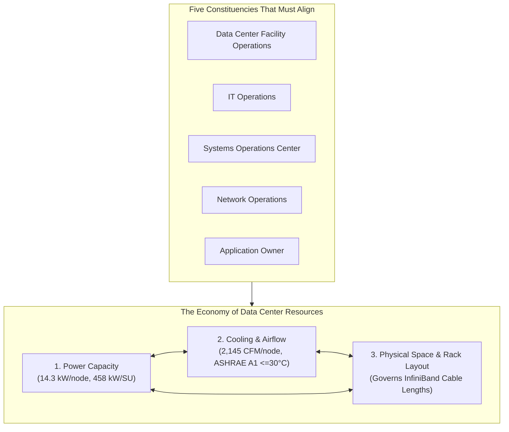
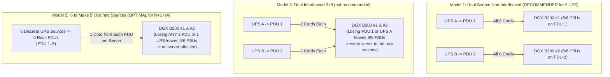

# 9.7 DGX B200 SuperPOD data center design: power, cooling, cabling and layout

| | |
|---|---|
| **Status** | Drafted (`b200_datacenter_lab.py`: 30 checks pass; facility design rules verified in Python) |
| **Level** | Advanced |
| **Priority tier** | 1b |
| **Lab venue** | none (design / reading) + self-checking Python model (`code/part09/b200_datacenter_lab.py`) |
| **Part** | Part 9: NVIDIA systems and reference architectures |
| **Sources used** | Steven Hambruch & Dennis O'Brien, *Data Center Best Practices with DGX B200* (`superpod-b200-dc`, pp. 1–24); *AI Systems Performance Engineering* Ch. 2 |

## Why this matters for AI infrastructure

An air-cooled **NVIDIA DGX B200** packs eight 1,000-watt Blackwell SXM6 GPUs into a 10U chassis drawing **up to 14.3 kW** and demanding **2,145 CFM of supply air** at sea level. When you deploy two or four of those nodes per rack across a 32-node Scalable Unit (**458 kW per SU**), traditional data center intuition fails—sometimes in ways that are completely counter-intuitive to experienced facility engineers.

For example, on a traditional dual-corded enterprise server, plugging 3 power supplies into `PDU A` and 3 power supplies into `PDU B` ("dual interleaved power") increases uptime. On a **DGX B200**, doing that exact same thing is a **serious mistake (not recommended)**: because a DGX B200 requires **at least 5 of its 6 internal PSUs energized (`N+1`)** to operate, losing *either* PDU in an interleaved rack drops 3 PSUs on every server and **crashes 100% of the systems in the rack**. Similarly, spacing racks farther apart to spread out a 57.2 kW heat plume can push InfiniBand cable runs past the **3-meter Passive DAC** or **30-meter Active Optical Cable (AOC)** physical limit. Mastering the interplay between **Power**, **Cooling**, and **Space**—and aligning Facility Operations, IT Operations, the Systems Operations Center, Network Operations, and Application Owners—is mandatory before a single DGX B200 crate arrives on the loading dock.

:::info Corpus scope note
Standalone *NVIDIA DGX B200 System User Guide* and *NVIDIA DGX SuperPOD with DGX B200 Reference Architecture* whitepaper PDFs are not in `~/Desktop/books-toon-rag/`. Every specification, 3-phase power-provisioning table row, 5-of-6 PSU topology diagram, ASHRAE / ISO 14644-1 Class 8 environmental limit, and cabling FAQ in this chapter is extracted from the 24-page NVIDIA technical deck *Data Center Best Practices with DGX B200* (`superpod-b200-dc`) by Steven Hambruch and Dennis O'Brien, supplemented by *AI Systems Performance Engineering* Chapter 2.
:::

## Prerequisites and outcomes

**Prerequisites:**
- Chapters `9.1` and `9.6` (DGX B200 system family overview and SuperPOD Scalable Unit concepts).

**Outcomes:** After completing this chapter, you will be able to:
1. Specify the physical, electrical, thermal, altitude-derating, and acoustic envelopes of a **10U DGX B200 node (`14.3 kW`)** and balance **Power**, **Cooling**, and **Space**.
2. Size **2-node (`28.6 kW`)** and **4-node (`57.2 kW`)** racks across all **10 rows of the 3-phase Power Provisioning Table**, calculating both maximum rack capacity and **stranded kW capacity**.
3. Apply the **5-of-6 (`N+1`) internal PSU rule** across all **five power provisioning topologies**—explaining why **Dual Interleaved (`3+3`)** and **Static Transfer Switches (`STS`)** are avoided and how **Non-Interleaved** and **`"6 to make 5"`** protect uptime.
4. Audit facility cooling and air quality against **ASHRAE Class A1**, **MERV 13** filtration, **ISO 14644-1 Class 8** particulate limits, and **1–4 SU Passive DAC / AOC** cabling constraints.

---

## Concepts: basics → intermediate → advanced

## 1. DGX B200 node physics and the economy of data center resources

Deploying high-density AI infrastructure is a three-body optimization problem across three finite, tightly coupled data center resources: **Power**, **Cooling**, and **Space**.

Think of Power, Cooling, and Space as the three corners of a stretched rubber triangle. If your data center has plenty of floor space but limited cooling per square foot, your first instinct is to spread the DGX B200 servers across twice as many racks with empty floor tiles between them. But stretching the **Space** corner pulls directly on the **InfiniBand Cabling** budget: suddenly your compute racks are more than 30 meters from the central spine switches, breaking the optical reach of the InfiniBand fabric.



### 1.1 Complete DGX B200 node physical, thermal, altitude, and acoustic specifications

Before designing rack layouts, record the node-level envelope of the **air-cooled NVIDIA DGX B200**:

| Parameter | DGX B200 Specification | Facility Design Implication |
|---|---|---|
| **Estimated System Power** | **14.3 kW Max** | `2 nodes/rack = 28.6 kW`; `4 nodes/rack = 57.2 kW`; `32-node SU = 458 kW` |
| **Estimated System Weight** | **`> 287.6 lbs (130 kg)`** (estimated) | Mechanical server lift mandatory; 4-node rack exceeds 1,150 lbs of nodes alone |
| **Rack Units & Dimensions** | **10 Rack Units (10 RU)**<br/>Height: `17.5 in (444 mm)`<br/>Width: `19.0 in (482.2 mm)`<br/>Length: `35.3 in (897.1 mm)` | Requires EIA-310 19-inch racks at least `24" × 44" × 48U` (`600 × 1,100 mm`); **`30" × 48" × 52U` (`700 × 1,200 mm`) recommended** |
| **Cooling & Supply Airflow** | **Air-cooled**, **~2,145 CFM per system** at sea level (based on **150 CFM per kW**) | `4,290 CFM` for a 2-node rack; `8,580 CFM` for a 4-node rack |
| **Operating Temperature** | **`5°C to 30°C` (`41°F to 86°F`)** | Capped at `30°C` max supply air temperature |
| **Operating Altitude & Temperature Derating** | **`3,048 meters (10,000 feet)` maximum:**<br/>• `0 – 1,000 ft`: `5°C to 35°C`<br/>• `1,000 – 5,000 ft`: `5°C to 30°C`<br/>• `5,000 – 10,000 ft`: `5°C to 25°C` | High-altitude data centers (e.g., >5,000 ft) must lower maximum cold-aisle supply air to **25°C** to compensate for thinner air density |
| **Operating Acoustic Power (`L_WA,m`)** | • At `25°C (77°F)` inlet: **96 dB**<br/>• At `30°C (86°F)` inlet: **101 dB** | Mandatory hearing protection in the data hall; a 5°C warmer inlet triples sound energy (+5 dB) as fans ramp to 100% |

:::tip In one minute
- A single **DGX B200** occupies **10 RU** (`17.5 × 19.0 × 35.3 in`), weighs **`> 287.6 lbs (130 kg)`**, draws **14.3 kW max**, requires **~2,145 CFM** of air at sea level (`150 CFM/kW`), and emits **96 dB at 25°C** (**101 dB at 30°C**).
- Maximum operating temperature derates with altitude: **`35°C` at `0–1,000 ft`**, **`30°C` at `1,000–5,000 ft`**, and **`25°C` at `5,000–10,000 ft`**.
- Align **five constituencies** early (DC Facility Ops, IT Ops, Systems Ops Center, Network Ops, and Application Owner) because **Power**, **Cooling**, and **Space** directly constrain **InfiniBand cable reach**.
:::

---

## 2. Rack density patterns and the 10-row 3-phase power provisioning table

In a DGX B200 SuperPOD, racks are provisioned using an **`N = 2` power circuit pattern**, where two three-phase branch circuits feed two rack PDUs (`PDU 1` and `PDU 2`), and **each circuit is rated to handle 50% of the peak demand of the rack** (factoring in required breaker deratings and a **0.95 power factor**).

### 2.1 Standard 2-node rack (`28.6 kW`) vs extreme-density 4-node rack (`57.2 kW`)

| Rack Parameter | Standard Deployment (**2 DGX B200s / Rack**) | Extreme-Density Deployment (**4 DGX B200s / Rack**) |
|---|---|---|
| **Peak Rack Power Demand** | **28.6 kW** (`14.3 kW` per circuit) | **57.2 kW** (`28.6 kW` per circuit) |
| **Cabinet Height** | **42U** minimum (**48U / 52U recommended**) | **52U Rack** required (`4 × 10U = 40U` of nodes) |
| **Minimum 3-Phase Circuits** | **`2x 380V 3Φ 32A`** (or `400V/415V 32A`) | **`2x 415V 3Φ 60A`** (or `415V 63A`) |
| **Estimated Airflow (Sea Level)** | **4,290 CFM** (at `150 CFM/kW`) | **8,580 CFM** (at `150 CFM/kW`) |
| **Cooling Constraints** | Standard hot/cold aisle containment | Specialized extreme-density air-cooled sites only (**rear-door heat exchangers and in-row coolers are not typically suitable**) |

### 2.2 The complete 10-row 3-phase Power Provisioning Table (80% derated vs 100% rated)

When you provision two three-phase circuits of voltage `V_dist` and current `I` at a **0.95 power factor** and breaker derating `d` (`80.0%` for North American NEC continuous-load breakers vs `100.0%` for IEC / 100%-rated breakers), the exact available rack power and **stranded capacity** (unused power capacity left on the circuit that cannot fit another 14.3 kW node) are governed by:

```text
Unrounded Rack Capacity (kW) = 2 circuits × sqrt(3) × V_dist × Amps × 0.95 (PF) × Derating / 1,000
Stranded Capacity at Peak Demand (kW) = Unrounded Rack Capacity (kW) - (Supported_Nodes × 14.3 kW)
```

Every one of the **10 standard distribution schemes** in `superpod-b200-dc` (verified to the tenth of a kilowatt by `compute_b200_rack_circuit_row()` in `code/part09/b200_datacenter.py`, where exposing the underlying `2 × sqrt(3) × V × I × 0.95 × d` formula is **my inference** explaining how the table's rounded capacity and exact stranded capacity columns are derived) is shown below:

| Phase | Distribution Voltage (`V`) | Line Voltage (`V`) | Breaker Amps (`A`) | Breaker Derating | Max Rack Power Capacity (`kW`)* | Supported DGX B200s / Rack** | Peak Server Demand (`kW`)** | Stranded Capacity at Peak (`kW`)** |
|---|---:|---:|---:|---:|---:|---:|---:|---:|
| `3Φ` | **380** | 219 | **32** | **80.0%** | **32 kW** (`32.01`) | **2** | **28.6 kW** | **3.4 kW** |
| `3Φ` | **400** | 230 | **32** | **80.0%** | **34 kW** (`33.70`) | **2** | **28.6 kW** | **5.1 kW** |
| `3Φ` | **415** | 240 | **32** | **80.0%** | **35 kW** (`34.96`) | **2** | **28.6 kW** | **6.4 kW** |
| `3Φ` | **415** | 240 | **60** | **80.0%** | **66 kW** (`65.55`) | **4** | **57.2 kW** | **8.4 kW** |
| `3Φ` | **415** | 240 | **63** | **80.0%** | **69 kW** (`68.83`) | **4** | **57.2 kW** | **11.6 kW** |
| `3Φ` | **380** | 219 | **32** | **100.0%** | **40 kW** (`40.01`) | **2** | **28.6 kW** | **11.4 kW** |
| `3Φ` | **400** | 230 | **32** | **100.0%** | **42 kW** (`42.12`) | **2** | **28.6 kW** | **13.5 kW** |
| `3Φ` | **415** | 240 | **32** | **100.0%** | **44 kW** (`43.70`) | **2** | **28.6 kW** | **15.1 kW** |
| `3Φ` | **415** | 240 | **60** | **100.0%** | **82 kW** (`81.94`) | **4** | **57.2 kW** | **24.7 kW** |
| `3Φ` | **415** | 240 | **63** | **100.0%** | **86 kW** (`86.03`) | **4** | **57.2 kW** | **28.8 kW** |

*\*Assumes 0.95 power factor. \*\*Based on a two-circuit `N` power provisioning scheme.*

Look closely at the **Stranded Capacity** column: if your facility installs `2x 415V 32A` circuits with `100%`-rated breakers (`43.7 kW` capacity), you can still only power **2 DGX B200 nodes (`28.6 kW`)** because 3 nodes would require `42.9 kW` unevenly split across `N=2` circuits, leaving **15.1 kW of stranded capacity per rack**. Matching your breaker amperage (`32A` at 80% derating for 2 nodes; `60A` at 80% derating for 4 nodes) minimizes stranded facility power.

:::tip In one minute
- Standard racks hold **2 DGX B200s (`28.6 kW`, `4,290 CFM`)** on **`2x 380V–415V 3Φ 32A`** circuits; extreme-density **52U racks** hold **4 DGX B200s (`57.2 kW`, `8,580 CFM`)** on **`2x 415V 3Φ 60A/63A`** circuits.
- Supplemental **rear-door heat exchangers and in-row coolers are not typically suitable** for DGX B200 racks.
- Use the 10-row provisioning table (`0.95` power factor, `80%` vs `100%` derating) to minimize **stranded kW capacity** (`3.4 kW` on `380V 32A 80%` vs `28.8 kW` on `415V 63A 100%`).
:::

---

## 3. The 5-of-6 (`N+1`) PSU rule and the five power provisioning topologies

This section contains the single most important electrical rule in a DGX B200 data center—one that catches experienced data center architects off guard if they assume a DGX B200 behaves like a `3+3` DGX H100.

### 3.1 Why `5 of 6` PSUs (`N+1`) changes everything

Recall from Chapter `9.1` that a 10.2 kW **DGX H100** has six 3.3 kW PSUs arranged in **`3+3` redundancy** (`3 × 3.3 kW = 9.9 kW ≈ 10.2 kW`), so a DGX H100 can lose 3 PSUs (an entire power feed) and stay running.

Now look at the **14.3 kW DGX B200**:
- A DGX B200 also has **6 internal Power Supply Units (PSUs)**, **but 5 of the 6 PSUs must be energized for the system to operate (`N+1` internal PSU redundancy).**
- A DGX B200 can survive the loss of **1 internal PSU** (`5 of 6` remain energized).
- **If more than 1 PSU is de-energized (`≤ 4 of 6` energized), the DGX B200 shuts down immediately, regardless of upstream power redundancies.**

### 3.2 Comparing all five rack power provisioning topologies (`Models 1 to 5`)

Because 5 of 6 PSUs must stay energized at all times, how you wire the 6 power cords of each DGX B200 to your rack PDUs and upstream UPS sources determines whether a single PDU or UPS failure causes a **50% outage**, a **100% outage (not recommended)**, or a **0% outage (`N+1` HA)**:



| Provisioning Model | How the 6 PSU Cords per Server are Wired | Single PDU Failure Impact | Single UPS Failure Impact | Redundancy & NVIDIA Recommendation |
|---|---|---|---|---|
| **1. Dual Source / Dual rPDU (Non-Interleaved)** | **All 6 PSUs of System 1 → `PDU 1 (UPS A)`**;<br/>**All 6 PSUs of System 2 → `PDU 2 (UPS B)`**. | **50%** of systems in rack (1 of 2 nodes) | **50%** of systems in rack (1 of 2 nodes) | Achieves **`N`** rack power. **Most optimal configuration when only 2 UPS sources are available at the rack** (fewest interdependencies). |
| **2. Single Source / Dual rPDU** | System 1 → `PDU 1`; System 2 → `PDU 2`; **both PDUs fed by a single `UPS A`**. | **50%** of systems in rack | **100%** of systems in rack | Achieves **`N`** only; single UPS maintenance or failure takes down the entire rack. |
| **3. Dual Interleaved Source / rPDU (`3+3`)** | Each server plugs **3 PSUs into `PDU 1 (UPS A)` and 3 PSUs into `PDU 2 (UPS B)`**. | **100% of systems in rack crash.** (3 of 6 PSUs lost on every node) | **100% of systems in rack crash.** | **`STOP — NOT RECOMMENDED.`** Interleaving 2 sources across a 5-of-6 PSU system *doubles* the probability of total rack disruption. |
| **4. Dual UPS + Static Transfer Switch (`STS`)** | Dual UPS feeds into an upstream STS feeding the rack PDUs. | **50%** of systems (1 system) | **0%** (if STS switchover succeeds, but STS is a SPOF) | **`STOP — NOT RECOMMENDED.`** In-rack STS is unsupported, and **NVIDIA has not tested or validated any STS product with DGX B200** (switchover transients may cause system damage or workload failures). |
| **5. `"6 to make 5"` Discrete Power Sources** | **6 discrete UPS power sources feeding 6 rack PDUs (`PDU 1..6`)**; each server plugs **1 PSU into each of the 6 PDUs**. | **0% of systems impacted.** (`5 of 6` PSUs remain energized) | **0% of systems impacted.** (`5 of 6` PSUs remain energized) | Achieves true **`N+1` High Availability** with zero interdependencies. **Optimal configuration for HA** (typically limited to 2 systems/rack due to space for 6 PDUs). |

:::tip In one minute
- A **DGX B200** has **6 PSUs** and requires **at least 5 of 6 PSUs energized (`N+1`)** to operate; losing 2 PSUs shuts the server down.
- **Never interleave two PDUs (`3+3`, Model 3) across a DGX B200's 6 PSUs (not recommended):** losing either PDU or either UPS de-energizes 3 PSUs on every node and **crashes 100% of the rack**.
- **Never use an unvalidated Static Transfer Switch (`STS`, Model 4, not recommended)**.
- With **2 UPS sources**, wire all 6 PSUs of Node 1 to `PDU 1 (UPS A)` and all 6 PSUs of Node 2 to `PDU 2 (UPS B)` (**Model 1**, limiting any failure to **50%** of the rack). For zero-downtime **`N+1` HA**, deploy **6 discrete UPS/PDU sources (`"6 to make 5"`, Model 5)** so any single PDU/UPS loss leaves 5 of 6 PSUs running (**0% impact**).
:::

---

## 4. Cooling optimization, ASHRAE Class A1, MERV 13 filtration, and ISO 14644-1 Class 8 cleanliness

Because each DGX B200 pulls **~2,145 CFM** of supply air through its heatsinks at sea level (`4,290 CFM` for a 2-node rack; `8,580 CFM` for a 4-node rack), both the **temperature/humidity envelope** and the **particulate cleanliness** of that massive air volume must be strictly controlled.

### 4.1 ASHRAE environmental parameters for DGX B200

Supply air entering the front of a DGX B200 must comply with **ASHRAE Class A1** specifications, subject to a **maximum supply air temperature of `30°C (86°F)`**:

| Envelope Range | ASHRAE Class | Dry-Bulb Temperature | Non-Condensing Humidity Range | Max Dew Point (`DP`) | DGX B200 Applicability |
|---|---|---|---|---|---|
| **Recommended** | **All A** | **`18°C to 27°C`** (`64.4°F to 80.6°F`) | `5.5°C DP` to `60% RH` and `15°C DP` (`41.9°F` to `60% RH` & `59°F DP`) | **`15°C` (`59°F`)** | **Recommended continuous operating band** for all DGX B200 deployments. |
| **Allowable for DGX B200** | **A1** (capped at `30°C`) | **`15°C to 30°C`** (`59°F to 86°F`; standard A1 is `15–32°C`) | **`20% to 80% RH`** | **`17°C` (`62.6°F`)** | **Allowable up to `30°C` for DGX B200 systems** (note acoustic jump from 96 dB at 25°C to 101 dB at 30°C). |
| *Reference only* | *A2* | *`10–35°C` (`50–95°F`)* | *`20–80% RH`* | *`21°C` (`69.8°F`)* | *Other data center classes (exceeds 30°C DGX B200 ceiling above 30°C).* |
| *Reference only* | *A3 / A4 / B / C* | *`5–40°C` / `5–45°C` / `5–35°C`* | *`8–85%` / `8–90%` / `8–80% RH`* | *`24°C` / `28°C`* | *General telecom/industrial reference classes.* |

### 4.2 Air filtration (`MERV 13`) and `ISO 14644-1 Class 8` particulate limits

At 8,580 CFM per 4-node rack, unfiltered dust or Zinc whiskers quickly coat high-fin-density heatsinks and optical transceivers. Therefore, `superpod-b200-dc` mandates three air-quality rules:
1. **Minimum filter rating:** All air handlers supplying the data hall must use at least **MERV 13** rated filters (or **EN779-2012 `M6/F7`**, or **ISO 16890 `ePM1-50%`**).
2. **ISO 14644-1 Class 8 cleanliness:** The rack area must meet the **ISO 14644-1 Class 8** cleanroom standard (maximum **`3,520,000` particles/m³ at `≥ 0.5 µm`**, **`832,000` particles/m³ at `≥ 1.0 µm`**, and **`29,300` particles/m³ at `≥ 5.0 µm`**).
3. **15-minute excursion ceiling:** Particulate counts at `≥ 0.5 µm` must **never exceed `3,520,000` particles/m³ for longer than 15 minutes** (for example, during uncrating or floor work—always unbox equipment outside the cold aisle.).

### 4.3 Seven airflow management best practices

To prevent hot exhaust recirculation without relying on unsupported rear-door heat exchangers or in-row coolers, implement all seven facility airflow controls:
1. **Computational Fluid Dynamics (CFD) modeling and analysis** of the room before finalizing rack placement.
2. **Hot or Cold Aisle Containment Systems** isolating the `2,145 CFM/node` intake from the exhaust plenum.
3. **Blanking panels** in every unused rack unit (`RU`) of every cabinet so cold air cannot bypass the servers.
4. **Brush grommets** sealing all floor and top-of-rack cable penetrations to prevent static-pressure loss.
5. **Active humidification and dehumidification** keeping dew point `≤ 15°C` (`≤ 17°C` max A1) and RH within `20%–80%`.
6. **MERV 13+ air filtration** maintained on a strict pressure-drop replacement schedule.
7. **Perforated floor-tile flow-rate audits using a calibrated anemometer** to verify that every 2-node rack receives `≥ 4,290 CFM` and every 4-node rack receives `≥ 8,580 CFM` at the cold-aisle floor tiles.

:::tip In one minute
- Supply air must meet **ASHRAE Class A1** capped at **`30°C (86°F)`** (**`18–27°C` and `≤ 15°C` dew point recommended**; `20%–80% RH`, `≤ 17°C` dew point allowable).
- Air filtration requires **≥ MERV 13** (`EN779 M6/F7` / `ISO 16890 ePM1-50%`) and **ISO 14644-1 Class 8** cleanliness (**`≤ 3,520,000` particles/m³ @ `≥ 0.5 µm`**, with no excursion lasting **`> 15 minutes`**).
- Validate room airflow with **CFD modeling**, **aisle containment**, **blanking panels**, **brush grommets**, and **anemometer perforated-tile audits**.
:::

---

## 5. Cabling, rack dimensions, smart rPDUs, and layout rules

In a 4-SU DGX B200 SuperPOD (**127 DGX B200 nodes + 1 UFM appliance, 32 Leaf switches, 16 Spine switches**), overhead pathways carry **1,020 compute-to-leaf cables** and **1,024 leaf-to-spine cables** (**2,044 high-speed InfiniBand cables** before counting storage, in-band, and OOB Ethernet.).

### 5.1 Passive DAC vs Active Optical Cables (AOC) and the `< 90%` length rule

| Cable Media Type | Physical Construction | Maximum Standard Distance | **`< 90%` Design Rule Limit** | Deployment Guidance |
|---|---|---|---|---|
| **Passive DAC (`100G`)** | Twinaxial shielded copper with passive SFP/QSFP ends (zero active electronics) | **Up to `5.0 meters`** | **`≤ 4.5 meters`** | Short intra-rack or adjacent-rack links. |
| **Passive DAC (`400G`)** | Twinaxial shielded copper with passive QSFP/OSFP ends | **Up to `3.0 meters`** | **`≤ 2.7 meters`** | Short in-rack/adjacent-rack InfiniBand runs. |
| **Active Optical Cable (`AOC`)** | Multimode or single-mode fiber permanently bonded to active optical transceivers | **Up to `30.0 meters`** | **`≤ 27.0 meters`** | Rack-to-rack and leaf-to-spine InfiniBand runs across the SuperPOD row. |

*(Calculating the exact `4.5 m`, `2.7 m`, and `27.0 m` figures by multiplying the `5 m`, `3 m`, and `30 m` standard limits by `0.90` is **my inference** applying the `< 90%` rule from `superpod-b200-dc` p. 21.)*

To keep 2,000+ cables serviceable and error-free, follow six cabling discipline rules:
1. **Keep all cable runs under 90% of the maximum supported distance** for the media type (`≤ 2.7 m` for 400G DAC; `≤ 27.0 m` for AOC), accounting for intra-rack vertical routing, overhead tray elevation, and minimum bend radiuses.
2. **Never use patch panels or intermediary ToR switches to extend InfiniBand cables:** Patch panels introduce optical attenuation and reflections that break 400G NDR link training, and intermediary switches add hop latency.
3. **Separate copper and fiber bundles and pathways** so heavy copper cables never crush optical fibers, and verify overhead cable-tray width, depth, **fill ratios**, and **structural weight load** around the central Management Racks.
4. **Bundle cables by functional group** (e.g., grouping Inter-Switch Links `ISLs` and core uplinks together).
5. **Pre-install spare cables in advance** along overhead pathways so a damaged cable during bring-up or operations can be swapped in minutes without opening ceiling trays.
6. **Color-code cable ties by endpoint** and **place printed labels at both ends as well as along the mid-span run**.

### 5.2 Cabinet dimensions, smart rPDU specs, and rack cohabitation rules

1. **Cabinet dimensions (`EIA-310` 19-inch enclosed racks):**
   - **Minimum required:** **`24" × 44"` (`600 mm × 1,100 mm`)** footprint and at least **`48U`** tall.
   - **NVIDIA recommended:** **`30" × 48" × 52U` (`700 mm × 1,200 mm`)**—the extra 100 mm of width (`700 mm`) and 4U of height (`52U`) are critical for routing six heavy power cords plus a dozen InfiniBand/Ethernet cables per node alongside smart PDUs without blocking exhaust airflow.
2. **Smart Rack PDU (`rPDU`) specification checklist:** While rPDU brand depends on regional voltage and plugs, every SuperPOD rPDU should include:
   - Integrated smart management module with **Network Interface** and **REST API** support
   - **Ports for temperature and humidity sensor probes**
   - **Locking receptacles** (preventing vibration from high-RPM DGX fans from loosening C19 plugs)
   - **PDU-level metering** and **remote per-receptacle outlet switching** (essential for executing remote Redfish/PDU **AC power cycles** to activate firmware.)
   - Optional **Red and Blue exterior PDU housing colors** for instant visual differentiation between Power Circuit 1 and Power Circuit 2.
3. **Strict no-cohabitation rule:** Never place third-party switches, patch panels, or unrelated IT servers inside unused RU space of a DGX B200 rack—and if DGX B200 racks are spaced apart with empty rack positions between them to aggregate room cooling capacity, **never deploy unrelated IT equipment in the spaces between DGX B200 racks**.

:::tip In one minute
- Keep InfiniBand cables **`< 90%` of max distance** (**`≤ 2.7 m`** for `3 m` 400G DAC; **`≤ 27.0 m`** for `30 m` AOC), never use patch panels on InfiniBand, separate copper and fiber bundles, and pre-install labeled spares.
- Use **`30" × 48" × 52U` (`700 × 1,200 mm`)** EIA-310 cabinets (minimum `24" × 44" × 48U`) with **REST-API smart rPDUs** featuring **locking receptacles**, **remote per-outlet switching**, and **Red/Blue** color coding.
- Never place unrelated IT equipment inside DGX racks or in the cooling spaces between DGX racks.
:::

---

## Commands and configurations that matter

Use this verification script and facility checklist before energizing a DGX B200 SuperPOD row (facility calculations and rules verified in `code/part09/b200_datacenter_lab.py`).

### 1. Run the DGX B200 facility power, PSU topology, environmental, and cable auditor

```bash
# Run the 30-check DGX B200 SuperPOD Data Center Design verification lab
python3 -B code/part09/b200_datacenter_lab.py
```

### 2. Inspect smart rPDU outlet states and trigger a full AC power cycle via REST API

Because a DGX B200 has 6 PSUs connected to locking rPDU receptacles, remote per-receptacle outlet switching on the smart rPDU allows administrators to execute a full **AC power cycle** across all 6 cords of a node when activating firmware (**untested** against a live vendor rPDU in this authoring environment):

```bash
# Illustrative Redfish / REST query against a smart Rack PDU to inspect phase load and outlet states
curl -sk -u "${PDU_USER}:${PDU_PASS}" \
  "https://${PDU_IP}/redfish/v1/PowerEquipment/RackPDUs/1/Mains" | jq .

# Verify all 6 outlets feeding DGX B200 Node 1 (Outlets 1..6 on PDU 1 in Non-Interleaved Model 1)
for OUTLET in 1 2 3 4 5 6; do
  curl -sk -u "${PDU_USER}:${PDU_PASS}" \
    "https://${PDU_IP}/redfish/v1/PowerEquipment/RackPDUs/1/Outlets/Outlet${OUTLET}" \
    | jq '{Id, PowerState, Watts: .PowerWatts.Reading}'
done
```

---

## How it fails

| Failure mode | Symptom | Root cause | Diagnosis & fix |
|---|---|---|---|
| **1. Total rack blackout during routine UPS/PDU maintenance (`Model 3` Interleaved `3+3` trap)** | Facilities takes `PDU 1` (or `UPS A`) offline for scheduled maintenance in a rack with two DGX B200 servers; **both DGX B200 servers immediately lose power and crash (`100%` rack outage)**. | Electricians wired each DGX B200 with 3 cords to `PDU 1` and 3 cords to `PDU 2` ("dual interleaved"). Because a DGX B200 requires **5 of 6 PSUs energized (`N+1`)** to run, losing `PDU 1` dropped 3 PSUs on both servers (leaving only `3/6` energized). | **Never interleave 2 power sources across a DGX B200's 6 PSUs.** Rewire to **Model 1 (Non-Interleaved)**: all 6 cords of Node 1 on `PDU 1 (UPS A)` and all 6 cords of Node 2 on `PDU 2 (UPS B)` (so a PDU/UPS outage affects only 50% of the rack), or deploy **Model 5 (`"6 to make 5"`, 6 discrete UPS/PDUs)** for 0% impact. |
| **2. Node crash or PSU fault during Static Transfer Switch (`STS`) switchover (`Model 4`)** | An upstream or in-rack Static Transfer Switch transfers between `UPS A` and `UPS B` during a voltage sag, and DGX B200 nodes reboot, trip PSU fault latches, or suffer hardware damage. | **NVIDIA has not tested or validated any STS product with DGX B200 (not recommended)**, and in-rack STS units are unsupported because phase-angle/transfer transients across six high-load PSUs can disrupt active workloads or damage power stages. | Remove unvalidated STS units from the DGX B200 power path and use either **Model 1 (Non-Interleaved Dual Source)** or **Model 5 (`"6 to make 5"`)**. |
| **3. Thermal throttling at high-altitude data center despite `28°C` cold aisle** | A DGX B200 cluster deployed in a high-altitude city (`6,000 ft / 1,830 m`) thermal-throttles even though cold-aisle supply air is kept at `28°C` (below the `30°C` sea-level limit). | Lower air density at altitude reduces the mass flow rate of air moved by the fans. Above `5,000 ft` (`5,000–10,000 ft`), the DGX B200 maximum operating temperature **derates from `30°C` down to `25°C`**. | Apply the altitude derating table (`0–1,000 ft: 35°C`; `1,000–5,000 ft: 30°C`; `5,000–10,000 ft: 25°C`) and lower the CRAC supply air setpoint below `25°C` at sites above 5,000 ft. |
| **4. Static-pressure suffocation from a Rear-Door Heat Exchanger (`RDHx`)** | A facility retrofits passive or active rear-door heat exchangers onto 57.2 kW 4-node DGX B200 racks; internal GPU and NVSwitch temperatures spike and fans scream at 101+ dB. | Four DGX B200 nodes expel **8,580 CFM** of high-velocity exhaust air. Supplemental **rear-door heat exchangers and in-row coolers are not typically suitable for DGX B200** because coil impedance creates backpressure that chokes chassis airflow. | Remove rear-door heat exchangers, use open high-perforation doors with full **Hot/Cold Aisle Containment**, and verify `≥ 2,145 CFM/node` with floor-tile anemometer audits and CFD modeling. |
| **5. InfiniBand link flaps from `29.5 m` AOC runs or structured patch panels** | Spine-to-leaf 400G NDR links between outer compute racks and central management racks intermittently drop or fail to train after rack spacing was widened for cooling. | Spacing racks apart stretched cable runs past the **`< 90%` design limit (`27.0 m` for `30 m` AOC)** once vertical rack routing and bend radiuses were included—or installers routed links through an overhead fiber patch panel. | Keep all InfiniBand AOC runs **`≤ 27.0 m`** (`< 90%` of `30 m`) and 400G DAC runs **`≤ 2.7 m`** (`< 90%` of `3 m`) point-to-point with **zero patch panels**, placing central switch racks at the physical center of the SU row. |

---

## Hands-on lab

This chapter's self-checking Python model (`code/part09/b200_datacenter.py`) and lab script (`code/part09/b200_datacenter_lab.py`) implement:
1. The **10-Row 3-Phase DGX B200 Rack Power Provisioning Calculator** (`380V/400V/415V`, `32A/60A/63A`, `80%` vs `100%` breaker derating at `0.95` power factor, reproducing all 10 rounded rack kW capacities, supported node counts `2` or `4`, peak demands `28.6 kW` or `57.2 kW`, exact stranded kW capacities `3.4` to `28.8 kW`, and `4,290` / `8,580 CFM` airflow targets).
2. The **5-of-6 (`N+1`) PSU Provisioning Topology Evaluator** (proving why `dual_interleaved` leaves `3/6` PSUs and causes a `100%` rack outage with a `STOP` warning, why `dual_ups_with_sts` is flagged `STOP`, why `dual_source_non_interleaved` caps impact at `50%`, and why `six_to_make_five` keeps `5/6` PSUs energized for `0%` impact `N+1` HA).
3. The **Altitude, ASHRAE Class A1, MERV 13, and ISO 14644-1 Class 8 Environmental Auditor** (`0–1,000 ft`, `1,000–5,000 ft`, and `5,000–10,000 ft` temperature derating, `96 dB` vs `101 dB` acoustic power, `18–27°C` recommended vs `30°C` allowable, `≤ 17°C` dew point, `≥ MERV 13` filtration, and `3,520,000` particles/m³ @ `≥ 0.5 µm` with the `15-minute` excursion rule).
4. The **InfiniBand DAC / AOC `< 90%` Cable Distance Validator** (`100G DAC ≤ 4.5 m / 5.0 m`, `400G DAC ≤ 2.7 m / 3.0 m`, `AOC ≤ 27.0 m / 30.0 m`).

Run the lab from the repository root:

```bash
python3 -B code/part09/b200_datacenter_lab.py
```

Expected output (verified in this repository):

```text
=== Chapter 9.7 Lab: DGX B200 SuperPOD Data Center Design ===
  [PASS] SPB200 p.11 row 3-phase 380V 32A (80%): 32 kW max, 2 nodes (28.6 kW), 3.4 kW stranded, 4290 CFM
  [PASS] SPB200 p.11 row 3-phase 400V 32A (80%): 34 kW max, 2 nodes (28.6 kW), 5.1 kW stranded, 4290 CFM
  [PASS] SPB200 p.11 row 3-phase 415V 32A (80%): 35 kW max, 2 nodes (28.6 kW), 6.4 kW stranded, 4290 CFM
  [PASS] SPB200 p.11 row 3-phase 415V 60A (80%): 66 kW max, 4 nodes (57.2 kW), 8.4 kW stranded, 8580 CFM
  [PASS] SPB200 p.11 row 3-phase 415V 63A (80%): 69 kW max, 4 nodes (57.2 kW), 11.6 kW stranded, 8580 CFM
  ...
  [PASS] SPB200 p.20-21: AOC max is 30.0 m and 90% design limit is 27.0 m (25m passes, 28.5m fails 90% rule)
  [PASS] SPB200 p.20: 32.0 m AOC fails 30.0 m standard max
  [PASS] SPB200 p.4: Flags altitude > 10,000 ft (3,048 m) maximum
  [PASS] SPB200 p.17: Flags relative humidity > 80% and dew point > 17.0C (62.6F)
  [PASS] Rejects unknown PSU provisioning model

Summary: 30 passed, 0 failed (total 30)
```

---

## Exercises

1. Run `python3 -B code/part09/b200_datacenter_lab.py`. Pick two rows of the 10-row power table and re-derive the rack capacity and the stranded kW by hand with `2 × √3 × V × A × 0.95 × derating`.
2. A site is at 6,500 ft altitude with a 28°C cold aisle. Is it inside the DGX B200 limit? What setpoint would you choose and why?
3. A rack has two DGX B200 nodes and three UPS sources. Which of the five wiring models would you pick if you can only have two sources? What if you can have six? What fails in each case when one PDU is switched off?
4. Check a planned run of 28 m of AOC and 2.9 m of 400G DAC against the `< 90%` rule. Which one fails, and what do you change?
5. Write a one-page pre-delivery checklist for a 4-node DGX B200 rack: circuits, airflow, rack size, floor load, rPDU features and air quality.
6. List the seven airflow practices from section 4.3 and mark which three you would do first in an existing room.

## Checkpoint questions (20)

<details>
<summary><strong>1. Why does interleaving two power feeds (`3 PSUs on PDU 1 + 3 PSUs on PDU 2`) across a DGX B200 server cause a 100% rack outage if either PDU or UPS fails, whereas the same `3+3` wiring works on a DGX H100?</strong></summary>

A 10.2 kW DGX H100 uses 6x 3.3 kW PSUs in **`3+3` redundancy** (3 PSUs can carry the full node). In contrast, a **14.3 kW DGX B200** uses 6 PSUs in **`5-of-6` (`N+1`) redundancy**: at least 5 of the 6 PSUs must remain energized for the system to operate, and losing more than 1 PSU shuts the server down immediately. If you wire 3 PSUs to `PDU 1` and 3 PSUs to `PDU 2`, a failure of *either* PDU de-energizes 3 PSUs on every server in the rack (`only 3/6 remain`), crashing **100% of the systems in the rack** (not recommended).
</details>

<details>
<summary><strong>2. What are the two NVIDIA-recommended power provisioning models for DGX B200 racks—first when only 2 UPS sources are available, and second when maximum High Availability (`N+1`) is required?</strong></summary>

1. **With 2 UPS sources (`Model 1 — Dual Source Non-Interleaved`):** Plug all 6 PSUs of System 1 into `PDU 1 (UPS A)` and all 6 PSUs of System 2 into `PDU 2 (UPS B)`. A failure of either PDU or either UPS impacts **only 50% (half) of the systems** in the rack.
2. **For maximum High Availability (`Model 5 — "6 to make 5"`):** Provision **6 discrete UPS power sources feeding 6 rack PDUs (`PDU 1..6`)**, and plug 1 PSU from each server into each of the 6 PDUs. Losing any single PDU or any single UPS de-energizes only 1 of 6 PSUs, leaving **5 of 6 PSUs energized (`0%` of systems impacted)**.
</details>

<details>
<summary><strong>3. Does NVIDIA recommend using Static Transfer Switches (`STS`) to achieve `N+1` power with two UPS sources on DGX B200 racks?</strong></summary>

**No (not recommended).** In-rack STS units are unsupported, an STS introduces a single point of failure, and **NVIDIA has not tested or validated any STS product for compatibility with DGX B200 systems**—switchover events may cause hardware damage, adverse system behavior, or workload failures.
</details>

<details>
<summary><strong>4. Calculate the maximum rack power capacity and stranded capacity for a rack provisioned with two 3-phase `415V 60A` circuits at `80%` breaker derating and a `0.95` power factor. How many DGX B200 nodes does it support, and what airflow is required?</strong></summary>

- **Unrounded rack capacity:** `2 × 1.73205 × 415 V × 60 A × 0.95 × 0.80 / 1,000 = 65.55 kW` (**`66 kW`** rounded).
- **Supported DGX B200 nodes:** **4 systems** (in a **52U rack**), with a peak demand of **`4 × 14.3 kW = 57.2 kW`**.
- **Stranded capacity at peak demand:** `65.55 kW - 57.2 kW = 8.35 kW` (**`8.4 kW`**).
- **Required sea-level airflow:** `57.2 kW × 150 CFM/kW = 8,580 CFM` (`2,145 CFM` per node).
</details>

<details>
<summary><strong>5. How does the DGX B200 operating temperature range change with altitude from sea level to 10,000 feet, and how does acoustic noise change between 25°C and 30°C?</strong></summary>

- **Altitude temperature derating (max altitude `3,048 m / 10,000 ft`):**
  - `0 – 1,000 ft`: `5°C to 35°C` (capped at `30°C` for continuous ASHRAE A1 operation)
  - `1,000 – 5,000 ft`: `5°C to 30°C`
  - `5,000 – 10,000 ft`: `5°C to 25°C`
- **Acoustic power (`L_WA,m`):** Rises from **96 dB at 25°C (77°F)** to **101 dB at 30°C (86°F)**.
</details>

<details>
<summary><strong>6. State the air filtration rating, cleanroom classification, and maximum particulate count / excursion duration required for a DGX B200 data hall.</strong></summary>

- **Air filtration:** Minimum **MERV 13** (or `EN779-2012 M6/F7` or `ISO 16890 ePM1-50%`).
- **Cleanliness class:** **ISO 14644-1 Class 8**.
- **Particulate ceiling:** Must not exceed **`3,520,000` particles/m³ at `≥ 0.5 µm`** (and `832,000 @ ≥ 1 µm`, `29,300 @ ≥ 5 µm`) for longer than **15 minutes**.
</details>

<details>
<summary><strong>7. What are the maximum standard cable lengths and `< 90%` design limits for 100G Passive DAC, 400G Passive DAC, and Active Optical Cables (AOC) in a DGX B200 SuperPOD?</strong></summary>

- **100G Passive DAC:** `5.0 m` max standard → **`≤ 4.5 m`** (`< 90%` design limit).
- **400G Passive DAC:** `3.0 m` max standard → **`≤ 2.7 m`** (`< 90%` design limit).
- **Active Optical Cable (AOC):** `30.0 m` max standard → **`≤ 27.0 m`** (`< 90%` design limit).
</details>

<details>
<summary><strong>8. What are NVIDIA's minimum and recommended EIA-310 rack dimensions for DGX B200, and what features must the smart rack PDUs (`rPDUs`) include?</strong></summary>

- **Minimum cabinet size:** **`24" × 44" × 48U` (`600 mm × 1,100 mm`)**.
- **Recommended cabinet size:** **`30" × 48" × 52U` (`700 mm × 1,200 mm`)**.
- **Smart rPDU requirements:** Integrated smart module with network + **REST API** interface, temperature/sensor probe ports, **locking receptacles**, PDU-level metering, **remote per-receptacle outlet switching**, and optional **Red and Blue exterior colors** for visual circuit differentiation.
</details>

<details>
<summary><strong>9. How much airflow does one DGX B200 need and where does that number come from?</strong></summary>

About 2,145 CFM at sea level, from the rule of 150 CFM per kW at 14.3 kW. Two nodes need 4,290 CFM and four nodes need 8,580 CFM.
</details>

<details>
<summary><strong>10. Why does a warmer inlet matter for noise and for staff?</strong></summary>

Fan noise rises from 96 dB at 25°C to 101 dB at 30°C. Hearing protection is needed in the hall.
</details>

<details>
<summary><strong>11. What is "stranded capacity" and how does a 415V 63A 100% circuit pair compare to a 380V 32A 80% pair?</strong></summary>

Stranded capacity is rack power you have paid for but cannot use because another whole node would not fit. The 415V 63A 100% pair strands 28.8 kW. The 380V 32A 80% pair strands 3.4 kW.
</details>

<details>
<summary><strong>12. Why is a 4-node DGX B200 rack called extreme-density, and what cooling is not suited to it?</strong></summary>

It draws 57.2 kW and needs 8,580 CFM. The source deck says rear-door heat exchangers and in-row coolers are not typically suitable, since they resist airflow.
</details>

<details>
<summary><strong>13. What is wrong with the "dual interleaved" wiring (3 cords on each PDU)?</strong></summary>

A B200 needs 5 of 6 PSUs. If either PDU or UPS goes away, each server keeps only 3 PSUs and shuts down, so the whole rack goes down.
</details>

<details>
<summary><strong>14. What is the recommended wiring when you only have two UPS sources?</strong></summary>

Model 1: all six cords of node 1 go to PDU 1 and all six of node 2 go to PDU 2. A single failure takes down half the rack.
</details>

<details>
<summary><strong>15. What is "6 to make 5" and what is its limit?</strong></summary>

Six separate UPS sources feed six PDUs. Each server plugs one PSU into each PDU. Any single PDU or UPS loss leaves 5 of 6 PSUs on, so nothing fails. The cost is six PDUs per rack, so it is typically limited to two systems per rack.
</details>

<details>
<summary><strong>16. What does the source deck say about static transfer switches?</strong></summary>

In-rack STS units are unsupported, and NVIDIA has not tested or validated any STS product with the DGX B200. Switchover can cause failures or damage.
</details>

<details>
<summary><strong>17. What environment class and humidity limits apply to the DGX B200?</strong></summary>

ASHRAE Class A1 capped at 30°C. Recommended is 18–27°C. Allowable humidity is 20–80% RH with a dew point of at most 17°C (recommended at most 15°C).
</details>

<details>
<summary><strong>18. What air quality is required?</strong></summary>

At least MERV 13 filtration and ISO 14644-1 Class 8 cleanliness, with at most 3,520,000 particles per m³ at 0.5 µm or larger, and no excursion longer than 15 minutes.
</details>

<details>
<summary><strong>19. Why do altitude and temperature interact?</strong></summary>

Thinner air carries less heat per unit of airflow. Above 5,000 ft the maximum drops to 25°C, so the cold-aisle setpoint must come down.
</details>

<details>
<summary><strong>20. What features must a smart rack PDU have?</strong></summary>

A network module with a REST API, ports for temperature and humidity probes, locking receptacles, metering, remote per-outlet switching (needed for AC power cycles), and optional red/blue housings for the two circuits.
</details>

---

## Sources and review notes

### Sources read in full for this chapter
1. **Steven Hambruch & Dennis O'Brien, *Data Center Best Practices with DGX B200* (`superpod-b200-dc`, pp. 1–24, read 100% in full):**
   - DGX B200 node specifications (14.3 kW max, >287.6 lbs / 130 kg, 10 RU, `17.5 × 19.0 × 35.3 in` / `444 × 482.2 × 897.1 mm`, air cooled, `5–30°C`, altitude derating `0–1,000 ft: 5–35°C`, `1,000–5,000 ft: 5–30°C`, `5,000–10,000 ft: 5–25°C`, acoustic `96 dB @ 25°C` / `101 dB @ 30°C`, p. 4), Scalable Unit specs (32 nodes / 458 kW, UFM displacement -> 127 nodes max in 4 SUs, p. 5), five organizational constituencies (p. 6), economy of data center resources (Power, Cooling, Space, pp. 7–8), 2-node (`28.6 kW`, `4,290 CFM`) vs 4-node (`57.2 kW`, `8,580 CFM`) rack profiles and unsuitability of rear-door heat exchangers / in-row coolers (p. 10), the 10-row Power Provisioning Table at 0.95 PF (p. 11), the 5-of-6 (`N+1`) PSU rule and all 5 power provisioning topologies including `STOP` warnings on Interleaved and STS designs (pp. 12–16), ASHRAE Class A1 (`18–27°C` recommended, `30°C` allowable), MERV 13 filtration, and ISO 14644-1 Class 8 (`3,520,000 @ 0.5 µm` for ≤15 min) cleanliness (p. 17), seven airflow best practices (p. 18), 1–4 SU switch/cable table and `< 90%` DAC/AOC cabling rules (pp. 19–21), and FAQs #1–#5 on cabinet dimensions, patch panels, smart rPDUs, SU scaling, and rack cohabitation (p. 23).
2. **Chris Fregly, *AI Systems Performance Engineering* (`ai-systems-performance-engineering`), Chapter 2 (p. 28):**
   - DGX B200 8-GPU air-cooled node architecture and compute/memory specifications.

### Not in the corpus
- Standalone *NVIDIA DGX B200 System User Guide* and *NVIDIA DGX SuperPOD with DGX B200 Reference Architecture* whitepaper PDFs are not in `~/Desktop/books-toon-rag/`.

### Run here
- `python3 -B code/part09/b200_datacenter_lab.py` — **30 passed, 0 failed**.

### My own choices and inferences, labelled in the text
1. **Unrounded 3-phase formula (`2 × sqrt(3) × V_dist × Amps × 0.95 × Derating / 1,000`) underlying the 10-row Power Provisioning Table (`compute_b200_rack_circuit_row` in `code/part09/b200_datacenter.py` and Section 2.2):** Writing out the explicit 3-phase equation that reproduces all 10 integer-rounded `Maximum Rack Power Capacity kW*` values and all 10 tenth-of-a-kilowatt `Stranded Capacity at Peak Demand kW**` values (`3.4, 5.1, 6.4, 8.4, 11.6, 11.4, 13.5, 15.1, 24.7, 28.8 kW`) on p. 11 of `superpod-b200-dc` is **my inference**.
2. **Exact 90% cable length limits (`4.5 m`, `2.7 m`, and `27.0 m` in `validate_ib_cable_run` in `code/part09/b200_datacenter.py` and Section 5.1):** Multiplying the `5.0 m` (100G DAC), `3.0 m` (400G DAC), and `30.0 m` (AOC) maximum distances on p. 20 by the `< 90%` rule on p. 21 of `superpod-b200-dc` is **my inference**.

### Not verified on live hardware
- Smart rPDU Redfish `/redfish/v1/PowerEquipment/RackPDUs/1` queries were not executed against a live rack PDU in this authoring environment.

