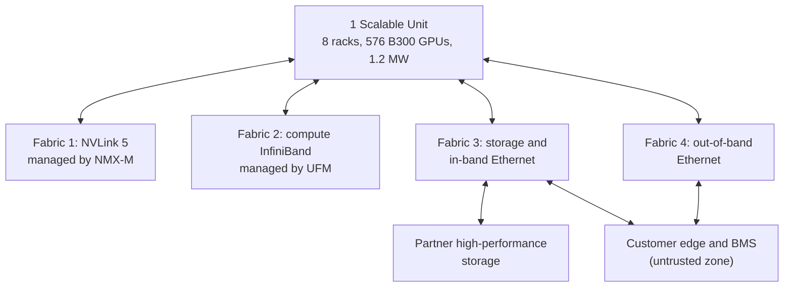
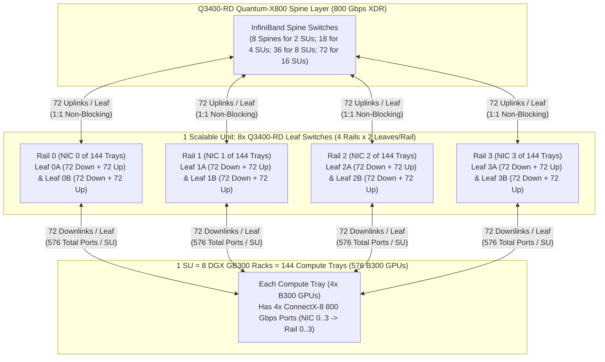
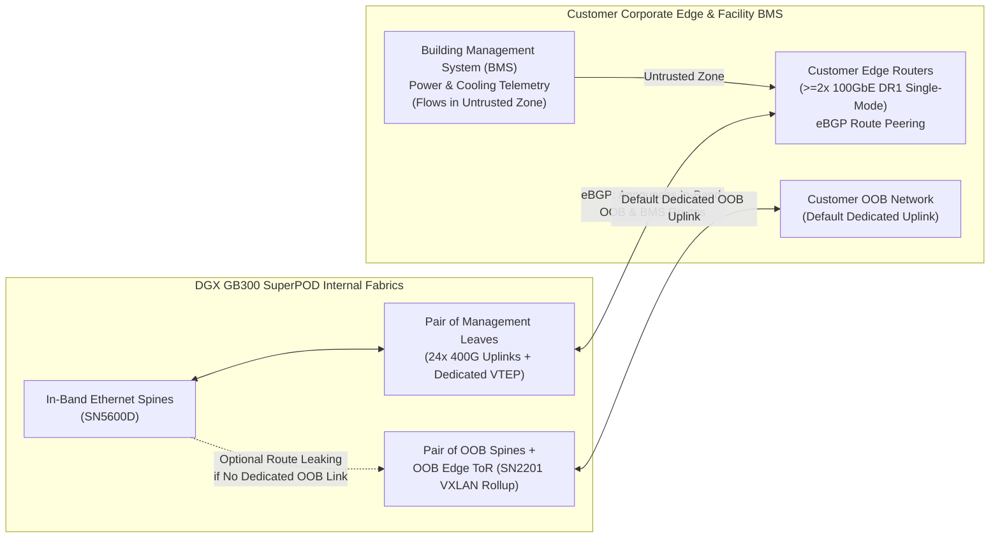

# 9.8 GB300 SuperPOD reference architecture

| | |
|---|---|
| **Status** | Drafted (`gb300_superpod_ra_lab.py`: 28 checks pass; reference architecture rules verified in Python) |
| **Level** | Advanced |
| **Priority tier** | 1b |
| **Lab venue** | none (design / reading) + self-checking Python model (`code/part09/gb300_superpod_ra_lab.py`) |
| **Part** | Part 9: NVIDIA systems and reference architectures |
| **Sources used** | *NVIDIA DGX SuperPOD: Next Generation Scalable Infrastructure for AI Factories Reference Architecture Featuring NVIDIA DGX GB300 Systems* (`superpod-gb300-ra`, pp. 1–36) |

## Why this matters for AI infrastructure

Designing a liquid-cooled cluster for frontier reasoning models from scratch often leads to mismatched switch port counts and storage bottlenecks. Infrastructure engineers feel this pain when a multi-megawatt data hall sits idle because leaf switches lack uplink capacity or building telemetry cannot reach the cluster manager.

The NVIDIA DGX GB300 SuperPOD Reference Architecture solves this problem by packaging Grace CPUs and Blackwell Ultra B300 GPUs into a repeatable factory blueprint. Earlier SuperPOD generations connected air-cooled nodes over NDR InfiniBand. The GB300 SuperPOD instead combines hybrid liquid-cooled DGX GB300 NVL72 racks with Quantum-X800 InfiniBand, Spectrum-4 Ethernet, and NVIDIA Mission Control. This modular design scales smoothly from a single Scalable Unit up to a two-layer fabric of sixteen Scalable Units.

When you review or operate a GB300 SuperPOD, every switch count and port ratio in the blueprint exists for an exact mathematical reason. The summary table below captures the core architectural dimensions of the GB300 SuperPOD from a single Scalable Unit up to maximum two-layer scale.

| Architectural dimension | 1 Scalable Unit baseline | Full 2-layer Reference Architecture scale | Key hardware and software mechanism |
|---|---|---|---|
| **Compute scale and power** | 8 racks, 144 compute trays, 576 B300 GPUs (288 GB HBM3e), 1.2 MW TDP | 16 Scalable Units, 128 racks, 9,216 B300 GPUs, 19.2 MW TDP | Hybrid liquid plus air cooling with BMS telemetry feeding Mission Control |
| **Compute InfiniBand fabric** | 8 Q3400-RD (144-port 800G) leaves arranged as 4 rails x 2 leaves per rail | 128 Q3400-RD leaves and 72 Q3400-RD spines across 2 layers | 72 compute downlinks + 72 spine uplinks = 144 ports per leaf (1:1 non-blocking) |
| **Storage and In-Band Ethernet** | 4 SN5600D compute leaves per SU at a 1:3 blocking ratio (24 uplinks : 72 downlinks) | Up to 64 compute leaves, 8 storage leaves (72 non-blocking 400G links), 24 spines | Dedicated unbonded BlueField-3 ports for 400G RoCEv2 storage vs In-Band management |
| **Out-of-Band and Customer Edge** | SN2201 1GbE copper switches rolled up via VXLAN to 2 OOB aggregation spines | At least 2x 100GbE DR1 single-mode uplinks with eBGP over a dedicated VTEP | BMS isolated in the untrusted zone; Run:ai splits control plane vs cluster operands |

:::info Corpus scope note
Separate companion documents mentioned in the reference architecture summary are the *DGX GB300 Data Center Design Guide*, *Detailed Software Architecture for NVIDIA Mission Control*, and *Relevant Security Information*. Those separate guides are not in our local corpus. Every specification, component table, port ratio, multi-SU switch table, edge routing rule, storage tier, and software layer in this chapter comes from the *NVIDIA DGX SuperPOD: Next Generation Scalable Infrastructure for AI Factories Reference Architecture Featuring NVIDIA DGX GB300 Systems*.
:::

## Prerequisites and outcomes

**Prerequisites:**
- Prior chapters in Part 9 covering Grace Blackwell Ultra GB300 Superchips, DGX GB300 NVL72 rack internals, and SuperPOD Scalable Unit concepts.

**Outcomes:** After completing this chapter, you will be able to:
1. Specify the single-SU hardware and software bill of materials across compute racks, compute trays, B300 GPUs, and thermal design power.
2. Prove the exact port arithmetic of the Compute InfiniBand Fabric using Q3400-RD Quantum-X800 switches across four rails up to full two-layer scale.
3. Prove the exact port arithmetic of the Storage and In-Band Ethernet Fabric contrasting Spectrum-4 SN5600D compute leaves against non-blocking storage leaves and unbonded BlueField-3 ports.
4. Design Out-of-Band SN2201 VXLAN rollups, customer edge eBGP VTEP handovers, untrusted BMS security zones, and the Mission Control plus Run:ai split Kubernetes placement.

---

## Concepts: basics → intermediate → advanced

## 1. Architectural foundation: the 8-rack, 576-GPU, 1.2 MW Scalable Unit

Engineering a multi-megawatt AI cluster rack by rack introduces custom cabling errors, unpredictable cooling bottlenecks, and months of commissioning delays. Data center operators and AI platform teams experience these delays directly when custom-built rows fail burn-in tests under synchronous collective workloads. Standardizing on a pre-engineered unit of deployment eliminates custom row engineering and guarantees predictable performance from day one.

The DGX GB300 SuperPOD Reference Architecture addresses the demands of AI reasoning and frontier training. Long-chain-of-thought inference and multi-trillion-parameter models require massive intra-rack NVLink bandwidth, high-speed inter-rack InfiniBand, and tight integration with data center Operational Technology. Think of a single GB300 Scalable Unit as a pre-tested AI power block. Instead of engineering a data hall server by server, you drop in a standardized multi-rack block that is an exact physical twin of NVIDIA's own internal research cluster. This repeatable stamp reduces deployment time from months to weeks.



| Part of the diagram | Detail |
|---|---|
| 1 Scalable Unit | 8 DGX GB300 NVL72 racks: 144 compute trays (288 Grace CPUs and 576 B300 GPUs), 72 NVLink switch trays (144 NVSwitch ASICs), 64 power shelves of 33 kW (8 per rack), hybrid cooling (direct liquid plus air) |
| Fabric 1: NVLink 5 | 1.8 TB/s per GPU, 130 TB/s per rack, managed by NMX-M |
| Fabric 2: compute InfiniBand | 8 Q3400-RD Quantum-X800 (800G) leaf switches (4 rails x 2), managed by UFM |
| Fabric 3: storage and in-band Ethernet | 4 SN5600D compute leaves plus storage and management leaves |
| Fabric 4: out-of-band Ethernet | SN2201 (48 x 1GbE) plus OOB aggregation spines (VXLAN) |
| Partner storage | RoCEv2, 90 to 280 GB/s read per SU |
| Customer edge | at least 2 x 100GbE DR1, eBGP VTEP, plus the building management system in the untrusted zone |

### 1.1 Facility, ownership, and support model

Without clear facility availability baselines and unified vendor ownership, a single cooling loop fault or switch firmware mismatch can stall an entire cluster while facility and IT teams trade blame. Cluster owners need explicit power, cooling, and support boundaries before facility construction begins.

1. **Scalable Unit baseline.** Each SU contains eight DGX GB300 NVL72 systems and requires a Thermal Design Power of 1.2 Megawatts. Across those racks, the SU houses compute trays, Grace CPUs, Blackwell Ultra B300 GPUs, and NVLink switch trays in the exact counts listed in the table below.
2. **Pre-tested scale and maximum RA scale.** A turnkey system is pre-tested at one SU and two SUs. The architecture scales up to sixteen SUs in two switching layers, and organizations should contact an NVIDIA representative when planning deployments of four SUs or more.
3. **Hybrid cooling, Tier 3 baseline, and NVEX support.** Each rack uses hybrid cooling that combines Direct Liquid Cooling for the high-power CPUs, GPUs, and NVSwitches with air cooling for lower-power components. Building Management System telemetry integrates directly into NVIDIA Mission Control. The hosting facility should meet Uptime Institute Tier 3, TIA-942-B Rated 3, or EN 50600 Class 3 concurrent maintainability standards. Full-system support is delivered by NVIDIA Enterprise Support.

| Deployment milestone | Racks | Compute trays | Grace CPUs | B300 GPUs | Thermal Design Power (TDP) | Engineering guidance |
|---|---:|---:|---:|---:|---:|---|
| **1 SU turnkey stamp** | 8 | 144 | 288 | 576 | 1.2 MW | Pre-tested baseline Scalable Unit |
| **2 SU turnkey stamp** | 16 | 288 | 576 | 1,152 | 2.4 MW | Pre-tested dual-SU deployment |
| **4 SU threshold** | 32 | 576 | 1,152 | 2,304 | 4.8 MW | Contact NVIDIA representative for 4 SUs or more |
| **16 SU maximum RA scale** | 128 | 2,304 | 4,608 | 9,216 | 19.2 MW | Maximum 2-layer leaf-spine fat-tree scale |

:::tip In one minute
- One DGX GB300 Scalable Unit comprises eight DGX GB300 NVL72 racks, requires 1.2 MW TDP, and uses hybrid liquid plus air cooling.
- The hosting data center should meet Tier 3, Rated 3, or Class 3 concurrent maintainability standards, with full-stack support delivered by NVIDIA Enterprise Support and Mission Control integrated with the facility BMS.
:::

---

## 2. Complete hardware and software bill of materials

When hardware and software components are selected piecemeal across different vendors, subtle incompatibilities between NIC firmware, switch operating systems, and job schedulers cause silent performance degradation. System architects and procurement teams need a locked, validated bill of materials so every rack, switch, storage array, and orchestrator works together as a single appliance.

Every component in a single DGX GB300 Scalable Unit is standardized across hardware and software. The two tables below list the complete hardware and software bill of materials from the reference architecture.

### 2.1 Hardware components of 1 Scalable Unit

| Component | Technology | Reference Architecture Specification & Role |
|---|---|---|
| **8x Compute Racks** | **NVIDIA DGX GB300 NVL72** | Rack-scale systems with **18 compute trays** (`2x GB300 Superchips = 2 Grace + 4 B300 GPUs` bridged by 900 GB/s NVLink-C2C under 1 OS instance; `4x ConnectX-8 800G` + `1x BlueField-3 2x400G` at front aisle; `4x 3.84 TB E1.S RAID 0` = `15.36 TB/tray` / `2,211.84 TB/SU` + `1x 1.92 TB M.2 OS`), **9 NVLink switch trays** (`2x COMe RJ45` + `1x BMC RJ45`), and **8x 33 kW power shelves** (`6x 5.5 kW PSUs` = `264 kW/rack`, larger energy storage, front BMC port, rear RJ45 power-brake ports). |
| **NVLink Fabric** | **NVIDIA NVLink 5** | 18 NVSwitch ASICs per rack (`2 per switch tray`), **18 NVL5 links/GPU = 1.8 TB/s** per GPU (**130 TB/s** per rack) over rear blind-mate copper cartridges. |
| **NVLink Management** | **NVIDIA Network Manager eXperience (`NMX-M`)** | Manages and operates all NVLink switch trays (`NVOS`) and provides real-time NVLink telemetry. |
| **Compute Fabric** | **NVIDIA Q3400-RD Quantum-X800 InfiniBand Switch** | **144-port 800 Gbps (XDR)** switch building a rail-optimized, non-blocking, full fat-tree network with **4 Quantum-X800 connections per compute tray** (`8 leaf switches per SU`). Supports Adaptive Routing (`AR`), `SHARPv3`, and `SHIELD`. |
| **InfiniBand Management** | **NVIDIA Unified Fabric Manager (`UFM`) Appliance, Enterprise Edition** | Combines real-time InfiniBand telemetry with AI-powered cyber intelligence and analytics to manage the scale-out compute fabric. |
| **Storage & In-Band Management Fabric** | **NVIDIA Spectrum-4 SN5600 / SN5600D Ethernet Switch** | **64-port 800 Gbps (`128x 400 Gbps`)** high-density Ethernet switch (`4 compute leaves per SU` + storage leaves + management leaves). |
| **Out-of-Band (OOB) Management Network** | **NVIDIA SN2201 Ethernet Switch** | **48x 1 Gbps copper RJ45** ports + OOB aggregation spines connecting all compute/switch/power-shelf/storage BMCs and NVSwitch `COMe` ports. |
| **Partner Storage** | **DGX Storage Program Certified Array** | Validated High-Performance Storage (400G RoCEv2, POSIX, Grace-certified) + User Storage (≥100 GbE DR1 NFS). |

### 2.2 Software components of a DGX GB300 SuperPOD

| Software Component | Role in the GB300 AI Factory |
|---|---|
| **NVIDIA Mission Control** | Unified 5-layer operations and orchestration platform integrating **Base Command Manager (BCM)**, **Run:ai**, **NMX-M**, autonomous failure recovery, predictive maintenance, in-memory checkpointing, and OT/BMS telemetry. |
| **NVIDIA AI Enterprise (`NVAIE`)** | End-to-end cloud-native enterprise software platform for developing and deploying production LLMs and generative AI pipelines. |
| **NVIDIA Magnum IO** | High-performance I/O and collective acceleration suite (`NCCL`, `GPUDirect RDMA`, `GPUDirect Storage`, `NVSHMEM`). |
| **NVIDIA NGC** | Catalog of GPU-optimized, pre-tested containers for AI training, inference, and HPC on `aarch64` Grace Blackwell systems. |
| **Slurm** | Batch workload manager for multi-node synchronous training and HPC jobs. |
| **NVIDIA Run:ai** | Dynamic Kubernetes GPU orchestration platform maximizing utilization across training, fine-tuning, and inference (with a split control-plane / operand architecture; see Section 6). |

:::tip In one minute
- A single GB300 SU integrates eight DGX GB300 NVL72 racks, NVLink 5 managed by NMX-M, Q3400-RD Quantum-X800 InfiniBand managed by UFM Enterprise, Spectrum-4 SN5600D Ethernet, and SN2201 OOB switches.
- The software stack combines NVIDIA Mission Control built on Base Command Manager, NVIDIA AI Enterprise, Magnum IO, NGC, Slurm, and NVIDIA Run:ai.
:::

---

## 3. Compute InfiniBand fabric: proving the 144-port Q3400-RD 4-rail math

Scaling a traditional 64-port switch fabric past two thousand GPUs forces architects to add a third tier of core switches. That extra core tier increases optical cable cost, latency, and power consumption. Network engineers and distributed training users feel this penalty when collective operations cross extra switch hops and job completion times stretch out. Raising the switch port radix allows the GB300 SuperPOD to scale to sixteen Scalable Units in a simple two-layer leaf-spine fat-tree without needing a third core tier.

The secret to this two-layer scale is the high port radix of the NVIDIA Q3400-RD Quantum-X800 XDR switch combined with a four-rail, two-leaf-per-rail SU layout.

### 3.1 Proving the 72 downlink plus 72 uplink leaf balance

We can verify the exact port arithmetic for one Scalable Unit using `verify_gb300_su_ib_leaf_port_math()` in `code/part09/gb300_superpod_ra.py`. Deriving the exact downlink and uplink split per leaf switch is my inference from the switch radix, the tray count per SU, and the rail layout stated in the reference architecture.



1. **Compute ports per SU.** One SU contains eight racks with eighteen compute trays per rack. Each compute tray integrates four ConnectX-8 NICs across four rails, which produces the exact per-SU and per-rail port totals shown in the derivation block below.
2. **Why each rail has two leaf switches.** A single Q3400-RD switch provides 144 ports in total. To remain 1:1 non-blocking, a leaf switch can use at most half of its ports for downlinks to compute trays and must reserve the other half for uplinks to the spine switches.
3. **Exact port balance per leaf switch.** Dividing each rail across two leaf switches gives eight leaf switches per SU. Each Q3400-RD leaf switch terminates 72 compute downlinks and dedicates its remaining 72 ports to spine uplinks, maintaining a 1:1 non-blocking ratio.
4. **Hop behavior.** Traffic on the same rail between compute trays connected to the same SU leaf is always a single hop away. Traffic between different compute racks or SUs, or between different rails, traverses the spine layer or switches rails inside the intra-rack NVL72 domain first.

```text
1 SU compute trays     = 8 racks * 18 trays/rack              = 144 compute trays
1 SU compute NIC ports = 144 trays * 4 ConnectX-8 NICs/tray   = 576 ports (144 ports/rail across 4 rails)
1 SU IB leaf switches  = 4 rails * 2 leaves/rail              = 8 Q3400-RD leaf switches
Per-leaf port balance  = 72 compute downlinks + 72 spine uplinks = 144 ports at 800 Gbps (1:1 non-blocking)
Intra-rack NVLink BW   = 1.8 TB/s per GPU (130 TB/s per NVL72 rack)
```

### 3.2 Two-layer InfiniBand switch scaling up to 16 SUs and 9,216 GPUs

| # of GPUs | # of SUs | Compute Racks | IB Leaf Switches per SU | Total IB Leaf Switches (`Q3400-RD`) | Total IB Spine Switches (`Q3400-RD`) |
|---:|---:|---:|---:|---:|---:|
| **576** | **1** | 8 | 8 | **8** | **4** *(for multi-rack/rail spine)* |
| **1,152** | **2** | 16 | 8 | **16** | **8** |
| **2,304** | **4** | 32 | 8 | **32** | **18** |
| **4,608** | **8** | 64 | 8 | **64** | **36** |
| **9,216** | **16** | 128 | 8 | **128** | **72** |

:::tip In one minute
- Each GB300 SU has 144 compute trays with four ConnectX-8 NICs each, producing 576 compute ports across four rails.
- Splitting each rail across two Q3400-RD leaf switches places 72 downlinks and 72 spine uplinks on every leaf switch, scaling to sixteen SUs in two layers.
:::

---

## 4. Ethernet, Out-of-Band, and Customer Edge architecture

Combining high-speed storage reads with bursty cluster management traffic on a poorly sized Ethernet network causes checkpoint stalls and unreachable management nodes. Storage administrators and security engineers feel this impact when a multi-rack checkpoint write saturates oversubscribed switch uplinks or when unauthenticated building controllers gain direct reachability to server BMCs. Separating host ports, sizing storage leaves for non-blocking throughput, and enforcing strict border routing solves all three problems.

To maximize cost-efficiency while delivering high-bandwidth RoCEv2 storage access, the DGX GB300 SuperPOD carries the Storage Network and In-Band Management Network on a two-layer NVIDIA Spectrum-4 SN5600D Ethernet fabric. It carries the Out-of-Band Management Network on dedicated SN2201 switches.

### 4.1 Proving the 1:3 compute leaf blocking ratio vs non-blocking storage leaves

Inside each SU, four SN5600D compute leaf switches connect to the dual-port BlueField-3 BF3240 cards in the compute trays. You can inspect this verification in `verify_gb300_su_ethernet_leaf_blocking()` in `code/part09/gb300_superpod_ra.py`. Dividing the compute tray host ports across four leaves and comparing against the twenty-four spine uplinks per leaf is my inference explaining the reference architecture's blocking ratio statement.

1. **Compute Leaves.** Four compute leaves serve each SU at a 1:3 blocking ratio. Across all compute trays in an SU, each tray's dual-port BF3240 provides two downlink connections, yielding 72 downlinks per compute leaf. Each compute leaf connects up to the Ethernet spines via 24 uplinks, yielding an exact 1:3 blocking ratio.
2. **Storage Leaves.** Starting at two leaves, storage leaf switches operate at a 1:1 non-blocking ratio. Dozens of compute trays read and write to shared High-Performance Storage simultaneously. The storage leaf switches therefore connect via 72 non-blocking links to the spine layer so storage arrays are never bottlenecked by leaf-to-spine oversubscription.
3. **Management Leaves.** A pair of management leaves connects persistent NFS home and user storage alongside the cluster management nodes into the Ethernet spine via 24 uplinks per leaf.
4. **Unbonded BlueField-3 port segmentation and future HBN.** Each compute tray's BF3240 dedicates one 400 Gbps port to the RoCEv2 Storage Network and the second port of at least 200 Gbps to the In-Band Management Network. Because RoCEv2 is not shared on a bonded interface with In-Band traffic, storage performance stays predictable and host routing remains simple. To add single-port failover in future releases, NVIDIA plans to enable Host-Based Networking on the BlueField-3 DPUs.

```text
SN5600D Ethernet Leaf Port Math (per Scalable Unit):
- Compute leaf downlinks : 144 trays * 2 BF3240 ports / 4 compute leaves = 72 downlinks/leaf @ 400 Gbps
- Compute leaf uplinks   : 24 spine uplinks/leaf @ 400 Gbps              -> 24 : 72 = 1:3 blocking ratio
- Storage leaf uplinks   : 72 spine uplinks/leaf @ 400 Gbps              -> 72 : 72 = 1:1 non-blocking
- Mgmt leaf uplinks      : 24 spine uplinks/leaf @ 400 Gbps (2 management leaves)
- BF3240 port split      : Port 1 = 400 Gbps RoCEv2 Storage; Port 2 = >= 200 Gbps In-Band Management (unbonded)
```

### 4.2 Ethernet and OOB switch scaling across 2 to 16 SUs

| # of GPUs | # of SUs | Ethernet Spines (`SN5600D`) | Ethernet Compute Leaves (`4/SU`) | Ethernet Storage Leaves | Max Supported Storage Bandwidth | Management Leaves + OOB Spines |
|---:|---:|---:|---:|---:|---|---|
| **1,152** | **2** | **4** | **8** | **2** | **`64 × 400GbE`** (`25.6 Tbps`) | **`2 + 2`** |
| **2,304** | **4** | **8** | **16** | **2** | **`128 × 400GbE`** (`51.2 Tbps`) | **`2 + 2`** |
| **4,608** | **8** | **12** | **32** | **4** | **`256 × 400GbE`** (`102.4 Tbps`) | **`2 + 2`** |
| **9,216** | **16** | **24** | **64** | **8** | **`1,024 × 400GbE`** (`409.6 Tbps`) | **`2 + 2`** |

### 4.3 Out-of-Band VXLAN and Customer Edge connectivity

Connecting an AI factory to a corporate network and a facility Building Management System requires strict routing and security boundaries. Without dedicated border peering and untrusted-zone isolation, dataset ingestion bottlenecks at the edge or facility controllers gain unauthorized access to internal server management interfaces.



1. **Out-of-Band Network.** The OOB network connects all compute-tray BMCs, BlueField BMCs, NVSwitch COMe and BMC ports, storage and network gear, and rack PDUs onto 48-port 1 GbE copper SN2201 switches. In the GB300 SuperPOD, each SU's OOB switches roll up into the aggregation layer as a dedicated VXLAN terminated on a pair of OOB aggregation spine switches. This design creates a physically independent IPMI, Redfish, and fabric-management plane.
2. **Customer Edge Uplink.** The customer edge handover requires at least two 100 GbE links with DR1 single-mode optical transceivers to handle high-speed dataset ingestion and corporate access. It uses a dedicated VTEP for uplink and hands over routes to the customer edge via external BGP peering. The border session announces routes to and from In-Band, Out-of-Band, and the Building Management System.
3. **BMS security zone rule.** The Building Management System provides data-center-scale power and cooling telemetry to Mission Control. It is required to flow through the customer edge uplink interfaces as part of the untrusted zone.
4. **Two options for OOB customer uplink.** In the default Dedicated OOB Uplink design, the last pair of SN2201 OOB switches acts as the OOB edge ToR switches. That pair provides a dedicated physical uplink to the customer's OOB management network. In the alternative In-Band Spine Route Leaking design, the customer chooses not to provision a dedicated OOB link. Instead, the OOB switches connect to the SN5600D In-Band spine network, and routes to the OOB interfaces are leaked toward the customer edge over the eBGP uplink.

:::tip In one minute
- Each SU has four SN5600D compute leaves operating at a 1:3 blocking ratio, while storage leaves use 72 non-blocking links and management leaves use 24 uplinks.
- Customer edge connectivity requires at least two 100GbE DR1 single-mode links, a dedicated VTEP, and eBGP peering announcing In-Band, OOB, and untrusted-zone BMS routes.
- OOB switches roll up via VXLAN to a pair of OOB spines. They connect to the customer via either a dedicated OOB edge ToR pair by default or route leaking through the SN5600D In-Band spines.
:::

---

## 5. Storage architecture and performance tiers

Undersizing shared storage turns every model checkpoint and multimodal dataset load into an expensive cluster-wide stall where hundreds of GPUs sit idle waiting on disk I/O. AI researchers and platform operators feel this bottleneck whenever checkpoint saves eat into training uptime or storage firmware upgrades force a maintenance window. Separating high-throughput training storage from user home directories and matching array bandwidth to workload intensity keeps GPUs saturated.

As detailed in the SuperPOD storage design, the DGX GB300 SuperPOD pairs its compute racks with two distinct storage systems: certified High-Performance Storage over RoCEv2 and User Storage over NFS. High-Performance Storage must be certified for Grace aarch64 and GPUDirect Storage, using local RAM and NVMe caching alongside non-disruptive upgrades. User Storage connects over at least 100 GbE DR1 links to serve home directories, logs, and Mission Control high-availability state.

| Storage Performance Tier | Workload profile | 1 SU Read / Write Bandwidth | 4 SU Read / Write Bandwidth |
|---|---|---|---|
| **Standard Tier** | Compute-dominated text LLM training and reasoning | `90 GB/s` read / `45 GB/s` write | `360 GB/s` read / `180 GB/s` write |
| **Enhanced Tier** | I/O-intensive multimodal training and frequent checkpointing | `280 GB/s` read / `140 GB/s` write | `1,120 GB/s` read / `560 GB/s` write |

:::tip In one minute
- Certify High-Performance Storage for Grace aarch64, RoCEv2 RDMA, GPUDirect Storage, and non-disruptive upgrades.
- Size arrays to the Standard Tier or Enhanced Tier shown in the table above based on your training and checkpointing intensity.
:::

---

## 6. Software stack decomposition: Mission Control and Run:ai split K8s placement

Operating thousands of liquid-cooled GPUs manually means a single degraded tray or stuck rank can halt a multi-node training job for hours until an on-call engineer intervenes. Site reliability engineers and ML teams lose valuable compute hours when hardware telemetry, fabric alerts, and job schedulers live in disconnected silos. Automating fault isolation and placing orchestration services on the right Kubernetes clusters eliminates manual triage.

The DGX GB300 SuperPOD software stack is operated through NVIDIA Mission Control, which delivers four core operational capabilities:
1. **Automated Failure Detection and Self-Recovery.** Mission Control continuously runs health checks such as `dcgmi` and `nvsm`. It isolates degraded trays and triggers autonomous recovery without human intervention.
2. **Optimized Workload Migration and Resource Allocation.** The platform automatically reassigns interrupted workloads to healthy trays so GPUs never sit idle waiting for manual triage.
3. **Unified Diagnostics for Infrastructure and Applications.** It correlates hardware and fabric telemetry from Base Command Manager, UFM, NMX-M, and the facility BMS with application-level collective and rank logs.
4. **In-Memory Checkpointing for Seamless Job Recovery.** Failed training ranks automatically restart from the most recent valid in-memory or local-NVMe checkpoint with zero rework.

### 6.1 The NVIDIA Run:ai two-cluster split on BCM-managed SuperPODs

Deploying all Kubernetes management components onto a single cluster mixes user-facing API portals with low-level hardware operators. That coupling complicates multi-cluster governance and administrative upgrades. Separating the central control plane from the cluster operands keeps tenant management clean and places workload schedulers directly beside the GPUs.

Pay special attention to how NVIDIA Run:ai is deployed inside a BCM-managed DGX GB300 SuperPOD:
- Run:ai uses a distributed architecture split into two primary subsystems: the Control Plane backend and the Cluster operands.
- The Run:ai Control Plane backend resides on the user-space Kubernetes cluster. This placement supports centralized multi-cluster management, tenant quota enforcement, and user UI or API access.
- The Run:ai Cluster components or operands are deployed directly onto the administrative Kubernetes infrastructure close to the DGX GB300 computational resources.

:::tip In one minute
- NVIDIA Mission Control provides automated failure detection and self-recovery, workload migration, unified diagnostics, and in-memory checkpointing on top of BCM, UFM, and NMX-M.
- In a BCM-managed GB300 SuperPOD, the Run:ai control plane backend runs on the user-space Kubernetes cluster. The Run:ai cluster operands run on the administrative Kubernetes infrastructure.
:::

---

## Commands and configurations that matter

Manual spreadsheet calculations for multi-SU switch counts, leaf blocking ratios, and border routing rules frequently let port mismatches slip into data center build plans. Running an automated verification script before ordering hardware or configuring border switches catches topology mistakes immediately.

Run the self-checking GB300 SuperPOD Reference Architecture verifier to validate the Q3400-RD InfiniBand leaf port balance and the SN5600D compute leaf blocking ratio. The script also checks the multi-SU switch tables alongside the customer edge eBGP, BMS, OOB, and Run:ai placement rules.

```bash
# Execute the 28-check GB300 SuperPOD Reference Architecture verification lab
python3 -B code/part09/gb300_superpod_ra_lab.py
```

---

## How it fails

Even with a standardized reference architecture, field deployments can fail when optical transceivers, security zones, or switch ports are wired to the wrong tier. The table below maps the five most common deployment failures to their symptoms, root causes, and fixes.

| Failure mode | Symptom | Root cause | Diagnosis & fix |
|---|---|---|---|
| **1. Customer edge uplink saturation or optics mismatch** | Dataset ingestion into High-Performance Storage bottlenecks at `< 20 Gbps`, or customer border routers fail to bring up optical links to the SuperPOD management leaves. | The customer provisioned a single 10G/25G uplink or ordered multimode `SR4` transceivers instead of the recommended **≥ 2x 100 GbE links with `DR1` single-mode optics**. | Provision **at least `2x 100 GbE` links with `DR1` single-mode transceivers** terminated on the dedicated uplink **VTEP** and peer via **eBGP**. |
| **2. Building Management System (`BMS`) placed on the trusted compute/OOB VLAN** | Security audit flags an unauthenticated facility BACnet/Modbus BMS controller with direct Layer-2 reachability to compute-tray BMCs or storage nodes. | The integration team bridged the facility BMS directly into the internal OOB or storage VLAN instead of routing it through the customer edge untrusted zone. | Follow the GB300 Reference Architecture security boundary: **BMS telemetry must flow through the customer edge uplink interfaces as part of the untrusted zone** with explicit eBGP route filtering and firewall policies into Mission Control. |
| **3. Unreachable OOB BMCs from customer SOC when dedicated OOB uplink is omitted** | Customer NOC/SOC engineers cannot reach the `SN2201` OOB switch subnet (`IPMI` / `Redfish` / `NMX-M`) because the facility did not run physical cables to the OOB edge ToR switches. | The customer skipped the default **dedicated OOB edge ToR uplink** (`SN2201`) *and* forgot to enable **OOB route leaking** on the `SN5600D` In-Band spines. | Either cable the last pair of `SN2201` switches as **dedicated OOB edge ToR uplinks** (default), or connect the OOB spines to the **`SN5600D` In-Band spine network and leak OOB routes** across the eBGP border VTEP. |
| **4. Storage throughput stalls from wiring storage arrays into 1:3 compute leaves** | High-Performance Storage read throughput plateaus at one-third of rated array bandwidth during multi-rack checkpoint loads. | Storage array 400G RoCEv2 ports were plugged into the **4 `SN5600D` compute leaves** (which have only `24 × 400G` spine uplinks for `72 × 400G` downlinks = **`1:3` blocking ratio**) instead of the dedicated **storage leaf switches**. | Connect all High-Performance Storage array ports to the dedicated **`SN5600D` storage leaf switches**, which are wired with **`72 non-blocking 400 Gbps` spine links (`1:1` non-blocking)**. |
| **5. Misplacing the Run:ai backend control plane vs cluster operands** | Run:ai multi-cluster orchestration or BCM administrative operator reconciliation fails during installation. | The installer deployed the Run:ai central backend onto the administrative Kubernetes cluster instead of separating the two layers. | On BCM-managed GB300 SuperPODs, deploy the **Run:ai control plane (backend) on the user-space Kubernetes cluster** and deploy the **Run:ai cluster components on the administrative Kubernetes infrastructure**. |

---

## Hands-on lab

This chapter's self-checking Python model in `code/part09/gb300_superpod_ra.py` and lab script in `code/part09/gb300_superpod_ra_lab.py` implement four verification suites:
1. The Quantum-X800 InfiniBand SU Port Verifier proving 72 compute downlinks plus 72 spine uplinks per leaf switch for 1:1 non-blocking operation.
2. The Spectrum-4 SN5600D Ethernet Leaf Blocking Verifier proving the 1:3 blocking ratio on compute leaves alongside non-blocking storage leaves and management leaves.
3. The Multi-Fabric Switch and Storage Table Verifier checking every row of the scaling tables plus rack power shelf capacity and aggregate E1.S and M.2 storage per SU.
4. The Customer Edge, OOB Handover, BMS Security Zone, and Run:ai Placement Auditor checking border optics, eBGP VTEP routing, untrusted BMS placement, OOB handover options, and Run:ai Kubernetes cluster placement.

Run the lab from the repository root.

```bash
python3 -B code/part09/gb300_superpod_ra_lab.py
```

Expected output verified in this repository is shown below.

```text
=== Chapter 9.8 Lab: GB300 SuperPOD Reference Architecture ===
  [PASS] 1 GB300 SU has 8 racks * 18 trays = 144 compute trays and 576 B300 GPUs
  [PASS] 144 trays * 4 ConnectX-8 NICs == 576 compute ports across 8 leaves (4 rails * 2 leaves/rail)
  [PASS] Each 144-port Q3400-RD leaf has 72 compute downlinks + 72 spine uplinks (1:1 non-blocking)
  [PASS] Rejects non-positive racks_per_su in IB port verifier
  [PASS] 144 trays * 2 BlueField-3 ports == 288 ports across 4 SN5600D compute leaves (72 downlinks/leaf)
  [PASS] SPGB300 p.22: 24 uplinks vs 72 downlinks at 400G per compute leaf == 1:3 blocking ratio
  ...
  [PASS] 2-SU fully tested GB300 system (p.14) has 16 racks, 1,152 GPUs, and 2.4 MW TDP
  [PASS] SPGB300 p.11: 8 power shelves/rack * 6 PSUs * 5.5 kW == 264.0 kW total shelf capacity per rack
  [PASS] SPGB300 p.9: 1 SU (8 racks = 144 compute trays) provides 144 * 4 * 3.84 TB == 2,211.84 TB E1.S RAID 0 scratch
  [PASS] SPGB300 p.9: 1 SU (144 compute trays) provides 144 * 1.92 TB == 276.48 TB M.2 OS storage
  [PASS] SPGB300 p.19: 1 SU (8 racks) contains 8 * 9 == 72 NVLink switch trays (144 NVSwitch ASICs)

Summary: 28 passed, 0 failed (total 28)
```

---

## Exercises

1. Run `python3 -B code/part09/gb300_superpod_ra_lab.py`. Pick the check for the Ethernet compute leaf and explain, in your own words, where the downlinks and uplinks come from and what the blocking ratio means.
2. Compute, for four SUs, the number of compute racks, GPUs, compute trays, NVLink switch trays, power shelves, and compute NIC ports. Use the per-SU numbers in Section 1.
3. A storage vendor plugs its RoCEv2 array into the compute leaves because they have free ports. Write what will go wrong and which switches should be used instead.
4. Design the customer edge for a new SuperPOD: how many uplinks, which optics, which routing protocol, and where does the facility BMS traffic go? Then describe the two ways to reach the OOB network.
5. Draw where the Run:ai control plane and the Run:ai cluster components live in a BCM-managed SuperPOD. Name the two Kubernetes clusters.
6. Using the scaling tables in the chapter, list the IB leaf, IB spine, and Ethernet spine counts across the multi-SU milestones. Which count does not grow in a straight line?

## Checkpoint questions (20)

<details>
<summary>`&lt;strong>`1. How many racks, compute trays, Grace CPUs, B300 GPUs, and NVLink switch trays make up one DGX GB300 Scalable Unit (SU), and what is its Thermal Design Power (TDP)?`&lt;/strong>`</summary>

One DGX GB300 Scalable Unit consists of eight DGX GB300 NVL72 racks and requires a Thermal Design Power of 1.2 Megawatts per SU.

```text
1 GB300 Scalable Unit (SU) Inventory:
- Compute racks       : 8 DGX GB300 NVL72 racks
- Compute trays       : 144 compute trays (8 * 18)
- Grace CPUs & GPUs   : 288 Grace CPUs (144 * 2) and 576 B300 GPUs (144 * 4)
- NVLink switch trays : 72 NVLink switch trays (8 * 9, containing 144 NVSwitch ASICs)
- DGX Power Shelves   : 64 power shelves (8 * 8, rated at 33 kW each)
- Thermal Design Power: 1.2 MW TDP per SU
```
</details>

<details>
<summary>`&lt;strong>`2. Prove why each Q3400-RD Quantum-X800 InfiniBand leaf switch in a GB300 SU has 72 compute downlinks and 72 spine uplinks.`&lt;/strong>`</summary>

Across one SU of compute trays, each tray has four ConnectX-8 NICs across four rails. Each of the four rails is split across two leaf switches per rail for eight leaf switches per SU. Consequently, each Q3400-RD leaf switch terminates 72 compute downlinks and uses its remaining 72 ports as spine uplinks for 1:1 non-blocking operation.
</details>

<details>
<summary>`&lt;strong>`3. Contrast the uplink port count and blocking ratio of the SN5600D Ethernet Compute Leaves, Storage Leaves, and Management Leaves in a GB300 SuperPOD.`&lt;/strong>`</summary>

- **Ethernet Compute Leaves.** Four switches per SU terminate 72 host ports and connect to the Ethernet spines via 24 uplinks, operating at a 1:3 blocking ratio.
- **Ethernet Storage Leaves.** Storage leaves connect to the spines via 72 non-blocking links for a 1:1 non-blocking ratio.
- **Ethernet Management Leaves.** Two switches connect to the spines via 24 links for node provisioning and persistent NFS home storage.
</details>

<details>
<summary>`&lt;strong>`4. Why does the DGX GB300 SuperPOD use two unbonded ports on the BlueField-3 BF3240 DPU instead of bonding them together, and what feature does NVIDIA plan to enable for future DPU high availability?`&lt;/strong>`</summary>

Dedicating Port 1 at 400 Gbps exclusively to lossless RoCEv2 Storage and Port 2 at 200 Gbps or higher to In-Band Management keeps RoCEv2 storage traffic isolated from In-Band TCP bursts. It also avoids complex, error-prone per-host routing rules. To add high-availability failover across the ports in future releases, NVIDIA plans to enable Host-Based Networking on the BlueField-3 DPUs.
</details>

<details>
<summary>`&lt;strong>`5. What are the optical media, link count, VTEP and routing protocol, and BMS security zone requirements for Customer Edge Connectivity in a DGX GB300 SuperPOD?`&lt;/strong>`</summary>

- **Links and optics.** Provision at least two 100 GbE links using DR1 single-mode optics.
- **Routing handover.** Terminate on a dedicated VTEP using eBGP peering to announce routes for In-Band, Out-of-Band, and the Building Management System.
- **BMS security zone.** BMS power and cooling telemetry is required to flow through the customer edge uplink interfaces as part of the untrusted zone.
</details>

<details>
<summary>`&lt;strong>`6. What are the two supported methods for connecting the SN2201 Out-of-Band management network to the customer's corporate network?`&lt;/strong>`</summary>

1. **Default Dedicated OOB Edge ToR.** The last pair of SN2201 OOB switches serves as the OOB edge ToR switches, providing a dedicated physical uplink to the customer's OOB network.
2. **Alternative In-Band Spine Route Leaking.** If the customer does not provision a dedicated OOB uplink, the OOB spine switches connect to the SN5600D In-Band spine network and leak routes to the OOB interfaces toward the customer edge via eBGP.
</details>

<details>
<summary>`&lt;strong>`7. How are the two components of NVIDIA Run:ai placed across Kubernetes clusters in a BCM-managed DGX GB300 SuperPOD?`&lt;/strong>`</summary>

- The Run:ai Control Plane backend resides on the user-space Kubernetes cluster for central multi-cluster orchestration.
- The Run:ai Cluster components or operands are deployed directly onto the administrative Kubernetes infrastructure close to the compute resources.
</details>

<details>
<summary>`&lt;strong>`8. What are the four core operational value pillars delivered by NVIDIA Mission Control on a DGX GB300 SuperPOD?`&lt;/strong>`</summary>

1. Automated Failure Detection and Self-Recovery.
2. Optimized Workload Migration and Resource Allocation.
3. Unified Diagnostics for Infrastructure and Applications.
4. In-Memory Checkpointing for Seamless Job Recovery.
</details>

<details>
<summary>`&lt;strong>`9. Why does one GB300 SU have 576 compute NIC ports?`&lt;/strong>`</summary>

One SU contains 144 compute trays, and each tray has four ConnectX-8 NICs, which gives 576 ports in total. That places 144 ports on each of the four rails.
</details>

<details>
<summary>`&lt;strong>`10. Why are there two leaf switches per rail?`&lt;/strong>`</summary>

One Q3400-RD switch has 144 ports. To stay 1:1 non-blocking, it uses 72 ports down to compute trays and 72 ports up to the spine. A single rail needs 144 downlinks, so each rail requires two leaf switches.
</details>

<details>
<summary>`&lt;strong>`11. What does 1:3 blocking on the Ethernet compute leaves mean?`&lt;/strong>`</summary>

Each compute leaf has 72 ports toward hosts and only 24 uplinks toward the spine. The uplinks are one third of the downlinks, so simultaneous line-rate traffic across all host ports is oversubscribed three to one.
</details>

<details>
<summary>`&lt;strong>`12. Why are storage arrays attached to dedicated storage leaves?`&lt;/strong>`</summary>

Storage leaves are non-blocking with 72 links to the spine. Compute leaves are oversubscribed at a 1:3 ratio, so storage arrays attached to compute leaves would bottleneck at roughly one third of their rated bandwidth.
</details>

<details>
<summary>`&lt;strong>`13. What are the two ports on the BlueField-3 used for?`&lt;/strong>`</summary>

Port 1 operates at 400G and carries RoCEv2 storage traffic. Port 2 operates at 200G or higher and carries in-band management and NFS user storage. The two ports are not bonded together.
</details>

<details>
<summary>`&lt;strong>`14. What future feature is planned for BlueField-3 high availability?`&lt;/strong>`</summary>

NVIDIA plans to enable Host-Based Networking on the BlueField-3 DPUs, which adds multi-path failover across the two ports.
</details>

<details>
<summary>`&lt;strong>`15. What does the customer edge need?`&lt;/strong>`</summary>

It requires at least two 100 GbE links with DR1 single-mode optics, a dedicated VTEP, and eBGP peering that announces in-band, OOB, and BMS routes.
</details>

<details>
<summary>`&lt;strong>`16. Why does the facility BMS traffic go through the customer-edge untrusted zone?`&lt;/strong>`</summary>

The reference architecture requires BMS telemetry to flow through the edge uplink interfaces as part of the untrusted zone. Bridging it directly into the internal OOB or storage network would give an unauthenticated facility controller direct reach to BMCs and storage.
</details>

<details>
<summary>`&lt;strong>`17. What are the two options for OOB reach to the customer?`&lt;/strong>`</summary>

The default option uses a dedicated OOB edge ToR pair of SN2201 switches. The alternative option omits the dedicated link and leaks OOB routes from the OOB switches through the SN5600D in-band spines over eBGP.
</details>

<details>
<summary>`&lt;strong>`18. What does Mission Control do when a tray fails?`&lt;/strong>`</summary>

It detects the failure with continuous health checks, isolates the degraded tray, moves the interrupted workload to healthy trays, and restarts failed ranks from the latest in-memory or local-NVMe checkpoint.
</details>

<details>
<summary>`&lt;strong>`19. Which scale did NVIDIA test fully, and when should you contact NVIDIA?`&lt;/strong>`</summary>

Deployments of one SU and two SUs are fully pre-tested turnkey systems. The reference architecture scales up to sixteen SUs, and you should contact an NVIDIA representative for deployments of four SUs or more.
</details>

<details>
<summary>`&lt;strong>`20. Which companion documents does the chapter say are missing from the corpus?`&lt;/strong>`</summary>

The *DGX GB300 Data Center Design Guide*, the *Detailed Software Architecture for NVIDIA Mission Control*, and *Relevant Security Information* are separate documents not in the local corpus.
</details>

---

## Sources and review notes

### Sources read in full for this chapter

| Source & Pages | Sections and technical topics extracted |
|---|---|
| *NVIDIA DGX SuperPOD: Next Generation Scalable Infrastructure for AI Factories Reference Architecture Featuring NVIDIA DGX GB300 Systems* (`superpod-gb300-ra`, pp. 1–12, read 100% in full) | Abstract and key technologies (pp. 1–3); 8-rack / 576-GPU / 1.2 MW SU, Tier 3 / Rated 3 / Class 3 baseline, hybrid cooling, OT integration, and 16-SU / 128-rack / 9,216-GPU scale-out (pp. 5–6); DGX GB300 NVL72 rack, compute tray, switch tray, and 8x 33 kW power shelves (pp. 7–11); Quantum-X800 800G IB (`AR`, `SHARP`, `SHIELD`) and Mission Control overview (p. 12). |
| *NVIDIA DGX SuperPOD Reference Architecture Featuring NVIDIA DGX GB300 Systems* (`superpod-gb300-ra`, pp. 13–36, read 100% in full) | `Table 1` hardware and `Table 2` software components (pp. 13–14); system/fabric/storage design requirements and `NVEX` support (pp. 14–17); 5 network segments over 4 physical fabrics and `MN-NVL` (pp. 18–19); Compute Fabric 4-rail x 2-leaf `Q3400-RD` 144-port topology and `Table 3` scaling (pp. 20–21); Ethernet `SN5600D` fabric with `1:3` compute leaves (`24 × 400G`), `72 × 400G` non-blocking storage leaves, `24 × 400G` management leaves, and `Table 4` scaling (pp. 22–23); unbonded BlueField-3 400G RoCEv2 vs ≥200G In-Band segmentation and future `HBN` roadmap (pp. 24–25); OOB `SN2201` VXLAN rollup + OOB spines (p. 26); Customer Edge Connectivity (`>= 2x 100GbE DR1`, dedicated `VTEP`, `eBGP`, `BMS` untrusted zone, `OOB edge ToR` vs In-Band spine route leaking, pp. 27–28); Storage Architecture `Table 4` & `Table 5` (`Standard` `90/45` & `360/180 GB/s` vs `Enhanced` `280/140` & `1,120/560 GB/s`, pp. 29–31); DGX SuperPOD Software / Mission Control 5 layers + Run:ai split K8s architecture (pp. 32–34). |

### Not in the corpus
- Companion documents referenced in the summary of `superpod-gb300-ra` are the *DGX GB300 Data Center Design Guide*, *Detailed Software Architecture for NVIDIA Mission Control*, and *Relevant Security Information*, which are not in `~/Desktop/books-toon-rag/`.

### Run here
- `python3 -B code/part09/gb300_superpod_ra_lab.py` passes all 28 checks with 0 failures.

### My own choices and inferences, labelled in the text

| Inference Item | How Derived |
|---|---|
| **Per-leaf port balance on `Q3400-RD` (`72 downlinks + 72 spine uplinks = 144 ports` in `verify_gb300_su_ib_leaf_port_math` in `code/part09/gb300_superpod_ra.py` and Section 3.1)** | Explicitly dividing `144 trays * 4 ConnectX-8 NICs = 576 compute ports per SU` across `8 leaf switches per SU` (`4 rails * 2 leaves/rail`) to show `72 downlinks + 72 spine uplinks = 144 ports` per `Q3400-RD` leaf switch is my inference explaining the non-blocking arithmetic behind p. 20 of `superpod-gb300-ra`. |
| **Per-leaf downlink count (`72 downlinks : 24 uplinks = 1:3`) on `SN5600D` Ethernet compute leaves (`verify_gb300_su_ethernet_leaf_blocking` in `code/part09/gb300_superpod_ra.py` and Section 4.1)** | Dividing `144 trays * 2 BlueField-3 ports = 288 ports per SU` across `4 compute leaf switches per SU` (`72 downlinks/leaf`) and comparing against the stated `24 links at 400 Gbps` uplinks (`24 : 72 = 1:3`) is my inference proving the `1:3 blocking ratio` stated on p. 22 of `superpod-gb300-ra`. |

### Not verified on live hardware
- Switch configurations on live Q3400-RD, SN5600D, and SN2201 switches were not executed in this authoring environment.

