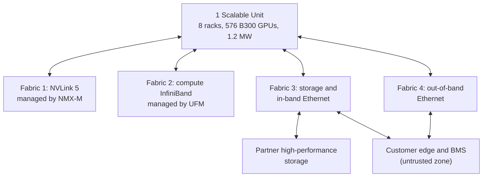
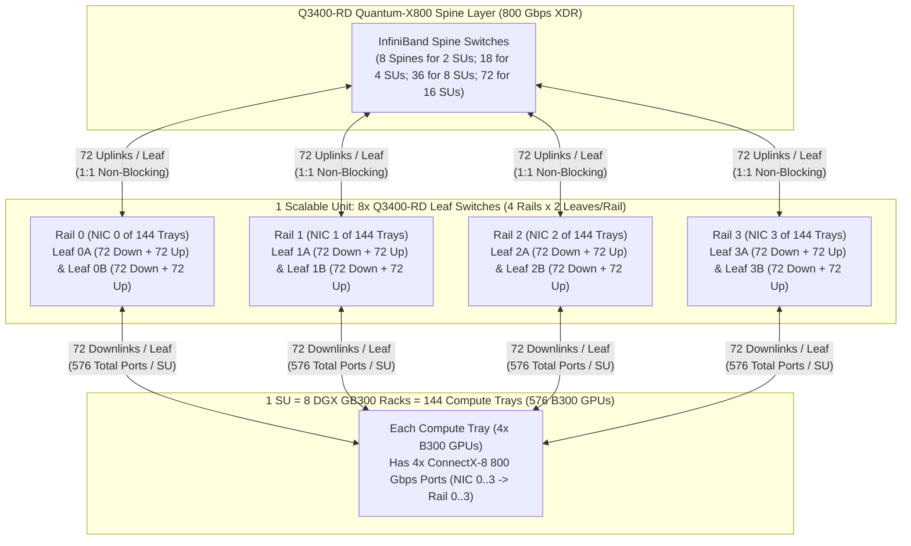
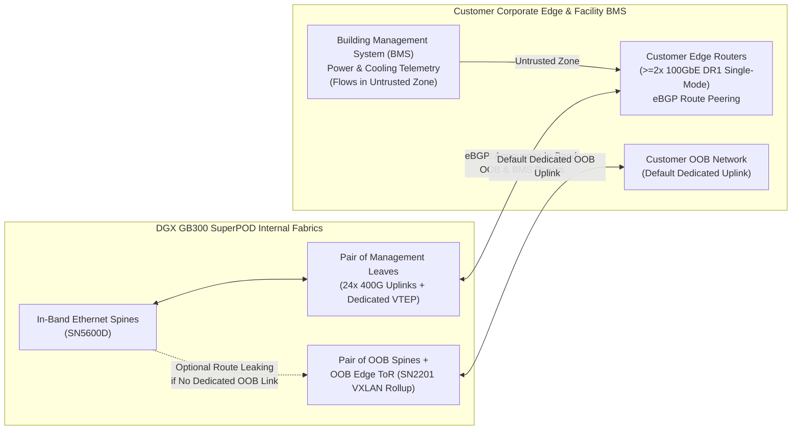

# 9.8 GB300 SuperPOD reference architecture

| | |
|---|---|
| **Status** | Drafted (`gb300_superpod_ra_lab.py`: 28 checks pass; reference architecture rules verified in Python) |
| **Level** | Advanced |
| **Priority tier** | 1b |
| **Lab venue** | none (design / reading) + self-checking Python model (`code/part09/gb300_superpod_ra_lab.py`) |
| **Part** | Part 9: NVIDIA systems and reference architectures |
| **Sources used** | *NVIDIA DGX SuperPOD: Next Generation Scalable Infrastructure for AI Factories Reference Architecture Featuring NVIDIA DGX GB300 Systems* (`superpod-gb300-ra`, pp. 1–36) |

## Why this matters for AI infrastructure

The **NVIDIA DGX GB300 SuperPOD Reference Architecture** is the flagship blueprint for next-generation AI factories built around **Grace CPUs** and **Blackwell Ultra (`B300`, 288 GB HBM3e)** GPUs. While earlier SuperPOD generations scaled 8-GPU air-cooled nodes over 400 Gbps NDR InfiniBand, the GB300 SuperPOD combines **72-GPU hybrid liquid-cooled `DGX GB300 NVL72` racks**, **800 Gbps `Quantum-X800` (`Q3400-RD` 144-port) InfiniBand**, **800 Gbps `Spectrum-4` (`SN5600D`) Ethernet**, and **NVIDIA Mission Control** into a modular architecture that scales from **1 Scalable Unit (`8 racks = 576 GPUs`, `1.2 MW` TDP)** all the way to **16 Scalable Units (`128 racks = 9,216 GPUs`, `19.2 MW` TDP)** in a simple two-layer network fabric.

When you architect, review, or operate a GB300 SuperPOD, every number in the blueprint exists for a mathematical reason: why each Scalable Unit contains **8 `Q3400-RD` InfiniBand leaf switches** arranged as **4 rails × 2 leaves per rail** (`72 compute downlinks + 72 spine uplinks = 144 ports`), why each SU contains **4 `SN5600D` Ethernet compute leaf switches** operating at a **1:3 blocking ratio** (`24 uplinks : 72 downlinks`) alongside **72-port non-blocking storage leaves**, how customer edge uplinks (`≥ 2x 100GbE DR1`) peer via **eBGP** across a dedicated **VTEP** while isolating the **Building Management System (`BMS`)** in the untrusted zone, and why **NVIDIA Run:ai** splits its control plane onto the **user-space Kubernetes cluster** while running cluster operands on the **administrative Kubernetes infrastructure**.

:::info Corpus scope note
Separate companion documents mentioned in the reference architecture summary—the *DGX GB300 Data Center Design Guide*, *Detailed Software Architecture for NVIDIA Mission Control*, and *Relevant Security Information*—are not in `~/Desktop/books-toon-rag/`. Every specification, component table, port ratio, multi-SU switch table, edge routing rule, storage tier, and software layer in this chapter is extracted from the complete 36-page *NVIDIA DGX SuperPOD: Next Generation Scalable Infrastructure for AI Factories Reference Architecture Featuring NVIDIA DGX GB300 Systems* (`superpod-gb300-ra`).
:::

## Prerequisites and outcomes

**Prerequisites:**
- Chapters `9.4`, `9.5`, and `9.6` (Grace Blackwell Ultra `GB300` Superchips, `DGX GB300 NVL72` rack internals, and SuperPOD Scalable Unit concepts).

**Outcomes:** After completing this chapter, you will be able to:
1. Specify the **1-SU hardware and software bill of materials** (`8x DGX GB300 NVL72` racks, `144` compute trays, `576` B300 GPUs, `1.2 MW` TDP).
2. Prove the exact port arithmetic of the **Compute InfiniBand Fabric** (`144-port Q3400-RD Quantum-X800` switches, `4 rails × 2 leaves/rail = 8 leaves/SU`) scaling up to `16 SUs / 9,216 GPUs` in 2 layers.
3. Prove the exact port arithmetic of the **Storage and In-Band Ethernet Fabric** (`Spectrum-4 SN5600D` `1:3` compute leaves vs `1:1` non-blocking storage leaves and unbonded BlueField-3 ports).
4. Design the **Out-of-Band (`SN2201` + VXLAN rollup)** and **Customer Edge Connectivity** (`≥ 2x 100GbE DR1` eBGP VTEP, untrusted `BMS` zone, and `OOB edge ToR` vs route leaking), alongside the **Mission Control + Run:ai** split K8s placement.

---

## Concepts: basics → intermediate → advanced

## 1. Architectural foundation: the 8-rack, 576-GPU, 1.2 MW Scalable Unit

The **DGX GB300 SuperPOD Reference Architecture** is designed for the era of AI reasoning and frontier training—where long-chain-of-thought inference and multi-trillion-parameter models demand massive intra-rack NVLink bandwidth, 800 Gbps inter-rack InfiniBand, and tight integration with data center Operational Technology (`OT`).

Think of a single **GB300 Scalable Unit (SU)** as a pre-tested, 1.2-megawatt "AI power block." Instead of engineering a data hall server by server, you drop in an 8-rack, 576-GPU block that is an exact physical twin of NVIDIA's own internal R&D cluster, reducing deployment time from months to weeks.



| Part of the diagram | Detail |
|---|---|
| 1 Scalable Unit | 8 DGX GB300 NVL72 racks: 144 compute trays (288 Grace CPUs and 576 B300 GPUs), 72 NVLink switch trays (144 NVSwitch ASICs), 64 power shelves of 33 kW (8 per rack), hybrid cooling (direct liquid plus air) |
| Fabric 1: NVLink 5 | 1.8 TB/s per GPU, 130 TB/s per rack, managed by NMX-M |
| Fabric 2: compute InfiniBand | 8 Q3400-RD Quantum-X800 (800G) leaf switches (4 rails x 2), managed by UFM |
| Fabric 3: storage and in-band Ethernet | 4 SN5600D compute leaves plus storage and management leaves |
| Fabric 4: out-of-band Ethernet | SN2201 (48 x 1GbE) plus OOB aggregation spines (VXLAN) |
| Partner storage | RoCEv2, 90 to 280 GB/s read per SU |
| Customer edge | at least 2 x 100GbE DR1, eBGP VTEP, plus the building management system in the untrusted zone |

### 1.1 Facility, ownership, and support model

1. **Scalable Unit (SU) baseline:** Each SU contains **8 DGX GB300 NVL72 systems** (`144` compute trays, `288` Grace CPUs, `576` Blackwell Ultra B300 GPUs, and `72` NVLink switch trays across the 8 racks; see **chapter `9.5`, section 2** for tray internals) and requires a **Thermal Design Power (TDP) of 1.2 Megawatts (MW)**.
2. **Pre-tested scale and maximum RA scale:** A turnkey system is pre-tested at **1 SU (576 GPUs)** and **2 SUs (1,152 GPUs)** and scales to **16 SUs (128 racks = 9,216 GPUs, 19.2 MW TDP)** in two switching layers (contacting an NVIDIA representative for deployments of **4 SUs or more**).
3. **Hybrid cooling, Tier 3 baseline, and `NVEX` support:** Each rack uses **hybrid cooling**—**Direct Liquid Cooling (`DLC`)** for the high-power CPUs, GPUs, and NVSwitches plus **air cooling** for lower-power components—with **Building Management System (`BMS`)** telemetry integrated into **NVIDIA Mission Control**. As introduced in **chapter `9.6`, section 1.1**, the hosting facility should meet **Uptime Institute Tier 3 / TIA-942-B Rated 3 / EN 50600 Class 3** concurrent maintainability standards, with full-system support delivered by **NVIDIA Enterprise Support (`NVEX`)**.

:::tip In one minute
- One **DGX GB300 Scalable Unit (SU)** comprises **8 DGX GB300 NVL72 racks** (`144` compute trays = **576 B300 GPUs**), requires **1.2 MW TDP**, and uses **hybrid liquid + air cooling**.
- The hosting data center should meet **Tier 3 / Rated 3 / Class 3** concurrent maintainability standards, with full-stack support delivered by **NVIDIA Enterprise Support (`NVEX`)** and **Mission Control** integrated with the facility **BMS**.
:::

---

## 2. Complete hardware and software bill of materials (`Tables 1 & 2`)

Every component in a single DGX GB300 Scalable Unit is standardized across hardware and software:

### 2.1 Hardware components of 1 Scalable Unit (`Table 1`)

| Component | Technology | Reference Architecture Specification & Role |
|---|---|---|
| **8x Compute Racks** | **NVIDIA DGX GB300 NVL72** | Rack-scale systems with **18 compute trays** (`2x GB300 Superchips = 2 Grace + 4 B300 GPUs` bridged by 900 GB/s NVLink-C2C under 1 OS instance; `4x ConnectX-8 800G` + `1x BlueField-3 2x400G` at front aisle; `4x 3.84 TB E1.S RAID 0` = `15.36 TB/tray` / `2,211.84 TB/SU` + `1x 1.92 TB M.2 OS`), **9 NVLink switch trays** (`2x COMe RJ45` + `1x BMC RJ45`), and **8x 33 kW power shelves** (`6x 5.5 kW PSUs` = `264 kW/rack`, larger energy storage, front BMC port, rear RJ45 power-brake ports). |
| **NVLink Fabric** | **NVIDIA NVLink 5** | 18 NVSwitch ASICs per rack (`2 per switch tray`), **18 NVL5 links/GPU = 1.8 TB/s** per GPU (**130 TB/s** per rack) over rear blind-mate copper cartridges. |
| **NVLink Management** | **NVIDIA Network Manager eXperience (`NMX-M`)** | Manages and operates all NVLink switch trays (`NVOS`) and provides real-time NVLink telemetry. |
| **Compute Fabric** | **NVIDIA Q3400-RD Quantum-X800 InfiniBand Switch** | **144-port 800 Gbps (XDR)** switch building a rail-optimized, non-blocking, full fat-tree network with **4 Quantum-X800 connections per compute tray** (`8 leaf switches per SU`). Supports Adaptive Routing (`AR`), `SHARPv3`, and `SHIELD`. |
| **InfiniBand Management** | **NVIDIA Unified Fabric Manager (`UFM`) Appliance, Enterprise Edition** | Combines real-time InfiniBand telemetry with AI-powered cyber intelligence and analytics to manage the scale-out compute fabric. |
| **Storage & In-Band Management Fabric** | **NVIDIA Spectrum-4 SN5600 / SN5600D Ethernet Switch** | **64-port 800 Gbps (`128x 400 Gbps`)** high-density Ethernet switch (`4 compute leaves per SU` + storage leaves + management leaves). |
| **Out-of-Band (OOB) Management Network** | **NVIDIA SN2201 Ethernet Switch** | **48x 1 Gbps copper RJ45** ports + OOB aggregation spines connecting all compute/switch/power-shelf/storage BMCs and NVSwitch `COMe` ports. |
| **Partner Storage** | **DGX Storage Program Certified Array** | Validated High-Performance Storage (400G RoCEv2, POSIX, Grace-certified) + User Storage (≥100 GbE DR1 NFS). |

### 2.2 Software components of a DGX GB300 SuperPOD (`Table 2`)

| Software Component | Role in the GB300 AI Factory |
|---|---|
| **NVIDIA Mission Control** | Unified 5-layer operations and orchestration platform integrating **Base Command Manager (BCM)**, **Run:ai**, **NMX-M**, autonomous failure recovery, predictive maintenance, in-memory checkpointing, and OT/BMS telemetry. |
| **NVIDIA AI Enterprise (`NVAIE`)** | End-to-end cloud-native enterprise software platform for developing and deploying production LLMs and generative AI pipelines. |
| **NVIDIA Magnum IO** | High-performance I/O and collective acceleration suite (`NCCL`, `GPUDirect RDMA`, `GPUDirect Storage`, `NVSHMEM`). |
| **NVIDIA NGC** | Catalog of GPU-optimized, pre-tested containers for AI training, inference, and HPC on `aarch64` Grace Blackwell systems. |
| **Slurm** | Batch workload manager for multi-node synchronous training and HPC jobs. |
| **NVIDIA Run:ai** | Dynamic Kubernetes GPU orchestration platform maximizing utilization across training, fine-tuning, and inference (with a split control-plane / operand architecture; see Section 6). |

:::tip In one minute
- A single **GB300 SU** integrates **8x DGX GB300 NVL72 racks** (`144` trays, `576` B300 GPUs, `2,211.84 TB` aggregate E1.S NVMe scratch), **NVLink 5** (`NMX-M`), **Q3400-RD Quantum-X800 800G InfiniBand** (`UFM Enterprise`), **Spectrum-4 SN5600D 800G Ethernet**, and **SN2201 1G OOB switches**.
- The software stack combines **NVIDIA Mission Control** (built on **BCM**), **NVIDIA AI Enterprise**, **Magnum IO**, **NGC**, **Slurm**, and **NVIDIA Run:ai**.
:::

---

## 3. Compute InfiniBand fabric: proving the 144-port `Q3400-RD` 4-rail math

How does the GB300 SuperPOD scale all the way to **16 Scalable Units (128 racks = 9,216 GPUs)** in a **two-layer leaf-spine fat-tree** without needing a third core switch tier? The secret is the **144-port radix** of the **NVIDIA Q3400-RD Quantum-X800 (800 Gbps XDR)** switch and the **4-rail, 2-leaf-per-rail** SU layout.

### 3.1 Proving the `72 downlink + 72 uplink = 144 port` leaf balance

Walk through the exact port arithmetic for one Scalable Unit (`verify_gb300_su_ib_leaf_port_math()` in `code/part09/gb300_superpod_ra.py`, where deriving the `72 downlink + 72 uplink = 144 port` split per leaf switch is **my inference** from the 144-port switch radix, 144 trays/SU, and 4 rails × 2 leaves/rail layout stated in `superpod-gb300-ra`):



1. **Compute ports per SU:** One SU has `8 racks × 18 compute trays/rack = 144 compute trays`. Each compute tray integrates **4 ConnectX-8 (800 Gbps) NICs** (`Rail 0`, `Rail 1`, `Rail 2`, `Rail 3`), producing **`144 × 4 = 576` compute NIC ports per SU** (`144 ports per rail`).
2. **Why each rail has 2 leaf switches (`8 leaves per SU`):** A single **Q3400-RD** switch has **144 ports** total. To remain **1:1 non-blocking**, a leaf switch can use at most half of its ports (**72 ports**) for downlinks to compute trays and must reserve the other half (**72 ports**) for uplinks to the spine switches.
3. **Exact port balance per leaf switch:** Dividing each 144-port rail across **2 leaf switches per rail** (`4 rails × 2 leaves/rail = 8 leaf switches per SU`) places:
   - **`144 / 2 = 72 compute downlinks` (at 800 Gbps)** on each `Q3400-RD` leaf switch.
   - **`144 - 72 = 72 spine uplinks` (at 800 Gbps)** on each `Q3400-RD` leaf switch (`72 + 72 = 144 ports`, **1:1 non-blocking**.).
4. **Hop behavior:** Traffic on the same rail between compute trays connected to the same SU leaf is **always 1 hop away**; traffic between different compute racks/SUs or between different rails traverses the spine layer (or switches rails inside the 1.8 TB/s NVL72 rack domain first).

### 3.2 Two-layer InfiniBand switch scaling up to 16 SUs / 9,216 GPUs (`Table 3`)

| # of GPUs | # of SUs | Compute Racks | IB Leaf Switches per SU | Total IB Leaf Switches (`Q3400-RD`) | Total IB Spine Switches (`Q3400-RD`) |
|---:|---:|---:|---:|---:|---:|
| **576** | **1** | 8 | 8 | **8** | **4** *(for multi-rack/rail spine)* |
| **1,152** | **2** | 16 | 8 | **16** | **8** |
| **2,304** | **4** | 32 | 8 | **32** | **18** |
| **4,608** | **8** | 64 | 8 | **64** | **36** |
| **9,216** | **16** | 128 | 8 | **128** | **72** |

:::tip In one minute
- Each GB300 SU has `144 compute trays × 4 ConnectX-8 (800G) NICs = 576 compute ports` (`144 per rail`).
- Splitting each rail across **2 `Q3400-RD` (144-port) leaf switches** (`4 rails × 2 = 8 leaves/SU`) puts **`72 downlinks + 72 spine uplinks = 144 ports`** on every leaf switch (**1:1 non-blocking**), scaling to **16 SUs (9,216 GPUs)** in two layers (`128` leaves, `72` spines).
:::

---

## 4. Ethernet, Out-of-Band, and Customer Edge architecture (`SN5600D` & `SN2201`)

To maximize cost-efficiency while delivering high-bandwidth RoCEv2 storage access, the DGX GB300 SuperPOD carries the **Storage Network** and **In-Band Management Network** on a two-layer **NVIDIA Spectrum-4 `SN5600D`** Ethernet fabric, and carries the **Out-of-Band Management Network** on **`SN2201`** switches.

### 4.1 Proving the `1:3` compute leaf blocking ratio vs non-blocking storage leaves

Inside each SU, **four `SN5600D` compute leaf switches** connect to the dual-port **BlueField-3 (`BF3240`)** cards in the 144 compute trays at 400 Gbps (`verify_gb300_su_ethernet_leaf_blocking()` in `code/part09/gb300_superpod_ra.py`, where showing `144 trays × 2 ports / 4 leaves = 72 downlinks/leaf` against `24 uplinks/leaf = 1:3` is **my inference** explaining the exact port math behind the reference architecture's `1:3 blocking ratio` statement):
1. **Compute Leaves (`4 per SU`, `1:3` blocking ratio):** Across `144` compute trays per SU, each tray's dual-port `BF3240` provides 2 downlink connections (`144 × 2 = 288` host ports across 4 compute leaves = **`72 downlinks per compute leaf`** at 400 Gbps). Each compute leaf connects up to the Ethernet spines via **`24 links at 400 Gbps`**, yielding an exact **`24 : 72 = 1 : 3` blocking ratio**.
2. **Storage Leaves (starting at `2 leaves`, `1:1 non-blocking`):** Because dozens of compute trays read and write to shared High-Performance Storage simultaneously, the **storage leaf switches connect via `72 non-blocking 400 Gbps links`** to the spine layer (`1:1 non-blocking`) so storage arrays are never bottlenecked by leaf-to-spine oversubscription.
3. **Management Leaves (`2 leaves`):** A pair of management leaves connects persistent NFS home/user storage and the cluster management nodes into the Ethernet spine via **`24x 400 Gbps` links** per leaf.
4. **Unbonded BlueField-3 port segmentation & future `HBN`:** Each compute tray's `BF3240` dedicates **one 400 Gbps port to the RoCEv2 Storage Network** and **the second port (≥200 Gbps) to the In-Band Management Network**. Because RoCEv2 is not shared on a bonded interface with In-Band traffic, storage performance is predictable and host routing stays simple (and to add single-port failover in future releases, NVIDIA plans to enable **Host-Based Networking, `HBN`**, on the BlueField-3 DPUs).

### 4.2 Ethernet and OOB switch scaling across 2 to 16 SUs (`Table 4`)

| # of GPUs | # of SUs | Ethernet Spines (`SN5600D`) | Ethernet Compute Leaves (`4/SU`) | Ethernet Storage Leaves | Max Supported Storage Bandwidth | Management Leaves + OOB Spines |
|---:|---:|---:|---:|---:|---|---|
| **1,152** | **2** | **4** | **8** | **2** | **`64 × 400GbE`** (`25.6 Tbps`) | **`2 + 2`** |
| **2,304** | **4** | **8** | **16** | **2** | **`128 × 400GbE`** (`51.2 Tbps`) | **`2 + 2`** |
| **4,608** | **8** | **12** | **32** | **4** | **`256 × 400GbE`** (`102.4 Tbps`) | **`2 + 2`** |
| **9,216** | **16** | **24** | **64** | **8** | **`1,024 × 400GbE`** (`409.6 Tbps`) | **`2 + 2`** |

### 4.3 Out-of-Band (`SN2201` + VXLAN) and Customer Edge connectivity (`eBGP` + `BMS`)



1. **Out-of-Band (`OOB`) Network (`SN2201`):** Connects all compute-tray BMCs, BlueField BMCs, NVSwitch `COMe` + BMC ports, storage/network gear, and rack PDUs onto **48x 1 GbE copper `SN2201`** switches. In the GB300 SuperPOD, each SU's OOB switches roll up into the aggregation layer as a **dedicated VXLAN** terminated on a **pair of OOB aggregation spine switches**, creating a physically independent IPMI/Redfish/fabric-management plane.
2. **Customer Edge Uplink (`≥ 2x 100GbE DR1` + `eBGP` VTEP):**
   - Requires **at least `2x 100 GbE` links with `DR1` single-mode optical transceivers** to handle high-speed dataset ingestion and corporate access.
   - Uses a **dedicated VTEP** for uplink and hands over routes to the customer edge via **external BGP (`eBGP`) peering**, announcing routes to and from **In-Band**, **Out-of-Band**, and the **Building Management System (`BMS`)**.
   - **BMS security zone rule:** The **Building Management System (`BMS`)**—which provides data-center-scale power and cooling telemetry to Mission Control—**is required to flow through the customer edge uplink interfaces as part of the untrusted zone**.
3. **Two options for OOB customer uplink (`OOB Edge ToR` vs `Route Leaking`):**
   - **Default (Dedicated OOB Uplink):** The last pair of `SN2201` OOB switches acts as the **"OOB edge ToR" switches**, providing a dedicated physical uplink to the customer's OOB management network.
   - **Alternative (In-Band Spine Route Leaking):** If the customer chooses not to provision a dedicated OOB link, the OOB switches connect to the **`SN5600D` In-Band spine network**, and routes to the OOB interfaces are **leaked toward the customer edge** over the eBGP uplink.

:::tip In one minute
- Each SU has **4 `SN5600D` compute leaves** with **24 × 400G uplinks vs 72 × 400G downlinks (`1:3` blocking ratio)**, while **storage leaves use `72 × 400G` non-blocking links** and **management leaves use `24 × 400G` links**.
- Customer edge connectivity requires **`≥ 2x 100GbE DR1` single-mode links**, a dedicated **VTEP**, and **eBGP** peering announcing **In-Band, OOB, and BMS (untrusted zone)** routes.
- OOB switches (`SN2201`) roll up via **VXLAN** to a pair of OOB spines and connect to the customer via either a **dedicated OOB edge ToR pair** (default) or **route leaking through the `SN5600D` In-Band spines**.
:::

---

## 5. Storage architecture and performance tiers (`Tables 4 & 5`)

As detailed in **chapter `9.6`, section 4.1**, the DGX GB300 SuperPOD pairs its compute racks with two storage systems—certified **High-Performance Storage (`HPS`)** over 400G RoCEv2 (`Grace aarch64` and `GDS` certified, with local RAM/NVMe caching and non-disruptive upgrades) and **User Storage** over `≥ 100 GbE DR1` NFS—and sizes HPS to either the **Standard Tier (`90 GB/s` read / `45 GB/s` write for 1 SU; `360 GB/s` read / `180 GB/s` write for 4 SUs)** for compute-dominated text LLM workloads or the **Enhanced Tier (`280 GB/s` read / `140 GB/s` write for 1 SU; `1,120 GB/s` read / `560 GB/s` write for 4 SUs)** for I/O-intensive multimodal workloads.

:::tip In one minute
- Certify High-Performance Storage for **Grace (`aarch64`)**, **RoCEv2 RDMA**, **GPUDirect Storage (`GDS`)**, and **non-disruptive upgrades** at **90/45 GB/s per SU (`Standard`)** or **280/140 GB/s per SU (`Enhanced`)** (see **chapter `9.6`, section 4** for checkpoint I/O math).
:::

---

## 6. Software stack decomposition: Mission Control and Run:ai split K8s placement

The DGX GB300 SuperPOD software stack is operated through **NVIDIA Mission Control**, which delivers four core operational capabilities:
1. **Automated Failure Detection & Self-Recovery:** Continuously runs health checks (`dcgmi`, `nvsm`), isolates degraded trays, and triggers autonomous recovery without human intervention.
2. **Optimized Workload Migration & Resource Allocation:** Automatically reassigns interrupted workloads to healthy trays so GPUs never sit idle waiting for manual triage.
3. **Unified Diagnostics for Infrastructure & Applications:** Correlates hardware/fabric telemetry (`BCM`, `UFM`, `NMX-M`, `BMS`) with application-level collective/rank logs.
4. **In-Memory Checkpointing for Seamless Job Recovery:** Automatically restarts failed training ranks from the most recent valid in-memory or local-NVMe checkpoint with zero rework.

### 6.1 The NVIDIA Run:ai two-cluster split on BCM-managed SuperPODs

Pay special attention to how **NVIDIA Run:ai** is deployed inside a BCM-managed DGX GB300 SuperPOD:
- Run:ai uses a distributed architecture split into two primary subsystems: **the Control Plane (backend)** and **the Cluster (operands)**.
- **Where each resides in a BCM-managed SuperPOD:**
  1. The **Run:ai Control Plane (backend)** resides on the **"user-space Kubernetes cluster"** (allowing centralized multi-cluster management, tenant quota enforcement, and user UI/API access).
  2. The **Run:ai Cluster components (operands)** are deployed directly onto the **"administrative Kubernetes infrastructure"** close to the DGX GB300 computational resources.

:::tip In one minute
- **NVIDIA Mission Control** provides **automated failure detection/self-recovery**, **workload migration**, **unified infra+app diagnostics**, and **in-memory checkpointing** on top of **BCM**, **UFM**, and **NMX-M**.
- In a BCM-managed GB300 SuperPOD, the **Run:ai control plane (backend)** runs on the **user-space Kubernetes cluster**, while **Run:ai cluster operands** run on the **administrative Kubernetes infrastructure**.
:::

---

## Commands and configurations that matter

Run the self-checking GB300 SuperPOD Reference Architecture verifier to validate the 144-port `Q3400-RD` InfiniBand leaf port balance, the `SN5600D` 1:3 compute leaf blocking ratio, the 1–16 SU switch tables, and the customer edge eBGP/BMS/OOB and Run:ai placement rules:

```bash
# Execute the 28-check GB300 SuperPOD Reference Architecture verification lab
python3 -B code/part09/gb300_superpod_ra_lab.py
```

---

## How it fails

| Failure mode | Symptom | Root cause | Diagnosis & fix |
|---|---|---|---|
| **1. Customer edge uplink saturation or optics mismatch** | Dataset ingestion into High-Performance Storage bottlenecks at `< 20 Gbps`, or customer border routers fail to bring up optical links to the SuperPOD management leaves. | The customer provisioned a single 10G/25G uplink or ordered multimode `SR4` transceivers instead of the recommended **≥ 2x 100 GbE links with `DR1` single-mode optics**. | Provision **at least `2x 100 GbE` links with `DR1` single-mode transceivers** terminated on the dedicated uplink **VTEP** and peer via **eBGP**. |
| **2. Building Management System (`BMS`) placed on the trusted compute/OOB VLAN** | Security audit flags an unauthenticated facility BACnet/Modbus BMS controller with direct Layer-2 reachability to compute-tray BMCs or storage nodes. | The integration team bridged the facility BMS directly into the internal OOB or storage VLAN instead of routing it through the customer edge untrusted zone. | Follow the GB300 Reference Architecture security boundary: **BMS telemetry must flow through the customer edge uplink interfaces as part of the untrusted zone** with explicit eBGP route filtering and firewall policies into Mission Control. |
| **3. Unreachable OOB BMCs from customer SOC when dedicated OOB uplink is omitted** | Customer NOC/SOC engineers cannot reach the `SN2201` OOB switch subnet (`IPMI` / `Redfish` / `NMX-M`) because the facility did not run physical cables to the OOB edge ToR switches. | The customer skipped the default **dedicated OOB edge ToR uplink** (`SN2201`) *and* forgot to enable **OOB route leaking** on the `SN5600D` In-Band spines. | Either cable the last pair of `SN2201` switches as **dedicated OOB edge ToR uplinks** (default), or connect the OOB spines to the **`SN5600D` In-Band spine network and leak OOB routes** across the eBGP border VTEP. |
| **4. Storage throughput stalls from wiring storage arrays into 1:3 compute leaves** | High-Performance Storage read throughput plateaus at one-third of rated array bandwidth during multi-rack checkpoint loads. | Storage array 400G RoCEv2 ports were plugged into the **4 `SN5600D` compute leaves** (which have only `24 × 400G` spine uplinks for `72 × 400G` downlinks = **`1:3` blocking ratio**) instead of the dedicated **storage leaf switches**. | Connect all High-Performance Storage array ports to the dedicated **`SN5600D` storage leaf switches**, which are wired with **`72 non-blocking 400 Gbps` spine links (`1:1` non-blocking)**. |
| **5. Misplacing the Run:ai backend control plane vs cluster operands** | Run:ai multi-cluster orchestration or BCM administrative operator reconciliation fails during installation. | The installer deployed the Run:ai central backend onto the administrative Kubernetes cluster instead of separating the two layers. | On BCM-managed GB300 SuperPODs, deploy the **Run:ai control plane (backend) on the user-space Kubernetes cluster** and deploy the **Run:ai cluster components on the administrative Kubernetes infrastructure**. |

---

## Hands-on lab

This chapter's self-checking Python model (`code/part09/gb300_superpod_ra.py`) and lab script (`code/part09/gb300_superpod_ra_lab.py`) implement:
1. The **144-Port `Q3400-RD` Quantum-X800 InfiniBand SU Port Verifier** (`8 racks × 18 trays = 144 trays = 576 GPUs`, `144 × 4 NICs = 576 ports/SU`, `4 rails × 2 leaves/rail = 8 leaves/SU`, proving `72 compute downlinks + 72 spine uplinks = 144 ports` for 1:1 non-blocking operation).
2. The **`Spectrum-4 SN5600D` Ethernet Leaf Blocking Verifier** (`144 trays × 2 BF3 ports = 288 ports` across `4 compute leaves = 72 downlinks/leaf` vs `24 uplinks/leaf = 1:3 blocking ratio`, `72 × 400G` non-blocking storage leaves, and `24 × 400G` management leaves).
3. The **1-to-16 SU (`576 to 9,216 GPU`) Multi-Fabric Switch & Storage Table Verifier** (verifying every row of `Table 3`, `Table 4`, and `Table 5`, plus rack power shelf `264 kW/rack` and E1.S/M.2 aggregate storage `2,211.84 TB` / `276.48 TB` per SU).
4. The **Customer Edge, OOB Handover, BMS Security Zone, and Run:ai Placement Auditor** (`≥ 2x 100GbE DR1` single-mode uplinks, `eBGP` VTEP, `BMS` in the `untrusted` zone, `dedicated_oob_edge_tor` vs `inband_spine_route_leaking`, and Run:ai control-plane vs operand K8s placement).

Run the lab from the repository root:

```bash
python3 -B code/part09/gb300_superpod_ra_lab.py
```

Expected output (verified in this repository):

```text
=== Chapter 9.8 Lab: GB300 SuperPOD Reference Architecture ===
  [PASS] 1 GB300 SU has 8 racks * 18 trays = 144 compute trays and 576 B300 GPUs
  [PASS] 144 trays * 4 ConnectX-8 NICs == 576 compute ports across 8 leaves (4 rails * 2 leaves/rail)
  [PASS] Each 144-port Q3400-RD leaf has 72 compute downlinks + 72 spine uplinks (1:1 non-blocking)
  [PASS] Rejects non-positive racks_per_su in IB port verifier
  [PASS] 144 trays * 2 BlueField-3 ports == 288 ports across 4 SN5600D compute leaves (72 downlinks/leaf)
  [PASS] SPGB300 p.22: 24 uplinks vs 72 downlinks at 400G per compute leaf == 1:3 blocking ratio
  ...
  [PASS] 2-SU fully tested GB300 system (p.14) has 16 racks, 1,152 GPUs, and 2.4 MW TDP
  [PASS] SPGB300 p.11: 8 power shelves/rack * 6 PSUs * 5.5 kW == 264.0 kW total shelf capacity per rack
  [PASS] SPGB300 p.9: 1 SU (8 racks = 144 compute trays) provides 144 * 4 * 3.84 TB == 2,211.84 TB E1.S RAID 0 scratch
  [PASS] SPGB300 p.9: 1 SU (144 compute trays) provides 144 * 1.92 TB == 276.48 TB M.2 OS storage
  [PASS] SPGB300 p.19: 1 SU (8 racks) contains 8 * 9 == 72 NVLink switch trays (144 NVSwitch ASICs)

Summary: 28 passed, 0 failed (total 28)
```

---

## Exercises

1. Run `python3 -B code/part09/gb300_superpod_ra_lab.py`. Pick the check for the Ethernet compute leaf and explain, in your own words, where `72 downlinks` and `24 uplinks` come from and what `1:3` means.
2. Compute, for 4 SUs, the number of compute racks, GPUs, compute trays, NVLink switch trays, power shelves and compute NIC ports. Use the per-SU numbers in section 1.
3. A storage vendor plugs its 400G RoCEv2 array into the compute leaves because they have free ports. Write what will go wrong and which switches should be used instead.
4. Design the customer edge for a new SuperPOD: how many uplinks, which optics, which routing protocol, and where does the facility BMS traffic go? Then describe the two ways to reach the OOB network.
5. Draw where the Run:ai control plane and the Run:ai cluster components live in a BCM-managed SuperPOD. Name the two Kubernetes clusters.
6. Using Tables 3 and 4 in the chapter, list the IB leaf, IB spine and Ethernet spine counts at 2, 8 and 16 SUs. Which count does not grow in a straight line?

## Checkpoint questions (20)

<details>
<summary><strong>1. How many racks, compute trays, Grace CPUs, B300 GPUs, and NVLink switch trays make up one DGX GB300 Scalable Unit (SU), and what is its Thermal Design Power (TDP)?</strong></summary>

One DGX GB300 Scalable Unit consists of **8 DGX GB300 NVL72 racks**, containing:
- **144 compute trays** (`8 × 18`)
- **288 Grace CPUs** (`144 × 2`) and **576 B300 GPUs** (`144 × 4`)
- **72 NVLink switch trays** (`8 × 9`, containing **144 NVSwitch ASICs**)
- **64 DGX Power Shelves** (`8 × 8`, rated at 33 kW each)
- **Thermal Design Power (TDP):** **1.2 Megawatts (MW)** per SU.
</details>

<details>
<summary><strong>2. Prove why each `Q3400-RD` (144-port Quantum-X800 800 Gbps) InfiniBand leaf switch in a GB300 SU has 72 compute downlinks and 72 spine uplinks (`1:1 non-blocking`).</strong></summary>

Across 1 SU (`144` compute trays), each tray has **4 ConnectX-8 (800 Gbps) NICs** (`1 per rail` across `4 rails`), totaling **`144 × 4 = 576` compute NIC ports per SU** (`144 ports per rail`). Because each of the 4 rails is split across **2 leaf switches per rail** (`4 × 2 = 8 leaf switches per SU`), each 144-port `Q3400-RD` leaf switch terminates **`144 / 2 = 72` compute downlinks** and uses its remaining **`144 - 72 = 72` ports as spine uplinks** (`72 : 72 = 1:1 non-blocking`).
</details>

<details>
<summary><strong>3. Contrast the uplink port count and blocking ratio of the `SN5600D` Ethernet Compute Leaves, Storage Leaves, and Management Leaves in a GB300 SuperPOD.</strong></summary>

- **Ethernet Compute Leaves (`4 per SU`):** Terminate `72` 400G host ports (`144 trays × 2 BlueField-3 ports / 4 leaves`) and connect to the Ethernet spines via **`24 × 400 Gbps` uplinks**, operating at a **`1:3` blocking (oversubscription) ratio**.
- **Ethernet Storage Leaves (`2 to 8 leaves`):** Connect to the spines via **`72 non-blocking 400 Gbps` links (`1:1` non-blocking)**.
- **Ethernet Management Leaves (`2 leaves`):** Connect to the spines via **`24 × 400 Gbps` links** for node provisioning and persistent NFS home storage.
</details>

<details>
<summary><strong>4. Why does the DGX GB300 SuperPOD use two unbonded ports on the BlueField-3 (`BF3240`) DPU instead of bonding them together, and what feature does NVIDIA plan to enable for future DPU high availability?</strong></summary>

Dedicating **Port 1 (400 Gbps)** exclusively to lossless **RoCEv2 Storage** and **Port 2 (≥200 Gbps)** to **In-Band Management** ensures that RoCEv2 storage traffic is never disrupted by In-Band TCP bursts and avoids complex, error-prone per-host routing rules. To add high-availability failover across the ports in future releases, NVIDIA plans to enable **Host-Based Networking (`HBN`)** on the BlueField-3 DPUs.
</details>

<details>
<summary><strong>5. What are the optical media, link count, VTEP/routing protocol, and BMS security zone requirements for Customer Edge Connectivity in a DGX GB300 SuperPOD?</strong></summary>

- **Links & optics:** At least **`2x 100 GbE` links using `DR1` single-mode optics**.
- **Routing handover:** Dedicated **VTEP** using **eBGP** peering to announce routes for **In-Band**, **Out-of-Band**, and the **Building Management System (`BMS`)**.
- **BMS security zone:** BMS power and cooling telemetry is required to flow through the customer edge uplink interfaces as part of the **untrusted zone**.
</details>

<details>
<summary><strong>6. What are the two supported methods for connecting the `SN2201` Out-of-Band (OOB) management network to the customer's corporate network?</strong></summary>

1. **Default — Dedicated OOB Edge ToR:** The last pair of `SN2201` OOB switches serves as the **"OOB edge ToR" switches**, providing a dedicated physical uplink to the customer's OOB network.
2. **Alternative — In-Band Spine Route Leaking:** If the customer does not provision a dedicated OOB uplink, the OOB spine switches connect to the **`SN5600D` In-Band spine network** and **leak routes to the OOB interfaces** toward the customer edge via eBGP.
</details>

<details>
<summary><strong>7. How are the two components of NVIDIA Run:ai placed across Kubernetes clusters in a BCM-managed DGX GB300 SuperPOD?</strong></summary>

- The **Run:ai Control Plane (backend)** resides on the **"user-space Kubernetes cluster"** (for central multi-cluster orchestration).
- The **Run:ai Cluster components (operands)** are deployed directly onto the **"administrative Kubernetes infrastructure"** close to the compute resources.
</details>

<details>
<summary><strong>8. What are the four core operational value pillars delivered by NVIDIA Mission Control on a DGX GB300 SuperPOD?</strong></summary>

1. **Automated Failure Detection & Self-Recovery**
2. **Optimized Workload Migration & Resource Allocation**
3. **Unified Diagnostics for Infrastructure & Applications**
4. **In-Memory Checkpointing for Seamless Job Recovery**
</details>

<details>
<summary><strong>9. Why does one GB300 SU have 576 compute NIC ports?</strong></summary>

144 compute trays, each with 4 ConnectX-8 NICs, give 576 ports. That is 144 ports on each of the 4 rails.
</details>

<details>
<summary><strong>10. Why are there two leaf switches per rail?</strong></summary>

One Q3400-RD has 144 ports. To stay 1:1 non-blocking it uses 72 ports down to trays and 72 up to the spine. A rail needs 144 downlinks, so it needs two leaves.
</details>

<details>
<summary><strong>11. What does 1:3 blocking on the Ethernet compute leaves mean?</strong></summary>

Each leaf has 72 × 400G ports toward hosts and only 24 × 400G uplinks. The uplinks are one third of the downlinks, so heavy traffic can be slowed.
</details>

<details>
<summary><strong>12. Why are storage arrays attached to dedicated storage leaves?</strong></summary>

Storage leaves are non-blocking with 72 × 400G links to the spine. Compute leaves are oversubscribed 1:3, so storage on them would only see about a third of its bandwidth.
</details>

<details>
<summary><strong>13. What are the two ports on the BlueField-3 used for?</strong></summary>

Port 1 (400G) carries RoCEv2 storage. Port 2 (at least 200G) carries in-band management and NFS user storage. They are not bonded.
</details>

<details>
<summary><strong>14. What future feature is planned for BlueField-3 high availability?</strong></summary>

Host-Based Networking (HBN), which would add failover across the two ports.
</details>

<details>
<summary><strong>15. What does the customer edge need?</strong></summary>

At least two 100 GbE links with DR1 single-mode optics, a dedicated VTEP, and eBGP peering that announces in-band, OOB and BMS routes.
</details>

<details>
<summary><strong>16. Why does the facility BMS traffic go through the customer-edge untrusted zone?</strong></summary>

The reference architecture requires BMS telemetry to flow through the edge uplink interfaces as part of the untrusted zone. Bridging it into the internal OOB or storage network would give a facility controller direct reach to BMCs and storage.
</details>

<details>
<summary><strong>17. What are the two options for OOB reach to the customer?</strong></summary>

A dedicated OOB edge ToR pair of SN2201 switches (default), or no dedicated link and route leaking from the OOB switches through the SN5600D in-band spines over eBGP.
</details>

<details>
<summary><strong>18. What does Mission Control do when a tray fails?</strong></summary>

It detects the failure with health checks, isolates the tray, moves the workload to healthy trays, and restarts failed ranks from the latest in-memory or local-NVMe checkpoint.
</details>

<details>
<summary><strong>19. Which scale did NVIDIA test fully, and when should you contact NVIDIA?</strong></summary>

1 SU and 2 SUs are fully tested turnkey systems. The reference architecture shows scale up to 16 SUs, and you should contact NVIDIA for 4 SUs or more.
</details>

<details>
<summary><strong>20. Which companion documents does the chapter say are missing from the corpus?</strong></summary>

The DGX GB300 Data Center Design Guide, the Detailed Software Architecture for Mission Control, and Relevant Security Information. So details in those are not covered here.
</details>

---

## Sources and review notes

### Sources read in full for this chapter
1. ***NVIDIA DGX SuperPOD: Next Generation Scalable Infrastructure for AI Factories Reference Architecture Featuring NVIDIA DGX GB300 Systems* (`superpod-gb300-ra`, pp. 1–36, read 100% in full):**
   - Abstract and key technologies (pp. 1–3), 8-rack / 576-GPU / 1.2 MW SU, Tier 3 / Rated 3 / Class 3 baseline, hybrid cooling, OT integration, and 16-SU / 128-rack / 9,216-GPU scale-out (pp. 5–6), DGX GB300 NVL72 rack, compute tray, switch tray, and 8x 33 kW power shelves (pp. 7–11), Quantum-X800 800G IB (`AR`, `SHARP`, `SHIELD`) and Mission Control overview (p. 12), `Table 1` hardware and `Table 2` software components (pp. 13–14), system/fabric/storage design requirements and `NVEX` support (pp. 14–17), 5 network segments over 4 physical fabrics and `MN-NVL` (pp. 18–19), Compute Fabric 4-rail × 2-leaf `Q3400-RD` 144-port topology and `Table 3` scaling (pp. 20–21), Ethernet `SN5600D` fabric with `1:3` compute leaves (`24 × 400G`), `72 × 400G` non-blocking storage leaves, `24 × 400G` management leaves, and `Table 4` scaling (pp. 22–23), unbonded BlueField-3 400G RoCEv2 vs ≥200G In-Band segmentation and future `HBN` roadmap (pp. 24–25), OOB `SN2201` VXLAN rollup + OOB spines (p. 26), Customer Edge Connectivity (`≥ 2x 100GbE DR1`, dedicated `VTEP`, `eBGP`, `BMS` untrusted zone, `OOB edge ToR` vs In-Band spine route leaking, pp. 27–28), Storage Architecture `Table 4` & `Table 5` (`Standard` `90/45` & `360/180 GB/s` vs `Enhanced` `280/140` & `1,120/560 GB/s`, pp. 29–31), and DGX SuperPOD Software / Mission Control 5 layers + Run:ai split K8s architecture (pp. 32–34).

### Not in the corpus
- Companion documents referenced on p. 35 of `superpod-gb300-ra` (*DGX GB300 Data Center Design Guide*, *Detailed Software Architecture for NVIDIA Mission Control*, and *Relevant Security Information*) are not in `~/Desktop/books-toon-rag/`.

### Run here
- `python3 -B code/part09/gb300_superpod_ra_lab.py` — **28 passed, 0 failed**.

### My own choices and inferences, labelled in the text
1. **Per-leaf port balance on `Q3400-RD` (`72 downlinks + 72 spine uplinks = 144 ports` in `verify_gb300_su_ib_leaf_port_math` in `code/part09/gb300_superpod_ra.py` and Section 3.1):** Explicitly dividing the `144 trays × 4 ConnectX-8 NICs = 576 compute ports per SU` across the `8 leaf switches per SU` (`4 rails × 2 leaves/rail`) to show `72 downlinks + 72 spine uplinks = 144 ports` per `Q3400-RD` leaf switch is **my inference** explaining the non-blocking arithmetic behind p. 20 of `superpod-gb300-ra`.
2. **Per-leaf downlink count (`72 downlinks : 24 uplinks = 1:3`) on `SN5600D` Ethernet compute leaves (`verify_gb300_su_ethernet_leaf_blocking` in `code/part09/gb300_superpod_ra.py` and Section 4.1):** Dividing `144 trays × 2 BlueField-3 ports = 288 ports per SU` across the `4 compute leaf switches per SU` (`72 downlinks/leaf`) and comparing against the stated `24 links at 400 Gbps` uplinks (`24 : 72 = 1:3`) is **my inference** proving the `1:3 blocking ratio` stated on p. 22 of `superpod-gb300-ra`.

### Not verified on live hardware
- Switch configurations on live `Q3400-RD`, `SN5600D`, and `SN2201` switches were not executed in this authoring environment.

