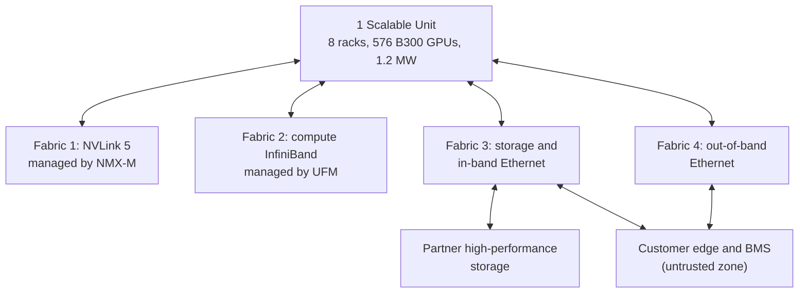
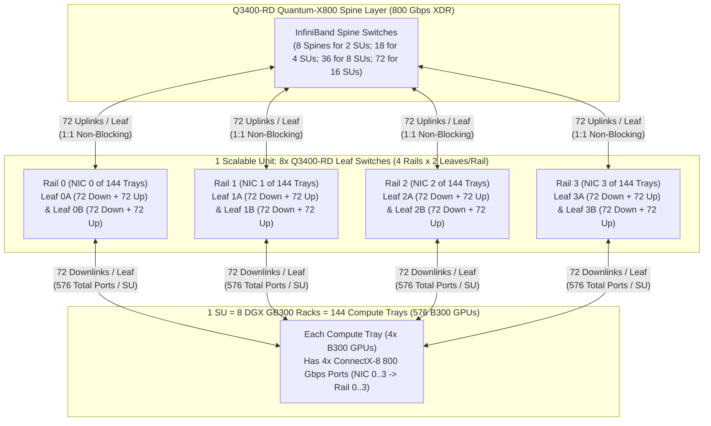
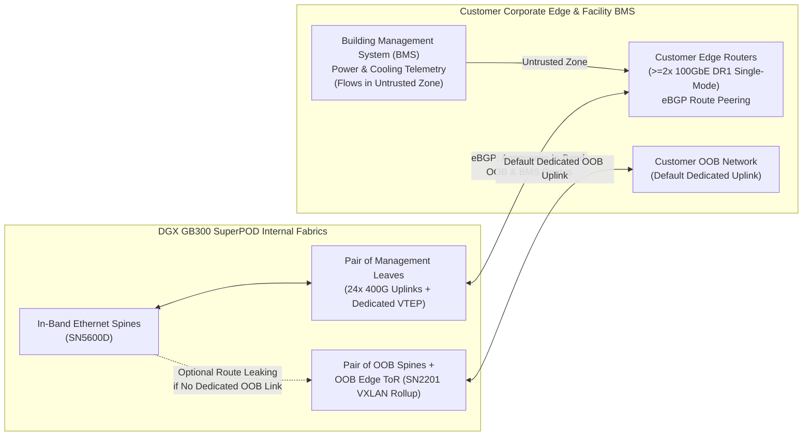

# 9.8 GB300 SuperPOD reference architecture

| | |
|---|---|
| **Status** | Drafted (`gb300_superpod_ra_lab.py`: 28 checks pass; reference architecture rules verified in Python) |
| **Level** | Advanced |
| **Priority tier** | 1b |
| **Lab venue** | none (design / reading) + self-checking Python model (`code/part09/gb300_superpod_ra_lab.py`) |
| **Part** | Part 9: NVIDIA systems and reference architectures |
| **Sources used** | *NVIDIA DGX SuperPOD: Next Generation Scalable Infrastructure for AI Factories Reference Architecture Featuring NVIDIA DGX GB300 Systems* (`superpod-gb300-ra`, pp. 1–36) |

## Why this matters for AI infrastructure

A multi-megawatt data hall is finished and the liquid-cooled racks are in, but the cluster cannot run. The leaf switches have too few uplinks for the traffic, and the building telemetry cannot reach the cluster manager. This is what happens when a liquid-cooled cluster is designed from scratch, one decision at a time.

The NVIDIA DGX GB300 SuperPOD Reference Architecture gives a fixed blueprint instead. It uses Grace CPUs and Blackwell Ultra B300 GPUs in hybrid liquid-cooled DGX GB300 NVL72 racks, with Quantum-X800 InfiniBand, Spectrum-4 Ethernet and NVIDIA Mission Control. Earlier SuperPOD generations connected air-cooled nodes over NDR InfiniBand. The GB300 design grows from one Scalable Unit to sixteen in a two-layer fabric.

Every switch count and port ratio follows from arithmetic that this chapter works through. The table summarizes the main numbers.

| Architectural dimension | 1 Scalable Unit baseline | Full 2-layer Reference Architecture scale | Key hardware and software mechanism |
|---|---|---|---|
| **Compute scale and power** | 8 racks, 144 compute trays, 576 B300 GPUs (288 GB HBM3e), 1.2 MW TDP | 16 Scalable Units, 128 racks, 9,216 B300 GPUs, 19.2 MW TDP | Hybrid liquid plus air cooling with BMS telemetry feeding Mission Control |
| **Compute InfiniBand fabric** | 8 Q3400-RD (144-port 800G) leaves arranged as 4 rails x 2 leaves per rail | 128 Q3400-RD leaves and 72 Q3400-RD spines across 2 layers | 72 compute downlinks + 72 spine uplinks = 144 ports per leaf (1:1 non-blocking) |
| **Storage and In-Band Ethernet** | 4 SN5600D compute leaves per SU at a 1:3 blocking ratio (24 uplinks : 72 downlinks) | Up to 64 compute leaves, 8 storage leaves (72 non-blocking 400G links), 24 spines | Dedicated unbonded BlueField-3 ports for 400G RoCEv2 storage vs In-Band management |
| **Out-of-Band and Customer Edge** | SN2201 1GbE copper switches rolled up via VXLAN to 2 OOB aggregation spines | At least 2x 100GbE DR1 single-mode uplinks with eBGP over a dedicated VTEP | BMS isolated in the untrusted zone; Run:ai splits control plane vs cluster operands |

## Prerequisites and outcomes

**Prerequisites:**
- Prior chapters in Part 9 covering Grace Blackwell Ultra GB300 Superchips, DGX GB300 NVL72 rack internals, and SuperPOD Scalable Unit concepts.

**Outcomes:** After completing this chapter, you will be able to:
1. Specify the single-SU hardware and software bill of materials across compute racks, compute trays, B300 GPUs, and thermal design power.
2. Prove the exact port arithmetic of the Compute InfiniBand Fabric using Q3400-RD Quantum-X800 switches across four rails up to full two-layer scale.
3. Prove the exact port arithmetic of the Storage and In-Band Ethernet Fabric contrasting Spectrum-4 SN5600D compute leaves against non-blocking storage leaves and unbonded BlueField-3 ports.
4. Design Out-of-Band SN2201 VXLAN rollups, customer edge eBGP VTEP handovers, untrusted BMS security zones, and the Mission Control plus Run:ai split Kubernetes placement.

---

## 1. The Scalable Unit: 8 racks, 576 GPUs, 1.2 MW

A custom-built row of racks fails its burn-in test under a synchronous collective workload. The cause is a cabling error, and fixing it adds weeks to commissioning. A pre-engineered unit avoids this, because the same unit has already been built and tested.

The GB300 reference architecture targets AI reasoning and frontier training. Long-chain-of-thought inference and models with trillions of parameters need high NVLink bandwidth inside a rack, fast InfiniBand between racks, and integration with the data center's building systems. One GB300 Scalable Unit is a pre-tested block of that design. The reference architecture describes the whole SuperPOD as a physical twin of NVIDIA's own research system, and says that building from Scalable Units cuts deployment from months to weeks. You place the block instead of engineering the hall server by server.



| Part of the diagram | Detail |
|---|---|
| 1 Scalable Unit | 8 DGX GB300 NVL72 racks: 144 compute trays (288 Grace CPUs and 576 B300 GPUs), 72 NVLink switch trays (144 NVSwitch ASICs), 64 power shelves of 33 kW (8 per rack), hybrid cooling (direct liquid plus air) |
| Fabric 1: NVLink 5 | 1.8 TB/s per GPU, 130 TB/s per rack, managed by NMX-M |
| Fabric 2: compute InfiniBand | 8 Q3400-RD Quantum-X800 (800G) leaf switches (4 rails x 2), managed by UFM |
| Fabric 3: storage and in-band Ethernet | 4 SN5600D compute leaves plus storage and management leaves |
| Fabric 4: out-of-band Ethernet | SN2201 (48 x 1GbE) plus OOB aggregation spines (VXLAN) |
| Partner storage | RoCEv2, 90 to 280 GB/s read per SU |
| Customer edge | at least 2 x 100GbE DR1, eBGP VTEP, plus the building management system in the untrusted zone |

### 1.1 Facility, ownership, and support model

A cooling loop faults, or a switch firmware version does not match, and the whole cluster stalls. The facility team blames IT, and IT blames the vendor. Fix the power, cooling and support boundaries before construction begins.

Each Scalable Unit has eight DGX GB300 NVL72 racks and a thermal design power of 1.2 MW. A fully tested system is pre-tested at one unit and two units. The architecture scales to sixteen units in two switching layers, and you should contact NVIDIA when you plan four units or more.

Each rack is cooled by a hybrid design. Liquid cooling handles the CPUs, GPUs and NVSwitches, and air cools the lower-power parts. The building management system sends telemetry into Mission Control. The hosting facility should meet Uptime Institute Tier 3, TIA-942-B Rated 3 or EN 50600 Class 3. NVIDIA Enterprise Support covers the whole system. The table gives the counts for each size.

| Deployment milestone | Racks | Compute trays | Grace CPUs | B300 GPUs | Thermal Design Power (TDP) | Engineering guidance |
|---|---:|---:|---:|---:|---:|---|
| **1 SU** | 8 | 144 | 288 | 576 | 1.2 MW | Pre-tested baseline |
| **2 SU** | 16 | 288 | 576 | 1,152 | 2.4 MW | Pre-tested |
| **4 SU** | 32 | 576 | 1,152 | 2,304 | 4.8 MW | Contact NVIDIA |
| **16 SU** | 128 | 2,304 | 4,608 | 9,216 | 19.2 MW | Maximum two-layer scale |

---

## 2. Complete hardware and software bill of materials

A procurement team buys NICs, switches and a scheduler from different vendors. The NIC firmware and the switch operating system do not quite agree, and performance drops with no error to point at. A validated bill of materials prevents this, because every rack, switch, storage array and orchestrator in it was tested together. The two tables list the hardware and software of one Scalable Unit.

### 2.1 Hardware components of 1 Scalable Unit

| Component | Technology | Specification |
|---|---|---|
| **8x Compute Racks** | **NVIDIA DGX GB300 NVL72** | 18 compute trays, 9 NVLink switch trays and 8 power shelves per rack. Details follow the table. |
| **NVLink Fabric** | **NVIDIA NVLink 5** | 18 NVSwitch chips per rack, 18 links per GPU, 1.8 TB/s per GPU, 130 TB/s per rack, over rear blind-mate copper. |
| **NVLink Management** | **NVIDIA Network Manager eXperience (`NMX-M`)** | Manages the NVLink switch trays and reports telemetry. |
| **Compute Fabric** | **NVIDIA Q3400-RD Quantum-X800 InfiniBand Switch** | 144-port 800 Gbps switch, rail-optimized non-blocking fat-tree, 4 connections per compute tray, 8 leaf switches per unit. Adaptive Routing, SHARPv3, SHIELD. |
| **InfiniBand Management** | **NVIDIA Unified Fabric Manager (`UFM`) Appliance, Enterprise Edition** | Telemetry and analytics for the InfiniBand fabric. |
| **Storage & In-Band Management Fabric** | **NVIDIA Spectrum-4 SN5600 / SN5600D Ethernet Switch** | 64 ports at 800 Gbps (128 at 400 Gbps); 4 compute leaves per unit plus storage and management leaves. |
| **Out-of-Band (OOB) Management Network** | **NVIDIA SN2201 Ethernet Switch** | 48 ports at 1 Gbps copper, plus OOB aggregation spines. |
| **Partner Storage** | **DGX Storage Program Certified Array** | High-Performance Storage over 400G RoCEv2, and User Storage over NFS at 100 GbE or more. |

Each compute tray holds two GB300 Superchips, which is two Grace CPUs and four B300 GPUs. NVLink-C2C at 900 GB/s joins the two Superchips so that they run as one logical unit under one operating system instance. At the front of the tray are four ConnectX-8 800G NICs and one BlueField-3 with two 400G ports. Local storage is four 3.84 TB E1.S drives in RAID 0, which is 15.36 TB per tray and 2,211.84 TB per unit, plus one 1.92 TB M.2 drive for the operating system. Each NVLink switch tray has two COMe RJ45 ports and one BMC RJ45 port. Each power shelf has six 5.5 kW supplies, so eight shelves give 264 kW of installed capacity per rack. The shelves have larger energy storage than earlier generations, a front BMC port and rear RJ45 ports for power brakes.

### 2.2 Software components of a DGX GB300 SuperPOD

| Software | Role |
|---|---|
| **NVIDIA Mission Control** | Five-layer operations platform built on Base Command Manager, with Run:ai, NMX-M, automatic recovery, predictive maintenance and building telemetry. |
| **NVIDIA AI Enterprise (`NVAIE`)** | Software platform for building and deploying production LLMs and generative AI. |
| **NVIDIA Magnum IO** | I/O and collective acceleration libraries: NCCL, GPUDirect RDMA, GPUDirect Storage, NVSHMEM. |
| **NVIDIA NGC** | Catalog of GPU-optimized containers for AI and HPC. |
| **Slurm** | Batch scheduler for multi-node training and HPC jobs. |
| **NVIDIA Run:ai** | Kubernetes GPU orchestration across training, fine-tuning and inference; see Section 6. |

---

## 3. The compute InfiniBand fabric and its port arithmetic

A fabric of 64-port switches needs a third tier once it grows past two thousand GPUs. The extra tier adds cable cost, power and a hop of latency to every all-reduce, and jobs run longer. The Q3400-RD Quantum-X800 switch has 144 ports, and a layout of four rails with two leaves each uses that port count well. Together they let the GB300 SuperPOD reach sixteen units in two layers, with no core tier.

### 3.1 Why each leaf has 72 downlinks and 72 uplinks

The function `verify_gb300_su_ib_leaf_port_math()` in `code/part09/gb300_superpod_ra.py` checks the port arithmetic for one unit. The reference architecture gives the switch port count, the tray count and the rail layout. The split of 72 down and 72 up per leaf is this chapter's own derivation from those facts.



One unit has eight racks of eighteen trays, and each tray has four ConnectX-8 NICs, one per rail. That gives 576 NIC ports, or 144 per rail.

A single Q3400-RD has 144 ports. To stay 1:1 non-blocking, a leaf can use half of its ports for the trays and must keep the other half for uplinks to the spines. So each rail is split over two leaves, which gives eight leaves per unit. Each leaf has 72 downlinks to trays and 72 uplinks to spines.

The reference architecture describes traffic on one rail inside a unit as one hop. It says traffic between racks or between rails crosses the spine layer.

```text
1 SU compute trays     = 8 racks * 18 trays/rack              = 144 compute trays
1 SU compute NIC ports = 144 trays * 4 ConnectX-8 NICs/tray   = 576 ports (144 ports/rail across 4 rails)
1 SU IB leaf switches  = 4 rails * 2 leaves/rail              = 8 Q3400-RD leaf switches
Per-leaf port balance  = 72 compute downlinks + 72 spine uplinks = 144 ports at 800 Gbps (1:1 non-blocking)
Intra-rack NVLink BW   = 1.8 TB/s per GPU (130 TB/s per NVL72 rack)
```

### 3.2 Two-layer InfiniBand switch scaling up to 16 SUs and 9,216 GPUs

| # of GPUs | # of SUs | Compute Racks | IB Leaf Switches per SU | Total IB Leaf Switches (`Q3400-RD`) | Total IB Spine Switches (`Q3400-RD`) |
|---:|---:|---:|---:|---:|---:|
| **576** | **1** | 8 | 8 | **8** | **4** *(chapter's own value; the reference architecture table starts at 2 units)* |
| **1,152** | **2** | 16 | 8 | **16** | **8** |
| **2,304** | **4** | 32 | 8 | **32** | **18** |
| **4,608** | **8** | 64 | 8 | **64** | **36** |
| **9,216** | **16** | 128 | 8 | **128** | **72** |

---

## 4. Ethernet, Out-of-Band, and Customer Edge architecture

A multi-rack checkpoint write saturates oversubscribed uplinks, and training stalls. At another site, a building controller can reach the server BMCs directly. Both come from an Ethernet network that mixes storage and management traffic without enough sizing or separation. Three measures fix them: separate host ports, storage leaves sized to be non-blocking, and strict border routing.

The SuperPOD carries the storage network and the in-band management network on a two-layer Spectrum-4 SN5600D fabric, and the out-of-band network on dedicated SN2201 switches. This keeps cost down and still gives fast RoCEv2 storage access.

### 4.1 Compute leaves at 1:3 and storage leaves that never block

Inside each unit, four SN5600D compute leaves connect to the dual-port BlueField-3 BF3240 cards in the trays. The check `verify_gb300_su_ethernet_leaf_blocking()` in `code/part09/gb300_superpod_ra.py` divides the tray ports over four leaves and compares them with 24 spine uplinks per leaf. That division is the chapter's own explanation of the blocking ratio that the reference architecture states.

Four compute leaves serve each unit at a 1:3 blocking ratio. Each tray's BF3240 has two ports, so each compute leaf has 72 downlinks, and it reaches the Ethernet spines over 24 uplinks. That is 24 to 72, or 1:3.

Storage leaves start at two per system and run non-blocking. Many trays read and write shared storage at the same time, so each storage leaf connects to the spine over 72 links and never limits the arrays. A pair of management leaves connects the persistent NFS home storage and the management nodes to the spine over 24 uplinks each.

Each tray's BF3240 gives one 400 Gbps port to RoCEv2 storage and a second port of at least 200 Gbps to in-band management. Because the two are not bonded, storage performance stays predictable and host routing stays simple. NVIDIA plans to enable Host-Based Networking on the BlueField-3 later, to add failover without bonding.

```text
SN5600D Ethernet Leaf Port Math (per Scalable Unit):
- Compute leaf downlinks : 144 trays * 2 BF3240 ports / 4 compute leaves = 72 downlinks/leaf @ 400 Gbps
- Compute leaf uplinks   : 24 spine uplinks/leaf @ 400 Gbps              -> 24 : 72 = 1:3 blocking ratio
- Storage leaf uplinks   : 72 spine uplinks/leaf @ 400 Gbps              -> 72 : 72 = 1:1 non-blocking
- Mgmt leaf uplinks      : 24 spine uplinks/leaf @ 400 Gbps (2 management leaves)
- BF3240 port split      : Port 1 = 400 Gbps RoCEv2 Storage; Port 2 = >= 200 Gbps In-Band Management (unbonded)
```

### 4.2 Ethernet and OOB switch scaling across 2 to 16 SUs

| # of GPUs | # of SUs | Ethernet Spines (`SN5600D`) | Ethernet Compute Leaves (`4/SU`) | Ethernet Storage Leaves | Max Supported Storage Bandwidth | Management Leaves + OOB Spines |
|---:|---:|---:|---:|---:|---|---|
| **1,152** | **2** | **4** | **8** | **2** | **`64 × 400GbE`** (`25.6 Tbps`) | **`2 + 2`** |
| **2,304** | **4** | **8** | **16** | **2** | **`128 × 400GbE`** (`51.2 Tbps`) | **`2 + 2`** |
| **4,608** | **8** | **12** | **32** | **4** | **`256 × 400GbE`** (`102.4 Tbps`) | **`2 + 2`** |
| **9,216** | **16** | **24** | **64** | **8** | **`1,024 × 400GbE`** (`409.6 Tbps`) | **`2 + 2`** |

### 4.3 Out-of-Band VXLAN and Customer Edge connectivity

An AI factory has to connect to the corporate network and to the building management system. With no dedicated border peering, dataset ingestion bottlenecks at the edge. With no isolation of the untrusted zone, facility controllers can reach the servers' management interfaces. Routing and security boundaries prevent both.



The OOB network connects the compute-tray BMCs, BlueField BMCs, NVSwitch COMe and BMC ports, storage and network gear and rack PDUs, on 48-port 1 GbE copper SN2201 switches. Each unit's OOB switches roll up as a dedicated VXLAN to a pair of OOB aggregation spines. This gives a physically independent plane for IPMI, Redfish and fabric management.

The customer edge needs at least two 100 GbE links with DR1 single-mode optics for dataset ingestion and corporate access. It uses a dedicated VTEP and hands over routes by external BGP. The session announces routes for in-band, out-of-band and the building management system. The building system gives power and cooling telemetry to Mission Control, and its traffic must flow through the edge uplinks as part of the untrusted zone.

There are two ways to uplink the OOB network. By default the last pair of SN2201 switches acts as the OOB edge top-of-rack pair, with a dedicated uplink to the customer's OOB network. If the customer does not provide a dedicated link, the OOB switches connect to the SN5600D in-band spine, and routes to the OOB interfaces are leaked toward the customer edge over the eBGP uplink.

Plan the border routing, and decide which OOB uplink option you will use, before the racks arrive.

---

## 5. Storage architecture and performance tiers

A training run saves a checkpoint, and hundreds of GPUs sit idle until the write finishes. Undersized shared storage turns every checkpoint and dataset load into a cluster-wide stall. Keep training storage apart from user home directories, and match array bandwidth to the workload.

The GB300 SuperPOD pairs its racks with two storage systems: certified High-Performance Storage over RoCEv2 and User Storage over NFS. High-Performance Storage must be certified for Grace aarch64 systems and for GPUDirect Storage. It uses local RAM and NVMe for caching and allows upgrades without downtime. User Storage uses at least 100 GbE DR1 links and serves home directories, logs and the high-availability state of Mission Control.

| Storage Performance Tier | Workload profile | 1 SU Read / Write Bandwidth | 4 SU Read / Write Bandwidth |
|---|---|---|---|
| **Standard Tier** | Compute-dominated text LLM training and reasoning | `90 GB/s` read / `45 GB/s` write | `360 GB/s` read / `180 GB/s` write |
| **Enhanced Tier** | I/O-intensive multimodal training and frequent checkpointing | `280 GB/s` read / `140 GB/s` write | `1,120 GB/s` read / `560 GB/s` write |

Choose the tier by whether the factory is compute-bound or I/O-bound, and size the arrays to match.

---

## 6. Mission Control and Run:ai

One tray degrades, or one rank gets stuck, and a multi-node training job halts for hours until the on-call engineer notices. Hardware telemetry, fabric alerts and the scheduler each live in their own tool, and the engineer connects them by hand. Mission Control automates that, and it also places the orchestration services on the right Kubernetes clusters.

Mission Control runs the GB300 SuperPOD software stack and does four things. It detects failures and recovers from them, by running health checks, isolating degraded trays and restarting work. It moves interrupted workloads to healthy trays so GPUs do not sit idle. It correlates hardware, fabric and facility telemetry with application logs. It also restarts failed ranks from the most recent valid checkpoint held in memory, so no work is redone. The reference architecture does not name the individual health-check tools.

### 6.1 The NVIDIA Run:ai two-cluster split on BCM-managed SuperPODs

Putting every Kubernetes management component on one cluster mixes user-facing portals with low-level hardware operators, and it makes upgrades and multi-cluster governance harder. Run:ai therefore splits into a control plane and the cluster components.

On a BCM-managed GB300 SuperPOD, the Run:ai control plane lives on the user-space Kubernetes cluster. That placement supports central management of several clusters, tenant quotas and the user interface and API. The Run:ai cluster components run on the administrative Kubernetes infrastructure, close to the DGX GB300 hardware.

---

## Commands and configurations that matter

A port mismatch slips into a build plan because switch counts for several units were worked out in a spreadsheet. A script run before you order hardware catches it. The verifier checks the Q3400-RD leaf port balance, the SN5600D blocking ratio, the multi-unit switch tables and the rules for edge routing, the building system, the OOB network and Run:ai placement.

```bash
# Execute the 28-check GB300 SuperPOD Reference Architecture verification lab
python3 -B code/part09/gb300_superpod_ra_lab.py
```

---

## How it fails

A standard design can still fail in the field when optics, security zones, or switch ports are wired to the wrong tier. The table lists five failures with their symptoms, causes, and fixes.

### 1. Customer edge uplink saturation or optics mismatch

Symptom: Dataset ingestion into High-Performance Storage bottlenecks at `< 20 Gbps`, or customer border routers fail to bring up optical links to the SuperPOD management leaves.

Cause: The customer provisioned a single 10G/25G uplink or ordered multimode `SR4` transceivers instead of the recommended ≥ 2x 100 GbE links with `DR1` single-mode optics.

Fix: Provision at least `2x 100 GbE` links with `DR1` single-mode transceivers terminated on the dedicated uplink VTEP and peer via eBGP.

### 2. Building Management System (`BMS`) placed on the trusted compute/OOB VLAN

Symptom: Security audit flags an unauthenticated facility BACnet/Modbus BMS controller with direct Layer-2 reachability to compute-tray BMCs or storage nodes.

Cause: The integration team bridged the facility BMS directly into the internal OOB or storage VLAN instead of routing it through the customer edge untrusted zone.

Fix: Follow the GB300 Reference Architecture security boundary: BMS telemetry must flow through the customer edge uplink interfaces as part of the untrusted zone with explicit eBGP route filtering and firewall policies into Mission Control.

### 3. Unreachable OOB BMCs from customer SOC when dedicated OOB uplink is omitted

Symptom: Customer NOC/SOC engineers cannot reach the `SN2201` OOB switch subnet (`IPMI` / `Redfish` / `NMX-M`) because the facility did not run physical cables to the OOB edge ToR switches.

Cause: The customer skipped the default dedicated OOB edge ToR uplink (`SN2201`) *and* forgot to enable OOB route leaking on the `SN5600D` In-Band spines.

Fix: Either cable the last pair of `SN2201` switches as dedicated OOB edge ToR uplinks (default), or connect the OOB spines to the `SN5600D` In-Band spine network and leak OOB routes across the eBGP border VTEP.

### 4. Storage throughput stalls from wiring storage arrays into 1:3 compute leaves

Symptom: High-Performance Storage read throughput plateaus at one-third of rated array bandwidth during multi-rack checkpoint loads.

Cause: Storage array 400G RoCEv2 ports were plugged into the 4 `SN5600D` compute leaves (which have only `24 × 400G` spine uplinks for `72 × 400G` downlinks = `1:3` blocking ratio) instead of the dedicated storage leaf switches.

Fix: Connect all High-Performance Storage array ports to the dedicated `SN5600D` storage leaf switches, which are wired with `72 non-blocking 400 Gbps` spine links (`1:1` non-blocking).

### 5. Misplacing the Run:ai backend control plane vs cluster operands

Symptom: Run:ai multi-cluster orchestration or BCM administrative operator reconciliation fails during installation.

Cause: The installer deployed the Run:ai central backend onto the administrative Kubernetes cluster instead of separating the two layers.

Fix: On BCM-managed GB300 SuperPODs, deploy the Run:ai control plane (backend) on the user-space Kubernetes cluster and deploy the Run:ai cluster components on the administrative Kubernetes infrastructure.

---

## Hands-on lab

This chapter's self-checking Python model in `code/part09/gb300_superpod_ra.py` and lab script in `code/part09/gb300_superpod_ra_lab.py` implement four verification suites:
1. The Quantum-X800 InfiniBand SU Port Verifier proving 72 compute downlinks plus 72 spine uplinks per leaf switch for 1:1 non-blocking operation.
2. The Spectrum-4 SN5600D Ethernet Leaf Blocking Verifier proving the 1:3 blocking ratio on compute leaves alongside non-blocking storage leaves and management leaves.
3. The Multi-Fabric Switch and Storage Table Verifier checking every row of the scaling tables plus rack power shelf capacity and aggregate E1.S and M.2 storage per SU.
4. The Customer Edge, OOB Handover, BMS Security Zone, and Run:ai Placement Auditor checking border optics, eBGP VTEP routing, untrusted BMS placement, OOB handover options, and Run:ai Kubernetes cluster placement.

Run the lab from the repository root.

```bash
python3 -B code/part09/gb300_superpod_ra_lab.py
```

Expected output verified in this repository is shown below.

```text
=== Chapter 9.8 Lab: GB300 SuperPOD Reference Architecture ===
  [PASS] 1 GB300 SU has 8 racks * 18 trays = 144 compute trays and 576 B300 GPUs
  [PASS] 144 trays * 4 ConnectX-8 NICs == 576 compute ports across 8 leaves (4 rails * 2 leaves/rail)
  [PASS] Each 144-port Q3400-RD leaf has 72 compute downlinks + 72 spine uplinks (1:1 non-blocking)
  [PASS] Rejects non-positive racks_per_su in IB port verifier
  [PASS] 144 trays * 2 BlueField-3 ports == 288 ports across 4 SN5600D compute leaves (72 downlinks/leaf)
  [PASS] SPGB300 p.22: 24 uplinks vs 72 downlinks at 400G per compute leaf == 1:3 blocking ratio
  ...
  [PASS] 2-SU fully tested GB300 system (p.14) has 16 racks, 1,152 GPUs, and 2.4 MW TDP
  [PASS] SPGB300 p.11: 8 power shelves/rack * 6 PSUs * 5.5 kW == 264.0 kW total shelf capacity per rack
  [PASS] SPGB300 p.9: 1 SU (8 racks = 144 compute trays) provides 144 * 4 * 3.84 TB == 2,211.84 TB E1.S RAID 0 scratch
  [PASS] SPGB300 p.9: 1 SU (144 compute trays) provides 144 * 1.92 TB == 276.48 TB M.2 OS storage
  [PASS] SPGB300 p.19: 1 SU (8 racks) contains 8 * 9 == 72 NVLink switch trays (144 NVSwitch ASICs)

Summary: 28 passed, 0 failed (total 28)
```

---

## Exercises

1. Run the lab script and find the check for the Ethernet compute leaf. In your own words, where do its downlinks and uplinks come from? What does the blocking ratio mean?
2. Take four SUs and the per-SU numbers in Section 1. How many compute racks and GPUs is that? How many NVLink switch trays and power shelves? How many compute NIC ports?
3. A storage vendor plugs its RoCEv2 array into the compute leaves because they have free ports. What goes wrong? Which switches should it use instead?
4. You are designing the customer edge for a new SuperPOD. How many uplinks do you need, with which optics, and with which routing protocol? Where does the facility BMS traffic go? Then describe the two ways to reach the OOB network.
5. Draw where the Run:ai control plane and the Run:ai cluster components run in a BCM-managed SuperPOD. Name the two Kubernetes clusters.
6. Read the IB leaf, IB spine, and Ethernet spine counts from the scaling tables for each multi-SU milestone. Which count does not grow in a straight line?

## Checkpoint questions (20)

<details>
<summary>**1. How many racks, compute trays, Grace CPUs, B300 GPUs, and NVLink switch trays make up one DGX GB300 Scalable Unit (SU), and what is its Thermal Design Power (TDP)?**</summary>

One DGX GB300 Scalable Unit consists of eight DGX GB300 NVL72 racks and requires a Thermal Design Power of 1.2 Megawatts per SU.

```text
1 GB300 Scalable Unit (SU) Inventory:
- Compute racks       : 8 DGX GB300 NVL72 racks
- Compute trays       : 144 compute trays (8 * 18)
- Grace CPUs & GPUs   : 288 Grace CPUs (144 * 2) and 576 B300 GPUs (144 * 4)
- NVLink switch trays : 72 NVLink switch trays (8 * 9, containing 144 NVSwitch ASICs)
- DGX Power Shelves   : 64 power shelves (8 * 8, rated at 33 kW each)
- Thermal Design Power: 1.2 MW TDP per SU
```
</details>

<details>
<summary>**2. Prove why each Q3400-RD Quantum-X800 InfiniBand leaf switch in a GB300 SU has 72 compute downlinks and 72 spine uplinks.**</summary>

Across one SU of compute trays, each tray has four ConnectX-8 NICs across four rails. Each of the four rails is split across two leaf switches per rail for eight leaf switches per SU. Consequently, each Q3400-RD leaf switch terminates 72 compute downlinks and uses its remaining 72 ports as spine uplinks for 1:1 non-blocking operation.
</details>

<details>
<summary>**3. Contrast the uplink port count and blocking ratio of the SN5600D Ethernet Compute Leaves, Storage Leaves, and Management Leaves in a GB300 SuperPOD.**</summary>

- **Ethernet Compute Leaves.** Four switches per SU terminate 72 host ports and connect to the Ethernet spines via 24 uplinks, operating at a 1:3 blocking ratio.
- **Ethernet Storage Leaves.** Storage leaves connect to the spines via 72 non-blocking links for a 1:1 non-blocking ratio.
- **Ethernet Management Leaves.** Two switches connect to the spines via 24 links for node provisioning and persistent NFS home storage.
</details>

<details>
<summary>**4. Why does the DGX GB300 SuperPOD use two unbonded ports on the BlueField-3 BF3240 DPU instead of bonding them together, and what feature does NVIDIA plan to enable for future DPU high availability?**</summary>

Dedicating Port 1 at 400 Gbps exclusively to lossless RoCEv2 Storage and Port 2 at 200 Gbps or higher to In-Band Management keeps RoCEv2 storage traffic isolated from In-Band TCP bursts. It also avoids complex, error-prone per-host routing rules. To add high-availability failover across the ports in future releases, NVIDIA plans to enable Host-Based Networking on the BlueField-3 DPUs.
</details>

<details>
<summary>**5. What are the optical media, link count, VTEP and routing protocol, and BMS security zone requirements for Customer Edge Connectivity in a DGX GB300 SuperPOD?**</summary>

- **Links and optics.** Provision at least two 100 GbE links using DR1 single-mode optics.
- **Routing handover.** Terminate on a dedicated VTEP using eBGP peering to announce routes for In-Band, Out-of-Band, and the Building Management System.
- **BMS security zone.** BMS power and cooling telemetry is required to flow through the customer edge uplink interfaces as part of the untrusted zone.
</details>

<details>
<summary>**6. What are the two supported methods for connecting the SN2201 Out-of-Band management network to the customer's corporate network?**</summary>

1. **Default Dedicated OOB Edge ToR.** The last pair of SN2201 OOB switches serves as the OOB edge ToR switches, providing a dedicated physical uplink to the customer's OOB network.
2. **Alternative In-Band Spine Route Leaking.** If the customer does not provision a dedicated OOB uplink, the OOB spine switches connect to the SN5600D In-Band spine network and leak routes to the OOB interfaces toward the customer edge via eBGP.
</details>

<details>
<summary>**7. How are the two components of NVIDIA Run:ai placed across Kubernetes clusters in a BCM-managed DGX GB300 SuperPOD?**</summary>

- The Run:ai Control Plane backend resides on the user-space Kubernetes cluster for central multi-cluster orchestration.
- The Run:ai Cluster components or operands are deployed directly onto the administrative Kubernetes infrastructure close to the compute resources.
</details>

<details>
<summary>**8. What are the four core operational value pillars delivered by NVIDIA Mission Control on a DGX GB300 SuperPOD?**</summary>

1. Automated Failure Detection and Self-Recovery.
2. Optimized Workload Migration and Resource Allocation.
3. Unified Diagnostics for Infrastructure and Applications.
4. In-Memory Checkpointing for Seamless Job Recovery.
</details>

<details>
<summary>**9. Why does one GB300 SU have 576 compute NIC ports?**</summary>

One SU contains 144 compute trays, and each tray has four ConnectX-8 NICs, which gives 576 ports in total. That places 144 ports on each of the four rails.
</details>

<details>
<summary>**10. Why are there two leaf switches per rail?**</summary>

One Q3400-RD switch has 144 ports. To stay 1:1 non-blocking, it uses 72 ports down to compute trays and 72 ports up to the spine. A single rail needs 144 downlinks, so each rail requires two leaf switches.
</details>

<details>
<summary>**11. What does 1:3 blocking on the Ethernet compute leaves mean?**</summary>

Each compute leaf has 72 ports toward hosts and only 24 uplinks toward the spine. The uplinks are one third of the downlinks, so simultaneous line-rate traffic across all host ports is oversubscribed three to one.
</details>

<details>
<summary>**12. Why are storage arrays attached to dedicated storage leaves?**</summary>

Storage leaves are non-blocking with 72 links to the spine. Compute leaves are oversubscribed at a 1:3 ratio, so storage arrays attached to compute leaves would bottleneck at roughly one third of their rated bandwidth.
</details>

<details>
<summary>**13. What are the two ports on the BlueField-3 used for?**</summary>

Port 1 operates at 400G and carries RoCEv2 storage traffic. Port 2 operates at 200G or higher and carries in-band management and NFS user storage. The two ports are not bonded together.
</details>

<details>
<summary>**14. What future feature is planned for BlueField-3 high availability?**</summary>

NVIDIA plans to enable Host-Based Networking on the BlueField-3 DPUs, which adds multi-path failover across the two ports.
</details>

<details>
<summary>**15. What does the customer edge need?**</summary>

It requires at least two 100 GbE links with DR1 single-mode optics, a dedicated VTEP, and eBGP peering that announces in-band, OOB, and BMS routes.
</details>

<details>
<summary>**16. Why does the facility BMS traffic go through the customer-edge untrusted zone?**</summary>

The reference architecture requires BMS telemetry to flow through the edge uplink interfaces as part of the untrusted zone. Bridging it directly into the internal OOB or storage network would give an unauthenticated facility controller direct reach to BMCs and storage.
</details>

<details>
<summary>**17. What are the two options for OOB reach to the customer?**</summary>

The default option uses a dedicated OOB edge ToR pair of SN2201 switches. The alternative option omits the dedicated link and leaks OOB routes from the OOB switches through the SN5600D in-band spines over eBGP.
</details>

<details>
<summary>**18. What does Mission Control do when a tray fails?**</summary>

It detects the failure with continuous health checks, isolates the degraded tray, moves the interrupted workload to healthy trays, and restarts failed ranks from the latest in-memory or local-NVMe checkpoint.
</details>

<details>
<summary>**19. Which scale did NVIDIA test fully, and when should you contact NVIDIA?**</summary>

Deployments of one SU and two SUs are fully pre-tested turnkey systems. The reference architecture scales up to sixteen SUs, and you should contact an NVIDIA representative for deployments of four SUs or more.
</details>

<details>
<summary>**20. Which companion documents does the chapter say are missing from the corpus?**</summary>

The *DGX GB300 Data Center Design Guide*, the *Detailed Software Architecture for NVIDIA Mission Control*, and *Relevant Security Information* are separate documents not in the local corpus.
</details>

---

## Sources and review notes

### Sources read in full for this chapter

| Source & Pages | Sections and technical topics extracted |
|---|---|
| *NVIDIA DGX SuperPOD: Next Generation Scalable Infrastructure for AI Factories Reference Architecture Featuring NVIDIA DGX GB300 Systems* (`superpod-gb300-ra`, pp. 1–12, read 100% in full) | Abstract and key technologies (pp. 1–3); 8-rack / 576-GPU / 1.2 MW SU, Tier 3 / Rated 3 / Class 3 baseline, hybrid cooling, OT integration, and 16-SU / 128-rack / 9,216-GPU scale-out (pp. 5–6); DGX GB300 NVL72 rack, compute tray, switch tray, and 8x 33 kW power shelves (pp. 7–11); Quantum-X800 800G IB (`AR`, `SHARP`, `SHIELD`) and Mission Control overview (p. 12). |
| *NVIDIA DGX SuperPOD Reference Architecture Featuring NVIDIA DGX GB300 Systems* (`superpod-gb300-ra`, pp. 13–36, read 100% in full) | `Table 1` hardware and `Table 2` software components (pp. 13–14); system/fabric/storage design requirements and `NVEX` support (pp. 14–17); 5 network segments over 4 physical fabrics and `MN-NVL` (pp. 18–19); Compute Fabric 4-rail x 2-leaf `Q3400-RD` 144-port topology and `Table 3` scaling (pp. 20–21); Ethernet `SN5600D` fabric with `1:3` compute leaves (`24 × 400G`), `72 × 400G` non-blocking storage leaves, `24 × 400G` management leaves, and `Table 4` scaling (pp. 22–23); unbonded BlueField-3 400G RoCEv2 vs ≥200G In-Band segmentation and future `HBN` roadmap (pp. 24–25); OOB `SN2201` VXLAN rollup + OOB spines (p. 26); Customer Edge Connectivity (`>= 2x 100GbE DR1`, dedicated `VTEP`, `eBGP`, `BMS` untrusted zone, `OOB edge ToR` vs In-Band spine route leaking, pp. 27–28); Storage Architecture `Table 4` & `Table 5` (`Standard` `90/45` & `360/180 GB/s` vs `Enhanced` `280/140` & `1,120/560 GB/s`, pp. 29–31); DGX SuperPOD Software / Mission Control 5 layers + Run:ai split K8s architecture (pp. 32–34). |

### Notes from the 2026-11 rework
- The earlier text said the reference architecture gives no deployment time. It does: it says that building from Scalable Units cuts deployment from months to weeks. The mention of `dcgmi` and `nvsm` as Mission Control health checks was removed because the reference architecture does not name them. The reference architecture describes one-rail traffic as one hop inside a unit and also says that traffic between racks crosses the spine, so the chapter repeats both statements without reconciling them. Switch counts, storage tiers and port ratios were checked against the reference architecture and match, except the 1-unit spine row, which is the chapter's own.

### Not in the corpus
- Companion documents referenced in the summary of `superpod-gb300-ra` are the *DGX GB300 Data Center Design Guide*, *Detailed Software Architecture for NVIDIA Mission Control*, and *Relevant Security Information*, which are not in `~/Desktop/books-toon-rag/`.

### Run here
- `python3 -B code/part09/gb300_superpod_ra_lab.py` passes all 28 checks with 0 failures.

### My own choices and inferences, labelled in the text

| Inference Item | How Derived |
|---|---|
| **Per-leaf port balance on `Q3400-RD` (`72 downlinks + 72 spine uplinks = 144 ports` in `verify_gb300_su_ib_leaf_port_math` in `code/part09/gb300_superpod_ra.py` and Section 3.1)** | Explicitly dividing `144 trays * 4 ConnectX-8 NICs = 576 compute ports per SU` across `8 leaf switches per SU` (`4 rails * 2 leaves/rail`) to show `72 downlinks + 72 spine uplinks = 144 ports` per `Q3400-RD` leaf switch is this chapter's own inference explaining the non-blocking arithmetic behind p. 20 of `superpod-gb300-ra`. |
| **Per-leaf downlink count (`72 downlinks : 24 uplinks = 1:3`) on `SN5600D` Ethernet compute leaves (`verify_gb300_su_ethernet_leaf_blocking` in `code/part09/gb300_superpod_ra.py` and Section 4.1)** | Dividing `144 trays * 2 BlueField-3 ports = 288 ports per SU` across `4 compute leaf switches per SU` (`72 downlinks/leaf`) and comparing against the stated `24 links at 400 Gbps` uplinks (`24 : 72 = 1:3`) is this chapter's own inference proving the `1:3 blocking ratio` stated on p. 22 of `superpod-gb300-ra`. |

### Not verified on live hardware
- Switch configurations on live Q3400-RD, SN5600D, and SN2201 switches (`dedicated_oob_edge_tor` vs `inband_spine_route_leaking`, `DLC` cooling, and `GDS` storage, cross-referenced with Chapters 9.4, 9.5, and 9.6 and the 35-page `superpod-gb300-ra` specification) were not executed in this authoring environment.

