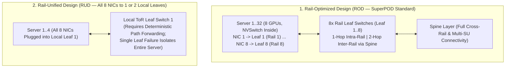
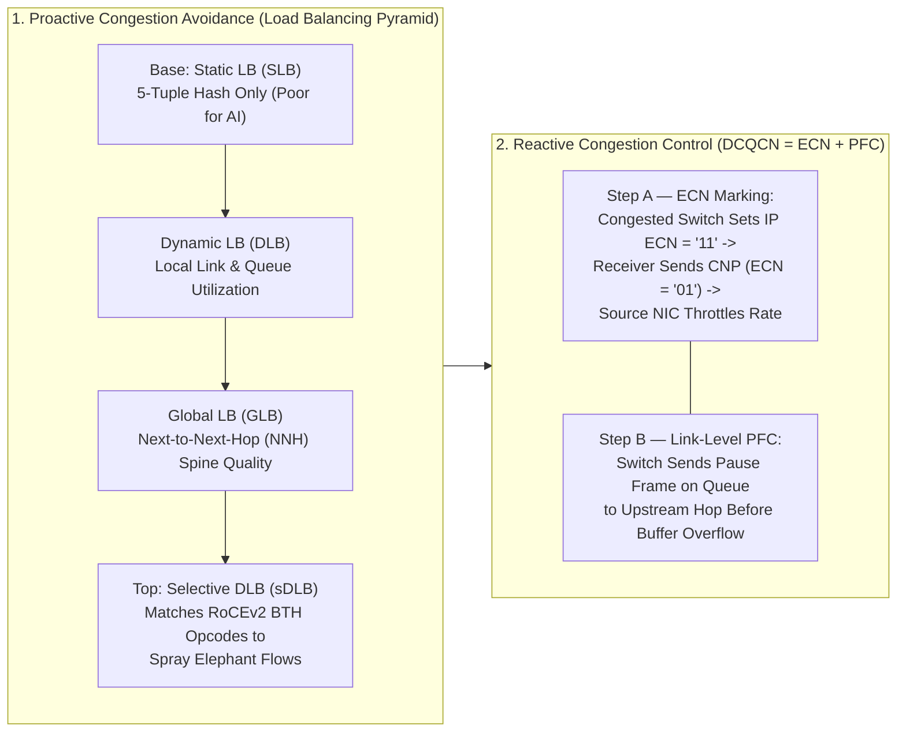

# 9.9 Compute, storage, in-band and out-of-band networks in a SuperPOD

| | |
|---|---|
| **Status** | Drafted (`superpod_networks_lab.py`: 27 checks pass; network fabric rules verified in Python) |
| **Level** | Advanced |
| **Priority tier** | 1b |
| **Lab venue** | none (design / reading) + self-checking Python model (`code/part09/superpod_networks_lab.py`) |
| **Part** | Part 9: NVIDIA systems and reference architectures |
| **Sources used** | *NVIDIA DGX SuperPOD Reference Architecture Featuring NVIDIA DGX GB300 Systems* (`superpod-gb300-ra`, pp. 13–28); *Data Center Best Practices with DGX B200* (`superpod-b200-dc`, pp. 5, 19–23); *AI Data Center Network Design and Technologies* Ch. 2 & Ch. 3 |

## Why this matters for AI infrastructure

In an ordinary data center, a server sends all its traffic through two bonded ports to one oversubscribed Top-of-Rack switch. Web requests, database queries, NFS mounts, Prometheus scrapes and SSH logins share that pipe. Run a thousand-GPU cluster on a network like that, and one checkpoint burst starves the Kubernetes control plane. A container image pull can block packets in the middle of an `ncclAllReduce`.

Picture the on-call engineer who gets paged at night because a training job slowed to a crawl. Nothing in the GPUs is broken. The job shares a pipe with a backup, a log shipper and a dozen logins, and every one of them competes for the same packets. The fix is not faster hardware. The fix is to stop mixing the traffic in the first place.

An NVIDIA DGX SuperPOD keeps these kinds of traffic apart. It carries five network segments over four separate switch fabrics. The first is the multi-node NVLink fabric, which carries GPU memory traffic inside a rack over copper backplanes. The second is the compute InfiniBand fabric, a non-blocking, rail-optimized network used only for collectives between nodes. The third is the storage and in-band Ethernet fabric on Spectrum-4 SN5600D switches, which gives each node two separate BlueField-3 ports, one for RoCEv2 storage and one for in-band management. The fourth is the out-of-band network of isolated copper SN2201 switches for BMCs, switch trays and smart PDUs. A segment is a kind of traffic with its own purpose, and a fabric is the physical switch network that carries it.

## Prerequisites and outcomes

You should have read the earlier Part 9 chapters on the NVL72 rack architecture, the SuperPOD Scalable Units, and the B200 and GB300 reference architectures. Those chapters describe the racks and the nodes. This one describes the networks that connect them.

The chapter starts by mapping the five segments onto the four fabrics. It then covers the compute network, with the wiring patterns, the leaf placement and the Clos scaling math. A Clos fabric is a multi-stage switch network where every leaf connects to every spine. After that it looks at storage traffic and why RoCEv2 needs load balancing and congestion control, then the in-band management network, and finally the out-of-band network. The lab checks the scaling and classification rules, and the failure cases show what goes wrong when a load balancer, a leaf or a cable is set up wrongly.

---

## 1. The map: five segments on four fabrics

A background container download stalls a multi-rack training job. The download shared a link with latency-sensitive collectives, and the collectives lost packets and heartbeats. A heartbeat is the small periodic message that tells the cluster a node is still alive, so losing it can look like a dead node. Give each class of traffic its own switch plane or its own host port, and every subsystem gets a predictable share of bandwidth.

Fabric 1, multi-node NVLink, carries tensors inside the rack at 1.8 TB/s per GPU and never leaves the rack. A tensor is a block of numbers, such as the activations or weights a model passes between GPUs. Fabric 2, compute InfiniBand, is reserved for NCCL collectives between nodes and is managed by UFM Enterprise. NCCL is the NVIDIA library that runs collectives such as all-reduce across GPUs. Fabric 3, storage and in-band Ethernet, is built around Spectrum-4 SN5600D spines. One unbonded BlueField-3 port carries 400G RoCEv2 storage, and the other carries in-band management and NFS. Fabric 4 is the out-of-band 1 GbE copper network on SN2201 switches. IPMI, Redfish and NVOS reach every tray over it even when the main fabrics are down. IPMI and Redfish are management interfaces for hardware, and NVOS is the operating system on the NVIDIA switches.

| Segment | Fabric | Tray interface | Switches | Carries |
|---|---|---|---|---|
| **1. NVLink 5** | **Fabric 1: Multi-Node NVLink (`MN-NVL`)** | Rear blind-mate copper, 18 links per GPU | 9 NVLink switch trays per rack, 18 chips, non-blocking | GPU-to-GPU traffic in the rack; managed by `NMX-M` |
| **2. Compute Network** | **Fabric 2: Compute InfiniBand Fabric** | 8 ConnectX-7 (400G NDR) on H100 and B200; 4 ConnectX-8 (800G XDR) per tray on GB300 | `QM9700` (64 x 400G) or `Q3400-RD` (144 x 800G), 8 leaves per unit, non-blocking | NCCL collectives between nodes; managed by `UFM Enterprise` |
| **3. Storage Network** | **Fabric 3: Storage & In-Band Ethernet Fabric** *(Shared Spine, Dedicated Host Port & Storage Leaves)* | BlueField-3 port 1, 400 GbE, unbonded | `Spectrum-4 SN5600D`: 4 compute leaves per unit at 1:3, 2 to 8 storage leaves at 1:1 | Lossless RoCEv2 (`UDP 4791`) and GPUDirect Storage to certified storage, 90 to 280 GB/s per unit |
| **4. In-Band Management Network** | **Fabric 3: Storage & In-Band Ethernet Fabric** *(Shared Spine, Dedicated Host Port & Mgmt Leaves)* | BlueField-3 port 2, 200 GbE or more | `Spectrum-4 SN5600D`: 4 compute leaves plus 2 management leaves with 24 x 400G uplinks | BCM provisioning, NFS user storage, Slurm and Kubernetes control planes, NGC pulls, and the eBGP customer edge with the building system |
| **5. Out-of-Band (`OOB`) Management Network** | **Fabric 4: Out-of-Band Network** | 1 GbE RJ45 on trays, BlueField-3, switch trays, storage and rPDUs | `SN2201` (48 x 1GbE), rolled up per unit by VXLAN to 2 OOB aggregation spines | IPMI, Redfish, NVOS, switch management, PDU telemetry |

Read the table row by row, and ask two questions for each segment. The first is which physical switch carries it. The second is which host port the traffic leaves from. Segments 3 and 4 share a fabric but not a host port, so the table shows them as two rows with the same fabric name. Segments 1 and 2 each get their own fabric, and segment 5 gets a separate network entirely.

Keep the five segments apart on the wire, and you can size each of them on its own. When a segment grows, you add capacity to that segment, and the others are not touched.

---

## 2. The compute network: rails, leaf placement and Clos scaling

A server has all eight compute NICs plugged into one Top-of-Rack switch, as a web server would be. The switch reboots, and the whole server drops out of the training job. AI factories wire NICs by rail instead of by rack, because of how GPUs in one node talk to GPUs in other nodes. A NIC is the network card that gives a server its connection to the fabric, and a rail is the set of NICs with the same position across all the servers.

### 2.1 Rail-optimized, rail-only and rail-unified wiring

Picture a rack builder who has to decide where each of a server's eight NICs goes before the first cable is pulled. Three wiring patterns are common, and each one trades cabling simplicity against what happens when a switch fails.



**Rail-optimized** is the SuperPOD standard. NIC 1 of every server in the unit goes to leaf 1 on rail 1, NIC 2 to leaf 2 on rail 2, and so on. A GPU on server A reaches the same-numbered GPU on server B through one leaf switch. If GPU 1 on server A must reach GPU 5 on server B, it can cross the NVSwitch inside server A to GPU 5 and leave on rail 5. It can also go through the spine layer. The NVSwitch is the switch chip inside the server that connects its GPUs, so it is the path for traffic that changes rail before it leaves the box.

Rail-only is the same at the leaf layer, but the spines join only the same rail of different groups. It saves switches and keeps a fault inside one rail. The cost is that all cross-rail traffic must cross the NVSwitch inside the servers. You give up some flexibility in exchange for fewer switches and a smaller blast radius.

Rail-unified plugs all eight NICs of a server into one local leaf, or four into each of two leaves. Cabling inside the rack is simple, with short copper cables, and the servers sharing a leaf are one hop apart. If that leaf fails, the whole server is cut off, and the switches must use deterministic path forwarding to keep the rails apart. Deterministic path forwarding means the path a packet takes is fixed in advance, not chosen by the switch on the fly.

### 2.2 Physical placement of Compute Leaf switches: ToR vs MoR vs EoR

Picture a row of eight compute racks. In a rail-optimized row, every server runs cables to all eight rail leaf switches. Where you mount those switches changes the rack power budget and the longest cable. Put them at the far end of a long row, and the cables from the farthest rack can exceed the allowed length. The three placements have short names. ToR means top-of-rack, MoR means middle-of-row, and EoR means end-of-row.

| Design Criterion | Top-of-Rack (`ToR`) | Middle-of-Row (`MoR`) | End-of-Row (`EoR`) |
|---|---|---|---|
| **Where Leaf Switches Sit** | 1 leaf switch at the top of each of the 8 compute racks | All 8 leaf switches in 1–2 dedicated network racks in the **center** of the row (between Racks 4 and 5) | All 8 leaf switches in 1–2 dedicated network racks at the **far end** of the row (Racks 9–10) |
| **Total Rack Space Required** | **Less** (8 racks total) | **More** (9–10 racks total) | **More** (9–10 racks total) |
| **Power & Cooling per Compute Rack** | **More** (switches add kW/heat to compute racks) | **Less** (compute racks hold only servers) | **Less** (compute racks hold only servers) |
| **Cabling Within Compute Rack** | Varying lengths to the local ToR switch | **None** (all compute cables exit to row tray) | **None** (all compute cables exit to row tray) |
| **Maximum Cable Span** | Spans up to **8 racks** | Spans a maximum of **6 racks** (**Shortest.**) | Spans up to **10 racks** (**Longest.**) |

Read the table as a set of trade-offs. ToR saves rack space but puts heat and power into every compute rack. MoR and EoR move the switches out of the compute racks, which costs extra rack space. The cable-span row decides the physical layout. A longer span means more cable, more vertical drop, and a higher chance that a run exceeds its limit.

Middle-of-Row is the usual layout for high-density SuperPOD rows. Network and management racks in the center of the row cut the longest server-to-leaf span to six racks. That keeps active optical cables well under the 27 m limit and keeps switch power and heat out of the compute racks. Active optical cables are the optical cables with transceivers built in, and their reach is the distance limit the cable is rated for.

When you plan a row, add up the longest cable path first, then decide where the leaf switches go. Doing it in the other order tends to produce a layout that looks neat on paper and fails at the first measurement.

### 2.3 From three-stage to five-stage Clos, and other large fabrics

Picture a cluster team that started at 256 GPUs and now plans for two thousand. As a cluster grows from hundreds to tens of thousands of GPUs, a two-tier leaf-spine fabric runs out of switch ports. A third tier of super-spine switches extends the scale, but it adds optical hops and can add oversubscription if it is not sized carefully. A two-tier leaf-spine fabric is also called a three-stage Clos, because it has three switch stages on the path from one server to another.

The number of ports per switch sets the non-blocking limit of a two-tier, or three-stage Clos, fabric. The function `calculate_clos_fabric_scale()` in `code/part09/superpod_networks.py` computes it. Splitting the ports half down and half up, for both 64-port and 144-port switches, is a step made for this lesson. It joins a published Clos design for 64-port switches with the GB300 reference architecture's switch table.

With 64-port 400 Gbps switches, each leaf has 32 ports down to servers and 32 up to spines. One row, or one unit, holds 256 GPUs on eight leaves and four spines. Eight rows reach the three-stage limit of 2,048 GPUs. Each extra row needs its own set of leaves, and the spines have to reach every leaf, which is why the ceiling appears at all.

With 144-port 800 Gbps Q3400-RD switches, the two-layer limit is four and a half times higher. A GB300 SuperPOD reaches sixteen units and 9,216 GPUs without a super-spine tier. The gain comes from the larger port count of the switch, not from a cleverer layout.

Beyond 2,048 GPUs on 64-port switches, four rows of 1,024 GPUs form one block. Blocks are joined by a super-spine layer or by high-radix 256-port chassis spines. A high-radix switch has many ports, so it can replace several smaller spines with one device. With a fixed pool of 32 super-spines, adding blocks trades oversubscription for GPU count, as the table shows. Oversubscription is the ratio of host-facing capacity to uplink capacity, so a higher ratio means more contention at the top of the fabric.

Two other designs exist for very large fabrics. A scheduled fabric cuts each packet at the ingress leaf into fixed cells of 64, 128 or 256 bytes and sprays them over all spine links. Virtual output queues remove head-of-line blocking, and the egress leaf reassembles the packets. Head-of-line blocking is when one packet waiting for a busy output holds up every packet behind it. A Dragonfly joins three-stage Clos groups to each other in a full mesh. It lowers hop count and optical cost and relies on adaptive routing to avoid congested links between groups.

| Clos Fabric Architecture | Switch Radix & Speed | Scale Milestone | Total GPUs | Leaf Switches | Spine Switches | Super-Spine Switches & Ratio |
|---|---|---|---:|---:|---:|---|
| **3-Stage Clos (1 Row)** | `64 × 400 Gbps` (`32 down + 32 up`) | 1 Row (1 SU) | 256 | 8 | 4 | None (`1 : 1` non-blocking) |
| **3-Stage Clos (2 Rows)** | `64 × 400 Gbps` (`32 down + 32 up`) | 2 Rows (2 SUs) | 512 | 16 | 8 | None (`1 : 1` non-blocking) |
| **3-Stage Clos (Max 8 Rows)** | `64 × 400 Gbps` (`32 down + 32 up`) | 8 Rows (Max 3-stage) | 2,048 | 64 | 32 | None (`1 : 1` non-blocking, `2,048` server & spine ports) |
| **3-Stage Clos (GB300 Max)** | `144 × 800 Gbps` (`Q3400-RD`, `72 down + 72 up`) | 16 SUs (Max 2-layer) | 9,216 | 128 | 72 | None (`1 : 1` non-blocking, `4.5x` ceiling vs 64-port) |
| **5-Stage Clos (2 Blocks)** | `64 × 400 Gbps` (`1,024-GPU` Blocks) | 2 Blocks (8 Rows) | 2,048 | 64 | 64 | 32 Super-Spines (`1 : 1` non-blocking) |
| **5-Stage Clos (4 Blocks)** | `64 × 400 Gbps` (`1,024-GPU` Blocks) | 4 Blocks (16 Rows) | 4,096 | 128 | 128 | 32 Super-Spines (`2 : 1` oversubscribed) |
| **5-Stage Clos (6 Blocks)** | `64 × 400 Gbps` (`1,024-GPU` Blocks) | 6 Blocks (24 Rows) | 6,144 | 192 | 192 | 32 Super-Spines (`3 : 1` oversubscribed) |
| **5-Stage Clos (8 Blocks)** | `64 × 400 Gbps` (`1,024-GPU` Blocks) | 8 Blocks (32 Rows) | 8,192 | 256 | 256 | 32 Super-Spines (`4 : 1` oversubscribed) |
| **5-Stage Clos (14 Blocks)** | `64 × 400 Gbps` (`1,024-GPU` Blocks) | 14 Blocks (56 Rows) | 14,336 | 448 | 448 | 32 Super-Spines (`7 : 1` oversubscribed) |

The table is a lookup, so use it to check a plan rather than read it end to end. Find the row that matches your switch size and the GPU count you plan. The ratio column tells you how much the top of the fabric is oversubscribed at that size. A 1 : 1 ratio means no contention, and a 7 : 1 ratio means the super-spines carry a seventh of the traffic the blocks could offer.

```text
Clos Building Block Reference Notes:
- 1 Block (or Brick) on 64-port switches = 4 rows = 1,024 GPUs, 32 leaves, 32 spines, and 1,024 super-spine-facing ports.
- 32 Super-Spine switches provide 2,048 super-spine ports; high-radix 256-port chassis spines cut spine switch count by 4x.
- Compute rack power range in MoR analysis: 57.2 kW to 150 kW per compute rack; intra-server NVSwitch bandwidth: 900 to 1,800 GB/s.
```

The block notes give the building blocks in one place. A block is the unit you add when the fabric grows, and its leaf and spine counts are fixed. The last line gives the power range that the middle-of-row analysis uses for each compute rack, plus the NVSwitch bandwidth inside a server. Those are the numbers that tie the network design back to the rack design.

---

## 3. The storage network: RoCEv2, elephant flows and congestion control

A storage graph shows one spine uplink at 100 percent and dropping packets, while three neighbouring uplinks sit nearly idle, and checkpoints stall. The cause is high-speed RDMA storage running over Ethernet switches that still use TCP-style hashing. Switches tuned for a few very large flows, with hardware congestion control on, keep RoCEv2 storage lossless at line rate. Lossless means the network is set up so that packets are paused rather than dropped when a queue fills.

In a DGX GB300 SuperPOD, High-Performance Storage is reached over RoCEv2 at 400 Gbps through Spectrum-4 SN5600D switches. RoCEv2 is RDMA over Converged Ethernet version 2, and RDMA lets one machine read or write another machine's memory directly. Each compute tray uses port 1 of its BlueField-3 for this. The same behaviour applies if you build an Ethernet-based compute fabric.

### 3.1 Why five-tuple hashing fails for RoCEv2

Picture an engineer who moves a web-style load-balancing setup onto an AI storage fabric. The graphs look fine at first, and then one spine link saturates while the others sit idle. The setup was built for a different kind of traffic, and the reason lies in how the switch chooses a path for each packet.

In a traditional cloud web network, thousands of servers open millions of short TCP connections with randomized source and destination IP addresses and ephemeral ports. An ephemeral port is a temporary port number that a client picks for one connection. Because of that high entropy, simple Static Load Balancing using a five-tuple hash spreads traffic evenly across Equal-Cost Multi-Path spine links. The five-tuple is the source and destination addresses, the two ports and the protocol, and the switch hashes them to pick a link. Entropy here means how varied those header values are.

AI storage and collective traffic on RoCEv2 behaves the other way around. It is a small number of very large flows at line rate, called elephant flows, with very low entropy. Low entropy shows up at two layers.

1. Low network-layer entropy. Communication often occurs one-to-one between a specific GPU or DPU IP address and a specific storage target or peer GPU IP address. So the address fields barely change from packet to packet.
2. Low transport-layer entropy on UDP 4791. Every RoCEv2 packet uses UDP destination port 4791, which indicates that the payload begins with the InfiniBand Base Transport Header. The Queue Pair number and packet sequence number change inside the Base Transport Header, but standard Ethernet switches hashing only the outer five-tuple never inspect that inner header. Those switches may even group simultaneous or sequential low-entropy flowlets onto the exact same spine link. A flowlet is a short burst inside a flow. That hash collision leaves three of four spine links idle while one link drops packets.

### 3.2 Load balancing and congestion control

A storage team sees dropped packets during a checkpoint write and asks what the fabric does about them. The answer has two parts. The switches first try to avoid congestion by spreading traffic better. When that is not enough, they slow the senders down. To keep RoCEv2 lossless across the SN5600D fabric, the switches combine proactive load balancing with reactive congestion control called DCQCN. Proactive means acting before a queue fills, and reactive means acting once it does.



The pyramid in the diagram reads from the base up. The base is the simplest method, and each step above it looks at more information before choosing a path. The reactive loop runs only when the proactive tiers were not enough. Keep both in mind, because a fix that changes only one half will leave the other half running with the old assumptions.

1. The four-tier load-balancing pyramid. Proactive load balancing progresses through four tiers. Static Load Balancing hashes only the outer five-tuple, which guarantees packet ordering but causes severe elephant-flow collisions. Dynamic Load Balancing evaluates real-time local member-link bandwidth and egress queue buffer utilization when assigning new flows or reassigning existing flowlets. Global Load Balancing extends DLB by incorporating Next-to-Next-Hop downstream path quality reported by spine switches. Upstream leaf switches can then route around downstream congestion hotspots. Selective Dynamic Load Balancing reads the RoCEv2 Base Transport Header read and write opcodes to spot elephant flows and spray their packets across ECMP links. ECMP is equal-cost multipath, the set of equally good links a switch can choose from.
2. Explicit Congestion Notification in DCQCN. Reactive Data Center Quantized Congestion Notification starts with end-to-end ECN marking. When a switch egress queue crosses its Random Early Detection threshold, the switch sets the two IP header ECN bits to `11` for Congestion Experienced on passing packets. Random Early Detection is a rule that starts marking packets before a queue is full, so the warning comes early. When the destination NIC receives a packet marked with `11`, it generates a Congestion Notification Packet with IP ECN `01` and sends it back to the source NIC. The source NIC then immediately throttles the sending Queue Pair's rate. A Queue Pair is the send and receive endpoint pair that an RDMA connection uses.
3. Priority Flow Control in DCQCN. If a microburst fills a switch buffer faster than the end-to-end ECN loop can react, the switch uses link-by-link Priority Flow Control as a safety net. A microburst is a very short spike of traffic that arrives faster than the feedback loop can respond. It transmits an IEEE 802.1Qbb PFC Pause Frame on that specific lossless priority queue to the immediately upstream switch or NIC. That pause frame halts transmission before a single packet can be dropped.
4. Why Storage Leaves are Non-Blocking while Compute Leaves are 1:3. As shown in chapter 9.8, section 4.1, the four SN5600D compute leaves per SU use 24 spine uplinks for 72 downlinks at a 1:3 blocking ratio. That ratio works because not all 144 compute trays pull 400 Gbps from storage at the exact same millisecond. In contrast, the SN5600D storage leaves are cabled with 72 non-blocking 400 Gbps uplinks so storage arrays never bottleneck under multi-rack in-cast. In-cast is many senders all sending to one receiver at the same moment.

The table below lists each mechanism with the signal it reads and what it does. Use it as a lookup when you read a counter and need to know which mechanism it belongs to.

| RoCEv2 Mechanism | Category | Header / Protocol Signal | Operational Behavior |
|---|---|---|---|
| **Static Load Balancing (`SLB`)** | Proactive LB (Tier 1) | Outer 5-tuple (`SrcIP, DstIP, SrcPort, DstPort, Proto`) | Deterministic hash; causes elephant-flow collisions on `UDP 4791` |
| **Dynamic Load Balancing (`DLB`)** | Proactive LB (Tier 2) | Local egress link load + queue buffer depth | Reassigns flows and flowlets based on local switch congestion |
| **Global Load Balancing (`GLB`)** | Proactive LB (Tier 3) | Next-to-Next-Hop (`NNH`) spine path telemetry | Steers leaf uplinks around downstream spine-to-leaf hotspots |
| **Selective DLB (`sDLB`)** | Proactive LB (Tier 4) | RoCEv2 `BTH` read/write opcodes inside `UDP 4791` | Identifies elephant flows and sprays packets across ECMP links |
| **ECN + CNP (`DCQCN` Loop)** | Reactive End-to-End | Switch marks IP ECN `11` (`Steps 1–3`) -> Receiver returns `CNP` (`01`, `Step 4`) | Source NIC throttles Queue Pair injection rate (`Step 5`) |
| **PFC Pause (`IEEE 802.1Qbb`)** | Reactive Link-by-Link | Per-priority pause frame with pause quanta (`Steps 3–5`) | Halts upstream hop before buffer overflow can drop packets |

---

## 4. The in-band management network and the customer edge

A spike in user logins or container downloads raises storage latency when provisioning, home directories and external registries share one interface with the RDMA storage. The cluster needs a separate management path for boots, schedulers and external routing, one that never touches the lossless storage port.

Port 1 of each tray's BlueField-3 BF3240 is dedicated to 400 Gbps lossless RoCEv2 storage. Port 2 connects at 200 Gbps or more to the in-band management network on the same Spectrum-4 fabric. Both ports sit on the same card and the same switch fabric, but the traffic on each one is kept separate on purpose.

### 4.1 What the in-band network carries

Picture an operator who asks which network an SSH session to a login node uses. The answer is the in-band network, and the list below shows everything else that travels on the same path.

1. Cluster control-plane services. The In-Band network connects NVIDIA Mission Control, Base Command Manager PXE and HTTP boot provisioning, Slurm controller daemons such as `slurmctld` and `slurmd`, and Kubernetes or Run:ai API servers across all compute trays and management servers. PXE is a network boot method, and the control-plane services are the programs that run the cluster rather than the jobs themselves.
2. Access to the NFS User Storage tier. It provides Ethernet connectivity of at least 100 GbE DR1 to the enterprise NFS User Storage tier. That tier hosts user `/home` directories, Slurm job scripts, centralized system logs, and shared High Availability state for Mission Control and BCM.
3. Border uplink to external registries and data sources. It connects via the pair of SN5600D management leaf switches and the dedicated border VTEP using at least two 100 GbE DR1 single-mode optics with eBGP peering. This uplink reaches external services outside the SuperPOD, including the NVIDIA NGC registry, Git code repositories, and enterprise data lakes. A border uplink is the link that leaves the SuperPOD, and eBGP is the routing protocol that exchanges routes with the outside network.
4. End-user interactive and API access. It carries authenticated user SSH sessions to Slurm login and head nodes alongside HTTPS requests to Kubernetes and Run:ai ingress endpoints. An ingress endpoint is the front door that routes outside web requests into the cluster.

### 4.2 Why storage and in-band use separate ports

Picture a checkpoint write that slows every time someone pulls a container image. The two jobs share one port, so they share one queue. Putting the 400 Gbps Storage Network on Port 1 and the In-Band Management Network on Port 2 of the BlueField-3 has three benefits.

- Why keep TCP traffic off the storage port? Heavy container image pulls from NGC or multi-gigabyte log flushes over the In-Band network can never consume buffer headroom on the lossless RoCEv2 storage port. Buffer headroom is the spare memory a switch keeps so that it can absorb a burst.
- Why not write host routing rules? Each physical interface sits in its own subnet and VLAN without fragile source-based routing rules on the host operating system. A subnet is a range of addresses, and a VLAN is a virtual network that keeps the two sides apart.
- What about failover? Dedicating one physical port to Storage and one to In-Band removes LACP link bonding on a single segment. LACP is the protocol that bonds two links into one, so removing it removes the failover it provided. To restore multi-path resilience, NVIDIA's roadmap enables Host-Based Networking on the BlueField-3 DPUs so the DPU hardware switch can provide failover across both ports without host LACP complexity.

A simple way to test the split is to ask what happens on a bad day. If a tray's in-band link is busy with a long image pull, the storage port should not notice. If the storage array is busy with a checkpoint, the login nodes should still answer. Each port has one job, so each problem stays on the port where it started. That is the whole reason for the separation, and it is also why a change that bonds the two ports undoes it.

---

## 5. The Out-of-Band Management Network

A bad kernel update or a wrong firewall rule locks up the host operating system on a compute tray. SSH and the monitoring agents go dark. The on-call engineer still has to power-cycle the tray, read its thermal sensors and flash switch firmware, even with the compute and storage fabrics down. The out-of-band network exists for this. It is a physically isolated 1 GbE copper network, and a non-privileged user should never reach it directly. A power cycle turns the tray off and back on. Reading the thermal sensors and flashing firmware both go through the BMC, which keeps working even when the operating system does not.

### 5.1 What connects to the OOB switches

Picture a technician opening a rack with a dead tray. The first question is which switch port the tray's management cable goes into, and the table below answers it for every component. Every rack in a DGX SuperPOD contains NVIDIA SN2201 48-port 1 GbE RJ45 copper switches. They connect the management port of every hardware component listed in the table. Management traffic stays on its own network, apart from the data fabrics.

| Component | What connects to the OOB switch |
|---|---|
| DGX compute tray BMCs | One 1 GbE RJ45 port per tray, for Redfish and IPMI. |
| BlueField-3 DPU BMCs | Dedicated ports, which give each DPU card its own out-of-band management. |
| NVLink switch trays | The single RJ45 BMC module port and the two RJ45 COMe ports that run NVOS. NMX-M and BCM firmware updates use the COMe ports. |
| Power shelves and smart rack PDUs | Each of the eight power shelves per GB300 rack connects its front 1 GbE RJ45 BMC port and its rear RJ45 power-brake management ports. The smart rack PDUs connect as well. |
| Fabric switches, servers, and storage | InfiniBand Q3400-RD or QM9700 switches, Ethernet SN5600D switches, the management servers for BCM, UFM, and Mission Control, and partner storage controller BMCs. |

The table is best read by component type. Every row names a device and the port on it that goes to the OOB switch. When a tray is dead, its BMC port is the one that still answers, so a missing cable there is the first thing to check. The NVLink row points out that the COMe ports are the ones used for firmware, and that is why both kinds of port have to be cabled.

### 5.2 VXLAN rollup and handover to the customer

Picture a network team asked to connect the management plane to the customer's own network without flattening everything into one big broadcast domain. A broadcast domain is the set of devices that hear each other's broadcast traffic, and a flat one grows noisy as it grows. To avoid one flat Layer-2 broadcast domain across eight to 128 racks, each unit's SN2201 switches roll up as a dedicated VXLAN that ends on a pair of OOB aggregation spines. VXLAN wraps the traffic of one virtual network inside another, so each unit keeps its own segment while sharing the same spines. Chapter 9.8, section 4.3, describes the two ways the OOB network reaches the customer. By default the last pair of SN2201 switches is the OOB edge uplink. The alternative leaks routes through the SN5600D in-band spines across the eBGP border VTEP.

---

## Commands and configurations that matter

A storage checkpoint slows down, or a border route disappears, and the team spends hours guessing which switch queue or host interface is wrong. A few commands on the compute tray and the Cumulus Linux switches show link speeds, DCQCN counters, and BGP peering state in seconds. Cumulus Linux is the switch operating system used on the Spectrum-4 switches in this design, and BGP peering state tells you whether the routing sessions are up.

The commands below check the network plane segmentation, the RoCEv2 ECN and PFC counters on the storage fabric, and the switch QoS state. These commands have not been run on live SuperPOD switches or nodes. The underlying fabric rules are verified in `code/part09/superpod_networks_lab.py`.

### 1. Run the 27-check SuperPOD Network Fabrics and Clos Scaling verifier

Start here before you touch a switch. The check runs on the repository and does not need the cluster.

```bash
python3 -B code/part09/superpod_networks_lab.py
```

### 2. Verify unbonded BlueField-3 Storage vs In-Band interfaces on a compute tray

Run these on the tray itself. The first line lists the interfaces, and the next two check the speed and the congestion counters of the two ports.

```bash
# 1. Inspect link speeds and confirm Port 1 (Storage) and Port 2 (In-Band) are separate, unbonded interfaces
ip -br link show
ethtool enp3s0f0np0 | grep -E "Speed:|Link detected:"   # Expect 400000Mb/s/Full (Storage RoCEv2)
ethtool enp3s0f1np1 | grep -E "Speed:|Link detected:"   # Expect >=200000Mb/s/Full (In-Band Mgmt)

# 2. Check RoCEv2 DCQCN (ECN marked packets, CNP sent/received, and PFC pause frames) on Storage Port 1
ethtool -S enp3s0f0np0 | grep -E "rx_ecn_mark|np_cnp_sent|rp_cnp_handled|tx_pause|rx_pause"
```

### 3. Inspect Cumulus Linux and Spectrum-4 RoCEv2 QoS, PFC, ECN, and BGP border state

Run these on the switch. The three lines check the RoCEv2 settings, the PFC state of one port and the BGP neighbors at the border.

```bash
# On an SN5600D Storage/Compute/Management Ethernet switch running NVIDIA Cumulus Linux (NVUE):
nv show qos roce
nv show interface swp1s0 qos pfc
nv show vrf default router bgp neighbor
```

---

## How it fails

Picture a Scalable Unit whose compute and storage both look fine on the dashboard, while one spine link runs hot and the storage graph shows stalls every few minutes. A wrong load-balancing setting, a badly placed leaf switch, a missing flow-control watchdog, or a missing management cable can take down compute and storage across a whole Scalable Unit. These are five common failure modes and their fixes. Each one has a symptom that shows up first, a cause behind it, and a fix that removes the cause.

### 1. Elephant-flow spine collision under Static 5-Tuple ECMP (`SLB`)

Symptom: On a RoCEv2 Storage or Compute Ethernet fabric, one `SN5600D` spine uplink saturates at 100% (`tx_pause` / `rx_ecn_mark` climbing rapidly) while three parallel spine uplinks sit at `< 15%` utilization.

Cause: All RoCEv2 packets share UDP destination port `4791` (`BTH` header inside) and `1:1` IP pairs have low entropy, causing traditional Static Load Balancing (`SLB` 5-tuple hash) to hash multiple 400 Gbps elephant flows onto the exact same spine link. The hash is working as designed. It simply has too few values to spread these flows across the links.

Fix: Enable adaptive load balancing on the Spectrum-4 switches—Dynamic Load Balancing (`DLB`), Global Load Balancing (`GLB` with Next-to-Next-Hop awareness), or Selective DLB (`sDLB` matching BTH opcodes for per-packet spraying)—alongside DCQCN (`ECN + PFC`). After the change, check the spine counters again to confirm the load is spread.

### 2. Single leaf switch failure isolating an entire 8-GPU node (`RUD` trap)

Symptom: A Top-of-Rack leaf switch reboots for a firmware upgrade, and four 8-GPU servers connected to that switch lose 100% of their cluster compute connectivity (`0/8` NICs reachable).

Cause: The cluster was cabled using Rail-Unified Design (`RUD`), plugging all 8 NICs of a server into a single local ToR leaf switch instead of Rail-Optimized Design (`ROD`). Every server depended on one switch, so one reboot cut off all of them at once.

Fix: Cable compute fabrics using Rail-Optimized Design (`ROD`) (`NIC k` → `Leaf Switch k`). In `ROD`, losing one leaf switch affects only 1 of the 8 rails (or 1 of 8 leaves per SU), allowing NCCL and UFM to route traffic across the remaining healthy rails.

### 3. Exceeding `27.0 m` AOC cable limit in an End-of-Row (`EoR`) layout

Symptom: Outer compute racks in an 8-rack row cannot reach the InfiniBand leaf switches with standard 30 m AOC cables once vertical tray drops and bend radiuses are included (`> 27.0 m` / `90%` limit).

Cause: The leaf switches were placed in an End-of-Row (`EoR`) rack at Rack 9–10 (10-rack cable span) instead of a Middle-of-Row (`MoR`) rack between Racks 4 and 5 (6-rack maximum cable span). The longest path was too long once the vertical drops were added.

Fix: Place network and management racks in the Middle-of-Row (`MoR`) so the maximum server-to-leaf horizontal span is cut from 10 racks down to 6 racks, keeping all AOC runs well under `27.0 m`. Measure the longest real path in the room before you order the cables.

### 4. PFC Pause Storm freezing the storage fabric

Symptom: High-Performance Storage reads/writes grind to a halt across an entire SU, and switch counters show millions of continuous `rx_pause` / `tx_pause` frames cascading from a storage leaf back to compute leaves. A pause storm is a chain of pause frames that spreads backward through the fabric and stops traffic everywhere.

Cause: Either ECN (`RED` marking at `11` and `CNP` generation) was disabled—forcing link-level PFC to trigger constantly without end-to-end DCQCN rate backoff—or a dead/hung NIC held a lossless priority queue paused indefinitely. In the first case, PFC does the job that ECN should have done, so it fires all the time. In the second, one stuck device never releases its queue.

Fix: Verify DCQCN is active end-to-end so ECN (`11` marking + `CNP`) throttles senders *before* buffers hit the PFC threshold (`nv show qos roce`), and configure a PFC watchdog timer on the switches to drop/drain stuck lossless queues after a few hundred milliseconds rather than propagating a fabric-wide pause storm. A watchdog is a timer that acts on a stuck queue when it runs too long.

### 5. Out-of-Band switch management cutoff for NVLink Switch Trays

Symptom: `cmsh` `firmware status` and `NMX-M` lose contact with all 9 NVLink switch trays (`switch001..009`) in a GB300 rack even though each switch tray's 1x BMC RJ45 port still answers ping. Ping answering only shows that one port is alive, which is why the fault is easy to miss.

Cause: Each NVLink switch tray has three RJ45 ports on the front: 1x BMC RJ45 port and 2x `COMe` RJ45 ports for `NVOS`. The cabling team plugged in only the BMC port and left the `COMe` (`NVOS`) ports unplugged from the `SN2201` OOB switch.

Fix: Connect both the BMC RJ45 port and the `COMe` (`NVOS`) RJ45 ports of every NVLink switch tray to the `SN2201` OOB management fabric, as required by the GB300 SuperPOD OOB architecture. After the cabling is fixed, confirm that `NMX-M` sees all nine trays.

---

## Hands-on lab

The Python model in `code/part09/superpod_networks.py` and the lab runner in `code/part09/superpod_networks_lab.py` implement four verification suites. Each suite checks one part of the network design, so a failed check points to one area of the plan.

1. The SuperPOD 5-Segment and 4-Fabric Traffic Classifier. It maps intra-rack GPU P2P, inter-rack NCCL collectives, RoCEv2 parallel filesystem I/O, Slurm/Kubernetes/NFS/eBGP traffic, and BMC/Redfish/NVOS traffic to their exact segment, physical fabric, switch hardware, and host interface.
2. The Leaf Placement Strategy Comparator. It evaluates ToR, MoR, and EoR cable spans, rack space, compute-rack power and cooling impact, and RUD DAC suitability.
3. The 3-Stage vs 5-Stage Clos Scaling Calculator. It verifies 64-port and 144-port Q3400-RD switch ceilings alongside five-stage Clos 1,024-GPU blocks from 1:1 to 7:1 Super-Spine oversubscription.
4. The RoCEv2, Load Balancing, and DCQCN Auditor. It checks UDP 4791 BTH encapsulation, SLB/DLB/GLB/sDLB modes, ECN marking, and PFC configuration.

Run the lab from the repository root.

```bash
python3 -B code/part09/superpod_networks_lab.py
```

These checks run on your own machine against the repository. They read the design rules and test them, and they do not touch a switch or a node, so a pass means the design is consistent and not that the live fabric is correct.

Expected output verified in this repository is shown below.

```text
=== Chapter 9.9 Lab: Compute, Storage, In-Band & OOB Networks in a SuperPOD ===
  [PASS] Intra-rack GPU P2P maps to NVLink 5 segment on MN-NVL fabric managed by NMX-M
  [PASS] Inter-rack NCCL collectives map to Compute Network on Quantum InfiniBand managed by UFM Enterprise
  [PASS] Parallel filesystem RoCEv2 maps to Storage Network on SN5600D via unbonded BlueField-3 400G Port 1
  [PASS] Slurm/K8s/NFS/eBGP maps to In-Band Management Network on SN5600D via BlueField-3 >=200G Port 2
  [PASS] BMC/Redfish/NVOS COMe maps to OOB Management Network on SN2201 + VXLAN OOB Spines
  [PASS] Rejects unknown traffic_type in network plane classifier
  [PASS] AIDC Ch3 Table 3-1: ToR spans max 8 racks, requires less rack space, more power/cooling per compute rack
  [PASS] AIDC Ch3 Table 3-1: MoR achieves shortest max cable span (6 racks) and removes switch power/heat from compute racks
  ...
  [PASS] AIDC Ch2: Flags missing PFC/ECN lossless DCQCN configuration
  [PASS] AIDC Ch2 Fig 2-5: Flags congested switch not setting ECN bits to '11' (Congestion Experienced)
  [PASS] SPGB300 p.24: Flags bonding RoCEv2 Storage port with In-Band Management port
  [PASS] Rejects unsupported switch radix in Clos calculator
  [PASS] Rejects invalid stage count in Clos calculator

Summary: 27 passed, 0 failed (total 27)
```

Read each PASS line as one claim with its source. The tag in the line tells you where the claim came from, so a failing line tells you which claim to re-check.

---

## Exercises

1. Run the lab script. Rebuild the three-stage Clos numbers by hand for a 64-port switch. Then do the same for a 144-port switch.
2. Classify these five flows. For each one, name the segment, the fabric and the host port. The flows are an NCCL AllReduce between two racks, a checkpoint write to the parallel file system, a Slurm job submission, an NVOS firmware update on a switch tray, and an NGC image pull.
3. Draw ToR, MoR, and EoR leaf placement for an eight-rack row. Mark the longest cable span in each. Which placement keeps AOC runs under the distance limit? Why?
4. Which three `ethtool` and `nv show` commands would you use to prove that RoCEv2 is set up for ECN and PFC? What does a healthy result look like?
5. A storage link graph shows one spine uplink at 100 percent and three at 15 percent. What is the diagnosis? Which two load-balancing features would you enable?
6. Write a cabling checklist for the NVLink switch trays in one GB300 rack. Which ports go to which switch? What stops working if one set is missing?

## Checkpoint questions (20)

<details>
<summary>**1. How can a DGX GB300 SuperPOD have five logical network segments but only four physical switch fabrics? Which two segments share a physical switch fabric, and how are they kept isolated at the compute tray?**</summary>

The Storage Network and the In-Band Management Network share the Storage and In-Band Ethernet Fabric built on Spectrum-4 SN5600D spine and compute leaf switches. At each compute tray, they are kept strictly isolated on separate, unbonded physical ports of the dual-port BlueField-3 BF3240 DPU. Port 1 operates at 400 Gbps and is dedicated exclusively to lossless RoCEv2 Storage, while Port 2 operates at 200 Gbps or higher and is dedicated to In-Band Management and NFS User Storage.
</details>

<details>
<summary>**2. Contrast Rail-Optimized Design, Rail-Only Design, and Rail-Unified Design for connecting multi-GPU servers to leaf switches.**</summary>

- **Rail-Optimized Design.** Connects NIC `k` of every server to Leaf Switch `k` on Rail `k`, with spine switches connecting all rails. Same-index GPUs across servers communicate in a single switch hop, while cross-rail traffic either uses the internal NVSwitch first or traverses the spine in two hops.
- **Rail-Only Design.** Wires NIC `k` to Leaf Switch `k` like ROD, but omits inter-rail spine connections, forcing all cross-rail traffic to route through the internal server NVSwitch.
- **Rail-Unified Design.** Connects all eight NICs of a server to one or two local ToR leaf switches. It simplifies intra-rack DAC cabling, but a single leaf switch failure isolates the entire server.
</details>

<details>
<summary>**3. In an eight-compute-rack Rail-Optimized row, compare Top-of-Rack, Middle-of-Row, and End-of-Row leaf switch placement in terms of maximum cable span and compute-rack power and cooling.**</summary>

- **Top-of-Rack.** Uses less total rack space, adds switch power and heat to the compute racks, and requires cables spanning up to eight racks.
- **Middle-of-Row.** Places leaf switches in dedicated racks in the center of the row, removing switch power and cooling from compute racks and achieving the shortest maximum cable span of six racks.
- **End-of-Row.** Places leaf switches at the end of the row, removing switch power and cooling from compute racks but requiring the longest maximum cable span of ten racks.
</details>

<details>
<summary>**4. Why does a three-stage Clos fabric built with 64-port switches max out at 2,048 GPUs, whereas 144-port Q3400-RD switches scale a two-tier Clos to 9,216 GPUs? How do you scale 64-port switches beyond 2,048 GPUs?**</summary>

In a 1:1 non-blocking two-tier Clos, each leaf switch dedicates half its ports to compute downlinks and half to spine uplinks. To scale 64-port switches beyond 2,048 GPUs, you add a Super-Spine layer in a five-stage Clos, use high-radix 256-port chassis spines, or adopt a Dragonfly topology.

```text
2-Tier (3-Stage Clos) Non-Blocking Ceiling Math:
- 64 x 400G switches  (32 down + 32 up): 64 leaves & 32 spines -> 64 * 32 = 2,048 GPUs (8 rows)
- 144 x 800G switches (72 down + 72 up): 128 leaves & 72 spines -> 128 * 72 = 9,216 GPUs (16 SUs)
```
</details>

<details>
<summary>**5. What UDP destination port does RoCEv2 use, why do AI RoCEv2 elephant flows suffer from low entropy under Static Load Balancing, and how do DLB, GLB, and sDLB solve it?**</summary>

- **UDP Port.** RoCEv2 encapsulates the InfiniBand Base Transport Header inside UDP destination port 4791.
- **Low-entropy problem.** Because a small number of one-to-one high-bandwidth elephant flows share identical outer IP and UDP headers, static five-tuple ECMP hashing hashes multiple elephant flows onto the same link.
- **Proactive solutions.** Dynamic Load Balancing assigns flows and flowlets using local link and queue utilization. Global Load Balancing adds Next-to-Next-Hop downstream spine quality. Selective DLB matches RoCEv2 Base Transport Header read and write opcodes to spray elephant-flow packets across all paths.
</details>

<details>
<summary>**6. Walk through the exact five-step sequence of ECN and PFC inside DCQCN when congestion occurs on a RoCEv2 switch link.**</summary>

- **ECN end-to-end rate control.** Packets flow from the source GPU server through leaf and spine switches in the first two steps. In step three, a congested switch queue crosses its threshold and marks the packet's IP ECN bits as `11` for Congestion Experienced. In step four, the destination server sees the ECN mark and sends a Congestion Notification Packet with IP ECN `01` back to the source server. In step five, the source NIC reduces its transmission rate for that flow.
- **PFC link-by-link pause.** If a queue still fills toward overflow, the congested switch sends a PFC Pause Frame on that specific queue number to the immediately upstream switch or node. The upstream hop pauses that queue and propagates pause quanta toward the source, halting transmission before packet loss can occur.
</details>

<details>
<summary>**7. What is a Scheduled Fabric, and how does Virtual Output Queueing eliminate head-of-line blocking?**</summary>

A Scheduled Fabric treats leaf switches like chassis line cards and spine switches like a cell backplane. Ingress leaves chop packets into fixed 64-, 128-, or 256-byte cells, spray them across all spine links, and reassemble them at the egress leaf. Using Virtual Output Queueing, each ingress port maintains a separate virtual buffer queue for every destination egress port. Congestion on one egress port therefore never blocks traffic destined for other idle egress ports.
</details>

<details>
<summary>**8. Which management interfaces on a DGX GB300 NVL72 rack connect to the SN2201 Out-of-Band network, and how are SN2201 switches aggregated across Scalable Units?**</summary>

The SN2201 copper OOB fabric connects all compute-tray BMCs, BlueField-3 DPU BMCs, and NVLink switch tray BMCs and COMe NVOS ports. It also connects DGX power shelf BMCs and rear power-brake ports, smart rPDUs, and InfiniBand, Ethernet, or storage management ports. Across the SuperPOD, each SU's SN2201 switches are rolled up as a dedicated VXLAN into a pair of OOB aggregation spine switches.
</details>

<details>
<summary>**9. What is the job of each of the four fabrics in one line each?**</summary>

The NVLink fabric handles GPU-to-GPU traffic inside a rack. Compute InfiniBand handles GPU collectives between racks. Storage and in-band Ethernet carries storage I/O and cluster services. Out-of-band Ethernet connects BMCs, switches, and PDUs.
</details>

<details>
<summary>**10. Which tool manages which fabric?**</summary>

NMX-M manages the NVLink switches, UFM Enterprise manages the compute InfiniBand fabric, and Base Command Manager alongside Mission Control runs the in-band and OOB services.
</details>

<details>
<summary>**11. What does Rail-Only design drop compared with Rail-Optimized?**</summary>

It removes the spine links between different rails, so cross-rail traffic must go through the NVSwitch inside the server. That choice saves switch cost and keeps faults isolated inside one rail.
</details>

<details>
<summary>**12. Why is Rail-Unified design risky?**</summary>

All NICs of a server go to one or two local leaves. If that leaf switch fails, the whole server loses connectivity to the cluster.
</details>

<details>
<summary>**13. What are the numbers for a five-stage Clos with 64-port switches?**</summary>

One block consists of four rows or 1,024 GPUs. With 32 super-spines, two blocks are 1:1 non-blocking, four blocks are 2:1, eight blocks are 4:1, and fourteen blocks are 7:1 oversubscribed, as listed in the Section 2.3 scaling table.
</details>

<details>
<summary>**14. How does a Scheduled Fabric forward packets across spines?**</summary>

The leaf switches behave like line cards and the spines act like a cell backplane. Packets are cut into fixed-size cells, sprayed over all spine links, and rebuilt at the egress leaf while virtual output queues stop one busy output from blocking others.
</details>

<details>
<summary>**15. What is Dragonfly in this chapter?**</summary>

Dragonfly is a topology that links blocks or groups directly to each other in a full inter-group mesh. It reduces hops and optical cable cost compared with a five-stage super-spine, and relies on adaptive routing.
</details>

<details>
<summary>**16. Why does RoCEv2 give low entropy to a hash?**</summary>

Every packet uses UDP destination port 4791 and flows are often one-to-one between two IP addresses. A five-tuple hash sees almost the same header for many big flows and may place them onto one link.
</details>

<details>
<summary>**17. What is the difference between DLB, GLB, and sDLB?**</summary>

DLB picks links by local link and queue load. GLB also uses next-to-next-hop information from the spine. Selective DLB looks at the RoCEv2 Base Transport Header opcodes and sprays big flows packet by packet.
</details>

<details>
<summary>**18. How does DCQCN use ECN and PFC together?**</summary>

ECN marks packets as congested with bits `11`, the receiver sends a CNP back, and the sender slows down. PFC acts as the safety net where a pause frame stops the upstream queue before the buffer overflows.
</details>

<details>
<summary>**19. How do you avoid a PFC pause storm?**</summary>

Make sure ECN and CNP work end to end so senders slow down before PFC fires. Also set a PFC watchdog timer on the switches to drain a stuck lossless queue.
</details>

<details>
<summary>**20. Why must both the BMC and the COMe ports of an NVLink switch tray be cabled to the OOB switch?**</summary>

The BMC port provides hardware telemetry. The two COMe ports run NVOS, which NMX-M and BCM use for switch management and firmware updates. With only the BMC port cabled, the tray answers ping but cannot be managed.
</details>

---

## Sources and review notes

### Sources read in full for this chapter

| Source & Scope | Technical Topics Extracted |
|---|---|
| *NVIDIA DGX SuperPOD: Next Generation Scalable Infrastructure for AI Factories Reference Architecture Featuring NVIDIA DGX GB300 Systems* (`superpod-gb300-ra`, pp. 13–28) | `Table 1` network switches (`NVLink 5` + `NMX-M`, `Q3400` IB + `UFM`, `Spectrum-4 SN5600` Ethernet, `SN2201` OOB, p. 13); Compute/Storage/In-Band/OOB design requirements (pp. 14–17); 5 network segments over 4 physical fabrics and Partial-SU rule (p. 18); `MN-NVL` (p. 19); Compute Fabric 4-rail x 2-leaf `Q3400-RD` 144-port topology and `Table 3` scaling (pp. 20–21); Ethernet `SN5600D` fabric (`1:3` compute leaves, `72×400G` non-blocking storage leaves, `24×400G` management leaves) and `Table 4` scaling (pp. 22–23); unbonded BlueField-3 400G RoCEv2 vs ≥200G In-Band ports and future `HBN` (pp. 24–25); OOB `SN2201` VXLAN rollup + OOB spines (p. 26); Customer Edge Connectivity (`>=2x 100GbE DR1`, dedicated `VTEP`, `eBGP`, untrusted `BMS`, `OOB edge ToR` vs route leaking, pp. 27–28). |
| Steven Hambruch & Dennis O'Brien, *Data Center Best Practices with DGX B200* (`superpod-b200-dc`, pp. 5, 19–23) | 1–4 SU InfiniBand leaf/spine switch counts, compute+UFM cable counts, spine-leaf cable counts, and DAC/AOC cabling rules (`27.0 m` / `90%` limit). |
| *AI Data Center Network Design and Technologies* (`ai-data-center-network-design-and-technologies`, Ch. 2, lines 1–120, read in full) | Training vs Inference networks, InfiniBand vs Ethernet trade-offs, RoCEv2 UDP port `4791` Base Transport Header (`BTH`), low entropy, simultaneous and sequential flowlets, elephant flows, proactive load balancing pyramid (`SLB` -> `DLB` -> `GLB` (`NNH`) -> `sDLB` (`BTH` opcode matching)), and reactive DCQCN (`ECN = 11` marking + `CNP` (`01`) return + `PFC` pause frames). |
| *AI Data Center Network Design and Technologies* (`ai-data-center-network-design-and-technologies`, Ch. 3, lines 1–220, read in full) | Rail-Optimized Design (`ROD`) vs Rail-Only Design vs Rail-Unified Design (`RUD`); `Table 3-1` Leaf Placement Comparison (`ToR` 8-rack span vs `MoR` 6-rack span vs `EoR` 10-rack span); 3-stage Clos (`64 × 400G` max 2,048 GPUs) vs 5-stage Clos (`1,024-GPU` Blocks/Bricks with 32 Super-Spines from `1:1` / 2,048 GPUs to `7:1` / 14,336 GPUs, plus `256 × 400G` chassis spines); Scheduled Fabric (`64/128/256-byte` cells + Virtual Output Queueing `VOQ`); Dragonfly (`DF`/`DF+`) topologies. |

### Notes from the 2026-11 rework
- The Clos switch counts, the 4.5 times ceiling and the GB300 leaf and storage figures were rechecked against the GB300 reference architecture and the B200 deck and match. The DCQCN signal values (ECN 11 on the marked packet, 01 on the congestion notification packet) come from the network design book and were not independently verified. The rail-only and rail-unified descriptions also come from that book only.

### Not in the corpus
- Standalone *NVIDIA Quantum-X800 / Spectrum-4 Switch Configuration Guides* and *NVIDIA Cumulus Linux / NVOS User Manuals* are not in `~/Desktop/books-toon-rag/`.

### Run here
- `python3 -B code/part09/superpod_networks_lab.py` passes all 27 checks with 0 failures.

### My own choices and inferences, labelled in the text

| Inference Item | How Derived |
|---|---|
| **Unifying the 2-tier (3-stage Clos) non-blocking GPU ceiling formula across `64-port` (`2,048 GPUs`) and `144-port` (`9,216 GPUs`) switches (`calculate_clos_fabric_scale` in `code/part09/superpod_networks.py` and Section 2.3)** | Connecting the `64 leaves * 32 downlinks = 2,048 GPUs` limit in *AI Data Center Network Design and Technologies* Chapter 3 (`Figure 3-9`) with the `128 leaves * 72 downlinks = 9,216 GPUs` limit in `superpod-gb300-ra` (`Table 3`) via `half_radix = switch_radix_ports // 2` is this chapter's own inference. |

### Not verified on live hardware
- `ethtool -S` RoCEv2 counter queries and Cumulus Linux `nv show` commands across the 5 network segments (`intra_rack_gpu_p2p`, `inter_rack_nccl_collectives`, `parallel_filesystem_rocev2`, `slurm_k8s_nfs_home_and_ebgp_uplink`, `bmc_ipmi_redfish_and_nvos_come`, `24:72` blocking ratio, `CMDaemon`, `gb200sw`/`gb300sw`, `40` / `980` / `1,000` GB/s storage tiers, cross-referenced with Chapter 9.5) were not executed on live BlueField-3 DPUs or Spectrum-4 switches in this authoring environment.

