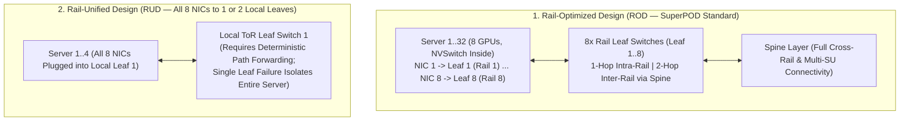
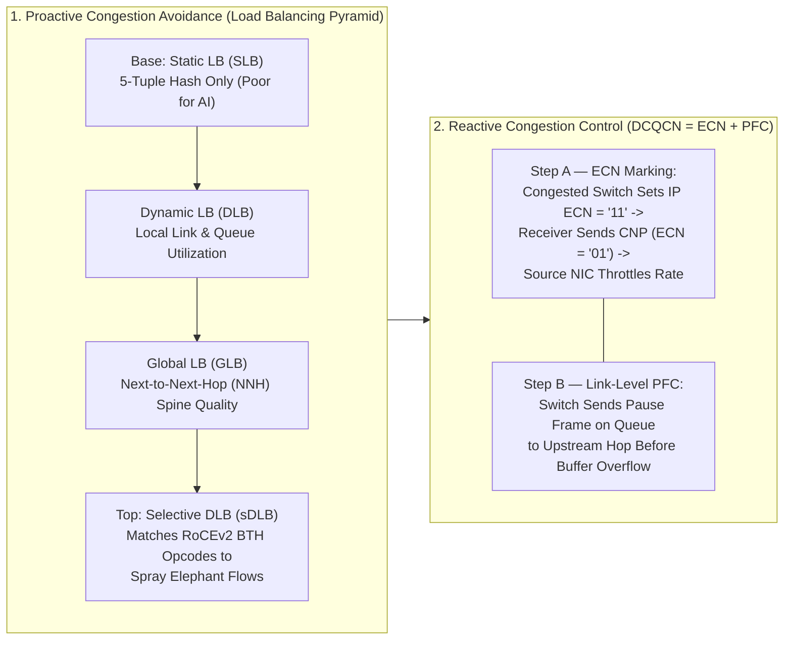

# 9.9 Compute, storage, in-band and out-of-band networks in a SuperPOD

| | |
|---|---|
| **Status** | Drafted (`superpod_networks_lab.py`: 27 checks pass; network fabric rules verified in Python) |
| **Level** | Advanced |
| **Priority tier** | 1b |
| **Lab venue** | none (design / reading) + self-checking Python model (`code/part09/superpod_networks_lab.py`) |
| **Part** | Part 9: NVIDIA systems and reference architectures |
| **Sources used** | *NVIDIA DGX SuperPOD Reference Architecture Featuring NVIDIA DGX GB300 Systems* (`superpod-gb300-ra`, pp. 13–28); *Data Center Best Practices with DGX B200* (`superpod-b200-dc`, pp. 5, 19–23); *AI Data Center Network Design and Technologies* Ch. 2 & Ch. 3 |

## Why this matters for AI infrastructure

In a traditional enterprise data center, a server has two bonded 25 GbE network ports that carry everything—web requests, database queries, NFS storage mounts, Prometheus scrapes, and SSH logins—over a single oversubscribed Top-of-Rack switch. If you try to run a 1,000-GPU AI factory on a converged network like that, the cluster fails immediately: a single 980 GB checkpoint burst starves the Kubernetes control plane, or a noisy SSH/container-pull stream triggers head-of-line blocking in the middle of a synchronous `ncclAllReduce` collective.

An **NVIDIA DGX SuperPOD** prevents traffic cross-contamination by physically isolating **five logical network segments** across **four distinct switch fabrics**:
1. **The Scale-Up Multi-Node NVLink Fabric (`MN-NVL`, carrying `NVLink 5`):** Intra-rack GPU-to-GPU memory access (`1.8 TB/s` per GPU).
2. **The Scale-Out Compute Fabric (carrying the `Compute Network`):** Non-blocking, rail-optimized InfiniBand (`400G NDR` or `800G XDR`) dedicated exclusively to inter-node GPU collectives.
3. **The Storage and In-Band Ethernet Fabric (carrying both the `Storage Network` and the `In-Band Management Network`):** Built on `Spectrum-4 SN5600D` switches and fed by **two separate, unbonded ports** on each node's `BlueField-3` DPU (`400G RoCEv2` for High-Performance Storage; `≥ 200G` for In-Band Management, NFS `/home`, and border `eBGP` uplinks).
4. **The Out-of-Band (`OOB`) Management Network:** Physically isolated `1 GbE` copper (`SN2201`) switches rolled up via **VXLAN** to dedicated OOB aggregation spines for BMCs, `NVOS` switch trays, and smart PDUs.

:::info Corpus scope note
Standalone *NVIDIA Quantum-X800 / Spectrum-4 Switch Configuration Guides* and *NVIDIA Cumulus Linux / NVOS User Manuals* are not in `~/Desktop/books-toon-rag/`. The fabric segmentation, rail topologies (`ROD`, `Rail-Only`, `RUD`), leaf placement (`ToR`, `MoR`, `EoR`), 3-stage vs 5-stage Clos scaling math, RoCEv2 (`UDP 4791`, `SLB`/`DLB`/`GLB`/`sDLB`, `DCQCN`) mechanics, and In-Band/OOB VXLAN & eBGP border designs in this chapter are drawn from `superpod-gb300-ra` (pp. 13–28), `superpod-b200-dc` (pp. 5, 19–23), and *AI Data Center Network Design and Technologies* Chapters 2 and 3.
:::

## Prerequisites and outcomes

**Prerequisites:**
- Chapters `9.5` to `9.8` (NVL72 rack architecture, SuperPOD Scalable Units, and the B200 and GB300 reference architectures).

**Outcomes:** After completing this chapter, you will be able to:
1. Map the **five logical network segments** onto the **four physical switch fabrics** of a DGX SuperPOD.
2. Contrast **Rail-Optimized (`ROD`)**, **Rail-Only**, and **Rail-Unified (`RUD`)** designs, compare **`ToR`** vs **`MoR`** vs **`EoR`** leaf placement, and calculate **3-stage** and **5-stage** Clos switch counts.
3. Explain why **RoCEv2 (`UDP 4791`)** suffers from **low entropy and elephant flows**, and configure proactive load balancing (**`SLB` → `DLB` → `GLB` → `sDLB`**) and reactive **DCQCN (`ECN 11` + `CNP 01` + `PFC` pause)**.
4. Architect the **In-Band Management** and **Out-of-Band (`SN2201` + VXLAN rollup)** networks.

---

## Concepts: basics → intermediate → advanced

## 1. Master map: the five logical segments across four physical fabrics

Think of a DGX SuperPOD like a modern international airport that separates vehicles onto four completely separate road systems:
1. **High-speed underground people-mover trains between terminals (`Fabric 1: Multi-Node NVLink`):** Carries passengers (`tensors`) inside the rack at 1.8 TB/s without ever going outside.
2. **The secured tarmac runways (`Fabric 2: Compute InfiniBand`):** Reserved strictly for synchronized aircraft takeoffs and landings (`inter-node NCCL collectives`), managed by the air-traffic control tower (`UFM Enterprise`).
3. **The heavy cargo freight highway and passenger arrival boulevard (`Fabric 3: Storage & In-Band Ethernet`):** Uses the same highway interchange (`Spectrum-4 SN5600D` spines), but keeps 40-ton cargo trucks (`400G RoCEv2 Storage` on BlueField-3 Port 1) in a dedicated unbonded lane separate from passenger taxis and buses (`≥200G In-Band Management & NFS` on BlueField-3 Port 2).
4. **The emergency and maintenance service road (`Fabric 4: Out-of-Band 1 GbE`):** A fenced-off perimeter road (`SN2201` switches) that lets fire trucks and mechanics (`IPMI / Redfish / NVOS`) reach every building even if the main highway is completely shut down.

| Logical Segment (`5 Total`) | Physical Fabric (`4 Total`) | Node / Tray Interface | Switch Hardware & Topology | Control Plane & Traffic Carried |
|---|---|---|---|---|
| **1. NVLink 5** | **Fabric 1: Multi-Node NVLink (`MN-NVL`)** | Rear blind-mate copper (`18 NVL5 links/GPU`) | **9x NVLink Switch Trays / rack** (`18 ASICs`, 1-stage non-blocking crossbar) | Managed by **`NMX-M`**. Carries intra-rack GPU-to-GPU P2P, `NVLS` reductions, and `NCCL` / `NVSHMEM`. |
| **2. Compute Network** | **Fabric 2: Compute InfiniBand Fabric** | **8x ConnectX-7 (`400G NDR`)** on H100/B200; **4x ConnectX-8 (`800G XDR`)** per tray on GB300 | **`QM9700` (`64x400G`)** or **`Q3400-RD` (`144x800G`)**, `8 leaves/SU`, **1:1 non-blocking** Rail-Optimized Fat-Tree | Managed by **`UFM Enterprise`**. Carries inter-node/inter-rack `NCCL` collectives (`SHARPv3`, `AR`, `SHIELD`). |
| **3. Storage Network** | **Fabric 3: Storage & In-Band Ethernet Fabric** *(Shared Spine, Dedicated Host Port & Storage Leaves)* | **BlueField-3 Port 1 (`400 GbE` dedicated, unbonded)** | **`Spectrum-4 SN5600D`** (`4 compute leaves/SU` at `1:3` blocking; `2–8 storage leaves` at `72×400G` **1:1 non-blocking**) | Lossless **RoCEv2 (`UDP 4791`)** + **GPUDirect Storage (`GDS`)** to certified High-Performance Storage (`90–280 GB/s` per SU). |
| **4. In-Band Management Network** | **Fabric 3: Storage & In-Band Ethernet Fabric** *(Shared Spine, Dedicated Host Port & Mgmt Leaves)* | **BlueField-3 Port 2 (`≥ 200 GbE` dedicated / bonded)** | **`Spectrum-4 SN5600D`** (`4 compute leaves/SU` + **`2 management leaves`** at `24×400G` uplinks) | **BCM** provisioning, **NFS User Storage** (`≥100G DR1`), Slurm/K8s/Run:ai control plane, NGC pulls, and **`≥2x 100GbE DR1` eBGP** customer edge + **BMS** (untrusted). |
| **5. Out-of-Band (`OOB`) Management Network** | **Fabric 4: Out-of-Band Network** | **1 GbE RJ45** ports on compute trays, BlueField-3, switch trays (`BMC` + `COMe`), storage, and rPDUs | **`SN2201` (`48x 1GbE` copper)** rolled up per SU via **VXLAN** to **`2 OOB Aggregation Spines`** | Physically isolated **IPMI / Redfish**, NVSwitch **`NVOS` (`COMe`)**, IB/NVLink switch management, and smart PDU telemetry. |

:::tip In one minute
- A SuperPOD maps **5 logical network segments** (`NVLink 5`, `Compute`, `Storage`, `In-Band Mgmt`, `OOB Mgmt`) onto **4 physical switch fabrics** (`MN-NVL`, `Compute InfiniBand`, `Storage & In-Band Ethernet`, `OOB Ethernet`).
- `Fabric 3` (`Spectrum-4 SN5600D`) carries both the `Storage` and `In-Band` segments, but keeps them **strictly separated on unbonded physical ports** of the BlueField-3 DPU (`Port 1 = 400G RoCEv2 Storage`; `Port 2 = ≥200G In-Band Management`).
:::

---

## 2. The Compute Network: Rail-Optimized (`ROD`) vs `Rail-Only` vs `RUD`, leaf placement, and Clos scaling

Why don't we wire the 8 compute NICs of a server into a single Top-of-Rack switch like a normal web server? Because of how GPUs inside a node cooperate with GPUs across nodes.

### 2.1 Rail-Optimized (`ROD`) vs Rail-Only vs Rail-Unified (`RUD`) designs

In *AI Data Center Network Design and Technologies* Chapter 3, three GPU-to-leaf wiring architectures are contrasted:



1. **Rail-Optimized Design (`ROD` — the NVIDIA SuperPOD standard):**
   - **How it wires:** `NIC 1` (`GPU 1`) of every server in the Scalable Unit connects to **Leaf Switch 1 (`Rail 1`)**, `NIC 2` connects to **Leaf Switch 2 (`Rail 2`)**, and so on across all 8 rails (`4 rails × 2 leaves/rail = 8 leaves/SU` on 4-NIC GB300 compute trays).
   - **Why it wins:** Any `GPU k` on Server A can exchange tensors with `GPU k` on Server B (`intra-rail communication`) in **a single leaf-switch hop** with minimum latency. And if `GPU 1` on Server A needs to talk to `GPU 5` on Server B (`inter-rail communication`), it can either route across the **internal 900–1,800 GB/s NVSwitch** inside Server A to `GPU 5` and exit on `Rail 5` (1 network hop), or traverse the `Spine` layer (2 network hops).
2. **Rail-Only Design:**
   - **How it wires:** Identical to `ROD` at the leaf layer, **except there are no spine connections between different rails** (spines only connect `Rail 1` of Stripe A to `Rail 1` of Stripe B).
   - **Trade-offs:** Saves switch budget and isolates faults strictly within a single rail, *forcing* all cross-rail traffic to traverse the internal GPU NVSwitch inside the servers.
3. **Rail-Unified Design (`RUD`):**
   - **How it wires:** Connects all 8 NICs of a server to **a single local ToR leaf switch** (or 4 NICs to each of 2 local leaves).
   - **Trade-offs:** Simplifies intra-rack cabling (allowing short, inexpensive copper DAC/AEC cables in a Top-of-Rack layout) and gives 1-hop latency across the 4 servers sharing that leaf, **but if that single leaf switch fails, the entire 8-GPU server is completely isolated from the cluster**, and switches must implement deterministic path forwarding to segregate rail traffic.

### 2.2 Physical placement of Compute Leaf switches: `ToR` vs `MoR` vs `EoR`

In a Rail-Optimized (`ROD`) row of 8 compute racks (32 servers = 256 GPUs), every server must run cables to **all 8 rail leaf switches**. Where you physically mount those 8 leaf switches changes your rack power budget and maximum cable length (`Table 3-1` in *AI Data Center Network Design and Technologies* Chapter 3):

| Design Criterion | Top-of-Rack (`ToR`) | Middle-of-Row (`MoR`) | End-of-Row (`EoR`) |
|---|---|---|---|
| **Where Leaf Switches Sit** | 1 leaf switch at the top of each of the 8 compute racks | All 8 leaf switches in 1–2 dedicated network racks in the **center** of the row (between Racks 4 and 5) | All 8 leaf switches in 1–2 dedicated network racks at the **far end** of the row (Racks 9–10) |
| **Total Rack Space Required** | **Less** (8 racks total) | **More** (9–10 racks total) | **More** (9–10 racks total) |
| **Power & Cooling per Compute Rack** | **More** (switches add kW/heat to compute racks) | **Less** (compute racks hold only servers) | **Less** (compute racks hold only servers) |
| **Cabling Within Compute Rack** | Varying lengths to the local ToR switch | **None** (all compute cables exit to row tray) | **None** (all compute cables exit to row tray) |
| **Maximum Cable Span** | Spans up to **8 racks** | Spans a maximum of **6 racks** (**Shortest.**) | Spans up to **10 racks** (**Longest.**) |

Notice why **Middle-of-Row (`MoR`)** is the standard layout for high-density SuperPOD rows: placing the dedicated network/management racks in the **center of the compute row** cuts the maximum server-to-leaf cable span to **at most 6 racks** (keeping AOC cables well below the `27.0 m` / `90%` limit) while removing switch power and heat from the 57.2 kW–150 kW compute racks.

### 2.3 Scaling from 3-Stage Clos (`2,048` / `9,216` GPUs) to 5-Stage Clos (`16K–128K` GPUs), Scheduled Fabrics, and Dragonfly

How far can a two-tier Leaf–Spine (**3-stage Clos**) fabric scale before running out of ports? The non-blocking ceiling is governed by the **switch port radix** (`calculate_clos_fabric_scale()` in `code/part09/superpod_networks.py`, where connecting the `(radix / 2)` downlink/uplink split across both `64-port` and `144-port` switches is **my inference** unifying *AI Data Center Network Design and Technologies* Chapter 3 and `superpod-gb300-ra` Table 3):

1. **3-Stage Clos with `64 × 400 Gbps` switches (`32 down + 32 up`):**
   - `1 Row (1 SU)` = **256 GPUs** (`8 leaves, 4 spines`).
   - `2 Rows (2 SUs)` = **512 GPUs** (`16 leaves, 8 spines`).
   - **Maximum 3-stage scale (`8 Rows`):** **2,048 GPUs** (`64 leaf switches` and `32 spine switches`, with `2,048` server-facing ports and `2,048` spine-facing ports).
2. **3-Stage (2-Layer) Clos with `144 × 800 Gbps` (`Q3400-RD`) switches (`72 down + 72 up`):**
   - Raising switch radix from 64 to **144 ports** increases the 2-layer non-blocking ceiling by **4.5×**, scaling a `DGX GB300 SuperPOD` to **16 SUs = 9,216 GPUs** (`128 leaf switches` and `72 spine switches`) without a Super-Spine tier.
3. **5-Stage Clos (`Leaf – Spine – Super-Spine`) for `2,048 to 14,336+` GPUs (using `64 × 400G` switches):**
   - Beyond 2,048 GPUs on 64-port switches, 4 rows (`1,024 GPUs`, `32 leaves`, `32 spines`, and `1,024 super-spine-facing ports`) are grouped into **1 Block (or Brick)**, and multiple Blocks are interconnected by a **Super-Spine** layer (or high-radix **256-port chassis spines**, which cut spine switch count by 4×).
   - With a fixed pool of **32 Super-Spine switches (`2,048` super-spine ports)**, scaling the number of 1,024-GPU Blocks trades Super-Spine oversubscription for total GPU count:
     - `2 Blocks (2,048 GPUs, 64 leaves, 64 spines)`: **`1 : 1` non-blocking**
     - `4 Blocks (4,096 GPUs, 128 leaves, 128 spines)`: **`2 : 1` oversubscribed**
     - `6 Blocks (6,144 GPUs, 192 leaves, 192 spines)`: **`3 : 1` oversubscribed**
     - `8 Blocks (8,192 GPUs, 256 leaves, 256 spines)`: **`4 : 1` oversubscribed**
     - `14 Blocks (14,336 GPUs, 448 leaves, 448 spines)`: **`7 : 1` oversubscribed**
4. **Alternative ultra-scale fabrics (`Scheduled Fabric` and `Dragonfly`):**
   - **Scheduled Fabric (Cell-Based `VOQ`):** Splits incoming packets at the ingress leaf into fixed **`64-, 128-, or 256-byte` cells**, sprays cells uniformly across all spine backplane links using **Virtual Output Queueing (`VOQ`)** (so each input port maintains a dedicated virtual queue per egress port, eliminating head-of-line blocking), and reassembles packets at the egress leaf.
   - **Dragonfly (`DF` / `DF+`):** Connects 3-stage Clos blocks/groups directly to each other in a **full inter-group mesh**, reducing hop count, network diameter, and optical cable cost compared to a 5-stage Super-Spine Clos, relying on **Adaptive Routing** to route around inter-group congestion.

:::tip In one minute
- **Rail-Optimized Design (`ROD`)** wires `NIC k` of every node to `Leaf Switch k` (`1 hop` intra-rail; `2 hops` inter-rail via spine or `1 hop` after internal NVSwitch), whereas **Rail-Unified Design (`RUD`)** wires all 8 NICs of a server to 1–2 local leaves (risking full-server isolation if a leaf fails).
- **Middle-of-Row (`MoR`)** leaf placement achieves the **shortest maximum cable span (`6 racks`)** vs `ToR` (`8 racks`) and `EoR` (`10 racks`) while keeping switch heat out of compute racks.
- A 2-tier (**3-stage Clos**) fabric maxes out at **2,048 GPUs** with `64 × 400G` switches (`64 leaves, 32 spines`) and **9,216 GPUs** with `144 × 800G` (`Q3400-RD`) switches (`128 leaves, 72 spines`). Larger clusters use a **5-stage Clos** (`1,024-GPU` blocks + Super-Spines) or **Dragonfly**.
:::

---

## 3. The Storage Network: RoCEv2 (`UDP 4791`), low-entropy elephant flows, `DLB`/`GLB`/`sDLB`, and `DCQCN`

In a DGX GB300 SuperPOD, High-Performance Storage is accessed over **400 Gbps RDMA over Converged Ethernet v2 (`RoCEv2`)** across `Spectrum-4 SN5600D` switches using **Port 1 (400G unbonded)** of each compute tray's BlueField-3 DPU. (The same RoCEv2 physics also apply when an organization builds an Ethernet-based backend compute fabric.)

### 3.1 Why AI/Storage RoCEv2 breaks traditional 5-tuple ECMP hashing (`UDP 4791` low entropy)

In a traditional cloud web network, thousands of servers open millions of short TCP connections with randomized source/destination IP addresses and ephemeral ports (**high entropy**), so simple **Static Load Balancing (`SLB`)** using a 5-tuple hash (`SrcIP, DstIP, SrcPort, DstPort, Protocol`) spreads traffic evenly across Equal-Cost Multi-Path (`ECMP`) spine links.

AI storage and collective traffic on **RoCEv2** is the exact opposite—it consists of a small number of massive, line-rate **elephant flows** with **extremely low entropy**:
1. **Low network-layer entropy:** Communication often occurs `1:1` between a specific GPU/DPU IP and a specific storage target or peer GPU IP.
2. **Low transport-layer entropy (`UDP 4791`):** Every RoCEv2 packet uses **UDP destination port `4791`**, which indicates that the payload begins with the **InfiniBand Base Transport Header (`BTH`)**. While the Queue Pair (`QP`) number and packet sequence number change inside the `BTH`, standard Ethernet switches hashing only the outer L3/L4 5-tuple do not inspect the `BTH`—and may even group simultaneous or sequential low-entropy **flowlets** onto the exact same spine link, leaving 3 of 4 spine links idle while 1 link drops packets.

### 3.2 Proactive Load Balancing (`SLB → DLB → GLB → sDLB`) and Reactive Congestion Control (`DCQCN`)

To make RoCEv2 lossless and congestion-free across the `SN5600D` fabric, AI Ethernet switches combine **proactive load balancing** with **reactive `DCQCN` congestion control**:



1. **The Four-Tier Load-Balancing Pyramid (Proactive):**
   - **Static Load Balancing (`SLB`):** Hashes only the outer 5-tuple; guarantees packet ordering but causes severe elephant-flow collisions.
   - **Dynamic Load Balancing (`DLB`):** Evaluates real-time **local member-link bandwidth and egress queue buffer utilization** when assigning new flows or reassigning existing flowlets.
   - **Global Load Balancing (`GLB`):** Extends `DLB` by incorporating **Next-to-Next-Hop (`NNH`) downstream path quality** reported by spine switches so upstream leaf switches route around downstream congestion hotspots.
   - **Selective Dynamic Load Balancing (`sDLB`):** Inspects the **RoCEv2 Base Transport Header (`BTH`) read/write opcodes** to identify massive elephant flows and enables fine-grained per-packet spraying across ECMP links.
2. **Data Center Quantized Congestion Notification (`DCQCN` — Reactive):**
   - **Explicit Congestion Notification (`ECN` — End-to-End):** When a switch egress queue crosses its Random Early Detection (`RED`) threshold, the switch sets the two IP header **ECN bits to `11` (`Congestion Experienced`)** on passing packets (Steps 1–3). When the destination NIC receives a packet with `ECN = 11`, it generates a **Congestion Notification Packet (`CNP`, with IP ECN `01`)** and sends it back to the source NIC (Step 4), which immediately throttles the sending Queue Pair's rate (Step 5).
   - **Priority Flow Control (`PFC` — Link-by-Link Safety Net):** If a microburst fills a switch buffer faster than the end-to-end ECN loop can react, the switch transmits an IEEE 802.1Qbb **PFC Pause Frame** on that specific lossless priority queue to the immediately upstream switch/NIC (containing pause quanta), halting transmission before a single packet can be dropped.
3. **Why Storage Leaves are `1:1 Non-Blocking` while Compute Leaves are `1:3`:**
   As proven in **chapter `9.8`, section 4.1**, the 4 `SN5600D` compute leaves per SU use `24 × 400G` spine uplinks for `72 × 400G` downlinks (`1:3` blocking ratio) because not all 144 compute trays pull 400 Gbps from storage at the exact same millisecond, whereas the **`SN5600D` storage leaves are cabled with `72 non-blocking 400 Gbps` uplinks (`1:1` non-blocking)** so storage arrays never bottleneck under multi-rack in-cast.

:::tip In one minute
- **RoCEv2** encapsulates the InfiniBand Base Transport Header (`BTH`) in **UDP port `4791`**, producing low-entropy **elephant flows** that break static 5-tuple ECMP (`SLB`).
- Use **Dynamic (`DLB`)**, **Global (`GLB` with Next-to-Next-Hop `NNH`)**, or **Selective (`sDLB` BTH opcode matching)** load balancing proactively, backed up reactively by **DCQCN** (**`ECN = 11`** marking + **`CNP`** return packets + link-level **`PFC`** pause frames).
- On the `SN5600D` Ethernet fabric, compute leaves run at a **`1:3` blocking ratio (`24:72`)**, while **storage leaves run `1:1` non-blocking (`72 × 400G`)**.
:::

---

## 4. The In-Band Management Network and Customer Edge routing

While `Port 1` (`400 Gbps`) of each compute tray's BlueField-3 (`BF3240`) DPU is dedicated to lossless RoCEv2 storage, **`Port 2` (`≥ 200 Gbps`)** connects to the **In-Band Management Network** segment on the `Spectrum-4 SN5600D` fabric.

### 4.1 Four core functions of the In-Band Management Network

1. **Cluster control-plane services:** Connects **NVIDIA Mission Control**, **Base Command Manager (`BCM` / `CMDaemon`)** PXE/HTTP boot provisioning, **Slurm** controller daemons (`slurmctld` / `slurmd`), and **Kubernetes / Run:ai** API servers across all compute trays and management servers.
2. **Access to the NFS User Storage tier:** Provides `≥ 100 GbE DR1` Ethernet connectivity to the enterprise **NFS User Storage** tier (which hosts user `/home` directories, Slurm job scripts, centralized system logs, and shared High Availability state for Mission Control and BCM).
3. **Border uplink to external registries and data sources:** Connects via the **pair of `SN5600D` management leaf switches** (`24 × 400 Gbps` spine links each) and the dedicated border **VTEP** (`≥ 2x 100 GbE DR1` single-mode optics with **eBGP** peering) to external services outside the SuperPOD, including the **NVIDIA NGC registry**, Git code repositories, and enterprise data lakes.
4. **End-user interactive and API access:** Carries authenticated user SSH sessions to Slurm login/head nodes and HTTPS requests to Kubernetes and Run:ai ingress endpoints.

### 4.2 Why Storage and In-Band sit on separate BlueField-3 ports (and future `HBN`)

Separating the **400 Gbps Storage Network** (`Port 1`) from the **≥200 Gbps In-Band Management Network** (`Port 2`) on the physical BlueField-3 ports gives you two major operational advantages:
- **Zero TCP interference on RoCEv2:** Heavy container image pulls from NGC or multi-gigabyte log flushes over the In-Band network can never consume buffer headroom on the lossless RoCEv2 storage port.
- **Zero complex host policy routing:** Each physical interface sits in its own subnet/VLAN without fragile source-based routing rules on the host OS.
- **Future High Availability via `HBN`:** Because dedicating one physical port to Storage and one to In-Band removes LACP link bonding on a single segment, NVIDIA's roadmap enables **Host-Based Networking (`HBN`)** on the BlueField-3 DPUs so the DPU hardware switch can provide resilient multi-path failover across both ports without host LACP complexity.

:::tip In one minute
- The **In-Band Management Network** (`≥ 200 Gbps` on BlueField-3 Port 2 + `2 × SN5600D` management leaves at `24 × 400G` uplinks) carries **BCM provisioning**, **NFS User Storage** (`≥ 100 GbE DR1`), **Slurm/K8s/Run:ai control planes**, and **`≥ 2x 100 GbE DR1` eBGP** border uplinks.
- Keeping Storage (`Port 1`) and In-Band (`Port 2`) unbonded prevents TCP bursts from disturbing RoCEv2 storage traffic, with future **BlueField `HBN`** providing DPU-level port failover.
:::

---

## 5. The Out-of-Band (`OOB`) Management Network (`SN2201` + VXLAN rollup)

The **Out-of-Band (`OOB`) Management Network** is the physically isolated 1 GbE copper nerve center of the SuperPOD. There is **no valid use case where a non-privileged user ever has direct network access to the OOB fabric**.

### 5.1 Every endpoint connected to the `SN2201` OOB fabric

Every rack in a DGX SuperPOD contains **NVIDIA `SN2201` (`48 × 1 GbE` RJ45 copper)** switches that connect the management ports of every hardware component:
1. **DGX Compute Tray BMCs** (`1 GbE RJ45` per tray for Redfish and IPMI).
2. **BlueField-3 DPU BMCs** (independent out-of-band management for the DPU cards).
3. **NVLink Switch Tray management interfaces:** Both the **1x RJ45 BMC module port** and the **2x RJ45 `COMe` ports** running **`NVOS`** (used by **`NMX-M`** and BCM `gb200sw`/`gb300sw` firmware updates).
4. **DGX Power Shelf BMCs** (front `1 GbE RJ45` BMC port and rear `RJ45` power-brake/OOB management ports on each of the 8 power shelves per GB300 rack) and **smart Rack PDUs (`rPDUs`)**.
5. **InfiniBand (`Q3400-RD` / `QM9700`) and Ethernet (`SN5600D`) switch management ports**, plus management servers (`BCM`, `UFM`, `Mission Control`) and partner storage controller BMCs.

### 5.2 VXLAN rollup to OOB Aggregation Spines and Customer OOB handover

To avoid a sprawling flat Layer-2 broadcast domain across 8 to 128 racks, each Scalable Unit's `SN2201` OOB switches roll up as a **dedicated VXLAN** terminated on a **pair of OOB Aggregation Spine switches** (`2 + 2` with the management leaves). As detailed in **chapter `9.8`, section 4.3**, the OOB fabric hands over to the customer's corporate OOB network via either the **last pair of `SN2201` switches acting as dedicated OOB edge ToR uplinks** (default) or **route leaking through the `SN5600D` In-Band spine layer** across the eBGP border VTEP.

:::tip In one minute
- The **Out-of-Band (`OOB`) Network** uses **`SN2201` (`48 × 1 GbE` copper)** switches to connect all compute BMCs, BlueField BMCs, NVSwitch `BMC + COMe (NVOS)` ports, power shelves, smart rPDUs, and fabric switch management ports.
- OOB traffic rolls up per SU as a **dedicated VXLAN** to a **pair of OOB aggregation spines**, handing over to the customer via either a **dedicated OOB edge ToR pair** (default) or **route leaking through the `SN5600D` In-Band spines**.
:::

---

## Commands and configurations that matter

Use these commands to verify SuperPOD network plane segmentation, inspect RoCEv2 (`UDP 4791`) ECN (`11`) and PFC counters on the Storage Ethernet fabric, and verify InfiniBand rail alignment (**untested** on live SuperPOD switches/nodes in this authoring environment; fabric rules verified in `code/part09/superpod_networks_lab.py`).

### 1. Run the 27-check SuperPOD Network Fabrics & Clos Scaling verifier

```bash
python3 -B code/part09/superpod_networks_lab.py
```

### 2. Verify unbonded BlueField-3 Storage (`400G RoCEv2`) vs In-Band (`≥200G`) interfaces on a compute tray

```bash
# 1. Inspect link speeds and confirm Port 1 (Storage) and Port 2 (In-Band) are separate, unbonded interfaces
ip -br link show
ethtool enp3s0f0np0 | grep -E "Speed:|Link detected:"   # Expect 400000Mb/s/Full (Storage RoCEv2)
ethtool enp3s0f1np1 | grep -E "Speed:|Link detected:"   # Expect >=200000Mb/s/Full (In-Band Mgmt)

# 2. Check RoCEv2 DCQCN (ECN marked packets, CNP sent/received, and PFC pause frames) on Storage Port 1
ethtool -S enp3s0f0np0 | grep -E "rx_ecn_mark|np_cnp_sent|rp_cnp_handled|tx_pause|rx_pause"
```

### 3. Inspect Cumulus Linux / Spectrum-4 RoCEv2 QoS, PFC, ECN, and BGP border state (`nv show`)

```bash
# On an SN5600D Storage/Compute/Management Ethernet switch running NVIDIA Cumulus Linux (NVUE):
nv show qos roce
nv show interface swp1s0 qos pfc
nv show vrf default router bgp neighbor
```

---

## How it fails

| Failure mode | Symptom | Root cause | Diagnosis & fix |
|---|---|---|---|
| **1. Elephant-flow spine collision under Static 5-Tuple ECMP (`SLB`)** | On a RoCEv2 Storage or Compute Ethernet fabric, one `SN5600D` spine uplink saturates at 100% (`tx_pause` / `rx_ecn_mark` climbing rapidly) while three parallel spine uplinks sit at `< 15%` utilization. | All RoCEv2 packets share **UDP destination port `4791`** (`BTH` header inside) and `1:1` IP pairs have **low entropy**, causing traditional Static Load Balancing (`SLB` 5-tuple hash) to hash multiple 400 Gbps elephant flows onto the exact same spine link. | Enable adaptive load balancing on the Spectrum-4 switches—**Dynamic Load Balancing (`DLB`)**, **Global Load Balancing (`GLB` with Next-to-Next-Hop awareness)**, or **Selective DLB (`sDLB` matching BTH opcodes for per-packet spraying)**—alongside **DCQCN (`ECN + PFC`)**. |
| **2. Single leaf switch failure isolating an entire 8-GPU node (`RUD` trap)** | A Top-of-Rack leaf switch reboots for a firmware upgrade, and four 8-GPU servers connected to that switch lose 100% of their cluster compute connectivity (`0/8` NICs reachable). | The cluster was cabled using **Rail-Unified Design (`RUD`)**, plugging all 8 NICs of a server into a single local ToR leaf switch instead of **Rail-Optimized Design (`ROD`)**. | Cable compute fabrics using **Rail-Optimized Design (`ROD`)** (`NIC k` → `Leaf Switch k`). In `ROD`, losing one leaf switch affects only 1 of the 8 rails (or 1 of 8 leaves per SU), allowing NCCL and UFM to route traffic across the remaining healthy rails. |
| **3. Exceeding `27.0 m` AOC cable limit in an End-of-Row (`EoR`) layout** | Outer compute racks in an 8-rack row cannot reach the InfiniBand leaf switches with standard 30 m AOC cables once vertical tray drops and bend radiuses are included (`> 27.0 m` / `90%` limit). | The leaf switches were placed in an **End-of-Row (`EoR`)** rack at Rack 9–10 (**10-rack cable span**) instead of a **Middle-of-Row (`MoR`)** rack between Racks 4 and 5 (**6-rack maximum cable span**). | Place network and management racks in the **Middle-of-Row (`MoR`)** so the maximum server-to-leaf horizontal span is cut from 10 racks down to **6 racks**, keeping all AOC runs well under `27.0 m`. |
| **4. PFC Pause Storm freezing the storage fabric** | High-Performance Storage reads/writes grind to a halt across an entire SU, and switch counters show millions of continuous `rx_pause` / `tx_pause` frames cascading from a storage leaf back to compute leaves. | Either **ECN (`RED` marking at `11` and `CNP` generation)** was disabled—forcing link-level **PFC** to trigger constantly without end-to-end DCQCN rate backoff—or a dead/hung NIC held a lossless priority queue paused indefinitely. | Verify **DCQCN** is active end-to-end so **ECN (`11` marking + `CNP`)** throttles senders *before* buffers hit the **PFC** threshold (`nv show qos roce`), and configure a **PFC watchdog timer** on the switches to drop/drain stuck lossless queues after a few hundred milliseconds rather than propagating a fabric-wide pause storm. |
| **5. Out-of-Band switch management cutoff for NVLink Switch Trays** | `cmsh` `firmware status` and `NMX-M` lose contact with all 9 NVLink switch trays (`switch001..009`) in a GB300 rack even though each switch tray's 1x BMC RJ45 port still answers ping. | Each NVLink switch tray has **three** RJ45 ports on the front: **1x BMC RJ45 port** and **2x `COMe` RJ45 ports for `NVOS`**. The cabling team plugged in only the BMC port and left the `COMe` (`NVOS`) ports unplugged from the `SN2201` OOB switch. | Connect **both the BMC RJ45 port and the `COMe` (`NVOS`) RJ45 ports** of every NVLink switch tray to the `SN2201` OOB management fabric, as required by the GB300 SuperPOD OOB architecture. |

---

## Hands-on lab

This chapter's self-checking Python model (`code/part09/superpod_networks.py`) and lab runner (`code/part09/superpod_networks_lab.py`) implement:
1. The **SuperPOD 5-Segment / 4-Fabric Traffic Classifier** (mapping `intra_rack_gpu_p2p`, `inter_rack_nccl_collectives`, `parallel_filesystem_rocev2`, `slurm_k8s_nfs_home_and_ebgp_uplink`, and `bmc_ipmi_redfish_and_nvos_come` to their exact segment, physical fabric, switch hardware, and host interface).
2. The **Leaf Placement Strategy Comparator** (`ToR` `8-rack` span vs `MoR` `6-rack` span vs `EoR` `10-rack` span, rack space, compute-rack power/cooling impact, and `RUD` DAC suitability).
3. The **3-Stage vs 5-Stage Clos Scaling Calculator** (`64 × 400G` 3-stage max `2,048 GPUs` across `1, 2, 8` rows vs `144 × 800G` `Q3400-RD` 3-stage max `9,216 GPUs` across `16 SUs`, and 5-stage Clos `1,024-GPU` blocks at `1:1`, `2:1`, `4:1`, and `7:1` Super-Spine oversubscription up to `14,336 GPUs`).
4. The **RoCEv2 (`UDP 4791`), Load Balancing (`SLB`/`DLB`/`GLB`/`sDLB`), and `DCQCN` (`ECN 11` + `PFC`) Auditor**.

Run the lab from the repository root:

```bash
python3 -B code/part09/superpod_networks_lab.py
```

Expected output (verified in this repository):

```text
=== Chapter 9.9 Lab: Compute, Storage, In-Band & OOB Networks in a SuperPOD ===
  [PASS] Intra-rack GPU P2P maps to NVLink 5 segment on MN-NVL fabric managed by NMX-M
  [PASS] Inter-rack NCCL collectives map to Compute Network on Quantum InfiniBand managed by UFM Enterprise
  [PASS] Parallel filesystem RoCEv2 maps to Storage Network on SN5600D via unbonded BlueField-3 400G Port 1
  [PASS] Slurm/K8s/NFS/eBGP maps to In-Band Management Network on SN5600D via BlueField-3 >=200G Port 2
  [PASS] BMC/Redfish/NVOS COMe maps to OOB Management Network on SN2201 + VXLAN OOB Spines
  [PASS] Rejects unknown traffic_type in network plane classifier
  [PASS] AIDC Ch3 Table 3-1: ToR spans max 8 racks, requires less rack space, more power/cooling per compute rack
  [PASS] AIDC Ch3 Table 3-1: MoR achieves shortest max cable span (6 racks) and removes switch power/heat from compute racks
  ...
  [PASS] AIDC Ch2: Flags missing PFC/ECN lossless DCQCN configuration
  [PASS] AIDC Ch2 Fig 2-5: Flags congested switch not setting ECN bits to '11' (Congestion Experienced)
  [PASS] SPGB300 p.24: Flags bonding RoCEv2 Storage port with In-Band Management port
  [PASS] Rejects unsupported switch radix in Clos calculator
  [PASS] Rejects invalid stage count in Clos calculator

Summary: 27 passed, 0 failed (total 27)
```

---

## Exercises

1. Run `python3 -B code/part09/superpod_networks_lab.py`. Rebuild the 3-stage Clos numbers by hand for a 64-port switch (2,048 GPUs) and a 144-port switch (9,216 GPUs).
2. Classify these five flows into a segment, a fabric and a host port: an NCCL AllReduce between two racks, a checkpoint write to the parallel file system, a Slurm job submission, an `NVOS` firmware update on a switch tray, and an NGC image pull.
3. For an 8-rack row, draw ToR, MoR and EoR leaf placement and mark the longest cable span for each. Which one keeps AOC runs under 27 m, and why?
4. Write the three `ethtool` and `nv show` commands you would use to prove that RoCEv2 is configured for ECN and PFC, and say what a healthy result looks like.
5. A storage link graph shows one spine uplink at 100% and three at 15%. Write the diagnosis and name two load-balancing features you would enable.
6. Write a cabling checklist for the NVLink switch trays in one GB300 rack: which ports go to which switch, and what stops working if one set is missing.

## Checkpoint questions (20)

<details>
<summary><strong>1. How can a DGX GB300 SuperPOD have five logical network segments (`NVLink 5`, `Compute`, `Storage`, `In-Band Management`, `Out-of-Band Management`) but only four physical switch fabrics? Which two segments share a physical switch fabric, and how are they kept isolated at the compute tray?</strong></summary>

The **Storage Network** and the **In-Band Management Network** share the **Storage and In-Band Ethernet Fabric** (`Spectrum-4 SN5600D` spine and compute leaf switches). At each compute tray, they are kept strictly isolated on **separate, unbonded physical ports** of the dual-port BlueField-3 (`BF3240`) DPU: **Port 1 (400 Gbps)** is dedicated exclusively to lossless **RoCEv2 Storage**, while **Port 2 (≥200 Gbps)** is dedicated to **In-Band Management and NFS User Storage**.
</details>

<details>
<summary><strong>2. Contrast Rail-Optimized Design (`ROD`), Rail-Only Design, and Rail-Unified Design (`RUD`) for connecting multi-GPU servers to leaf switches.</strong></summary>

- **Rail-Optimized Design (`ROD`):** Connects `NIC k` (`GPU k`) of every server to `Leaf Switch k` (`Rail k`), with spine switches connecting all rails. Same-index GPUs across servers communicate in **1 switch hop** (`intra-rail`), while cross-rail traffic either uses the internal NVSwitch first or traverses the spine (`2 hops`).
- **Rail-Only Design:** Wires `NIC k` to `Leaf Switch k` like `ROD`, but **omits inter-rail spine connections**, forcing 100% of cross-rail traffic to route through the internal server NVSwitch.
- **Rail-Unified Design (`RUD`):** Connects all 8 NICs of a server to **1 or 2 local ToR leaf switches**. Simplifies intra-rack DAC cabling, but **a single leaf switch failure isolates the entire server**.
</details>

<details>
<summary><strong>3. In an 8-compute-rack Rail-Optimized row, compare Top-of-Rack (`ToR`), Middle-of-Row (`MoR`), and End-of-Row (`EoR`) leaf switch placement in terms of maximum cable span and compute-rack power/cooling.</strong></summary>

- **Top-of-Rack (`ToR`):** Uses less total rack space, adds switch power and heat to the compute racks, and requires cables spanning up to **8 racks**.
- **Middle-of-Row (`MoR`):** Places leaf switches in dedicated racks in the center of the row, removing switch power/cooling from compute racks and achieving the **shortest maximum cable span (`6 racks`)**.
- **End-of-Row (`EoR`):** Places leaf switches at the end of the row, removing switch power/cooling from compute racks but requiring the **longest maximum cable span (`10 racks`)**.
</details>

<details>
<summary><strong>4. Why does a 3-stage (2-tier leaf-spine) Clos fabric built with `64 × 400G` switches max out at 2,048 GPUs, whereas `144 × 800G` (`Q3400-RD`) switches scale a 2-tier Clos to 9,216 GPUs? How do you scale `64 × 400G` switches beyond 2,048 GPUs?</strong></summary>

In a 1:1 non-blocking 2-tier Clos, each leaf switch dedicates half its ports (`radix / 2`) to compute downlinks and half to spine uplinks:
- With **`64 × 400G` switches** (`32 down + 32 up`), 64 leaf switches and 32 spine switches support **`64 × 32 = 2,048` GPUs** (`8 rows`).
- With **`144 × 800G` (`Q3400-RD`) switches** (`72 down + 72 up`), 128 leaf switches and 72 spine switches support **`128 × 72 = 9,216` GPUs** (`16 SUs`).
To scale `64 × 400G` switches beyond 2,048 GPUs, you add a **Super-Spine** layer (**5-stage Clos**, grouping 4 rows = `1,024 GPUs` into a Block/Brick at `1:1` to `7:1` oversubscription), use high-radix **256-port chassis spines**, or adopt a **Dragonfly** topology.
</details>

<details>
<summary><strong>5. What UDP destination port does RoCEv2 use, why do AI RoCEv2 elephant flows suffer from low entropy under Static Load Balancing (`SLB`), and how do `DLB`, `GLB`, and `sDLB` solve it?</strong></summary>

- **UDP Port:** RoCEv2 encapsulates the InfiniBand Base Transport Header (`BTH`) inside **UDP destination port `4791`**.
- **Low-entropy problem:** Because a small number of `1:1` high-bandwidth elephant flows share identical outer IP/UDP headers (`4791`), static 5-tuple ECMP hashing (`SLB`) hashes multiple elephant flows onto the same link.
- **Proactive solutions:** **Dynamic Load Balancing (`DLB`)** assigns flows/flowlets using local link and queue utilization; **Global Load Balancing (`GLB`)** adds **Next-to-Next-Hop (`NNH`)** downstream spine quality; and **Selective DLB (`sDLB`)** matches **RoCEv2 `BTH` read/write opcodes** to spray elephant-flow packets across all paths.
</details>

<details>
<summary><strong>6. Walk through the exact 5-step sequence of ECN and PFC inside `DCQCN` when congestion occurs on a RoCEv2 switch link.</strong></summary>

- **ECN (End-to-End rate control):** (1–2) Packets flow from the source GPU server through leaf and spine switches; (3) a congested switch queue crosses its threshold and marks the packet's IP **ECN bits as `11` (`Congestion Experienced`)**; (4) the destination server sees `ECN = 11` and sends a **Congestion Notification Packet (`CNP`, with IP ECN `01`)** back to the source server; (5) the source NIC reduces its transmission rate for that flow.
- **PFC (Link-by-Link pause):** If a queue still fills toward overflow, (3) the congested switch sends a **PFC Pause Frame** on that specific queue number to the immediately upstream switch/node; (4) the upstream hop pauses that queue and propagates pause quanta toward the source; (5) the source halts transmission before packet loss can occur.
</details>

<details>
<summary><strong>7. What is a Scheduled Fabric, and how does Virtual Output Queueing (`VOQ`) eliminate head-of-line blocking?</strong></summary>

A **Scheduled Fabric** treats leaf switches like chassis line cards and spine switches like a cell backplane: ingress leaves chop packets into fixed **`64-, 128-, or 256-byte` cells**, spray them across all spine links, and reassemble them at the egress leaf. Using **Virtual Output Queueing (`VOQ`)**, each ingress port maintains a separate virtual buffer queue for every destination egress port, ensuring that congestion on one egress port never blocks traffic destined for other idle egress ports.
</details>

<details>
<summary><strong>8. Which management interfaces on a DGX GB300 NVL72 rack connect to the `SN2201` Out-of-Band (`OOB`) network, and how are `SN2201` switches aggregated across Scalable Units?</strong></summary>

The `SN2201` (`48 × 1 GbE` copper) OOB fabric connects all **compute-tray BMCs**, **BlueField-3 DPU BMCs**, **NVLink switch tray BMCs AND `COMe` (`NVOS`) ports**, **DGX power shelf BMCs and rear power-brake ports**, **smart rPDUs**, and **InfiniBand/Ethernet/storage management ports**. Across the SuperPOD, each SU's `SN2201` switches are rolled up as a **dedicated VXLAN** into a **pair of OOB aggregation spine switches**.
</details>

<details>
<summary><strong>9. What is the job of each of the four fabrics in one line each?</strong></summary>

NVLink fabric: GPU-to-GPU inside a rack. Compute InfiniBand: GPU collectives between racks. Storage and in-band Ethernet: storage I/O and cluster services. Out-of-band Ethernet: BMCs, switches and PDUs.
</details>

<details>
<summary><strong>10. Which tool manages which fabric?</strong></summary>

`NMX-M` manages the NVLink switches, `UFM Enterprise` manages the compute InfiniBand fabric, and BCM and Mission Control run the in-band and OOB services.
</details>

<details>
<summary><strong>11. What does "Rail-only" design drop compared with rail-optimized?</strong></summary>

It removes the spine links between different rails, so cross-rail traffic must go through the NVSwitch inside the server. It saves switch cost and keeps faults inside one rail.
</details>

<details>
<summary><strong>12. Why is rail-unified design risky?</strong></summary>

All NICs of a server go to one or two local leaves. If that leaf fails, the whole server loses the cluster.
</details>

<details>
<summary><strong>13. What are the numbers for a 5-stage Clos with 64-port switches?</strong></summary>

A block is 4 rows (1,024 GPUs). With 32 super-spines, 2 blocks (2,048 GPUs) are 1:1, 4 blocks 2:1, 8 blocks 4:1, and 14 blocks (14,336 GPUs) 7:1 oversubscribed.
</details>

<details>
<summary><strong>14. What is a Scheduled Fabric?</strong></summary>

The leaf switches behave like line cards and the spines like a cell backplane. Packets are cut into 64/128/256-byte cells, sprayed over all spine links, and rebuilt at the egress leaf. Virtual output queues stop one busy output from blocking others.
</details>

<details>
<summary><strong>15. What is Dragonfly in this chapter?</strong></summary>

A topology that links blocks or groups directly to each other in a full inter-group mesh. It reduces hops and optical cable cost compared with a 5-stage super-spine, and relies on adaptive routing.
</details>

<details>
<summary><strong>16. Why does RoCEv2 give low entropy to a hash?</strong></summary>

Every packet uses UDP destination port 4791 and flows are often one-to-one between two IPs. A 5-tuple hash sees almost the same header for many big flows and may put them on one link.
</details>

<details>
<summary><strong>17. What is the difference between DLB, GLB and sDLB?</strong></summary>

DLB picks links by local link and queue load. GLB also uses next-to-next-hop information from the spine. sDLB looks at the RoCEv2 BTH opcodes and sprays big flows packet by packet.
</details>

<details>
<summary><strong>18. How does DCQCN use ECN and PFC together?</strong></summary>

ECN marks packets as congested (bits `11`), the receiver sends a CNP back, and the sender slows down. PFC is the safety net: a pause frame stops the upstream queue before the buffer overflows.
</details>

<details>
<summary><strong>19. How do you avoid a PFC pause storm?</strong></summary>

Make sure ECN and CNP work end to end so senders slow down before PFC fires, and set a PFC watchdog on the switches to drain a stuck lossless queue.
</details>

<details>
<summary><strong>20. Why must both the BMC and the COMe ports of an NVLink switch tray be cabled to the OOB switch?</strong></summary>

The BMC port gives hardware telemetry. The two COMe ports run NVOS, which NMX-M and BCM use for management and firmware updates. With only the BMC port, the tray answers ping but cannot be managed.
</details>

---

## Sources and review notes

### Sources read in full for this chapter
1. ***NVIDIA DGX SuperPOD: Next Generation Scalable Infrastructure for AI Factories Reference Architecture Featuring NVIDIA DGX GB300 Systems* (`superpod-gb300-ra`, pp. 13–28):**
   - `Table 1` network switches (`NVLink 5` + `NMX-M`, `Q3400` IB + `UFM`, `Spectrum-4 SN5600` Ethernet, `SN2201` OOB, p. 13), Compute/Storage/In-Band/OOB design requirements (pp. 14–17), 5 network segments over 4 physical fabrics and Partial-SU rule (p. 18), `MN-NVL` (p. 19), Compute Fabric 4-rail × 2-leaf `Q3400-RD` 144-port topology and `Table 3` scaling (pp. 20–21), Ethernet `SN5600D` fabric (`1:3` compute leaves, `72×400G` non-blocking storage leaves, `24×400G` management leaves) and `Table 4` scaling (pp. 22–23), unbonded BlueField-3 400G RoCEv2 vs ≥200G In-Band ports and future `HBN` (pp. 24–25), OOB `SN2201` VXLAN rollup + OOB spines (p. 26), and Customer Edge Connectivity (`≥2x 100GbE DR1`, dedicated `VTEP`, `eBGP`, untrusted `BMS`, `OOB edge ToR` vs route leaking, pp. 27–28).
2. **Steven Hambruch & Dennis O'Brien, *Data Center Best Practices with DGX B200* (`superpod-b200-dc`, pp. 5, 19–23):**
   - 1–4 SU InfiniBand leaf/spine switch counts, compute+UFM cable counts, spine–leaf cable counts, and DAC/AOC cabling rules.
3. ***AI Data Center Network Design and Technologies* (`ai-data-center-network-design-and-technologies`), Chapters 2 and 3 (read in full):**
   - Chapter 2 (*"The Common-Man View" of AI Data Center Fabrics*, lines 1–120): Training vs Inference networks, InfiniBand vs Ethernet trade-offs, RoCEv2 **UDP port `4791`** Base Transport Header (`BTH`), low entropy, simultaneous and sequential flowlets, elephant flows, proactive load balancing pyramid (**`SLB` → `DLB` → `GLB` (`NNH`) → `sDLB` (`BTH` opcode matching)**), and reactive **DCQCN** (**`ECN = 11`** marking + **`CNP` (`01`)** return + **`PFC`** pause frames).
   - Chapter 3 (*Network Design Considerations*, lines 1–220): **Rail-Optimized Design (`ROD`)** vs **Rail-Only Design** vs **Rail-Unified Design (`RUD`)**, `Table 3-1` Leaf Placement Comparison (**`ToR` 8-rack span** vs **`MoR` 6-rack span** vs **`EoR` 10-rack span**), 3-stage Clos (`64 × 400G` max **2,048 GPUs**) vs 5-stage Clos (`1,024-GPU` Blocks/Bricks with 32 Super-Spines from `1:1` / `2,048 GPUs` to `7:1` / `14,336 GPUs`, plus `256 × 400G` chassis spines), **Scheduled Fabric** (`64/128/256-byte` cells + **Virtual Output Queueing `VOQ`**), and **Dragonfly (`DF`/`DF+`)** topologies.

### Not in the corpus
- Standalone *NVIDIA Quantum-X800 / Spectrum-4 Switch Configuration Guides* and *NVIDIA Cumulus Linux / NVOS User Manuals* are not in `~/Desktop/books-toon-rag/`.

### Run here
- `python3 -B code/part09/superpod_networks_lab.py` — **27 passed, 0 failed**.

### My own choices and inferences, labelled in the text
1. **Unifying the 2-tier (3-stage Clos) non-blocking GPU ceiling formula across `64-port` (`2,048 GPUs`) and `144-port` (`9,216 GPUs`) switches (`calculate_clos_fabric_scale` in `code/part09/superpod_networks.py` and Section 2.3):** Connecting the `64 leaves × 32 downlinks = 2,048 GPUs` limit in *AI Data Center Network Design and Technologies* Chapter 3 (`Figure 3-9`) with the `128 leaves × 72 downlinks = 9,216 GPUs` limit in `superpod-gb300-ra` (`Table 3`) via `half_radix = switch_radix_ports // 2` is **my inference**.

### Not verified on live hardware
- `ethtool -S` RoCEv2 counter queries and Cumulus Linux `nv show` commands were not executed on live BlueField-3 DPUs or Spectrum-4 switches in this authoring environment.

