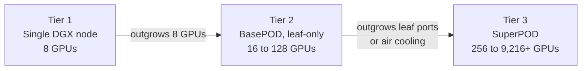
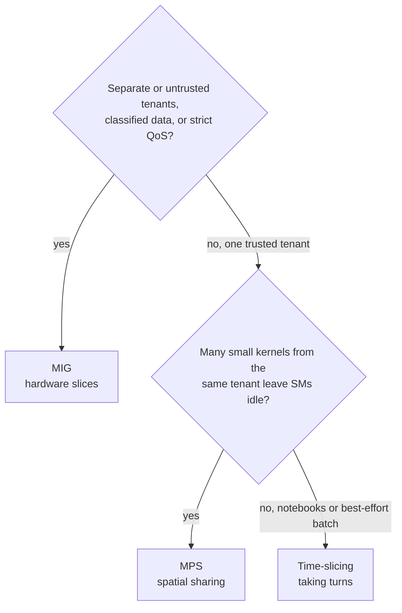
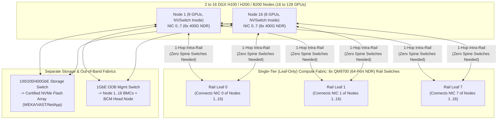

# 9.10 BasePOD and smaller deployments

| | |
|---|---|
| **Status** | Drafted (`basepod_deployments_lab.py`: 28 checks pass; commissioning commands **untested** on live BasePOD) |
| **Level** | Intermediate |
| **Priority tier** | 1b |
| **Lab venue** | none (design / reading) + self-checking Python model (`code/part09/basepod_deployments_lab.py`) |
| **Part** | Part 9: NVIDIA systems and reference architectures |
| **Sources used** | `nvidia-devops` V21 Ch. 1–14, `index.md`, Labs 01, 03, 04; `nvidia-devops-core-interview` Module 4 Q14; `nvidia-devops-legacy-v09` (`01 - Hardware & Ecosystem Gauntlet`, `03 - Security Governance Masterclass`, `05 - Linux, Networking, and IaC Gauntlet`) |

## Why this matters for AI infrastructure

Picture a data science team that receives its first eight-GPU server. The engineers are glad to have it, and they start running their scripts the same way they ran them on a laptop. Each script uses one GPU. The other seven sit idle, and the server looks like an expensive way to run a single job at a time. This is how most enterprise teams begin. They do not start with a data center built for a multi-unit SuperPOD. They buy one server for one team, or a small departmental pod of two to sixteen nodes, where a node is one server inside the cluster.

Small pods fail in two opposite ways. If engineers treat the pod like a workstation, the project stalls, because nobody plans for shared storage, scheduling or identical software on every machine. If they overbuild it like a cloud cluster, the budget goes into parts that nobody uses. Either seven of eight GPUs sit idle behind single-GPU scripts, or a missing commissioning check crashes a two-week training job on day three. Commissioning means the set of checks a team runs on new hardware before it lets real work touch it.

Three choices matter for smaller deployments. First, you can drop the spine switch layer when your nodes fit inside one layer of rail leaf switches. A spine switch sits above the leaf switches and carries traffic between them. Dropping it saves transceivers and switches, and it keeps same-rail traffic to one switch hop, which means one trip through a single switch.

Second, you must share expensive GPUs safely among users and jobs. Choose between Multi-Instance GPU (MIG) hardware isolation, Multi-Process Service (MPS) sharing and simple time-slicing. MIG splits one GPU into separate hardware slices. MPS lets several processes from one program share the GPU at the same time. Time-slicing lets processes take turns. A software sharing mode across untrusted tenants exposes shared physical memory, and one faulty kernel can crash every neighbour on the device. A kernel is a small program that runs on the GPU.

Third, run a six-stage commissioning and acceptance gate before you hand the cluster to researchers. Physical, server, network, storage, cluster and operational checks catch marginal transceivers, parts swapped into the wrong slot after maintenance, and missing blanking panels before production runs begin. A blanking panel is a plain cover that fills an empty rack slot so that air cannot slip through the gap.

```text
Deployment scales and the main engineering focus at each:
  - Single DGX Node:     1 node (8 GPUs)                  -> Internal NVSwitch only; MIG/MPS/containers to prevent 7 of 8 GPUs sitting idle
  - DGX BasePOD / Pod:   2 to 16 nodes (16 to 128 GPUs)   -> Leaf-only rail-optimized fabric (0 spines), 3-fabric split, shared flash storage, 6-stage acceptance
  - DGX SuperPOD:        32+ nodes (256 to 9,216+ GPUs)   -> Multi-tier leaf-spine Clos, 1.2 MW to 19.2 MW facility power/CDU cooling, UFM, Mission Control recovery
```

Read the block above from top to bottom. Each line is one tier, and the text after the arrow names the engineering focus that tier needs. The jump from one tier to the next is driven by the number of nodes and by what the building can supply, in power and in cooling.

## Prerequisites and outcomes

**Prerequisites:** Review DGX node internals and SuperPOD Scalable Unit concepts in Chapters 9.1, 9.2, and 9.6. You should also understand Base Command Manager golden-image provisioning from Chapters 8.1 and 8.4. A golden image is one master copy of an operating system and its software that every compute node is built from.

The chapter walks through the three tiers and what changes at each one. It then covers the three ways to share a GPU, a leaf-only network design with a 16-node reference pod, a multi-pool budget case for a startup, and the six acceptance stages. Each section starts from a situation a team meets in practice, and then explains the mechanism that answers it.

---

## 1. Three tiers: one node, a BasePOD and a SuperPOD

A team that buys one eight-GPU server has a utilization problem. Utilization is the share of time the hardware is doing useful work instead of waiting. Data scientists run single-GPU scripts and seven GPUs sit idle. When the same team grows to four or sixteen nodes, single-server habits break. Without separate compute and storage networks, golden-image provisioning and a cluster scheduler, multi-node jobs stall on storage contention and configuration drift. Storage contention means many machines fight over the same disks at once, and configuration drift means the machines slowly stop matching one another.

The three tiers need different designs. On a single DGX node, every transfer stays inside the NVSwitch baseboard, and the main job is keeping the GPUs busy with containers and GPU partitioning. NVSwitch is the switch chip on the node's board that links all the GPUs together, so GPUs can exchange data without going out to the network. A BasePOD of two to sixteen nodes adds one cluster manager, Base Command Manager with Slurm or Kubernetes, one layer of leaf switches and shared flash storage. Slurm and Kubernetes are the two schedulers that decide which job runs on which machine. A SuperPOD of 32 or more nodes needs its own power and liquid-cooling infrastructure and a multi-tier leaf-spine fabric managed with UFM and NMX-M. It also needs automated recovery software, because hardware faults happen daily at a thousand GPUs. At that size, something breaks almost every day, so the software has to find the fault and route work around it without a person having to start there.



The diagram shows the move from one tier to the next. Each arrow has a reason written on it. A team moves to a BasePOD when eight GPUs are no longer enough. It moves to a SuperPOD when the leaf switch ports run out or when air cooling cannot carry the heat any more.

| Tier | Scale | Network | Storage | Software |
|---|---|---|---|---|
| 1. Single DGX node | 1 node, 8 GPUs (DGX H100 / H200 / B200) | Internal NVSwitch, 900 to 1,800 GB/s | 30 TB local `/raid` plus enterprise NAS | DGX OS, NGC, Jupyter, MIG / MPS |
| 2. BasePOD / leaf-only pod | 2 to 16 air-cooled DGX nodes (16 to 128 GPUs) | Single-tier (leaf-only) IB NDR or RoCEv2; 3 fabrics: compute, storage, management | Shared all-flash storage (VAST, WEKA, NetApp) | BCM golden images, Slurm or Kubernetes operators |
| 3. SuperPOD | 32+ nodes or 8+ NVL72 racks (256 to 9,216+ GPUs) | Multi-tier non-blocking fat-tree (leaf and spine) | Dedicated high-performance storage | UFM, NMX-M, Mission Control auto-recovery; facility power and liquid cooling (CDUs) |

The table is a lookup. Use it when you need the scale, network, storage or software of a tier, and read the prose around it for the reasons behind each row.

### 1.1 The three tiers side by side

The two-to-sixteen node range for a spine-less pod is this chapter's own choice, used in `select_deployment_archetype`. It joins a two-to-eight node BasePOD onboarding range with a sixteen-node leaf-only pod design. Treat it as a planning rule, not an NVIDIA limit. A planning rule is a guideline a team chooses for itself, and a different team could draw the line in another place for good reasons.

The comparison below sets the same five dimensions side by side. Read across a row to see how one concern changes from tier to tier. Read down a column to see the whole profile of one tier.

| Dimension | Tier 1: single DGX | Tier 2: BasePOD and smaller pods | Tier 3: SuperPOD |
|---|---|---|---|
| **Scale** | 1 node, 8 GPUs | 2 to 16 nodes, 16 to 128 GPUs | 32+ nodes or 8 to 128 NVL72 racks, 248 to 9,216+ GPUs |
| **Users** | Data science teams, proofs of concept | Departmental AI, fine-tuning, RAG, 70B training | Cloud providers, sovereign AI, frontier pre-training |
| **Compute network** | NVSwitch only | Leaf-only rail-optimized NDR InfiniBand or RoCEv2, no spines | Multi-tier non-blocking fat-tree with `UFM Enterprise` and `NMX-M` |
| **Storage** | Local `/raid` plus existing NAS | Certified all-flash storage on a dedicated 100 to 400G fabric | High-Performance Storage (90 to 280 GB/s per unit) plus NFS user storage |
| **Software** | DGX OS, containers, NGC | `BCM` golden images with Slurm or Kubernetes | Mission Control, BCM, Run:ai or Slurm, automatic recovery |
| **Main risk** | Single-GPU scripts leave 7 of 8 GPUs idle | Storage and compute on one switch, or no multi-node burn-in | Treating a SuperPOD as a big BasePOD |

The last row is the one teams most often get wrong. A SuperPOD has its own power, cooling and fabric requirements, and a design that works for a pod of sixteen nodes will not simply scale up to it.

---

## 2. Sharing a GPU safely: MIG, MPS and time-slicing

Picture an inference service that needs a small embedding model, and a data scientist who wants a notebook open on the same machine. On a single DGX node or a four-node departmental pod, few developers or inference services need a whole high-memory GPU. A small embedding model or a notebook uses a fraction of an H100, H200 or B200. An embedding model turns text into a list of numbers so that similar sentences end up close together. If an administrator shares the GPU with the wrong mechanism, one user's out-of-memory error or illegal memory access crashes every other workload on the card. An illegal memory access happens when a program reads or writes memory it was never given, and the GPU stops that program. Sharing physical memory between business units or regulated datasets also breaks security boundaries.

The sharing question comes down to one point. Do the workloads belong to separate tenants who do not trust each other, or to one team that does? A tenant is a group or customer whose work must stay apart from others. NVIDIA offers three ways to share a GPU. The right one depends on whether the workloads belong to separate untrusted tenants or to one trusted tenant.



Read the diagram as two questions. The first asks about trust and data sensitivity. If the answer is yes, you need MIG. The second asks whether one trusted team is leaving parts of the GPU idle with many small kernels. QoS, quality of service, means a guaranteed level of speed for a workload.

```text
GPU sharing limits:
  - Full GPU VRAM Baselines:  80 GB (H100), 141 GB (H200), 180 GB (B200)
  - MIG Partition Limit:      Up to 7 hardware instances per GPU on A100, H100, H200, and B200
  - MPS Client Limit:         Up to 48 client connections per GPU (shared VRAM and L2 cache)
  - Time-Slicing Replicas:    Configurable (typically 2 to 16+ replicas in Kubernetes Device Plugin)
```

The limits above set the ceiling for each mechanism. VRAM is the memory on the GPU card, and L2 cache is a small, fast memory shared by all the GPU's compute units. The Kubernetes Device Plugin is the component that tells Kubernetes how many GPUs a node has to hand out, so time-slicing replicas are configured there.

### 2.1 The three mechanisms compared

The three mechanisms differ in how they divide the GPU. MIG divides the hardware itself. MPS lets several processes share the compute units at the same time. Time-slicing gives each process a turn on the whole GPU. The table below is a lookup for the differences, and the prose after it explains why they matter.

| Attribute | Multi-Instance GPU (`MIG`) | Multi-Process Service (`MPS`) | Time-slicing |
|---|---|---|---|
| **Partitioning** | Hardware engines; GPU must be reconfigured | CUDA runtime, spatial sharing | Driver, taking turns |
| **Maximum per GPU** | Up to 7 instances (A100, H100, H200, B200) | Up to 48 clients | Configurable, for example 2 to 16 replicas |
| **Compute cores** | Dedicated slices, truly parallel | Shared, kernels run at the same time | Shared, processes take turns |
| **Memory** | Isolated capacity and bandwidth | Shared, no hardware boundary | Shared; one out-of-memory process can starve neighbours |
| **L2 cache** | Dedicated slices | Shared; noisy neighbours possible | Shared |
| **Fault and security isolation** | Hardware isolation; needed for multi-tenant and classified data | None; a fatal fault in one client ends all MPS clients on that GPU | None; shared memory, unsuitable for classified work |
| **Best use** | Multi-tenant inference, notebooks, classified workloads, strict latency targets | One tenant's MPI ranks or small inference kernels that cannot fill the GPU alone | Best-effort dev and test pods for one friendly team |

The main difference is fault isolation. With MIG, a crash in one slice stays in that slice. With MPS and time-slicing, a crash in one process can reach the others, because they all lean on the same memory and the same cache. Speed is a secondary concern. Choose the mechanism by asking who you are protecting from whom, then check whether the speed of the result is good enough.

MPI ranks, in the table, are the separate processes that one parallel program starts to split its work. A tenant's job of this kind can use MPS well, because all its ranks belong to the same owner.

---

## 3. Leaf-only networking and a 16-node reference pod

Teams stepping up from one server to a multi-node pod often assume they must buy a two-tier leaf-and-spine fabric at once. A fabric is the network that connects the nodes. In a two-tier design, leaf switches connect to the nodes and spine switches connect the leaves to each other. On two to sixteen nodes, a spine tier costs hundreds of thousands of dollars in switches and optics and adds a hop to cross-switch traffic. Optics are the transceivers and fibre that carry the signal between a switch and a cable.

### 3.1 Why two to sixteen nodes need no spine switches

Chapters 9.6 to 9.9 showed that a multi-unit SuperPOD uses a two-tier leaf-and-spine fat-tree. A fat-tree is a layout where the links get wider as they climb toward the top, so the traffic can always flow without bottlenecks. A BasePOD of two to sixteen nodes can omit the spines, because all the nodes fit within the ports of one layer of rail leaf switches. A rail is one lane of the network, and each lane connects one NIC position across every node. A NIC is the network card that carries a node's data onto the fabric.



The diagram separates three networks. The compute fabric carries the traffic between GPUs. The storage switch connects the nodes to the shared flash array. The out-of-band switch carries management traffic to the BMCs, the small controllers that let you reach a server when its operating system is down. Keeping these three apart stops a busy training job from starving the storage or the management path.

Each eight-GPU node has eight compute NICs at 400 Gbps NDR. You deploy eight leaf switches, one per rail, such as the 64-port Quantum-2 QM9700. NIC `k` of every node plugs into leaf `k`. For a very small pod of two to four nodes, you can also split the rail domains across one or two physical switches.

All sixteen nodes plug their rail `k` NIC into the same leaf `k`, so each leaf uses only 16 of its 64 ports. Every same-rail transfer between any two nodes takes one switch hop, with no spine. Cross-rail transfers happen inside each node over the NVSwitch baseboard. The reason this works is simple. A GPU on node 3 that needs to talk to the GPU in the same slot on node 9 uses the same rail, so the traffic goes up through one switch and down again. A GPU that needs to talk to a different slot first crosses the NVSwitch inside its own node, and then takes the rail that matches its target.

```text
Leaf-only rail-optimized pod, parameters and trade-offs:
  - Node Injection Bandwidth:  8 NICs x 400 Gbps NDR = 3.2 Tbps per node
  - Intra-Rail Hop Count:      1 switch hop across all 2 to 16 nodes (16 downlinks used per 64-port QM9700 leaf)
  - Intra-Node Cross-Rail:     900 to 1,800 GB/s internal NVSwitch baseboard
  - CAPEX Savings:             Eliminates spine switches and spine-to-leaf optics (saves $100K to $200K+)
  - Operational Constraint:    All 8 rail switches must stay healthy; scaling beyond leaf port count requires adding spines
```

Injection bandwidth is how fast one node can push data into the fabric. CAPEX, capital expenditure, is the money spent up front on hardware. The operational constraint line is the one to remember. If one rail switch fails, that rail is down on every node at once, so the leaf switches need the same care you would give to any single point of failure.

### 3.2 A 16-node training pod and its eight-week rollout

A team that wants to train and refresh a 70B-class language model needs to know what the hardware costs and how long it takes to bring the pod into service. The table gives an illustrative blueprint and capital cost for a 16-node H100 SXM5 pod that trains and refreshes 70B-class language models. The prices are planning figures, not quotes. A planning figure is a number used to size a budget before real vendor prices arrive. The H100 SXM5 is an H100 GPU mounted on the board form that NVIDIA uses in its high-end servers, which lets the GPUs talk to each other at high speed.

| Subsystem | Specification | Illustrative cost |
|---|---|---|
| **Compute Nodes (`16x`)** | `16 × DGX H100-class` nodes = **128x H100 80 GB SXM5 GPUs** (`126,592` dense BF16 TFLOPS peak), dual Xeon Platinum 8480C (`112 cores/node`), `2 TB DDR5/node`, `8 × 3.84 TB NVMe` (`~30 TB/node` local cache) | `16 × $285,000 = $4,560,000` (`$4.56M`) |
| **Compute Fabric** | **8x Rail-Optimized NDR 400G Leaf Switches** (`16 downlinks/switch`, DAC for short runs, AOC otherwise) | `~$400,000` (switches, optics, cables) |
| **Storage & Archive** | `2 × BlueField-3 DPUs/node` → **500 TB Shared All-Flash NAS / Parallel File System (`~10 GB/s`)** + **AWS S3** cold archive | `~$200,000` (allocated storage share) |
| **Racks, Power & Cooling** | **4 Compute Racks** (`4 nodes/rack × 10.2 kW = ~40.8 kW/rack`), **~163.2 kW (`~163 kW`) total IT load**, A+B feeds, hot/cold aisle containment, UPS on network/storage/mgmt | `~$200,000` (racks, PDUs, cooling) + `~$100,000` installation & testing |
| **Total Pod CAPEX & TCO** | **Total CAPEX = `$5,460,000` (`~$5.5M`)** (`~$42,656 / ~$43K` per GPU; `~$43` per dense BF16 TFLOP) | Plus `~$644K/year` OPEX = **`~$7.4M` 3-Year TCO** (`~$2.14 / GPU-hour`) |

Reading the table is easier if you follow the money from top to bottom. The compute nodes are most of the cost. The fabric, storage, racks and power come next. The last row adds it all up. TCO, total cost of ownership, adds the running cost, OPEX, which is the spending that repeats each year, to the up-front cost. A DAC is a direct-attach copper cable, which is cheap and works only over short runs. An AOC is an active optical cable, which costs more and reaches further. The UPS is the battery system that carries the load through a short power cut and gives the generator time to start.

The rollout follows an eight-week schedule with recovery targets. Each week builds on the one before it, and a problem found in week three is far cheaper to fix than one found in week seven.

```text
Eight-week deployment schedule and recovery targets:
  - Weeks 1-2 (Site Preparation):       Install 41 kW/rack A+B PDUs, breakers, chillers/containment, racks, cable trays; test UPS failover
  - Weeks 3-4 (Hardware Installation):  Unpack, inventory, run 8-hour GPU burn-in per node; rack 16 nodes (8 hours); verify ibstat Active / 400G on 128 ports
  - Weeks 5-6 (Software & Config):      Provision DGX OS via BCM golden images; pin driver/CUDA/cuDNN/NCCL; run nccl-tests all_reduce_perf across all 128 GPUs
  - Week 7 (Baseline Performance):      Run 100+ step proxy LLM job; verify 40% to 60% MFU, < 5% exposed communication overhead, and kW draw vs 163.2 kW rating
  - Week 8 (Production Readiness):      Deploy Prometheus (dcgm-exporter, node_exporter, UFM/IB counters) and Grafana; test NAS + S3 checkpoint sync; 1-week burn-in
  - Operational MTTR Targets:           GPU fault <= 15 min, IB link flap <= 5 min, checkpoint failover <= 10 min, brief power blip < 1 min via UPS
```

Several terms in the schedule need a plain explanation. MFU, model FLOPs utilization, is the share of the GPU's peak math speed that a real training run actually uses. A proxy LLM job is a stand-in training run that looks like the real workload, used to test the pod before the real work arrives. Exposed communication overhead is the time the GPUs spend waiting for data from other GPUs, instead of computing. MTTR, mean time to repair, is how long it takes to get a failed part back into service. A checkpoint is a saved copy of the training state, so a crashed run can restart from the last save rather than from the beginning.

---

## 4. A multi-pool cluster: a first-year budget case

Real deployments rarely run one workload. Put periodic pre-training, low-latency production inference and dozens of customer fine-tuning jobs in one queue, and they collide. Training bursts starve the inference API, or an expensive interconnect sits idle during small adapter jobs. Pre-training means training a model from its starting point on a large body of data. Fine-tuning means adjusting an existing model for a narrower task. An adapter is a small set of extra weights trained on top of a frozen base model, which is far cheaper than training the whole model again.

Consider a Series B company with a 20 million dollar first-year budget for capital and operating cost. A Series B company is one that has already raised a large round of outside funding and is now scaling. It has three workloads. It refreshes a 70B model quarterly with 100 billion new tokens. A token is a piece of text, roughly a word or part of a word, and the training data is counted in tokens. It serves a Llama-70B inference API at 500 queries per second at peak, with a 99.5 percent availability target. Availability is the share of time the service is up and answering. It also runs a customer LoRA fine-tuning service with 100 concurrent adapter jobs on an 8B base model. LoRA, low-rank adaptation, is the adapter method described above.

### 4.1 Pool sizing and first-year cost

Three dedicated pools match each workload to the right GPU generation and network. A pool here is a group of machines reserved for one kind of work. Dedicated pools keep a long training run from taking capacity that the customer-facing API needs. Pool 1 is sixteen H100 SXM5 nodes on a rail-optimized InfiniBand fabric for the quarterly refresh. Pool 2 is nine H100 SXM5 nodes, one of them a full spare, serving 500 queries per second of 70B FP8 inference with high availability. FP8 is an 8-bit number format that uses less memory and runs faster than the 16-bit formats. Pool 3 is two A100 80 GB nodes that pack up to 128 concurrent 8B LoRA jobs, where multi-node InfiniBand is not needed.

```text
Pool sizing and first-year cost arithmetic:
  1. Pool 1 — 16-Node (128-GPU H100 SXM5) Training Pod ($4.96M compute + fabric):
     - Training FLOPs per refresh:  FLOPs = 6 x Parameters x Tokens = 6 x (70 x 10^9) x (100 x 10^9) = 4.2 x 10^22 FLOPs
     - Sustained cluster throughput: 128 GPUs x 989 TFLOPS (BF16 dense) x 0.40 MFU = 50,636.8 TFLOPS (50.6 PFLOPS)
     - Wall-clock refresh duration: 4.2 x 10^22 FLOPs / 5.06368 x 10^16 FLOP/s = 829,436 seconds = 9.6 days (~120,000 tokens/s)
     - Cost per quarterly refresh:  Electricity (16 x 10.2 kW x 1.35 PUE = 220 kW x 230 hrs x $0.12/kWh = $6K)
                                    + 3-year hardware amortization ($4.56M x 9.6 / 1,095 days = $40K) = ~$46K per run (80 spare days/quarter)

  2. Pool 2 — 9-Node (72-GPU H100 SXM5) Production Inference Pool ($2.57M compute):
     - Per-replica throughput:      Llama-3-70B FP8 with TP=2 delivers 15.2 QPS per 2-GPU replica (< 500 ms P99 TTFT)
     - Active replicas for 500 QPS: 500 / 15.2 = 32.9 -> 33 replicas (66 GPUs)
     - N+1 High-Availability sizing: Add 1 full spare node for 99.5% SLA (<= 3.6 hrs/mo downtime) -> 9 nodes = 72 GPUs (36 replicas = 547.2 QPS)

  3. Pool 3 — 2-Node (16-GPU A100 80 GB) Multi-Tenant LoRA Pool (~$0.40M compute):
     - Per-GPU memory bin-packing:  8B BF16 base weights (~16 GB shared read-only) + ~2 GB per-job activations/rank-16 LoRA adapter
     - Concurrent job capacity:     4 to 8 concurrent LoRA trainers per 80 GB GPU = 64 to 128 concurrent jobs across 16 GPUs

  4. Total Year-1 Budget Rollup (27 Nodes Total):
     - Total CAPEX:                 $4.56M (16 train) + $0.40M (IB) + $2.57M (9 infer) + $0.40M (2 LoRA) + $1.00M (storage/power/cooling/install) = ~$8.93M (~$8.9M)
     - Year-1 OPEX:                 Electricity (27 x 10.2 kW x 60% load x 1.35 PUE = 223 kW x 8,760 hrs x $0.12/kWh = $234K)
                                    + Personnel (3 FTE x $150K = $450K) + Maintenance (1% CAPEX = $89K) + Software (~$50K) = ~$0.82M OPEX
     - Combined Year-1 Spend:       $8.9M CAPEX + $0.82M OPEX = ~$9.7M (leaves ~$10.3M of the $20M budget for a second region or expansion)
```

The arithmetic has a clear order. Start with the work, which is the number of FLOPs, floating-point operations, a training run needs. Then divide by the speed the pool delivers, and you get the time. For the training pool, the work is 6 times the parameter count times the token count. Parameters are the learned numbers inside the model. The sustained speed is the peak speed of the GPUs, scaled down by the MFU. PUE, power usage effectiveness, is the total power a facility draws divided by the power the IT equipment uses, so a PUE above 1 shows the cooling and power losses. FTE means full-time equivalent, one full-time person. Amortization spreads the price of the hardware over the years it will be used.

For the inference pool, the logic runs the other way. Start from the traffic you must serve, 500 queries per second, and divide by what one replica can handle, which is 15.2. That gives 33 replicas. A replica is one running copy of the model. TP=2 means each replica spreads the model over two GPUs. The spare node is what the N+1 label means. N+1 means you have one more than you strictly need, so one failure does not break the service. The downtime figure follows from the availability target. A 99.5 percent target allows the service to be down for only a small share of the month.

The LoRA pool works from memory rather than from speed. The base weights are loaded once and shared, and each job adds only its own small adapter and activations. Activations are the intermediate values a model holds during training. Packing jobs into memory is what lets one GPU serve several customers at once.

The year-one total is the sum of the pool costs plus the first year of running costs. The budget then leaves room for a second region or for growth. Keeping spare budget is a choice, and it is what allows the company to respond to demand it cannot yet predict.

---

## 5. Six stages of commissioning and acceptance

Picture a new pod that passes `nvidia-smi` and a thirty-second smoke test on its first morning. The team is ready to announce it. A smoke test is a quick run that checks the system is basically alive, and it is far from a proof that the system will hold up under real load. Many multi-week training failures trace back to a defect that existed on day one. Examples are a missing blanking panel that lets hot exhaust recirculate, a GPU reseated into the wrong slot after a return, and one rail landing on an oversubscribed uplink. An uplink is a link that carries traffic up to a higher layer, and oversubscribed means more traffic is offered to it than it can carry. Others show up only after two days of heat soak, or because an alert rule has a misspelled metric name.

Before you sign off a new pod, run all six acceptance stages in order, as modeled in `evaluate_six_stage_acceptance`, and keep the evidence. The order matters. Each stage assumes the one before it has passed. There is no point checking storage speed on a rack whose cables are crossed. Keeping the evidence means saving the logs and reports, so that a later failure can be traced to a specific change.

### Stage 1: Physical Acceptance

The first stage asks whether the building is ready for the hardware. A rack that runs too hot or a circuit that is too close to its limit will cause trouble no matter how good the servers are.

Checks: PDU load balanced across phases, breaker headroom `> 20%`. A PDU is the power distribution unit inside the rack, and phases are the separate legs of the three-phase power supply, which should carry roughly equal load. Breaker headroom is how much spare capacity a circuit breaker still has before it trips. Rack inlet temperature `< 27°C` under load (thermal camera walk). The inlet temperature is the air temperature that enters the front of each server, and a thermal camera walk means someone walks the rows while the racks are working and photographs the heat. All cables labeled, bend radius respected, DAC/AOC within spec. Bend radius is how sharply a cable may be bent before the signal suffers. Zero optical RX/TX power warnings (`ethtool` / switch CLI). RX and TX are the receive and transmit sides of an optical link, and a warning there means the light level is out of range. Every node's BMC reachable + Redfish power-cycle verified. Redfish is the standard remote interface for managing server hardware, and a power cycle means turning the machine off and on again remotely.

Evidence to keep: Signed physical checklist + thermal camera photos + 100% green BMC table.

Example symptom: Thermal camera shows `Node 7` inlet at `34°C` while neighbors read `24°C`.

Example triage: Check for a blocked front filter or a missing rack blanking panel allowing hot-aisle exhaust recirculation (a 10-minute fix) before blaming the room chillers. A hot aisle is the row where servers blow their exhaust, and recirculation is that hot air being drawn back into the front of a server. The fix is cheap and quick, so check it before you suspect the cooling plant.

### Stage 2: Server Acceptance

The second stage asks whether each server is built the way the design says it should be. Two servers of the same model can behave differently if one has older firmware or a card in the wrong slot.

Checks: Zero firmware drift (`BIOS, BMC, GPU VBIOS, NIC, BlueField DPU`). Firmware is the small program stored on each part. Drift means the parts on different machines are running different versions. `nvidia-smi -L` matches SKU count. A SKU is a stock-keeping unit, the model code for a configuration, and the count should match the design. Zero `Xid` or ECC errors. Xid is the error code the NVIDIA driver logs when a GPU faults, and ECC is error-correcting memory. All DIMM channels populated at rated speed (`dmidecode`). A DIMM is a memory module, and each channel should run at the speed it was rated for. `nvidia-smi topo -m` matches fleet matrix (`NV18` + `PIX`). This command shows how each GPU connects to every other GPU and NIC, and the fleet matrix is the reference table that every node must match. `nvidia-smi nvlink -s` & `ibstat` (`Active / LinkUp / 400G`) all green. These commands show the status of the GPU-to-GPU links and the InfiniBand links.

Evidence to keep: Zero-delta firmware diff report + archived `topo -m` & NVLink tables per node.

Example symptom: One node's `nvidia-smi topo -m` shows a GPU-NIC pair on `NODE`/`SYS` instead of `PIX`.

Example triage: Node was reassembled after an RMA with NICs/GPUs in the wrong slots. Physically move the card back to the right slot; never mask it in software. An RMA is a return merchandise authorization, the process for sending a faulty part back to the vendor. Masking it in software would hide the symptom and leave the wrong path in place.

### Stage 3: Network Acceptance

The third stage asks whether every link in the fabric carries the speed it should. A fabric that is slow on one rail will slow every job that touches that rail, and the symptom often looks like a software problem.

Checks: Switch LLDP neighbor table matches cabling diagram (`0` crossed rails). LLDP, link layer discovery protocol, lets each switch report which device sits on the other end of each cable, so you can compare the live wiring with the plan. Every port `UP` at full negotiated speed. Point-to-point `ib_write_bw` / `nccl-tests` `≥ 90%` of line rate on every individual rail. The line rate is the speed the link is rated for, and each rail is tested on its own. `ib_write_lat` in low single-digit µs. Latency is the delay for one small message to cross the link. Full-scale `all_reduce_perf` with zero PFC pause storms. All-reduce is the collective step where every GPU combines its results with every other GPU, and PFC, priority flow control, is the mechanism that pauses traffic to stop packets from being dropped. A pause storm means the pauses spread and block the network.

Evidence to keep: Full all-pairs, per-rail bandwidth/latency matrix + full-scale `nccl-tests` report.

Example symptom: `Rail 3` across all 16 nodes runs 15% slower than `Rails 0–2, 4–7`.

Example triage: Don't swap 16 optical cables. Check `Leaf Switch 3`'s uplink group or QoS config—a single shared switch misconfiguration explains a whole-rail drop. QoS is quality of service, the rules that decide which traffic gets priority. A problem that affects one rail on all nodes points at the shared switch, not at sixteen separate cables.

### Stage 4: Storage Acceptance

The fourth stage asks whether the shared storage can keep up with every GPU at once. A training job reads its dataset and writes its checkpoints, and when all nodes do this together, the storage path is often the first thing to saturate.

Checks: Concurrent all-node `fio` sequential read/write meets target (`≥ 100 MB/s per GPU` aggregate). fio is a benchmark tool for disk and network storage, and sequential means reading or writing large blocks in order. Aggregate means the total across all nodes. Random small-file read IOPS meets shuffled-dataset target. IOPS is input-output operations per second, and small random reads are what a shuffled dataset of many small files produces. `mdtest` file create/stat/delete rates validated for thousands of shard files. mdtest measures how fast the storage handles file metadata, such as creating, checking and deleting files, and shard files are the pieces a large dataset is split into. Timed full-scale 128-GPU checkpoint save & restore within MTTR budget. The checkpoint test is the one that matters most, because it measures how fast a failed run can come back.

Evidence to keep: Concurrent all-node `fio` + `mdtest` logs + timed full-cluster checkpoint save/restore log.

Example symptom: 16-node concurrent read hits only 60% of the single-node benchmark.

Example triage: Check the storage switch uplinks between compute leaves and the storage array before blaming the SSDs. The single-node benchmark is the baseline, and a concurrent test that falls well short of it usually means the shared path is the bottleneck.

### Stage 5: Cluster Acceptance

The fifth stage asks whether the whole cluster holds up under sustained load, not just in short bursts. Many failures only appear after the hardware has been hot for a long time.

Checks: Full-cluster `HPL / GPU-Linpack` sustained FLOPS check (`0` node drops). HPL is the High-Performance Linpack benchmark, which runs a large dense math problem across every node and measures sustained speed. Full-scale `nccl-tests` (`all_reduce_perf`, `all_gather_perf`). These tests run the collective operations across the whole pod. NVIDIA `ClusterKit` coordinated multi-node diagnostic sweep. ClusterKit is a set of diagnostics that check many nodes in one coordinated pass. 24-to-72-hour continuous burn-in (`0` unplanned node drops). A burn-in is a long run under full load, meant to shake out faults that appear only after heat has built up. End-to-end representative customer workload + checkpoint restore.

Evidence to keep: HPL report + `ClusterKit` output + 24–72h burn-in log + customer proxy run log.

Example symptom: At hour 48 of burn-in, `Node 11` throws `Xid 79 (Fallen off the bus)` and drops.

Example triage: Pull the node, run diagnostics, and RMA. Never just restart the job and sign off—catching 48-hour thermal/power infant mortality is the entire purpose of Stage 5. Infant mortality is the term for parts that fail early because of a hidden defect, and the burn-in exists to catch those failures before customers do. Restarting the job would hide the fault and let the defective node back into service.

### Stage 6: Operational Acceptance

The sixth stage asks whether the people and processes around the pod work when something goes wrong. A cluster that is healthy on paper but cannot page the right person at night is not ready.

Checks: Live alert-fire injection (simulate GPU temp/node kill and confirm page reaches on-call). Injection means you trigger a fake fault on purpose and check that the alert reaches the on-call engineer. CMDB reconciliation (exact serials, asset tags, rack RU slots). A CMDB is the configuration database that records each machine, and RU is a rack unit, the standard height of one slot. Live executed rollback drill (revert a firmware/image update end-to-end). Clean node drain/cordon and rejoin test. Draining means moving the work off a node, and cordoning means marking it so that no new work lands there. Runbooks accessible outside the cluster + test vendor support ticket. A runbook is the written step-by-step guide for handling a known problem, and it must be readable even when the cluster is down.

Evidence to keep: Alert-fire delivery log + reconciled CMDB export + executed rollback log + test ticket ID.

Example symptom: Simulated GPU temperature spike never pages on-call.

Example triage: Check the Prometheus scrape target and DCGM metric name in the alert rule (e.g., referencing a non-existent metric name) before assuming the GPU didn't heat up. Prometheus is the monitoring system that collects the metrics, and DCGM is the NVIDIA tool that exports GPU metrics. A typo in a metric name means the alert is watching a value that never arrives, so it stays silent even when the GPU overheats.

---

## Commands and configurations that matter

Use these commands during BasePOD provisioning, safe golden-image driver updates, MIG partitioning, and six-stage acceptance testing. These steps were not run on a live BasePOD, so treat them as a starting point to check against your own hardware. The decision logic behind them is covered by the lab in `code/part09/basepod_deployments_lab.py`.

### 1. Safe OFED and driver update on a BCM-managed BasePOD via image cloning

When an administrator runs ad-hoc package manager updates directly on live Base Command Manager compute nodes, the cluster drifts out of sync and loses its rollback path. OFED is the OpenFabrics Enterprise Distribution, the package set that drives the InfiniBand NICs. Even worse, rebooting a compute node wipes local package changes when it boots from the central golden image. Always clone the software image on the head node, chroot into the clone, regenerate the initial ramdisk, canary-test one node, and roll out by category. The head node is the management server that holds the images. Chroot means running commands inside the cloned image as if it were its own root filesystem. The initial ramdisk is the small boot image that loads the drivers before the system starts, which is why it must be rebuilt when kernel modules change. A canary test runs the change on one node first, so a bad update reaches only one machine. A category is the group of nodes that share one image.

```text
# 1. Clone the active golden image in cmsh
[root@headnode ~]# cmsh
% softwareimage
% clone dgx-os-6-1 dgx-os-6-1-ofed24
% commit
```

```bash
# 2. Chroot into the cloned image directory on the head node and install the new package
sudo cm-chroot-sw-img /cm/images/dgx-os-6-1-ofed24
apt-get update && apt-get install -y mlnx-ofed-all
exit
```

```text
# 3. Regenerate the initial ramdisk (mandatory when kernel modules change!) and canary test node001
[root@headnode ~]# cmsh
% softwareimage use dgx-os-6-1-ofed24
% createramdisk
% device use node001
% set softwareimage dgx-os-6-1-ofed24
% commit
% reboot
# If node001 passes ibstat and nccl-tests, update the category; to roll back, point back to dgx-os-6-1 and reboot!
```

The three steps work in a fixed order. The clone protects the working image. The chroot step changes only the copy. The ramdisk step makes the copy bootable with its new drivers, and the canary step proves it on one node. The rollback path is the original image, which is still on disk, so switching back takes a reboot rather than a repair.

### 2. Configure hardware-isolated Multi-Instance GPU slices on a single DGX or BasePOD node

When multiple developers or inference containers share a single GPU without hardware isolation, one process can exhaust memory or trigger a fault that kills every neighbor. A container is a packaged, isolated process that shares the host's kernel. Enabling Multi-Instance GPU mode partitions the physical streaming multiprocessors, L2 cache, and memory controllers into isolated hardware slices. The streaming multiprocessors are the blocks of compute units inside the GPU, and the memory controllers are the parts that move data to and from the memory. A GPU instance is the hardware slice, and a compute instance is the set of compute units that runs inside it.

```bash
# 1. Enable MIG mode on GPU 0 (requires GPU reset / no active CUDA processes)
sudo nvidia-smi -i 0 -mig 1

# 2. List supported MIG GPU Instance (GI) profiles (e.g., 1g.10gb, 2g.20gb, 3g.40gb, 7g.80gb on H100)
sudo nvidia-smi mig -i 0 -lgip

# 3. Create seven isolated 1g.10gb MIG instances with their matching Compute Instances (-C)
sudo nvidia-smi mig -i 0 -cgi 19,19,19,19,19,19,19 -C

# 4. Verify all 7 hardware-isolated MIG devices and their UUIDs
nvidia-smi -L
```

Run the steps in order. Step 1 turns the mode on, and it needs the GPU to be idle, which is why the comment asks for no active CUDA processes. CUDA is the programming model that runs code on NVIDIA GPUs. Step 2 is a read-only listing, so it is safe to run at any time. Step 3 creates the slices. Step 4 is the check that every slice exists and has its own UUID, which is the unique ID the system uses to refer to it.

### 3. Stage 2, 3, and 4 Acceptance verification commands across a 16-node BasePOD

Skipping fleet-wide firmware checks, per-rail bandwidth tests, or metadata stress tests leaves hidden bottlenecks in the cluster. A hidden bottleneck is a slow point that no one has measured, so it shows up only under real load. Run these three checks across all sixteen nodes before starting the Stage 5 cluster burn-in. Each check maps to one acceptance stage, so a failure tells you which stage to revisit.

```bash
# Stage 2: Verify zero VBIOS drift across all 16 nodes via BCM pexec
cmsh -c "device; pexec -n node001..node016 'nvidia-smi --query-gpu=name,vbios_version --format=csv,noheader | uniq -c'"

# Stage 3: Verify per-rail RDMA bandwidth (>= 90% of 400G = >= 45 GB/s per HCA)
ib_write_bw -d mlx5_0 -F --report_gbits --use_cuda=0 <peer_node_ip>

# Stage 4: Verify concurrent metadata creation/stat/deletion rates across all 16 nodes with mdtest
mpirun -np 128 --map-by ppr:8:node mdtest -n 1000 -i 3 -d /mnt/SharedPFS/mdtest_dir
```

The first command uses `pexec` to run one query on every node at the same time, so a single VBIOS version that differs across the pod shows up at once. The VBIOS is the firmware stored on the GPU board. The second command measures the speed of one rail between two nodes, and the comment shows what passing looks like. The third command starts a metadata test across all nodes. A metadata test checks how fast the storage handles the file operations described in Stage 4.

---

## How it fails

Each failure below follows the same pattern. The symptom is what the team sees first, the cause is the mechanism underneath, and the fix is the change that removes the cause. Read the symptom as a clue, because it often points to the wrong layer at first.

### 1. Using Time-Slicing or MPS for untrusted multi-tenant or classified workloads

Symptom: A tenant's buggy CUDA kernel triggers an illegal memory access and crashes every other tenant's pod on the same GPU—or a security audit flags shared physical VRAM across classified tenants.

Cause: Time-Slicing and MPS share the same physical HBM address space and L2 cache with zero hardware memory protection or fault isolation. HBM is the high-bandwidth memory on the GPU card. An address space is the range of memory locations a process can point to, so shared address space means one process can reach memory that belongs to another. The team cannot see this from the outside until something crashes.

Fix: Enable Multi-Instance GPU (`MIG`) (`nvidia-smi -mig 1`, or via the Kubernetes GPU Operator `mig.strategy=single|mixed`), which physically partitions SMs, L2 cache, and memory controllers into up to 7 hardware-isolated instances. The GPU Operator is the Kubernetes component that installs and manages the GPU software, and the strategy setting controls how the MIG slices are offered to pods. SMs are the streaming multiprocessors, the compute blocks inside the GPU.

### 2. Updating drivers on a BCM BasePOD via ad-hoc `apt/yum` instead of image cloning

Symptom: After an in-place driver update across 16 nodes, 3 nodes fail to boot and the remaining 13 get overwritten back to the old driver on their next reboot.

Cause: BCM provisions compute nodes from golden software images stored on the head node. In-place package edits on compute nodes are wiped on reboot, and editing the live image without cloning or running `createramdisk` leaves no rollback path. The failure looks strange at first, because the update seemed to work when it was applied, and only a reboot reveals it was never kept.

Fix: Clone the software image in `cmsh` (`clone old new`), update packages inside `cm-chroot-sw-img /cm/images/<new>`, run `createramdisk` inside `cmsh`, canary-test one node, and switch the category image assignment.

### 3. Hot-aisle recirculation (`34°C` inlet) on one node from a missing blanking panel (Stage 1)

Symptom: During Stage 1/5 acceptance, `Node 7` thermal-throttles with a `34°C` inlet reading while `Node 6` and `Node 8` in the same rack read `24°C`. Thermal throttling is when the GPU slows itself down to protect its temperature.

Cause: An empty 2U–4U gap above `Node 7` was left without a rack blanking panel, allowing `50°C+` rear exhaust air to get sucked directly back into `Node 7`'s front intake fans. The gap is a missing piece of rack space, and the hot exhaust from the servers above it finds an easy path back to the front of Node 7. The neighbors look fine because they are not sitting next to the gap.

Fix: Walk the cold aisle with a thermal camera during Stage 1 Physical Acceptance and install snap-in blanking panels in every unused rack unit (`RU`) plus brush grommets on all cable openings. The cold aisle is the side of the rack where cool air comes in, and brush grommets are the bristle strips that seal the holes where cables pass through.

### 4. Post-RMA PCIe slot swap turning a repaired node into a permanent straggler (Stage 2)

Symptom: After a field technician replaces a motherboard or riser on `Node 4`, `nvidia-smi` shows all 8 GPUs healthy, but 16-node training jobs run 20% slower whenever `Node 4` is included. A straggler is a node that runs slower than the rest, and in a synchronized job the whole run waits for it. A riser is a small board that holds PCIe cards at a right angle to the motherboard.

Cause: During reassembly, a ConnectX-7 NIC was plugged into a riser on the wrong PCIe root complex/switch (`NODE` or `SYS` instead of `PIX` in `nvidia-smi topo -m`). PCIe is the bus that connects cards to the CPU, and a root complex is the point where that bus leaves the CPU. NCCL still runs, but that rail's traffic bounces through the CPU/UPI link. NCCL is the NVIDIA collective communication library that moves data between GPUs, and UPI is the link between the two CPU sockets. The traffic still arrives, which is why the node looks healthy in simple checks.

Fix: Always re-run Stage 2 Server Acceptance (`nvidia-smi topo -m` diffed against the fleet golden matrix) whenever a node returns from hardware maintenance, and physically move the card back to its designated PCIe switch slot.

### 5. Signing off on a cluster after a 10-minute test and hitting `Xid 79` on Day 3 (Stage 5)

Symptom: A newly delivered 16-node cluster passes quick `nvidia-smi` and 1-minute `nccl-tests` checks, gets handed to researchers, and crashes 48 hours into a flagship training run with `Xid 79 (GPU has fallen off the bus)`. A quick test is useful for catching obvious faults, but it runs too briefly to show a problem that grows with heat.

Cause: Infant-mortality hardware defects (marginal SXM socket contact, PCIe retimer thermal drift, or PSU voltage droop) only manifest after 24 to 72 hours of continuous thermal soak. A retimer is a chip that rebuilds the PCIe signal over a longer path, and PSU is the power supply. Voltage droop means the supply voltage sags under load. Each defect is small and each one stays hidden until the parts warm up together.

Fix: Never waive Stage 5 Cluster Acceptance: run `HPL`, `ClusterKit`, and a mandatory 24-to-72-hour continuous burn-in (plus a full proxy job with checkpoint save/restore). Any node that drops during the 72-hour burn-in is pulled and RMA'd before customer handoff. Waiving the stage saves schedule time at the front, but it risks a crash that costs far more in lost training time later.

---

## Hands-on lab

This chapter's self-checking Python model in `code/part09/basepod_deployments.py` and lab runner in `code/part09/basepod_deployments_lab.py` implement four verification modules. A verification module is one small piece of the model that checks one decision against its rule. First, the deployment archetype selector classifies clusters into a Single-Node DGX, a BasePOD or leaf-only pod, or a multi-tier SuperPOD. Second, the GPU sharing selector chooses between Multi-Instance GPU, Multi-Process Service, and time-slicing. Third, the 16-node training pod sizer and the startup multi-pool calculator verify the rack power, capital cost, and training refresh math. Fourth, the six-stage commissioning auditor checks every acceptance threshold across physical, server, network, storage, cluster, and operational gates. The lab checks the logic of the design. It does not touch a real cluster, so a pass means the rules are consistent, not that the hardware is correct.

```text
Python Model Parameter Summary (code/part09/basepod_deployments.py):
  - Archetype Boundaries:     1 node (8 GPUs) -> Single-Node DGX; 2-16 air-cooled nodes (16-128 GPUs) -> BasePOD; 32+ nodes -> SuperPOD
  - 16-Node Pod Sizer:        4 racks, 40.8 kW/rack, 163.2 kW IT load, 8 rail leaves (16 downlinks), $4.56M + $0.90M = $5.46M ($42,656/GPU, $43/TFLOP)
  - $20M Startup Calculator:  4.2e22 FLOPs = 9.6 days on 128 H100s at 40% MFU; 36 2-GPU replicas = 547.2 QPS
```

Run the lab from the repository root. The command below runs the checks without writing a bytecode cache.

```bash
python3 -B code/part09/basepod_deployments_lab.py
```

The lab prints one line per check and a summary at the end. When it passes in this repository, the output looks like the block below.

```text
=== Chapter 9.10 Lab: BasePOD and Smaller Deployments ===
  [PASS] 1-node deployment maps to Single-Node DGX (8 GPUs, internal NVSwitch only)
  [PASS] 4-node (32 GPU) and 16-node (128 GPU) air-cooled pods map to BasePOD / Leaf-Only Pod
  [PASS] 32-node cluster or liquid-cooled deployment maps to SuperPOD (multi-tier Clos + facility CDU)
  [PASS] Rejects node_count <= 0
  [PASS] Untrusted multi-tenant / classified workload selects MIG (7 slices, hardware memory + fault isolation)
  [PASS] Single-tenant concurrent small kernels selects MPS (spatial sharing, no hardware fault isolation)
  ...
  [PASS] V21 Ch13 Stage 6: Paper-only rollback (not executed live) fails Stage 6 Operational
  [PASS] V21 Ch13 Stage 3: PFC pause storm during all-to-all test fails Stage 3 Network
  [PASS] V21 Ch13 Stage 4: Failed mdtest small-file metadata rate fails Stage 4 Storage
  [PASS] V21 Ch13 Stage 5: Failed ClusterKit multi-node sweep fails Stage 5 Cluster
  [PASS] V21 Ch13 Stage 6: Unreconciled CMDB serials/rack slots fails Stage 6 Operational

Summary: 28 passed, 0 failed (total 28)
```

---

## Exercises

1. Run `python3 -B code/part09/basepod_deployments_lab.py` first. Then re-derive the 9.6-day refresh time for a 70B model on 100B tokens with 128 GPUs at 40 percent MFU. Redo the same calculation at 30 percent MFU. Redo it once more with 64 GPUs. Compare the three answers and say which input changed each one.
2. A hospital has classified and non-classified teams sharing one eight-GPU node. Which mechanism fits the classified team? Which mechanism fits the non-classified team? Write the commands you would run to set up MIG.
3. Draw the leaf-only compute fabric for six nodes. How many leaf switches do you need? How many ports are used on each switch? What would force you to add a spine tier?
4. Add up the capital cost of the 16-node pod from the specification table. Does the total match the 5.46 million dollar budget? What is the resulting cost per GPU?
5. You receive a repaired node back from hardware maintenance. Which acceptance stage must you re-run? Which command reveals whether a network card was placed in the wrong slot?
6. Write the golden-image driver update steps for a Base Command Manager pod on one page. End with the exact rollback procedure.

## Checkpoint questions (20)

<details>
<summary>**1. How does the onboarding and architectural focus shift as a customer moves from a Single DGX Node to a BasePOD and then to a SuperPOD?**</summary>

- **Single DGX Node:** Focuses on single-node utilization with DGX OS, NGC containers, Jupyter, and GPU partitioning via MIG or MPS. All GPU-to-GPU traffic stays on the internal NVSwitch baseboard.
- **DGX BasePOD:** Introduces distributed computing across a single-tier leaf-only compute switch fabric, centralized all-flash storage, and three-fabric separation across compute, storage, and management. It uses Base Command Manager golden-image provisioning and Slurm or Kubernetes operators.
- **DGX SuperPOD:** Requires a multi-tier leaf-spine Clos fabric, facility-level high-kilowatt power feeds, and liquid-cooling distribution units. It adds UFM Enterprise and NMX-M telemetry alongside Mission Control autonomous straggler and checkpoint recovery.
</details>

<details>
<summary>**2. Contrast MIG, MPS, and Time-Slicing. Why is MIG mandatory when sharing a GPU across multiple untrusted tenants or classified workloads?**</summary>

- **Time-Slicing:** Context-switches processes temporally on shared physical memory and L2 cache, resulting in high latency jitter and zero memory protection.
- **MPS:** Runs multiple kernels from a single trusted tenant concurrently on shared streaming multiprocessors. However, it still shares memory and L2 cache with zero fault isolation, so one crashing kernel kills all MPS clients on that GPU.
- **MIG:** Physically partitions the GPU into up to seven hardware-isolated instances. Each slice receives dedicated streaming multiprocessors, L2 cache, memory controllers, and address ranges, preventing cross-tenant memory access or fault propagation.
</details>

<details>
<summary>**3. Why can a 16-node rail-optimized pod operate with 8 leaf switches and zero spine switches? What is the hop count between same-rail GPUs across nodes?**</summary>

Each of the 16 nodes has 8 compute network cards. When network card `k` of all 16 nodes plugs into rail leaf switch `k`, those connections use only 16 ports on each 64-port QM9700 leaf switch. Every node therefore lands its rail `k` interface on the exact same physical switch. Same-rail GPUs across all 16 nodes communicate in a single switch hop with zero spine switches required, while cross-rail communication uses the internal NVSwitch inside each node.
</details>

<details>
<summary>**4. Summarize the rack count, power budget, and CAPEX breakdown of the reference 16-node H100 training pod.**</summary>

```text
16-Node (128-GPU H100 SXM5) Reference Pod Summary (V21 Ch 13):
  - Racks & Power:    4 compute racks (4 nodes/rack x 10.2 kW = 40.8 kW/rack, or 163.2 kW total IT load)
  - CAPEX Breakdown:  16 x $285K ($4.56M nodes) + $400K (IB fabric) + $200K (flash storage share) + $200K (racks/PDUs/cooling) + $100K (install)
  - Total Cost:       $5.46M (~$5.5M) CAPEX (~$43K/GPU, ~$43 per dense BF16 TFLOP); ~$7.4M 3-year TCO with OPEX
```
</details>

<details>
<summary>**5. Calculate how many days it takes to refresh a 70B-parameter LLM on 100 billion new tokens using the 16-node H100 pod at an assumed 40% MFU.**</summary>

```text
70B Model 100B-Token Refresh Duration (V21 Lab 01):
  - Total training work:       FLOPs = 6 x 70 x 10^9 x 100 x 10^9 = 4.2 x 10^22 FLOPs
  - Sustained throughput:      128 GPUs x 989 TFLOPS x 0.40 = 50,636.8 TFLOPS (5.064 x 10^16 FLOP/s)
  - Wall-clock duration:       4.2 x 10^22 / 5.064 x 10^16 = 8.29 x 10^5 seconds = 9.6 days (~120,000 tokens/s)
```
</details>

<details>
<summary>**6. Name all six stages of the AI Factory Commissioning and Acceptance Framework in order, and state why Stage 5 requires a 24-to-72-hour continuous burn-in.**</summary>

The six stages are Physical Acceptance, Server Acceptance, Network Acceptance, Storage Acceptance, Cluster Acceptance, and Operational Acceptance. Stage 1 checks power headroom, inlet temperatures, cabling, optics, and BMC reachability. Stage 2 checks firmware drift, GPU counts, topology matrices, and link states. Stage 3 validates LLDP neighbors, per-rail line-rate bandwidth, latency, and pause-free collectives. Stage 4 verifies concurrent sequential throughput, small-file IOPS, metadata rates, and timed checkpoints. Stage 5 runs Linpack, `nccl-tests`, ClusterKit, a continuous burn-in, and a customer proxy job. Stage 6 tests live alerts, CMDB records, live rollback drills, node draining, and external runbooks. A 24-to-72-hour burn-in is mandatory in Stage 5 because thermal throttling, marginal power supplies, and intermittent PCIe bus drops frequently pass a five-minute test and only fail after hours of sustained heat soak.
</details>

<details>
<summary>**7. During Stage 3 Network Acceptance on a 16-node pod, Rail 5 shows 15% lower bandwidth than the other 7 rails across every node in the cluster. Why shouldn't you start by replacing optical cables on the 16 nodes?**</summary>

Sixteen independent optical cables do not simultaneously degrade by the exact same 15 percent margin on the same rail index. A whole-rail bandwidth drop points directly to the shared Rail 5 leaf switch. Typical root causes include an oversubscribed uplink group, a quality-of-service or buffer misconfiguration, or a degraded spine link on that switch.
</details>

<details>
<summary>**8. What is the safe procedure for updating OFED or GPU drivers on a 16-node BasePOD managed by Base Command Manager, and why is createramdisk required?**</summary>

First, clone the active software image in `cmsh` so the working image remains untouched. Second, enter the cloned image via `cm-chroot-sw-img` and install the updated driver packages. Third, run `createramdisk` on the new image in `cmsh` so the initial ramdisk includes the new kernel modules for network boot. Fourth, assign the new image to one canary test node, reboot it, and validate `ibstat` and `nccl-tests`. Fifth, roll out the image to the compute node category via graceful scheduler drain and reboot, retaining instant rollback to the old image.
</details>

<details>
<summary>**9. What is the BasePOD range in this chapter, and what is marked as the author's inference?**</summary>

The chapter defines the BasePOD and leaf-only pod range as 2 to 16 DGX nodes, corresponding to 16 to 128 GPUs. The author marks the combined 2-to-16 node boundary as an inference that unifies the 2-to-8 node onboarding range and the 8-to-16 node leaf-only pod topology from the source materials.
</details>

<details>
<summary>**10. Why can a leaf-only pod have no spine?**</summary>

With up to 16 nodes, network card `k` of every node lands on rail leaf switch `k` and uses only 16 of its 64 ports. Same-rail GPUs are a single hop apart across the leaf switch, and cross-rail traffic travels over the high-speed NVSwitch fabric inside each node.
</details>

<details>
<summary>**11. What are the pros and cons of a leaf-only pod?**</summary>

The advantages are the lowest possible switching latency, zero spine switch or spine-to-leaf optic cost, and simple cabling. The disadvantages are that losing one rail switch disables that rail across every node, and expanding past the leaf port count requires adding a spine tier.
</details>

<details>
<summary>**12. How many MIG instances can one GPU have, and what do they isolate?**</summary>

A single GPU supports up to 7 hardware slices on A100, H100, H200, and B200 architectures. Each slice isolates its own streaming multiprocessors, L2 cache slice, memory controllers, and high-bandwidth memory address space so a fault in one slice never affects neighbors.
</details>

<details>
<summary>**13. When is MPS appropriate?**</summary>

Multi-Process Service is appropriate when a single trusted tenant runs several small kernels that cannot fill the GPU compute cores alone. It provides spatial sharing of streaming multiprocessors to boost occupancy, but it offers no hardware memory protection or fault isolation.
</details>

<details>
<summary>**14. Why is time-slicing unsuitable for untrusted tenants?**</summary>

Time-slicing forces processes to share physical memory and L2 cache with no hardware memory boundary. One process running out of memory or triggering a fatal exception can starve or disrupt every other workload sharing the GPU.
</details>

<details>
<summary>**15. What is the training-time formula and the 70B example?**</summary>

Total training compute equals 6 multiplied by parameter count and token count. For a 70B parameter model trained on 100B tokens, this requires 4.2e22 FLOPs, which takes 9.6 days across 128 H100 GPUs at 40 percent MFU.
</details>

<details>
<summary>**16. How was the inference pool sized in the $20M case?**</summary>

Serving 500 queries per second at 15.2 queries per second per two-GPU replica requires 33 active replicas, or 66 GPUs. Adding one full spare node for high availability brings the pool to 9 nodes, 72 GPUs, 36 replicas, and 547.2 queries per second of capacity.
</details>

<details>
<summary>**17. What is the Year-1 total for the 27-node startup design?**</summary>

The 27-node multi-pool design requires 8.9 million dollars in capital expenditure plus 0.82 million dollars in Year-1 operating expenditure. The combined 9.7 million dollar spend fits comfortably inside the 20 million dollar budget.
</details>

<details>
<summary>**18. What does Stage 1 (physical acceptance) check?**</summary>

Stage 1 verifies more than 20 percent breaker headroom, rack inlet temperatures below 27 degrees Celsius under load, labeled and in-spec cables, zero optical power warnings, and working BMC and Redfish power control on every node.
</details>

<details>
<summary>**19. What do Stages 2 and 3 check?**</summary>

Stage 2 verifies zero firmware drift, correct GPU counts, zero hardware errors, matching `nvidia-smi topo -m` matrices, and active NVLink and InfiniBand links. Stage 3 verifies that LLDP matches the cabling plan, every rail achieves at least 90 percent of line rate, latency stays in the low single-digit microseconds, and collectives trigger zero pause storms.
</details>

<details>
<summary>**20. Why is a 24–72 hour burn-in needed, and what is Stage 6?**</summary>

Infant-mortality hardware faults such as marginal socket contact or thermal drift often appear only after many hours of sustained heat soak. Stage 6 is operational acceptance, which requires a live alert injection test, CMDB reconciliation, a live executed rollback drill, node drain and rejoin testing, external runbooks, and a test support ticket.
</details>

---

## Sources and review notes

### Sources read in full for this chapter

1. **Author's `nvidia-devops` Notes (Volume 21 — *AI Factory: Building Large-Scale Production Systems*):**
   - `chapter-02-gpu-compute-cluster-design.md` (`nvidia-zero-to-hero/volume-21/chapter-02-gpu-compute-cluster-design.md`, 4,137 words): Single-node Configurations A (8× H100 SXM5, $285K) and B (8× H100 PCIe, $215K), and Topology 1 (Single-Pod, Leaf Only up to 8–16 nodes / 64–128 GPUs).
   - `chapter-13-reference-architecture-100-gpu-training-cluster.md` (`nvidia-zero-to-hero/volume-21/chapter-13-reference-architecture-100-gpu-training-cluster.md`, 3,583 words): Complete 16-node (128-GPU H100 SXM5) training pod blueprint (4 racks × 4 nodes = 40.8 kW / ~41 kW per rack, 163.2 kW / ~163 kW total IT load, 8 rail-aligned NDR leaf switches, 16 × $285,000 = $4,560,000 / $4.56M compute + $400,000 IB + $200,000 storage + $200,000 racks/PDUs/cooling + $100,000 install = $5,460,000 / $5.46M / ~$5.5M CAPEX, $42,656 / ~$43K per GPU, ~$43 per BF16 TFLOP, ~$644K/year OPEX, ~$7.4M 3-year TCO, ~$2.14/GPU-hr, 8-week deployment schedule, MTTR targets, and Six-Stage Commissioning and Acceptance Framework including `HPL/Linpack`, `ClusterKit`, and 24–72 hour burn-in).
   - `nvidia-zero-to-hero/volume-21/labs/lab-01-cluster-design-workshop.md` (1,403 words): the Series B multi-pool sizing. Pool 1 is 16 H100 training nodes at $4.96M including fabric, and the refresh takes 4.2 x 10^22 FLOPs, which is 9.6 days at 40 percent MFU. Pool 2 is 9 H100 inference nodes at $2.57M, 33 replicas plus one spare node, 547.2 QPS. Pool 3 is 2 A100 nodes at $0.40M. The 27 nodes cost $8.93M plus $0.82M operating cost, about $9.7M in year one.
2. **Interview & Legacy Modules (`nvidia-devops-core-interview` & `nvidia-devops-legacy-v09`):**
   - Module 4 Q14 (Customer Education & Onboarding: Single DGX Node vs BasePOD vs SuperPOD, 1.2 MW to 19.2 MW SuperPOD scale, 90–280 GB/s storage)
   - `01 - Hardware & Ecosystem Gauntlet` (Module 1.1: MIG up to 7 hardware-isolated slices on 80 GB H100 / 141 GB H200 / 180 GB B200 vs MPS up to 48 clients vs Time-Slicing)
   - `03 - Security Governance Masterclass` (Multi-tenant GPU isolation rules for classified workloads)
   - `05 - Linux, Networking, and IaC Gauntlet` (Q16: BCM golden-image cloning `clone old-img new-img`, `cm-chroot-sw-img`, and `createramdisk` workflow)

### Notes from the 2026-11 rework
- The vendor-specific BasePOD reference architecture PDFs for NetApp, WEKA, VAST, DDN and IBM Storage Scale are not in the corpus. The pod sizes, the 2 to 16 node envelope, the prices and the rollout schedule therefore come from course notes. They are planning figures, not NVIDIA specifications. Arithmetic checked: 128 x 989 = 126,592 TFLOPS, 4 x 4 x 10.2 = 163.2 kW, 4.2e22 FLOPs = 9.6 days at 40 percent MFU, 500 / 15.2 = 33 replicas, and $8.93M plus $0.82M is about $9.7M. The MIG limit of seven instances and the MPS limit of 48 clients were not rechecked against current NVIDIA documentation.

### Not in the corpus
- Vendor-specific NVIDIA DGX BasePOD reference architecture PDFs for NetApp, WEKA, VAST, DDN, or IBM Storage Scale are not in the local book corpus.

### Run here
- `python3 -B code/part09/basepod_deployments_lab.py` passes all 28 checks with 0 failures.

### My own choices and inferences, labelled in the text
- The two-to-sixteen node range joins a two-to-eight node BasePOD onboarding example with an eight-to-sixteen node leaf-only pod design from the course notes. It is the chapter's own planning rule.

### Not verified on live hardware
- The `cm-chroot-sw-img`, `nvidia-smi mig -cgi`, `ib_write_bw`, `mdtest`, and `ClusterKit` commands were not executed on live BasePOD hardware in this authoring environment.

