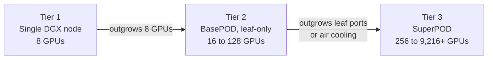
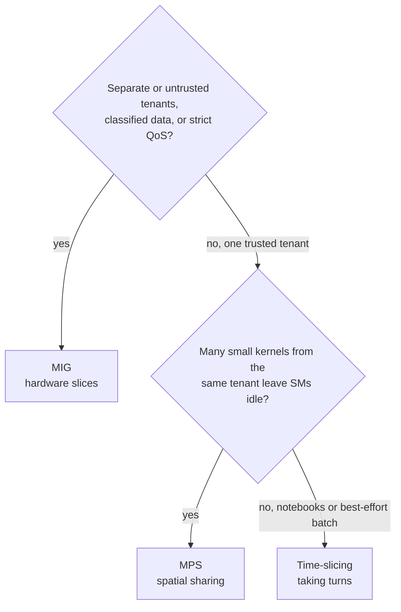
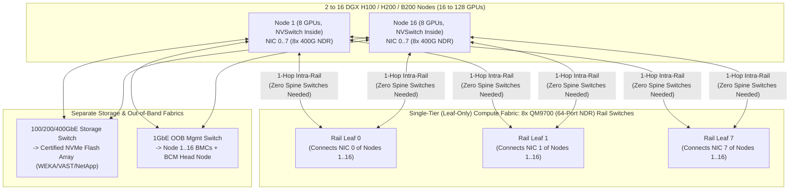

# 9.10 BasePOD and smaller deployments

| | |
|---|---|
| **Status** | Drafted (`basepod_deployments_lab.py`: 28 checks pass; commissioning commands **untested** on live BasePOD) |
| **Level** | Intermediate |
| **Priority tier** | 1b |
| **Lab venue** | none (design / reading) + self-checking Python model (`code/part09/basepod_deployments_lab.py`) |
| **Part** | Part 9: NVIDIA systems and reference architectures |
| **Sources used** | `nvidia-devops` V21 (Ch. 2, Ch. 13, Lab 01); `nvidia-devops-core-interview` Module 4 Q14; `nvidia-devops-legacy-v09` (`01 - Hardware & Ecosystem Gauntlet`, `03 - Security Governance Masterclass`, `05 - Linux, Networking, and IaC Gauntlet`) |

## Why this matters for AI infrastructure

Not every organization needs—or has the 1.2 MW to 19.2 MW data center facility required to host—a multi-Scalable-Unit DGX SuperPOD. In fact, the vast majority of enterprise AI infrastructure starts at one of two smaller scales: a **Single DGX Node (`1 node, 8 GPUs`)** for a departmental data science team, or an **NVIDIA DGX BasePOD / Departmental Pod (`2 to 16 DGX nodes = 16 to 128 GPUs`)** built for fine-tuning (`LoRA` and full-parameter), Retrieval-Augmented Generation (`RAG`), and 70B-class domain LLM pre-training.

Designing and onboarding these smaller deployments requires a distinct set of engineering trade-offs:
1. **You can eliminate the Spine switch layer altogether** (`Leaf-Only Rail-Optimized Pod`) when your node count fits inside the port budget of a single layer of rail leaf switches (`2 to 16 nodes = 16 to 128 GPUs`).
2. **You must partition expensive GPUs safely across multiple users and jobs**—knowing exactly when to use **Multi-Instance GPU (`MIG`)** hardware isolation versus **Multi-Process Service (`MPS`)** spatial sharing or **Time-Slicing**.
3. **You must execute a rigorous 6-stage commissioning and acceptance gate** (`Physical → Server → Network → Storage → Cluster → Operational`) so a marginal transceiver, a post-RMA PCIe slot swap, or a missing rack blanking panel is caught *before* researchers launch a two-week training run.

:::info Corpus scope note
Vendor-specific *NVIDIA DGX BasePOD with NetApp / WEKA / VAST / DDN / IBM Storage Scale Reference Architecture* PDFs are not in `~/Desktop/books-toon-rag/`. In this chapter, the Single-Node vs BasePOD vs SuperPOD onboarding framework, GPU sharing rules (`MIG`, `MPS`, `Time-Slicing`), the leaf-only 16-node (`128-GPU`) reference blueprint, the `$20M` multi-pool startup design, and the six-stage commissioning protocol are drawn from `nvidia-devops` Volume 21 (Chapters 2 and 13 and Lab 01), `nvidia-devops-core-interview` Module 4 (Q14), and `nvidia-devops-legacy-v09` (`01 - Hardware & Ecosystem Gauntlet`, `03 - Security Governance Masterclass`, and `05 - Linux, Networking, and IaC Gauntlet`).
:::

## Prerequisites and outcomes

**Prerequisites:**
- Chapters `9.1`, `9.2`, and `9.6` (DGX node internals and SuperPOD Scalable Unit concepts).
- Chapters `8.1` and `8.4` (Base Command Manager golden-image provisioning).

**Outcomes:** After completing this chapter, you will be able to:
1. Contrast the architecture, onboarding focus, and operational boundaries of **Single-Node DGX (`1 node, 8 GPUs`)**, **DGX BasePOD / Leaf-Only Pod (`2 to 16 nodes, 16 to 128 GPUs`)**, and **DGX SuperPOD (`32+ nodes / rack-scale NVL72`)**.
2. Select the right GPU sharing mechanism (**`MIG`**, **`MPS`**, or **`Time-Slicing`**) based on tenant trust, data classification, and QoS requirements.
3. Architect a **Leaf-Only Rail-Optimized Pod** (`2 to 16 nodes`) and walk through the **16-Node (`128-GPU H100 SXM5`) Reference Blueprint** and the **`$20M` Multi-Pool Startup Design**.
4. Execute the **Six-Stage AI Factory Commissioning and Acceptance Framework** (`Physical`, `Server`, `Network`, `Storage`, `Cluster`, and `Operational`).

---

## Concepts: basics → intermediate → advanced

## 1. The three tiers of AI deployments: Single Node vs BasePOD vs SuperPOD

A customer buying a single 8-GPU DGX node has fundamentally different architectural needs from an enterprise deploying an 8-node **DGX BasePOD**, which in turn differs fundamentally from a Cloud Service Provider building a 64-node **DGX SuperPOD**.

Think of the three tiers like aviation:
- **Single DGX Node (`8 GPUs`):** Operating a single twin-engine corporate aircraft—everything happens inside one fuselage (`NVSwitch` baseboard), and your primary job is keeping the seats full (`MIG` / containers).
- **DGX BasePOD (`2 to 16 nodes, 16 to 128 GPUs`):** Operating a regional airport with a single control tower (`BCM` + `Slurm`/`Kubernetes`), a single runway layer (`Leaf-Only` switch fabric), and a shared fuel depot (centralized flash storage from WEKA, VAST, or NetApp) inside existing enterprise hangars.
- **DGX SuperPOD (`32+ nodes / multi-SU / NVL72 racks`):** Building an international hub airport from bare ground—requiring dedicated utility substations, chilled-water plants (`CDUs`), multi-tier air-traffic control (`Leaf-Spine` Clos + `UFM` + `NMX-M`), and automated tow-trucks (`Mission Control` autonomous recovery) because with thousands of engines running 24/7, hardware faults occur daily.



| Tier | Scale | Network | Storage | Software |
|---|---|---|---|---|
| 1. Single DGX node | 1 node, 8 GPUs (DGX H100 / H200 / B200) | Internal NVSwitch, 900 to 1,800 GB/s | 30 TB local `/raid` plus enterprise NAS | DGX OS, NGC, Jupyter, MIG / MPS |
| 2. BasePOD / leaf-only pod | 2 to 16 air-cooled DGX nodes (16 to 128 GPUs) | Single-tier (leaf-only) IB NDR or RoCEv2; 3 fabrics: compute, storage, management | Shared all-flash storage (VAST, WEKA, NetApp) | BCM golden images, Slurm or Kubernetes operators |
| 3. SuperPOD | 32+ nodes or 8+ NVL72 racks (256 to 9,216+ GPUs) | Multi-tier non-blocking fat-tree (leaf and spine) | Dedicated high-performance storage | UFM, NMX-M, Mission Control auto-recovery; facility power and liquid cooling (CDUs) |

### 1.1 Comparing Single Node, BasePOD, and SuperPOD side by side

*(Treating `2 to 16 nodes (16 to 128 GPUs)` as the practical envelope of a spine-less BasePOD / single-pod before transitioning to a multi-tier SuperPOD in `select_deployment_archetype()` is **my inference**, combining the 2–8 node BasePOD onboarding range in `nvidia-devops-core-interview` Module 4 Q14 with the 8–16 node leaf-only pod architecture in Volume 21 Chapters 2 and 13.)*

| Architectural Dimension | Tier 1: Single DGX System | Tier 2: DGX BasePOD & Smaller Pods | Tier 3: DGX SuperPOD |
|---|---|---|---|
| **Typical Scale** | **1 node** (**8 GPUs**) | **2 to 16 nodes** (**16 to 128 GPUs**) | **32+ nodes** (`1–64 SUs`) or **8–128 NVL72 racks** (**248 to 9,216+ GPUs**) |
| **Target Users & Workloads** | Data science teams, PoCs, single-node fine-tuning, multi-model inference | Mid-size enterprises, departmental AI, LoRA/full fine-tuning, RAG, 70B LLM training | CSPs, sovereign AI, frontier foundation model pre-training and reasoning |
| **Compute Network Topology** | **Internal NVSwitch only** (no external GPU-to-GPU fabric needed) | **Single-tier (Leaf-Only) Rail-Optimized** NDR InfiniBand or lossless RoCEv2 (`1 hop` intra-rail, `0` spines) | **Multi-tier non-blocking Fat-Tree / Clos** (`Leaf + Spine`) with `UFM Enterprise` & `NMX-M` |
| **Storage Architecture** | Internal `30 TB` `/raid` NVMe cache + existing enterprise NAS | Centralized **certified all-flash storage** (WEKA, VAST, NetApp, DDN, IBM Storage Scale) over dedicated 100–400G Storage Fabric | Dedicated **High-Performance Storage** (`90–280 GB/s` per SU over 400G RoCEv2) + separate **NFS User Storage** |
| **Provisioning & Orchestration** | Standalone **DGX OS**, Docker / containerd, **NVIDIA Container Toolkit**, **NGC**, Jupyter | **Base Command Manager (`BCM`)** golden-image PXE boot + **Slurm** or **Kubernetes** (`GPU Operator` + `Network Operator`) | **NVIDIA Mission Control** + **BCM** + **Run:ai** / **Slurm** + autonomous hardware/job recovery |
| **Key Onboarding Focus & Trap** | **Trap:** Running monolithic single-GPU Python scripts leaving 7 of 8 GPUs idle. **Fix:** Teach `MIG`, `torchrun` DDP, and NGC containers. | **Trap:** Mixing storage and compute on one switch or skipping multi-node burn-in. **Fix:** Enforce **3-fabric separation** (`Compute`, `Storage`, `Mgmt`) and 6-stage acceptance. | **Trap:** Treating SuperPOD as "just a big BasePOD." **Fix:** Bridge data center facilities (`HVAC/CDU/Power`) with MLOps straggler & checkpoint automation. |

:::tip In one minute
- **Single-Node DGX (`8 GPUs`)** focuses on single-box utilization (`DGX OS`, `NGC`, `MIG`/`MPS`); **BasePOD (`2–16 nodes = 16–128 GPUs`)** introduces **three separate networks (`Compute`, `Storage`, `Management`)**, centralized flash storage, **BCM** golden images, and a **Leaf-Only** switch fabric.
- Never treat a **SuperPOD (`32+ nodes`)** as "just a big BasePOD": SuperPOD requires multi-tier leaf-spine fabrics, facility-scale power/liquid cooling, and automated straggler/checkpoint recovery because hardware MTBF at thousands of GPUs makes component failures a daily event.
:::

---

## 2. Sharing smaller deployments safely: `MIG` versus `MPS` versus `Time-Slicing`

On a single DGX node or a 4-node departmental BasePOD, rarely does every developer or inference microservice need an entire 80 GB H100, 141 GB H200, or 180 GB B200 GPU. NVIDIA provides three completely different mechanisms to share a GPU across multiple workloads—and confusing them in a multi-tenant or security-sensitive environment is a critical mistake:



The comparison table below gives the isolation details for each option.

### 2.1 Comparing the three GPU sharing mechanisms

| Attribute | 1. Multi-Instance GPU (`MIG`) | 2. Multi-Process Service (`MPS`) | 3. GPU Time-Slicing |
|---|---|---|---|
| **Partitioning Layer** | **Physical hardware engines** (requires reconfiguring GPU mode) | **CUDA runtime / spatial SM scheduler** | **OS / driver temporal context switcher** |
| **Max Partitions per GPU** | **Up to 7 hardware instances** (on `A100`, `H100`, `H200`, `B200`) | Up to 48 client connections (architectural limit) | Configurable (e.g., 2 to 16+ replicas in K8s Device Plugin) |
| **SM Compute Cores** | **Dedicated physical SM slices** (runs truly in parallel) | **Shared SMs spatially** (kernels from different processes run simultaneously) | **Shared SMs temporally** (processes take turns via time-quanta preemption) |
| **VRAM & Memory Bandwidth** | **Hardware-isolated HBM capacity, memory controllers & crossbars** | **Shared VRAM** (no hardware memory boundary between clients) | **Shared VRAM** (one OOM process can starve neighbors) |
| **L2 Cache** | **Dedicated L2 cache slices** | **Shared L2 cache** (noisy neighbor cache thrashing possible) | **Shared L2 cache** |
| **Fault & Security Isolation** | **Strict hardware isolation** (an Xid fault or memory bug stays inside the slice; **mandatory for multi-tenant & classified data**) | **Zero fault isolation** (a fatal memory fault in one client terminates *all* MPS clients on that GPU) | **Zero memory protection** (shared physical VRAM; unsuitable for classified multi-tenant workloads) |
| **Best Use Case** | Multi-tenant Kubernetes inference, interactive Jupyter notebooks, classified workloads, strict P99 latency SLAs | Single-tenant MPI ranks or small inference models whose kernels are too narrow to fill all SMs alone | Over-subscribing best-effort dev/test pods for a single friendly team |

:::tip In one minute
- Use **`MIG` (up to 7 hardware slices)** whenever you need **hardware memory protection, fault isolation, or deterministic P99 QoS** across multiple tenants or classified workloads.
- Use **`MPS`** only when a **single trusted tenant** runs multiple small kernels concurrently to boost SM occupancy without hardware re-partitioning.
- Never use **Time-Slicing** or **MPS** to isolate untrusted tenants processing sensitive data, because both share physical VRAM and L2 cache.
:::

---

## 3. Leaf-only BasePOD networking and the 16-Node (`128-GPU`) reference blueprint

### 3.1 Why a 2-to-16 Node BasePOD needs zero Spine switches (`Leaf-Only Rail-Optimized Pod`)

In Chapters `9.6` through `9.9`, we saw that a multi-SU SuperPOD uses a two-tier **Leaf + Spine** Fat-Tree. Why can a smaller **2-to-16 node BasePOD (`16 to 128 GPUs`)** omit the Spine switch layer completely?



- **How the Leaf-Only Rail-Optimized topology works:** Each 8-GPU node has 8 compute NICs (`NIC 0..7` at 400 Gbps NDR = **3.2 Tbps injection bandwidth per node**). You deploy **8 leaf switches** (one per rail, such as the **64-port `Quantum-2 QM9700`**; or for very small 2–4 node BasePODs, partitioned rail VLANs/ports on 1–2 switches). `NIC k` of every node plugs into `Leaf Switch k`.
- **Why zero spines are needed:** Because all 16 nodes' `Rail k` NICs land on the *exact same physical `Leaf Switch k`* (`16 downlinks` out of `64 available ports`), every same-rail GPU-to-GPU transfer across all 16 nodes completes in **a single switch hop (`1 hop`)**, and cross-rail transfers happen inside each node over the **900–1,800 GB/s NVSwitch**.
- **Trade-offs of the Leaf-Only Pod:**
  - **Pros:** Lowest possible latency (`1 switch hop`), zero spine switch or spine-to-leaf cable CAPEX (`saves $100K–$200K+`), and simplest cabling.
  - **Cons:** All 8 rails must be kept healthy (if one rail switch fails, that rail is lost for every node), and growing past the leaf port count later requires adding a Spine tier.

### 3.2 Complete 16-Node (`128-GPU H100 SXM5`) Training Pod Blueprint and 8-Week Rollout

From `nvidia-devops` Volume 21 Chapter 13, here is the complete engineering blueprint and CAPEX breakdown for a **16-node (`128-GPU`) H100 SXM5 training pod** designed to train and refresh 70B-class LLMs:

| Subsystem | 16-Node (`128-GPU`) Pod Specification | Illustrative CAPEX & Sizing Math |
|---|---|---|
| **Compute Nodes (`16x`)** | `16 × DGX H100-class` nodes = **128x H100 80 GB SXM5 GPUs** (`126,592` dense BF16 TFLOPS peak), dual Xeon Platinum 8480C (`112 cores/node`), `2 TB DDR5/node`, `8 × 3.84 TB NVMe` (`~30 TB/node` local cache) | `16 × $285,000 = $4,560,000` (`$4.56M`) |
| **Compute Fabric** | **8x Rail-Optimized NDR 400G Leaf Switches** (`16 downlinks/switch`, DAC for short runs, AOC otherwise) | `~$400,000` (switches, optics, cables) |
| **Storage & Archive** | `2 × BlueField-3 DPUs/node` → **500 TB Shared All-Flash NAS / Parallel File System (`~10 GB/s`)** + **AWS S3** cold archive | `~$200,000` (allocated storage share) |
| **Racks, Power & Cooling** | **4 Compute Racks** (`4 nodes/rack × 10.2 kW = ~40.8 kW/rack`), **~163.2 kW (`~163 kW`) total IT load**, A+B feeds, hot/cold aisle containment, UPS on network/storage/mgmt | `~$200,000` (racks, PDUs, cooling) + `~$100,000` installation & testing |
| **Total Pod CAPEX & TCO** | **Total CAPEX = `$5,460,000` (`~$5.5M`)** (`~$42,656 / ~$43K` per GPU; `~$43` per dense BF16 TFLOP) | Plus `~$644K/year` OPEX = **`~$7.4M` 3-Year TCO** (`~$2.14 / GPU-hour`) |

**The 8-Week Deployment Schedule and Operational MTTR Targets:**
- **Weeks 1–2 (Site Preparation):** Install 41 kW/rack A+B PDUs, breakers, chillers/containment, racks, and cable trays; verify utility voltage/phase and test UPS failover.
- **Weeks 3–4 (Hardware Installation):** Unpack, inventory, and run an **8-hour GPU burn-in per node**; rack all 16 nodes (8 hours); cable the 8 rail switches and verify `ibstat` (`Active / 400G`) on all 128 ports.
- **Weeks 5–6 (Software & Configuration):** Provision **DGX OS** (via **BCM** golden images), pin validated NVIDIA driver / CUDA / cuDNN / NCCL versions, configure `torchrun` / DeepSpeed / Megatron-LM, and run `nccl-tests` (`all_reduce_perf`) across all node pairs and at full 128-GPU scale.
- **Week 7 (Baseline Performance Testing):** Run a 100+ step proxy LLM training job, verify MFU (`40%–60%`), confirm exposed communication overhead is `< 5%`, and compare measured kW draw under load against the `163.2 kW` rating.
- **Week 8 (Production Readiness):** Deploy Prometheus (`dcgm-exporter` + `node_exporter` + UFM/IB counters) and Grafana alerts, test NAS + S3 checkpoint sync, configure **Slurm** or **Kubernetes** gang scheduling, and run a **1-week continuous stability burn-in** (`MTTR targets: GPU fault ≤ 15 min, IB link flap ≤ 5 min, checkpoint failover ≤ 10 min, brief power blip < 1 min via UPS`).

:::tip In one minute
- A **2-to-16 node (`16-to-128 GPU`) pod** can use a **Leaf-Only Rail-Optimized fabric** (`8 rail leaf switches`, `0` spines), achieving **1-hop** intra-rail latency across all nodes.
- The reference **16-node (`128-GPU H100`) training pod** packs **4 nodes per rack (`~40.8 kW/rack`) across 4 racks (`163.2 kW` total IT load)** for **`~$5.46M` (`~$5.5M`) CAPEX** (`~$43K/GPU`, `~$43/BF16 TFLOP`) and rolls out in **8 weeks**.
:::

---

## 4. Designing a multi-pool departmental AI cluster (`$20M` Year-1 startup case study)

Real enterprise and startup deployments rarely run just one workload. Walk through the multi-pool sizing exercise from `nvidia-devops` Volume 21 Lab 01, where a Series B company with a **`$20M` Year-1 budget (`CAPEX + OPEX`)** must support three simultaneous workloads:
1. **Quarterly 70B LLM continued pre-training refresh** on **100 billion new tokens** every 3 months.
2. **Production Llama-70B online inference API** serving **500 QPS peak** at a **99.5% availability SLA** (`< 500 ms` P99 TTFT).
3. **Enterprise customer LoRA fine-tuning service** running **100 concurrent LoRA jobs** on an 8B base model.

### 4.1 Step-by-step pool sizing and Year-1 TCO math

1. **Pool 1 — 16-Node (`128-GPU H100 SXM5`) Training Pod (`$4.96M` compute + fabric):**
   - **Total training FLOPs required per refresh:**
     ```text
     FLOPs = 6 × Parameters × Tokens = 6 × (70 × 10^9) × (100 × 10^9) = 4.2 × 10^22 FLOPs
     ```
   - **Sustained cluster throughput at 40% MFU:** `128 GPUs × 989 TFLOPS (BF16 dense) × 0.40 = 50,636.8 TFLOPS (50.6 PFLOPS)`.
   - **Wall-clock time per 100B-token refresh:** `4.2 × 10^22 FLOPs / 5.06368 × 10^16 FLOP/s ≈ 829,436 seconds ≈ 9.6 days` (processing **`~120,000 tokens/second`** across the 128 GPUs).
   - **Cost per training run:** Electricity (`16 × 10.2 kW × 1.35 PUE ≈ 220 kW × 230 hours × $0.12/kWh ≈ $6K`) + 3-year hardware amortization (`$4.56M × 9.6 / 1,095 days ≈ $40K`) = **`~$46K` per quarterly refresh** (leaving the 128 H100s available for batch jobs, evaluation, or overflow inference the other 80 days of the quarter.).
2. **Pool 2 — 9-Node (`72-GPU H100 SXM5`) Inference Pool (`$2.57M` compute):**
   - Serving Llama-3-70B in FP8 with 2-GPU Tensor Parallelism (`TP=2`) yields an illustrative **`15.2 QPS` per 2-GPU replica**.
   - To serve `500 QPS` peak requires `500 / 15.2 = 32.9 → 33 replicas (66 GPUs)`.
   - Adding **1 full `N+1` spare node** to meet the **99.5% SLA** (`≤ 3.6 hours/month` downtime) gives **`9 nodes × 8 GPUs = 72 GPUs (36 replicas = 547.2 QPS capacity)`**.
3. **Pool 3 — 2-Node (`16-GPU A100 80 GB`) Multi-Tenant LoRA Fine-Tuning Pool (`~$0.40M` compute):**
   - An 8B BF16 base model takes `~16 GB` of shared read-only weights per GPU, plus `~2 GB` of per-job activations and rank-16 LoRA adapter states—allowing each 80 GB A100 to bin-pack `4 to 8` concurrent LoRA trainers (`64 to 128` concurrent jobs across 16 GPUs).
4. **Total Year-1 Budget Rollup (`27 Nodes Total`):**
   - **Total CAPEX:** `$4.56M` (16 training nodes) + `$0.40M` (IB fabric) + `$2.57M` (9 inference nodes) + `$0.40M` (2 A100 nodes) + `$1.00M` (storage, power, cooling, install) = **`~$8.93M (~$8.9M)` CAPEX**.
   - **Year-1 OPEX:** Electricity (`27 nodes × 10.2 kW × 60% avg load × 1.35 PUE ≈ 223 kW × 8,760 hrs × $0.12/kWh ≈ $234K`) + Personnel (`3 FTE × $150K = $450K`) + Maintenance (`1% CAPEX ≈ $89K`) + Software (`~$50K`) = **`~$0.82M` OPEX**.
   - **Combined Year-1 Spend:** **`$8.9M + $0.82M = ~$9.7M`**—comfortably inside the `$20M` budget, leaving `~$10.3M` for a second geographic inference region or expansion.

:::tip In one minute
- Size training pods directly from **`FLOPs = 6 × Parameters × Tokens`**: refreshing a 70B model on 100B tokens (`4.2 × 10^22` FLOPs) on 128 H100 GPUs at 40% MFU (`50.6 PFLOPS`) takes **9.6 days (`~120,000 tokens/s`)** at **`~$46K` per run**.
- A 27-node multi-pool departmental cluster (`16` training nodes + `9` inference nodes with `N+1` spare + `2` LoRA fine-tuning nodes) fits under **`~$9.7M` Year-1 (`$8.9M` CAPEX + `$0.82M` OPEX)**.
:::

---

## 5. The Six-Stage AI Factory Commissioning and Acceptance Framework

Passing `nvidia-smi` and a 30-second smoke test does **not** mean a new BasePOD or 128-GPU cluster is ready for production. Most multi-week training postmortems trace back to a physical or operational defect that existed on Day 1—a missing blanking panel causing hot-aisle recirculation, a GPU reseated into the wrong PCIe slot after an RMA, a single rail landing on an oversubscribed uplink, an intermittent `Xid 79` that only triggers after 48 hours of heat soak, or a Prometheus alert rule with a misspelled DCGM metric name.

Before signing off on any new GPU pod, execute all **six sequential acceptance stages** (`evaluate_six_stage_acceptance()` in `code/part09/basepod_deployments.py`) and archive the required sign-off evidence:

| Stage | Required Acceptance Checks & Thresholds | Required Sign-Off Evidence | Real-World Failure Triage Example |
|---|---|---|---|
| **Stage 1: Physical Acceptance** | • PDU load balanced across phases, **breaker headroom `> 20%`**<br/>• Rack inlet temperature **`< 27°C`** under load (thermal camera walk)<br/>• All cables labeled, bend radius respected, DAC/AOC within spec<br/>• Zero optical RX/TX power warnings (`ethtool` / switch CLI)<br/>• Every node's BMC reachable + Redfish power-cycle verified | Signed physical checklist + **thermal camera photos** + 100% green BMC table | **Symptom:** Thermal camera shows `Node 7` inlet at `34°C` while neighbors read `24°C`.<br/>**Triage:** Check for a blocked front filter or a **missing rack blanking panel** allowing hot-aisle exhaust recirculation (a 10-minute fix) before blaming the room chillers. |
| **Stage 2: Server Acceptance** | • **Zero firmware drift** (`BIOS, BMC, GPU VBIOS, NIC, BlueField DPU`)<br/>• `nvidia-smi -L` matches SKU count; zero `Xid` or ECC errors<br/>• All DIMM channels populated at rated speed (`dmidecode`)<br/>• **`nvidia-smi topo -m` matches fleet matrix** (`NV18` + `PIX`)<br/>• `nvidia-smi nvlink -s` & `ibstat` (`Active / LinkUp / 400G`) all green | Zero-delta firmware diff report + archived `topo -m` & NVLink tables per node | **Symptom:** One node's `nvidia-smi topo -m` shows a GPU-NIC pair on `NODE`/`SYS` instead of `PIX`.<br/>**Triage:** Node was reassembled after an RMA with NICs/GPUs in the wrong slots. Physically move the card back to the right slot; never mask it in software. |
| **Stage 3: Network Acceptance** | • Switch **LLDP neighbor table** matches cabling diagram (`0` crossed rails)<br/>• Every port `UP` at full negotiated speed<br/>• Point-to-point `ib_write_bw` / `nccl-tests` **`≥ 90%` of line rate on every individual rail**<br/>• `ib_write_lat` in low single-digit µs<br/>• Full-scale `all_reduce_perf` with **zero PFC pause storms** | Full all-pairs, **per-rail** bandwidth/latency matrix + full-scale `nccl-tests` report | **Symptom:** `Rail 3` across all 16 nodes runs 15% slower than `Rails 0–2, 4–7`.<br/>**Triage:** Don't swap 16 optical cables. Check `Leaf Switch 3`'s uplink group or QoS config—a single shared switch misconfiguration explains a whole-rail drop. |
| **Stage 4: Storage Acceptance** | • **Concurrent all-node** `fio` sequential read/write meets target (**`≥ 100 MB/s per GPU`** aggregate)<br/>• Random small-file read IOPS meets shuffled-dataset target<br/>• **`mdtest`** file create/stat/delete rates validated for thousands of shard files<br/>• Timed **full-scale 128-GPU checkpoint save & restore** within MTTR budget | Concurrent all-node `fio` + `mdtest` logs + timed full-cluster checkpoint save/restore log | **Symptom:** 16-node concurrent read hits only 60% of the single-node benchmark.<br/>**Triage:** Check the **storage switch uplinks** between compute leaves and the storage array before blaming the SSDs. |
| **Stage 5: Cluster Acceptance** | • Full-cluster **`HPL / GPU-Linpack`** sustained FLOPS check (`0` node drops)<br/>• Full-scale `nccl-tests` (`all_reduce_perf`, `all_gather_perf`)<br/>• **NVIDIA `ClusterKit`** coordinated multi-node diagnostic sweep<br/>• **24-to-72-hour continuous burn-in** (`0` unplanned node drops)<br/>• End-to-end **representative customer workload** + checkpoint restore | HPL report + `ClusterKit` output + **24–72h burn-in log** + customer proxy run log | **Symptom:** At hour 48 of burn-in, `Node 11` throws `Xid 79 (Fallen off the bus)` and drops.<br/>**Triage:** Pull the node, run diagnostics, and RMA. **Never just restart the job and sign off**—catching 48-hour thermal/power infant mortality is the entire purpose of Stage 5. |
| **Stage 6: Operational Acceptance** | • **Live alert-fire injection** (simulate GPU temp/node kill and confirm page reaches on-call)<br/>• **CMDB reconciliation** (exact serials, asset tags, rack RU slots)<br/>• **Live executed rollback drill** (revert a firmware/image update end-to-end)<br/>• Clean node drain/cordon and rejoin test<br/>• Runbooks accessible **outside** the cluster + test vendor support ticket | Alert-fire delivery log + reconciled CMDB export + executed rollback log + test ticket ID | **Symptom:** Simulated GPU temperature spike never pages on-call.<br/>**Triage:** Check the Prometheus scrape target and **DCGM metric name** in the alert rule (e.g., referencing a non-existent metric name) before assuming the GPU didn't heat up. |

:::tip In one minute
- Never hand off a new BasePOD or training cluster after a 5-minute smoke test; require signed evidence across all **6 acceptance stages**: **1. Physical** (`>20%` breaker headroom, `<27°C` thermal scan), **2. Server** (`0` firmware drift, exact `topo -m`), **3. Network** (LLDP + `≥90%` line rate **per rail**), **4. Storage** (concurrent all-node `fio ≥100 MB/s/GPU` + `mdtest` + timed checkpoint), **5. Cluster** (`HPL`, `ClusterKit`, and **24–72h burn-in**), and **6. Operational** (live alert-fire test, CMDB sync, and **live executed rollback**).
:::

---

## Commands and configurations that matter

Use these commands during BasePOD provisioning, safe BCM golden-image driver updates, MIG partitioning, and 6-stage acceptance testing (**untested** on live BasePOD hardware in this authoring environment; logic verified in `code/part09/basepod_deployments_lab.py`).

### 1. Safe OFED / Driver update on a BCM-managed BasePOD via image cloning (never `apt/yum update` live nodes.)

As highlighted in our operations runbooks, **never run ad-hoc Ansible `yum/apt update` commands across live BCM compute nodes** (which breaks immutable image state and prevents rollback). Always clone the BCM software image, chroot into the clone, regenerate the ramdisk, canary-test one node, and roll out by category:

```text
# 1. Clone the active golden image in cmsh
[root@headnode ~]# cmsh
% softwareimage
% clone dgx-os-6-1 dgx-os-6-1-ofed24
% commit
```

```bash
# 2. Chroot into the cloned image directory on the head node and install the new package
sudo cm-chroot-sw-img /cm/images/dgx-os-6-1-ofed24
apt-get update && apt-get install -y mlnx-ofed-all
exit
```

```text
# 3. Regenerate the initial ramdisk (mandatory when kernel modules change!) and canary test node001
[root@headnode ~]# cmsh
% softwareimage use dgx-os-6-1-ofed24
% createramdisk
% device use node001
% set softwareimage dgx-os-6-1-ofed24
% commit
% reboot
# If node001 passes ibstat and nccl-tests, update the category; to roll back, point back to dgx-os-6-1 and reboot!
```

### 2. Configure hardware-isolated Multi-Instance GPU (`MIG`) slices on a single DGX or BasePOD node

```bash
# 1. Enable MIG mode on GPU 0 (requires GPU reset / no active CUDA processes)
sudo nvidia-smi -i 0 -mig 1

# 2. List supported MIG GPU Instance (GI) profiles (e.g., 1g.10gb, 2g.20gb, 3g.40gb, 7g.80gb on H100)
sudo nvidia-smi mig -i 0 -lgip

# 3. Create seven isolated 1g.10gb MIG instances with their matching Compute Instances (-C)
sudo nvidia-smi mig -i 0 -cgi 19,19,19,19,19,19,19 -C

# 4. Verify all 7 hardware-isolated MIG devices and their UUIDs
nvidia-smi -L
```

### 3. Stage 2, 3, and 4 Acceptance verification commands across a 16-node BasePOD

```bash
# Stage 2: Verify zero VBIOS drift across all 16 nodes via BCM pexec
cmsh -c "device; pexec -n node001..node016 'nvidia-smi --query-gpu=name,vbios_version --format=csv,noheader | uniq -c'"

# Stage 3: Verify per-rail RDMA bandwidth (>= 90% of 400G = >= 45 GB/s per HCA)
ib_write_bw -d mlx5_0 -F --report_gbits --use_cuda=0 <peer_node_ip>

# Stage 4: Verify concurrent metadata creation/stat/deletion rates across all 16 nodes with mdtest
mpirun -np 128 --map-by ppr:8:node mdtest -n 1000 -i 3 -d /mnt/SharedPFS/mdtest_dir
```

---

## How it fails

| Failure mode | Symptom | Root cause | Diagnosis & fix |
|---|---|---|---|
| **1. Using Time-Slicing or MPS for untrusted multi-tenant or classified workloads** | A tenant's buggy CUDA kernel triggers an illegal memory access and crashes every other tenant's pod on the same GPU—or a security audit flags shared physical VRAM across classified tenants. | **Time-Slicing** and **MPS** share the same physical HBM address space and L2 cache with zero hardware memory protection or fault isolation. | Enable **Multi-Instance GPU (`MIG`)** (`nvidia-smi -mig 1`, or via the Kubernetes GPU Operator `mig.strategy=single\|mixed`), which physically partitions SMs, L2 cache, and memory controllers into up to **7 hardware-isolated instances**. |
| **2. Updating drivers on a BCM BasePOD via ad-hoc `apt/yum` instead of image cloning** | After an in-place driver update across 16 nodes, 3 nodes fail to boot and the remaining 13 get overwritten back to the old driver on their next reboot. | BCM provisions compute nodes from **golden software images** stored on the head node. In-place package edits on compute nodes are wiped on reboot, and editing the live image without cloning or running `createramdisk` leaves no rollback path. | Clone the software image in `cmsh` (`clone old new`), update packages inside `cm-chroot-sw-img /cm/images/<new>`, run **`createramdisk`** inside `cmsh`, canary-test one node, and switch the category image assignment. |
| **3. Hot-aisle recirculation (`34°C` inlet) on one node from a missing blanking panel (Stage 1)** | During Stage 1/5 acceptance, `Node 7` thermal-throttles with a `34°C` inlet reading while `Node 6` and `Node 8` in the same rack read `24°C`. | An empty 2U–4U gap above `Node 7` was left without a **rack blanking panel**, allowing `50°C+` rear exhaust air to get sucked directly back into `Node 7`'s front intake fans. | Walk the cold aisle with a **thermal camera** during Stage 1 Physical Acceptance and install snap-in **blanking panels** in every unused rack unit (`RU`) plus brush grommets on all cable openings. |
| **4. Post-RMA PCIe slot swap turning a repaired node into a permanent straggler (Stage 2)** | After a field technician replaces a motherboard or riser on `Node 4`, `nvidia-smi` shows all 8 GPUs healthy, but 16-node training jobs run 20% slower whenever `Node 4` is included. | During reassembly, a ConnectX-7 NIC was plugged into a riser on the wrong PCIe root complex/switch (`NODE` or `SYS` instead of `PIX` in `nvidia-smi topo -m`). NCCL still runs, but that rail's traffic bounces through the CPU/UPI link. | Always re-run **Stage 2 Server Acceptance (`nvidia-smi topo -m` diffed against the fleet golden matrix)** whenever a node returns from hardware maintenance, and physically move the card back to its designated PCIe switch slot. |
| **5. Signing off on a cluster after a 10-minute test and hitting `Xid 79` on Day 3 (Stage 5)** | A newly delivered 16-node cluster passes quick `nvidia-smi` and 1-minute `nccl-tests` checks, gets handed to researchers, and crashes 48 hours into a flagship training run with `Xid 79 (GPU has fallen off the bus)`. | Infant-mortality hardware defects (marginal SXM socket contact, PCIe retimer thermal drift, or PSU voltage droop) only manifest after **24 to 72 hours of continuous thermal soak**. | Never waive **Stage 5 Cluster Acceptance**: run `HPL`, `ClusterKit`, and a **mandatory 24-to-72-hour continuous burn-in** (plus a full proxy job with checkpoint save/restore). Any node that drops during the 72-hour burn-in is pulled and RMA'd before customer handoff. |

---

## Hands-on lab

This chapter's self-checking Python model (`code/part09/basepod_deployments.py`) and lab runner (`code/part09/basepod_deployments_lab.py`) implement:
1. The **Deployment Archetype Selector** (`Single-Node DGX` for 1 node / 8 GPUs; `BasePOD / Leaf-Only Pod` for 2–16 air-cooled nodes / 16–128 GPUs; `SuperPOD` for 32+ nodes or liquid-cooled racks).
2. The **GPU Sharing & Isolation Selector** (`MIG` 7 hardware-isolated slices for untrusted multi-tenancy, classified data, or strict QoS vs `MPS` spatial sharing for single-tenant small kernels vs `Time-Slicing`).
3. The **16-Node (`128-GPU H100`) Training Pod Sizer** (`4 racks`, `40.8 kW/rack`, `163.2 kW` total IT load, `8` rail leaf switches with `16` downlinks each, `$4.56M` compute + `$0.90M` infra = `$5.46M` CAPEX, `$42,656/GPU`, `$43/BF16 TFLOP`) and the **`$20M` Startup Multi-Pool Calculator** (`4.2e22` FLOPs = `9.6 days` on 128 H100s at 40% MFU, and `36` 2-GPU replicas = `547.2 QPS`).
4. The **Six-Stage AI Factory Commissioning & Acceptance Gate Auditor** (reproducing every pass criterion and real-world failure triage scenario across `Physical`, `Server`, `Network`, `Storage`, `Cluster`, and `Operational` acceptance).

Run the lab from the repository root:

```bash
python3 -B code/part09/basepod_deployments_lab.py
```

Expected output (verified in this repository):

```text
=== Chapter 9.10 Lab: BasePOD and Smaller Deployments ===
  [PASS] 1-node deployment maps to Single-Node DGX (8 GPUs, internal NVSwitch only)
  [PASS] 4-node (32 GPU) and 16-node (128 GPU) air-cooled pods map to BasePOD / Leaf-Only Pod
  [PASS] 32-node cluster or liquid-cooled deployment maps to SuperPOD (multi-tier Clos + facility CDU)
  [PASS] Rejects node_count <= 0
  [PASS] Untrusted multi-tenant / classified workload selects MIG (7 slices, hardware memory + fault isolation)
  [PASS] Single-tenant concurrent small kernels selects MPS (spatial sharing, no hardware fault isolation)
  ...
  [PASS] V21 Ch13 Stage 6: Paper-only rollback (not executed live) fails Stage 6 Operational
  [PASS] V21 Ch13 Stage 3: PFC pause storm during all-to-all test fails Stage 3 Network
  [PASS] V21 Ch13 Stage 4: Failed mdtest small-file metadata rate fails Stage 4 Storage
  [PASS] V21 Ch13 Stage 5: Failed ClusterKit multi-node sweep fails Stage 5 Cluster
  [PASS] V21 Ch13 Stage 6: Unreconciled CMDB serials/rack slots fails Stage 6 Operational

Summary: 28 passed, 0 failed (total 28)
```

---

## Exercises

1. Run `python3 -B code/part09/basepod_deployments_lab.py`. Re-derive the 9.6-day refresh time for a 70B model on 100B tokens using 128 GPUs at 40% MFU. Then redo it at 30% MFU and with 64 GPUs.
2. A hospital has classified and non-classified teams sharing one 8-GPU node. Choose between MIG, MPS and time-slicing for each team, and write the commands you would run to set up MIG.
3. Draw the leaf-only compute fabric for 6 nodes. How many leaf switches do you need, how many ports are used on each, and what would force you to add a spine?
4. Add up the CAPEX of the 16-node pod from the table and check that it equals $5.46M. What is the cost per GPU?
5. You get a repaired node back from RMA. Which acceptance stage must you re-run, and which command shows the problem if a NIC was put in the wrong slot?
6. Write the golden-image driver update steps for a BCM pod on one page, ending with how you roll back.

## Checkpoint questions (20)

<details>
<summary><strong>1. How does the onboarding and architectural focus shift as a customer moves from a Single DGX Node (`8 GPUs`) to a BasePOD (`2–16 nodes`) and then to a SuperPOD (`32+ nodes`)?</strong></summary>

- **Single DGX Node (`1 node, 8 GPUs`):** Focuses on single-node utilization (`DGX OS`, `NGC` containers, `Jupyter`, and partitioning GPUs via `MIG` or `MPS`); all GPU-to-GPU traffic stays on the internal NVSwitch baseboard.
- **DGX BasePOD (`2–16 nodes = 16–128 GPUs`):** Introduces distributed computing across a **single-tier (Leaf-Only) compute switch fabric**, centralized all-flash storage (WEKA, VAST, NetApp), **3-fabric separation (`Compute`, `Storage`, `Management`)**, **BCM** golden-image provisioning, and **Slurm / Kubernetes** (`GPU Operator` + `Network Operator`).
- **DGX SuperPOD (`32+ nodes / multi-SU / NVL72 racks`):** Requires a **multi-tier Leaf-Spine Clos fabric**, facility-level engineering (high-kW power feeds, liquid cooling `CDUs`), `UFM Enterprise` / `NMX-M` telemetry, and `Mission Control` autonomous straggler and checkpoint recovery.
</details>

<details>
<summary><strong>2. Contrast `MIG`, `MPS`, and `Time-Slicing`. Why is `MIG` mandatory when sharing a GPU across multiple untrusted tenants or classified workloads?</strong></summary>

- **`Time-Slicing`:** Context-switches processes temporally on shared physical VRAM and L2 cache (high latency jitter, zero memory protection).
- **`MPS` (Multi-Process Service):** Runs multiple kernels from a **single trusted tenant** concurrently on shared SMs, but still shares VRAM and L2 cache with **zero fault isolation** (one crashing kernel kills all MPS clients on that GPU).
- **`MIG` (Multi-Instance GPU):** Physically partitions the GPU into **up to 7 hardware-isolated instances**, each with its own dedicated SMs, L2 cache slice, memory controllers, and HBM address range—preventing any tenant from reading another tenant's memory or causing cross-tenant fault/latency interference.
</details>

<details>
<summary><strong>3. Why can a 16-node (`128-GPU`) rail-optimized pod operate with 8 leaf switches and zero spine switches? What is the hop count between same-rail GPUs across nodes?</strong></summary>

Each of the 16 nodes has 8 compute NICs (`NIC 0..7`). When `NIC k` of all 16 nodes plugs into `Rail Leaf Switch k` (requiring only `16` ports on each 64-port `QM9700` leaf switch), every node's `Rail k` lands on the exact same physical switch. Therefore, same-rail GPUs across all 16 nodes communicate in **a single switch hop (`1 hop`)** with zero spine switches required, while cross-rail communication uses the internal 900 GB/s NVSwitch inside each node.
</details>

<details>
<summary><strong>4. Summarize the rack count, power budget, and CAPEX breakdown of the reference 16-node (`128-GPU H100 SXM5`) training pod.</strong></summary>

- **Racks & Power:** **4 compute racks** (`4 nodes/rack × 10.2 kW = 40.8 kW/rack`, or **`163.2 kW (~163 kW)` total IT load**).
- **CAPEX Breakdown:** `16 × $285K = $4.56M` (nodes) + `$400K` (InfiniBand fabric) + `$200K` (shared flash storage share) + `$200K` (racks, PDUs, cooling) + `$100K` (installation & testing) = **`$5.46M (~$5.5M)` total CAPEX** (`~$43K/GPU`, `~$43` per dense BF16 TFLOP; `~$7.4M` 3-year TCO with OPEX).
</details>

<details>
<summary><strong>5. Calculate how many days it takes to refresh a 70B-parameter LLM on 100 billion new tokens using the 16-node (`128-GPU H100`) pod at an assumed 40% MFU.</strong></summary>

- **Total training work:** `FLOPs = 6 × 70 × 10^9 × 100 × 10^9 = 4.2 × 10^22 FLOPs`.
- **Sustained cluster throughput (40% MFU):** `128 GPUs × 989 TFLOPS × 0.40 = 50,636.8 TFLOPS (5.064 × 10^16 FLOP/s)`.
- **Duration:** `4.2 × 10^22 / 5.064 × 10^16 ≈ 8.29 × 10^5 seconds ≈ 9.6 days` (at `~120,000 tokens/second`).
</details>

<details>
<summary><strong>6. Name all six stages of the AI Factory Commissioning and Acceptance Framework in order, and state why Stage 5 requires a 24-to-72-hour continuous burn-in.</strong></summary>

1. **Stage 1: Physical Acceptance** (power headroom `> 20%`, thermal scan `< 27°C`, cabling/optics, BMC reachability)
2. **Stage 2: Server Acceptance** (`0` firmware drift, SKU count, `topo -m` match, NVLink & `ibstat` active)
3. **Stage 3: Network Acceptance** (LLDP match, per-rail bandwidth `≥ 90%` line rate, latency, `0` PFC pause storms)
4. **Stage 4: Storage Acceptance** (concurrent all-node `fio ≥ 100 MB/s/GPU`, random IOPS, `mdtest` metadata, timed checkpoint save/restore)
5. **Stage 5: Cluster Acceptance** (`HPL/Linpack`, full-scale `nccl-tests`, `ClusterKit`, **24–72h continuous burn-in**, and representative customer proxy job)
6. **Stage 6: Operational Acceptance** (live alert-fire test, CMDB reconciliation, live executed rollback drill, drain/rejoin, external runbooks & support ticket)
A 24-to-72-hour burn-in is mandatory in Stage 5 because thermal throttling, marginal PSUs, and intermittent PCIe link drops (`Xid 79`) frequently pass a 5-minute test and only fail after hours of sustained heat soak.
</details>

<details>
<summary><strong>7. During Stage 3 Network Acceptance on a 16-node pod, `Rail 5` shows 15% lower bandwidth than the other 7 rails across every node in the cluster. Why shouldn't you start by replacing optical cables on the 16 nodes?</strong></summary>

Sixteen independent optical cables do not simultaneously degrade by the exact same 15% on the same rail index. A whole-rail bandwidth drop points to the **shared `Rail 5` leaf switch** (such as an oversubscribed uplink group, a QoS/buffer misconfiguration, or a degraded spine link on that switch).
</details>

<details>
<summary><strong>8. What is the safe procedure for updating OFED or GPU drivers on a 16-node BasePOD managed by Base Command Manager (`BCM`), and why is `createramdisk` required?</strong></summary>

1. **Clone** the active software image in `cmsh` (`clone old-img new-img`).
2. Enter the cloned image via `cm-chroot-sw-img /cm/images/new-img` and install the updated driver packages.
3. Run **`createramdisk`** on `new-img` in `cmsh` so the initial ramdisk (`initrd`) includes the new kernel modules for PXE/image boot.
4. Assign `new-img` to **one canary test node**, reboot it, and validate `ibstat` and `nccl-tests`.
5. Roll out to the compute node Category via graceful Slurm/K8s drain and reboot (retaining instant rollback by switching the Category back to `old-img`).
</details>

<details>
<summary><strong>9. What is the BasePOD range in this chapter, and what is marked as the author's inference?</strong></summary>

2 to 16 DGX nodes (16 to 128 GPUs). The author marks the combined `2..16` boundary as an inference from two sources.
</details>

<details>
<summary><strong>10. Why can a leaf-only pod have no spine?</strong></summary>

With up to 16 nodes, NIC k of every node lands on rail leaf k and uses only 16 of its 64 ports. Same-rail GPUs are one hop apart, and cross-rail traffic goes over NVSwitch inside the node.
</details>

<details>
<summary><strong>11. What are the pros and cons of a leaf-only pod?</strong></summary>

Pros: lowest latency, no spine cost, simple cabling. Cons: if one rail switch fails, that rail is lost for every node, and growing past the leaf ports means adding a spine tier.
</details>

<details>
<summary><strong>12. How many MIG instances can one GPU have, and what do they isolate?</strong></summary>

Up to 7 hardware slices, each with its own SMs, L2 slice, memory controllers and memory. A fault in one slice stays in that slice.
</details>

<details>
<summary><strong>13. When is MPS appropriate?</strong></summary>

For one trusted tenant running several small kernels that cannot fill the GPU alone. It gives spatial sharing but no fault isolation.
</details>

<details>
<summary><strong>14. Why is time-slicing unsuitable for untrusted tenants?</strong></summary>

Processes share physical memory and cache with no memory protection, and one process running out of memory can starve the others.
</details>

<details>
<summary><strong>15. What is the training-time formula and the 70B example?</strong></summary>

FLOPs = 6 × parameters × tokens. For 70B parameters and 100B tokens this is 4.2×10²² FLOPs, about 9.6 days on 128 H100 GPUs at 40% MFU.
</details>

<details>
<summary><strong>16. How was the inference pool sized in the $20M case?</strong></summary>

500 QPS at 15.2 QPS per 2-GPU replica needs 33 replicas (66 GPUs). Adding one spare node gives 9 nodes, 72 GPUs, 36 replicas and about 547 QPS.
</details>

<details>
<summary><strong>17. What is the Year-1 total for the 27-node startup design?</strong></summary>

About $8.9M CAPEX plus about $0.82M OPEX, so about $9.7M, within the $20M budget.
</details>

<details>
<summary><strong>18. What does Stage 1 (physical acceptance) check?</strong></summary>

More than 20% breaker headroom, rack inlet under 27°C under load, labelled and in-spec cables, no optical power warnings, and BMC and Redfish power-cycle tested on every node.
</details>

<details>
<summary><strong>19. What do Stages 2 and 3 check?</strong></summary>

Stage 2: zero firmware drift, correct GPU count, no errors, `topo -m` matches the fleet, NVLink and `ibstat` green. Stage 3: LLDP matches the cabling plan, at least 90% of line rate on every rail, low latency, no PFC storms.
</details>

<details>
<summary><strong>20. Why is a 24–72 hour burn-in needed, and what is Stage 6?</strong></summary>

Infant-mortality faults appear only after hours of heat soak. Stage 6 is operational acceptance: a live alert test, CMDB reconciliation, a live rollback drill, drain and rejoin, external runbooks and a test support ticket.
</details>

---

## Sources and review notes

### Sources read in full for this chapter
1. **`nvidia-devops` Volume 21 (*AI Factory: Building Large-Scale Production Systems*):**
   - `chapter-02-gpu-compute-cluster-design.md` (4,137 words): Single-node Configurations A (`8× H100 SXM5`, `$285K`) and B (`8× H100 PCIe`, `$215K`), and Topology 1 (`Single-Pod, Leaf Only` up to 8–16 nodes / 64–128 GPUs).
   - `chapter-13-reference-architecture-100-gpu-training-cluster.md` (3,583 words): Complete 16-node (`128-GPU H100 SXM5`) training pod blueprint (`4 racks × 4 nodes = ~41 kW/rack`, `~163 kW` total IT load, `8` rail-aligned NDR leaf switches, `$4.56M` compute + `$0.90M` infra = `$5.46M / ~$5.5M` CAPEX, `~$7.4M` 3-year TCO, 8-week deployment checklist, MTTR targets, and the **Six-Stage AI Factory Commissioning and Acceptance Framework** including `ClusterKit`, 24–72h burn-in, and stage-by-stage failure triage examples).
   - `labs/lab-01-cluster-design-workshop.md` (1,403 words): `$20M` Series B multi-pool cluster sizing (`16` H100 training nodes = `4.2e22` FLOPs / `9.6 days` on 100B tokens at 40% MFU + `9` H100 inference nodes with `N+1` spare for `500 QPS` at 99.5% SLA + `2` A100 80GB LoRA fine-tuning nodes = `27 nodes`, `~$8.9M` CAPEX + `~$0.82M` OPEX = `~$9.7M` Year 1).
2. **`nvidia-devops-core-interview` (Chapter 1, chunk 14) & `nvidia-devops-legacy-v09` (`01 - Hardware & Ecosystem Gauntlet`, `03 - Security Governance Masterclass`, `05 - Linux, Networking, and IaC Gauntlet`):**
   - Module 4 Q14 (*Customer Education & Onboarding*: Single DGX Node vs BasePOD vs SuperPOD), Module 1.1 (`MIG` up to 7 hardware-isolated slices vs `MPS` spatial sharing vs `Time-Slicing`), multi-tenant security rules, and Q16 (`BCM` golden-image cloning, `cm-chroot-sw-img`, and `createramdisk` workflow).

### Not in the corpus
- Vendor-specific *NVIDIA DGX BasePOD with NetApp / WEKA / VAST / DDN / IBM Storage Scale Reference Architecture* PDFs are not in `~/Desktop/books-toon-rag/`.

### Run here
- `python3 -B code/part09/basepod_deployments_lab.py` — **28 passed, 0 failed**.

### My own choices and inferences, labelled in the text
1. **Node-count boundary (`2 to 16 nodes = 16 to 128 GPUs`) for `BasePOD / Leaf-Only Pod` in `select_deployment_archetype` (`code/part09/basepod_deployments.py` and Section 1.1):** Combining the 2–8 node BasePOD onboarding example in `nvidia-devops-core-interview` Module 4 Q14 with the 8–16 node (64–128 GPU) leaf-only pod architecture in Volume 21 Chapters 2 and 13 into a unified `2..16` node range before transitioning to a 32+ node SuperPOD is **my inference**.

### Not verified on live hardware
- `cm-chroot-sw-img`, `nvidia-smi mig -cgi`, `ib_write_bw`, `mdtest`, and `ClusterKit` commands were not executed on live BasePOD hardware in this authoring environment.

