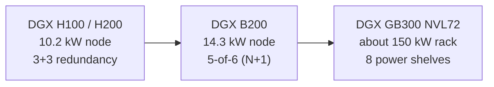
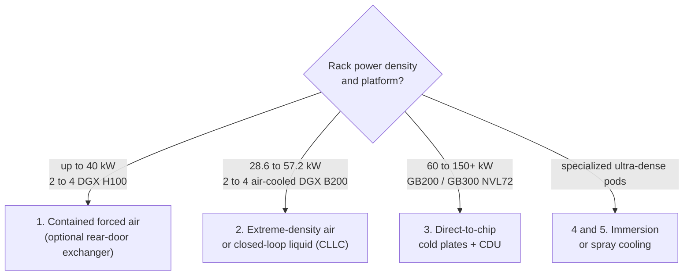

# 9.11 Power delivery, thermal design and liquid cooling

| | |
|---|---|
| **Status** | Drafted (`power_thermal_cooling_lab.py`: 26 checks pass; facility formulas and rules verified in Python) |
| **Level** | Advanced |
| **Priority tier** | 1b |
| **Lab venue** | none (design / reading) + self-checking Python model (`code/part09/power_thermal_cooling_lab.py`) |
| **Part** | Part 9: NVIDIA systems and reference architectures |
| **Sources used** | `nvidia-devops` V5 Ch. 4; `nvidia-devops` V1 Ch. 6 & Summary; `nvidia-devops` V21 Ch. 5; *Data Center Best Practices with DGX B200* (`superpod-b200-dc`); *NVIDIA DGX SuperPOD Reference Architecture Featuring NVIDIA DGX GB300 Systems* (`superpod-gb300-ra`); *AI Data Center Network Design and Technologies* Ch. 5; *AI Systems Performance Engineering* Ch. 2 |

## Why this matters for AI infrastructure

Software engineers grow up treating compute as an elastic cloud API where calling a function makes a hundred instances appear. Nothing in that model asks how much current the instance draws or where its heat goes. In an AI factory, that cloud abstraction collides head-on with the laws of thermodynamics and electrical engineering. A legacy enterprise rack holds forty CPU web servers and draws very modest power. Picture rolling a four-node rack of DGX H100 or DGX B200 servers into that same room without re-engineering the facility. Or picture rolling in a single DGX GB200 or GB300 NVL72 rack. Two failures tend to happen within minutes.

First, the rack triggers an electrical brownout or trips its branch breakers. A branch circuit is one of the many smaller circuits that feed the racks from the room's main supply. High-density GPU racks demand three to ten times more current than legacy branch circuits and power distribution units were rated to carry continuously. Either the upstream breakers trip under sustained load, or the bus voltage drops until the server power supplies latch off. A bus is the shared conductor that carries power along a row of equipment, and latching off means a supply shuts itself down and stays off.

Second, the rack suffers a thermal meltdown and severe clock throttling. Every single watt of electrical power entering a GPU turns directly into heat. Standard room air conditioning cannot physically push enough cubic feet per minute through a two-foot-wide column of air to remove that heat. The GPUs quickly hit their thermal slowdown threshold and slash their clock frequencies. That throttling cuts training throughput in half. The slowdown threshold is the temperature at which the GPU reduces its own speed to protect the chip.

```text
Legacy enterprise racks vs AI factory rack power and thermal envelope:
  - Legacy Enterprise CPU Rack:      5 kW to 15 kW (enterprise data halls average 16 kW to 18 kW per rack)
  - 4-Node Air-Cooled DGX H100 Rack: ~40.8 kW (~41 kW) IT load
  - 4-Node Air-Cooled DGX B200 Rack: 57.2 kW IT load (28.6 kW for 2-node rack)
  - Single DGX GB200 / GB300 NVL72:  about 130 kW (GB200) and 150 kW (GB300) per rack, direct liquid cooling + CDU
  - Electrical-to-Thermal Physics:   1 kW = 3,412.14 BTU/hr; GPU thermal slowdown triggers around 80°C to 90°C
```

The block above puts the two worlds side by side. Read the legacy line first, because it is the baseline most data halls were built for. Then read the AI rows, and notice that one AI rack can draw several times what a legacy rack draws. kW is kilowatts, one thousand watts, and BTU/hr is the British thermal unit per hour, a heat measure that facility engineers still use. CDU, coolant distribution unit, is the box that moves liquid through the rack and passes its heat to facility water. Those three ideas carry through the whole chapter.

Three areas of knowledge decide whether a rack like this runs well. The first is how three-phase power reaches the rack and how each circuit is sized. The second is how power supplies are wired for redundancy in each DGX generation. The third is how much air or liquid is needed to carry the heat away. Once those are clear, the five liquid-cooling technologies are easier to compare, and a team can keep a multi-million-dollar cluster at its boost clocks, the higher speed the GPUs run at when conditions allow.

## Prerequisites and outcomes

**Prerequisites:** Review the DGX node and rack families alongside the DGX B200 data center power tables in Chapters 9.1, 9.5, and 9.7.

The chapter starts with the facility wall and the way power is split between IT equipment, cooling and distribution. It then sizes three-phase branch circuits, looks at power supply wiring across DGX generations, and works through sensible-heat airflow, including the heat that switches and optical transceivers add to a rack. The last sections cover the five liquid-cooling technologies, the facility numbers for an NVL72 rack and the commissioning checks for a cooling loop. Each section begins with a situation a facility team actually faces, and then explains the calculation or the physical reason behind it.

---

## 1. The facility wall: power density, PUE, and why you cannot stack 8 DGX nodes in one rack

Suppose an executive tells you that the company has an empty row in its corporate data center. They want to buy 32 eight-unit DGX H100 servers, stack them into four tall racks at eight servers per rack to save floor space, and plug them into the existing storage area network. The plan sounds sensible on a floor plan. It becomes a problem only when you check what the room can supply and remove.

That proposal hits three physical walls immediately. First, it hits the power and weight wall. An eight-node stack of DGX H100 servers demands over 81.6 kilowatts of power and weighs nearly three thousand pounds before counting the rack frame and power distribution units. That load crushes standard raised-floor tiles and trips standard colocation breakers instantly. A colocation facility is a building that rents out space, power and cooling to several customers, and its breakers are sized for the customers' typical load.

Second, it hits the thermodynamic air-cooling wall. Pushing 85 kilowatts of heat out of the back of an air-cooled rack overwhelms room air-conditioning units. Within minutes, hot exhaust air recirculates into the front intake and the GPUs thermal-throttle. Air-cooled deployments must cap density at two to four DGX nodes per rack, leaving empty rack units sealed with blanking panels to match the rack power and cooling envelope. A rack unit is one standard slot of height in the rack, and a blanking panel fills an empty slot so air cannot slip through it.

Third, it hits the data-path wall. A standard enterprise storage area network cannot feed 32 DGX nodes simultaneously. A storage area network is the dedicated network that links servers to shared disks, and it was built for many small, ordinary requests. The cluster requires a dedicated parallel file system supporting GPUDirect Storage. A parallel file system spreads each file across many storage servers so that many nodes can read it at once, and GPUDirect Storage lets the GPU read data directly from storage without going through the CPU first.

```text
Single DGX H100 vs 8-node rack proposal:
  - Single 8U DGX H100 Power:   10.2 kW max (8 x 700W = 5.6 kW GPUs + 4.6 kW CPUs, 2 TB DDR5, 8 NVMe, 8 CX-7, 2 BF-3, fans, VRM loss)
  - Single 8U DGX H100 Weight:  ~370 lbs (168 kg), requiring a 1,200 mm (48-in) deep rack and mechanical server lift
  - 8-Node Stack Power & Mass:  8 x 10.2 kW = 81.6 kW (~85 kW with switches); 8 x 370 lbs = 2,960 lbs (> 3,200 lbs with rack and PDUs)
  - Safe Air-Cooled Density:    2 to 4 DGX nodes per rack (20 kW to 57.2 kW), with unused rack units sealed by blanking panels
```

The numbers in the block explain each wall. One server draws 10.2 kW at its maximum, so eight of them draw 81.6 kW before the switches are counted. The 700 W figure is the power limit of one GPU, and the rest of the node adds CPUs, memory, network cards, fans and conversion losses. VRM loss means the heat lost in the voltage regulators that power the chips. The safe density line is the one to act on. A rack of two to four nodes stays inside what air can carry away, and a rack of eight does not.

### 1.1 Data center power breakdown and Power Usage Effectiveness

When an AI cluster draws a hundred kilowatts of IT power, the utility meter at the building entrance spins much faster than a hundred kilowatts. Cooling fans, chillers, water pumps, uninterruptible power supplies, and step-down transformers all consume additional electricity just to keep the servers alive. A chiller is a machine that cools water for the air-conditioning system, and a UPS is the battery system that carries the load through a short outage.

Facility efficiency is measured by Power Usage Effectiveness, which divides total facility power consumption by IT equipment power consumption. Think of it as a ratio of what the building uses to what the servers actually use. An ideal PUE is 1.0, meaning every watt from the utility reaches the silicon. Real air-cooled data centers typically achieve 1.2 to 1.5, with 1.35 used as a standard planning baseline. Moving from air cooling to Direct Liquid Cooling reduces cooling-system power consumption by up to 70 percent, driving facility PUE down toward 1.05 to 1.15. A planning baseline is the value a team uses for budgeting until it has measured its own building.

```text
Traditional data center power breakdown and PUE formula:
  - IT Computing Equipment (servers, storage, switches):  40% to 45% of total facility power
  - Cooling Systems (chillers, CRAC/CRAH, pumps, towers): 35% to 40% of total facility power (second-largest consumer)
  - Power Distribution, UPS Conversion Losses, Lighting:  15% to 25% of total facility power
  - Power Usage Effectiveness Formula:                    PUE = Total Facility Power Consumption (kW) / IT Equipment Power Consumption (kW)
  - Typical PUE Baselines:                                1.2 to 1.5 air-cooled (1.35 planning baseline); 1.05 to 1.15 with Direct Liquid Cooling (~70% cooling power cut)
```

The first three lines show where the money goes. Cooling is the second-largest share, which is why a cooling change moves the total so much. CRAC and CRAH units are the room air-conditioners, computer room air conditioning and computer room air handling. The PUE formula is simple division, and the baselines show what to expect from each cooling style. Keep in mind that a lower PUE means less wasted power, not more computing.

### 1.2 Worked cluster power and monthly kWh budget (64-GPU H100 pod)

The eight-node H100 cluster below shows how to calculate both the peak facility power demand and the monthly electricity bill. A kWh, kilowatt-hour, is the energy used by a one-kilowatt load running for one hour, and it is the unit on the electricity bill. The calculation in `calculate_monthly_cluster_energy_and_cost` multiplies the provisioned IT load by the facility PUE and integrates across the daily operating schedule. Integrating here just means adding up the energy for each part of the day.

```text
Worked 8-node (64-GPU H100) cluster energy and cost budget:
  - Provisioned IT Load:          8 nodes x 10.2 kW = 81.6 kW
  - Full-Load Facility Power:     81.6 kW x 1.35 PUE = 110.16 kW (~110 kW)
  - Daily 24-Hour Schedule (30-day month):
      1. Training (16 hours/day at 110 kW):    16 h x 30 d x 110 kW = 52,800 kWh/month ($6,340/mo training power)
      2. Idle (4 hours/day at 20 kW):          4 h x 30 d x 20 kW   = 2,400 kWh/month
      3. Maintenance (4 hours/day at 40 kW):   4 h x 30 d x 40 kW   = 4,800 kWh/month
  - Total Monthly Energy:         52,800 + 2,400 + 4,800 = 60,000 kWh/month
  - Monthly & Annual Electricity: 60,000 kWh x $0.12/kWh = $7,200/month ($86,400/year per 64-GPU cluster)
  - Month-2 Expansion Check:      Adding a second 64-GPU job (16 nodes = 128 GPUs) doubles demand from 110 kW to 220 kW ($12,670/mo), exceeding a 144 kW room cap
```

Work through the bill in the same order the block does. First, the IT load is the nodes multiplied by their power. Second, the PUE turns that into what the building must supply. Third, each part of the daily schedule gets its own energy total, and the three totals add up to the monthly figure. Notice that the training hours use the full facility power, while idle and maintenance hours use smaller loads. That is why the training block carries most of the bill.

Notice the twelve-month facility forecasting rule illustrated by that Month-2 expansion check. Running a second concurrent 64-GPU job doubles facility demand to 220 kilowatts. If your room feed is capped at 144 kilowatts, you cannot launch that second pod no matter how much budget you have for GPUs. Committed utility and cooling megawatts form the binding constraint rather than the monthly electricity bill. A constraint is the limit that stops growth first, and here the limit is the power the building can deliver, not the money. Facility power upgrades must be planned twelve months ahead of cluster growth, because utility work and cooling plant take a long time to arrive.

---

## 2. Three-phase power distribution, breaker derating, and PSU redundancy across generations

When a four-node DGX rack runs idle or executes a short smoke test, its power draw sits well below peak rating. Twenty minutes into a full-scale Linpack or AllReduce run, however, every GPU and network card hits peak power simultaneously. Linpack is a benchmark that loads every GPU with heavy math, and AllReduce is the collective step that sends data between all the GPUs at once. If the electrical circuits were sized without continuous-load derating, upstream breakers trip. If the power supplies were wired with the wrong redundancy pattern for that DGX generation, a single feed loss takes down the entire rack.

The lesson from that picture is that a short test is not a good guide to the load a rack carries for hours. Size the circuits for the sustained peak, not the typical moment.

### 2.1 The three tiers of data center power distribution and 80% breaker derating

Power travels from the utility substation to the GPU silicon across three facility tiers. A substation steps the grid voltage down to something a building can use. Tier 1 consists of the utility or UPS row feed and branch breakers. High-power GPU racks never use single-phase 110V outlets. Instead, they use three-phase 208V, 380V, 400V, or 415V circuits or high-amperage 240V feeds with heavy-gauge C19 and C20 cords or busbars. Three-phase power carries three alternating legs of electricity, which together deliver more power through the same conductor size than a single-phase circuit can. C19 and C20 are the standard heavy-duty plug types used for this current. Electrical codes limit continuous loads to 80 percent of breaker nameplate rating, so every branch circuit is derated by 0.80. Derating means lowering the rating you are allowed to use, so the breaker is never run at its limit for long hours. The nameplate rating is the number printed on the breaker or the circuit.

```text
Three-phase power equations and standard circuit capacities:
  - Three-Phase Nameplate Power (kW) = sqrt(3) x Voltage (V) x Current (A) x Power_Factor / 1,000
  - Continuous Derated Capacity (kW) = Nameplate Power (kW) x 0.80   (80% electrical code rule)

  - 3-Phase 208V, 60A Circuit (PF 1.0):   1.732 x 208 x 60 / 1,000 = 21.6 kW nameplate -> 17.3 kW continuous (requires 4 whips for a 40.8 kW DGX H100 rack)
  - 3-Phase 415V, 32A Circuit (PF 1.0):   23.0 kW nameplate -> 18.4 kW continuous (or 34.96 kW ~ 35 kW across N=2 circuits at 0.95 PF)
  - 3-Phase 415V, 60A Circuit (PF 0.95):  32.8 kW continuous per circuit -> 65.55 kW (~66 kW) across N=2 circuits, supporting 4x 14.3 kW DGX B200 (57.2 kW)
```

The formula has three inputs. Voltage and current come from the circuit, and the square root of 3 reflects the way three-phase legs combine. The power factor is a number between 0 and 1 that shows how much of the current does useful work. PF 1.0 is the ideal case, and 0.95 is a more realistic value for a loaded server. A whip is a short flexible cable that runs from the distribution unit to the rack, and the 208V example shows why one circuit is not enough for a 40.8 kW rack. Work the first line by hand once, and the rest of the block follows the same pattern.

Tier 2 consists of smart rack power distribution units. These metered units monitor per-phase inlets and locking per-receptacle outlets. A locking outlet holds the plug in place so a bumped cable does not disconnect. They export SNMP and Redfish telemetry such as `PowerWatts`, `LineInputVoltage`, and `CurrentAmps` into Prometheus and provide remote outlet switching for full AC power cycles. SNMP is an older monitoring protocol, and telemetry means the live readings the unit reports. These readings let an operator see a breaker filling up before it trips.

Tier 3 consists of the internal node power supplies or rack power shelves. Across Hopper and Blackwell generations, NVIDIA uses three distinct power supply redundancy architectures. Hopper is the GPU generation that includes the H100 and H200, and Blackwell is the generation that includes the B200 and the GB200 and GB300 systems. The diagram below shows how the three generations step up in power per unit.



The arrows read as a progression from a single node to a full rack. Each generation changes how the power supplies share the load, so the wiring that worked for one generation can be wrong for the next. The table below records each generation's arrangement. Read the "what it means" column as the practical instruction for how the feeds must be connected.

| Platform | Power supplies | What it means |
|---|---|---|
| DGX H100 / H200 (10.2 kW max node) | 6 x 3.3 kW internal PSUs (19.8 kW installed) | 3 PSUs on feed A and 3 on feed B. The node survives losing a whole feed (3 PSUs) at about full load (3 x 3.3 kW = 9.9 kW) |
| DGX B200 (14.3 kW max node) | 6 internal PSUs, 5 of 6 must run | Losing more than 1 PSU shuts the node down. Do not interleave 3+3 (the whole rack crashes). Use non-interleaved dual source (50% impact) or "6 to make 5" discrete UPS/PDUs (0% impact) |
| DGX GB300 NVL72 (about 150 kW rack) | 8 rack power shelves of 33 kW (264 kW total), 6 x 5.5 kW PSUs per shelf (N redundant) | Larger internal energy storage smooths load spikes. Front RJ45 BMC port and rear RJ45 power-brake ports |

Each row answers one question about the wiring. For the H100, the question is what happens when one feed fails. Three supplies remain, and that is enough to carry the node at about full load. For the B200, the question is how many supplies must stay up, and the answer is five of six. That is why the B200 cannot be wired the same way as the H100. The word "interleave" means alternating the supplies between the two feeds in a set pattern. The GB300 row describes rack-level shelves rather than single-node supplies, and its energy storage is there to smooth sudden spikes in load.

:::note Reconciling DGX H100 PSU redundancy descriptions across sources
NVIDIA's DGX H100 documentation rates it at 10.2 kW maximum with six 3.3 kW power supplies in 3+3 redundancy. Losing an entire power feed leaves three supplies delivering up to 9.9 kW to sustain the server. By contrast, a passing sentence in *AI Data Center Network Design and Technologies* Chapter 5 describes those six 3.3 kW supplies as 4+2 redundancy consuming 13.2 kW. Always provision DGX H100 racks for the official 10.2 kW maximum system rating and wire its six supplies 3+3 across Feed A and Feed B. On the 14.3 kW DGX B200, however, five of six supplies must stay energized, making 3+3 interleaving a critical mistake.
:::

When two sources describe the same hardware in different ways, use the official system rating and the wiring it specifies. A passing description in a general book is a weaker guide than the vendor's own rating for the product you are buying. Check the wiring against the rating, and keep the reconciliation note with the rack plans.

---

## 3. Thermal physics: sensible-heat airflow (CFM), switch/optics heat, and fan directions

Picture a rack with plenty of electrical power that still shuts down its training jobs every afternoon. The power is fine. The problem is that the air moving through the rack cannot carry the heat away. Even when a rack has plenty of electrical power, insufficient airflow or reversed switch fans will quickly shut down training jobs. If cold supply air cannot absorb the heat generated by the servers and front-panel optical transceivers, component temperatures climb past their thermal slowdown thresholds. Sensible heat is the heat that makes the air warmer, as opposed to heat that changes its state, such as melting or boiling. In a data hall that is almost all of the heat, so the sensible-heat formula is the main tool for airflow.

### 3.1 The sensible-heat airflow equation

When cooling equipment with air, engineers must calculate how many cubic feet per minute of cold air must pass through the servers. CFM stands for cubic feet per minute, the volume of air moved each minute. That airflow must carry away the heat load for a target air temperature rise between the front intake and rear exhaust. The rise is the difference between the air going in and the air coming out. The standard sensible-heat airflow formula implemented in `calculate_sensible_heat_airflow_cfm` relates heat load in watts to airflow volume and temperature rise.

The idea is a balance. Every watt of heat has to be picked up by the air passing through the rack, and a bigger rise means the air carries more heat per cubic foot, so less airflow is needed. A smaller rise needs more air, which means bigger and louder fans.

```text
Sensible-heat airflow equations and worked examples:
  - Temperature Rise Conversion:  ΔT (°F) = ΔT (°C) x 1.8
  - Required Airflow (CFM):       CFM ≈ (3.16 x Heat_Load_Watts) / ΔT (°F)
  - Heat Load (BTU/hr):           BTU/hr = Heat_Load_Watts x 3.41214

  - Example 1 — 8-Node (64-GPU H100) Pod (81,600 W at ΔT = 20°C = 36°F):
      CFM ≈ (3.16 x 81,600 W) / 36°F = 7,162.7 CFM (~7,160 CFM across the 8 nodes)
  - Example 2 — Single 10.2 kW DGX H100 vs 14.3 kW DGX B200:
      DGX H100 (10.2 kW): Generates 34,804 BTU/hr (~34,800 BTU/hr) and requires > 1,000 CFM (1,194 CFM at ΔT = 15°C = 27°F)
      DGX B200 (14.3 kW): Requires ~2,145 CFM at sea level (150 CFM/kW rule, corresponding to ΔT ≈ 11.7°C = 21.1°F)
```

The first line converts the temperature rise from Celsius to Fahrenheit, because the constant 3.16 is written for Fahrenheit. The second line is the airflow itself. The third converts watts into BTU per hour, which is the unit many fan and cooling datasheets use. Work Example 1 with the numbers in front of you. The heat is 81,600 watts, the rise is 36 degrees Fahrenheit, and the answer is the cubic feet per minute the whole pod needs. Then compare Example 2, where a single node already needs more than a thousand CFM. A small increase in power can require a large increase in air.

### 3.2 Don't forget switch and optical transceiver power

When budgeting rack power and heat, engineers often forget the network switches and optical transceivers. An optical transceiver is the small plug-in module that turns electrical signals into light for a fibre link. A single high-radix 64-port 400 Gbps switch draws up to 3 kilowatts of power. High-radix means many ports on one switch. Furthermore, as link speeds scaled from 100 Gbps to 400 Gbps and 800 Gbps, per-transceiver power draw jumped by nearly five times. The jump matters because each port in a switch has its own transceiver, so the small per-module figure multiplies quickly across a whole switch.

The table below compares three common optical form factors. A form factor is the physical shape and standard of a module, and the shape decides how much power and heat it can handle.

| Optical Form Factor | Typical Speed | Max Power per Transceiver | Power for 64 Ports on One Switch |
|---|---|---:|---:|
| **`QSFP28`** | 100 Gbps | **3.2 W** | `204.8 W` (~0.2 kW) |
| **`QSFP56-DD` (`QSFP-DD`)** | 400 Gbps | **12.0 W** | `768.0 W` (~0.8 kW) |
| **`OSFP`** | 400 Gbps / 800 Gbps | **15.0 W** (**4.69× `QSFP28`**) | **`960.0 W` (~1.0 kW in optics alone.)** |

The table is a lookup. The last column is the one that changes planning, because 64 ports multiply each module's draw. A switch that was quiet on paper in the 100G era can now add a full kilowatt in optics alone. Those watts land in the same rack as the servers, and the front-panel optics are also the parts most sensitive to heat, which is the subject of the next section.

### 3.3 Choosing fan airflow direction: Front-to-Back vs Back-to-Front vs Bidirectional

All servers, storage arrays, and network switches in a rack must share the exact same airflow direction so one device never exhausts hot air into its neighbor's cold intake. Picture a switch that blows its exhaust forward while the server behind it pulls air from the front. The switch then heats the very air that the server breathes. Three fan configurations exist in data center hardware.

First, front-to-back airflow pulls cold air in from the front cold aisle and exhausts hot air into the rear hot aisle. This is the AI data center standard because optical switch ports sit on the front panel of network switches and on the front cold aisle of DGX GB300 compute trays. A cold aisle is the row where cool air is delivered, and a hot aisle is the row where the exhaust collects. Front-to-back airflow passes fresh cold air over those temperature-sensitive optical transceivers first before crossing the hot switch ASIC and board. An ASIC is the custom chip that does the switching work inside the switch.

Second, back-to-front airflow pulls cold air in through the rear power supplies first and exhausts heated air out the front port panel. Because pre-heated air reaches the optical transceivers last, the optics run hotter and require larger heatsinks such as finned-top OSFP cages. A heatsink is the metal fin block that carries heat away from a chip, and a cage is the metal socket that holds the transceiver.

Third, bidirectional fans can reverse direction in software based on thermal sensors. While flexible at ordering time, bidirectional fans are prohibitively expensive and aerodynamically less efficient than purpose-built unidirectional fans. Always standardize on front-to-back airflow before ordering hardware. The lesson is that the direction is decided when the hardware is ordered, not after it arrives, because a mismatch cannot be fixed by a software setting.

---

## 4. Liquid cooling architectures: RDHx, CLLC, Direct-to-Chip Cold Plates (DLC), Immersion, and Spray

Picture a facility team that has already sealed every blanking panel and still watches the GPUs climb toward their slowdown threshold on a warm afternoon. Air is no longer doing the job. Above fifty to sixty kilowatts per rack, air reaches its practical thermodynamic ceiling. Fans cannot spin fast enough to remove a hundred kilowatts of heat from a single rack without deafening acoustic levels and massive fan power draw. Water has roughly 3,500 times the volumetric heat capacity of air. Volumetric heat capacity is how much heat a set volume of a material can carry for each degree of temperature rise. A narrow tube of warm water can carry away far more thermal energy than a roaring hurricane of air fans while cutting data center cooling energy by up to 70 percent.

The flowchart below sorts the options by rack power and platform. Start at the top and follow the branch that matches the rack you are planning.



A rear-door heat exchanger fits 20 to 40 kW racks, but it is not suitable for the DGX B200 because of static pressure limits. Static pressure is the resistance the air meets as it is pushed through a dense rack, and the B200 rack needs a lot of air to get through. Air-cooled DGX B200 racks require 4,290 to 8,580 CFM of high-velocity air, while OEM HGX servers in waterless rooms can use internal closed-loop liquid cooling. OEM means the original equipment manufacturer, the company that builds the server. HGX is the NVIDIA board platform that OEM servers are built around. For racks of 60 kW and above, such as the GB200 and GB300 NVL72, direct-to-chip cold plates cool the Grace CPUs, Blackwell GPUs, and NVSwitches. Rack manifolds and dripless quick-disconnects carry the coolant to a Coolant Distribution Unit, while hybrid air cooling handles lower-power tray components. A manifold is a pipe that splits or joins the coolant flow, and a dripless quick-disconnect is a connector that seals both sides when it is unplugged so no coolant escapes.

### 4.1 Comparing all five liquid-cooling technologies

The table compares the five methods on three points: how the cooling works, what the facility must provide, and where each method is strong or weak. Read one row at a time, and then compare the rows against your rack's power density.

| Cooling Technology | How It Works Physically | Facility Requirements & Modifications | Strengths & Limitations |
|---|---|---|---|
| 1. Rear-Door Heat Exchanger (`RDHx` / `AALC`) | A liquid-filled radiator coil is mounted as the rear door of an air-cooled rack. Servers use standard front-to-back fans; hot exhaust air passes through the water-cooled rear door and re-enters the room cooled. | Requires chilled-water supply/return pipes to the rack door, zero modification to the servers inside the rack. | Simplest liquid retrofit for `~20–40 kW` racks, but less efficient than cold plates, and NOT typically suitable for `DGX B200` due to extreme `4,290–8,580 CFM` airflow impedance. |
| 2. Closed-Loop Liquid Cooling (`CLLC` — Internal Chassis Loop) | Cold plates on the GPUs connect to an internal pump and radiator *inside* the 4U–8U server chassis, cooled by chassis fans. | Zero facility water plumbing required (100% self-contained inside the server box). | Eliminates GPU-to-GPU Airflow Shadowing in air-only data centers, but still dumps 100% of the heat into the room air. |
| 3. Cold Plate / Direct-to-Chip Liquid Cooling (`DLC` + `CDU`) | Copper micro-channel cold plates bolt directly onto the high-TDP silicon (CPUs, GPUs, NVSwitch ASICs). Coolant circulates through dripless quick-disconnects and rack manifolds to a Coolant Distribution Unit (`CDU`), which exchanges heat with facility water. | Requires rack coolant manifolds, leak detection, redundant pumps, water-quality monitoring, and an in-rack or in-row CDU (plus hybrid room air for lower-power NICs/DIMMs/drives). | The standard for `DGX GB200 NVL72` (`~130 kW`) and `DGX GB300 NVL72` (`~150 kW`) (and Google TPUs / Meta AI racks). Lower cost and far easier servicing than submerging boards in immersion tanks. |
| 4a. Single-Phase Immersion Cooling | Entire server boards/racks are submerged in a sealed tank of non-conductive dielectric liquid. Heated liquid stays in liquid phase and is pumped to an external water-cooled heat exchanger. | Requires custom horizontal tank racks, overhead hoists for servicing, and immersion-certified components (no standard fans; special optical sealing). | Uniform cooling of 100% of board components at extreme density, but messy/complex field maintenance and high facility redesign cost. |
| 4b. Two-Phase Immersion Cooling | Servers sit in a sealed tank of low-boiling-point fluorochemical fluid. Heat boils the fluid into vapor gas, which rises to a cold-water condenser tube at the top of the tank, condenses into droplets, and rains back down. | Sealed vapor-tight tank with top condenser coil (no external liquid-to-liquid heat exchanger needed; evaluated in production by Microsoft). | Extremely high latent-heat transfer efficiency without external coolant pumps, but fluid cost, environmental rules, and sealed-tank servicing are challenging. |
| 5. Sprayed Liquid Cooling | Nozzles inside a modified chassis spray dielectric coolant directly onto the heated chip surfaces, draining back to a heat exchanger. | Requires specialized spray-modified server enclosures and drainage return loops. | Uses less coolant volume than immersion and reduces total data center energy consumption by ~25.8% compared to air cooling. |

Three terms carry most of the table. Single-phase means the coolant stays liquid as it picks up heat. Two-phase means the coolant boils, and the vapor carries the heat away before it condenses again. Latent heat is the energy absorbed during that change of state, which is why boiling is so effective. Dielectric means the liquid does not conduct electricity, so it can touch live boards without shorting them. Read the method rows with those three words in mind, and the differences in maintenance and cost become easier to see.

The strongest practical distinction is between the methods that keep the servers in air and the methods that bring liquid onto the chip. The first group is easier to retrofit. The second group takes out the most heat and is where the newest NVL72 racks belong, even though it needs the most facility work.

### 4.2 Hybrid Direct-to-Chip Liquid + Air Cooling on DGX GB300 NVL72

If a facility team assumes that a liquid-cooled NVL72 rack dumps zero heat into the room air, the data hall will quickly overheat. The mistake is easy to make, because the rack is advertised as liquid cooled. The DGX GB300 SuperPOD Reference Architecture describes the DGX GB300 NVL72 rack as a hybrid cooling solution because cold plates do not cover every tiny component on the board. Hybrid means both loops are needed, and the room has to keep handling the heat from the parts that stay in air.

In the liquid-cooled loop, direct-to-chip cold plates capture the massive heat flux from the 36 Grace CPUs, 72 Blackwell Ultra B300 GPUs, and 18 NVSwitch ASICs. Heat flux is the amount of heat that crosses each square centimetre of a surface, and the chips here have the highest values in the rack. Coolant enters and exits through each tray's rear cold water inlet and hot water outlet manifolds. In the air-cooled loop, lower-power components on the front of the trays are cooled by room air. Those air-cooled parts include the ConnectX-8 and BlueField-3 optical transceivers, E1.S and M.2 NVMe drives, and power-shelf fans. E1.S and M.2 are the small form factors used for solid-state drives. The reference architecture describes the hybrid split only in words and gives no percentage. The 85 percent liquid to 15 percent air split in `select_cooling_architecture` is an illustrative assumption for sizing, not a vendor figure. A sizing assumption is a working number that lets a team plan capacity, and it must be replaced with the vendor's figure before the design is final.

```text
DGX GB300 NVL72 hybrid cooling loop (illustrative split):
  - Rack & Scalable Unit Scale:  ~150 kW per NVL72 rack; 1.2 MW TDP per 8-rack Scalable Unit
  - Liquid-Cooled Loop (~80-85% illustrative split = ~127.5 kW):
      Captures heat from 36 Grace CPUs, 72 Blackwell Ultra B300 GPUs, and 18 NVSwitch ASICs via rear manifold inlets/outlets
  - Air-Cooled Loop (~15-20% illustrative split = ~22.5 kW):
      Cools front-panel ConnectX-8 (800G) and BlueField-3 (400G) optics, E1.S and M.2 NVMe drives, and power-shelf fans
```

The block shows why the air side still matters. Even at the low end of the illustrative split, the air loop still carries a real share of the heat to remove. That heat goes into the room, so the room's air handling has to be sized for it. Read the liquid and air loops as two separate heat budgets that add up to the rack's total.

### 4.3 CDU commissioning checklist for Direct Liquid Cooling

Commissioning a cooling loop means checking it before any real work runs on it. When reviewing or commissioning a direct-to-chip liquid-cooled rack such as the GB200 or GB300 NVL72, verify seven facility parameters with the mechanical engineering team. Mechanical engineers own the water side of the building, and the GPU team owns the rack. The two must agree on each number before the first job starts.

First, confirm that the coolant supply temperature and return temperature stay within the GPU cold-plate envelope and safely above the room dew point. The dew point is the temperature at which room air starts to form water droplets, and the cold-plate envelope is the temperature range the cold plates are designed to handle. Never set supply water below the room dew point, or atmospheric moisture will condense and drip onto live circuit boards. Condensation is the same effect you see on the outside of a cold glass on a humid day.

Second, verify the required flow rate in liters or gallons per minute across every compute tray, switch tray, and rack manifold. Flow rate is the volume of coolant moving each minute, and every tray needs its share. Third, check the differential pressure range across the rack manifolds so coolant flow balances evenly between the bottom tray and the top tray. Differential pressure is the difference in pressure between two points, and it drives the flow. Without balance, the trays at the top of the rack can starve for coolant. Fourth, confirm that the CDU heat-rejection capacity in kilowatts or megawatts includes margin above peak sustained load. Heat rejection is how much heat the CDU can pass to the facility water, and the margin is the spare capacity above the worst-case load.

Fifth, require redundant coolant pumps and dual power feeds on the CDU. A single pump failure must never stop coolant flow, because losing coolant flow on a 150 kW rack causes GPUs to hit thermal shutdown in seconds. Sixth, verify that rope or optical leak-detection sensors are installed inside every tray, drip pan, and manifold trench. A drip pan catches small leaks, and a manifold trench is the channel that carries the pipes under the rack. Those sensors must wire directly to Mission Control and the building management system. Seventh, assign named ownership for water and glycol chemistry, biocide treatment, and 25 to 50 micron filtration maintenance so micro-channel cold plates never clog or corrode. Glycol is the antifreeze added to the coolant, a biocide stops algae and bacteria from growing in the loop, and the micron figure is the size of particle the filter must catch. Micro-channel plates have very narrow coolant passages, so even small debris can block them.

Each item needs a named person, a unit of measure and a recorded value. A checklist that only says "check the flow" will not tell the next engineer whether the loop was healthy on the day it was commissioned.

---

## 5. Rack-scale NVL72 racks: the facility numbers to plan with

Chapter 9.5 describes the NVL72 rack itself. This section holds the facility side in one place, so that the other chapters can link here instead of repeating numbers. A facilities engineer who has to say yes or no to a GB200 or GB300 rack needs six answers: how much power, how many feeds, how the power is converted, how much of the heat goes to water, how heavy it is, and what flow the loop needs. Each of the six answers is a separate sign-off, and missing one can stop the delivery.

### 5.1 Power draw and feeds

The sourced figures are different in kind. For the GB200 NVL72, the published description is about 130 kW at maximum load: 18 compute trays at about 6 kW each, plus about 20 kW for switch trays, pumps and fans. A sum like this is a check on the total. For the DGX GB300 NVL72, the DGX SuperPOD reference architecture gives 1.2 MW of thermal design power for each Scalable Unit of 8 racks, which is 150 kW per rack. Thermal design power is the heat the cooling system is designed to remove, and it is used here as the rack's power budget. Plan GB200 rooms at 130 kW and GB300 rooms at 150 kW. The ranges such as 120 to 130 kW that circulate in other material are not used in this handbook.

Data centers commonly provision two independent feeds, each sized to carry the whole rack, so that losing one feed does not trip a breaker. Each feed is a separate path from the power source, and each must be able to carry the full load alone. Eight racks at 150 kW is the 1.2 MW Scalable Unit. The reference architecture also asks for a data center that meets Uptime Institute Tier 3 or an equivalent standard, with concurrent maintainability and no single point of failure. Concurrent maintainability means one part of the power or cooling can be serviced while the room keeps running.

```text
Rack-scale power figures (sourced)
GB200 NVL72 maximum draw      about 130 kW   18 trays x about 6 kW + about 20 kW overhead
GB300 NVL72 allocation        150 kW         1.2 MW per 8-rack Scalable Unit / 8
Installed power shelf         264 kW         8 shelves x 33 kW (6 x 5.5 kW supplies each, N redundant)
Facility power at PUE 1.15    about 172 kW   150 kW x 1.15 (arithmetic, not a vendor figure)
```

The last line is the one to read carefully. It multiplies the rack load by a PUE of 1.15 to estimate what the building must supply, and it is labeled as arithmetic rather than a vendor number. Keep the two apart in your planning notes. The installed shelf capacity is larger than the rack's allocation, which gives the power system room to handle peaks.

### 5.2 Where AC becomes DC

Facility AC feeds the power shelves, which hold the power supply units and convert it to DC. DC means direct current, the steady form of electricity that the chips use. The rear of each compute tray has DC power connectors that blind-mate to the rack. Blind-mate means the connector seats itself when the tray slides in, without a person reaching behind it to see. The trays therefore receive DC, and no AC conversion happens inside the compute tray. Some descriptions place the conversion in each compute node. The NVIDIA reference architecture shows the supplies in the shelves, so this handbook follows it. The busbar voltage is not stated in the sources used here.

The DGX GB300 shelf adds larger internal energy storage. NVIDIA states the purpose as reducing the peak load the rack places on the data center power supply. In plain terms, the storage absorbs short bursts so that the building sees a steadier draw. The rear RJ45 ports on the shelf are for power brakes, which throttle the rack quickly when a power fault occurs. RJ45 is the common network-style plug, and a power brake is a signal that tells the rack to slow down right away.

### 5.3 Heat to water, heat to air, and the flow you need

The GB300 reference architecture calls the rack hybrid cooled. GPUs and CPUs, the most power-intensive parts, are liquid cooled. The remainder is air cooled. NVIDIA product pages call the rack fully liquid cooled, and the exact split is not given. Treat the room as still receiving some heat, and ask NVIDIA for the split for your site. The two descriptions differ in emphasis, and the room design should follow the more cautious one.

The flow follows from a heat balance. Heat removed equals mass flow times the specific heat of water times the temperature rise. Mass flow is the weight of water moving each second. Specific heat is how much energy water needs to rise one degree, and water needs a lot. The temperature rise is the difference between the water coming in and going out. Changing any one of these changes the flow you need, which is why the balance is the first thing to check when a flow number looks wrong.

```text
Heat balance for the loop (first-pass sizing only)
Q = m x cp x dT
130 kW = m x 4.18 kJ/(kg K) x 11 K
m = about 2.8 kg/s = about 170 liters per minute
```

Read the formula from left to right. Q is the heat to be removed, m is the mass flow, cp is the specific heat, and dT is the temperature rise. Solving for m gives the flow. Notice that a smaller temperature rise demands more flow for the same heat, which is one reason the design choices for supply temperature matter so much.

That result sits inside the 150 to 200 liters per minute at a 10 to 12 degree rise given as a rough estimate for a 130 kW rack. It is arithmetic on an assumed rise, not a CDU specification, so take the real flow and pressure from the CDU vendor. Facility water is often supplied at 20 to 30 degrees Celsius. Warm-water designs run 30 degrees in and 45 degrees out, so evaporative towers can cool it without refrigeration. An evaporative tower cools water by letting some of it evaporate, which takes less energy than running a chiller.

### 5.4 Weight and floor load

A filled NVL72 rack weighs about 3,000 lbs, or 1.3 to 1.4 metric tons, on one footprint. Floor load is the weight the floor carries per square foot, and it is set by the building. Check the raised-floor point and distributed load ratings before delivery. A raised floor is the false floor that hides power and cooling pipes under the room. High-density racks often sit on a reinforced slab, meaning a concrete floor built to take heavy loads, and moving one needs rated rigging. Rigging is the lifting equipment, and its rating must cover the full weight of the rack.

### 5.5 Where the rest of the facility material lives

Chapter 6.30 is the beginner primer on data center power and cooling. This chapter is the deep dive. Chapters 9.5, 9.7 and 8.15 keep only the numbers that are specific to their systems and link here for the shared ones. The questions to answer at the end of a facility review are short: does the room carry 130 or 150 kW per rack on each feed, does the CDU have margin and redundant pumps, and can the floor carry the weight. Use those three questions as the final gate before any rack is delivered.

---

## Commands and configurations that matter

Use these commands to monitor GPU thermal slowdown thresholds, inspect real-time power draw and power limits, and run the 26-check facility power and thermal verifier. The hardware commands were not run on live DGX hardware, so treat them as a reference to check against your own system. The underlying formulas are checked in `code/part09/power_thermal_cooling_lab.py`.

### 1. Run the 26-check Power Delivery, Thermal Design & Liquid Cooling lab

Before signing off on a facility power or cooling plan, run the self-checking Python model to verify three-phase breaker derating, sensible-heat airflow volumes, monthly cluster energy budgets, and cooling architecture selection. Running the model first means your planning numbers and the lab's rules agree before anyone signs.

```bash
python3 -B code/part09/power_thermal_cooling_lab.py
```

### 2. Query GPU slowdown/shutdown temperature thresholds and active thermal throttle flags

When a training run slows down unexpectedly, engineers often blame software or network congestion when a blocked air filter or degraded CDU loop is actually forcing GPUs into thermal slowdown. A throttle flag is the status bit that tells you the GPU is slowing itself down, and the reason is listed beside it. Querying the temperature thresholds and active throttle flags in `nvidia-smi` immediately reveals whether thermal or power-brake throttling is active. Start with the first command to see the temperatures, then run the second to see whether the GPU is slowing down for heat or for power. The third command watches the numbers over time while a soak test runs.

```bash
# 1. Inspect current GPU & HBM temperatures alongside exact hardware Slowdown and Shutdown thresholds
nvidia-smi -q -d TEMPERATURE | grep -E "GPU Current Temp|Memory Current Temp|GPU Slowdown Temp|GPU Shutdown Temp|GPU Max Operating Temp"

# 2. Check whether any GPU is currently throttling due to SW/HW thermal slowdown or power brake
nvidia-smi -q -d PERFORMANCE | grep -E "Performance State|Clocks Throttle Reasons|SW Thermal Slowdown|HW Thermal Slowdown|HW Power Brake Slowdown"

# 3. Poll per-GPU power draw (Watts) and temperature (C) every 2 seconds during a thermal soak test
nvidia-smi --query-gpu=index,power.draw,power.limit,temperature.gpu,temperature.memory,clocks.current.sm \
  --format=csv -l 2
```

The first command shows how close each GPU is to its limits, which is the margin you have left. The second command shows the reason for any slowdown. The third command is a live feed, so you can watch the temperatures rise during a soak test and see whether the clocks drop with them. HBM is the high-bandwidth memory on the GPU, and its temperature is reported separately because it can run hot on its own.

### 3. Set a software GPU power cap to optimize performance-per-watt or survive degraded cooling

During partial-cooling maintenance or on workloads that are not compute-bound, running GPUs at their full 700 W limit can trip marginal breakers or overheat a degraded data hall. Not compute-bound means the job waits on memory or the network more than on math, so a lower power limit costs little speed. As noted in *AI Systems Performance Engineering* Chapter 2, administrators can cap per-GPU power draw via `nvidia-smi -pl`, trading a small clock reduction for a substantial drop in rack power and heat. A power cap is a ceiling the GPU is not allowed to exceed, and the GPU adjusts its clocks to stay under it.

```bash
# Enable persistence mode and cap all 8 GPUs on a DGX H100 from 700W down to 550W (saving up to 1.2 kW/node)
sudo nvidia-smi -pm 1
sudo nvidia-smi -pl 550
```

Persistence mode keeps the driver loaded, so the power setting is not lost between jobs. The cap is applied after persistence is on. The two lines are the whole change, and the cap should be removed again once the cooling problem is fixed, so that the full speed comes back.

---

## How it fails

Each failure below has a symptom that a team sees first, a root cause that sits underneath, and a fix that removes the cause. The table lists five of them. Read the symptom column as the clue, and then check the cause column before you change anything. Many of these failures look like software problems at first.

| Failure mode | Symptom | Root cause | Diagnosis & fix |
|---|---|---|---|
| **1. GPU clock speeds fluctuating wildly (`SW/HW Thermal Slowdown: Active`)** | Training step times double and `nvidia-smi` shows GPU utilization at `99%`, but SM clocks oscillate wildly below base frequency while GPU temperatures sit at `83°C–88°C`. | The facility cooling loop is failing to remove heat (hot-aisle recirculation past missing blanking panels, CRAC/CDU flow loss, or clogged filters), forcing the GPUs to throttle clocks to prevent silicon damage. | Run `nvidia-smi -q -d TEMPERATURE,PERFORMANCE` to confirm `SW Thermal Slowdown: Active`. Inspect cold-aisle inlet temp (`< 27°C–30°C`), seal missing rack blanking panels and floor brush grommets, verify CDU pump flow rate (`LPM`), and check BMC fan sensors. |
| **2. Breaker trip on a 40 kW rack fed by two `208V 3Φ 60A` whips** | A 4-node DGX H100 rack (`40.8 kW` peak) runs fine at idle and during small tests, but trips upstream PDU branch breakers 20 minutes into a full-scale `HPL` or `AllReduce` run. | A 3-phase `208V 60A` circuit is `21.6 kW` nameplate and only **`17.3 kW` continuous** (at 80% code derating). Two circuits provide only **`34.6 kW`** continuous capacity (`< 40.8 kW` demand). | Provision four `208V 3Φ 60A` whips (`2 per feed = 69.2 kW` continuous) or upgrade to **3-phase `415V 60A`** circuits (`32.8 kW` continuous per circuit at 0.95 PF = `65.6 kW` per rack), or reduce rack density from 4 nodes to 2–3 nodes per rack. |
| **3. Cooling Coefficient of Performance (`COP`) degradation (`3.5 → 2.8`) over 12 months** | IT equipment power draw (`kW`) is unchanged from last year, but facility CRAC/chiller electrical consumption has risen by 25% (`PUE` creeping up from `1.28` to `1.42`). | High-volume AI airflow (`4,290–8,580 CFM/rack`) fouled the CRAC evaporator coils and air filters with dust, forcing compressor stages and fans to work much harder for the same heat rejection. | Trend CRAC/CDU `kW-cooling per kW-electrical` (`COP`) monthly, replace **MERV 13+** filters on a strict 90-day schedule (or differential-pressure alarm), and clean evaporator/condenser fins. |
| **4. Condensation drip inside a Direct-to-Chip liquid-cooled tray** | Moisture/leak-detection rope triggers an alarm inside a liquid-cooled compute tray even though pressure tests show zero coolant-loop fitting leaks. | The facility chilled-water / CDU supply temperature (`T_supply`) was set to `12°C` while the data hall ambient air dew point was `16°C` (`> 65% RH`), causing atmospheric moisture to condense on the cold manifolds and cold plates. | Always keep **CDU supply coolant temperature at least `2°C–3°C` above the data hall's maximum dew point** (`≤ 15°C` recommended dew point, `≤ 17°C` max A1 dew point) and maintain active room dehumidification (`≤ 60% RH`). |
| **5. Front-panel `OSFP` optical link flaps from Back-to-Front switch fans** | 400G/800G `OSFP` transceivers (`15 W` each) on a leaf switch report `High Temperature Warning (> 70°C)` in `ethtool -m` and periodically flap links during heavy `AllReduce` runs. | A switch ordered with **Back-to-Front** fans was mounted in a **Front-to-Back** rack, either sucking hot aisle exhaust air directly over the 15W `OSFP` optics or bathing the optics in pre-heated PSU exhaust. | Verify every server, storage shelf, and switch in the rack uses **Front-to-Back** airflow so cold-aisle intake air (`18–27°C`) cools the front-panel `OSFP` optical modules first. |

Several of these rows describe the same chain from a different angle. A blocked filter, a missing panel or a mismatched fan direction all raise the air temperature at the intake, and the GPUs or optics respond to that temperature. When a symptom appears, ask first which part of the air or liquid path changed. Flap means a link goes up and down repeatedly, and a dew point is the temperature at which room moisture condenses.

Row 2 deserves a closer read, because the arithmetic is the lesson. Two circuits of 17.3 kW each give 34.6 kW, and the rack needs 40.8 kW, so two whips are short by a wide margin. The fixes either add capacity or reduce the number of nodes, and both are visible in the table.

---

## Hands-on lab

This chapter's self-checking Python model in `code/part09/power_thermal_cooling.py` and lab script in `code/part09/power_thermal_cooling_lab.py` implement five facility calculators. A calculator here is one small function that takes a facility input and returns a planning number. First, the three-phase circuit calculator verifies nameplate and 80 percent continuous derated capacity across 208V and 415V feeds. Second, the sensible-heat airflow calculator computes required cubic feet per minute and BTU per hour values across temperature rises. Third, the cluster monthly energy forecaster models the 64-GPU H100 operating schedule and the Month-2 facility expansion cap. Fourth, the optical transceiver and power supply verifier checks port power ratios and shelf capacities. Fifth, the cooling architecture selector maps rack power density to air containment, closed-loop cooling, or direct liquid cooling with a CDU. The lab checks the arithmetic and the rules. It does not measure a real room, so a pass confirms the logic and not the building.

```text
Python Model Verification Summary (code/part09/power_thermal_cooling.py):
  - 3-Phase Circuit Math:    208V 60A = 21.6 kW nameplate / 17.3 kW continuous; 415V 32A = 23.0 kW / 18.4 kW; 415V 60A @ 0.95 PF = 32.8 kW/circuit
  - Sensible-Heat Airflow:   81.6 kW at 20°C (36°F) rise = 7,162.7 CFM (~7,160 CFM); single 10.2 kW DGX H100 = 34,804 BTU/hr and > 1,000 CFM
  - 64-GPU Monthly Energy:   81.6 kW x 1.35 PUE = 110.16 kW; 52,800 + 2,400 + 4,800 = 60,000 kWh/mo = $7,200/mo ($86,400/yr at $0.12/kWh)
  - Optics & PSU Verifier:   QSFP28 3.2W vs QSFP56-DD 12W vs OSFP 15W (4.69x, 64 ports = 960W); H100 3+3 = 9.9 kW; GB300 8x 33 kW = 264 kW
  - Cooling Selector:        <= 40 kW air; 57.2 kW B200 air (rdhx_suitable=False); 50 kW CLLC; 120 kW GB200 DLC+CDU; 150 kW GB300 hybrid (127.5 kW / 22.5 kW)
```

Run the lab from the repository root. The command below runs the checks without writing a bytecode cache.

```bash
python3 -B code/part09/power_thermal_cooling_lab.py
```

When the lab passes in this repository, the output looks like the block below.

```text
=== Chapter 9.11 Lab: Power Delivery, Thermal Design & Liquid Cooling ===
  [PASS] V21 Ch5: 3-phase 208V 60A circuit is 21.6 kW nameplate and 17.3 kW continuous (80% derated)
  [PASS] 3-phase 415V 32A circuit is 23.0 kW nameplate and 18.4 kW continuous (80% derated)
  [PASS] SPB200 p.11: Single 3-phase 415V 60A circuit at 0.95 PF and 80% derating == 32.8 kW (65.6 kW for 2 circuits)
  [PASS] Rejects non-positive voltage in 3-phase calculator
  [PASS] V21 Ch5: 81.6 kW (8x DGX H100) at 20C (36F) rise requires 7,162.7 CFM (~7,160 CFM)
  [PASS] V5 Ch4: Single 10.2 kW DGX H100 generates 34,804 BTU/hr (~34,800 BTU/hr) and >1,000 CFM
  ...
  [PASS] V5 Ch4: DGX H100 3+3 PSU redundancy keeps 3 * 3.3 kW == 9.9 kW active on single-feed loss
  [PASS] SPGB300 p.11: DGX GB300 power shelf has 6 * 5.5 kW == 33.0 kW per shelf (8 shelves/rack = 264.0 kW)
  [PASS] AIDC Ch5: OSFP optics (15W) draw 4.69x more power per port than legacy QSFP28 optics (3.2W)
  [PASS] Rejects non-positive days_per_month
  [PASS] Rejects derating_factor > 1.0

Summary: 26 passed, 0 failed (total 26)
```

---

## Exercises

1. Run `python3 -B code/part09/power_thermal_cooling_lab.py` first. Then reproduce the 60,000 kWh per month figure by hand. Next, change the training time to 20 hours a day and calculate the new monthly energy. Say how the monthly cost changes at that schedule.
2. A data hall has 36 kW of cooling capacity for each row. Using 10.2 kW per DGX H100 and a 1.35 PUE, how many nodes can one row hold? Then state what changes if you move to liquid cooling with a PUE of 1.1.
3. Compute the required airflow in CFM for a 14.3 kW node with a 15 degree Celsius air temperature rise. Then compare your answer with the 150 CFM per kilowatt rule of thumb in the DGX B200 guide.
4. Build a comparison table of the five liquid-cooling methods. Use the columns where the liquid flows, what the facility requires, and one primary limitation. Then mark the method used on the GB200 and GB300 NVL72 in that table.
5. A rack of four DGX H100 servers trips its breakers 20 minutes into a stress test. Which three electrical numbers would you check first? Which two remediation options would you offer the team?
6. Write the seven-item CDU commissioning list as an operational checklist. Specify the measurement unit you would record for each item.

## Checkpoint questions (20)

<details>
<summary>**1. In a traditional air-cooled data center, what percentage of total electrical power goes to IT equipment, cooling systems, and power distribution/UPS? How is PUE defined, and how much can liquid cooling reduce cooling power?**</summary>

- **Power split:** IT equipment consumes 40 to 45 percent, cooling systems consume 35 to 40 percent, and power distribution, UPS losses, and lighting consume 15 to 25 percent.
- **PUE definition:** PUE equals total facility power divided by IT equipment power. An ideal value is 1.0, and typical air-cooled halls reach 1.2 to 1.5.
- **Liquid cooling impact:** Direct liquid cooling reduces cooling-system power consumption by up to 70 percent, bringing facility PUE down toward 1.05 to 1.15.
</details>

<details>
<summary>**2. Calculate the monthly kWh consumption and annual electricity cost at $0.12/kWh for an 8-node H100 cluster with 81.6 kW IT load at 1.35 PUE running 16h/day training, 4h/day idle, and 4h/day maintenance.**</summary>

```text
Monthly kWh and Annual Cost Calculation (8-Node H100 Cluster):
  - Training (30 days):     16 h x 30 d x 110 kW = 52,800 kWh
  - Idle (30 days):         4 h x 30 d x 20 kW   = 2,400 kWh
  - Maintenance (30 days):  4 h x 30 d x 40 kW   = 4,800 kWh
  - Total monthly energy:   52,800 + 2,400 + 4,800 = 60,000 kWh/month
  - Cost at $0.12/kWh:      60,000 x $0.12 = $7,200/month = $86,400/year
```
</details>

<details>
<summary>**3. Using the sensible-heat airflow equation, calculate the required airflow for an 81,600 W deployment with a 20°C air temperature rise.**</summary>

```text
Sensible-Heat Airflow Calculation (81,600 W at 20°C Rise):
  - Convert ΔT to Fahrenheit:  20°C x 1.8 = 36°F
  - Calculate Required CFM:    CFM ≈ (3.16 x 81,600 W) / 36°F = 7,162.7 CFM (~7,160 CFM)
```
</details>

<details>
<summary>**4. Compare the maximum power consumption of a QSFP28, a QSFP56-DD, and an OSFP optical transceiver, and explain why Front-to-Back airflow is preferred on AI switches.**</summary>

A 100G QSFP28 draws up to 3.2 W, a 400G QSFP56-DD draws up to 12.0 W, and a 400G or 800G OSFP draws up to 15.0 W. An OSFP transceiver uses 4.69 times the power of a QSFP28, consuming 960 W across a 64-port switch in optics alone. Optical transceivers sit on the front panel of the switch and are highly sensitive to heat. Front-to-back airflow passes fresh cold intake air over the optics first before heating up across the switch ASIC and power supplies.
</details>

<details>
<summary>**5. Contrast the PSU redundancy architectures of a DGX H100, a DGX B200, and a DGX GB300 NVL72 rack.**</summary>

- **DGX H100:** Uses six 3.3 kW internal power supplies in 3+3 redundancy across Feed A and Feed B. It survives the loss of an entire three-supply feed with the remaining three supplies delivering up to 9.9 kW for the 10.2 kW node.
- **DGX B200:** Uses six internal power supplies in 5-of-6 redundancy for its 14.3 kW load. Losing more than one supply shuts the node down, so 3+3 interleaving is forbidden. Administrators must use non-interleaved dual-source feeds or six discrete sources.
- **DGX GB300 NVL72:** Uses eight 33 kW rack power shelves with six 5.5 kW supplies per shelf for 264 kW total shelf capacity. Each shelf includes larger internal energy storage to smooth peak GPU load transients plus rear RJ45 power-brake ports.
</details>

<details>
<summary>**6. Compare Rear-Door Heat Exchangers, Direct-to-Chip Cold Plate Liquid Cooling, Single-Phase Immersion, Two-Phase Immersion, and Sprayed Liquid Cooling.**</summary>

- **RDHx:** Mounts a water-cooled radiator door on the back of an air-cooled rack for 20 to 40 kW loads with no server changes. It is unsuitable for high-static-pressure DGX B200 racks.
- **Direct-to-Chip Cold Plate:** Bolts copper cold plates directly to CPUs, GPUs, and NVSwitches and circulates coolant to a CDU. It is the production standard for GB200 and GB300 NVL72 racks, about 130 kW and 150 kW.
- **Single-Phase Immersion:** Submerges servers in a sealed tank of dielectric fluid pumped to an external heat exchanger.
- **Two-Phase Immersion:** Boils low-boiling-point fluid into vapor that condenses on a cold-water tube at the top of the sealed tank. It needs no external liquid-to-liquid heat exchanger.
- **Sprayed Liquid Cooling:** Sprays dielectric coolant through nozzles onto heated chips inside a modified chassis. It uses less fluid than immersion and cuts energy consumption by 25.8 percent compared to air cooling.
</details>

<details>
<summary>**7. Why must a Coolant Distribution Unit never supply chilled water at a temperature below the data hall's dew point?**</summary>

If the liquid flowing through the rack manifolds and cold plates is colder than the ambient air dew point, moisture in the room air will condense into water droplets. Those droplets form on the outside of the pipes and cold plates, dripping onto live circuit boards and triggering leak alarms or short circuits.
</details>

<details>
<summary>**8. What two nvidia-smi commands tell you the exact temperature threshold at which a GPU begins thermal slowdown and whether thermal or power-brake throttling is currently active?**</summary>

First, `nvidia-smi -q -d TEMPERATURE` displays the current GPU and memory temperatures alongside the exact slowdown and shutdown thresholds. Second, `nvidia-smi -q -d PERFORMANCE` displays the active clock throttle reasons. Those reasons include software thermal slowdown, hardware thermal slowdown, and hardware power brake slowdown.
</details>

<details>
<summary>**9. Why is committed megawatts, not the electricity bill, the binding limit in AI cluster growth?**</summary>

Running a second concurrent 64-GPU job doubles facility power demand from 110 kW to 220 kW. If the room utility feed is capped at 144 kW, you cannot start that second pod regardless of your operating budget. Facility power upgrades therefore must be planned roughly 12 months ahead of cluster expansion.
</details>

<details>
<summary>**10. What are the three walls in the CIO's 8-nodes-per-rack proposal?**</summary>

The first wall is the power and weight limit at 81.6 kW and 2,960 lbs per rack. The second is the thermodynamic air-cooling wall, because room air conditioning cannot remove 85 kW of heat from one rack. The third is the data-path wall, because a standard SAN cannot feed 32 DGX nodes.
</details>

<details>
<summary>**11. What is a normal PUE, and what does liquid cooling do to it?**</summary>

Air-cooled data halls typically reach a PUE of 1.2 to 1.5, with 1.35 used as a standard planning baseline. Direct liquid cooling cuts cooling-system power consumption by up to 70 percent and drives facility PUE toward 1.05 to 1.15.
</details>

<details>
<summary>**12. How do you size a 3-phase circuit and why derate it to 80%?**</summary>

Three-phase nameplate power equals the square root of 3 multiplied by voltage, current, and power factor. Electrical codes permit loading a branch circuit continuously to only 80 percent of its nameplate rating. Thus, a 208V 60A circuit provides 21.6 kW nameplate capacity and 17.3 kW continuous capacity.
</details>

<details>
<summary>**13. What does the sensible-heat formula tell you?**</summary>

The formula multiplies 3.16 by the heat load in watts and divides by the air temperature rise in degrees Fahrenheit. It calculates the airflow volume in cubic feet per minute needed to carry away heat, such as 7,160 CFM for an 81.6 kW load at a 36 degree Fahrenheit rise.
</details>

<details>
<summary>**14. Why do OSFP optics matter for rack power?**</summary>

Each OSFP optical transceiver consumes up to 15 W, which is 4.69 times the 3.2 W draw of a 100G QSFP28 module. A single 64-port switch therefore spends 960 W on optical transceivers alone.
</details>

<details>
<summary>**15. Why choose front-to-back airflow on switches?**</summary>

Optical transceivers sit on the front panel of the switch, so front-to-back airflow passes cold intake air over the temperature-sensitive optics first. Back-to-front fans bathe the optics in pre-heated exhaust air, while bidirectional fans cost more and are aerodynamically less efficient.
</details>

<details>
<summary>**16. What is the practical limit of air cooling?**</summary>

Forced air cooling reaches its practical thermodynamic ceiling around 50 to 60 kW per rack. Above that density, facilities transition to liquid cooling because water holds roughly 3,500 times more heat per unit volume than air.
</details>

<details>
<summary>**17. What does the RDHx do and why is it not suited to the DGX B200?**</summary>

A rear-door heat exchanger mounts a water-cooled radiator coil on the rear door of an air-cooled rack, handling 20 to 40 kW racks without server modifications. However, the radiator coil adds static airflow impedance that is unsuitable for the 4,290 to 8,580 CFM airflow volume of a DGX B200 rack.
</details>

<details>
<summary>**18. Why is the GB300 NVL72 hybrid cooled?**</summary>

Direct-to-chip cold plates remove heat from the high-power Grace CPUs, Blackwell Ultra GPUs, and NVSwitches, while room air still cools lower-power components such as optical transceivers, NVMe drives, and power-shelf fans. The 85 percent liquid to 15 percent air numerical split in the Python model is the author's illustrative estimate.
</details>

<details>
<summary>**19. What causes condensation in a liquid-cooled tray and how do you prevent it?**</summary>

Condensation occurs when the CDU supplies coolant colder than the ambient room dew point. Prevent it by keeping the coolant supply temperature at least 2 to 3 degrees Celsius above the maximum room dew point and maintaining active room dehumidification.
</details>

<details>
<summary>**20. What does nvidia-smi -pl do and when would you use it?**</summary>

The `nvidia-smi -pl` command sets a software power cap in watts on each GPU. Administrators use it during partial cooling maintenance or for workloads that are not compute-bound, trading a small clock frequency reduction for a lower rack thermal and electrical load.
</details>

---

## Sources and review notes

### Sources read in full for this chapter

1. **Author's `nvidia-devops` Notes:**
   - `chapter-04-power-cooling-and-rack-readiness.md` (`nvidia-zero-to-hero/volume-05/chapter-04-power-cooling-and-rack-readiness.md`, 1,143 words)
   - `chapter-06-modern-ai-factory.md` (`nvidia-zero-to-hero/volume-01/chapter-06-modern-ai-factory.md`, 1,297 words) & `06-volume-01-summary.md` (946 words): Legacy 5–15 kW (16–18 kW average) vs AI 40–120+ kW rack density, DGX H100 10.2 kW / 34,804 BTU/hr (~34,800 BTU/hr) / > 1,000 CFM (1,194 CFM at 15°C = 27°F rise) / ~370 lbs (168 kg) / 1,200 mm rack depth, 6× 3.3 kW PSUs (19.8 kW installed) in 3+3 redundancy (`A1/A2` and `B1/B2` feeds to smart `rPDUs`, 3 × 3.3 kW = 9.9 kW active on single-feed loss), RDHx vs Direct Liquid Cooling (DLC with cold plates + CDU, water ~3,500× volumetric heat capacity of air, coolant `T_return`), `GDS` storage thermal budgets, and CIO 8-nodes-per-rack (81.6 kW / ~85 kW, 2,960 lbs / > 3,200 lbs) scenario.
   - `chapter-05-power-delivery-and-thermal-management.md` (`nvidia-zero-to-hero/volume-21/chapter-05-power-delivery-and-thermal-management.md`, 1,924 words): Component power budget (8 × 700W = 5.6 kW GPUs + 4.6 kW host/NIC/fan/VRM = 10.2 kW), 64-GPU (81.6 kW IT × 1.35 PUE = 110.16 kW ~ 110 kW) monthly energy schedule (16h train 52,800 kWh + 4h idle 2,400 kWh + 4h maint 4,800 kWh = 60,000 kWh/mo = $7,200/mo / $86,400/yr at $0.12/kWh; Month-2 220 kW > 144 kW cap; $6,340/mo vs $12,670/mo training power), sensible-heat airflow formula (`CFM ≈ 3.16 × Watts / ΔT(°F)` -> 7,162.7 CFM / ~7,160 CFM at 20°C = 36°F; 1 kW = 3,412.14 BTU/hr), 208V 3-phase 60A (21.6 kW nameplate / 17.3 kW 80%-derated; 2 whips = 34.6 kW, 4 whips = 69.2 kW), 12-month facility forecasting, and thermal/COP (3.5 -> 2.8, PUE 1.28 -> 1.42) troubleshooting.
   - `nvidia-zero-to-hero/volume-06/labs/lab-02` (CDU 7-point commissioning checklist: supply/return temp vs dew point, LPM/GPM flow rate, differential pressure kPa/PSI, kW/MW heat rejection, N+1 pumps, leak detection sensors, and 25–50 micron filtration / water chemistry).
2. **Book Sources from the Local TOON-RAG Corpus (read in full):**
   - *AI Data Center Network Design and Technologies* (`ai-data-center-network-design-and-technologies`), Chapter 5 (lines 1–112): Data center power split (40%–45% IT, 35%–40% cooling, 15%–25% distribution/UPS/lighting), PUE formula, switch (~3 kW for 64×400G) and optical transceiver power (QSFP28 3.2 W / 204.8 W ~ 0.2 kW; QSFP56-DD 12.0 W / 768.0 W ~ 0.8 kW; OSFP 15.0 W = 4.69× QSFP28 / 960.0 W ~ 1.0 kW), Front-to-Back vs Back-to-Front vs Bidirectional fan airflow, and the 5 liquid-cooling methods (RDHx / AALC, CLLC, Cold Plate DLC + CDU, Single-Phase Immersion, Two-Phase Immersion, and Sprayed Liquid Cooling -25.8% energy; liquid cooling cutting cooling power up to ~70%).
   - Steven Hambruch & Dennis O'Brien, *Data Center Best Practices with DGX B200* (`superpod-b200-dc`, pp. 4–18) & *NVIDIA DGX SuperPOD Reference Architecture Featuring NVIDIA DGX GB300 Systems* (`superpod-gb300-ra`, pp. 5–11): DGX B200 14.3 kW / 2,145 CFM (150 CFM/kW, ΔT ≈ 11.7°C = 21.1°F; 4,290 CFM for 28.6 kW 2-node rack; 8,580 CFM for 57.2 kW 4-node rack), 415V 32A (23.0 kW / 18.4 kW; 34.96 kW ~ 35 kW for N=2 at 0.95 PF), 415V 60A (32.8 kW / 65.55 kW ~ 66 kW for N=2 at 0.95 PF), 5-of-6 PSU rules, ASHRAE A1 dew point (`<= 15°C` recommended, `<= 17°C` max), and DGX GB300 NVL72 (`c01`..`c18` compute trays, ~150 kW/rack, 1.2 MW/SU) hybrid liquid+air cooling and 8× 33 kW energy-storage power shelves (6× 5.5 kW PSUs = 264 kW/rack) with rear RJ45 power-brake ports.
   - *AI Systems Performance Engineering* (`ai-systems-performance-engineering`), Chapter 2: Software GPU power capping via `nvidia-smi -pl 550` (from 700W TDP, saving up to 1.2 kW/node).

### Not in the corpus
- Vendor-specific Coolant Distribution Unit installation and water chemistry manuals are not in the local book corpus.

### Corrections to the sources
- **Rack power, AC to DC and cooling (this revision).** Section 5 uses 130 kW for GB200 (book: 18 x 6 kW + about 20 kW) and 150 kW for GB300 (1.2 MW per 8-rack Scalable Unit, DGX GB300 SuperPOD Reference Architecture p. 5, divided by 8). The earlier 120 to 130 kW range was dropped as unsourced. The AC to DC path follows the reference architecture (power shelves with six 5.5 kW supplies; DC power connectors on the tray rear). Cooling follows the reference architecture's hybrid description; the book and NVIDIA's product page say fully liquid cooled. The 48 to 54 V busbar figure is not stated in any source used here and is not used. The heat-balance flow of about 170 liters per minute is the chapter's arithmetic, matching the book's 150 to 200 liters per minute estimate.
- *AI Data Center Network Design and Technologies* Chapter 5 mentions 4+2 redundancy consuming 13.2 kW for the six 3.3 kW power supplies of a DGX H100, whereas `nvidia-devops` Volume 05 Chapter 4 and Volume 21 Chapter 5 document the official 10.2 kW maximum system rating and 3+3 power-feed redundancy. Both figures are reconciled in Section 2.1.

### Run here
- `python3 -B code/part09/power_thermal_cooling_lab.py` passes all 26 checks with 0 failures.

### My own choices and inferences, labelled in the text
- Expressing the hybrid heat-capture split on a 150 kW DGX GB300 NVL72 rack as an illustrative 85 percent liquid to 15 percent air split in `select_cooling_architecture` and Section 4.2 is my inference, because the reference architecture states qualitatively that high-power components are liquid cooled and other components are air cooled without specifying a percentage split.

### Not verified on live hardware
- The `nvidia-smi -q -d TEMPERATURE,PERFORMANCE` and `nvidia-smi -pl 550` commands were not executed on live DGX hardware in this authoring environment.

