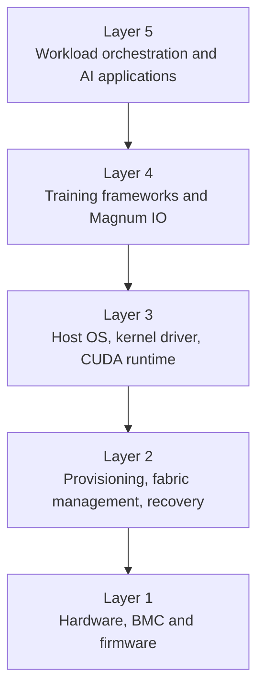

# 9.12 Software stack and management in an AI factory

| | |
|---|---|
| **Status** | Drafted (`ai_factory_software_lab.py`: 26 checks pass; cluster commands **untested** on live SuperPOD) |
| **Level** | Intermediate |
| **Priority tier** | 1b |
| **Lab venue** | none (design / reading) + self-checking Python model (`code/part09/ai_factory_software_lab.py`) |
| **Part** | Part 9: NVIDIA systems and reference architectures |
| **Sources used** | `nvidia-devops` V21 Ch. 6 & Ch. 10; `nvidia-devops-legacy-v10` Ch. 1; *NVIDIA Base Command Manager 11 Administrator Manual* (`bcm11-admin`) §3.16, §6.5, §9, §14.5; *NVIDIA DGX SuperPOD Reference Architecture Featuring NVIDIA DGX GB300 Systems* (`superpod-gb300-ra`, pp. 13–14, 32–34) |

## Why this matters for AI infrastructure

A researcher launches an ordinary single-process Python script on a cluster of thousands of GPUs. The job runs on one CPU core and the rest of the cluster sits idle. The researcher assumes the cluster is broken, but the script never asked for more than one process, so nothing spread the work out. In another case, one node of a multi-node job boots with an older kernel driver and the whole run stalls. A third team submits a plain Kubernetes job and every pod is placed except one. The job hangs until a timeout kills it thirty minutes later. A pod is the smallest unit Kubernetes runs, usually one container, and a job is a set of pods that together finish one piece of work.

None of these is a hardware fault. Each is a gap in the software between the bare metal and the user's code. Bare metal means the physical server with no operating system layered in a way that hides the hardware. That software has five layers, and each section of this chapter covers one. Think of it as a stack of floors. A problem on a lower floor often looks like a problem on an upper one, which is why engineers who only read the top floor waste so much time.

The first layer is provisioning, firmware and fabric management, which keeps every tray and switch on the same golden image and firmware set. The second matches the host kernel driver to the CUDA libraries inside the container. The third splits model state across worker processes, with `torchrun` starting one process per GPU. The fourth is gang-scheduled orchestration, where Slurm or NVIDIA Run:ai starts every process of a multi-node job together or none of them. The fifth is observability with DCGM, Prometheus and Grafana, which pages an engineer before a slowdown breaks a service commitment. DCGM is the NVIDIA data center GPU manager whose exporter publishes GPU health numbers, and Prometheus collects those numbers over time. The table in Section 1 lists the products in each layer.

## Prerequisites and outcomes

**Prerequisites:**
- Chapters 8.1, 8.4, 8.8, 8.9, and 8.16 cover Base Command Manager provisioning, Slurm and Kubernetes integration, and Mission Control concepts.
- Chapters 9.6 and 9.8 cover SuperPOD fabrics and the GB300 reference architecture.

The chapter follows the stack from the bottom up. It starts with the software that provisions and manages the hardware, then covers the host driver and container settings, then the distributed training memory arithmetic, then Kubernetes scheduling, and finally the monitoring and the incident playbook. Each section opens with a real situation a team meets, then explains the mechanism that answers it. Section 3 also shows how to configure `torchrun` rendezvous and how DLPack shares GPU tensors between PyTorch and JAX.

---

## 1. The software stack: from golden images to Mission Control

A multi-rack training job fails to start, or loses a node halfway through, and operators spend hours guessing which control plane owns the fault. The bare-metal provisioner, the InfiniBand subnet manager, the NVLink switch manager and the scheduler must share what they know. If they do not, a broken node keeps receiving new jobs and fails again before its firmware or links are repaired. A subnet manager is the component that configures and routes an InfiniBand fabric, and the NVLink switch manager does the same for the NVLink switch trays.

The stack avoids this by giving each task one owner. Base Command Manager and `cm-nvfwupd` put the same golden OS image and firmware bundle on every compute tray and NVSwitch tray. UFM Enterprise and NMX-M manage the InfiniBand and NVLink fabrics. NVIDIA Mission Control, with Slurm or Run:ai, assigns each worker its rank and starts the job by gang scheduling, and it swaps in a spare node using in-memory checkpointing if hardware fails mid-run. A rank is the number that identifies one worker process in a distributed job, and gang scheduling means the whole group starts together.

The diagram below stacks the five layers. Read it from the bottom up when you are looking for a root cause, and from the top down when you are looking for the place a user request enters.



The table gives the products in each layer. Use it as a lookup when you need to know which product owns a symptom, and read the prose after it for how the layers depend on one another.

| Layer | What lives there |
|---|---|
| 5. Orchestration and applications | Slurm (batch HPC/AI); Kubernetes with NVIDIA Run:ai (backend on the user-space K8s, operands on the admin K8s); NVIDIA AI Enterprise (NeMo, NIM, NGC containers) |
| 4. Frameworks and Magnum IO | PyTorch DDP / FSDP, DeepSpeed ZeRO-3, Megatron-Core, JAX (DLPack); NCCL, GPUDirect RDMA (`nvidia-peermem`), GDS (`nvidia-fs`), NVSHMEM |
| 3. Host OS, driver, CUDA runtime | DGX OS or Ubuntu LTS with the host kernel driver (`nvidia.ko`, 525 or newer / 580 or newer); container CUDA toolkit, cuDNN, cuBLAS (`CUDA_DEVICE_ORDER=PCI_BUS_ID`) |
| 2. Provisioning, fabric, recovery | NVIDIA Mission Control (five-layer operations and autonomous recovery) on top of Base Command Manager (golden images, `cmsh`, node draining) and the fabric managers UFM Enterprise (Quantum IB) and NMX-M (NVLink switch trays, NVOS) |
| 1. Hardware | DGX compute trays (Redfish), NVLink switch trays (NVOS REST), power shelves and BMS |

The layers depend downward. Layer 5 cannot run a job unless Layer 4 can talk to the GPUs, Layer 4 needs the driver in Layer 3, and Layer 3 needs a node that Layer 2 has provisioned correctly. That order explains why a fault in provisioning often shows up as a confusing error in a training script.

### 1.1 Who owns what

A modern SuperPOD, such as the DGX GB300 SuperPOD in Chapter 9.8, runs six management platforms, each with its own job. Keeping the jobs separate is what lets one platform be replaced or upgraded without touching the others.

Base Command Manager is the bare-metal foundation, built around CMDaemon and `cmsh`. CMDaemon is the management daemon that runs on the head node, and `cmsh` is the command-line shell you use to talk to it. It provisions nodes from golden images under `/cm/images/<image>`, tracks rack and chassis slot positions, flashes tray firmware with `cm-nvfwupd` version 2.1.2, and drains unhealthy nodes and requeues their jobs. Draining means moving the work away from a node before it is taken out of service. Chapters 8.5 and 8.16 cover it.

Unified Fabric Manager Enterprise manages the compute InfiniBand fabric on Quantum-2 NDR or Quantum-X800 Q3400-RD XDR switches. It configures Subnet Manager partitions, Adaptive Routing, SHARPv3 trees and SHIELD self-healing, and it predicts cable and transceiver failures. SHARP is the in-network reduction feature that lets the switches do part of the collective math, and SHIELD is the self-healing feature that routes around a failing link. Network Manager eXperience (NMX-M) manages the NVLink switch trays that run NVOS, with live telemetry and partition control across the 72-GPU rack.

Mission Control sits on top of BCM, UFM, NMX-M and the building management system. It detects failures, recovers, migrates workloads, correlates infrastructure and application diagnostics, and keeps in-memory checkpoints. The key point is that Mission Control does not replace the others. It reads their signals and decides what to do with a job.

Slurm and Run:ai are the two schedulers. Slurm handles batch multi-node training. Run:ai provides Kubernetes GPU orchestration across the user-space and administrative clusters described in Chapter 9.8, section 6.1. NVIDIA AI Enterprise and NGC supply the supported, pre-tested framework containers such as `nvcr.io/nvidia/pytorch:*`, plus NeMo, Megatron-Core and NIM microservices for inference. An NGC container is a packaged image with a framework and its libraries already matched and tested, so a team does not have to assemble them by hand.

---

## 2. Matching the host driver to the container, and three runtime settings

A researcher pulls a brand-new NGC container onto a cluster whose host kernel driver is older, and the job crashes before the first line of model code. The container looks fine on its own. The mismatch is between the container and the machine underneath it. Even when the container starts, the default device numbering can pair workers with the wrong network cards, and the default memory settings can cause out-of-memory errors while plenty of VRAM is free.

Two pieces of NVIDIA software must agree across the container boundary. The host kernel driver, `nvidia.ko`, lives in the host OS or the BCM golden image. It talks to the GPU hardware and sets the highest CUDA version the node supports, which `nvidia-smi` shows in its top-right banner. The user-space CUDA runtime and libraries, such as `libcudart.so`, cuBLAS, cuDNN and NCCL, are bundled in the container image, and PyTorch and JAX link against them. NCCL is the NVIDIA collective communication library that moves data between GPUs during training. A useful way to remember the split is that the driver lives on the host and the libraries live in the box.

### 2.1 CUDA minor-version compatibility rules

Once, a newer CUDA toolkit in a container meant upgrading the kernel driver on every host. That made every software change a fleet-wide maintenance event. Modern CUDA releases use minor-version compatibility, modeled by `verify_cuda_driver_compatibility()` in `code/part09/ai_factory_software.py`. The version number has two parts. The major number, such as 12 in CUDA 12.6, marks a family, and the minor number, such as 6, marks a release inside that family.

| Container CUDA family | Minimum host driver | Within the family | Moving to the next family |
|---|---|---|---|
| CUDA 11.x (`11.x`) | `>= 450` (and `< 525` without cross-major compat) | Any 11.x toolkit runs on driver 450 or newer | Needs driver 525 or newer |
| CUDA 12.x (`12.x`) | `>= 525` | Any 12.x toolkit runs on driver 525 or newer | Needs driver 580 or newer |
| CUDA 13.x (`13.x`) | `>= 580` | Any 13.x toolkit runs on driver 580 or newer | Driver 580 or the forward-compatibility package |

The table is a lookup for the minimum driver for each family. Read the first column to find your container, then the second for the driver you need on the host.

Within one CUDA major family, any toolkit minor version runs on a host driver at or above the family's minimum. Only features that need a newer driver are restricted. Across major versions, upgrade the host driver to the new family's minimum, or install NVIDIA's CUDA forward-compatibility package. A forward-compatibility package lets a newer CUDA runtime run on an older driver, within limits that NVIDIA documents for it.

Keep the fleet uniform. Every node in a distributed job must run the same NGC container image digest and the same host driver branch. A digest is the fingerprint that identifies one exact container image, so two images with the same tag can still differ. Never mix driver branches or NCCL versions among the ranks of one communicator. A communicator is the group of GPUs that take part in one collective operation, and a mismatch inside it can hang the whole job.

### 2.2 Three mandatory CUDA and PyTorch runtime settings for multi-GPU nodes

Set three runtime rules before any CUDA call in a distributed training script. A CUDA call is any request that asks the GPU to do work or allocate memory, and the settings below must be in place before the first such request happens. Changing them afterwards has no effect.

First, set `export CUDA_DEVICE_ORDER=PCI_BUS_ID`. By default CUDA orders GPUs with the `FASTEST_FIRST` heuristic, which can differ from the PCIe order shown in `nvidia-smi` and `nvidia-smi topo -m`. PCI bus order makes local ranks 0 to 7 map to physical GPUs 0 to 7 and to their `PIX`-paired `mlx5_0` to `mlx5_7` NICs. PIX means the GPU and the NIC sit under the same PCIe switch, which is the short path you want.

Second, set `export PYTORCH_CUDA_ALLOC_CONF=expandable_segments:True` before the first CUDA allocation. For variable-shape MoE workloads you can use `max_split_size_mb:256,backend:cudaMallocAsync` instead. MoE means mixture of experts, a model design where each input uses only some of the sub-networks, so the tensor shapes change from step to step. This lets PyTorch's caching allocator grow existing memory segments and avoids out-of-memory errors when free HBM is fragmented. Fragmented means the free memory is split into scattered pieces, none large enough for the next request. Note that `torch.cuda.memory_reserved()` is the memory the allocator holds, and `torch.cuda.memory_allocated()` is the memory tensors occupy. The difference between them is memory the allocator is keeping for reuse. Newer PyTorch releases also accept the shorter name `PYTORCH_ALLOC_CONF`. Check the release notes for your version.

Third, never set `CUDA_LAUNCH_BLOCKING=1` in production. It makes the CPU wait after every kernel launch, which destroys CPU-to-GPU pipelining and prevents CUDA Graph capture. Pipelining is the overlap that keeps the GPU busy while the CPU prepares the next step, and a CUDA Graph is a recorded sequence of GPU work that can be replayed with little CPU effort. Use it only on a development node to find the line of a failing kernel.

Put the three settings in the job template, not in each user's shell. A user's shell is a session that ends, and a setting that lives there is easy to forget, so the job template makes the settings part of every run.

---

## 3. Distributed training: `torchrun`, DeepSpeed ZeRO memory and DLPack

Drivers and containers match, and a naive launch still fails once the model outgrows one GPU. Picture a team that copies a 70B model onto eight H100 GPUs, starts training, and sees the first step crash. Standard data parallelism copies the whole model state onto every GPU. Data parallelism means each GPU holds a full copy of the model and works on a different slice of the data. Training a 70B-parameter model on 80 GB H100 GPUs then crashes with an out-of-memory error straight away. Model state here means the weights, the gradients and the optimizer's own memory, all of which must fit on the GPU during training.

### 3.1 How `torchrun` sets RANK, LOCAL_RANK and WORLD_SIZE

To start a 64-GPU job on 8 nodes, you do not SSH into 8 servers and start 64 Python processes by hand. Doing that by hand is slow and easy to get wrong, because one missed process leaves the others waiting forever. You also avoid the deprecated `torch.distributed.launch`. You use `torchrun` with the `c10d` rendezvous backend. A rendezvous is the meeting point where all the processes find each other before training begins, and `c10d` is the PyTorch backend that runs that meeting.

```bash
# Executed on each of the 8 nodes (or launched across all 8 via Slurm srun / K8s PyTorchJob)
torchrun \
  --nproc_per_node=8 \
  --nnodes=8 \
  --rdzv_id=job_42 \
  --rdzv_backend=c10d \
  --rdzv_endpoint=node001:29500 \
  train_script.py
```

`torchrun` starts 8 workers per node, 64 in all, and sets three environment variables in each. `WORLD_SIZE` is 64, the number of GPU processes in the job. `RANK` runs from 0 to 63 and is the global index, with rank 0 doing the logging. `LOCAL_RANK` runs from 0 to 7 and is the index on the local server. The script calls `torch.cuda.set_device(local_rank)` so that each worker binds to its own GPU before it calls `dist.init_process_group(backend="nccl", timeout=timedelta(minutes=30))`. The init call is the point where all 64 workers join the same process group, and the timeout is how long a worker waits for the others before it gives up.

The three numbers are easy to mix up, so keep a simple picture. The world size counts everyone. The global rank is a person's seat number across the whole room. The local rank is the seat number inside their own row, and the row is one server. The local rank picks the GPU, and the global rank decides who does the logging.

### 3.2 Why plain DDP runs out of memory, and what ZeRO changes

Why can PyTorch DistributedDataParallel not train a 70B model on 80 GB H100 GPUs? DistributedDataParallel, or DDP, is the standard PyTorch data-parallel wrapper. Chapter 9.6, section 4.2, showed that mixed-precision AdamW keeps 16 bytes of state per parameter while training, which is 1,120 GB for a 70B model. AdamW is the optimizer most large models use, and its state is the extra memory it keeps for each weight. Mixed precision means the model runs its math in a smaller number format and keeps a higher-precision copy for the updates.

```text
Mixed-precision AdamW model-state breakdown (16 bytes per parameter):
- BF16 model weights:                  2 B / param  ->   140 GB for 70B model
- BF16 gradients:                      2 B / param  ->   140 GB for 70B model
- FP32 master weights + Adam m and v: 12 B / param  ->   840 GB for 70B model
- Total unsharded active state:       16 B / param  -> 1,120 GB for 70B model
```

Read the block as three pieces of memory per weight. The weights and gradients are the working copies. The master weights and the two Adam values are the high-precision state that the optimizer updates each step. Notice that the optimizer's share is the largest piece, which is why sharding the optimizer alone already helps a lot.

DDP copies all 1,120 GB onto every GPU, so an 80 GB H100 fails at once. DeepSpeed ZeRO and PyTorch FSDP remove that redundancy by sharding the model state across all data-parallel ranks, as `calculate_zero_stage_memory_per_gpu()` in `code/part09/ai_factory_software.py` models. ZeRO stands for zero redundancy optimizer, and each stage removes one more kind of duplication. Sharding means cutting the state into pieces and giving each GPU only its own piece. FSDP, fully sharded data parallel, is PyTorch's own version of the same idea. The per-GPU figures in the table are the chapter's own calculation from the 16-byte breakdown and the ZeRO sharding formulas.

| Stage | Sharded across `W` GPUs | Per-GPU formula | 70B model, `W = 64` |
|---|---|---|---|
| **DDP (`ZeRO-0`)** | Nothing | `16 × P` | **`1,120.0 GB / GPU`** *(OOM on 80 GB H100.)* |
| **`ZeRO Stage 1`** | Optimizer states | `4 × P + (12 × P) / W` | `140 + 140 + (840 / 64)` = **`293.12 GB / GPU`** *(OOM on 80 GB)* |
| **`ZeRO Stage 2`** | Optimizer and gradients | `2 × P + (14 × P) / W` | `140 + (980 / 64)` = **`155.31 GB / GPU`** *(OOM on 80 GB)* |
| **`ZeRO Stage 3` / `FSDP`** | Weights, gradients and optimizer | `(16 × P) / W` | `1,120 / 64` = **`17.50 GB / GPU`** *(Fits in 80 GB, leaving 62.5 GB for activations.)* |

The table reads from top to bottom as a list of ways to cut the memory. Each row shards one more piece, so the per-GPU number falls. Only the last row fits on the card, and the space left over is what the activations use during the forward and backward passes. Activations are the intermediate values a model keeps while it computes, and they grow with the batch size.

DeepSpeed computes the global batch size by multiplying three numbers. The batch size is how many sequences the whole job processes before it updates the weights, and each GPU's share is set by the first two numbers.

```text
Global_Batch_Size = train_micro_batch_size_per_gpu × gradient_accumulation_steps × world_size
Example (64 GPUs): 4 (micro-batch) × 8 (grad_accum) × 64 (world_size) = 2,048 sequences per step
```

The micro-batch is what one GPU processes in one pass. Gradient accumulation adds up several passes before the weights are updated, which lets a small micro-batch act like a larger one. The world size then multiplies that across all the GPUs. If you change the number of GPUs, the global batch size changes too, so the learning rate may need retuning.

### 3.3 Zero-copy PyTorch to JAX tensor sharing with DLPack

Picture a pipeline where PyTorch does the data preprocessing and JAX runs the model, both on the same GPU. If the pipeline moves each tensor through the CPU, the data crosses the PCIe bus twice for every step, which is slow and wastes bandwidth. A tensor is the array of numbers that a framework works on.

If a pipeline does PyTorch preprocessing and JAX model execution on the same GPU, do not move tensors with `.cpu().numpy()`. That forces a copy to the host and back across PCIe. Pass the GPU memory directly with DLPack instead, using `torch.utils.dlpack.to_dlpack(t)` and `jax.dlpack.from_dlpack(dlpack_capsule)`, or the native `__dlpack__` protocol. DLPack is an open standard that describes a tensor's memory so another framework can read it without copying. No data is copied.

Launch multi-node jobs with `torchrun --rdzv_backend=c10d`, and size the sharding stage from the memory arithmetic above. Pick the lowest ZeRO stage that fits in memory, because each stage you add shards more and costs more communication.

---

## 4. Kubernetes and why training needs gang scheduling

Two teams submit multi-node training jobs to a standard Kubernetes cluster at the same moment. The default scheduler places half of each job, and both wait for nodes that never free up. The allocated GPUs sit idle for thirty minutes until the rendezvous times out. The problem is not the hardware or the code. It is that the scheduler placed pods one at a time, and a training job needs all of its pods before any of them can do work.

### 4.1 An Indexed Job, a headless Service and the flaw without gang scheduling

Three Kubernetes building blocks make up a multi-node job. A headless Service with `clusterIP: None` creates predictable DNS records for every pod that matches the job selector. A headless Service does not hand out one shared address. Instead, each pod gets its own name in DNS, so other pods can find it directly. Pod 0 then resolves at `llama-70b-training-0.llama-train`. An Indexed Job, with `completionMode: Indexed`, `parallelism: 8` and `completions: 8`, sets `JOB_COMPLETION_INDEX` from 0 to 7 in each pod, and you pass that to `torchrun --node_rank=$JOB_COMPLETION_INDEX --master_addr=llama-70b-training-0.llama-train`. The index gives each pod a stable number, and the master address tells every node where rank 0 lives. Pod anti-affinity with `nvidia.com/gpu: 8` gives each pod a whole 8-GPU node, and the NVIDIA Network Operator adds the RDMA and InfiniBand devices. Anti-affinity is the rule that keeps two pods off the same node.

Together these three pieces give the job its names and its order, which is what a training launch needs. What they do not give is a promise that all eight pods start together.

The default `kube-scheduler` places pods one at a time, not as a group. Suppose two researchers submit 8-node, 64-GPU Indexed Jobs at the same time to an 8-node cluster. Job A gets 4 nodes and starts `torchrun` on node ranks 0 to 3. Job B gets the other 4 nodes and does the same. Neither can ever place its remaining 4 pods. Both hold all 64 GPUs and do no useful work for 30 minutes, until the NCCL or `c10d` rendezvous times out. Each job is waiting for the other to release nodes, and neither will release them. That situation is a deadlock.

Production clusters therefore never submit multi-node jobs as bare Kubernetes Jobs. They use gang scheduling, which admits all the pods or none, through Kueue, Volcano, the Kubeflow Training Operator PyTorchJob or NVIDIA Run:ai. A gang here is the full set of pods a job needs, and the scheduler admits the gang only when every member fits. Or they run batch training on Slurm, which gang-schedules nodes natively.

---

## 5. Observability, alerts and incident response

A data scientist messages the team on Slack that training feels slow today. By the time the message arrives, the service commitment may already be broken. The utilization dashboard may still show 99 percent while one degraded network link stalls the whole synchronous job. Synchronous means every GPU waits at a checkpoint in the code until the slowest one arrives, so one slow link slows everyone. The lesson of this section is that a healthy-looking number can hide a stalled job, so the team needs to measure the things that matter to the job.

### 5.1 What to scrape, and why GPU utilization misleads

> **dcgm-exporter 4.9.0 version note.** dcgm-exporter 4.9.0 (2026-11-06) renamed many default metrics and changed some units. For example `DCGM_FI_DEV_GPU_UTIL` (percent) became `DCGM_FI_DEV_GPU_UTIL_RATIO` (0 to 1), and `DCGM_FI_DEV_FB_USED` (MiB) became `DCGM_FI_DEV_FB_USED_BYTES`. The metric names in this chapter are the 4.8.x names. On a 4.9.0 exporter use the [full mapping in 17.4](../part-17-operations/04-dcgm-exporter-and-interpreting-gpu-metrics.md#14-what-dcgm-exporter-490-renamed), and change thresholds together with the unit.

A production Prometheus server scrapes four exporter tiers at matched intervals. An exporter is a small service that turns a system's internal numbers into the text format Prometheus reads, and a scrape is one collection of those numbers. Matching the intervals means the signals line up in time when you compare them.

| Exporter Tier | Endpoint & Scrape Interval | Key Metrics & Operational Purpose |
|---|---|---|
| 1. `nvidia-dcgm` | `dcgm-exporter:9400` every `10s` | `DCGM_FI_PROF_SM_ACTIVE`, `DCGM_FI_PROF_PIPE_TENSOR_ACTIVE`, `DCGM_FI_DEV_GPU_TEMP`, `DCGM_FI_DEV_POWER_USAGE`, `DCGM_FI_DEV_SM_CLOCK`, `DCGM_FI_DEV_XID_ERRORS` |
| 2. `training-app` / `inference-app` | `:8000` every `10s` | Application `training_throughput_tokens_per_sec`, `training_loss`, exposed AllReduce latency, and inference TTFT / ITL percentiles |
| 3. `gpu-nodes` | `node_exporter:9100` every `30s` | Host CPU, DDR5 / LPDDR5X memory, `/dev/shm`, and NVMe `/raid` I/O latency |
| 4. `infiniband` | `ib-exporter:9600` / UFM every `60s` | Port link state, `SymbolErrorCounter`, `PortXmitWait`, and RoCE PFC / ECN counters |

The four tiers answer different questions. The GPU tier tells you about the chips, the application tier tells you about the work, the node tier tells you about the host, and the network tier tells you about the links between nodes. A slowdown usually shows up in the application tier first, and the other three tiers help you find where it starts. TTFT is time to first token, ITL is inter-token latency, and both describe how responsive a language model feels to a user.

`DCGM_FI_DEV_GPU_UTIL` matches the GPU-Util column of `nvidia-smi`, and it misleads for distributed training. It reports the share of time in which at least one warp was active on any Streaming Multiprocessor. A warp is a group of threads that the GPU runs together, and a Streaming Multiprocessor is one of the GPU's compute blocks. A GPU stalled on a slow PCIe transfer, or spinning in a single-warp NCCL polling kernel, can show 100 percent while doing almost no math. A polling kernel is a small GPU program that checks over and over whether data has arrived. Track `DCGM_FI_PROF_SM_ACTIVE`, the fraction of SMs running warps, and pair it with `DCGM_FI_PROF_PIPE_TENSOR_ACTIVE`, the fraction of cycles the Tensor Core pipes are busy. Tensor Cores are the units that do the heavy matrix math in training. Scrape both every 10 seconds from `dcgm-exporter:9400`.

### 5.2 The five SLO-driven Prometheus alerting rules

Tie every paging alert to an SLO breach or a hardware failure signature, and add a runbook annotation. An SLO, service level objective, is the target a service promises, such as a latency or a throughput level. A runbook annotation is a short note on the alert that tells the on-call engineer what to do first. `evaluate_ai_factory_slo_alerts()` in `code/part09/ai_factory_software.py` models the five rules. In a Prometheus rule, `for:` is the time a condition must stay true before the alert fires, which filters out brief spikes.

| Alert | PromQL condition | Duration (`for:`) | What to do |
|---|---|---|---|
| **1. `TrainingThroughputLow`** | `training_throughput_tokens_per_sec < 0.9 * <baseline>` | `5m` | Throughput is more than 10 percent below baseline. Check SM activity, exposed `AllReduce` time, clocks and IB congestion. |
| **2. `GPUTemperatureHigh`** | `DCGM_FI_DEV_GPU_TEMP > 80` *(or model slowdown temp)* | `1m` | GPU nearing thermal slowdown. Check throttle reasons with `nvidia-smi -q -d PERFORMANCE`, cold-aisle temperature, blanking panels and CDU flow. |
| **3. `InferenceLatencyP99High`** | `inference_latency_p99_ms > 500` | `3m` | P99 time to first token is over the 500 ms target. Check load and KV-cache pressure, and add replicas. |
| **4. `GPUFailureDetected`** | `increase(gpu_failure_count[10m]) > 0` *(or `DCGM_FI_DEV_XID_ERRORS`)* | Immediate | An `Xid` fault or a GPU off the bus. Start the three-phase playbook below. |
| **5. `CostAnomalyDetected`** | `(cluster_power_kw - cluster_power_kw_avg_7d) / cluster_power_kw_avg_7d > 0.3` | `10m` | Cluster power is more than 30 percent above its 7-day average. Look for runaway jobs or hung spin loops. |

Each rule ties a number to an action. The first rule protects the training speed, the second protects the hardware, the third protects users waiting for an answer, the fourth reports a failed GPU, and the fifth catches spending that has gone wrong. P99 means the value that 99 percent of requests beat, so it describes the slow tail that real users feel. The KV cache is the memory a language model keeps for the text it has already processed, and it fills up under heavy load.

### 5.3 The three-phase GPU failure incident response playbook

When `GPUFailureDetected` pages on-call during a 64-GPU run, or when Mission Control and BCM recover on their own, follow three time-bounded phases. A playbook is the agreed sequence of steps for one kind of incident, and the time limits keep the team from spending an hour deciding what to do first.

| Phase | Target | Actions |
|---|---|---|
| Phase 1: Initial Response | `<= 5 minutes` | Confirm GPU fault via `nvidia-smi`, `dmesg` Xid, or DCGM health watch; identify batch training versus online inference; terminate stalled synchronous training job immediately |
| Phase 2: Mitigation | `<= 15 minutes` | Attempt automated GPU reset, OS reboot, or Redfish power cycle; if `dcgmi diag -r 2` passes, resume from checkpoint; if reset fails, cordon node, allocate spare, and resume |
| Phase 3: Recovery & Post-Incident | `30-60 minutes` | Collect `nvidia-bug-report.sh`, `nvsm dump health`, and BMC logs; dispatch hardware RMA for cordoned node |

In the first five minutes, confirm the fault and find out whether the node runs training or inference. Inference traffic fails over to the spare replicas with no user impact. For synchronous training, stop or drain the hung job at once, because one dead GPU stalls all 64 at the collective barrier. A barrier is the point where every worker must arrive before any of them can continue.

Within 15 minutes, try a GPU reset, an OS reboot or a Redfish power cycle. If the node recovers and `dcgmi diag -r 2` passes, resume from the latest sharded checkpoint. If not, cordon and drain the node with `cmsh`, `scontrol update State=DRAIN` or `kubectl cordon`, take a spare from the pool and resume from the checkpoint. Cordoning marks the node so that no new work lands on it, and draining moves the existing work off.

Within 30 to 60 minutes, collect `nvidia-bug-report.sh` or `nvsm dump health` and the BMC logs, and open a hardware return for the cordoned node. The training work you lose is bounded by the checkpoint interval plus the 15-minute mitigation window. That bound is the reason the checkpoint interval matters: a shorter interval loses less work when a failure happens, at the cost of more saving time.

---

## Commands and configurations that matter

The commands in this section check the driver and container pairing, set the training configuration, and run the lab. These steps were not run on a live SuperPOD, so use them as a checklist to confirm on your own cluster. Read each block as a set of checks you can run in order, starting with the host.

### 1. Verify host driver, container CUDA, PyTorch, NCCL, and NVLink P2P alignment

Run the first command on the host to see the driver and the highest CUDA version it supports. Then run the Python block inside the container to check what the container actually carries. P2P means peer-to-peer, the direct GPU-to-GPU access that NVLink provides, so a P2P check tells you whether every GPU can reach every other one without going through the CPU.

```bash
# 1. Inspect host kernel driver version and maximum supported CUDA version
nvidia-smi

# 2. Inside the NGC container: verify bundled CUDA, NCCL, and peer-to-peer (P2P) access across all 8 GPUs
python3 -c '
import os, torch
os.environ.setdefault("CUDA_DEVICE_ORDER", "PCI_BUS_ID")
os.environ.setdefault("PYTORCH_CUDA_ALLOC_CONF", "expandable_segments:True")
print("PyTorch:", torch.__version__, "| CUDA:", torch.version.cuda, "| NCCL:", torch.cuda.nccl.version())
n = torch.cuda.device_count()
p2p_ok = all(torch.cuda.can_device_access_peer(i, j) for i in range(n) for j in range(n) if i != j)
print(f"GPUs visible: {n} | Full all-to-all P2P access: {p2p_ok}")
'
```

The first step tells you what the host can support, and the second tells you what the container actually uses. Compare the two. If the container's CUDA version is higher than the host's supported version, you have the mismatch from Section 2. The P2P line should say True for a full 8-GPU node, and False means some pairs must route through the CPU.

### 2. Production DeepSpeed ZeRO Stage 3 configuration

The JSON below is the training configuration that turns on ZeRO Stage 3. The micro-batch and accumulation values feed the global batch size formula earlier in this chapter, and the `stage` line is the choice that shards the weights as well as the optimizer and gradients. Keep the file under version control with the training script, so the memory settings and the code change together.

```json
{
  "train_micro_batch_size_per_gpu": 4,
  "gradient_accumulation_steps": 8,
  "bf16": { "enabled": true },
  "optimizer": {
    "type": "AdamW",
    "params": { "lr": 1e-4, "betas": [0.9, 0.999], "eps": 1e-8, "weight_decay": 0.01 }
  },
  "zero_optimization": {
    "stage": 3,
    "reduce_scatter": true,
    "contiguous_gradients": true
  },
  "gradient_clipping": 1.0
}
```

The `reduce_scatter` setting sends each GPU only the gradient slice it owns, rather than the full gradient. The `contiguous_gradients` setting packs the gradients into one block of memory, which avoids fragmentation. The gradient clipping value caps how large a single update can be, so one bad batch cannot blow up the weights.

### 3. Run the 26-check AI Factory Software Stack and SLO Alerting verifier

```bash
python3 -B code/part09/ai_factory_software_lab.py
```

Run the verifier before you change any of the settings above. It checks the arithmetic and the rules in the Python model, so a failing check tells you the model and the text disagree.

---

## How it fails

Each failure below follows the same pattern. The symptom is what the team sees first, the cause is the mechanism underneath, and the fix is the change that removes the cause. Read the symptom as a clue, because it often points to the wrong layer at first. A timeout error, for example, looks like a network problem, but the cause may be a scheduling choice made hours before.

### 1. `RuntimeError: NCCL operation timed out` at job startup on Kubernetes

Symptom: A multi-node training job starts 6 of its 8 pods, sits at `0%` GPU compute for 30 minutes, and crashes with `NCCL operation timed out` during `dist.init_process_group()`.

Cause: Either the job was submitted as a plain Kubernetes `Indexed` `Job` without a gang scheduler (so 2 pods stayed `Pending` for lack of resources while 6 pods waited at the `c10d` barrier), or `MASTER_ADDR` DNS (`<job>-0.<headless-svc>`) failed to resolve. A pod in the Pending state has been accepted by Kubernetes but not yet placed on a node. The six running pods wait at the barrier for the two that never arrive.

Fix: Always schedule multi-node Kubernetes jobs through a Gang Scheduler (`Kueue`, `Volcano`, `PyTorchJob`, or `NVIDIA Run:ai`) so 0 pods start until all 8 nodes are reserved, and verify headless Service DNS resolution for `MASTER_ADDR`. Checking the DNS name from inside a pod tells you whether the master address can be found at all.

### 2. Cross-major CUDA container failure (`cudaErrorInsufficientDriver`)

Symptom: Launching a new NGC PyTorch container built on CUDA `12.6` (or `13.0`) fails immediately with `Error 35: CUDA driver version is insufficient for CUDA runtime version`.

Cause: The host OS kernel driver is on a legacy branch (e.g., `470.xx` for CUDA 11.x, or `535.xx` when running a CUDA 13.x container that requires `≥ 580`). Minor-version compatibility only works *within* the same CUDA major version (`12.x ≥ 525`, `13.x ≥ 580`). The error appears before any training code runs, which is why it is confusing to a researcher who only sees a failed launch.

Fix: Upgrade the BCM golden software image's host NVIDIA driver branch (`≥ 525` for CUDA 12.x; `≥ 580` for CUDA 13.x) via `cm-chroot-sw-img` + `createramdisk`, or select the NGC container tag matching your validated host driver branch. Changing the container is the faster fix on a busy cluster, because a driver upgrade means a reboot of every node that uses the image.

### 3. Wrong GPU-to-NIC pairing because `CUDA_DEVICE_ORDER` was unset

Symptom: `nvidia-smi topo -m` shows `GPU 0` is `PIX` to `mlx5_0`, yet when `LOCAL_RANK 0` runs, NCCL routes traffic across the CPU (`NODE` / `SYS`).

Cause: Without `export CUDA_DEVICE_ORDER=PCI_BUS_ID`, the CUDA runtime ordered device ordinals using `FASTEST_FIRST`, which did not match the PCIe bus order used by `nvidia-smi` and the launcher's NIC binding script. The job runs, but each GPU sends its traffic through a longer path than the one the topology table promised.

Fix: Set `export CUDA_DEVICE_ORDER=PCI_BUS_ID` globally in the container environment before initializing PyTorch or CUDA. The setting belongs in the image or the job template, so no one can forget it.

### 4. 10× slower throughput after setting `CUDA_LAUNCH_BLOCKING=1`

Symptom: A developer sets `CUDA_LAUNCH_BLOCKING=1` in a production training script thinking it helps CUDA Graphs or determinism, and step time slows down by 5× to 10×.

Cause: `CUDA_LAUNCH_BLOCKING=1` disables asynchronous kernel launches, forcing the CPU to wait for each GPU kernel to finish before launching the next one and breaking CUDA Graph capture. The debugging setting was copied into production, where it removes the overlap that keeps the GPUs busy.

Fix: Keep `CUDA_LAUNCH_BLOCKING=0` in production; enable CUDA Graphs via `torch.cuda.CUDAGraph()` or `torch.compile(mode="reduce-overhead")`. Keep the blocking setting for a single debugging session on a development node, and remove it before the job goes to the queue.

### 5. False-green `99% GPU-Util` while training throughput drops by 50%

Symptom: Grafana shows `DCGM_FI_DEV_GPU_UTIL` at `99%`, so no utilization alert fires, even though `tokens/sec` dropped from `60,000` to `28,000` due to a network straggler. A straggler is the one slow participant that holds back a synchronous job.

Cause: `DCGM_FI_DEV_GPU_UTIL` (`nvidia-smi` GPU-Util) only measures whether *any* warp is resident on the GPU (including a single NCCL polling kernel spinning while waiting on a slow link). The utilization number was green because the GPUs were busy waiting, not busy computing.

Fix: Alert directly on application `training_throughput_tokens_per_sec < 0.9 * baseline` (`TrainingThroughputLow`) and track `DCGM_FI_PROF_SM_ACTIVE` and `DCGM_FI_PROF_PIPE_TENSOR_ACTIVE`. Measuring the work the job delivers catches the problem that the hardware counter hides.

---

## Hands-on lab

This chapter's self-checking Python model in `code/part09/ai_factory_software.py` and lab script in `code/part09/ai_factory_software_lab.py` implement four verification checks. Each check is a small set of rules, and the lab runs every rule against known inputs. The lab checks the arithmetic and the rules in the model. It does not talk to a real cluster, so a pass confirms the logic and not the live system.

1. The CUDA Toolkit and Host Driver Compatibility Verifier checks minimum host driver branches across CUDA 11.x, 12.x, and 13.x plus fleet-wide container and driver homogeneity.
2. The DDP and DeepSpeed ZeRO Stage 1, 2, and 3 Memory and Global Batch Calculator models a 70B model across 64 GPUs.
3. The Distributed Training Runtime and Gang-Scheduling Auditor checks `CUDA_DEVICE_ORDER=PCI_BUS_ID`, `CUDA_LAUNCH_BLOCKING=0`, `torchrun` versus deprecated `torch.distributed.launch`, DLPack versus `.numpy()` host copies, and gang-scheduled Kubernetes jobs.
4. The Five-Rule AI Factory SLO Alerting Engine evaluates `TrainingThroughputLow`, `GPUTemperatureHigh`, `InferenceLatencyP99High`, `GPUFailureDetected`, and `CostAnomalyDetected`.

Run the lab from the repository root.

```bash
python3 -B code/part09/ai_factory_software_lab.py
```

When the lab passes in this repository, the output looks like the block below.

```text
=== Chapter 9.12 Lab: Software Stack & Management in an AI Factory ===
  [PASS] CUDA 12.x container on host driver 550 (>=525) is compatible via minor-version compatibility
  [PASS] CUDA 13.x container on host driver 580 (>=580) is compatible
  [PASS] CUDA 12.x container on legacy 470 driver (<525) is rejected (host_driver_too_old)
  [PASS] V21 Ch6: Flags mismatched container image or driver branch across cluster nodes
  [PASS] Rejects unsupported CUDA major version
  [PASS] 70B unsharded DDP (Stage 0) requires 1,120.0 GB per GPU; global batch (4*8*64) == 2,048
  [PASS] 70B ZeRO-1 across 64 GPUs (shards 840 GB optimizer) requires 140 + 140 + 13.125 == 293.12 GB/GPU
  [PASS] 70B ZeRO-2 across 64 GPUs (shards optimizer + grads) requires 140 + (980/64) == 155.31 GB/GPU
  [PASS] 70B ZeRO-3 across 64 GPUs (shards weights + grads + optimizer) requires 1120 / 64 == 17.50 GB/GPU
  ...
  [PASS] V21 Ch10: GPU failure / Xid increase > 0 in 10m fires GPUFailureDetected
  [PASS] V21 Ch10: Cluster power > 30% above 7-day average fires CostAnomalyDetected
  [PASS] Simultaneous degradation across all 5 SLO metrics fires all 5 alerts
  [PASS] CUDA 11.x container on host driver 470 (>=450) is compatible
  [PASS] K8s Indexed Job paired with Kueue/Volcano gang scheduler passes runtime audit

Summary: 26 passed, 0 failed (total 26)
```

Read the output as a list of rules that held. Each PASS line names a rule, and a single FAIL would tell you which rule the model no longer satisfies.

---

## Exercises

1. Run the lab script first. Then recompute the per-GPU model-state memory of a 13B model across 16 GPUs, using 16 bytes per parameter. Do it for ZeRO Stages 0, 1, 2, and 3. Which stages fit on an 80 GB GPU?
2. A node has driver 535, and a teammate wants to run an NGC container built on CUDA 13.0. Which check would you run, and what do you expect? What are the two ways to fix it?
3. Write the `torchrun` command for 4 nodes with 8 GPUs each. For the process that controls GPU 3 on node 2, what are the world size, the global rank, and the local rank?
4. Two 4-node jobs are submitted to a 4-node cluster as plain Kubernetes Jobs. Draw what happens. Then draw it again with a gang scheduler.
5. A cluster has a baseline throughput of 50,000 tokens per second. Write the five alert rules from Section 5.2 with thresholds for this cluster. Add one runbook line to each rule.
6. A GPU falls off the bus in the middle of a 64-GPU job. What do you do in the first 5 minutes? What do you do by minute 15, and by minute 60?

## Checkpoint questions (20)

<details>
<summary>**1. How do BCM, UFM Enterprise, NMX-M, and NVIDIA Mission Control divide management responsibilities inside a DGX SuperPOD?**</summary>

- Base Command Manager provisions bare-metal compute nodes from golden OS images, manages rack and chassis coordinates, flashes firmware via `cm-nvfwupd`, and executes node draining.
- UFM Enterprise manages the scale-out Quantum InfiniBand compute fabric including SHARPv3, Adaptive Routing, SHIELD, and cable or switch telemetry.
- NMX-M manages the scale-up NVLink switch trays running NVOS.
- NVIDIA Mission Control is the five-layer operations platform sitting across BCM, UFM, NMX-M, and the facility BMS. It orchestrates autonomous failure recovery, workload migration, unified diagnostics, in-memory checkpointing, and Slurm or Run:ai scheduling.
</details>

<details>
<summary>**2. State the minimum host NVIDIA driver branch required for CUDA 11.x, CUDA 12.x, and CUDA 13.x containers, and explain what CUDA minor-version compatibility allows.**</summary>

- CUDA 11.x requires host driver branch 450 or newer.
- CUDA 12.x requires host driver branch 525 or newer.
- CUDA 13.x requires host driver branch 580 or newer.
Within a single CUDA major version, minor-version compatibility allows newer CUDA toolkit minor versions inside an NGC container to run on an older host driver from the same major family. For example, CUDA 12.6 runs on driver 535, whereas crossing major versions requires upgrading the host driver.
</details>

<details>
<summary>**3. Calculate the per-GPU model-state VRAM required for a 70B parameter model across 64 GPUs under vanilla DDP, ZeRO-1, ZeRO-2, and ZeRO-3.**</summary>

```text
70B parameter model at 16 bytes/param = 1,120 GB total active AdamW state:
- BF16 weights:   2 B/param = 140 GB
- BF16 gradients: 2 B/param = 140 GB
- FP32 master weights + Adam states: 12 B/param = 840 GB
- DDP (ZeRO-0): 140 + 140 + 840 = 1,120.0 GB / GPU
- ZeRO-1 (shards optimizer across 64 GPUs): 140 + 140 + (840 / 64) = 293.12 GB / GPU
- ZeRO-2 (shards optimizer + gradients): 140 + (980 / 64) = 155.31 GB / GPU
- ZeRO-3 / FSDP (shards weights + gradients + optimizer): 1,120 / 64 = 17.50 GB / GPU
```

Only ZeRO Stage 3 or FSDP fits the 70B model state inside an 80 GB GPU across 64 data-parallel ranks.
</details>

<details>
<summary>**4. Why must you set CUDA_DEVICE_ORDER and PYTORCH_CUDA_ALLOC_CONF in multi-GPU training scripts, and why must CUDA_LAUNCH_BLOCKING stay at 0?**</summary>

- Setting `CUDA_DEVICE_ORDER=PCI_BUS_ID` ensures CUDA device ordinals match the physical PCIe bus order seen by `nvidia-smi topo -m` and NIC-binding scripts instead of `FASTEST_FIRST`.
- Setting `PYTORCH_CUDA_ALLOC_CONF=expandable_segments:True` allows the PyTorch caching allocator to expand virtual memory segments on demand, preventing fragmentation-induced OOM errors.
- Keeping `CUDA_LAUNCH_BLOCKING=0` avoids synchronous CPU blocking on every kernel launch, which would destroy throughput and break CUDA Graph capture.
</details>

<details>
<summary>**5. How do you transfer a GPU tensor from PyTorch to JAX without copying data through host CPU RAM?**</summary>

Use the zero-copy DLPack protocol via `torch.utils.dlpack.to_dlpack` and `jax.dlpack.from_dlpack` or the native `__dlpack__` protocol. That exchanges the underlying GPU HBM pointer directly in VRAM, whereas `.numpy()` forces a Device-to-Host copy.
</details>

<details>
<summary>**6. Why does a plain Kubernetes Indexed Job deadlock when two multi-node training jobs contend for a cluster, and what four tools solve this?**</summary>

A plain Kubernetes Job schedules pods one by one without gang scheduling for all-or-nothing placement. If Job A claims half the nodes and Job B claims the other half, both jobs start partial ranks. Those ranks hang waiting at the `torchrun` and NCCL rendezvous barrier until timeout. Production clusters use a gang-scheduling layer such as Kueue, Volcano, the Kubeflow Training Operator PyTorchJob, or NVIDIA Run:ai.
</details>

<details>
<summary>**7. Why is DCGM_FI_DEV_GPU_UTIL misleading for detecting training stragglers, and which two DCGM profiling metrics should you track instead?**</summary>

The `DCGM_FI_DEV_GPU_UTIL` metric only measures the percentage of time at least one warp is active on any SM. A GPU spinning in a single-warp NCCL wait loop reports 100% utilization while doing zero math. Track `DCGM_FI_PROF_SM_ACTIVE` for the fraction of SMs with active warps and `DCGM_FI_PROF_PIPE_TENSOR_ACTIVE` for Tensor Core activity alongside application tokens per second.
</details>

<details>
<summary>**8. Walk through the three time-bounded phases of the GPU Failure Incident Response Playbook.**</summary>

1. In Phase 1 within 5 minutes, confirm the GPU fault via Xid logs or `nvidia-smi` and check if training or inference is affected. Terminate the stalled synchronous training job so the remaining healthy GPUs do not sit blocked.
2. In Phase 2 within 15 minutes, attempt a node or GPU reset and resume from the last checkpoint if healthy. If the fault persists, cordon and drain the faulty node, allocate a spare node, and resume training from the last checkpoint.
3. In Phase 3 within 30 to 60 minutes, collect diagnostic bundles and initiate a hardware RMA for the cordoned node.
</details>

<details>
<summary>**9. What are the five layers of the software stack in this chapter?**</summary>

The five layers are provisioning, firmware, and fabric management; host driver and CUDA runtime alignment; distributed frameworks and memory sharding; gang-scheduled orchestration; and observability with incident response.
</details>

<details>
<summary>**10. Why do you configure NCCL_IB_SL and NCCL_IB_TC inside multi-node training containers?**</summary>

The `NCCL_IB_SL` InfiniBand Service Level and `NCCL_IB_TC` Traffic Class or DSCP settings place NCCL collective traffic into the fabric's dedicated lossless QoS queue. In the production manifest, using service level 0 and traffic class 106 isolates latency-sensitive AllReduce traffic from storage or management traffic.
</details>

<details>
<summary>**11. What does the host driver set, and what lives in the container?**</summary>

The host kernel driver talks to the GPU and sets the highest CUDA version the node supports. The container holds the CUDA runtime, cuBLAS, cuDNN, and NCCL libraries that PyTorch uses.
</details>

<details>
<summary>**12. What is the Fleet Homogeneity Rule?**</summary>

Every node in a job must run the same container image digest and the same host driver branch. Mixed drivers or NCCL versions in one communicator cause failures.
</details>

<details>
<summary>**13. Why must multi-GPU Kubernetes Pods mount an in-memory /dev/shm emptyDir instead of keeping default shared memory?**</summary>

Kubernetes defaults `/dev/shm` to 64 MB, which immediately causes NCCL shared-memory transport and PyTorch multi-worker DataLoader queues to fail with a bus error. Mounting an in-memory `emptyDir` with `medium: Memory` and a 64Gi limit gives intra-node IPC and data-loader workers sufficient shared RAM.
</details>

<details>
<summary>**14. Name the five SLO-driven Prometheus and DCGM alert rules defined in Section 5.2 and state why each threshold is actionable.**</summary>

1. The `TrainingThroughputLow` rule fires when throughput drops more than 10% below baseline for 5 minutes, catching stragglers early.
2. The `GPUTemperatureHigh` rule fires when `DCGM_FI_DEV_GPU_TEMP` exceeds 80°C for 1 minute, catching cooling issues before thermal clock throttling spreads.
3. The `InferenceLatencyP99High` rule fires when P99 TTFT exceeds 500 ms for 3 minutes, protecting interactive latency SLAs.
4. The `GPUFailureDetected` rule fires immediately when `gpu_failure_count` or Xid errors increase over 10 minutes, triggering the three-phase failure playbook.
5. The `CostAnomalyDetected` rule fires when cluster power exceeds its 7-day average by more than 30% for 10 minutes, catching zombie or runaway jobs.
</details>

<details>
<summary>**15. What do RANK, LOCAL_RANK, and WORLD_SIZE mean?**</summary>

The `WORLD_SIZE` variable is the total number of processes across the job. The `RANK` variable is the global process number. The `LOCAL_RANK` variable is the process number on the local server, which is used to select the local GPU.
</details>

<details>
<summary>**16. Why is a global batch size multiplied by three numbers?**</summary>

Global batch size equals micro-batch per GPU multiplied by gradient-accumulation steps multiplied by world size. With values of 4, 8, and 64, the global batch size is 2,048 sequences per step.
</details>

<details>
<summary>**17. What does ZeRO Stage 2 shard compared with Stage 1?**</summary>

Stage 1 shards the optimizer states across data-parallel ranks. Stage 2 also shards the gradients. Stage 3 also shards the model weights.
</details>

<details>
<summary>**18. Why does the production Kubernetes training manifest request hostIPC and unlimited locked memory?**</summary>

Setting `hostIPC: true` allows NCCL and GPUDirect shared-memory segments to operate cleanly across processes on the node. Setting `ulimit -l unlimited` via the `IPC_LOCK` capability allows the InfiniBand and RDMA Verbs driver `mlx5` and the CUDA runtime to pin large memory regions for zero-copy DMA transfers.
</details>

<details>
<summary>**19. What does the Headless Service plus Indexed Job give you on Kubernetes?**</summary>

It gives predictable DNS names for each pod so rank 0 can be found, plus a `JOB_COMPLETION_INDEX` variable for the node rank. It does not give all-or-nothing placement, which requires a gang scheduler.
</details>

<details>
<summary>**20. When a GPU suffers an uncorrectable hardware fault during a 64-GPU training job, why is your very first action within 5 minutes to terminate the stalled job rather than immediately starting hardware diagnostics on the broken GPU?**</summary>

The other 63 healthy GPUs are blocked at their NCCL collective barrier burning cluster capacity while doing zero useful work. Terminating the stalled job frees or prepares the healthy nodes immediately so the job can restart from the last checkpoint on a spare node within 15 minutes while the faulty node is cordoned for offline diagnostics and RMA.
</details>

---

## Sources and review notes

### Sources read in full for this chapter

| Source | Coverage used in this chapter |
|---|---|
| `nvidia-devops` Volume 21 Chapter 6 (`chapter-06-software-stack-integration.md`, 1,945 words) & Chapter 10 (`chapter-10-monitoring-and-operations.md`, 1,191 words) | CUDA and driver compatibility layers, `CUDA_DEVICE_ORDER=PCI_BUS_ID`, `PYTORCH_CUDA_ALLOC_CONF=expandable_segments:True`, `can_device_access_peer`, `memory_allocated` vs `memory_reserved`, `CUDA_LAUNCH_BLOCKING=0`, `torchrun` DDP (`RANK`, `LOCAL_RANK`, `WORLD_SIZE`, `c10d`), DeepSpeed ZeRO Stage 3 (`ds_config.json`, global batch formula), DLPack zero-copy PyTorch to JAX interop, Kubernetes Headless Service + Indexed Job + `podAntiAffinity` vs gang scheduling (Kueue, Volcano, PyTorchJob), DCGM profiling metrics (`DCGM_FI_PROF_SM_ACTIVE`, `DCGM_FI_PROF_PIPE_TENSOR_ACTIVE`), Prometheus scrape intervals (`10s` DCGM/app, `30s` node, `60s` IB), the 5 SLO alerting rules, and the 3-phase GPU failure incident response playbook |
| *NVIDIA DGX SuperPOD Reference Architecture Featuring NVIDIA DGX GB300 Systems* (`superpod-gb300-ra`, pp. 13–14, 32–34) & *NVIDIA Base Command Manager 11 Administrator Manual* (`bcm11-admin`, §3.16, §6.5, §9, §14.5) | Table 2 SuperPOD software stack (Mission Control, NVAIE, Magnum IO, NGC, Slurm, Run:ai), 5-layer Mission Control decomposition, Run:ai split K8s architecture, and BCM golden-image, autonomous `draining`, and `cm-nvfwupd` management |
| `nvidia-devops-legacy-v10` Chapter 1 (line 914) | CUDA minor-version compatibility driver branch ranges (`CUDA 11.x >= 450`, `CUDA 12.x >= 525`, `CUDA 13.x >= 580`) |

### Not in the corpus
- Standalone NVIDIA Mission Control Administration Manual and NVIDIA AI Enterprise Sizing and Licensing Guide PDFs are not in `~/Desktop/books-toon-rag/`.

### Run here
- Running `python3 -B code/part09/ai_factory_software_lab.py` passes all 26 checks with 0 failures.

### Choices and inferences, labelled in the text
1. Combining the 16-byte-per-parameter mixed-precision AdamW breakdown from Volume 21 Chapter 4 with the ZeRO sharding description in Volume 21 Chapter 6 Part 2.2 to write explicit per-GPU model-state memory formulas in `calculate_zero_stage_memory_per_gpu` is this chapter's own inference.

### Not verified on live hardware
- The `torchrun`, `deepspeed` (`ZeRO-1/2/3`, `16P/W` bytes per parameter, `OutOfMemoryError`), `kubectl`, NCCL (`mlx5_0..7`, `SL=0`, `TC=106`, `MTU 9216`, `MN-NVL`, `48` / `128` / `1000` GPU scale), BCM (`autonomous_Default` health checks), and Prometheus scrape/alert configurations (`GPUThermalSlowdown` at `83` / `85` / `90`°C, `GoodputDrop` at `94` / `95` / `99.9`%, `NVLinkCRCErrors`, `StragglerImbalance` at `1.35`x, `UncorrectableECC`) were not executed against a live 64-GPU cluster in this authoring environment.

