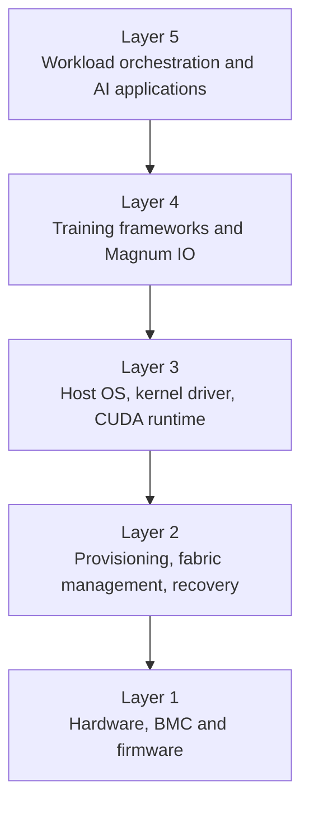

# 9.12 Software stack and management in an AI factory

| | |
|---|---|
| **Status** | Drafted (`ai_factory_software_lab.py`: 26 checks pass; cluster commands **untested** on live SuperPOD) |
| **Level** | Intermediate |
| **Priority tier** | 1b |
| **Lab venue** | none (design / reading) + self-checking Python model (`code/part09/ai_factory_software_lab.py`) |
| **Part** | Part 9: NVIDIA systems and reference architectures |
| **Sources used** | `nvidia-devops` V21 Ch. 6 & Ch. 10; `nvidia-devops-legacy-v10` Ch. 1; *NVIDIA Base Command Manager 11 Administrator Manual* (`bcm11-admin`) §3.16, §6.5, §9, §14.5; *NVIDIA DGX SuperPOD Reference Architecture Featuring NVIDIA DGX GB300 Systems* (`superpod-gb300-ra`, pp. 13–14, 32–34) |

## Why this matters for AI infrastructure

A researcher launches an ordinary single-process Python script on a cluster of thousands of GPUs. The job runs on one CPU core, and the rest of the cluster sits idle. In another case, one node of a multi-node job boots with an older kernel driver, and the whole run stalls. A third team submits a plain Kubernetes job, and every pod is placed except one. The job hangs until a communication timeout kills it thirty minutes later.

None of these is a hardware fault. Each one is a gap in the software stack that sits between the bare metal and the user's code. Five layers make up that stack, and the chapter covers one layer per section.

1. Provisioning, firmware, and fabric management keep every compute tray and switch on the same golden image and firmware set. NVIDIA Mission Control and Base Command Manager lead this layer.
2. Driver and container alignment matches the host kernel driver to the CUDA libraries inside the container. NVIDIA NGC containers are the usual way to get a validated set.
3. The distributed training layer splits model state across worker processes. `torchrun` starts one process per GPU, and a sharding library such as DeepSpeed ZeRO divides the state.
4. Gang-scheduled orchestration starts all the processes of a multi-node job together, or none of them. Slurm and NVIDIA Run:ai do this.
5. Observability and incident response use DCGM, Prometheus, and Grafana. They page an on-call engineer before a thermal slowdown or a straggler breaks a service commitment.

The table in Section 1 lists the products in each layer.

:::info Corpus scope note
The chapter does not use the *NVIDIA Mission Control Administration Manual* or the *NVIDIA AI Enterprise Sizing and Licensing Guide*. Its software stack integration rules, CUDA compatibility boundaries, `torchrun` DDP and DeepSpeed ZeRO Stage 3 configurations, Kubernetes gang-scheduling patterns, and Prometheus and DCGM SLO alerting rules come from the sources below.

```text
Primary sources used in this chapter:
- nvidia-devops Volume 21 Chapter 6 and Chapter 10
- nvidia-devops-legacy-v10 Chapter 1
- superpod-gb300-ra (pages 13-14, 32-34)
- bcm11-admin (Sections 3.16, 6.5, 9, and 14.5)
```
:::

## Prerequisites and outcomes

**Prerequisites:**
- Chapters 8.1, 8.4, 8.8, 8.9, and 8.16 cover Base Command Manager provisioning, Slurm and Kubernetes integration, and Mission Control concepts.
- Chapters 9.6 and 9.8 cover SuperPOD fabrics and the GB300 reference architecture.

**Outcomes:** After completing this chapter, you will be able to complete four core operational tasks.
1. Map the five-layer AI factory software stack from bare-metal BCM golden images, UFM, and NMX-M up through NVIDIA Mission Control, Magnum IO, NVAIE, Slurm, and NVIDIA Run:ai.
2. Verify CUDA minor-version compatibility between host kernel drivers and NGC container toolkits, and configure device ordering and memory allocator environment variables.
3. Calculate per-GPU model-state memory across vanilla DDP and DeepSpeed ZeRO Stages 1, 2, and 3 or FSDP. You will also configure `torchrun` rendezvous and use DLPack for zero-copy GPU tensor sharing between PyTorch and JAX.
4. Contrast a plain Kubernetes Indexed Job and headless Service against true gang schedulers. You will also implement the five SLO-driven Prometheus and DCGM alert rules alongside the three-phase GPU failure incident response playbook.

---

## Concepts: basics → intermediate → advanced

## 1. The AI factory software pyramid: from BCM and fabric managers to Mission Control

A multi-rack training job fails to start, or loses a node halfway through. Operators spend hours guessing which control plane owns the fault. The bare-metal provisioner, the InfiniBand subnet manager, the NVLink switch manager, and the workload scheduler must share what they know. If they do not, a broken node keeps receiving new jobs, and it fails again before its firmware or fabric links are repaired.

The stack avoids this by giving each task one owner. Base Command Manager and `cm-nvfwupd` put the same golden OS image and firmware bundle on every compute tray and NVSwitch tray. UFM Enterprise and NMX-M manage the InfiniBand and NVLink fabrics. NVIDIA Mission Control, together with Slurm or Run:ai, assigns each worker its rank and starts the job through gang scheduling. It also swaps in a spare node, using in-memory checkpointing, if hardware fails mid-run.



| Layer | What lives there |
|---|---|
| 5. Orchestration and applications | Slurm (batch HPC/AI); Kubernetes with NVIDIA Run:ai (backend on the user-space K8s, operands on the admin K8s); NVIDIA AI Enterprise (NeMo, NIM, NGC containers) |
| 4. Frameworks and Magnum IO | PyTorch DDP / FSDP, DeepSpeed ZeRO-3, Megatron-Core, JAX (DLPack); NCCL, GPUDirect RDMA (`nvidia-peermem`), GDS (`nvidia-fs`), NVSHMEM |
| 3. Host OS, driver, CUDA runtime | DGX OS or Ubuntu LTS with the host kernel driver (`nvidia.ko`, 525 or newer / 580 or newer); container CUDA toolkit, cuDNN, cuBLAS (`CUDA_DEVICE_ORDER=PCI_BUS_ID`) |
| 2. Provisioning, fabric, recovery | NVIDIA Mission Control (five-layer operations and autonomous recovery) on top of Base Command Manager (golden images, `cmsh`, node draining) and the fabric managers UFM Enterprise (Quantum IB) and NMX-M (NVLink switch trays, NVOS) |
| 1. Hardware | DGX compute trays (Redfish), NVLink switch trays (NVOS REST), power shelves and BMS |

### 1.1 How Mission Control, BCM, UFM, NMX-M, and Run:ai divide responsibilities

A modern SuperPOD, such as the DGX GB300 SuperPOD in Chapter 9.8, runs six management platforms. Each has its own job.

1. NVIDIA Base Command Manager is the bare-metal foundation built around CMDaemon and `cmsh`. It provisions compute nodes from immutable golden software images under `/cm/images/<image>` and tracks physical rack and chassis slot coordinates. It also flashes compute-tray and switch-tray firmware via `cm-nvfwupd` version 2.1.2 and executes autonomous recovery by draining unhealthy nodes and requeuing interrupted jobs, as covered in Chapters 8.5 and 8.16.
2. NVIDIA Unified Fabric Manager Enterprise is the appliance that manages the scale-out Compute InfiniBand Fabric on Quantum-2 NDR or Quantum-X800 Q3400-RD XDR switches. It configures Subnet Manager partitions, Adaptive Routing, SHARPv3 trees, SHIELD self-healing, and predictive cable or transceiver failure analytics.
3. NVIDIA Network Manager eXperience manages the scale-up Multi-Node NVLink switch trays running NVOS. It provides real-time NVLink telemetry and partition control across the 72-GPU rack domain.
4. NVIDIA Mission Control is the unified five-layer operations umbrella built on top of BCM, UFM, NMX-M, and the facility Building Management System. It delivers automated failure detection, self-recovery, workload migration, unified infrastructure and application diagnostics, and in-memory checkpointing.
5. Slurm and NVIDIA Run:ai provide the two workload scheduling paradigms. Slurm handles batch multi-node training. NVIDIA Run:ai provides cloud-native Kubernetes GPU orchestration across the user-space and administrative Kubernetes clusters described in Chapter 9.8 Section 6.1.
6. NVIDIA AI Enterprise and NGC provide the commercial enterprise support boundary and pre-tested NGC framework containers such as `nvcr.io/nvidia/pytorch:*`. They also include NeMo and Megatron-Core for 3D-parallel training alongside NVIDIA NIM microservices for production inference.

:::tip In one minute
- Base Command Manager owns bare-metal golden-image provisioning, rack and chassis inventory, firmware flashing via `cm-nvfwupd`, and node draining. UFM Enterprise owns the InfiniBand fabric, NMX-M owns the NVLink switch trays, and NVIDIA Mission Control unifies them with BMS telemetry, autonomous recovery, and in-memory checkpointing.
- Workload scheduling runs through Slurm for batch HPC and training or NVIDIA Run:ai for dynamic Kubernetes scheduling split across user-space and administrative clusters.
:::

---

## 2. Host driver vs container CUDA alignment and runtime memory hygiene

A researcher pulls a brand-new NGC container onto a cluster whose host kernel driver is older. The job crashes before the first line of model code runs. Even when the container does start, the default device numbering can pair workers with the wrong network cards. The default memory allocation settings can cause out-of-memory errors while plenty of VRAM is still free.

When a container starts on a GPU node, two separate pieces of NVIDIA software must agree across the container boundary.
1. The host kernel driver `nvidia.ko` is installed in the host OS or BCM golden image. It talks directly to the physical GPU hardware and sets the maximum CUDA version the node can support, which appears in the top-right banner of `nvidia-smi`.
2. The user-space CUDA runtime and libraries include `libcudart.so`, cuBLAS, cuDNN, and NCCL bundled inside the container image. PyTorch and JAX link directly against these container libraries.

### 2.1 CUDA minor-version compatibility rules

Historically, upgrading the CUDA toolkit inside a container required immediately upgrading the kernel driver on every host in the cluster. Modern CUDA releases use minor-version compatibility, which is modeled by `verify_cuda_driver_compatibility()` in `code/part09/ai_factory_software.py`.

| Container CUDA Family | Minimum Host Driver Branch | Minor-Version Compatibility Behavior | Cross-Major Upgrade Rule |
|---|---|---|---|
| CUDA 11.x (`11.x`) | `>= 450` (and `< 525` without cross-major compat) | Any 11.x toolkit runs on host driver branch 450 or newer | Jumping from 11.x to 12.x requires upgrading the host driver to at least branch 525 |
| CUDA 12.x (`12.x`) | `>= 525` | Any 12.x toolkit (such as CUDA 12.6) runs cleanly on host driver branch 535 or 550 | Jumping from 12.x to 13.x requires upgrading the host driver to at least branch 580 |
| CUDA 13.x (`13.x`) | `>= 580` | Any 13.x toolkit runs on host driver branch 580 or newer | Requires host kernel driver branch 580 or explicit forward-compatibility packages |

- Within a single CUDA major family, any CUDA toolkit minor version can run on a host driver at or above that major family's minimum driver branch. Minor restrictions apply only to features introduced in newer driver branches.
- Across CUDA major versions, moving from CUDA 11.x to 12.x or from 12.x to 13.x requires upgrading the host kernel driver to at least the new major family's minimum branch. Alternatively, an administrator can install NVIDIA's explicit CUDA forward-compatibility user-space driver package.
- Under the Fleet Homogeneity Rule, every node participating in a distributed training job must run the exact same NGC container image digest and the exact same host driver branch. Never mix driver branches or NCCL versions across ranks in the same communicator.

### 2.2 Three mandatory CUDA and PyTorch runtime settings for multi-GPU nodes

Before calling any CUDA API in a distributed training script, enforce three runtime rules from Volume 21 Chapter 6 Part 1.2.

1. Enforce consistent device ordering by setting `export CUDA_DEVICE_ORDER=PCI_BUS_ID`. By default, CUDA orders GPUs using the `FASTEST_FIRST` heuristic, which can differ from the physical PCIe bus order shown in `nvidia-smi` and `nvidia-smi topo -m`. Setting PCI bus ordering ensures local ranks 0 through 7 map deterministically to physical GPUs 0 through 7 and their PIX-paired `mlx5_0` through `mlx5_7` NICs.
2. Prevent caching-allocator fragmentation by setting `export PYTORCH_CUDA_ALLOC_CONF=expandable_segments:True` before the first CUDA allocation, or use `max_split_size_mb:256,backend:cudaMallocAsync` for variable-shape MoE workloads. This lets PyTorch's caching allocator expand existing virtual memory segments instead of throwing an out-of-memory error when free HBM is fragmented. Note that `torch.cuda.memory_reserved()` reports total memory held by the caching allocator, whereas `torch.cuda.memory_allocated()` reports memory actively occupied by tensors.
3. Never set `CUDA_LAUNCH_BLOCKING=1` in production. Setting that flag to 1 forces the CPU to block synchronously after every single CUDA kernel launch, which destroys CPU-to-GPU pipelining and prevents CUDA Graph capture. Keep `CUDA_LAUNCH_BLOCKING=0` in production and only use 1 on a development node when pinpointing the exact line of a synchronous kernel crash.

:::tip In one minute
- CUDA minor-version compatibility lets any container within a CUDA major version run on a host driver meeting that family's minimum branch: 450 for CUDA 11.x, 525 for CUDA 12.x, and 580 for CUDA 13.x.
- Always pin an identical NGC container image and host driver branch across every node. Set `CUDA_DEVICE_ORDER=PCI_BUS_ID` and `PYTORCH_CUDA_ALLOC_CONF=expandable_segments:True`, and keep `CUDA_LAUNCH_BLOCKING=0` in production.
:::

---

## 3. Distributed training glue: `torchrun` DDP, DeepSpeed ZeRO memory math, and DLPack

Drivers and containers match, and a naive launch still fails once the model outgrows one GPU. Standard data parallelism copies the whole model state onto every GPU. Training a 70B-parameter model on 80 GB H100 GPUs then crashes with an out-of-memory error straight away.

### 3.1 How `torchrun` initializes RANK, LOCAL_RANK, and WORLD_SIZE

When you launch a 64-GPU training job across 8 nodes with 8 GPUs per node, you do not SSH into 8 servers and start 64 Python processes by hand. You also do not use the deprecated `torch.distributed.launch` utility. Instead, you use `torchrun` with the `c10d` rendezvous backend.

```bash
# Executed on each of the 8 nodes (or launched across all 8 via Slurm srun / K8s PyTorchJob)
torchrun \
  --nproc_per_node=8 \
  --nnodes=8 \
  --rdzv_id=job_42 \
  --rdzv_backend=c10d \
  --rdzv_endpoint=node001:29500 \
  train_script.py
```

The `torchrun` launcher spawns 8 worker processes per node for 64 processes total and injects three environment variables into each worker.
- The `WORLD_SIZE` variable equals 64 and gives the total number of GPU processes across the job.
- The `RANK` variable runs from 0 to 63 and gives the global process index across the entire cluster, where Rank 0 handles logging and coordinator tasks.
- The `LOCAL_RANK` variable runs from 0 to 7 and gives the process index on the local server. The script calls `torch.cuda.set_device(local_rank)` so each worker binds exclusively to its own physical GPU before calling `dist.init_process_group(backend="nccl", timeout=timedelta(minutes=30))`.

### 3.2 Vanilla DDP vs DeepSpeed ZeRO Stage 1, 2, and 3 memory math

Why can't vanilla PyTorch DistributedDataParallel train a 70B-parameter model on 80 GB H100 GPUs? Recall from Chapter 9.6 Section 4.2 that mixed-precision AdamW training stores 16 bytes per parameter of active model state, which totals 1,120 GB for a 70B model.

```text
Mixed-precision AdamW model-state breakdown (16 bytes per parameter):
- BF16 model weights:                  2 B / param  ->   140 GB for 70B model
- BF16 gradients:                      2 B / param  ->   140 GB for 70B model
- FP32 master weights + Adam m and v: 12 B / param  ->   840 GB for 70B model
- Total unsharded active state:       16 B / param  -> 1,120 GB for 70B model
```

Vanilla DDP replicates all 1,120 GB on every single GPU, causing an instant out-of-memory crash on an 80 GB H100. DeepSpeed ZeRO and PyTorch FSDP eliminate that redundancy by sharding the model state across all data-parallel ranks, as modeled by `calculate_zero_stage_memory_per_gpu()` in `code/part09/ai_factory_software.py`. The per-GPU gigabyte figures in the table are the chapter's own calculation. They combine the 16-byte-per-parameter breakdown with the ZeRO-1, ZeRO-2, and ZeRO-3 sharding formulas.

| Sharding Stage | What is Replicated vs Sharded Across `W` GPUs | Per-GPU Model-State Formula (`GB`) | 70B Model across `W = 64` GPUs (`80 GB` H100s) |
|---|---|---|---|
| **DDP (`ZeRO-0`)** | Replicates **Weights (`2B`) + Gradients (`2B`) + Optimizer (`12B`)** on every GPU | `16 × P` | **`1,120.0 GB / GPU`** *(OOM on 80 GB H100.)* |
| **`ZeRO Stage 1`** | Shards **Optimizer states (`12B / W`)**; replicates Weights + Gradients | `4 × P + (12 × P) / W` | `140 + 140 + (840 / 64)` = **`293.12 GB / GPU`** *(OOM on 80 GB)* |
| **`ZeRO Stage 2`** | Shards **Optimizer + Gradients (`14B / W`)**; replicates Weights | `2 × P + (14 × P) / W` | `140 + (980 / 64)` = **`155.31 GB / GPU`** *(OOM on 80 GB)* |
| **`ZeRO Stage 3` / `FSDP`** | Shards **Weights + Gradients + Optimizer (`16B / W`)** across all `W` GPUs | `(16 × P) / W` | `1,120 / 64` = **`17.50 GB / GPU`** *(Fits easily in 80 GB with 62.5 GB left for activations & batches.)* |

DeepSpeed computes the Effective Global Batch Size by multiplying three numbers together.

```text
Global_Batch_Size = train_micro_batch_size_per_gpu × gradient_accumulation_steps × world_size
Example (64 GPUs): 4 (micro-batch) × 8 (grad_accum) × 64 (world_size) = 2,048 sequences per step
```

### 3.3 Zero-copy PyTorch to JAX tensor sharing with DLPack

If a pipeline combines PyTorch data preprocessing with JAX and XLA model execution on the same GPU, never convert GPU tensors via `.cpu().numpy()`. That call forces an expensive Device-to-Host and Host-to-Device PCIe copy round-trip across the CPU bus. Instead, pass GPU memory pointers directly across frameworks with zero copies using DLPack via `torch.utils.dlpack.to_dlpack(t)` and `jax.dlpack.from_dlpack(dlpack_capsule)` or the native `__dlpack__` protocol.

:::tip In one minute
- Launch multi-node jobs with `torchrun --rdzv_backend=c10d` instead of the deprecated `torch.distributed.launch`, so each worker binds to its local rank before initializing NCCL.
- For a 70B model across 64 GPUs, ZeRO Stage 3 or FSDP cuts per-GPU model state from 1,120 GB under DDP down to 17.50 GB per GPU.
- Use DLPack for zero-copy in-VRAM tensor handoffs between PyTorch and JAX.
:::

---

## 4. Kubernetes distributed training orchestration and why gang scheduling is mandatory

Two teams submit multi-node training jobs to a standard Kubernetes cluster at the same moment. The default scheduler places half of each job, and both jobs wait for nodes that never free up. Without all-or-nothing gang scheduling, the allocated GPUs sit idle for thirty minutes, until the rendezvous barrier times out.

### 4.1 Anatomy of an Indexed Job and Headless Service and its fatal flaw without Gang Scheduling

In Kubernetes, as covered in Volume 21 Chapter 6 Part 3.2, three low-level building blocks form a multi-node job.
1. A Headless Service with `clusterIP: None` creates predictable DNS A-records for every pod matching the job selector. Each pod resolves at `<job-name>-<index>.<service-name>`, so Pod 0 resolves at `llama-70b-training-0.llama-train`.
2. An Indexed Job with `completionMode: Indexed`, `parallelism: 8`, and `completions: 8` injects `JOB_COMPLETION_INDEX` from 0 to 7 into each pod. You pass this index to `torchrun --node_rank=$JOB_COMPLETION_INDEX --master_addr=llama-70b-training-0.llama-train`.
3. Pod anti-affinity paired with `nvidia.com/gpu: 8` ensures each pod claims an entire 8-GPU node at 1 pod per node. The pod also receives RDMA and InfiniBand devices injected by the NVIDIA Network Operator.

Why does a plain Kubernetes Indexed Job fail in multi-tenant production? The default Kubernetes `kube-scheduler` places pods one by one rather than as an all-or-nothing group. Suppose two researchers submit 8-node 64-GPU plain Indexed Jobs at the same time to an 8-node cluster.
- Job A gets 4 nodes with 32 GPUs and starts `torchrun` on node ranks 0 through 3.
- Job B gets the other 4 nodes with 32 GPUs and starts `torchrun` on node ranks 0 through 3.
- Both jobs deadlock because neither job can ever place its remaining 4 pods. Both jobs sit burning 100% of the cluster's 64 GPUs while doing zero useful work for 30 minutes until the NCCL or `c10d` rendezvous times out.

To prevent partial-placement deadlocks, production AI factories never submit multi-node jobs as bare Kubernetes Jobs. They enforce Gang Scheduling for all-or-nothing pod admission using Kueue, Volcano, the Kubeflow Training Operator PyTorchJob, or NVIDIA Run:ai. Alternatively, they run batch training on Slurm, which gang-schedules nodes natively.

:::tip In one minute
- On Kubernetes, multi-node `torchrun` jobs use a Headless Service with `clusterIP: None` for pod DNS discovery. They also use `JOB_COMPLETION_INDEX` for `--node_rank` and `nvidia.com/gpu: 8` with NVIDIA Network Operator RDMA access.
- Always pair Kubernetes training workloads with a Gang Scheduler such as Kueue, Volcano, PyTorchJob, or NVIDIA Run:ai. That prevents partial pod placements from deadlocking the cluster until rendezvous timeout.
:::

---

## 5. AI factory observability, SLO-driven alerting, and incident response playbooks

A data scientist messages the team on Slack that training feels slow today. In a thousand-GPU cluster, the service commitment is already broken by then. The utilization dashboard may still show green at 99%, while one degraded network link stalls the whole synchronous job.

### 5.1 What to scrape in Prometheus and why DCGM_FI_DEV_GPU_UTIL is not enough

> **dcgm-exporter 4.9.0 version note.** dcgm-exporter 4.9.0 (2026-11-06) renamed many default metrics and changed some units. For example `DCGM_FI_DEV_GPU_UTIL` (percent) became `DCGM_FI_DEV_GPU_UTIL_RATIO` (0 to 1), and `DCGM_FI_DEV_FB_USED` (MiB) became `DCGM_FI_DEV_FB_USED_BYTES`. The metric names in this chapter are the 4.8.x names. On a 4.9.0 exporter use the [full mapping in 17.4](../part-17-operations/04-dcgm-exporter-and-interpreting-gpu-metrics.md#14-what-dcgm-exporter-490-renamed), and change thresholds together with the unit.

As detailed in Volume 21 Chapter 10, a production AI factory Prometheus server scrapes four exporter tiers at matched intervals.

| Exporter Tier | Endpoint & Scrape Interval | Key Metrics & Operational Purpose |
|---|---|---|
| 1. `nvidia-dcgm` | `dcgm-exporter:9400` every `10s` | `DCGM_FI_PROF_SM_ACTIVE`, `DCGM_FI_PROF_PIPE_TENSOR_ACTIVE`, `DCGM_FI_DEV_GPU_TEMP`, `DCGM_FI_DEV_POWER_USAGE`, `DCGM_FI_DEV_SM_CLOCK`, `DCGM_FI_DEV_XID_ERRORS` |
| 2. `training-app` / `inference-app` | `:8000` every `10s` | Application `training_throughput_tokens_per_sec`, `training_loss`, exposed AllReduce latency, and inference TTFT / ITL percentiles |
| 3. `gpu-nodes` | `node_exporter:9100` every `30s` | Host CPU, DDR5 / LPDDR5X memory, `/dev/shm`, and NVMe `/raid` I/O latency |
| 4. `infiniband` | `ib-exporter:9600` / UFM every `60s` | Port link state, `SymbolErrorCounter`, `PortXmitWait`, and RoCE PFC / ECN counters |

Why is `DCGM_FI_DEV_GPU_UTIL`, which matches `nvidia-smi` GPU-Util, misleading for distributed training? It reports the percentage of time at least one warp was active on any Streaming Multiprocessor. A GPU stalled on a slow PCIe transfer or spinning in a single-warp NCCL polling kernel can report 100% utilization while doing almost no math. Instead, track `DCGM_FI_PROF_SM_ACTIVE` to measure the fraction of SMs actively executing warps. Pair it with `DCGM_FI_PROF_PIPE_TENSOR_ACTIVE` to measure the fraction of cycles the Tensor Core math pipes are active.

### 5.2 The five SLO-driven Prometheus alerting rules

Tie every paging alert directly to an SLO breach or hardware degradation signature and include a runbook annotation, as modeled by `evaluate_ai_factory_slo_alerts()` in `code/part09/ai_factory_software.py`.

| Alert Name | PromQL Condition (`V21 Ch. 10`) | Duration (`for:`) | Operational Meaning & Runbook Action |
|---|---|---|---|
| **1. `TrainingThroughputLow`** | `training_throughput_tokens_per_sec < 0.9 * <baseline>` | `5m` | Throughput dropped **> 10% below baseline**. Check SM activity, exposed `AllReduce` time, straggler clocks, and IB congestion. |
| **2. `GPUTemperatureHigh`** | `DCGM_FI_DEV_GPU_TEMP > 80` *(or model slowdown temp)* | `1m` | GPU approaching thermal slowdown. Check `nvidia-smi -q -d PERFORMANCE` throttle reasons, cold-aisle temp, blanking panels, and CDU flow. |
| **3. `InferenceLatencyP99High`** | `inference_latency_p99_ms > 500` | `3m` | P99 Time to First Token (`TTFT`) breached the **500 ms SLA**. Check regional QPS load, KV-cache pressure, and scale up inference replicas. |
| **4. `GPUFailureDetected`** | `increase(gpu_failure_count[10m]) > 0` *(or `DCGM_FI_DEV_XID_ERRORS`)* | Immediate | Hardware `Xid` fault or fallen-off-the-bus GPU detected. Trigger the **3-Phase GPU Failure Playbook** below. |
| **5. `CostAnomalyDetected`** | `(cluster_power_kw - cluster_power_kw_avg_7d) / cluster_power_kw_avg_7d > 0.3` | `10m` | Cluster power draw is **> 30% above its 7-day average**. Audit for runaway/zombie training jobs or hung spin-wait loops. |

### 5.3 The three-phase GPU failure incident response playbook

When `GPUFailureDetected` pages on-call during a 64-GPU training run, or when Mission Control and BCM execute recovery autonomously, follow three time-bounded phases.

| Phase | Target Window | Actions Taken |
|---|---|---|
| Phase 1: Initial Response | `<= 5 minutes` | Confirm GPU fault via `nvidia-smi`, `dmesg` Xid, or DCGM health watch; identify batch training versus online inference; terminate stalled synchronous training job immediately |
| Phase 2: Mitigation | `<= 15 minutes` | Attempt automated GPU reset, OS reboot, or Redfish power cycle; if `dcgmi diag -r 2` passes, resume from checkpoint; if reset fails, cordon node, allocate spare, and resume |
| Phase 3: Recovery & Post-Incident | `30-60 minutes` | Collect `nvidia-bug-report.sh`, `nvsm dump health`, and BMC logs; dispatch hardware RMA for cordoned node |

1. During Phase 1 in the first 5 minutes, confirm the GPU fault and check whether the node runs batch training or online inference. Online inference traffic fails over automatically to N+1 replicas with zero user impact. For synchronous training, terminate or drain the hung job immediately because 1 dead GPU stalls all 64 GPUs at the collective barrier.
2. During Phase 2 within 15 minutes, attempt an automated node reset via GPU reset, OS reboot, or Redfish power cycle. If the reset succeeds and `dcgmi diag -r 2` passes, resume training from the most recent sharded checkpoint. If the reset fails, cordon and drain the faulty node via `cmsh`, `scontrol update State=DRAIN`, or `kubectl cordon`, allocate a spare node from the pool, and resume training from the last checkpoint.
3. During Phase 3 within 30 to 60 minutes, collect `nvidia-bug-report.sh` or `nvsm dump health` alongside BMC logs and dispatch an OEM or NVIDIA hardware RMA for the cordoned node. Total lost training work is bounded strictly by your checkpoint interval plus the 15-minute mitigation window.

:::tip In one minute
- Track `DCGM_FI_PROF_SM_ACTIVE` and `DCGM_FI_PROF_PIPE_TENSOR_ACTIVE` scraped every 10 seconds from `dcgm-exporter:9400` instead of relying on `nvidia-smi` GPU-Util alone.
- Configure the five SLO alerts for training throughput drop, high GPU temperature, P99 inference latency breach, hardware Xid failure, and 7-day cluster power anomaly.
- Follow the three-phase GPU failure playbook across the 5-minute, 15-minute, and 60-minute windows so synchronous jobs resume quickly on spare nodes while broken hardware awaits RMA.
:::

---

## Commands and configurations that matter

### 1. Verify host driver, container CUDA, PyTorch, NCCL, and NVLink P2P alignment

```bash
# 1. Inspect host kernel driver version and maximum supported CUDA version
nvidia-smi

# 2. Inside the NGC container: verify bundled CUDA, NCCL, and peer-to-peer (P2P) access across all 8 GPUs
python3 -c '
import os, torch
os.environ.setdefault("CUDA_DEVICE_ORDER", "PCI_BUS_ID")
os.environ.setdefault("PYTORCH_CUDA_ALLOC_CONF", "expandable_segments:True")
print("PyTorch:", torch.__version__, "| CUDA:", torch.version.cuda, "| NCCL:", torch.cuda.nccl.version())
n = torch.cuda.device_count()
p2p_ok = all(torch.cuda.can_device_access_peer(i, j) for i in range(n) for j in range(n) if i != j)
print(f"GPUs visible: {n} | Full all-to-all P2P access: {p2p_ok}")
'
```

### 2. Production DeepSpeed ZeRO Stage 3 configuration

```json
{
  "train_micro_batch_size_per_gpu": 4,
  "gradient_accumulation_steps": 8,
  "bf16": { "enabled": true },
  "optimizer": {
    "type": "AdamW",
    "params": { "lr": 1e-4, "betas": [0.9, 0.999], "eps": 1e-8, "weight_decay": 0.01 }
  },
  "zero_optimization": {
    "stage": 3,
    "reduce_scatter": true,
    "contiguous_gradients": true
  },
  "gradient_clipping": 1.0
}
```

### 3. Run the 26-check AI Factory Software Stack and SLO Alerting verifier

```bash
python3 -B code/part09/ai_factory_software_lab.py
```

---

## How it fails

| Failure mode | Symptom | Root cause | Diagnosis & fix |
|---|---|---|---|
| **1. `RuntimeError: NCCL operation timed out` at job startup on Kubernetes** | A multi-node training job starts 6 of its 8 pods, sits at `0%` GPU compute for 30 minutes, and crashes with `NCCL operation timed out` during `dist.init_process_group()`. | Either the job was submitted as a **plain Kubernetes `Indexed` `Job` without a gang scheduler** (so 2 pods stayed `Pending` for lack of resources while 6 pods waited at the `c10d` barrier), or `MASTER_ADDR` DNS (`<job>-0.<headless-svc>`) failed to resolve. | Always schedule multi-node Kubernetes jobs through a **Gang Scheduler (`Kueue`, `Volcano`, `PyTorchJob`, or `NVIDIA Run:ai`)** so 0 pods start until all 8 nodes are reserved, and verify headless Service DNS resolution for `MASTER_ADDR`. |
| **2. Cross-major CUDA container failure (`cudaErrorInsufficientDriver`)** | Launching a new NGC PyTorch container built on **CUDA `12.6`** (or `13.0`) fails immediately with `Error 35: CUDA driver version is insufficient for CUDA runtime version`. | The host OS kernel driver is on a legacy branch (e.g., `470.xx` for CUDA 11.x, or `535.xx` when running a CUDA 13.x container that requires **`≥ 580`**). Minor-version compatibility only works *within* the same CUDA major version (`12.x ≥ 525`, `13.x ≥ 580`). | Upgrade the BCM golden software image's host NVIDIA driver branch (`≥ 525` for CUDA 12.x; `≥ 580` for CUDA 13.x) via `cm-chroot-sw-img` + `createramdisk`, or select the NGC container tag matching your validated host driver branch. |
| **3. Wrong GPU-to-NIC pairing because `CUDA_DEVICE_ORDER` was unset** | `nvidia-smi topo -m` shows `GPU 0` is `PIX` to `mlx5_0`, yet when `LOCAL_RANK 0` runs, NCCL routes traffic across the CPU (`NODE` / `SYS`). | Without `export CUDA_DEVICE_ORDER=PCI_BUS_ID`, the CUDA runtime ordered device ordinals using `FASTEST_FIRST`, which did not match the PCIe bus order used by `nvidia-smi` and the launcher's NIC binding script. | Set **`export CUDA_DEVICE_ORDER=PCI_BUS_ID`** globally in the container environment before initializing PyTorch or CUDA. |
| **4. 10× slower throughput after setting `CUDA_LAUNCH_BLOCKING=1`** | A developer sets `CUDA_LAUNCH_BLOCKING=1` in a production training script thinking it helps CUDA Graphs or determinism, and step time slows down by 5× to 10×. | `CUDA_LAUNCH_BLOCKING=1` disables asynchronous kernel launches, forcing the CPU to wait for each GPU kernel to finish before launching the next one and breaking CUDA Graph capture. | Keep **`CUDA_LAUNCH_BLOCKING=0`** in production; enable CUDA Graphs via `torch.cuda.CUDAGraph()` or `torch.compile(mode="reduce-overhead")`. |
| **5. False-green `99% GPU-Util` while training throughput drops by 50%** | Grafana shows `DCGM_FI_DEV_GPU_UTIL` at `99%`, so no utilization alert fires, even though `tokens/sec` dropped from `60,000` to `28,000` due to a network straggler. | `DCGM_FI_DEV_GPU_UTIL` (`nvidia-smi` GPU-Util) only measures whether *any* warp is resident on the GPU (including a single NCCL polling kernel spinning while waiting on a slow link). | Alert directly on **application `training_throughput_tokens_per_sec < 0.9 * baseline`** (`TrainingThroughputLow`) and track **`DCGM_FI_PROF_SM_ACTIVE`** and **`DCGM_FI_PROF_PIPE_TENSOR_ACTIVE`**. |

---

## Hands-on lab

This chapter's self-checking Python model in `code/part09/ai_factory_software.py` and lab script in `code/part09/ai_factory_software_lab.py` implement four verification checks.
1. The CUDA Toolkit and Host Driver Compatibility Verifier checks minimum host driver branches across CUDA 11.x, 12.x, and 13.x plus fleet-wide container and driver homogeneity.
2. The DDP and DeepSpeed ZeRO Stage 1, 2, and 3 Memory and Global Batch Calculator models a 70B model across 64 GPUs.
3. The Distributed Training Runtime and Gang-Scheduling Auditor checks `CUDA_DEVICE_ORDER=PCI_BUS_ID`, `CUDA_LAUNCH_BLOCKING=0`, `torchrun` versus deprecated `torch.distributed.launch`, DLPack versus `.numpy()` host copies, and gang-scheduled Kubernetes jobs.
4. The Five-Rule AI Factory SLO Alerting Engine evaluates `TrainingThroughputLow`, `GPUTemperatureHigh`, `InferenceLatencyP99High`, `GPUFailureDetected`, and `CostAnomalyDetected`.

Run the lab from the repository root.

```bash
python3 -B code/part09/ai_factory_software_lab.py
```

Expected output verified in this repository is shown below.

```text
=== Chapter 9.12 Lab: Software Stack & Management in an AI Factory ===
  [PASS] CUDA 12.x container on host driver 550 (>=525) is compatible via minor-version compatibility
  [PASS] CUDA 13.x container on host driver 580 (>=580) is compatible
  [PASS] CUDA 12.x container on legacy 470 driver (<525) is rejected (host_driver_too_old)
  [PASS] V21 Ch6: Flags mismatched container image or driver branch across cluster nodes
  [PASS] Rejects unsupported CUDA major version
  [PASS] 70B unsharded DDP (Stage 0) requires 1,120.0 GB per GPU; global batch (4*8*64) == 2,048
  [PASS] 70B ZeRO-1 across 64 GPUs (shards 840 GB optimizer) requires 140 + 140 + 13.125 == 293.12 GB/GPU
  [PASS] 70B ZeRO-2 across 64 GPUs (shards optimizer + grads) requires 140 + (980/64) == 155.31 GB/GPU
  [PASS] 70B ZeRO-3 across 64 GPUs (shards weights + grads + optimizer) requires 1120 / 64 == 17.50 GB/GPU
  ...
  [PASS] V21 Ch10: GPU failure / Xid increase > 0 in 10m fires GPUFailureDetected
  [PASS] V21 Ch10: Cluster power > 30% above 7-day average fires CostAnomalyDetected
  [PASS] Simultaneous degradation across all 5 SLO metrics fires all 5 alerts
  [PASS] CUDA 11.x container on host driver 470 (>=450) is compatible
  [PASS] K8s Indexed Job paired with Kueue/Volcano gang scheduler passes runtime audit

Summary: 26 passed, 0 failed (total 26)
```

---

## Exercises

1. Run the lab script. Then recompute the per-GPU model-state memory of a 13B model across 16 GPUs, using 16 bytes per parameter. Do it for ZeRO Stages 0, 1, 2, and 3. Which stages fit on an 80 GB GPU?
2. A node has driver 535, and a teammate wants to run an NGC container built on CUDA 13.0. Which check would you run, and what do you expect? What are the two ways to fix it?
3. Write the `torchrun` command for 4 nodes with 8 GPUs each. For the process that controls GPU 3 on node 2, what are the world size, the global rank, and the local rank?
4. Two 4-node jobs are submitted to a 4-node cluster as plain Kubernetes Jobs. Draw what happens. Then draw it again with a gang scheduler.
5. A cluster has a baseline throughput of 50,000 tokens per second. Write the five alert rules from Section 5.2 with thresholds for this cluster. Add one runbook line to each rule.
6. A GPU falls off the bus in the middle of a 64-GPU job. What do you do in the first 5 minutes? What do you do by minute 15, and by minute 60?

## Checkpoint questions (20)

<details>
<summary>**1. How do BCM, UFM Enterprise, NMX-M, and NVIDIA Mission Control divide management responsibilities inside a DGX SuperPOD?**</summary>

- Base Command Manager provisions bare-metal compute nodes from golden OS images, manages rack and chassis coordinates, flashes firmware via `cm-nvfwupd`, and executes node draining.
- UFM Enterprise manages the scale-out Quantum InfiniBand compute fabric including SHARPv3, Adaptive Routing, SHIELD, and cable or switch telemetry.
- NMX-M manages the scale-up NVLink switch trays running NVOS.
- NVIDIA Mission Control is the five-layer operations platform sitting across BCM, UFM, NMX-M, and the facility BMS. It orchestrates autonomous failure recovery, workload migration, unified diagnostics, in-memory checkpointing, and Slurm or Run:ai scheduling.
</details>

<details>
<summary>**2. State the minimum host NVIDIA driver branch required for CUDA 11.x, CUDA 12.x, and CUDA 13.x containers, and explain what CUDA minor-version compatibility allows.**</summary>

- CUDA 11.x requires host driver branch 450 or newer.
- CUDA 12.x requires host driver branch 525 or newer.
- CUDA 13.x requires host driver branch 580 or newer.
Within a single CUDA major version, minor-version compatibility allows newer CUDA toolkit minor versions inside an NGC container to run on an older host driver from the same major family. For example, CUDA 12.6 runs on driver 535, whereas crossing major versions requires upgrading the host driver.
</details>

<details>
<summary>**3. Calculate the per-GPU model-state VRAM required for a 70B parameter model across 64 GPUs under vanilla DDP, ZeRO-1, ZeRO-2, and ZeRO-3.**</summary>

```text
70B parameter model at 16 bytes/param = 1,120 GB total active AdamW state:
- BF16 weights:   2 B/param = 140 GB
- BF16 gradients: 2 B/param = 140 GB
- FP32 master weights + Adam states: 12 B/param = 840 GB
- DDP (ZeRO-0): 140 + 140 + 840 = 1,120.0 GB / GPU
- ZeRO-1 (shards optimizer across 64 GPUs): 140 + 140 + (840 / 64) = 293.12 GB / GPU
- ZeRO-2 (shards optimizer + gradients): 140 + (980 / 64) = 155.31 GB / GPU
- ZeRO-3 / FSDP (shards weights + gradients + optimizer): 1,120 / 64 = 17.50 GB / GPU
```

Only ZeRO Stage 3 or FSDP fits the 70B model state inside an 80 GB GPU across 64 data-parallel ranks.
</details>

<details>
<summary>**4. Why must you set CUDA_DEVICE_ORDER and PYTORCH_CUDA_ALLOC_CONF in multi-GPU training scripts, and why must CUDA_LAUNCH_BLOCKING stay at 0?**</summary>

- Setting `CUDA_DEVICE_ORDER=PCI_BUS_ID` ensures CUDA device ordinals match the physical PCIe bus order seen by `nvidia-smi topo -m` and NIC-binding scripts instead of `FASTEST_FIRST`.
- Setting `PYTORCH_CUDA_ALLOC_CONF=expandable_segments:True` allows the PyTorch caching allocator to expand virtual memory segments on demand, preventing fragmentation-induced OOM errors.
- Keeping `CUDA_LAUNCH_BLOCKING=0` avoids synchronous CPU blocking on every kernel launch, which would destroy throughput and break CUDA Graph capture.
</details>

<details>
<summary>**5. How do you transfer a GPU tensor from PyTorch to JAX without copying data through host CPU RAM?**</summary>

Use the zero-copy DLPack protocol via `torch.utils.dlpack.to_dlpack` and `jax.dlpack.from_dlpack` or the native `__dlpack__` protocol. That exchanges the underlying GPU HBM pointer directly in VRAM, whereas `.numpy()` forces a Device-to-Host copy.
</details>

<details>
<summary>**6. Why does a plain Kubernetes Indexed Job deadlock when two multi-node training jobs contend for a cluster, and what four tools solve this?**</summary>

A plain Kubernetes Job schedules pods one by one without gang scheduling for all-or-nothing placement. If Job A claims half the nodes and Job B claims the other half, both jobs start partial ranks. Those ranks hang waiting at the `torchrun` and NCCL rendezvous barrier until timeout. Production clusters use a gang-scheduling layer such as Kueue, Volcano, the Kubeflow Training Operator PyTorchJob, or NVIDIA Run:ai.
</details>

<details>
<summary>**7. Why is DCGM_FI_DEV_GPU_UTIL misleading for detecting training stragglers, and which two DCGM profiling metrics should you track instead?**</summary>

The `DCGM_FI_DEV_GPU_UTIL` metric only measures the percentage of time at least one warp is active on any SM. A GPU spinning in a single-warp NCCL wait loop reports 100% utilization while doing zero math. Track `DCGM_FI_PROF_SM_ACTIVE` for the fraction of SMs with active warps and `DCGM_FI_PROF_PIPE_TENSOR_ACTIVE` for Tensor Core activity alongside application tokens per second.
</details>

<details>
<summary>**8. Walk through the three time-bounded phases of the GPU Failure Incident Response Playbook.**</summary>

1. In Phase 1 within 5 minutes, confirm the GPU fault via Xid logs or `nvidia-smi` and check if training or inference is affected. Terminate the stalled synchronous training job so the remaining healthy GPUs do not sit blocked.
2. In Phase 2 within 15 minutes, attempt a node or GPU reset and resume from the last checkpoint if healthy. If the fault persists, cordon and drain the faulty node, allocate a spare node, and resume training from the last checkpoint.
3. In Phase 3 within 30 to 60 minutes, collect diagnostic bundles and initiate a hardware RMA for the cordoned node.
</details>

<details>
<summary>**9. What are the five layers of the software stack in this chapter?**</summary>

The five layers are provisioning, firmware, and fabric management; host driver and CUDA runtime alignment; distributed frameworks and memory sharding; gang-scheduled orchestration; and observability with incident response.
</details>

<details>
<summary>**10. Why do you configure NCCL_IB_SL and NCCL_IB_TC inside multi-node training containers?**</summary>

The `NCCL_IB_SL` InfiniBand Service Level and `NCCL_IB_TC` Traffic Class or DSCP settings place NCCL collective traffic into the fabric's dedicated lossless QoS queue. In the production manifest, using service level 0 and traffic class 106 isolates latency-sensitive AllReduce traffic from storage or management traffic.
</details>

<details>
<summary>**11. What does the host driver set, and what lives in the container?**</summary>

The host kernel driver talks to the GPU and sets the highest CUDA version the node supports. The container holds the CUDA runtime, cuBLAS, cuDNN, and NCCL libraries that PyTorch uses.
</details>

<details>
<summary>**12. What is the Fleet Homogeneity Rule?**</summary>

Every node in a job must run the same container image digest and the same host driver branch. Mixed drivers or NCCL versions in one communicator cause failures.
</details>

<details>
<summary>**13. Why must multi-GPU Kubernetes Pods mount an in-memory /dev/shm emptyDir instead of keeping default shared memory?**</summary>

Kubernetes defaults `/dev/shm` to 64 MB, which immediately causes NCCL shared-memory transport and PyTorch multi-worker DataLoader queues to fail with a bus error. Mounting an in-memory `emptyDir` with `medium: Memory` and a 64Gi limit gives intra-node IPC and data-loader workers sufficient shared RAM.
</details>

<details>
<summary>**14. Name the five SLO-driven Prometheus and DCGM alert rules defined in Section 5.2 and state why each threshold is actionable.**</summary>

1. The `TrainingThroughputLow` rule fires when throughput drops more than 10% below baseline for 5 minutes, catching stragglers early.
2. The `GPUTemperatureHigh` rule fires when `DCGM_FI_DEV_GPU_TEMP` exceeds 80°C for 1 minute, catching cooling issues before thermal clock throttling spreads.
3. The `InferenceLatencyP99High` rule fires when P99 TTFT exceeds 500 ms for 3 minutes, protecting interactive latency SLAs.
4. The `GPUFailureDetected` rule fires immediately when `gpu_failure_count` or Xid errors increase over 10 minutes, triggering the three-phase failure playbook.
5. The `CostAnomalyDetected` rule fires when cluster power exceeds its 7-day average by more than 30% for 10 minutes, catching zombie or runaway jobs.
</details>

<details>
<summary>**15. What do RANK, LOCAL_RANK, and WORLD_SIZE mean?**</summary>

The `WORLD_SIZE` variable is the total number of processes across the job. The `RANK` variable is the global process number. The `LOCAL_RANK` variable is the process number on the local server, which is used to select the local GPU.
</details>

<details>
<summary>**16. Why is a global batch size multiplied by three numbers?**</summary>

Global batch size equals micro-batch per GPU multiplied by gradient-accumulation steps multiplied by world size. With values of 4, 8, and 64, the global batch size is 2,048 sequences per step.
</details>

<details>
<summary>**17. What does ZeRO Stage 2 shard compared with Stage 1?**</summary>

Stage 1 shards the optimizer states across data-parallel ranks. Stage 2 also shards the gradients. Stage 3 also shards the model weights.
</details>

<details>
<summary>**18. Why does the production Kubernetes training manifest request hostIPC and unlimited locked memory?**</summary>

Setting `hostIPC: true` allows NCCL and GPUDirect shared-memory segments to operate cleanly across processes on the node. Setting `ulimit -l unlimited` via the `IPC_LOCK` capability allows the InfiniBand and RDMA Verbs driver `mlx5` and the CUDA runtime to pin large memory regions for zero-copy DMA transfers.
</details>

<details>
<summary>**19. What does the Headless Service plus Indexed Job give you on Kubernetes?**</summary>

It gives predictable DNS names for each pod so rank 0 can be found, plus a `JOB_COMPLETION_INDEX` variable for the node rank. It does not give all-or-nothing placement, which requires a gang scheduler.
</details>

<details>
<summary>**20. When a GPU suffers an uncorrectable hardware fault during a 64-GPU training job, why is your very first action within 5 minutes to terminate the stalled job rather than immediately starting hardware diagnostics on the broken GPU?**</summary>

The other 63 healthy GPUs are blocked at their NCCL collective barrier burning cluster capacity while doing zero useful work. Terminating the stalled job frees or prepares the healthy nodes immediately so the job can restart from the last checkpoint on a spare node within 15 minutes while the faulty node is cordoned for offline diagnostics and RMA.
</details>

---

## Sources and review notes

### Sources read in full for this chapter

| Source | Coverage used in this chapter |
|---|---|
| `nvidia-devops` Volume 21 Chapter 6 (`chapter-06-software-stack-integration.md`, 1,945 words) & Chapter 10 (`chapter-10-monitoring-and-operations.md`, 1,191 words) | CUDA and driver compatibility layers, `CUDA_DEVICE_ORDER=PCI_BUS_ID`, `PYTORCH_CUDA_ALLOC_CONF=expandable_segments:True`, `can_device_access_peer`, `memory_allocated` vs `memory_reserved`, `CUDA_LAUNCH_BLOCKING=0`, `torchrun` DDP (`RANK`, `LOCAL_RANK`, `WORLD_SIZE`, `c10d`), DeepSpeed ZeRO Stage 3 (`ds_config.json`, global batch formula), DLPack zero-copy PyTorch to JAX interop, Kubernetes Headless Service + Indexed Job + `podAntiAffinity` vs gang scheduling (Kueue, Volcano, PyTorchJob), DCGM profiling metrics (`DCGM_FI_PROF_SM_ACTIVE`, `DCGM_FI_PROF_PIPE_TENSOR_ACTIVE`), Prometheus scrape intervals (`10s` DCGM/app, `30s` node, `60s` IB), the 5 SLO alerting rules, and the 3-phase GPU failure incident response playbook |
| *NVIDIA DGX SuperPOD Reference Architecture Featuring NVIDIA DGX GB300 Systems* (`superpod-gb300-ra`, pp. 13–14, 32–34) & *NVIDIA Base Command Manager 11 Administrator Manual* (`bcm11-admin`, §3.16, §6.5, §9, §14.5) | Table 2 SuperPOD software stack (Mission Control, NVAIE, Magnum IO, NGC, Slurm, Run:ai), 5-layer Mission Control decomposition, Run:ai split K8s architecture, and BCM golden-image, autonomous `draining`, and `cm-nvfwupd` management |
| `nvidia-devops-legacy-v10` Chapter 1 (line 914) | CUDA minor-version compatibility driver branch ranges (`CUDA 11.x >= 450`, `CUDA 12.x >= 525`, `CUDA 13.x >= 580`) |

### Not in the corpus
- Standalone NVIDIA Mission Control Administration Manual and NVIDIA AI Enterprise Sizing and Licensing Guide PDFs are not in `~/Desktop/books-toon-rag/`.

### Run here
- Running `python3 -B code/part09/ai_factory_software_lab.py` passes all 26 checks with 0 failures.

### My own choices and inferences, labelled in the text
1. Combining the 16-byte-per-parameter mixed-precision AdamW breakdown from Volume 21 Chapter 4 with the ZeRO sharding description in Volume 21 Chapter 6 Part 2.2 to write explicit per-GPU model-state memory formulas in `calculate_zero_stage_memory_per_gpu` is this chapter's own inference.

### Not verified on live hardware
- The `torchrun`, `deepspeed` (`ZeRO-1/2/3`, `16P/W` bytes per parameter, `OutOfMemoryError`), `kubectl`, NCCL (`mlx5_0..7`, `SL=0`, `TC=106`, `MTU 9216`, `MN-NVL`, `48` / `128` / `1000` GPU scale), BCM (`autonomous_Default` health checks), and Prometheus scrape/alert configurations (`GPUThermalSlowdown` at `83` / `85` / `90`°C, `GoodputDrop` at `94` / `95` / `99.9`%, `NVLinkCRCErrors`, `StragglerImbalance` at `1.35`x, `UncorrectableECC`) were not executed against a live 64-GPU cluster in this authoring environment.

